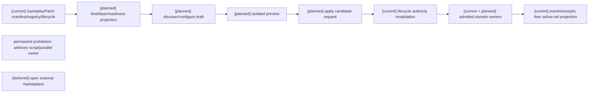
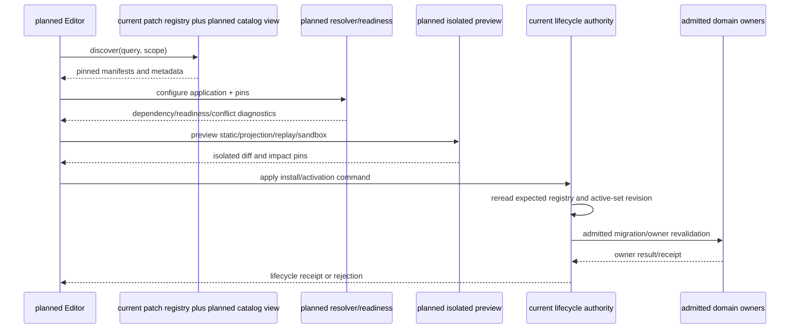
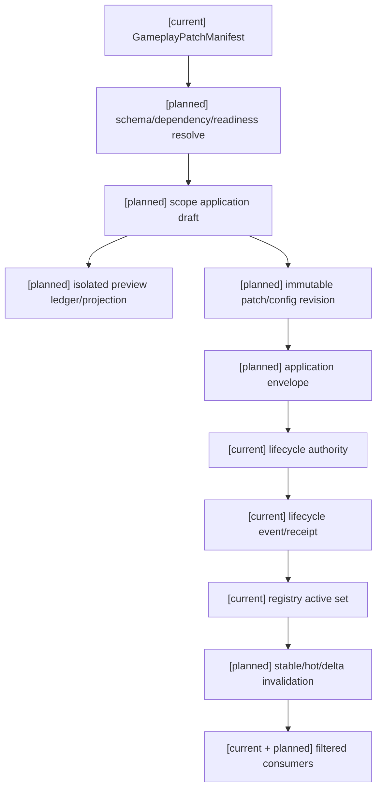

# 玩法包分层、组合、发现与应用规格

执行范围补记（2026-10-10）：按 [D15](../审查/03-实施待决收敛与验证闸门.md)，本规格对应的共用计划05暂不启动，当前1–6讨论不单独启动其中玩法包任务。正文保留设计和依赖供后续恢复，不作为当前角色/通用领域/B/C完成条件，不影响既有注册合同的合法消费。

状态：`analysis/planned/non-authorizing`。在角色与通用领域合同之后实施；package 不拥有领域事实。

## 1. 源文档到规格/验收/计划

| 分析源及章节 | 本文 | 验收 | 计划 |
|---|---|---|---|
| [玩法包01](../玩法包与编辑器应用治理/01-玩法包现有实现审计与差距矩阵.md) “已实现基础”“代码与证据索引”“先前玩法包设计与当前实现的对应关系”“完整玩法与模块的判断”“差距矩阵” | §2 | P01–P04 | 05/Task1 |
| [玩法包02](../玩法包与编辑器应用治理/02-玩法包分层、组合与通用底座复用设计.md) “分层”“创作者包类型与架构层次的映射”“底座复用原则”“组合规则”“包承载对象”“调整和补充的接入级别” | §3–5 | P05–P10 | 05/Task1–2 |
| [玩法包03](../玩法包与编辑器应用治理/03-编辑器中的玩法包发现、调用与应用设计.md) “四种编辑器操作”“编辑器侧对象”“编辑器中的类型和完整度显示”“应用请求合同”“包应用流程” | §5 | P05–P13 | 05/Task2 |
| [玩法包04](../玩法包与编辑器应用治理/04-玩法包调整、补充、覆盖与冲突治理设计.md) “调整、补充和禁止覆盖”“冲突类型”“安全边界”“覆盖解析”“标签和元标签” | §4 | P08–P10 | 05/Task2 |
| [玩法包05](../玩法包与编辑器应用治理/05-玩法包与各领域接入矩阵.md) “接入合同”“角色技能与学习”“资源、状态、外物和装备”“空间和物理协作” | §4 | P09–P11 | 05/Task2 |
| [玩法包06](../玩法包与编辑器应用治理/06-玩法包发布、激活、迁移与缓存同步设计.md) “生命周期”“迁移原则”“生命周期状态必须分开”“激活、在途工作与卸载”“预览与正式环境隔离”“缓存层级” | §5 | P11–P14 | 05/Task4–5 |
| [玩法包07](../玩法包与编辑器应用治理/07-玩法包示例：常规世界、修仙魔法、自走棋.md) 全文、[08](../玩法包与编辑器应用治理/08-玩法包目标架构、差距与后续路线.md) “差距矩阵”“玩法包类型的验收标准”“静态设计与运行验收分开” | §3–5、§9 | P06–P07、P14 | 05/Task1–2、4–5 |
| [编辑器04](../编辑器与能力权限治理/04-十月分析领域接入与编辑器同步矩阵.md) §2.1、§4 | §4–5 | P11–P13 | 05/Task2、5 |

## 2. 当前基座与状态

| 状态 | 现有文件 | 实际能力/限制 |
|---|---|---|
| `[current]` | `backend/app/gameplay/patch_runtime.py` (`GameplayPatchManifest`, `GameplayPatchRegistry`, `PatchSetRevision`) | manifest/revision/digest/dependency/schema/platform extension/candidate composition；没有统一 authoring catalog 或 `primary_kind` 完整 editor API |
| `[current]` | `patch_lifecycle_authority.py` (`PatchCandidateInstallCommand`, `PatchActiveSetCommand`, `GameplayPatchLifecycleAuthorityService`) | install/active set/enable/disable/upgrade/rollback、幂等、事件、receipt、部分 state-group migration |
| `[current]` | `production_package_registry.py` | 只载入固定批准 manifest；不是开放包市场或 suite launcher |
| `[current]` | `patch_rule_settlement.py` | 仅 `resource.consume` effect，不是 generic package domain execution |
| `[planned]` | 本文 §3–6 | catalog/editor discover/configure/preview/apply、kind/completeness/readiness projection、通用 migration/invalidation |
| 永久禁止 | 任意脚本/第二 authority、clock、scheduler、event store、tag registry | 不是 deferred feature |

## 3. 逻辑层、creator kind、completeness、readiness 四者分开

### 3.1 七个逻辑层

原文 package/02 七层是 `Foundation`（schema/event/permission/effect/selector/time/revision contracts）、`Domain`（语义/owner contract）、`World rules`（能力白名单/政策）、`Game mode`、`Scenario`、`Content`、`Verification`。它们是逻辑层，可签名组合但必须追踪依赖和 owner；不要求七个物理 package。Foundation/Domain 是能力提供/准入面；World/Mode/Scenario/Content 是消费配置面；不是写权限继承链。

### 3.2 creator `primary_kind` 精确枚举

只用分析原值：`setting / world_rules / mechanic / game_mode / scenario / content / verification / suite`。其中 `setting` 映射 Semantic/Presentation references；`world_rules` 映射 World rules+Domain policies；`mechanic` 映射 Domain+Content+Adapter bindings；`game_mode` 映射 Game mode+Domain+Time/Space adapters；`scenario` 映射 Scenario+Content+local policies；`content` 映射 Content definitions；`verification` 映射 fixture/profile；`suite` 是多层依赖组合/入口/verification。不得把 foundation 当 creator kind，也不得漏 world_rules 或把 scenario/content 合并。

### 3.3 完整度与 readiness

`completeness` 精确枚举：`content_module / composable_mechanic / playable_mode / complete_suite`。它不等于 kind：例如自走棋装备是 `mechanic` 模块，完整自走棋才可能是 `suite`。`readiness` 精确展示 `missing_dependencies / unsupported_capabilities / ready / active`，由依赖闭包、底座能力、entrypoint 和 verification profile 在 target scope 下计算；作者声明仅候选元数据。complete_suite 不是角色全能或内容自动 materialize。

### 3.4 当前与目标分类

当前 `GameplayPatchManifest`/`PlatformExtension` 没统一 creator kind、completeness、readiness catalog。这些字段只能经 admitted manifest schema version 或受控 projection 登记，并保留 package identity↔patch revision、digest、dependencies/conflicts、owner/schema refs。禁止旁建 runtime registry。

## 4. 组合、覆盖与 package/application 边界

依赖图：Foundation→Domain→World rules→Game mode→Scenario→Content→Verification；实际 World/Mode 可并行组合，但要明示 compatibility，resolve 后固定 revision pins，不能由安装顺序决定优先级。下层不能开未注册能力；同一事实不能有多个 owner。

调整只改 schema 允许 policy 字段；补充只加已接纳 extension family 内 definition/binding；覆盖默认拒绝，尤其 owner/event/time/permission/tag/fact semantics。owner 不存在时先独立 admission/设计底座 adapter，包导入不安装逻辑。去重 key 包含 source/relation/causal event/target incarnation/operation；因果 loop 按包04上限拒绝/结算。

`PackageRevisionView` 是 patch manifest 的分析投影：identity/patch_revision/digest/dependency/definition/declaration/binding/policy/adapter/verification/replay/migration refs。`PackageApplication` 是 scope 使用配置：application id/scope/revision pins/kind/completeness/modules/scopes/entrypoints/dependency closure/config/profile/grant/resolved digest/activation policy。一个 package 多 scope application 的计数/cooldown/config 隔离。两者不是已存在独立 runtime model。

Editor 操作严格是 `discover → configure → preview → apply`。`apply` 请求 candidate install/activation；不直接写伤害、资源、状态、装备。`create_instance` 与 `apply` 分开，只对 admission 允许且在目标 scope 下 readiness 满足的 playable_mode/complete_suite 请求；不是 editor 自动创建 actor/instance。

应用 envelope 映射源的 `PackageApplicationRequest`：`command_id, application_id, target_scope_ref, requested_revision_pins, configuration_revision, activation_boundary_ref, migration_policy_ref, expected_registry_revision, expected_active_set_revision, authority_grant_ref, idempotency_key, payload_digest`。这些不声称等于当前 `PatchActiveSetCommand` 字段；owner route 从准入 descriptor 推导，不接纳作者任意 stream/owner coordinate。

## 5. Lifecycle、preview 与 cache

区分 content state (`draft/validated/published`)、registry (`installed/admitted`) 与 application (`pending/scheduled/active/disabled/superseded`)。validation pins 改变旧报告失效。编辑器可复用现有 candidate/active lifecycle，但通用 draft/preview/impact report 与迁移仍 planned。

Preview static/projection/replay 不提交正式 events；sandbox 使用隔离的临时 ledger，若内部模拟提交则只标 preview，不触正式 append spine。包 application 改配置生成 application config revision；definition 改动生成派生 package revision。授权报告保存 revision/seed/evidence pins。

activation 固定 scope/旧新 revision/migration digest/idempotency/expected registry revision，发生在已支持 boundary 并由 owner 重验。in-flight work grandfather/expire/migrate/block-disable；owner event 先于 registry cutover。事件失败不切换；事件成功但缓存落后按事件修复。disable 停止未来调用，不删事件/不清零资源/不默认撤销已结算学习事实。rollback 发布新的合法应用 revision，不能抹历史。

Stable 放定义/active profile/grant/binding；Hot 放当前实例/current values；Delta 带 base/next revisions 与因果 receipt。grant/profile/binding revoke 使候选集、pending request、角色 cache 失效；Delta 缺失/乱序补拉 snapshot，不能猜测。

## 6. 架构图

## 7. 时序图

## 8. 数据流图

## 9. 验收

| ID | 案例 | 期望 |
|---|---|---|
| P01 | manifest digest/schema/dependency/cycle 错误 | resolver 诊断并拒绝，不切 active set |
| P02 | 仅 resource.consume production base | current capability 范围如实显示，不称 generic settlement |
| P03 | 未批准 author/hidden owner/script-shaped field | trusted/admission schema 拒绝，不调用 arbitrary code |
| P04 | catalog 候选与固定 production registry | 不混淆 editor catalog 和已安装生产包 |
| P05 | exact primary_kind enum 与非法别名/foundation kind | 保留原枚举，非法项 schema 拒绝 |
| P06 | content_module 冒充 complete_suite/缺 verification | closure 不 ready；列出缺失 modules/owner/profile |
| P07 | 同一 package 两 scope 应用 | configuration/counters/cooldowns 分区 |
| P08 | 调整/补充/覆盖未准入字段 | schema 可编辑字段成功；owner/fact override fail-closed |
| P09 | 缺 owner adapter | 先拒绝/单独 admission，不由 package 导入创建逻辑 |
| P10 | causal cycle/同 binding 多入口 | 有界并去重；loop reject/diagnose |
| P11 | configure 与 apply 分离；create_instance vs apply | draft 不写事实；只有 admitted entrance 创建实例请求 |
| P12 | preview sandbox 临时 event | 只在 isolated ledger，正式 append 为零 |
| P13 | stale registry、timeout after commit、retry | 原 receipt 查询；不重复事件；cutover 顺序正确 |
| P14 | disable/rollback/active package migration | 历史不删；事件先于 cutover；缓存失效/补 snapshot |

关联玩法包01–08、编辑器04、角色16、规格09–12；计划05 Task1–5。无目标 scope 的 owner admission/verification profile 时，不足以直接执行新 creator API 实施。
