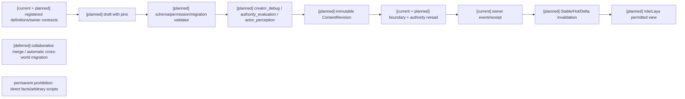
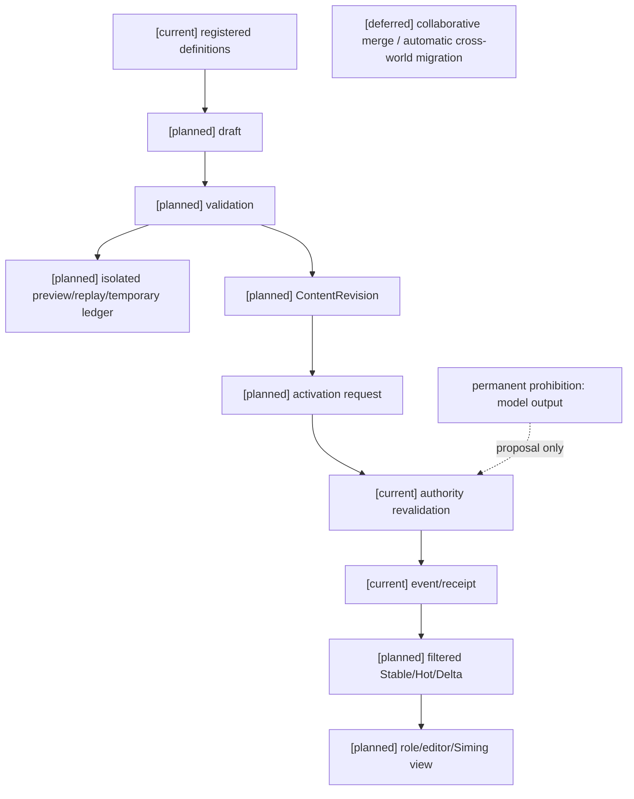

# 编辑器能力、权限、发布与同步规格

状态：`analysis/planned/non-authorizing`。编辑器管理定义与准入合同，不保存领域 current truth；模型/Laya/司命都不能通过编辑器绕过 owner。

执行状态（2026-10-10）：`paused-by-user`。按 [D15](../审查/03-实施待决收敛与验证闸门.md)，用户要求通用编辑器控制面暂不处理，本规格及共用计划05暂不启动。正文与三图保留为恢复后的设计要求，当前不开展该专项调查、实现或验收；不作为待决项1–6的前置或完成条件。角色/领域已有权限校验和authority边界继续适用，暂停不授予绕过权限的能力。

## 1. 来源追踪

| 分析源及章节 | 本文 | 验收 | 计划 |
|---|---|---|---|
| [编辑器01](../编辑器与能力权限治理/01-编辑器能力开关与世界规则配置设计.md) §1–6 | §3 | C01–C05 | 05/Task3 |
| [编辑器02](../编辑器与能力权限治理/02-编辑器权限授予、角色与司命变更设计.md) §1–8 | §4 | G01–G06 | 05/Task3 |
| [编辑器03](../编辑器与能力权限治理/03-编辑器版本发布、预览与运行时同步设计.md) §1–6 | §5–6 | V01–V09 | 05/Task4–5 |
| [编辑器04](../编辑器与能力权限治理/04-十月分析领域接入与编辑器同步矩阵.md) §1–7 | §2、§6 | V02–V09 | 05/Task3、5 |
| [编辑器05](../编辑器与能力权限治理/05-装备系统编辑器接入设计.md) §1–6、§10 | §5、§7 | E01–E05 | 05/Task4–5 |
| [战斗08](../战斗系统与角色技能，状态和资源/08-对象标签、编辑与版本治理设计.md) §6–8、§13 | §4–6 | G05、V03 | 05/Task3、5 |
| [角色16](../角色/16-通用玩法时序模型与编辑器设计.md) §4、§7.3 | §5 | V05 | 04/Task1、05/Task4 |

## 2. current/planned/deferred 与 owner

| 状态 | 实际基础 | 本规格边界 |
|---|---|---|
| `[current]` | `backend/app/gameplay/patch_runtime.py` manifest/registry、`patch_lifecycle_authority.py` candidate/active lifecycle、event/revision、角色 L1/actor cache 基础 | 复用 authority admission、revision、event/receipt；不宣称完整 editor control plane |
| `[current]` | `backend/app/population_continuity/capability_input.py`、`activation_policy.py`、`branch_preview.py`（若被应用） | 仅按各自代码和测试覆盖声明，不将 population materialization 当通用 editor |
| `[planned]` | CapabilityDefinition/Profile/RulePolicy、AuthorityGrant/MutationContract、Draft/Preview/ContentRevision/Activation/rollback/sync | 新控制面需先 owner admission；不得让 editor 保存 domain facts |
| `[deferred]` | 编辑器03 §1、§6 所列多人协作合并与跨世界观自动迁移 | 本批不设计其冲突解决、迁移算法或新 owner |
| 永久禁止 | editor/model/Siming direct fact writes、arbitrary script rule、第二 registry/clock/event store/tag registry | 不写成 deferred feature |

编辑器目录唯一拥有能力定义/profile、权限 grant、mutation contract、draft、preview、publish、activation、rollback、invalidation；战斗/角色/时间/生命/标签目录仍拥有各自定义与事实。

## 3. 能力 profile：五个状态分开

`CapabilityDefinition` 描述 id/namespace/category/dependencies/conflicts/default/supported scopes/parameter schema/migration ref/revision；`CapabilityProfile` 描述 owner scope、enabled/disabled、policy overrides、inheritance/revision；`RulePolicy` 描述已注册规则。

同一能力至少区分 `supported`（内容是否注册）、`enabled`（scope 是否打开）、`eligible`（对象是否有资格）、`active`（实例是否已生效）、`visible`（观察者是否可见）。下层 profile 不能启用上层未注册能力、扩大数值/目标/频率/authority；解析产物带继承链、来源 revisions 与 composition digest。关闭 mana 不清零当前资源；关闭 control 不删除所有已结算状态。

能力切换边界 exact enum：`immediate / next_action / next_stable / scheduled`。关闭迁移 exact enum：`reject_new / finish_existing / freeze / convert / detach / defer`。缺迁移策略或 owner 拒绝。

## 4. Grant/Mutation 合同

`AuthorityGrant` 必须包含 grant/principal/kind/registered operation/mode/domain owner/target+spatial+temporal scopes/magnitude+resource limits/frequency+cooldown/required capabilities+evidence/visibility/revocation/revision。mode exact enum：`none / observe / suggest / request / catalyze / invoke / direct`；`direct` 只调用已注册限定命令，不是字段写入。

MutationContract 固定 owner、校验来源/revision、目标、时间窗口、幂等和 receipt。Grant 不授予 learned ability、skill mastery、complexity capacity、body feasibility 或 resource capacity。角色提出 typed intent/learning proposal；司命最多 catalyst/suggest/request 或已注册受限 direct；owner 重新校验并提交。

## 5. Draft、preview、publish、activation 与装备接入

Draft 必须 pin parent revision、schema refs、package refs、capability profile、grant digest、tag/time revisions、owner contract、migration、visibility、preview/replay pins。发布检查 schema/units/ranges、dependency/conflict、owner、capability upper bounds、permission scopes、migration、replay compatibility、cache impact。

Preview 分四类：static（schema/owner/依赖，无状态）；projection（选定 scope 的配置投影）；replay（固定历史 pins，不能新定义改历史）；sandbox（隔离 branch/temporary ledger，可以有标记临时事件，但不能进入正式 append spine）。`creator_debug_view`、`authority_evaluation_view`、`actor_perception_view` 三种视图独立 revision/composition digest，禁止把 creator debug 流给 actor。

发布生成不可变 `ContentRevision`；激活仅在 boundary，owner reread 当前 source 并产 event/receipt。rollback 是新的反向 revision，不删历史。装备编辑器只编辑 definition/slot/trigger/recipe/variant/offer policy 等注册 schema；quantity/durability/uses/charges/cooldown 与 use timing 独立，装备不直接创建 skill mastery/instance truth。

## 6. 同步与撤权

Stable 仅携带 world/content/capability/grant/semantic/effect/visibility/policy revisions；Hot 携带当前 active capability/permission、resource/status/cooldown/space/affordance/migration；Delta 携带 enable/disable、grant changes、policy/affordance/migration、from/to revision 和 authority refs。缺失/乱序 Delta 请求完整 snapshot。

撤权必须使新的 affordance、pending intent、active binding、相关 actor private cache 和 creator preview projection 失效；角色不可读取被撤销秘密值。编辑器 preview 的“可用”不等于 runtime settlement；每次 owner command 重新读取 current source。

## 7. 架构图



## 8. 时序图

```mermaid
sequenceDiagram
  participant C as planned Creator/editor
  participant V as planned validator
  participant P as planned preview views
  participant R as planned publisher
  participant A as current lifecycle/domain authority
  participant H as planned cache projector
  Note over C,H: [current] patch lifecycle/revision spine; [planned] generic editor control plane; [deferred] collaborative merge and automatic cross-world migration
  C->>V: edit profile/grant/policy/draft pins
  V-->>C: diagnostics or valid candidate
  C->>P: static/projection/replay/sandbox
  P-->>C: isolated report by view
  C->>R: publish exact pins
  R->>A: activate at boundary
  A->>A: reread owner sources/grant/revision/migration
  alt accepted
    A->>H: event/receipt and invalidation
    H-->>C: activation result
  else rejected
    A-->>C: zero-write rejection for this owner operation
  end
```

## 9. 数据流图



## 10. 验收

| ID | 案例 | 必须结果 |
|---|---|---|
| C01 | supported/enabled/eligible/active/visible 不同 | UI/runtime 各字段独立，不能 enabled 一键代替 |
| C02 | 下层 profile 打开未注册/扩大上层范围 | fail-closed，诊断依赖与来源 |
| C03 | close capability with in-flight state | 使用 exact migration policy；不清零/删状态 |
| C04 | profile inheritance and source digest | 继承链、来源 revisions、composition digest 可重建 |
| C05 | unknown schema/script field | schema 拒绝；不执行 arbitrary code |
| G01 | grant mode/direct 字段路径 | 只接 registered operation；owner receipt |
| G02 | target/space/time/magnitude/frequency/visibility over limit | request 拒绝，不能被模型预算突破 |
| G03 | grant revoke pending intent/active binding/cache | 全部失效并清 private data |
| G04 | role learning/skill complexity/body infeasible | grant 不授学习/复杂度/身体可行性 |
| G05 | creator tag/meta edit vs world role/Siming change | 前者 draft/revision；后者 typed proposal/catalyst |
| G06 | Soul/Rule direct attempt | SoulAccessGate/owner 拒绝，无事实写入 |
| V01 | static/projection/replay/sandbox preview | 正式 append zero；sandbox 仅 isolated temporary ledger |
| V02 | creator_debug vs authority vs actor view | 各自过滤/revision/digest，互不泄露 |
| V03 | publish/activate stale revision or missing migration | 拒绝/延迟，不静默替换 |
| V04 | rollback | 新反向 revision，历史事件/pins 保留 |
| V05 | grant/profile/semantic revoke cache | Stable invalidation、Hot/Delta 更新，旧 grant 不可用 |
| V06 | lost/out-of-order Delta | full snapshot；不由模型猜测 |
| V07 | role/Siming/model tries direct fact write | permanent prohibition，owner 无 event |
| V08 | sandbox preview result used as actor truth | visibility boundary 阻断 |
| V09 | equipment draft changes quantity/durability/use timing | schema 分轴；实例事实仍 equipment owner |
| E01 | equipment slot/trigger/recipe/variant/offer | editor 只编辑注册定义/policy，需 domain admission |
| E02 | equipment grant vs learned skill | 卸装撤 grant，学习事实保留 |
| E03 | equipment preview 定位到 slot/trigger/recipe/target/effect/resource/status/grant/owner/revision/cache impact | diagnostic 由 source revisions 和对应 owner contract 支撑；无 owner 的字段显示缺口，不运行任意规则 |
| E04 | creator draft/publish 与世界内 role/Siming change | creator 只改定义草稿；世界内路径是 typed intent/catalyst，经 grant/capability 和 equipment owner settle |
| E05 | 通用装备定义与普通世界 profile 的发布、撤权、可见性变化 | 定义/visibility/grant 变化按对应 Stable/Hot/Delta 与 cache owner 失效；不包含棋盘、羁绊、单局回合或奖励政策 |
| E06 | 自走棋装备 policy、棋盘/阵容/回合/羁绊/offer/reward 的编辑器适配 | `[deferred]`；未来单局运行时另立 owner、spec、plan 和验证批次，不进入本批编辑器完成条件 |

关联编辑器01–05、玩法包03–06、战斗08、角色16；本批计划05 Task3–5只消费 E01–E05。E06 由未来单局适配计划单独消费。population branch materialization 若被采用，必须先满足对应 owner admission，不能作为本通用 editor current。
