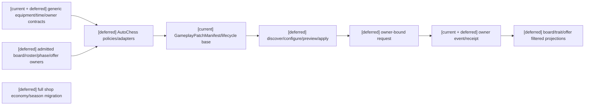
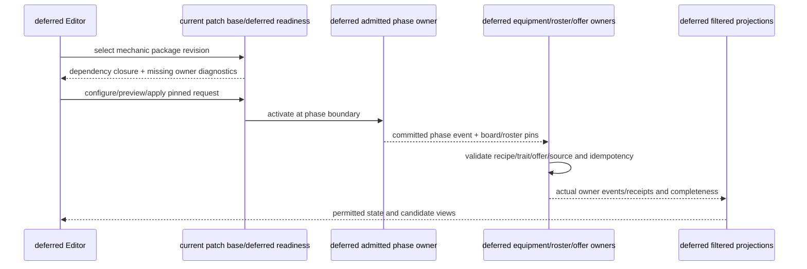
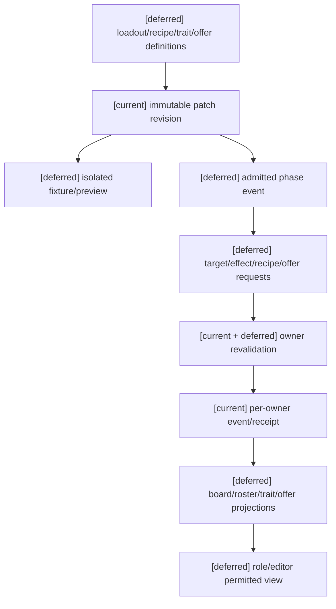

# 自走棋装备玩法包未来单局适配规格（延期归档）

状态：`analysis/planned/non-authorizing`；本批状态：`closed/deferred`。本文件保留为未来单局运行时的来源归档，不属于当前开放世界批次的 active spec、前置门禁或完成条件。它是 mechanic 模块，不代表完整自走棋 suite。

## 0. 当前批次关闭边界

十月当前批次只服务开放世界运行时。自走棋装备、棋盘、阵容、单局回合、羁绊、offer/reward 和相关编辑器适配依赖另一套尚未建立的单局运行时，因此本文所有 adapter、owner admission、Harness 和实现任务均暂停。保留下面的来源映射和边界约束，只用于未来重新立项时避免污染通用合同；本批不实现、不探测、不伪造这些 owner。

## 1. 来源与未来重启条件

| 分析源与章节 | 本文 | 验收 | 计划 |
|---|---|---|---|
| [战斗11](../战斗系统与角色技能，状态和资源/11-通用装备系统设计.md) “通用核心与玩法包边界”“核心对象”“触发器与标签”“效果、目标和结算”“合成、变体与随机接口” | §2–3 通用装备引用 | AC01、AC09 | 未来计划06/Task1–2 |
| [战斗12](../战斗系统与角色技能，状态和资源/12-自走棋装备玩法包设计.md) “玩法包边界”“棋盘装备栏与分配政策”“组件与成装” | §3 loadout/recipe | AC02–AC03 | 未来计划06/Task2–3 |
| [战斗12](../战斗系统与角色技能，状态和资源/12-自走棋装备玩法包设计.md) “转职装备与羁绊”“回合、阶段和装备触发器” | §3 traits/phases | AC04–AC06 | 未来计划06/Task3 |
| [战斗12](../战斗系统与角色技能，状态和资源/12-自走棋装备玩法包设计.md) “随机候选、掉落与奖励”“当前、计划与暂缓” | §3 offer、§7 | AC07–AC09 | 未来计划06/Task4–5 |
| [玩法包07](../玩法包与编辑器应用治理/07-玩法包示例：常规世界、修仙魔法、自走棋.md) “自走棋玩法包”“三例对照”、[玩法包03](../玩法包与编辑器应用治理/03-编辑器中的玩法包发现、调用与应用设计.md) “编辑器中的类型和完整度显示” | §2 | AC01 | 未来计划06/Task1–2 |
| [编辑器05](../编辑器与能力权限治理/05-装备系统编辑器接入设计.md) §1–6 | §2–3 | AC08–AC09 | 未来计划06/Task2；本批编辑器只覆盖通用装备 E01–E05 |

前置角色规格01–08及16的适用现有动作库/actor边界、通用09–12、包13和编辑器14必须有新鲜可审查 evidence，才能实施；静态设计不等于前置 runtime 已验收。AD 专项不被本适配消费时不构成它的门禁；未来灵魂 owner 按总规格的先准入后回验顺序处理。不得以自走棋反向更改心智/装备/时间/资源通用主线。

## 2. 当前与目标

`[current]` 只有已有 resource/status/effect/tag/equipment/event/revision 与局部 time/action window 基础；`patch_runtime.py`、`patch_lifecycle_authority.py` 提供固定 package/lifecycle。没有自走棋 loadout/trait/round/reward owner runtime 的证据。

`[planned]` 仅表示未来单局运行时重新立项后可继续评审的 package policies/adapters；本批不执行。`[deferred]` 全部自走棋 adapter、board/roster/trait/phase/offer/reward owner admission、完整商店经济、赛季自动平衡、多人共享掉落市场和跨赛季装备迁移。任意随机脚本/第二装备 runtime 永久禁止。

## 3. adapter 精确对象和字段

| 原文对象 | 字段/责任 |
|---|---|
| `AutoChessLoadoutPolicy` | max_items_per_unit、allowed categories、unique group、equip/transfer phases、combat transfer allowed、death drop、persistence；“三件”仅内容配置 |
| `BinaryCombinationRecipe` | input_a/input_b、completed_item、consume_inputs、decomposable、duplicate policy、recipe revision；固定 input instances/phase/失败政策 |
| `TraitGrant` | trait id、holder、source equipment、assignment revision；语义授予，不直接团队 effect |
| `RosterTraitProjection` | roster/trait、counted members/count、roster revision；bench/dead/summon membership 显式 |
| `TraitBreakpointRule` | trait、threshold、effect bundle、activation/deactivation policy；卸装、阈值变化按 phase 时点失效 |
| `AutoChessOfferPolicy` | pool/revision、seed ref、candidate count、eligibility/duplicate rules、selection phase、unselected policy；随机选择由 authority event 固化 |

棋盘同排/邻格/格数由空间 adapter 映射 `TargetSelector`，不把“格”写进核心。组合不自动继承所有标签，recipe 明定继承。equip/unequip/transfer/replace 仍是 EquipmentAssignment owner event。

phase 事件含 round_ref/stage_ref/board_revision/roster_revision/causal_chain_id，只由 admitted phase owner 生成；equipment 仅消费已提交事件。Trait stats/activation、实际团队 status/resource effect 和 board/roster/phase 各有 owner。Reward/offer 随机结果持久到 event，seed 私有、算法/政策 revision 固定；模型不能猜候选。

## 4. 架构图

## 5. 时序图

## 6. 数据流图

## 7. 验收

| ID | 案例 | 期望 |
|---|---|---|
| AC01 | 前置证据 stale/static-only；mechanic 冒充 suite | 阻断实施/不 ready，显示依赖缺口 |
| AC02 | duplicate component、invalid slot、unique group、stale board | owner 拒绝，失败操作不写其事件 |
| AC03 | recipe 成功/失败/标签继承 | 固定 inputs/revision，消费幂等，继承按 recipe |
| AC04 | trait below/at/above threshold；卸装 | count/deactivation 按 policy phase，不重复计数 |
| AC05 | bench/dead/summon roster member | membership 明确，计数/生命周期正确 |
| AC06 | late/重复 phase event、round expire | pins/revisions/causal-chain 去重，旧 proposal 拒绝/重建 |
| AC07 | candidate selection under same pool/seed；private/expired scope | event 固定可回放；seed/别 roster 秘密不泄露 |
| AC08 | owner A 提交、B 冲突/timeout | A 保留，receipt query + recovery/compensation；不是全局原子 |
| AC09 | package rollback/full vs checkpoint-tail/non-auto-chess world | 历史保留，回放一致；通用核心不出现三件/棋盘/trait 特例 |

本文件及计划06只保留未来单局运行时重新立项时的来源草案；当前没有可执行任务。无 board/roster/phase/offer owner admission 时，未来适配仍必须保持 deferred/diagnostic，不能声称已实施完整游戏模式，也不能成为开放世界批次的阻断。
