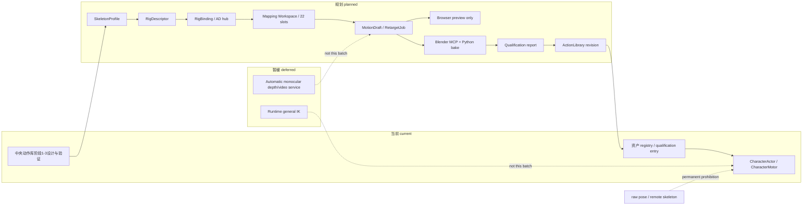
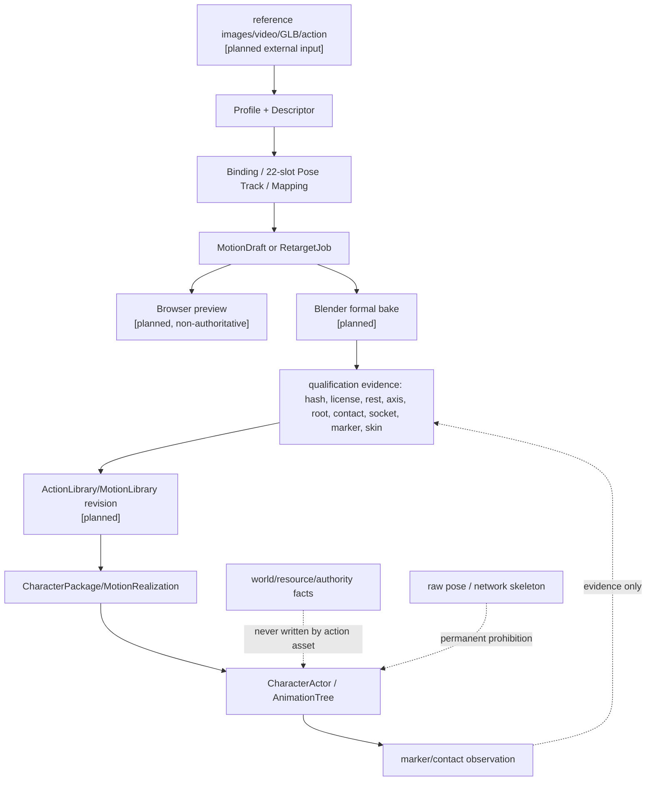

# 角色动作工作流与统一动作库接入规格

状态：`analysis/planned/non-authorizing`

执行状态（2026-10-10）：`paused-by-user`。按 [D15](../审查/03-实施待决收敛与验证闸门.md)，用户要求AD工作流暂不处理，本规格和计划07暂不启动。正文与三图保留为恢复后的设计要求，当前不调查或执行AD映射、Blender烘焙、GLB复载与专项资格化链。待决项1–6仍可消费已有合格动作底座并取得所需Godot证据；未资格化的新动作不得借暂停进入运行时。

来源：本规格只收敛 [角色动作工作流/01-AD骨架动作参考与重定向工作流设计](../角色动作工作流/01-AD骨架动作参考与重定向工作流设计.md)；并引用现有中央动作库阶段 1–3 设计和计划作为实现基线。它不把 AD、Blender 或媒体资产写成当前仓库能力。

## 1. 范围、owner 与状态

本规格覆盖原设计的大阶段一（Profile、动作库、映射工作区、预览和正式烘焙边界）以及大阶段二（四视角参考、已有动作非破坏修正、新 Action 创建）。它只负责离线资产资格、骨架映射、动作库登记和表现接入，不拥有 CharacterAgent cognition、Gameplay authority、资源、伤害、库存或世界事实。

- `[current]`：仓库现有 `CharacterActor`、角色资产 registry、部分动作 realization、浏览器播放/验证入口，以及中央动作库阶段 1–3 的设计与验证入口。
- `[planned]`：AD `SkeletonProfile`/`RigDescriptor`/`RigBinding`、多个中介骨架、22 槽位适配、Mapping Workspace、四视角 Pose Track、`RetargetJob`、浏览器预览、Blender MCP/Python 正式烘焙、资格报告和 `ActionLibrary` 登记；大阶段二的 MotionDraft、非破坏修正和新 Action 追加。
- `[deferred]`：自动视频生成服务、自动单目 depth、运行时通用 IK、实时未经验证的重定向。
- **始终禁止**：模型或网络直接驱动 raw pose/原始骨骼，未经资格化的 GLB/Blend/MP4/纹理进入 runtime registry，动作资产替换既有 actor，动作层写入世界事实。

资产注册、SkeletonProfile、动作库登记和 backend character identity binding 是四个独立步骤；新增角色默认追加独立 actor，不能因资产注册或 active-control 选择而隐式替换既有场景 actor。

## 2. 数据契约与原文约束

### 2.1 三类骨架对象

`SkeletonProfile` 是稳定、版本化的标准骨架，包含 canonical bones、父子关系、左右侧、rest pose、轴向、root motion、挂点和资格状态。`RigDescriptor` 只描述实际 GLB/FBX/Blend 中检测出的 armature、层级、rest pose、root、hash 和结构摘要。`RigBinding` 记录实际 rig 到 Profile 或 AD 中介骨架的映射、修正、未映射骨和资格证据。三者不能互相冒充；unknown 不得自动归入 humanoid。

AD 中介骨架可以有多个，必须覆盖动作需要的根骨、髋部、多段脊柱、颈头、四肢、手指、脚趾、接触点和道具挂点。22 个视觉槽位只是输入标准，不是完整动作骨骼：

```text
hips, spine, chest, upperChest, neck, head,
leftShoulder, leftUpperArm, leftLowerArm, leftHand,
rightShoulder, rightUpperArm, rightLowerArm, rightHand,
leftUpperLeg, leftLowerLeg, leftFoot, leftToes,
rightUpperLeg, rightLowerLeg, rightFoot, rightToes
```

每槽记录像素坐标、置信度、可见/遮挡、源点、派生公式、帧号和视角；左右侧使用人物解剖学左右，不能按画面左右重推。

### 2.2 固定参考和 Mapping Workspace

四视角固定为 `front=0°`、`right=90°`、`back=180°`、`left=270°`，使用同分辨率、帧率、身高占比、地面线和时间轴；不得用相机移动或裁剪模拟转身。统一 Mapping Workspace 支持：`detector-to-slots`、`rig-to-hub`、`hub-to-rig`、`rig-to-rig`、`rig-to-mesh`、`bone-to-socket`。界面显示源/AD/目标三栏、同步高亮、mesh tint、四视角同帧和蓝/金/绿/橙/红状态。只有 rigId、版本、签名完全一致时才可跳过可视映射，但仍静默验证。

### 2.3 动作库和两阶段边界

`ActionLibrary` 按语义动作 ID解析 `shared_library`、`retargeted_library`、`package_native` 或显式 `fallback` realization；同名不代表兼容。

大阶段一：注册 Profile/Descriptor/Binding 和动作库，建立映射工作区、已有动作选择式迁移、浏览器 preview-only、`RetargetJob`、Codex→Blender MCP/Python 烘焙、GLB 复载和资格化登记。

大阶段二：在阶段一合同上接入四视角关键帧。已有 Action 保持只读，修正层经预览确认后由 Blender 烘焙为新 Action 副本；新动作从 Pose Track/MotionDraft 创建，原动作保留，同名追加来源或草稿后缀，禁止静默覆盖。

## 3. 架构图



## 4. 主流程时序图

```mermaid
sequenceDiagram
  participant AD as AD / creator
  participant P as Profile + Mapping Workspace
  participant Pr as Browser preview
  participant C as Codex orchestration
  participant Bl as Blender Python
  participant Q as Qualification
  participant R as ActionLibrary registry
  participant A as CharacterActor
  Note over AD,A: [current] actor/registry/verification；[planned] AD+Blender pipeline；[deferred] runtime IK/depth
  AD->>P: register Profile/Descriptor/Binding and 22-slot or rig mapping
  P-->>AD: source/AD/target mapping, confidence and diagnostics
  AD->>Pr: inspect MotionDraft (preview only)
  Pr-->>AD: visible differences; no formal registry revision
  AD->>C: RetargetJob(sourceGlb,targetGlb,selectedActions,sourceRigId,targetRigId,mappingProfileId,previewStatus)
  C->>Bl: validate signatures, rest pose, IK/ground/root and bake Action/GLB
  Bl-->>Q: candidate GLB + source/target hashes + report inputs
  alt approved
    Q->>R: register semantic action realization
    R-->>A: resolved clip/marker/root contribution
    A->>A: AnimationTree presentation; Motor owns movement
  else rejected/quarantined
    Q-->>AD: diagnostic; no activation
  end
```

## 5. 数据流图



## 6. 验收、实现映射与待决项

1. Profile、Descriptor、Binding、ActionLibrary、MotionDraft 和 RetargetJob 都有 source/target refs、版本/hash 和 qualification status；unknown 不自动 humanoid。
2. 浏览器预览、Blender 正式烘焙、GLB 复载和正式登记各自有状态，preview 或未经资格化输出不能被 runtime registry 发现。
3. Blender MCP 负责编排和元数据回传，Blender Python 负责数值烘焙、IK、接地、root、Action、skin 和 GLB；WebApp/AD 负责交互映射、时间轴、预览、MP4/八方向导出。AD WebApp 工程已定位为 `D:\Users\User\Documents\XSXB-animation-director`，但完整 RetargetJob、Blender bake、GLB 复载和 qualification 仍必须用独立证据确认，不能以路径或静态文件存在代替运行验收。
4. 动作库只提供表现和 marker evidence；CharacterMotor 仍是位移、碰撞和 root contribution owner，authority 仍是资源/世界事实 owner。
5. 原始媒体、GLB、Blend、MP4、纹理和模型输出在外部/忽略目录，不写入 Git。
6. 当前中央动作库是否已具备可运行资产，必须以新鲜 manifest、Godot 探针和 Harness 证据判定；本规格不把中央设计文档称为已完成运行时。

现有代码/验证映射：`scripts/character/CharacterEmbodimentAssetRegistry.gd`、`scripts/character/CharacterActor.gd`、`scripts/character/MotionRetargeter.gd`、`scripts/qualification/MotionLibraryBuilder.gd`、`scripts/qualification/MotionRetargetBuildRunner.gd`、`scripts/character/RoleAnimationController.gd`、`scripts/verification/street_shared_motion_library_probe.gd`、`scripts/verification/motion_retarget_runtime_probe.gd`；测试包括 `scripts/verification/tests/test_motion_library_contract.py`、`test_motion_profile_contract.py`、`test_motion_retarget_runtime_probe.py`、`test_shared_motion_library_probe.py`、Godot registry/retargeter probes 和 `backend/tests/test_character_asset_qualification_contract.py`。

对应计划：[07-角色动作工作流接入实施计划](../计划/07-角色动作工作流接入实施计划.md)。原文章节映射：动作工作流01 §2–5→§2.1–2.2；§6–8→§2.3；§9–11→§6；§13–14→§1、§6。中央设计和计划仅作为实现基线，不能替代本批次的来源证据。

## 7. 本批规格与计划回写（第二阶段资产审计 RW-23，2026-10-12）

manifest 是现有 `semantic_action_id → package clip/marker` 的静态映射；它不创建目标、owner 或动作执行权。角色和 backend identity 稳定，资产包、骨架、motion library、clip 与 marker 通过独立 revision 的 package binding 替换。活跃动作必须固定原 revision；binding revision 只在动作终态/取消/失败或现有安全边界生效。Qualification 必须重新核对 skeleton、retarget、动作、marker、root policy、required slots、接触证据和 runtime admission；skeleton 改变不得只换 GLB。失败保持旧 binding。

`short_punch` 继续只是后端兼容语义；正式资产动作以 manifest 实际登记的 `action:melee.unarmed_punch`、`action:melee.sword_slash` 及现有 locomotion/presentation actions 为准。不存在明确迁移合同与资产证据时，不将 `short_punch` alias 到 unarmed punch。每个 A 阶段动作仍需完整 target contract、owner route/receipt 与真实 marker/physics-contact evidence，资格报告和静态 scene reference 不足以执行。

第二阶段的场景与 package 逐项静态矩阵见 [审查09](../审查/09-资产复用与动作可替换准入矩阵.md)。用户已暂停的 AD/Blender/GLB 新资格化与编辑器工作继续 deferred；本回写不启动阶段一或阶段二工具链，也不修改运行时代码。
