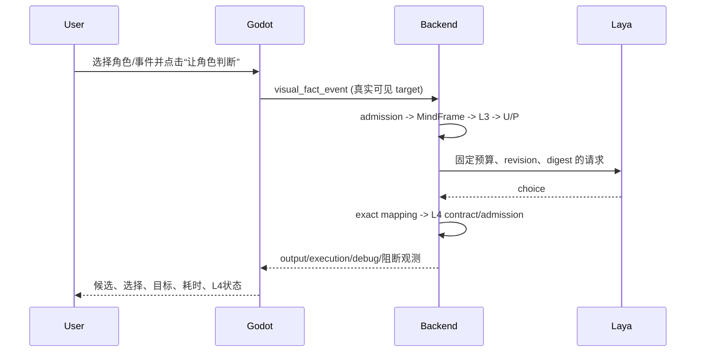
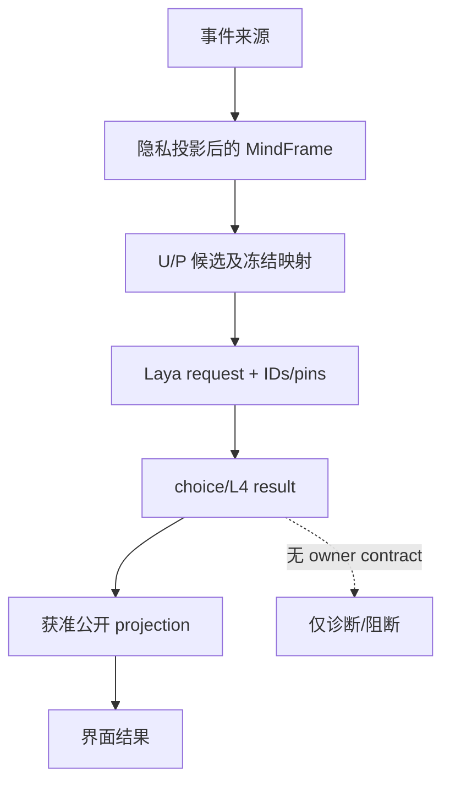

# Laya 角色运行演示规格

状态：`analysis/planned/non-authorizing`。本批只收敛一个可观看的 Godot 观测场景，复用既有角色认知、L3/L4、gateway/Laya 与消息投影；不创建新的角色脑、候选编译器、调度器或领域 owner。

## 范围与映射

- `[current]` `BackendBridge`/`LocalPresentationBus` 已转发 `character_agent_output`、`character_agent_execution`、`character_agent_debug_*`；后端 `visual_fact_event`/`raw_fact_event` 会进入既有 cognition admission/coordinator/driver、L3 candidate compiler、gateway/Laya adapter 和 L4 投影。
- `[current]` `StreetCombatActorDemo` 的 `CharacterActor`、package binding、Motor 和 motion library 作为资产底座参考；本场景不挂战斗 coordinator，不发送近战语义。
- `[planned]` `LayaCharacterRuntimeDemo` 以场景配置事件触发真实 fact ingress，并以公开观测消息填充 UI；结果保留 turn/request/candidate/contract/revision/digest 关联。
- `[deferred]` 观察/询问领域执行合同、完整 owner receipt、物理接触与近战动作；没有领域 receipt 时仅显示诊断或阻断。

## 运行链路

```mermaid
flowchart LR
  G[Godot 场景配置/可见事件] --> F[visual_fact_event]
  F --> A[cognition admission/coordinator]
  A --> L3[L3 prepared request + MindFrame]
  L3 --> P[CandidateCompiler U/P]
  P --> W[gateway / fixed Laya provider]
  W --> C[choice exact mapping]
  C --> L4[L4 accept/freeze/resume]
  L4 --> O[公开观测 projection]
  O --> UI[Godot UI]
```

## 验收

必须证明真实 backend 回合、真实 Laya 请求/choice 映射、L4 返回、Godot 边界消息、事件变化后第二回合、角色切换对照、无合法目标/权限阻断，以及 provider 不可用/取消不会复用旧成功。截图或短录屏、trace 与复现步骤留在仓库外证据目录。不得把 fixture 回放标为 live，也不得显示 private truth 或“已执行”而无领域 receipt。

## 2026-10-15 用户收口：仅验证 Laya choice 输出类型

按用户明确要求，本轮到此收口，不再验证 Godot。验证范围仅记录为 Laya 的 `choice` 输出类型；不扩展到 `score`、`noul` 或其他输出类型。合同/回归测试与历史 provider 证据按原轮次保留，不作为本轮真实运行证据。

Godot editor/runtime、按钮交互、截图/录屏、第二事件回合及完整 `raw_fact_event → backend → Laya → L4 → Godot` live 链路均未验证，本轮不再安排。暂停本轮这些验证要求不等于它们已通过，也不表示领域 owner 执行或角色选择质量已验收。L4/owner receipt 与 A-Cognition 的既有未验收状态保留。本条覆盖前文要求本轮继续取得 Godot 运行证据的安排；实现范围和原始验收设计保留供后续另行推进。

## 2026-10-15 backend 收口与局部阶段三续行

本轮用户授权顺序：真实 backend choice 回合 → 计划02/03角色剩余基础 → 阶段三局部准入。阶段三专指规格09–12／计划04通用领域接入，与计划03和A/B/C不同。先复用当前实现与新鲜证据，仅核对实际依赖；不重做整批静态审计。

真实回合须由事实解析、privacy/visibility投影、cognition admission及原coordinator/driver进入MindFrame、CandidateCompiler U/P与冻结映射、gateway、固定官方离线multilingual CPU Laya、choice、accept/freeze/resume和实际L4。显式启用共享完整预算门，保留同turn/request的实际usage与阶段receipt；模型接纳、L4合同接纳、owner提交分列。第二不同事件及取消/迟到、provider不可用复用现有负例路径。此条恢复backend-only验证，不恢复Godot安排。

计划04 Task1–2按局部API/owner依赖实施，阶段准备、开始实施、合同通过、最终验收分别记录。缺某consumer API仅阻断该consumer；没有soul owner的结果等待计划04，不能反向阻断所有通用工作。Godot、领域执行和模型质量均未验收。Policy A保持autonomous 0/8、explicit diagnostic 0/6、role-sensitive 1/8；真实backend回合不能补算质量。禁止final/holdout、训练、Godot启动或交互/截图/录屏及非choice类型验证；B/C、玩法包、编辑器、自走棋、AD/Blender继续关闭。

验证：focused、完整pytest、适用backend Harness、git diff --check；不运行Godot profile或Harness all，历史all未通过状态保留。证据导出仓库外，仅回收本轮自有进程与临时数据。实现结果另附本批回写，不把此准备登记写为验收通过。

## 本批规格与计划回写：RW-34 backend choice与基础合同局部实施（2026-10-15）

本轮实际结果见[RW-34批次报告](../回写/backend-choice-foundations-stage3-20261015.md)：固定官方离线multilingual CPU服务经真实backend事实入口与原coordinator/driver完成choice接纳、冻结续行及L4结果。首回合L4为cognition_unavailable下的physiology_hint，第二不同事件新turn已完成但L4命令为空；不登记领域执行成功。取消后迟到结果zero_write，服务不可用有真实URLError。完整预算门在该backend进程显式启用，普通runtime仍opt-in。

角色新增调节投影、表达/观察episode、协同/短契约、SpeechLease的局部合同，任务证据及剩余项见计划02/03；阶段三严格为规格09–12／计划04，Task1–2已开始实施、局部合同与生产迁移/最终验收分列。原角色03/04/15、规格08、计划02/03及原角色16/规格09–12/计划04分别回写。模型质量仍0/8、0/6、1/8未验收，Godot未验证，领域最终执行未验收；本轮不恢复Godot、其他输出类型、final/holdout或训练。验证与清理以批次报告最终区块为准。
