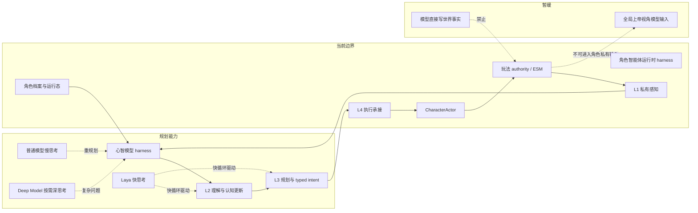
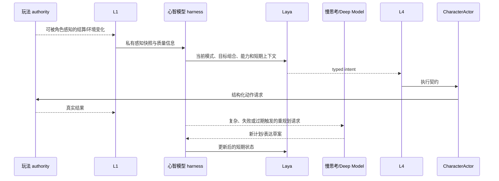
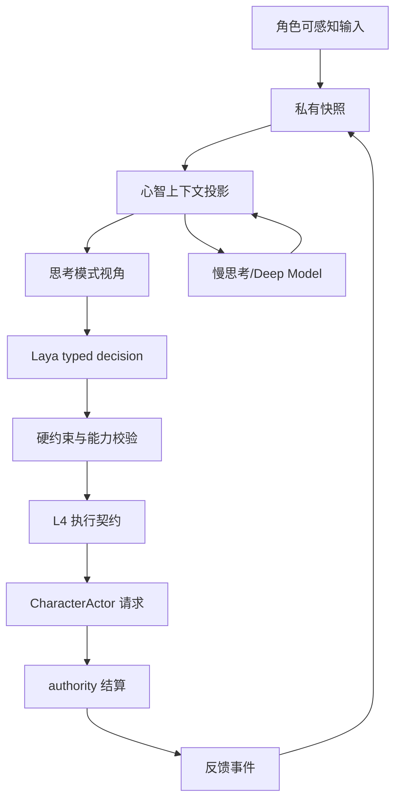

# 01 角色心智模型与模型驱动运行时设计

状态：`planned architecture; non-authorizing`

## 1. 目的

定义角色智能体、心智模型、模型、L1-L4 和玩法 authority 的关系，解决“谁是大脑、谁提供智能、谁拥有事实、谁执行动作”的边界问题。

## 2. 核心关系

角色智能体是完整运行 harness，负责调度、状态持久化、模型调用、执行承接和观测。心智模型是角色智能体的大脑 harness，负责把档案、记忆、动态状态和 L1 私有感知组织成模型可用的思考上下文。模型是智能来源，负责主观解释、目标权衡和意图选择；模型不是世界 authority，也不是执行器。



## 3. L1-L4 职责

| 层 | 责任 | 禁止越界 |
|---|---|---|
| L1 | 获取和维护角色私有感知、身体状态、听觉通信、主动感知结果 | 不把隐藏 authority 事实直接交给模型 |
| L2 | 解释感知、更新信念/记忆/动态状态、整理当前问题 | 不用本地规则静默替代模型认知 |
| L3 | 管理目标组合、候选意图和当前 typed intent | 不绕过模型替模型决定主观策略；本地只做能力/权限/硬约束校验 |
| L4 | 将 intent 转成执行契约并承接取消、超时、连续动作 | 不结算世界事实 |
| CharacterActor | 身体、动画、声音和可见表现 | 不成为世界真相 authority |
| 玩法 authority | 结算命中、伤害、掉落、资源和世界状态 | 不把完整事实广播给角色 |

## 4. 模型路由

- `Laya`：短上下文、低延迟、typed decision；负责当前动作、语音选择、取消和短期协同。
- 普通模型：慢思考；负责战术重构、目标重组、复杂解释和动态表达草案。
- `Deep Model`：按需调用；负责新机制、高风险冲突、连续失败和长链推断。
- 规则与本地代码：只负责 schema、权限、能力、可执行性、时限和 authority 边界。

Laya 的确切 `choice / score / noul` 语义必须以实际 checkpoint 验证为准；本设计只冻结“typed decision 快循环”这一接口方向。

## 5. 关键数据对象

```text
PrivatePerceptionSnapshot
MindFrame
ThoughtModeFrame
GoalPortfolio
TypedIntent
ExecutionContract
SettlementFeedback
```

每个对象都需要携带 `source`、`confidence`、`context_version` 或 `revision`，使模型输出能够被回放和过期检查。

## 6. 主时序



## 7. 数据流转



## 8. 当前、计划与暂缓

- `[current]`：仓库已有 L1 私有快照、主动感知、L2/L3 入口、L4 执行承接、认知 job/continuation 和心智状态对象。
- `[planned]`：把 Laya 接入快循环；将 L3 的语义最终选择收回模型；引入统一 typed intent、模式帧、上下文版本和异步升级。
- `[deferred]`：让模型直接读取全局世界状态、让模型直接写 authority、用另一个本地“脑”替代心智模型。

## 9. 本批规格与计划回写（2026-10-10）

本节登记本批对模型部署和基线选择的收敛。后续探针证据只证明其明示的外部服务路径，不表示仓库 provider adapter、角色 admission 或模型质量已经通过。

| 决策 | 相对原设计的收敛 | 规格/计划映射 | 未解除条件 |
|---|---|---|---|
| D01 慢思考与 Deep Model | 先检查本机是否有可用本地 LLM；没有或不可用时使用 API。此路由只决定慢/Deep 计算位置，不改变 Laya 快循环的模型身份 | 规格01–02；计划01 Task1B | 本地探测、真实 API 请求、凭据/延迟/取消与失败证据 |
| D07 Laya 快服务 | Laya 采用独立本地 `laya-serve`；backend 通过专用 adapter 调用 `127.0.0.1/v1/systemone`。2026-10-10 已取得仓库外 WSL2/CUDA 官方服务 health 与真实中文请求证据；backend 专用 adapter 仍未实现 | 规格01–02；计划01 Task1B | gateway/admission 集成、取消/迟到结果拒绝、候选映射和质量证据 |
| D09 官方基线 | A 阶段先固定 `laya-multilingual`；`typed-decisions` 只做独立对照，不混入首轮生产路径 | 规格01–02；计划01 Task1B/1A | checkpoint revision、中文质量、延迟和 provider 支持证据 |
| D03 微调触发 | 保留官方权重基线；心智输入和题目校准后关键决策仍不达标，才实施必要领域微调。慢模型回退不能替代 Laya 质量验收 | 规格01–02；计划01 Task1C/1A | 留出集结果、触发阈值、训练资源和 recipe |

`choice / score / noul` 等协议语义仍按实际 checkpoint 实测；本回写不能被解释为已批准固定 wire schema。

本次本机探针固定官方源码 `NandhaKishorM/laya` `v0.4.2` commit `68804629e8ccd9d616d48a40e87de9fabbeae069` 与 `convaiinnovations/laya-multilingual` revision `1720e3e3357cfe1e281542e223f8273b0890ca34`；权重文件 SHA-256 为 `9d628fd971b700382ac6f65920a86f149777b2e748e0c955fb3b19695aa8f204`。WSL2 Ubuntu 24.04 使用 torch `2.14.1+cu130`，`/health` 报实际 CUDA checkpoint、CPU fallback 0，真实中文 `/v1/systemone` 请求返回 200。首次请求约 787 ms，同一输入五次热请求约 20–24 ms，仅为单题观察值。该证据仅将 D07 的官方部署/协议探针标为已取得；`CharacterModelGateway` 当前仍为生成式 provider，未取得 Laya 专用 adapter 和角色 admission 证据。单题选择蓄力 Boss 时的 `attack_boss` 仅作为待人工审查的开发集诊断候选，不改变 D03/D05 的质量门槛。

### gateway/admission 接入细化（D07/RW-01）

基于本设计 §3–7，首版动作 choice 接入现有持久 L3 provider stage：admission → coordinator `prepare_l3` 冻结 → driver/共用 slots/gateway → 专用 `/v1/systemone` adapter → `accept_l3`/`freeze_l3`/`resume_l3` → L3/L4与领域 owner。这是把原模型路由落到已有恢复边界；不把 choice 补造成生成式认知输出，不新增编排、store或世界 owner。角色 `cognition_stage` receipt 与领域 authority receipt 分别取证。

当前 admission 仅持久接受 Siming/后台两来源；`PreparedCognitionJob` 四来源的拒旧结果不能代替持久 replay。首条动作执行纵切使用已准入 Siming 来源且遵守控制模式；后台认知完成时 `commands=[]`，只验证选择/阶段恢复。连续感知/自身来源在同一 admission owner 扩展后再验收。显式取消使原持久请求终止，停机保留原请求重新准入恢复；取消 Event 不证明服务端已停止，槽位随真实 worker 完成释放。过期/取消/旧 pin 不能新增效应、执行或写回，也不能使用旧 frame floor。

接入职责/顺序设计已收敛，输入投影/官方协议/候选字段映射实施前确认，adapter与来源扩展实施中产生，真实请求/响应、取消/迟到/恢复、receipt/replay验收时取得。完整三图和代码/测试映射见 [规格01 §3.1.2/§3.2/§4/§5](../规格/01-角色智能体心智运行时重构总规格.md#312-laya-与现有-gatewayadmission-的接入合同)，任务见计划01 Task1B/1A，证据分界见审查03 §4.4；当前仍为 planned/non-authorizing，不以静态映射宣称 Laya 角色闭环。

### 候选评估回写（D16/RW-17，2026-10-10）

模型基础选择质量与角色表现分两轨：基础轨关闭受控失误但保留 authored profile 能力上限，表现轨按固定 seed 开启角色失误并独立记录证据、选择、表达和执行结果。候选先由注册动作、可见目标、affordance、能力包络和执行合同形成完整 U，再实测受控 P；输入/题目错误、候选缺陷、模型选错和执行失败使用不同分母。规格05 §4.2.2–4.2.3定义来源审核、轨迹隔离、顺序/规模/延迟/校准/微调及 final 冻结。没有真实题目和留出证据前，不能声称模型质量或角色差异已通过。


### A-Cognition development 输入边界修复回写（2026-10-13，RW-26）

本轮定位到两处实际丢失边界：评估准备器把角色投影保存在旁路记录，`laya_state` 只取 scenario event；正式 provider serializer 又未消费请求已有的角色上下文。因此修复准备器及实际 provider 边界，复用 `CharacterMindFrameBuilder`、gateway 的冻结 prepared request，以及共享 `build_wire_request`。冻结审核和真实调用使用同一 serializer，对照完整 `state`、`criteria`、choice labels 与内部 U/P 映射，不仅比较 state 字符串。

`[current]` 修复后的 state 复用 `CharacterPromptPolicy._profile_summary(effective_profile)` 的既有角色摘要，并携带注册的 envelope/policy 字段；不建立评估专属人格 prompt，不把原始 dossier、完整私有档案、gold、acceptable actions 或 reviewer rationale 送入 provider。char_a/b/c 使用当前 authored profile 来源，经 MindFrame 编译及获准 L3 输入投影；char_d 只解析隔离 authored metadata，缺失人格、认知、能力与算力保持 unknown/unavailable，仅评估已有来源的诊断边界，不创建正式角色或默认值。

`[planned]` development readiness 必须由来源、schema/隔离、冻结输入和最终 wire 一致性检查产生；外部手改 v2 不是可复现生成器证据。准备包由修正入口重新生成，保留 source revisions/digests、转换路径及逐题 frozen request；本轮真实运行结果另登记审查03、审查05，证据导出根目录为 `D:/Temp/paralls-acognition-development-20261013-inputfix/`。本节记录输入实现差异，不预先声明真实调用、正确率、延迟或验收通过。

`[deferred]` 本轮 calibration、final/holdout、微调、具身动作和 owner 改造均不执行。已暴露的原 calibration 版本保留污染事实及历史证据，不能通过重命名、洗牌或复用相同题目恢复盲性，必须由独立来源重建；final/holdout 继续封存。`action_target_quality_denominator=0`，observe/ask_probe/defer 不计完整动作＋目标质量；共同安全题不能证明角色条件差异，unknown/unavailable 造成的能力缺口另列。16 条 development 不能冻结正式阈值或释放四角色整体心智、完整 A 或 A-Embodied。

本次为既有输入链的最小修复；架构、主时序及数据流仍以本文件现有三图和规格01/03/05为准。对应计划01 Task1B/1C、审查03 §4.19、审查05 §7.5及回写登记 RW-26；B/C、玩法包、编辑器、自走棋、AD/Blender 保持关闭。


### 本批规格与计划回写：Development v4（2026-10-13，RW-28）

[current] 候选语义合同 `candidate-semantics:v4:1` 由 CandidateCompiler 生成并可复现，label/候选/target/description/顺序/mapping/digest一起冻结。旧盲审SHA `db910db888e0b4a5c88100b0db29dbcd9378dccb586e67b90499d423f7dccc20` 永久retired/non-independent。全新r2隔离审查只读净化包，实际3次read命令与accidental_exposure=[]核验后批准 `independent_review_approved=true`，调用前冻结48行真值。

48次真实调用完成：原16条明确指令诊断独立正式分母16、命中4；新增8题×4角色中autonomous16/explicit16分轨，正式分母均0，因为没有来源要求必然角色差异、三个候选都可接受。不得把相同选择判为失败。动作＋目标分母仍0；A/B/C缺认知、hard limits、compute、authority；D另缺人格，均不补默认值。provider error/mapping rejection=0，CPU p50=793.945ms、p95=910.455ms。原v3→v4选择变化6/16，历史description→v4变化11/16，有输入与设备混杂，不能写成质量提升；旧7/16不是正式正确率。

48条完整追溯与wire一致；state无截断，18种label+description中3种被48token上限截去末尾句号，语义完整。候选合同和新审查已通过，但role-sensitive题仍不能区分质量，calibration blocked，不触发微调。A-Cognition仅development证据；A-Embodied未运行/blocked；Godot本批禁止且历史环境blocked；Harness all未运行且不能称通过。backend-contract/change-lifecycle通过并cleanup passed；全量pytest最终重跑结果见后续工程验证记录。

完整来源、逐题覆盖、三张边界图与证据索引见 [审查11](../审查/11-development-v4真值审查与候选语义冻结.md)。本批偏离原设计的部分为先冻结认知fixture语义、分轨审查，不把fixture别名升级为动作注册/owner执行；新增题的来源条件仍不足以要求不同答案。[planned] 先改善有来源可区分development题，满足门禁后才独立新calibration；[deferred] 无新增延期能力。


### 本批规格与计划回写：RW-29（2026-10-13）

本节替代RW-28中“r2独立批准”的结论，保留原件与历史结果。`reviewer-truth-r2.json` 的reviewer未批准，`approved-independent-truth.json` 是lead日志复核批准；历史纠正字段为 `reviewer_independent_approval=false`、`lead_audit_approval=true`、`formal_truth_usable=false`。旧reviewer误见acceptable_paths的污染记录永久保留。历史16条诊断4命中不作为角色质量；v4新32条角色质量正式分母0；48次CPU请求事实和冻结v4 digest保留，不混入历史CUDA对照。

[current] v2新输入为24条/6个新trajectory/三条独立轨道；全新reviewer在未读v1结论、旧答案和模型结果时亲自批准，fixture选择正式可计算分母为autonomous 8/8、explicit diagnostic 6/8、role-sensitive 8/8，共22；explicit两条因目标convenor不可用且无fallback排除。v1仅6条diagnostic的部分审查原件保留。role-sensitive依据是各参与者authored当前/过时可见证据，不能解释成人格能力验证；char_d原profile缺口保持unknown。新v2实际verifier通过，reviewer_independent_approval=true、lead_audit_approval=true、formal_truth_usable=true，严格仅适用于这22条fixture选择；原truth与lead审计truth分别保留。全部24题实际option token门通过，max46 <48；历史v4 48条input/wire/mapping digest精确重建。runtime完整动作＋目标、legality、owner、话语及执行receipt分母均0。

[current] 实际MindFrame/U/P/wire追溯和24题token审计已取得；tokenizer SHA `609d8f4c067cd3950f88594c5a802616cea245823836ef5848ee4fc40aab5b6f`，中性C1 label与可逆T1 target catalog保留映射。CPU health已核验，Hub离线分支的live revision与固定checkpoint一致，artifact SHA `9d628fd971b700382ac6f65920a86f149777b2e748e0c955fb3b19695aa8f204`；同实例正式calibration已执行并三轨未达阈值。checkpoint temperature=[1,1,1]、argmax eval，seed不是sampling字段，不编造配置。docs/backend-contract/change-lifecycle Harness分别exit0、cleanup passed。

[current] checkpoint与阈值门已满足本轮调用条件；正式calibration已执行并失败（autonomous 0/8、explicit diagnostic 0/6、role-sensitive 1/8），不触发微调。A-Cognition正式质量未通过，A-Embodied、Godot与Harness all分别保留独立状态。

[deferred] 无新增延期能力；本轮禁止事项不改写既有规划。来源、三个边界图、分轨分母、批准语义、验证与待决详情见[审查12](../审查/12-calibration前置收口与独立题集门禁.md)；变更登记见[RW-29](../回写/README.md)。外部证据根为 `D:/Users/User/Documents/paralls-evidence/october-calibration-preclosure-20261013/`。

[current 2026-10-14] 本地snapshot路径不会赋值官方Agent.revision；使用固定Hub repo ID、`HF_HUB_OFFLINE=1`与官方缓存时，snapshot_download local_files_only解析固定revision，health revisions.multilingual与checkpoint revision一致，CPU、loaded及真实systemone 200均在同一实例核验。阈值审批文件仍为calibration_allowed=false，故本轮不产生质量结果；见审查12及RW-30。

### 2026-10-14 封存后核对与归因限制

本轮正式calibration实例为PID 6110，启动时间 `Wed Oct 14 15:46:02 2026`、端口18765；前序身份探针PID 5802与正式实例分开记录，两者均已回收。正式实例的前后health记录loaded仅multilingual、固定checkpoint revision、实际checkpoint device CPU。身份attestation与准入记录分别位于仓库外 `D:/laya-probe-cache/checkpoint-live-attestation-20261014.json`、`D:/laya-probe-cache/october-admission.json`，逐题archive/score位于 `D:/laya-probe-cache/october-calibration-run-20261014/`。

封存响应的usage显示21/22条 `truncated=true`，同21条含 `truncated_questions=[choice]`；state丢弃55–1067 token。冻结评分仍为autonomous 0/8、explicit diagnostic 0/6、role-sensitive 1/8，有效样本字段仍为8/6/8，分母、标签、阈值与逐题记录不改。候选option token审计不能证明完整state进入模型；现有输入截断限制将失败全部归因于模型选择能力，必要领域微调触发条件尚未成立。本轮不训练，不修改同批输入后重测，不以慢模型替代质量结论。外部 `post-archive-token-audit.json` 保留逐题usage。

封存完整性复核：score以去除自身digest字段后的canonical JSON（UTF-8、sort_keys、ensure_ascii=false、紧凑分隔符）重算，与登记 `sha256:2113662a7d64ec26dcc3ab78c5abddd78e2e4a97f04fe2dab1a4a66d8a2cd109` 一致。archive采用同口径重算为 `sha256:a9169483075a17220ccd75ea845d507d94327c88fec75cd5e1444e87c639dbb8`，与登记 `sha256:28156259028341ea03b67de11f5b8a97f3daa624808de497b3427edab2caf5b1` 不一致；原封存前image/生成口径尚未恢复，不能称archive digest完整性已验证，也不据此推断篡改。保留原文件及登记值，此证据缺口需关闭后才能接受正式证据链。

A-Cognition保留本轮失败，仍缺完整输入/token门及archive完整性收口、后续独立final/holdout和runtime完整动作＋目标/legality/owner/receipt验收；22条fixture不能证明完整人格、认知上限、算力或具身质量。final/holdout未读取、未运行，A-Embodied独立blocked；Godot及其他关闭范围不启动。


### 2026-10-14 本批规格与计划回写：RW-31 calibration 只读取证

[current] 本轮原证据未重写；新只读诊断与三图见 [仓库外取证报告](D:/laya-probe-cache/calibration-audit-20261014-root/report.md)，逐题/清单/验证见同目录 per-question.json、inventory-expanded.json、verification.json。此项修正前文“archive原口径未恢复”的现状：历史发送命令明确 archive=canonical(records数组)，UTF-8、对象键排序、数组原序、ensure_ascii=false、compact、无末尾换行，185143字节，重算281562…一致。旧审计错误套用全对象去自身digest口径；score211366…与22题request/response digest也一致。records封存不覆盖顶层health/process，原HTTP抓包及服务端token IDs未保存，均unknown，不声称全链verified。

[current] 冻结prepared context state、wire与发送record逐题相同；正式发送直接取冻结wire，绕过runtime backend/provider.complete。固定tokenizer与Laya纯sequence代码离线复现全部22题usage：max_len1024/head_max_len256，题头195/152加SEP后state room828/871；21条在common.build_sequence取state_ids[:room]丢尾55–1067，唯一muted_bell participant04无截断。不是仅审计记录截断。原评分0/8、0/6、1/8及valid_samples8/6/8保持，不删除题、不缩小正式22分母；总观察命中1/22，不称0/22。历史评分漏检usage.truncated，与冻结invalid_handling.truncated合同冲突；calibration完整输入验收blocked，微调触发条件不可评估。另发现发送脚本封存前已加载含标签truth以筛正式ID，“封存后才读取标签”不能证明完整隔离；是否泄漏到模型unknown，不能擅自断言。已暴露calibration不是盲集或holdout。

[2026-10-14 RW-32结果] 共享 provider 完整输入预算修复已实现；修复后官方离线CPU实例在合成预检后封存22/22，usage全部无截断，完整序列需求最大2081。v3 truth独立批准未重审，评分保持blocked；见回写RW-32。

[2026-10-14 RW-32后续更正] 上句2081为旧拼接估算；按固定官方逐段编码的真实最大需求为2091，22/22与封存usage一致。独立reviewer已将旧truth重新绑定v3实际输入与逐题request/candidate映射，仅批准已暴露calibration诊断。原archive评分0/8、0/6、1/8，Policy A诊断未通过；普通运行时预算仅在显式max_len或input_budget_required时启用。v2执行身份/读日志未绑定，不能以新合同追溯补证；详见[RW-32后续](../回写/calibration-repair-20261014.md)。

[planned] 仅提出完整state+head预算门与足够max_len传输方案、truncated评分拒绝、无truth的ID-only准入及明确archive范围测试要求，均未实施；保留fixture/source/truth/U/P/阈值。扩大预算也会使模型看到原未见尾部，必须重新冻结transport/model-input digest、保留原digest，并由fresh独立reviewer复核合同及暴露边界；任何语义/候选/来源改变另冻结对应输入，不能覆盖原证据。细节与对应测试要求见外部报告，不授权下一轮调用。

[deferred] final/independent holdout继续封存未读未跑；A-Cognition质量未验收，A-Embodied/Godot/B/C/玩法包/编辑器/自走棋/AD/Blender保持关闭。阈值 manifest digest 重算一致且锁定 `sha256:a4bb6f41bc165ed1a645550ee54a7e1830ff5f5dbd8843bb73ecfbf6b6517ba1`。本轮provider/训练调用0，无运行时代码变更，不跑全量pytest；本条为取证回写，不是修复或运行时验收。


## 本批规格与计划回写：RW-34 backend choice与基础合同局部实施（2026-10-15）

本轮实际结果见[RW-34批次报告](../回写/backend-choice-foundations-stage3-20261015.md)：固定官方离线multilingual CPU服务经真实backend事实入口与原coordinator/driver完成choice接纳、冻结续行及L4结果。首回合L4为cognition_unavailable下的physiology_hint，第二不同事件新turn已完成但L4命令为空；不登记领域执行成功。取消后迟到结果zero_write，服务不可用有真实URLError。完整预算门在该backend进程显式启用，普通runtime仍opt-in。

角色新增调节投影、表达/观察episode、协同/短契约、SpeechLease的局部合同，任务证据及剩余项见计划02/03；阶段三严格为规格09–12／计划04，Task1–2已开始实施、局部合同与生产迁移/最终验收分列。原角色03/04/15、规格08、计划02/03及原角色16/规格09–12/计划04分别回写。模型质量仍0/8、0/6、1/8未验收，Godot未验证，领域最终执行未验收；本轮不恢复Godot、其他输出类型、final/holdout或训练。验证与清理以批次报告最终区块为准。
