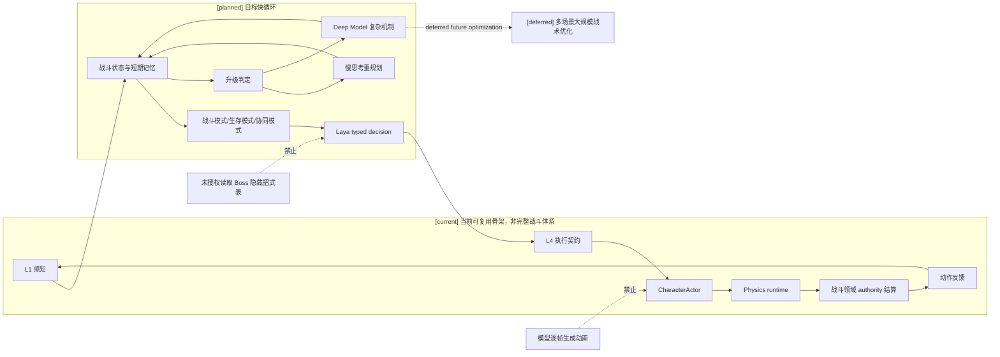
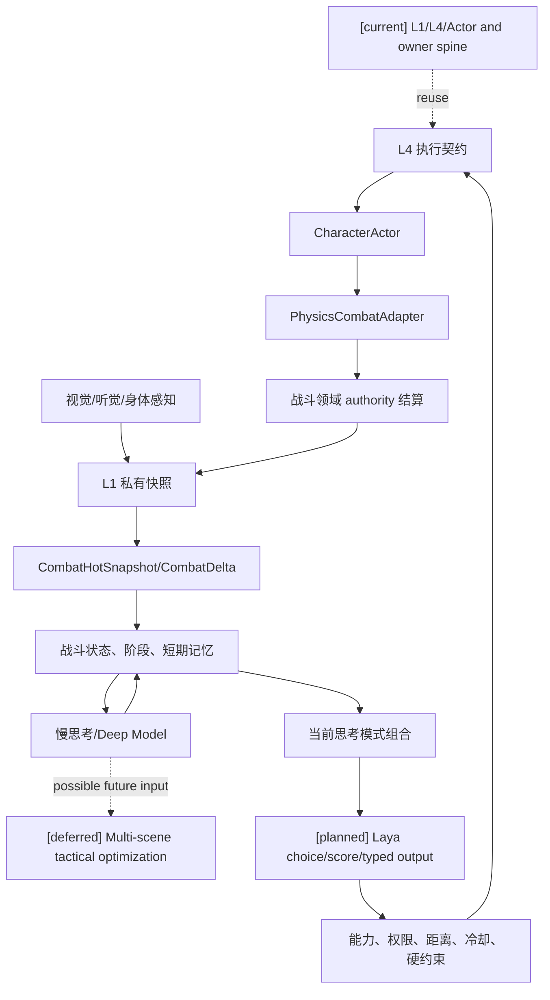

# 02 Laya 快循环与快慢思考战斗设计

状态：`planned architecture; non-authorizing`

## 1. 设计目标

让 Laya 能够在不等待慢思考的情况下，连续完成一段常规战斗，包含观察、试探、闪避、攻击、资源管理、失败修正、阶段切换和撤退；慢思考和 Deep Model 只在快循环无法解释或需要重规划时介入。

## 2. 战斗循环



## 3. 快循环应承担的能力

```text
observe / probe
approach / reposition
dodge / block
attack / punish
heal / disengage
hold_position / retreat
protect_ally / focus_target
abort_maneuver
```

每个 intent 至少包含目标、承诺时长、停止条件、失败回退、上下文版本和优先级；跨玩法动作契约的字段和生命周期由 [11-跨玩法动作承诺协议设计](11-跨玩法动作承诺协议设计.md) 统一定义。连续位移、动画、命中盒和身体表现由执行层承接，不要求每帧调用 Laya。

快循环的输入不是模型自行推算的战斗文本，而是 `CombatHotSnapshot`、`CombatDelta` 和物理/具身证据的权限过滤投影。Laya 可以读取当前可用资源、冷却、状态、装备可用性、环境暴露、动作阶段和空间摘要；它不能把物理接触直接当成伤害，也不能自己结算蓝耗、命中、控制或环境场效果。

战斗内容包通过 Gameplay Foundation 的物理证据适配合同与物理引擎协作：物理引擎提供碰撞、轨迹、接触、遮挡和冲量证据，战斗所属领域 authority 按已注册规则解释证据并提交命中、闪避、格挡、伤害、控制和资源/状态变化，再把结构化结果回投给 L1/Laya。物理引擎负责连续运动和表现；Gameplay Foundation 提供跨玩法动作、证据、时序和提交边界；战斗内容包定义战斗语义。

上述完整合作合同为 `[planned]`；`[current]` 仅复用已有执行入口、局部证据/窗口与 owner 提交主干，不表示通用物理证据适配和跨通道战斗结算已经完成。

战斗循环消费 [16-通用玩法时序模型与编辑器设计](16-通用玩法时序模型与编辑器设计.md) 提供的时间线、step/frame 映射和结算窗口。当前 3D 物理时间与世界 tick 之间尚无统一的可编辑 profile 合同；接入后应由明确的 `ClockMapping` 和证据 revision 确定采样证据属于哪个结算窗口。

## 4. 魂游 Boss 推演

1. Boss 抬刀：L1 提供前摇，Laya 选择保持距离或试探。
2. 重击落空：L1 反馈恢复窗口，Laya 选择一到两次惩罚攻击并准备脱离。
3. 三连斩首次命中：战斗短期记忆记录失败，Laya 调整为延迟闪避。
4. 二阶段特效出现：L1 观察到姿态、音效和范围变化，模式切换到生存优先；慢思考可后台重排短期计划。
5. 连续几次无法解释新招：触发 Deep Model；快循环仍保持防御、距离和撤退。
6. Boss 倒地：Laya 选择是否补刀，不能因长期目标而盲目贪刀。

## 5. 升级与降级

升级触发：连续失败、上下文冲突、新阶段、目标组合冲突、信息不足、快循环重复同一失败动作。

降级顺序：动态语音/复杂表达取消；慢思考回落到 Laya；模型不可用时进入 continuity floor，只允许观察、保持距离、自保、撤退、沉默等连续性动作。

## 6. 时序图

```mermaid
sequenceDiagram
  participant P as Boss/玩法 authority
  participant L1 as 角色 L1
  participant B as 战斗短期状态
  participant F as Laya
  participant X as L4/Actor
  participant G as Physics runtime
  participant C as Combat domain authority
  participant S as 慢思考或 Deep Model
  Note over P,S: [current] L1/L4/Actor and owner spine; [planned] full fast loop and mapped windows; [deferred] large-scale multi-scene tactics
  P-->>L1: 可感知前摇/命中/阶段变化
  L1->>B: 更新敌情、体力、失败记录
  B->>F: 当前战术上下文
  F->>X: 闪避/攻击/保持/撤退 intent
  X->>G: typed action/field intent
  G-->>C: collision/contact/trajectory evidence
  C-->>L1: semantic result and CombatDelta
  alt 快循环失效
    B->>S: 异步重规划请求
    S-->>B: 新短期计划
  end
```

## 7. 数据流图



## 8. 状态标记

- `[current]`：L1、L4、Actor ingress、authority 结算和部分 L2/L3 入口。
- `[planned]`：Laya 连续快循环、战斗短期记忆、失败修正、阶段升级和可取消重规划。
- `[deferred]`：跨场景的大规模战术优化、模型驱动精细动作生成研究。
- 始终禁止：模型未授权读取 Boss 隐藏状态、绕过执行契约和 authority；逐 render frame 调用模型不作为本设计的执行路径。

## 9. 本批规格与计划回写（2026-10-10）

1. 验证顺序固定为 A 单角色跨情境、B 单角色连续 Boss、C 双角色连续协同。B/C 均为必验；A 通过不能代表 B/C 完成。
2. 首版选择单位是一次完整的“动作＋目标”候选。动作族只用于候选生成、包络和门禁分类，不替代模型选择；L4 与执行 owner 仍各自校验。
3. 评估真值使用结构化可接受动作＋目标集合，允许多个合理答案；教师或旧 L3 的单次选择不能自动作为唯一真值。
4. 先对包络内完整候选实测规模、顺序敏感性、延迟和正确率，再冻结生产受控候选集。分步“动作族→目标”仅作后备研究路线。
5. B/C 使用隔离的新 Laya Boss/协同场景，不复用 `StreetCombatDemo` 场景语义；动作底座限于已验证的 `StreetCombatActorDemo` Actor、动作库、Motor、authority 和资格证据。
6. 慢/Deep 升级结果必须可取消并带 revision/expiry，不能把慢回退记为 Laya 正确选择。
7. 2026-10-10 固定官方 Laya `v0.4.2` 源码 commit 与 `laya-multilingual` 权重 revision 后，已在仓库外 WSL2/CUDA 服务对单题完整候选执行真实 `/v1/systemone` 请求。模型在“Boss 蓄力、队友在左、选择最合适动作”的输入下选择 `attack_boss`（概率 0.6038）；该题没有从仓库动作注册表/affordance/执行合同生成候选，且尚未由人工审核结构化可接受动作集合，因此只登记为开发集诊断候选，审核前不算正式样本；不得据此计算质量阈值或进入校准/最终留出。首次请求约 787 ms，同输入五次热请求约 20–24 ms，仅作单题观测。实证文件和部署细节见 [实施闸门 §4.3](../审查/03-实施待决收敛与验证闸门.md#43-laya-本机探针证据2026-10-10)。

映射：总规格00 §4.1；规格01、02、05、07；计划00、01、02、03。裸服务实证只解除上游协议/设备探针；角色 gateway/admission、真实注册候选、独立留出集、owner receipt、actor admission 和 Godot 结果证据仍待取得。

8. 依据 §3/§5–7，gateway/admission 接入收敛为现有持久 L3 provider stage 的请求冻结、driver/slots派发、专用 systemone adapter、coordinator再次准入与L4/领域合同。choice不生成承诺参数，角色stage receipt不代替领域authority receipt。首次执行纵切使用已准入Siming来源且遵守控制模式；后台来源当前在L3后完成并保持 `commands=[]`，只能验证选择/阶段恢复。连续感知/自身来源须扩展同一admission owner，staged job四来源不能冒充已有持久恢复能力。
9. 显式取消与停机恢复分别验收；非流式取消 Event 当前未传到provider，driver关闭不等于服务端中断，也不等于永久取消持久请求。过期/取消/旧版本不得提交新效应或旧frame floor；重试复用原expiry，恢复复用原候选/receipt，槽位随真实worker结束释放。职责/顺序设计已收敛；输入/候选/协议映射、adapter实现和真实边界证据分阶段取得，不把最终质量/B/C/Soul验收反设为基础开工前置。

上述D07/RW-01细化的完整架构、时序、数据流和实现映射见 [规格01 §3.1.2/§3.2/§4/§5](../规格/01-角色智能体心智运行时重构总规格.md#312-laya-与现有-gatewayadmission-的接入合同)；同步规格02、计划01 Task1B/1A、审查03 §4.4和回写登记。仅设计修订，未取得Laya角色runtime实证。

### B/C 场景与真实边界回写（D19/RW-20，2026-10-11）

B 单角色连续 Boss 和 C 双角色连续协同均必须在新的隔离 Godot 场景中取得真实证据。`StreetCombatActorDemo` 仅作为已验证 Actor、动作库、Motor、authority 和资格化底座；`StreetCombatDemo` 的既有街战控制器、Boss/目标或胜负语义不作为 B/C 来源。模型只输出选择/提案，Boss/协同 domain owner 提交结果，Godot 只做本地具身与表现。真实 Laya→gateway/admission、owner receipt、replay/checkpoint、actor admission 和可见结果仍待 [审查08](../审查/08-第六项B-C隔离Godot场景与真实边界证据.md) 与总计划 Task6A 取得；A 或动作底座通过不能替代 B/C。

### 候选评估回写（D16/RW-17，2026-10-10）

战斗题目沿用同一角色心智模型，首版仍由 Laya 一次选择完整动作＋目标；动作族只用于候选生成、包络与门禁。Boss 题必须从真实注册动作、可见目标、affordance 和执行合同构造，原文中的战斗例子不能直接成为 gold。基础选择质量轨关闭受控失误，角色表现轨按固定 seed 开启失误；B 连续 Boss 的执行 receipt 与模型选错单独验收。完整候选/受控候选配对实验和多可接受动作真值见规格05 §4.2.1–4.2.3，A 通过不能替代 B/C。


### A-Cognition development 输入边界修复回写（2026-10-13，RW-26）

本轮定位到两处实际丢失边界：评估准备器把角色投影保存在旁路记录，`laya_state` 只取 scenario event；正式 provider serializer 又未消费请求已有的角色上下文。因此修复准备器及实际 provider 边界，复用 `CharacterMindFrameBuilder`、gateway 的冻结 prepared request，以及共享 `build_wire_request`。冻结审核和真实调用使用同一 serializer，对照完整 `state`、`criteria`、choice labels 与内部 U/P 映射，不仅比较 state 字符串。

`[current]` 修复后的 state 复用 `CharacterPromptPolicy._profile_summary(effective_profile)` 的既有角色摘要，并携带注册的 envelope/policy 字段；不建立评估专属人格 prompt，不把原始 dossier、完整私有档案、gold、acceptable actions 或 reviewer rationale 送入 provider。char_a/b/c 使用当前 authored profile 来源，经 MindFrame 编译及获准 L3 输入投影；char_d 只解析隔离 authored metadata，缺失人格、认知、能力与算力保持 unknown/unavailable，仅评估已有来源的诊断边界，不创建正式角色或默认值。

`[planned]` development readiness 必须由来源、schema/隔离、冻结输入和最终 wire 一致性检查产生；外部手改 v2 不是可复现生成器证据。准备包由修正入口重新生成，保留 source revisions/digests、转换路径及逐题 frozen request；本轮真实运行结果另登记审查03、审查05，证据导出根目录为 `D:/Temp/paralls-acognition-development-20261013-inputfix/`。本节记录输入实现差异，不预先声明真实调用、正确率、延迟或验收通过。

`[deferred]` 本轮 calibration、final/holdout、微调、具身动作和 owner 改造均不执行。已暴露的原 calibration 版本保留污染事实及历史证据，不能通过重命名、洗牌或复用相同题目恢复盲性，必须由独立来源重建；final/holdout 继续封存。`action_target_quality_denominator=0`，observe/ask_probe/defer 不计完整动作＋目标质量；共同安全题不能证明角色条件差异，unknown/unavailable 造成的能力缺口另列。16 条 development 不能冻结正式阈值或释放四角色整体心智、完整 A 或 A-Embodied。

本次为既有输入链的最小修复；架构、主时序及数据流仍以本文件现有三图和规格01/03/05为准。对应计划01 Task1B/1C、审查03 §4.19、审查05 §7.5及回写登记 RW-26；B/C、玩法包、编辑器、自走棋、AD/Blender 保持关闭。


### 本批规格与计划回写：Development v4（2026-10-13，RW-28）

[current] 候选语义合同 `candidate-semantics:v4:1` 由 CandidateCompiler 生成并可复现，label/候选/target/description/顺序/mapping/digest一起冻结。旧盲审SHA `db910db888e0b4a5c88100b0db29dbcd9378dccb586e67b90499d423f7dccc20` 永久retired/non-independent。全新r2隔离审查只读净化包，实际3次read命令与accidental_exposure=[]核验后批准 `independent_review_approved=true`，调用前冻结48行真值。

48次真实调用完成：原16条明确指令诊断独立正式分母16、命中4；新增8题×4角色中autonomous16/explicit16分轨，正式分母均0，因为没有来源要求必然角色差异、三个候选都可接受。不得把相同选择判为失败。动作＋目标分母仍0；A/B/C缺认知、hard limits、compute、authority；D另缺人格，均不补默认值。provider error/mapping rejection=0，CPU p50=793.945ms、p95=910.455ms。原v3→v4选择变化6/16，历史description→v4变化11/16，有输入与设备混杂，不能写成质量提升；旧7/16不是正式正确率。

48条完整追溯与wire一致；state无截断，18种label+description中3种被48token上限截去末尾句号，语义完整。候选合同和新审查已通过，但role-sensitive题仍不能区分质量，calibration blocked，不触发微调。A-Cognition仅development证据；A-Embodied未运行/blocked；Godot本批禁止且历史环境blocked；Harness all未运行且不能称通过。backend-contract/change-lifecycle通过并cleanup passed；全量pytest最终重跑结果见后续工程验证记录。

完整来源、逐题覆盖、三张边界图与证据索引见 [审查11](../审查/11-development-v4真值审查与候选语义冻结.md)。本批偏离原设计的部分为先冻结认知fixture语义、分轨审查，不把fixture别名升级为动作注册/owner执行；新增题的来源条件仍不足以要求不同答案。[planned] 先改善有来源可区分development题，满足门禁后才独立新calibration；[deferred] 无新增延期能力。


### 本批规格与计划回写：RW-29（2026-10-13）

本节替代RW-28中“r2独立批准”的结论，保留原件与历史结果。`reviewer-truth-r2.json` 的reviewer未批准，`approved-independent-truth.json` 是lead日志复核批准；历史纠正字段为 `reviewer_independent_approval=false`、`lead_audit_approval=true`、`formal_truth_usable=false`。旧reviewer误见acceptable_paths的污染记录永久保留。历史16条诊断4命中不作为角色质量；v4新32条角色质量正式分母0；48次CPU请求事实和冻结v4 digest保留，不混入历史CUDA对照。

[current] v2新输入为24条/6个新trajectory/三条独立轨道；全新reviewer在未读v1结论、旧答案和模型结果时亲自批准，fixture选择正式可计算分母为autonomous 8/8、explicit diagnostic 6/8、role-sensitive 8/8，共22；explicit两条因目标convenor不可用且无fallback排除。v1仅6条diagnostic的部分审查原件保留。role-sensitive依据是各参与者authored当前/过时可见证据，不能解释成人格能力验证；char_d原profile缺口保持unknown。新v2实际verifier通过，reviewer_independent_approval=true、lead_audit_approval=true、formal_truth_usable=true，严格仅适用于这22条fixture选择；原truth与lead审计truth分别保留。全部24题实际option token门通过，max46 <48；历史v4 48条input/wire/mapping digest精确重建。runtime完整动作＋目标、legality、owner、话语及执行receipt分母均0。

[current] 实际MindFrame/U/P/wire追溯和24题token审计已取得；tokenizer SHA `609d8f4c067cd3950f88594c5a802616cea245823836ef5848ee4fc40aab5b6f`，中性C1 label与可逆T1 target catalog保留映射。CPU health已核验，Hub离线分支的live revision与固定checkpoint一致，artifact SHA `9d628fd971b700382ac6f65920a86f149777b2e748e0c955fb3b19695aa8f204`；同实例正式calibration已执行并三轨未达阈值。checkpoint temperature=[1,1,1]、argmax eval，seed不是sampling字段，不编造配置。docs/backend-contract/change-lifecycle Harness分别exit0、cleanup passed。

[current] checkpoint与阈值门已满足本轮调用条件；正式calibration已执行并失败（autonomous 0/8、explicit diagnostic 0/6、role-sensitive 1/8），不触发微调。A-Cognition正式质量未通过，A-Embodied、Godot与Harness all分别保留独立状态。

[deferred] 无新增延期能力；本轮禁止事项不改写既有规划。来源、三个边界图、分轨分母、批准语义、验证与待决详情见[审查12](../审查/12-calibration前置收口与独立题集门禁.md)；变更登记见[RW-29](../回写/README.md)。外部证据根为 `D:/Users/User/Documents/paralls-evidence/october-calibration-preclosure-20261013/`。

[current 2026-10-14] 本地snapshot路径不会赋值官方Agent.revision；使用固定Hub repo ID、`HF_HUB_OFFLINE=1`与官方缓存时，snapshot_download local_files_only解析固定revision，health revisions.multilingual与checkpoint revision一致，CPU、loaded及真实systemone 200均在同一实例核验。阈值审批文件仍为calibration_allowed=false，故本轮不产生质量结果；见审查12及RW-30。

### 2026-10-14 封存后核对与归因限制

本轮正式calibration实例为PID 6110，启动时间 `Wed Oct 14 15:46:02 2026`、端口18765；前序身份探针PID 5802与正式实例分开记录，两者均已回收。正式实例的前后health记录loaded仅multilingual、固定checkpoint revision、实际checkpoint device CPU。身份attestation与准入记录分别位于仓库外 `D:/laya-probe-cache/checkpoint-live-attestation-20261014.json`、`D:/laya-probe-cache/october-admission.json`，逐题archive/score位于 `D:/laya-probe-cache/october-calibration-run-20261014/`。

封存响应的usage显示21/22条 `truncated=true`，同21条含 `truncated_questions=[choice]`；state丢弃55–1067 token。冻结评分仍为autonomous 0/8、explicit diagnostic 0/6、role-sensitive 1/8，有效样本字段仍为8/6/8，分母、标签、阈值与逐题记录不改。候选option token审计不能证明完整state进入模型；现有输入截断限制将失败全部归因于模型选择能力，必要领域微调触发条件尚未成立。本轮不训练，不修改同批输入后重测，不以慢模型替代质量结论。外部 `post-archive-token-audit.json` 保留逐题usage。

封存完整性复核：score以去除自身digest字段后的canonical JSON（UTF-8、sort_keys、ensure_ascii=false、紧凑分隔符）重算，与登记 `sha256:2113662a7d64ec26dcc3ab78c5abddd78e2e4a97f04fe2dab1a4a66d8a2cd109` 一致。archive采用同口径重算为 `sha256:a9169483075a17220ccd75ea845d507d94327c88fec75cd5e1444e87c639dbb8`，与登记 `sha256:28156259028341ea03b67de11f5b8a97f3daa624808de497b3427edab2caf5b1` 不一致；原封存前image/生成口径尚未恢复，不能称archive digest完整性已验证，也不据此推断篡改。保留原文件及登记值，此证据缺口需关闭后才能接受正式证据链。

A-Cognition保留本轮失败，仍缺完整输入/token门及archive完整性收口、后续独立final/holdout和runtime完整动作＋目标/legality/owner/receipt验收；22条fixture不能证明完整人格、认知上限、算力或具身质量。final/holdout未读取、未运行，A-Embodied独立blocked；Godot及其他关闭范围不启动。


### 2026-10-14 本批规格与计划回写：RW-31 calibration 只读取证

[current] 本轮原证据未重写；新只读诊断与三图见 [仓库外取证报告](D:/laya-probe-cache/calibration-audit-20261014-root/report.md)，逐题/清单/验证见同目录 per-question.json、inventory-expanded.json、verification.json。此项修正前文“archive原口径未恢复”的现状：历史发送命令明确 archive=canonical(records数组)，UTF-8、对象键排序、数组原序、ensure_ascii=false、compact、无末尾换行，185143字节，重算281562…一致。旧审计错误套用全对象去自身digest口径；score211366…与22题request/response digest也一致。records封存不覆盖顶层health/process，原HTTP抓包及服务端token IDs未保存，均unknown，不声称全链verified。

[current] 冻结prepared context state、wire与发送record逐题相同；正式发送直接取冻结wire，绕过runtime backend/provider.complete。固定tokenizer与Laya纯sequence代码离线复现全部22题usage：max_len1024/head_max_len256，题头195/152加SEP后state room828/871；21条在common.build_sequence取state_ids[:room]丢尾55–1067，唯一muted_bell participant04无截断。不是仅审计记录截断。原评分0/8、0/6、1/8及valid_samples8/6/8保持，不删除题、不缩小正式22分母；总观察命中1/22，不称0/22。历史评分漏检usage.truncated，与冻结invalid_handling.truncated合同冲突；calibration完整输入验收blocked，微调触发条件不可评估。另发现发送脚本封存前已加载含标签truth以筛正式ID，“封存后才读取标签”不能证明完整隔离；是否泄漏到模型unknown，不能擅自断言。已暴露calibration不是盲集或holdout。

[2026-10-14 RW-32结果] 共享 provider 完整输入预算修复已实现；修复后官方离线CPU实例在合成预检后封存22/22，usage全部无截断，完整序列需求最大2081。v3 truth独立批准未重审，评分保持blocked；见回写RW-32。

[2026-10-14 RW-32后续更正] 上句2081为旧拼接估算；固定官方head逐段编码加特殊token后最大2091，22/22与封存usage一致。独立reviewer确认旧truth适用于v3实际请求，只限已暴露calibration诊断；原archive按固定8/6/8分母评分0/8、0/6、1/8，Policy A诊断未通过。普通运行时无显式预算参数时没有此预算门；v2历史执行身份与读日志不能追溯补齐。见[RW-32后续](../回写/calibration-repair-20261014.md)。

[planned] 仅提出完整state+head预算门与足够max_len传输方案、truncated评分拒绝、无truth的ID-only准入及明确archive范围测试要求，均未实施；保留fixture/source/truth/U/P/阈值。扩大预算也会使模型看到原未见尾部，必须重新冻结transport/model-input digest、保留原digest，并由fresh独立reviewer复核合同及暴露边界；任何语义/候选/来源改变另冻结对应输入，不能覆盖原证据。细节与对应测试要求见外部报告，不授权下一轮调用。

[deferred] final/independent holdout继续封存未读未跑；A-Cognition质量未验收，A-Embodied/Godot/B/C/玩法包/编辑器/自走棋/AD/Blender保持关闭。阈值 manifest digest 重算一致且锁定 `sha256:a4bb6f41bc165ed1a645550ee54a7e1830ff5f5dbd8843bb73ecfbf6b6517ba1`。本轮provider/训练调用0，无运行时代码变更，不跑全量pytest；本条为取证回写，不是修复或运行时验收。


## 本批规格与计划回写：RW-34 backend choice与基础合同局部实施（2026-10-15）

本轮实际结果见[RW-34批次报告](../回写/backend-choice-foundations-stage3-20261015.md)：固定官方离线multilingual CPU服务经真实backend事实入口与原coordinator/driver完成choice接纳、冻结续行及L4结果。首回合L4为cognition_unavailable下的physiology_hint，第二不同事件新turn已完成但L4命令为空；不登记领域执行成功。取消后迟到结果zero_write，服务不可用有真实URLError。完整预算门在该backend进程显式启用，普通runtime仍opt-in。

角色新增调节投影、表达/观察episode、协同/短契约、SpeechLease的局部合同，任务证据及剩余项见计划02/03；阶段三严格为规格09–12／计划04，Task1–2已开始实施、局部合同与生产迁移/最终验收分列。原角色03/04/15、规格08、计划02/03及原角色16/规格09–12/计划04分别回写。模型质量仍0/8、0/6、1/8未验收，Godot未验证，领域最终执行未验收；本轮不恢复Godot、其他输出类型、final/holdout或训练。验证与清理以批次报告最终区块为准。
