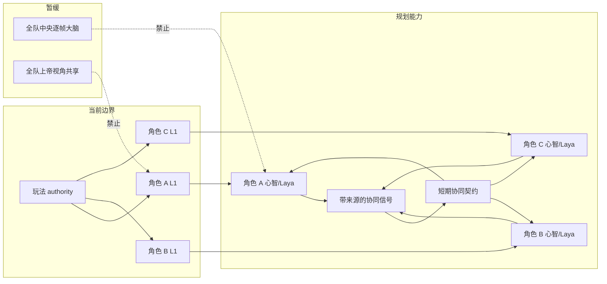
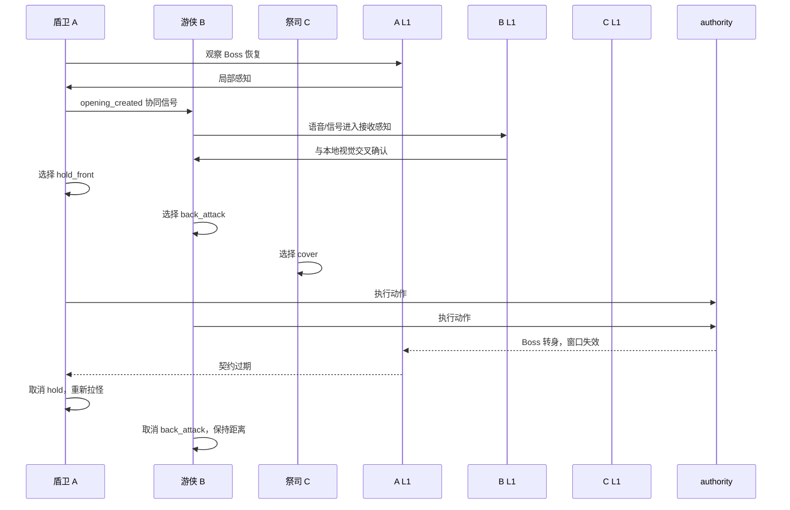
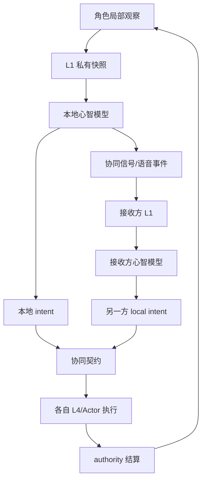

# 03 协同作战与信息通信设计

状态：`planned architecture; non-authorizing`

## 1. 设计目标

支持多个独立角色在局部感知下完成协同 Boss 战。团队不设置一个替所有角色逐帧决策的中央大脑；每个角色仍由自己的心智模型和 Laya 决定局部动作，队伍通过通信、短期协同契约和可中止承诺形成组合动作。

## 2. 协同边界



## 3. 协同信号与契约

协同信号不是世界事实，而是某个角色基于自身 L1 的观察和判断：

```json
{
  "type": "opening_created",
  "source": "shield_A",
  "observation": "boss_recovery",
  "confidence": "medium",
  "target": "ranger_B",
  "expires_at": "..."
}
```

协同契约只描述短期合作：目标、参与者、各自责任、有效期、失败条件和退出方式。每个角色仍输出自己的 `local_intent`。

## 4. 协同案例

盾卫发现 Boss 硬直，喊“打背后”；游侠观察确认后选择背击；祭司保持支援。如果 Boss 突然转身，游侠可以拒绝或取消背击，盾卫重新选择拉怪，契约自动失效。盾卫倒地后，队伍不继续执行旧契约，而是由各角色重新建立“风筝、清小怪、创造复活窗口”的短期计划。

## 5. 时序图



## 6. 数据流图



## 7. 状态标记

- `[current]`：L1 私有感知、角色心智状态、L4/Actor 和 authority 边界。
- `[planned]`：带来源和过期时间的协同信号、短期协同契约、局部退出和重建。
- `[deferred]`：中央团队大脑、未经 L1 的全队共享隐藏事实、强制队友执行模型命令。

## 8. 本批规格与计划回写（2026-10-10）

本批把协同验证收敛为 C：在 A 跨情境闭环、B 单角色连续 Boss 验证和所需通用 owner 准入后，使用两个独立角色连续完成协同验证。双方仍独立形成 local intent，经各自 L1 收到可感知信号并由各自 Laya 选择；C 不是共享团队大脑或统一 intent。验证覆盖信号延迟/过期、误解、拒绝/退出、局面改变和 owner 回执。

C 使用新的隔离验收场景；动作底座可复用 `StreetCombatActorDemo` 已验证的 Actor/动作库/Motor/authority，不能把 `StreetCombatDemo` 的既有场景语义当作新协同验证基础。映射：总规格00 §4.1、规格08、计划03 Task6A；通信路径、actor admission、模型轨迹、authority receipts 和 Godot 结果尚待实测。

### 第六项真实边界回写（D19/RW-20，2026-10-11）

C 的隔离场景必须在 B 单角色连续 Boss 取得真实证据后使用两个独立 Actor/identity。发送者局部观察只能经实际空间声音/可见信号进入接收方 L1；每方保留自己的 local intent、候选、Laya choice 和 owner receipt。`StreetCombatActorDemo` 只提供已验证的具身底座，`StreetCombatDemo` 不提供协同场景语义。模型输出、生成音频和 Actor 动画不构成世界事实；真实 gateway/admission、协同 ingress、owner/authority receipt、过期/拒绝/退出处理、replay/checkpoint 与双方 Godot 可见结果待 [审查08](../审查/08-第六项B-C隔离Godot场景与真实边界证据.md) 和计划03 Task6A 取得。

## 本批规格与计划回写（2026-10-15，角色基础局部实施）

结构化局部signal和短期契约已沿现有RawFact→听觉CandidatePercept→可听性/recipient/privacy过滤→接收方L1实现合同。保留source、observation、confidence、target、expiry，不成为fact_claim或共享脑。短契约检查参与者、revision、期限和拒绝/退出；main事实consumer尚缺可信clock/revision pins并fail-closed，故不声称真实Laya协同或C通过。

依据与逐任务新鲜证据见[规格08](../规格/08-角色协同表达与精神边界规格.md)及[计划03](../计划/03-角色协同表达与精神边界实施计划.md)。仅合同局部通过；模型质量、Godot与领域最终执行均不由此补算通过。
