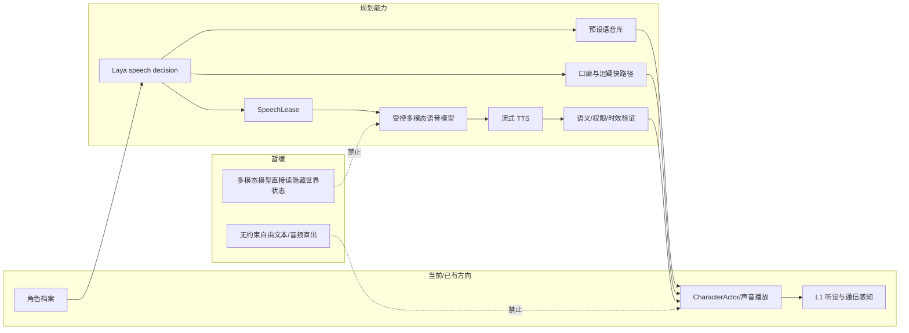
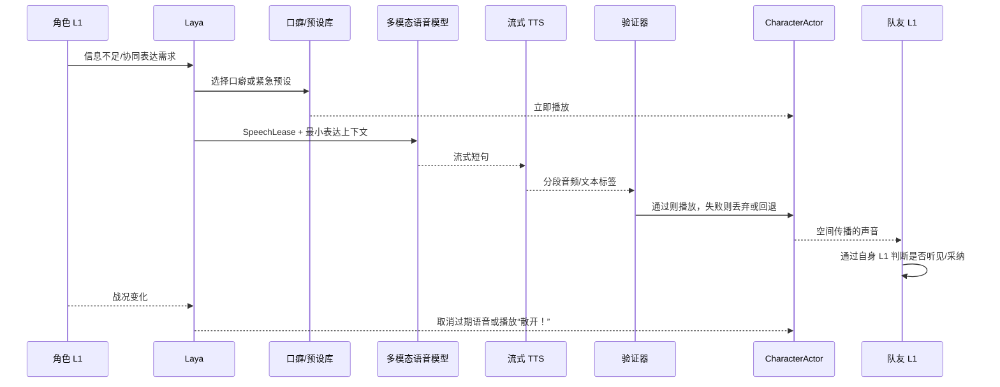
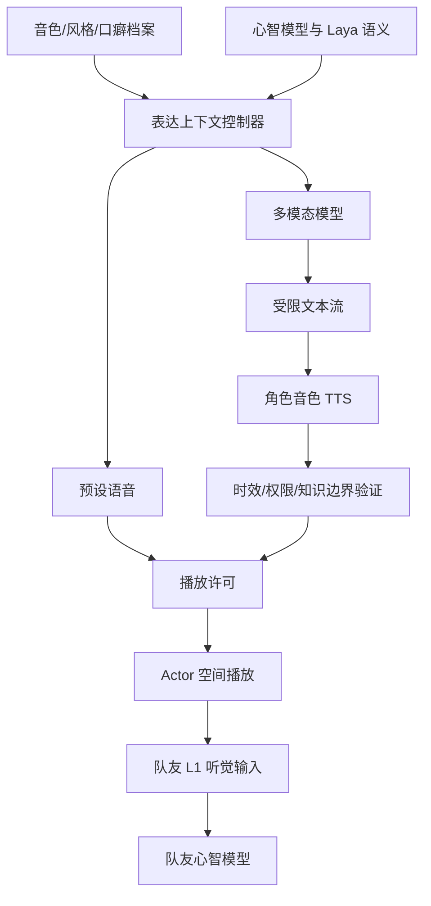

# 04 角色语音与多模态表达设计

状态：`planned architecture; non-authorizing`

## 1. 设计目标

让每个角色拥有稳定的声音身份和说话风格，同时支持魂游战斗中的低延迟喊话、复杂战术表达、迟疑口癖和实时流式对话。语音属于角色行为表达，不得绕过心智模型直接改变动作或世界状态。

## 2. 分层架构



## 3. 角色档案

档案至少包含：

```yaml
voice_profile:
  voice_id: character_voice_07
  rate: 1.05
  pitch: 0.92
  energy: restrained
speech_style:
  sentence_length: short
  directness: cautious
  verbosity: low
verbal_tics:
  hesitation: ["等等……", "有点不对……"]
  uncertainty: ["我还没看清……"]
  urgency: ["散开！", "现在退！"]
```

音色、风格和口癖属于长期档案；当前情绪、紧急程度和关系决定本轮是否使用它们。

## 4. 三条语音路径

1. **预设快路径**：Laya 选择 `retreat`、`attack_now`、`cover_me` 等语音，立即播放。
2. **口癖占位路径**：信息不足或正在等待慢思考时，先播放“嗯……”“等等……”等角色化填充音频。
3. **动态流式路径**：Laya 生成语义和 `SpeechLease`，受控多模态模型组织短句，流式 TTS 生成音频，Laya 可随时取消。

## 5. 控制原则

多模态模型只拥有表达权限：措辞、语气、停顿、声音。Laya 决定是否表达、对象、意义、优先级、有效期和取消；L1 决定队友是否实际听见；L4/Actor 负责播放表现。

## 6. 时序图



## 7. 数据流图



## 8. 状态标记

- `[current]`：角色档案已有表达/声音方向；L1 和 Actor 是既有边界。
- `[planned]`：口癖快路径、SpeechLease、流式 TTS、语音取消、受控多模态表达。
- `[deferred]`：多模态模型直接决定战术、自由音频未经验证直出、音频语义绕过 L1 进入队友心智。

## 本批规格与计划回写（2026-10-10）

审查结论：规格08与计划03保留本文的三条语音路径、Laya对表达语义和取消的控制、表达模型仅负责受限措辞/声音、接收方经自身L1判断是否听见，以及未经验证直出的禁止边界。SpeechLease与取消证据被展开为可验收合同，没有改变本文的实现路线、owner或延期范围；本来源没有需要另行登记的设计偏离。

映射：规格08 §8、§11.1；计划03 Task4、Task6。真实语音服务、音色绑定、播放回传和接收方L1证据仍是运行时验收条件。

## 本批规格与计划回写（2026-10-15，角色基础局部实施）

SpeechLease已接既有dialogue continuation，冻结实际speaker/target/request和原turn单调deadline，在排队、流、TTS后和commit拒绝过期/取消后续输出。它不证明provider停止计算，也不证明played/heard。preset/catchphrase三路径资产、真正流式TTS和接收方播放证据仍缺；不安装外部依赖，不验证Godot。

依据与逐任务新鲜证据见[规格08](../规格/08-角色协同表达与精神边界规格.md)及[计划03](../计划/03-角色协同表达与精神边界实施计划.md)。仅合同局部通过；模型质量、Godot与领域最终执行均不由此补算通过。
