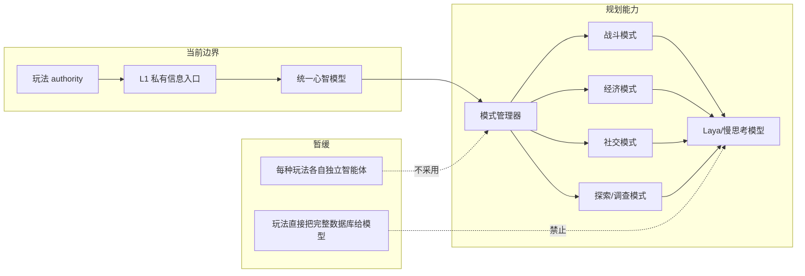
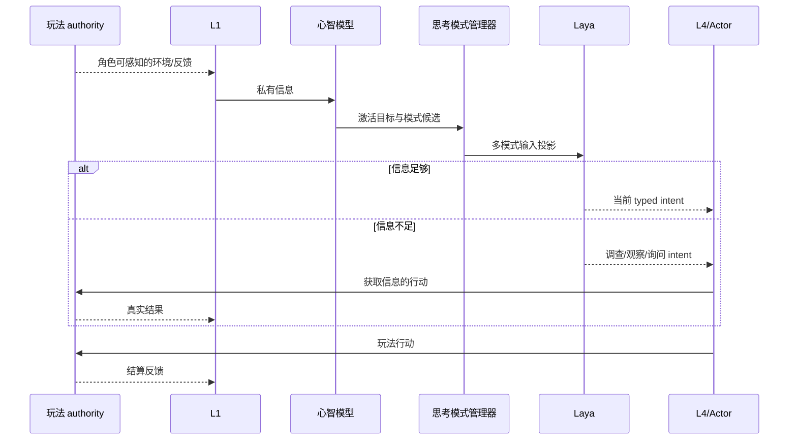
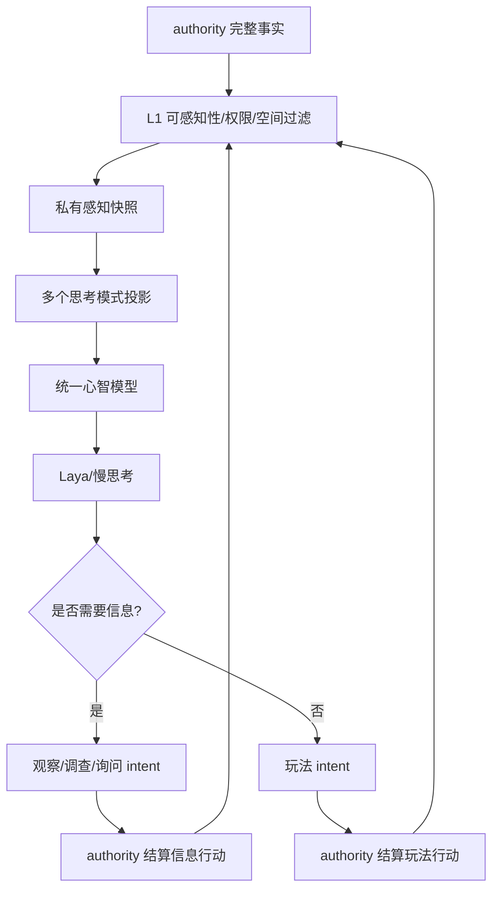

# 05 玩法思考模式适配与 L1 信息获取设计

状态：`planned architecture; non-authorizing`

## 1. 设计目标

同一个心智模型支持不同玩法系统。玩法系统不重新造一个角色大脑，而是提供 `ThoughtMode`：规定本轮输入视角、问题维度、输出类型和可用范围。所有外部信息都必须经过 L1；当答案未知时，心智模型只能提出信息需求，由 L1 通过感知或行动获取。

## 2. 模式关系



## 3. 思考模式字段

```text
mode_id
activation_conditions
input_projection
question_schema
output_intent_types
priority_bias
resource_horizon
information_needs
exit_conditions
```

## 3.1 L1 边界引用

L1 的事实抛出器、provider/PQF 和 VLA advisory 三条链路的当前实现与对齐规则由 [09-L1 多源感知与信息入口设计](09-L1多源感知与信息入口设计.md) 负责。本文件只定义玩法模式如何消费 L1 投影，不重复定义感知链路。

模式可以同时激活。例如打怪取材料时，战斗模式关心威胁和攻击窗口，材料模式关心掉落线索和目标材料；它们共同进入心智模型，由 Laya 选当前唯一 intent，未胜出的目标保持为 preserved/background goal。

## 4. 信息需求接口

模型可以输出：

```text
information_request:
  need: identify_material_source
  preferred_observation: inspect_trace
  urgency: low
  expires_at: ...
```

模型可以提出信息需求，但主动观察、移动重查、询问和试探的策略细节由 [10-主动感知与记忆边界设计](10-主动感知与记忆边界设计.md) 负责。模型不能直接查询完整掉落表、地图或经济数据库；所有结果仍需通过 L1 返回。

## 5. 战斗适配

```text
输入：敌人局部感知、身体状态、队友通信、动作反馈
输出：dodge / attack / punish / protect_ally / retreat 等 intent
```

战斗模式可支持魂游 Boss 的阶段、招式观察、失败修正和协同窗口，但不拥有命中、伤害、掉落等事实。

## 6. 经济适配

```text
输入：可见价格、库存、订单、信誉线索、已知规则
输出：inspect_price / negotiate / buy / sell / reserve / wait / ask 等 intent
```

角色不知道全市场价格时，可以通过查看挂牌、询问商人、试探报价或观察交易获得信息。经济 authority 结算库存、产权、支付和价格变化；心智模型只保存角色实际知道的结果。

## 7. 时序图



## 8. 数据流图



## 9. 模式管理与触发

模式管理器由当前目标、身体风险、环境事件、信息缺口、失败记录和玩法上下文共同触发。它可以提升、降低、并行保留或暂缓模式，但不能直接写最终 belief、goal 或 world truth。Laya 负责当前动作选择；慢思考负责模式重组和长跨度取舍。

## 10. 状态标记

- `[current]`：L1 私有感知、主动感知触发、统一心智状态和玩法 authority 边界。
- `[planned]`：可注册 ThoughtMode、模式组合、信息需求 intent、战斗/经济适配器。
- `[deferred]`：玩法 authority 直接广播完整事实、每种玩法独立复制一套角色智能、模式管理器直接替模型做主观决策。

## 11. 本批规格与计划回写（2026-10-10）

本批不把战斗、经济、社交等模式实现为多个独立角色脑。它们继续作为同一心智模型的注册输入/输出适配视角，统一经过 L1 私有过滤和同一候选/intent/authority 边界；模式建议不能越过 Laya 的主观选择或 owner admission。

### 11.1 本批候选评估回写（2026-10-10）

不同 ThoughtMode 提供问题视角和合法信息需求，但不各自建立动作执行层。跨模式输入合并后，候选仍按规格05的注册动作、可见目标、affordance、能力包络和执行合同生成；Laya 一次选择完整动作＋目标，未胜出的目标保留为背景状态。评估按场景轨迹隔离，模式输入错误、候选缺陷、模型选错和 owner 执行失败分别归因。

映射：规格03、总规格00 §4.1、计划01 Task2A/3–5。当前 provider/VLA 支路仍按本设计的 blocked/可调用 advisory 边界处理，不能因模式注册而宣称完整运行时。

D16/RW-17按本设计§3–6展开跨模式评估题型，基础选择质量轨关闭人为失误、角色表现轨开启固定seed失误，两轨均保留能力上限。不同模式题必须映射真实注册动作/目标；没有准入owner的情节只作planned材料或unavailable诊断。来源审核、U/P配对、轨迹划分与final冻结详见规格05 §4.2.2–4.2.3，计划01 Task1C/计划02 Task1–3/6负责实施和回验。
