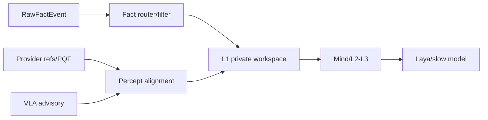
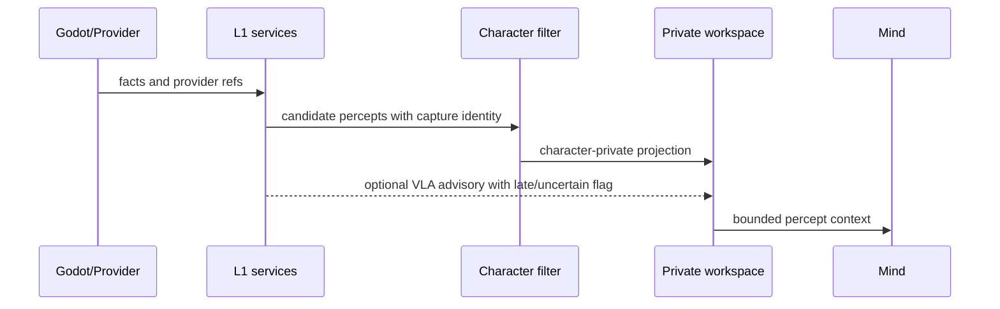
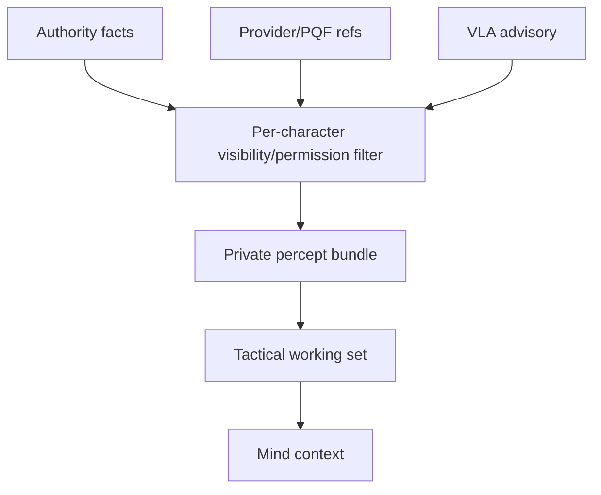

# 09 L1 多源感知与信息入口设计

状态：`planned architecture; non-authorizing`

## 1. 主题结论

L1 是角色获得信息的唯一入口，但 L1 内部包含不同来源：事实抛出器主链、provider/PQF 增强链和可调用的 VLA advisory 支路。它们共享 capture identity 和时空对齐，不等于同一个 provider，也不意味着每轮自动调用 VLA。

- `[current]`：`RawFactEvent -> CandidatePerceptEvent -> CharacterPerceivedEvent` 主链；`PerceptionInputFrame -> PQF -> CanonicalPerceptBundle` provider 链；VLA request/scheduler/cache/advisory bridge。
- `[planned]`：在 L1 私有工作区统一收敛 `self_state`、`external_state`、`event_inbox` 和 `uncertainty`。
- `[deferred]`：玩法直接把完整数据库推给模型；VLA 覆盖事实或 authority。

## 2. 架构图



## 3. 时序图



## 4. 数据流图



## 5. 设计规则

```text
事实链：稳定、可回放、可审计
provider/PQF：携带同一拍的视觉、空间、听觉、身体和骨架引用
VLA：补充视觉/空间解释，允许超时、过期和低置信度
L1：执行可感知性、权限、空间、时间和角色私有过滤
模型：只能消费 L1 投影，不能直接读取 authority 隐藏状态
```

## 6. 本批规格与计划回写（2026-10-10）

本批把 L1 继续固定为所有角色信息的唯一入口。Laya、慢思考、Deep Model、VLA advisory 和不同玩法消费方只能读取经过角色权限、空间、可见性和新鲜度过滤的私有投影；模式扩展不能创建第二条完整事实链，也不能把 provider advisory 升格为 authority truth。

映射：规格03/04、计划01 Task2A/3–5；provider 真实可用性和字段协议仍需独立 evidence。
