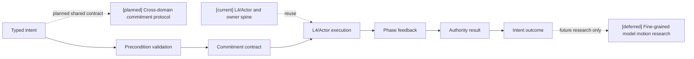
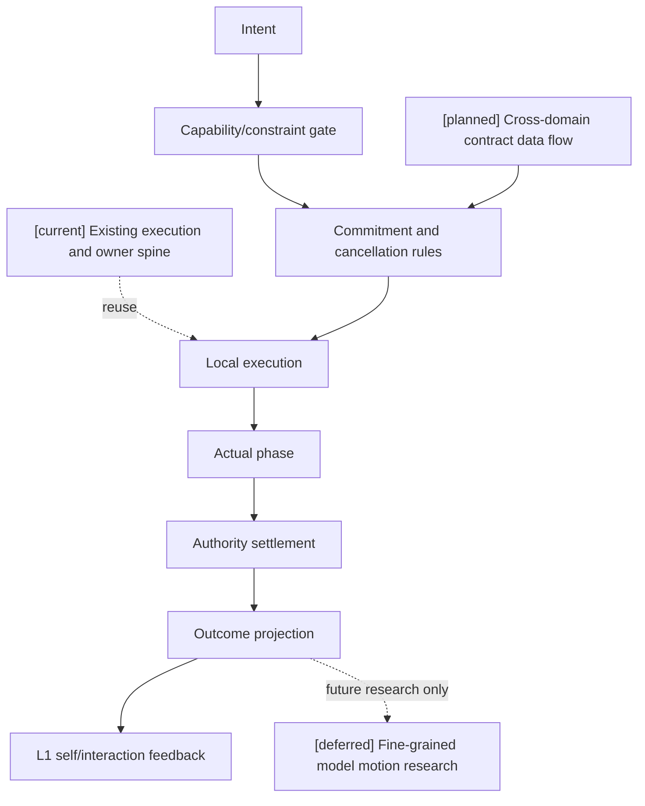
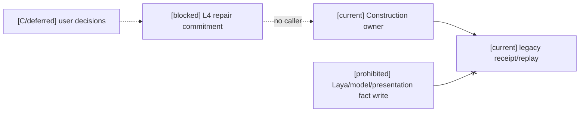
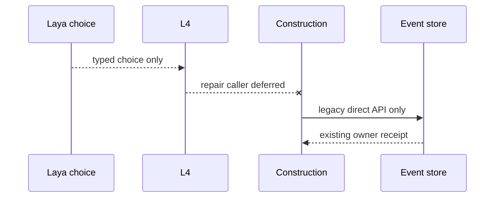
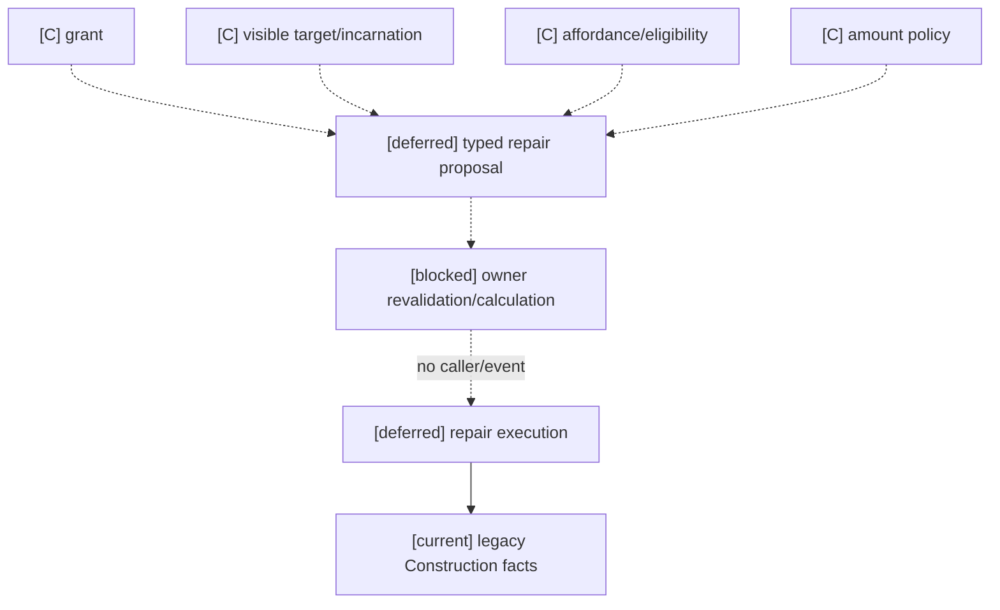

# 11 跨玩法动作承诺协议设计

状态：`planned architecture; non-authorizing`

## 1. 主题边界

本文只定义 Laya/模型输出如何被 L4、CharacterActor 和 authority 接受、执行、取消和反馈。战斗快循环与慢思考策略由 [02-Laya 快循环与快慢思考战斗设计](02-Laya快循环与快慢思考战斗设计.md) 负责；传统 Boss 的动作启发由 [07-传统游戏 AI 感知与 Boss 战思考模式设计](07-传统游戏AI感知与Boss战思考模式设计.md) 负责。

- `[current]`：L4、Actor ingress、authority settlement 和动作结果投影的运行时骨架。
- `[planned]`：跨玩法统一的 typed action commitment、阶段、取消条件和失败回退。
- `[deferred]`：模型驱动精细动作生成研究。
- 始终禁止：模型绕过 L4 和 authority 直接写身体或世界真值。

## 2. 协议结构



## 3. 动作契约

```json
{
  "intent": "dodge_left",
  "target": "boss_01",
  "commitment_ms": 420,
  "preconditions": ["stamina >= 12", "left_route == reachable"],
  "abort_conditions": ["ground_lost", "incoming_area_attack"],
  "fallback": "guard",
  "context_revision": "self-1842"
}
```

协议同时适用于战斗、经济、社交和调查动作，例如 `buy`、`ask`、`inspect`、`dodge`，区别由 ThoughtMode 注册 intent 类型和约束。

对于战斗动作，协议不把物理引擎当作 authority，也不跳过物理证据：`L4/Actor` 将 typed action commitment 交给对应执行器，Gameplay Foundation 的 physics evidence adapter 返回碰撞、接触、轨迹、遮挡或冲量证据，战斗内容包所属 authority 再将证据解释为命中、闪避、控制、资源和状态结果。经济、社交和调查动作可以使用各自的 domain adapter，但最终遵守同一套承诺、执行和 authority result 生命周期；时间戳通过 [16-通用玩法时序模型与编辑器设计](16-通用玩法时序模型与编辑器设计.md) 定义的 mapping 关联到领域结算窗口。

## 4. 动作生命周期

```text
queued -> accepted -> startup -> active -> recovery -> completed
                         \-> interrupted / failed / blocked
```

必须区分：

```text
intent：我想做什么
request：请求是否被执行层接受
execution：身体或交互通道实际做到哪一步
result：authority 最终确认的结果
```

## 5. 时序图

```mermaid
sequenceDiagram
  participant Y as Laya/Model
  participant V as L4 validator
  participant X as Actor/Executor
  participant A as Authority
  participant L1 as L1 feedback
  Note over Y,L1: [current] L4/Actor and authority spine; [planned] shared commitments and time mapping; [deferred] fine-grained model motion
  Y->>V: typed intent + context revision
  V->>X: accepted commitment
  X-->>L1: startup/active/recovery
  X->>A: authority request
  A-->>L1: completed/interrupted/failed result
  L1-->>Y: outcome at next decision window
```

## 6. 数据流图



## 7. 契约所有权

| 部件 | 负责 | 不负责 |
|---|---|---|
| Laya/模型 | 选择 intent、目标和短时承诺 | 直接控制姿态、宣称动作成功 |
| L4 | 校验能力、约束、取消和回退 | 结算伤害、资源、产权 |
| CharacterActor | 本地连续执行、动作阶段和表现 | 成为 world truth owner |
| Authority | 最终结算、revision 和结果 | 代替模型选择主观目标 |
| L1 | 接收实际状态和结果并形成私有反馈 | 把意图当成事实 |

## 8. 本批规格与计划回写（2026-10-10）

首版把模型比较单元限定为一个完整“动作＋目标”候选，并由 Laya 一次选择。候选必须来自已注册动作、可见目标、当前 affordance、能力包络和适用执行合同；动作族只用于候选生成与约束分类，不是第二层替模型做选择的 planner。模型输出仍需经过本协议的 L4 验证和 authority 生命周期。

候选预算尚未冻结：先实测包络内完整候选的规模、顺序敏感性、延迟和决策质量，再由规格05和计划02决定生产受控候选集。分两阶段先选动作族再选目标是后备研究方向，不能在首版隐式引入第二个 commitment/version/cancel 合同。

映射：规格05 §4.2、规格07、计划01 Task1C 和计划02 Task1–3；候选 schema、合法目标来源和独立留出评估仍须映射至现有注册表与 `CharacterExecutionContract`。

### 8.1 本批候选评估回写（2026-10-10）

完整候选的来源固定为已注册 `ActionDefinition`/`SkillActionBinding`、角色可见目标、当前 affordance/身体可行性、能力包络和本合同可表达的语义动作/目标引用。候选记录不是新的 authority 合同；Laya 只选择冻结集合中的完整动作＋目标，L4 仍负责承诺字段映射、取消/回退和再次准入。候选覆盖、模型选择、执行 receipt 和 authority 结果分开验收，候选缺陷不能记成模型答对。

D16/RW-17 将关闭受控失误的基础选择质量与开启固定 seed 失误的角色表现分开；两轨均保留能力/权限硬边界。当前 L4 从 attention_target 构造目标的实现必须修订为保留冻结 choice 所选目标，不能自动变成另一动作＋目标。详细题型、轨迹隔离、执行失败归因与 final 冻结合同见规格05 §4.2.2–4.2.3、规格07 §9；计划01 Task1C、计划02 Task1–3/5–6承担后续实现和实证。


2026-10-16 Task4 维修候选审查：CharacterExecutionContract 可表达角色、目标、revision 与幂等承诺；现有 ActionAttempt 入口要求物理接触证据，不能用于非物理维修。Construction 维修无真实应用 caller，owner API 未接受角色 grant、时间窗口与 read pins，因此本协议到维修事实的链路 blocked/not_verified，见[准入矩阵与三图](../回写/stage3-task4-construction-audit-20261016.md)。

## 本批规格与计划回写：Action 时间接口（2026-10-16）

本轮仅将角色16时间合同接入既有调查冲突 Action consumer；接口来源、冻结窗口、owner 权限/时间重验、receipt/Durable 恢复、旧事件兼容及激活规则统一见[规格09 Action 接口决定](../规格/09-通用时间权限投影与领域服务接入规格.md#action-consumer-接口决定2026-10-16计划04-task1)，当前实现/计划/禁止项三图及证据见[阶段三回写](../回写/stage3-task1-task2-20261015.md#action-consumer-时间接入2026-10-16)。owner 仍只拥有原调查冲突事实；case_death/终局事件不是其他角色动作的通用结果。该接线不代表完整 Laya→L4→物理→领域动作链，不启动 Task4、近战或物理执行。旧事件可回放不等于统一时间证据；测试配置与生产内容启用分开验收。

2026-10-16 Action 验证回写：现有 Stormnight caller 已经 RuntimeExecution/真实 envelope 接线至原 conflict owner/store；147 项允许列表 focused 通过，最后 caller 幂等修正后三文件21项通过，backend-contract 仅静态通过。完整事件/receipt/Durable新实例证据、兼容/激活边界、生产未配置与剩余 Task1 缺口见[阶段三 Action 最终结果](../回写/stage3-task1-task2-20261015.md)。准入 fingerprint 从历史事件恢复；配置变化无迁移即拒绝，旧 retry 保留 pins；不扩展原调查冲突终局语义。历史 Status pytest cleanup 与本轮 Action pytest cleanup 均 incomplete，Harness cleanup 单列 passed；历史 HTTP503 审查仍 incomplete。

## 本批规格与计划回写：facility repair 承诺边界（2026-10-16）

本协议 §3–4 的 intent/request/execution/result 仍分离。维修候选只能从既有 `CharacterSkillRegistry` 的获准动作定义、角色可见设施 target、当下 affordance、真实 grant 和冻结时间/source/read pins 生成；当前无维修动作登记、owner route 或真实 caller。`CharacterExecutionContract.expected_observation.grant_ref` 的撤权检查是 L4 初筛，不是签发授权或 Construction 提交前重验。现有 `ActionAttempt` 要求 contact marker/physics evidence，非物理维修不得复用它提交事实。

Construction direct API 的 `repair_amount` 由 caller 传入；角色链须先将它降为 typed proposal，由 Construction 的获准规则算最终 condition。规则、维修 grant 来源及撤销、设施 target/incarnation 和 eligibility 均仍 blocked；这些缺口不能从本协议示例 intent 推导。原 receipt/补偿仅证明 Construction 局部提交与恢复，不证明 L4 结果反馈。完整十项分类、责任/兼容矩阵及三图见[Task4 动作准入设计](../回写/stage3-task4-construction-audit-20261016.md#2026-10-16-动作准入设计收口仅设计未实施)；状态 `planned/non-authorizing; facility repair blocked/not_verified`，模型与表现永不拥有事实写入权。

### 四项 B/C 决策登记（2026-10-16）

维修链四项均登记为 **C：正式 deferred，待用户决策**：grant 的签发/撤销/owner；facility incarnation、角色可见性和 target admission；repair affordance/资格政策；`repair_amount` proposal 与 Construction owner calculation。`facility_ref` 本身不是合法角色 target，当前 condition 不能推出维修资格，caller/model 不能直接写 amount 或 `next_condition`。四项决定及解除来源见[阶段三收口登记](../回写/stage3-task4-construction-audit-20261016.md#bc-阻断正式收口四项待用户决策-2026-10-16)。未获批准前不创建 caller 或 repair event。

#### Architecture diagram



#### Sequence diagram



#### Data-flow diagram



这些图区分已有角色承诺协议、未准入的维修链和 deferred 决策，不代表实现。
