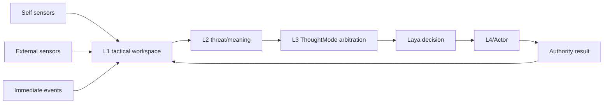
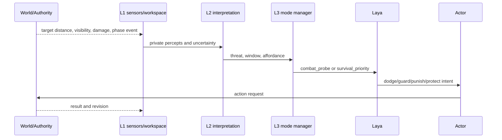
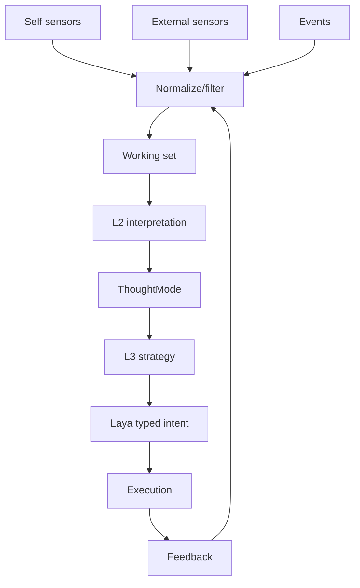

# 12 传统游戏 AI 与 ThoughtMode 设计

状态：`planned architecture; non-authorizing`

## 1. 主题结论

传统 Boss AI 的可借鉴部分是传感器、Blackboard、阶段、动作承诺和反馈闭环，而不是全知读取和独立 Boss 大脑。Boss 的 Phase 1/2/3 可以成为统一心智模型中的 ThoughtMode。

- `[current]`：统一心智模型、L1-L4 骨架、玩法模式设计和 authority 边界。
- `[planned]`：L1 tactical working set、阶段模式、模式触发、目标仲裁和失败升级。
- `[deferred]`：每种玩法复制一套智能体；模型直接读取隐藏招式表或完整敌人状态。

## 2. 游戏 AI 参考映射

```text
Boss Blackboard            角色系统
Self state                 SelfStateSnapshot
Target state               ExternalPerceptSnapshot
Recent events              L1 event inbox
Attack/recovery window     L2 affordance interpretation
Boss phase                 ThoughtMode/phase context
Behavior selection         L3 + Laya typed decision
Animation/action execution L4 + CharacterActor
```

## 3. 架构图



## 4. 时序图



## 5. 数据流图



## 6. 推荐模式

```text
combat_probe          试探招式和距离
combat_punish         识别恢复窗口并惩罚
survival_priority     低资源或高压时优先自保
protect_ally          保护队友、吸引仇恨
investigate_pattern   新招无法解释时主动观察
retreat_and_recover   脱离战斗并恢复资源
```

ThoughtMode 规定输入投影、问题维度、输出 intent 类型、资源视野和退出条件；它不是独立角色，也不是独立模型。

## 7. 本批规格与计划回写（2026-10-10）

本批不把示例中的六个战斗模式冻结为通用 runtime 枚举。它们只作为可注册 descriptor 的示例；模式的输入投影、输出 intent、激活/退出条件和资源视野必须经现有字段、L1 隐私过滤和能力/权限 gate 映射后才可准入。经济、社交和探索模式继续复用同一心智模型，未胜出目标保留为背景目标，不产生第二角色脑。

映射：规格03；计划01 Task3。模式注册表、阶段触发和真实 Laya 选择仍为 planned/blocked。
