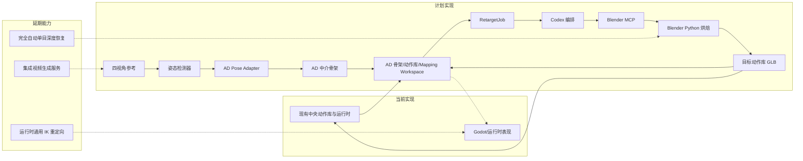
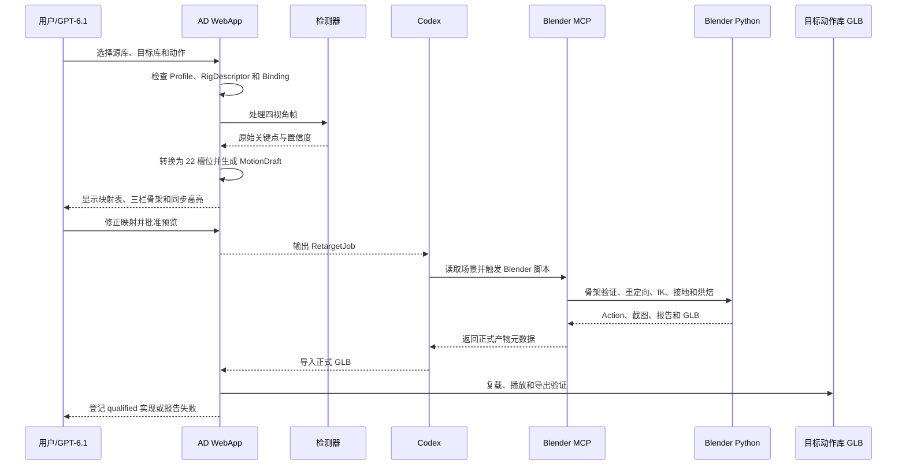
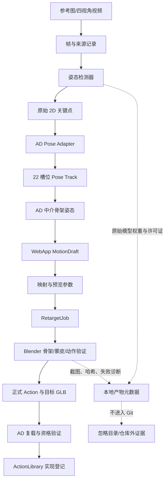

# AD 骨架、动作参考与重定向工作流设计

状态：`analysis/planned/non-authorizing`

本文记录 XSXB Animation Director（AD）面向 GPT‑6.1 的视觉动作标准、骨架注册、动作库管理、四视角参考、交互式映射、Blender MCP 正式烘焙和 GLB 复载验证方案。本文不修改现有运行时，不把浏览器预览登记为正式动作，也不授权生成或提交任何媒体资产。

上游约束：仓库现有统一动作库以 `motionlib:humanoid.v1.core@1` 为中央动作库入口，支持 `shared_library`、`retargeted_library`、`package_native` 和显式 `fallback` realization。本文补充 AD 的创作、映射和离线产物工作流，不改变后端 authority 合同。

## 1. 目标和边界

AD 的职责是管理骨架与动作、提供四视角参考、交互式映射、即时预览、时间轴编辑和正式结果复载验证。Codex 负责读取 AD 生成的重定向任务，并调用 Blender MCP 或明确授权的 Blender 离线流程生成正式 Action、Blend 和 GLB。

目标流程：

```text
骨架库 + 中央动作库 + 目标角色
                  ↓
        AD 交互映射与即时预览
                  ↓
       Codex 调用 Blender MCP 烘焙
                  ↓
         目标动作库实现 / GLB
                  ↓
       AD 复载、预览、时间轴和导出
```

范围包括：

- 固定四视角动作参考图和视频；
- 检测器输出到 AD 22 个语义人体槽位；
- AD 中介骨架和多个注册骨架之间的映射；
- 源动作库 GLB 到目标动作库 GLB 的选定动作迁移；
- 已有动作的非破坏性修改和新动作创建；
- WebApp 预览与无头 Blender 正式烘焙的边界；
- 骨架、动作库、映射和验证记录的本地数据契约。

明确边界：原始参考图、视频、关键帧、模型、Blend、GLB、MP4、纹理和生成输出放在项目规定的忽略目录，不提交 Git。本文不定义自动生成视频供应商，也不把单目 3D 姿态预测当作可靠的真实深度来源。

## 2. 核心概念

### 2.1 SkeletonProfile（正式骨架标准）

`SkeletonProfile` 是动作库可以接受的稳定骨架标准，定义：

- 稳定 ID 和版本；
- canonical bone ID、名称、父子关系和左右侧；
- Rest Pose、局部轴向、单位和前向/上向约定；
- root motion 规则；
- AD 22 个语义槽位的对应骨骼；
- 手指、脚趾、辅助骨和变形骨资格；
- 武器和道具挂点；
- 层级摘要、Rest Pose 摘要和资格状态。

骨骼数量只作为描述信息，不能单独证明兼容。未注册或结构不确定的标准必须为 `unknown`，不得自动归入某个 humanoid Profile。

### 2.2 RigDescriptor（实际模型骨架描述）

`RigDescriptor` 描述某个实际 GLB、FBX 或 Blend 中检测到的 Armature：实际骨骼名称、数量、层级、Rest Pose、骨轴、root、变形标记、结构摘要和源文件 hash。它不等于正式 Profile。

### 2.3 RigBinding（实际骨架绑定）

`RigBinding` 记录实际 Rig 到正式 Profile 或 AD 中介骨架的映射。它包含静止姿势校正、骨轴校正、骨长比例、root、接地、挂点、未映射骨、状态和验证证据。

### 2.4 AD 中介骨架

AD 中介骨架是跨骨架交换动作的标准，不是所有角色必须直接使用的唯一骨架。一个项目可以注册多个中介骨架，例如人形、带完整手指的人形和四足中介骨架。

中介骨架必须覆盖完整动作需要的根骨、髋部、多段脊柱、颈头、四肢、手指、脚趾、脚底接触点和道具挂点。22 个槽位是视觉输入标准，不是完整动作骨骼列表。

### 2.5 ActionLibrary（动作库）

每个动作库绑定一个原生 `SkeletonProfile`，并以一个 GLB 作为模型、Armature 和动作集合的承载文件：

```text
source-library.glb
├── 源网格
├── 源 Armature
└── 源动作集合
```

动作实现必须区分：

- `shared_library`：同一标准骨架，可直接共享；
- `retargeted_library`：已经迁移到目标骨架；
- `package_native`：角色包自带且已登记的动作；
- `fallback`：清单中明确声明的后备动作。

同名动作不代表兼容，兼容性必须关联 `rigId`、版本、映射 Profile、骨架签名和验证状态。

## 3. AD Visual Pose Standard

检测器可以替换 MediaPipe、MMPose、RTMPose 或其他后端，但检测器原始输出不能直接进入 Blender。统一流程是：

```text
Detector Output
→ AD Pose Adapter
→ AD 22 Slots
→ AD 中介骨架
```

AD 22 个视觉槽位为：

```text
hips, spine, chest, upperChest, neck, head,
leftShoulder, leftUpperArm, leftLowerArm, leftHand,
rightShoulder, rightUpperArm, rightLowerArm, rightHand,
leftUpperLeg, leftLowerLeg, leftFoot, leftToes,
rightUpperLeg, rightLowerLeg, rightFoot, rightToes
```

每个槽位至少记录像素坐标、置信度、可见性、遮挡、源检测点、是否为派生点、帧号和视角。`spine`、`chest`、`upperChest`、`neck`、`head` 等由肩、髋、鼻子或耳朵等输入点派生时，必须记录派生公式和组合置信度。

左右侧使用人物解剖学左右标签，不能根据画面左右重新推断。检测器、WebApp 和 Blender 都使用同一套语义 ID。

## 4. 固定四视角协议

```text
front = 0°
right = 90°
back  = 180°
left  = 270°
```

四个视角使用固定正交相机、相同分辨率、帧率、人物身高占比、地面线和时间轴。人物在每个视角中保持固定角度；不允许通过相机移动、变焦或自动裁剪模拟转身。四视角应使用同一动作的相同帧编号，以便恢复前后深度、解决遮挡和检查左右侧。

## 5. 通用 Mapping Workspace

所有不同骨架、视觉语义和变形系统的映射都进入同一工作区，不仅用于动作迁移。

映射类型包括：

```text
detector-to-slots
rig-to-hub
hub-to-rig
rig-to-rig
rig-to-mesh
bone-to-socket
```

跨骨架时显示：

```text
源骨架 | AD 中介骨架 | 目标骨架
```

检测器映射时显示：

```text
参考帧 | AD 22 槽位 | AD 中介骨架
```

表格至少包含 AD 槽位、源骨骼、AD 骨骼、目标骨骼、父骨、变形资格、Rest Pose 修正、骨长比例、状态和置信度。

点击任意行或骨骼必须同步高亮所有对应对象：

- 源、AD、目标骨骼同时高亮；
- 显示骨骼头尾、名称和父子链；
- 对应网格区域短暂变色；
- 四视角同步到相同帧；
- 相机聚焦当前骨骼。

颜色约定：源骨架蓝色、AD 骨架金色、目标骨架绿色、低置信度橙色、缺失或冲突红色。

以下情况自动打开映射工作区：导入新骨架、注册动作库、源目标骨架不同、Profile 版本变化、映射缺失或过期、检测器语义适配不完整、蒙皮未验证或道具挂点不确定。

只有源目标 `rigId`、版本和骨架签名完全一致时，才允许跳过可视映射界面；仍必须执行静默签名验证。

## 6. 两个大阶段

整个改造分为两个大阶段。第一阶段先把骨架、动作库和重定向预览的可信边界建立起来；第二阶段再把四视角关键帧参考接入动作编辑和新动作制作。第二阶段依赖第一阶段稳定的 Profile、Binding、Mapping Workspace 和 Blender 产物验证，不允许绕过这些注册和映射合同直接生成正式动作。

### 大阶段一：骨架与动作库基础、映射和预览

目标是让 AD 能管理多个骨架和动作库，并且对任何跨骨架关系提供可审查的映射表和即时预览。

包含：

- `SkeletonProfile`、`RigDescriptor`、`RigBinding` 和 `ActionLibrary` 数据契约；
- AD 中介骨架注册；
- 源动作库 GLB 和目标动作库 GLB 的登记；
- 检测器输出到 22 个 AD 槽位的适配契约；
- 通用 Mapping Workspace、逐骨对照和同步高亮；
- 已有动作的浏览器临时重定向预览；
- 已有 Action 的选择式迁移基础；
- `RetargetJob` 输出和 Codex → Blender MCP 的正式烘焙边界；
- 正式 GLB 复载、动作资格验证和动作库登记。

阶段一不承诺通过关键帧参考自动创建新动作，也不把浏览器预览作为正式动作。

### 大阶段二：关键帧参考驱动的动作编辑与动作制作

阶段二在阶段一的 AD 中介骨架上工作。其输入是固定四视角的参考图/视频、检测器输出和可选的已有 Action 先验；其输出是经过 WebApp 审查并由 Blender 正式烘焙的目标动作库 GLB。

包含两条共用同一求解器的路径：

1. **动作编辑**：已有 Action 保持只读，关键帧参考生成非破坏性修正层；WebApp 预览确认后，由 Blender 烘焙新的 Action 副本。
2. **动作制作**：从关键帧参考生成 AD 中介骨架姿态、根骨轨迹、接触事件和插值曲线，再映射到目标骨架并烘焙为新的 Action。

阶段二仍由 AD 负责关键帧摆放、时间轴、四视角验证和 MotionDraft；Codex/Blender MCP 负责正式 IK、接地、烘焙、GLB 导出和几何验证。

## 7. 两个大阶段下的四个子阶段

### 大阶段一 / 子阶段 0：Profile 注册

先分离 `SkeletonProfile`、`RigDescriptor` 和 `RigBinding`。补齐正式 humanoid Profile 的关节定义；将实际角色先登记为 `unknown` 或独立 Rig，完成拓扑、Rest Pose 和语义映射后再决定是否发布为通用 Profile。v1 到 v2 映射保持方向性，禁止为合并或缺失的骨骼反向生成假映射。

验收：未知骨架不会被误标为正式 Profile；每个正式 Profile 都有版本化、可检查的定义。

### 大阶段一 / 子阶段 1：骨架库和动作库数据契约

建立可版本化本地清单：

- 骨架库记录 Profile、实际 Rig、Binding、身材参数、校准和验证状态；
- 中央动作库按语义 ID 管理源动作和目标实现；
- 每个动作记录源文件、作者、许可证、hash、源骨架、目标实现、时长、循环、root motion、接触点、道具和资格状态；
- 清单区分源动作、原生动作和重定向实现。

验收：缺少来源、Profile、映射或验证状态时清单校验失败；素材仍只存在忽略目录。

### 大阶段一 / 子阶段 2：AD 骨架库、动作库和重定向工作台 UI

AD 提供三个工作区：

1. **骨架库**：Profile、角色模型、实际 Rig、骨骼树、Rest Pose、映射和兼容问题；
2. **动作库**：语义动作、来源、许可证、源骨架、目标实现和资格状态；
3. **重定向工作台**：源动作、目标角色、三栏骨架、逐骨映射、左右检查、Rest Pose、接地、道具挂点和版本保存。

UI 明确区分 `preview-only`、`blender-baked` 和 `qualified` 三种状态。

### 大阶段一 / 子阶段 3：浏览器即时预览和正式烘焙边界

WebApp 根据当前映射和目标 Rest Pose 临时重定向动作，用于快速检查躯干、四肢、左右侧、骨轴、root/pelvis、脚底、武器和循环边界。预览结果只保存为映射参数和 `MotionDraft`，不能直接登记为动作库实现。

Codex 读取 `RetargetJob`，调用 Blender MCP 或经过授权的无头 Blender：验证骨架签名，执行 IK、接地、root motion、Action 写入、动作合并和 GLB 导出。AD 复载导出的 GLB，通过实际播放、时间轴、MP4 和八方向导出验证后，才登记为 `retargeted_library`。

## 8. 大阶段二动作工作流

### 8.1 新动作创建

```text
四视角参考视频
→ 检测器
→ AD 22 槽位
→ AD 中介骨架关键帧
→ WebApp 全程摆放和预览
→ MotionDraft
→ 目标 RigBinding
→ Blender MCP 烘焙
→ 目标动作库 GLB
→ AD 复载验证
```

关键帧按姿势变化、速度峰值、接触、离地、最高点、落地、方向变化和遮挡变化选择，不进行单纯均匀抽帧。

### 8.2 已有动作修改

原始 Action 保持只读。WebApp 生成非破坏性修正层，记录参考帧、受影响骨骼、权重和求解参数；用户确认后由 Blender 烘焙为新 Action。支持抬手、攻击方向、脚滑、肩膀塌陷、速度和局部姿势替换。

### 8.3 关键帧动作的目标骨架落地

关键帧编辑或新动作生成完成后，用户选择目标动作库 GLB，WebApp 将确认后的 `MotionDraft` 绑定到目标 `RigBinding`。若目标骨架与草稿骨架签名一致，则直接写入；若不一致，则执行：

```text
AD MotionDraft → AD 中介骨架 → 目标骨架
```

目标 GLB 原有动作保留，新动作作为新 Action 追加；同名动作默认使用来源或草稿后缀，不静默覆盖。第一阶段的已有 Action 选择式迁移可以复用同一条目标落地链，但不包含关键帧参考生成。

## 9. Blender MCP 与 Blender Python 分工

MCP 负责读取当前场景、当前 Blend、Armature、网格和骨骼，触发脚本、显示参考帧、截取验证图和回报产物元数据。Blender Python 负责骨架签名验证、Rest Pose 与骨轴修正、IK、接地、根骨、Action 烘焙、蒙皮检查和 GLB 导出。WebApp 负责库管理、映射交互、预览、时间轴、MP4 和八方向导出。

MCP 不能替代 Blender 数值求解；浏览器预览不能替代 Blender 烘焙；GLB 文件名不能替代动作身份验证。

## 10. 数据契约示例

### RigBinding

```json
{
  "mappingProfileId": "character-a-to-ad-human-v1",
  "sourceRigId": "character-a-v2",
  "targetRigId": "ad-human-v1",
  "mappingType": "rig-to-hub",
  "bones": {
    "leftUpperArm": {
      "sourceBone": "arm.L",
      "targetBone": "upper_arm.L",
      "restCorrection": [0, 0, 0, 1],
      "lengthScale": 1.02,
      "status": "verified"
    }
  },
  "unmappedBones": [],
  "warnings": []
}
```

### RetargetJob

```json
{
  "sourceGlb": "source-library.glb",
  "targetGlb": "target-library.glb",
  "selectedActions": ["Walk", "Slash"],
  "sourceRigId": "source-rig-v1",
  "targetRigId": "target-rig-v2",
  "mappingProfileId": "source-to-target-v1",
  "previewStatus": "approved"
}
```

### MotionDraft

```json
{
  "rigId": "ad-human-v1",
  "rigVersion": 1,
  "frames": [],
  "semanticSlots": {},
  "boneLocalTransforms": {},
  "rootMotion": {},
  "contacts": {},
  "solverVersion": "ad-pose-solver-v1"
}
```

## 11. 资格验证

### 骨架

- Profile、RigDescriptor、Binding 版本一致；
- 22 个核心槽位映射完整；
- 左右骨骼没有交换；
- 父子关系和 Rest Pose 正确；
- 根骨存在且规则明确；
- 目标骨是变形骨；
- 没有重复 Armature 修改器；
- 所有网格顶点有有效权重。

### 动作

- 参考关键帧与目标姿态对齐；
- 手脚接触事件正确；
- 没有明显脚底滑动、穿地或严重穿模；
- 根骨移动方向正确；
- 道具挂点稳定；
- 循环动作首尾连续；
- 低置信度帧有人工处理记录。

### WebApp

- 正式 GLB 能被 AD 复载；
- 动作卡片、时间轴、调速、修剪和重排正常；
- 控制台无加载或动画错误；
- MP4 可解码；
- 八方向输出的 manifest、动作 ID、目录和实际内容一致。

## 12. 图表

### 架构图



### 主流程时序图



### 数据流图



图中 `[current]`、`[planned]`、`[deferred]` 的边界以架构图图例为准。当前实现只覆盖中央动作库、部分动作 realization、浏览器播放和既有验证入口；AD Mapping Workspace、四视角 Pose Track、RetargetJob 与 Blender MCP 编排属于 planned；视频生成服务、完全自动单目深度和运行时通用 IK 属于 deferred。

## 13. 产物与登记边界

建议的本地产物目录：

```text
reference-images/
reference-video/
extracted-frames/
pose-keypoints/
blender-calibration/
retargeted-actions/
verification/
```

每个任务记录来源、生成标记、作者、许可证、生成参数、视频帧率、相机参数、关键帧时间、关键点置信度、骨骼映射、接地参数、Blender 版本、MCP 状态和输出 hash。

正式登记顺序为：

```text
preview-only
→ blender-baked
→ webapp-verified
→ qualified
→ action-library realization
```

任何浏览器预览、未验证 GLB 或未完成 RigBinding 的动作都不能登记为正式动作库实现。

## 14. 当前代码映射和后续实现入口

现有 XSXB Animation Director 的 `DirectorScene`、`RigCalibrationScene`、`rigCalibration.ts`、`animation-packs.json` 和 `validate-local-assets.mjs` 可作为 WebApp 预览、22 槽位校准、动作清单和静态资产验证的基础。当前 manifest 的 `actorMode`、`boneMatch`、`groundingTime` 和 `groundOffset` 不能单独替代 `SkeletonProfile`、`RigDescriptor`、`RigBinding` 和骨架签名。

后续实现应按两个大阶段拆分：

### 大阶段一

1. 建立 Profile、RigDescriptor、RigBinding 和 ActionLibrary schema；
2. 建立 AD 中介骨架和 22 槽位适配契约；
3. 建立通用 Mapping Workspace 与同步高亮；
4. 建立已有动作的浏览器预览、RetargetJob 和 Codex → Blender MCP 正式烘焙链；
5. 完成 GLB 复载、动作库登记和现有中央动作库资格验证。

### 大阶段二

1. 建立固定四视角参考、关键帧数据和姿态相位识别；
2. 在 WebApp 中实现关键帧摆放、非破坏性动作修正和新动作草稿；
3. 将关键帧姿态转换为 AD 中介骨架的局部变换、root motion、接触和插值数据；
4. 通过同一 `RetargetJob` 调用 Blender MCP，生成目标骨架 Action 和 GLB；
5. 通过 AD 复载、时间轴、MP4 和八方向导出完成最终验证。

本文是方案文档，不表示上述 planned 能力已经实现或已经通过运行时验证。

## 本批规格与计划回写（2026-10-10）

执行范围补记（D15/RW-16）：用户于2026-10-10要求第8项AD工作流暂不处理，规格16与计划07为 `paused-by-user`、暂不启动。两阶段设计与资格要求保留至用户恢复，当前不调查AD基线或执行映射、Blender烘焙、GLB复载与专项资格化。已有合格动作可支撑角色与B/C真实验证，未资格化新动作不得启用；本专项不作为待决项1–6门禁。见 [执行决策D15](../审查/03-实施待决收敛与验证闸门.md)与 [回写RW-16](../回写/README.md)。

本批核对后确认 XSXB Animation Director 工程位于 `D:\Users\User\Documents\XSXB-animation-director`；`src/DirectorScene.ts`、`src/RigCalibrationScene.ts`、`src/rigCalibration.ts`、本地素材 manifest 示例与 `scripts/validate-local-assets.mjs` 均存在。工程当前以本地 WebApp、Rig 校准、manifest/素材结构校验和浏览器动作编辑为基线；仓库中的相关实现不能证明本文列出的完整 `RetargetJob`、Blender MCP 正式烘焙、GLB复载资格化链已经贯通。

据此，规格16将已能定位的WebApp/中央动作库边界列为 `current`，将完整映射、正式烘焙与资格化列为 `planned`；计划07 Task1改为核对真实实现、运行证据和剩余合同，不再把工程位置未知作为阻断。Task2–8仍须按本文各阶段获取WebApp、Blender、GLB和动作库的独立证据。此次只校正实现基线及任务入口，没有改写本文的两阶段目标。
