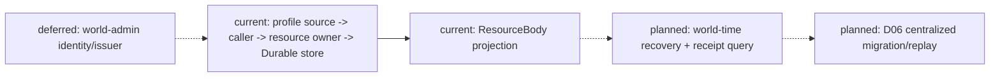
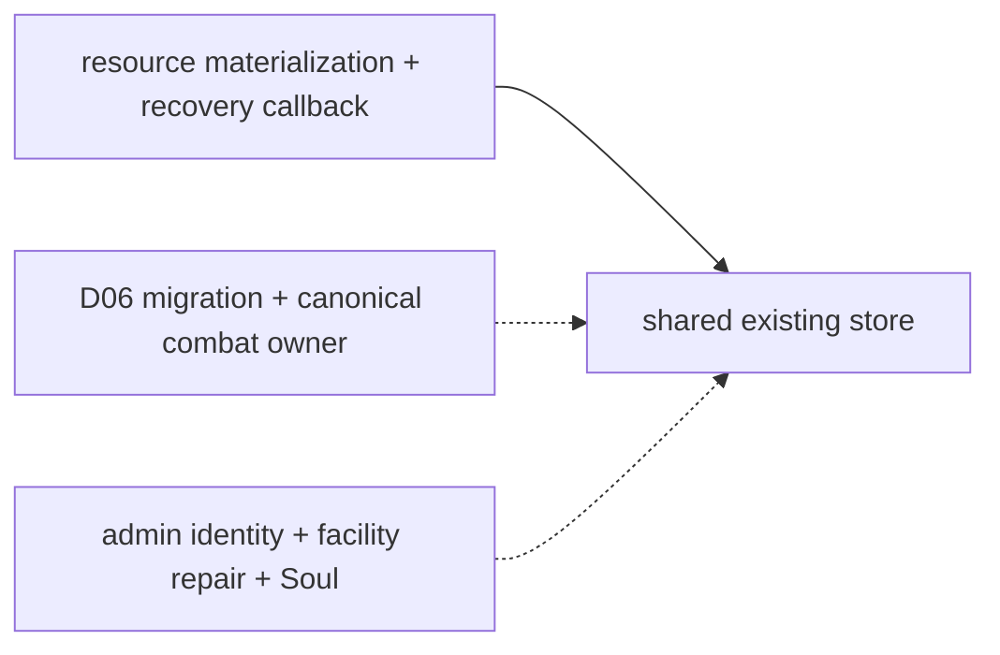
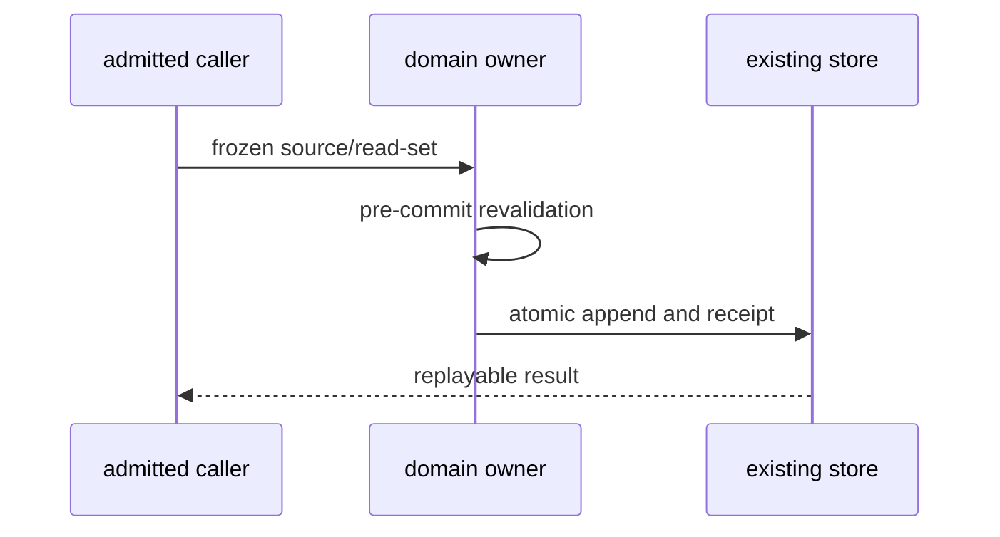
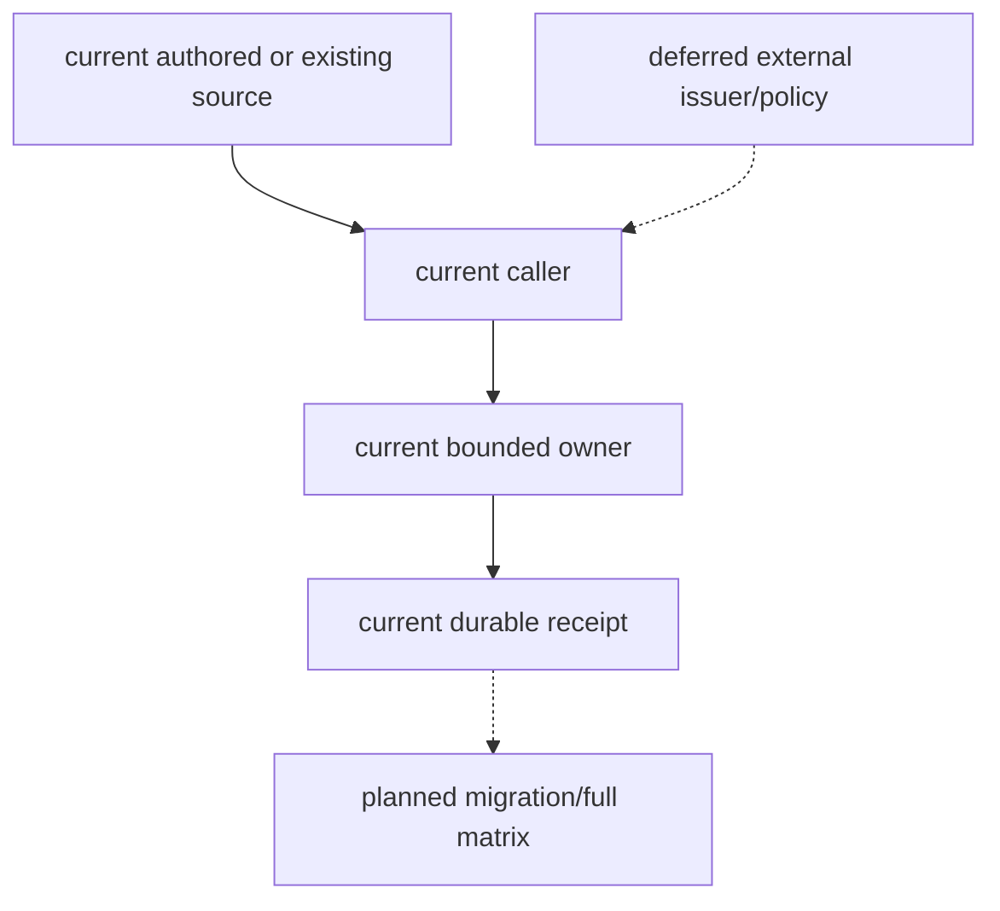
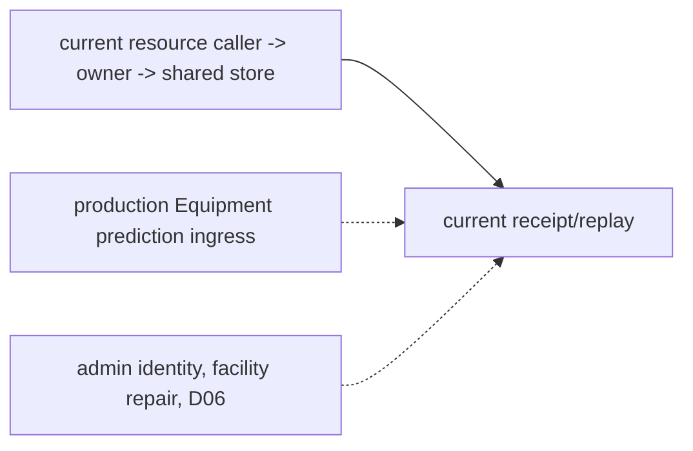
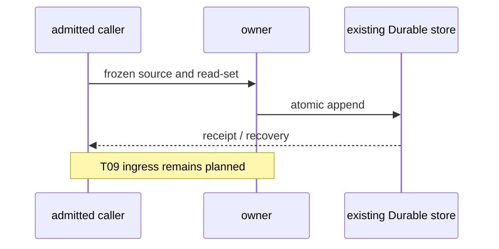
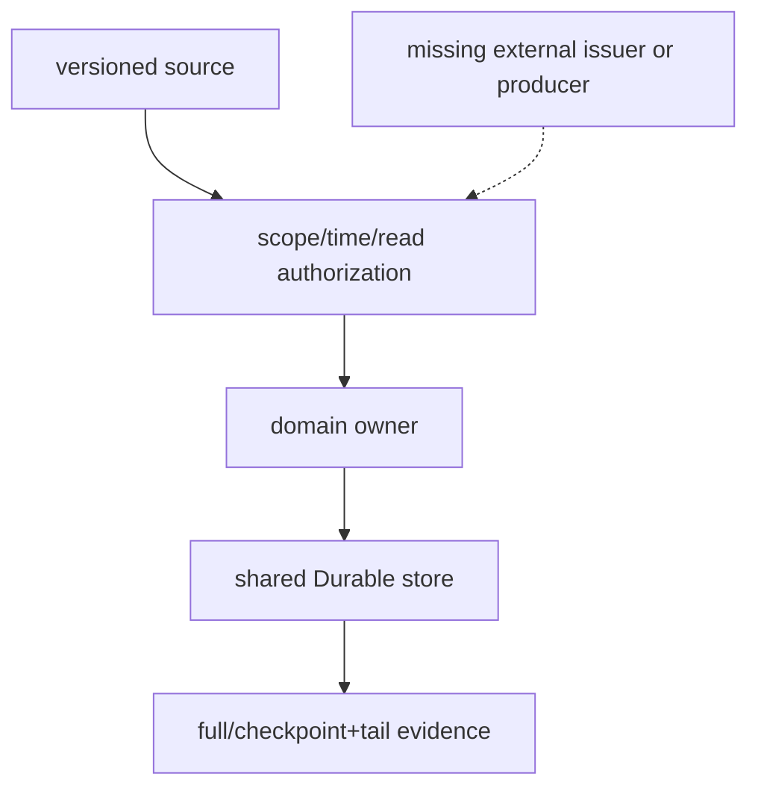

# 通用合同与领域服务实施计划

2026-10-17 当前授权索引：用户已授权继续 Task1–Task6 的来源调查、正式技术设计、可逆实现与验收；2026-10-18 明确委托本代理决定全部产品政策。较早“本轮不启动 Task5/6”及“需另行授权”文字仅是历史轮次约束，不覆盖当前授权。当前需求—来源—实现—证据矩阵、所选政策及缺来源处的 fail-closed 处理见[阶段三总收口审查](../回写/stage3-closure-20261016.md)。该委托不允许推造业务事实、外部源、权限或 caller。

执行边界补记（2026-10-10）：按 [D15](../审查/03-实施待决收敛与验证闸门.md)，规格14/16与计划05/07暂不启动，不作为本计划的开工或完成前置。角色/领域必要的时间、权限、owner、receipt与投影仍按本计划调查和验证；不借此启动通用编辑器控制面或AD专项。现有合格动作与实际Actor表现由对应角色/B/C任务提供证据。

状态：`analysis/planned/non-authorizing`。本计划落实规格09–12；不是运行时实现授权，也不把分析规格中的规划合同当成现有 API。

执行与验收补记（2026-10-15）：本轮用户明确授权按局部依赖实施；“阶段三”仅指本计划／规格09–12。顺序为真实backend choice回合 → 计划02/03角色基础 → 本计划Task1 → Task2。角色基础前置按consumer所需的时间、revision/expiry、权限、owner receipt、幂等和恢复逐项判断；Godot未验证、模型质量未验收、未来soul owner、全部资源迁移、近战与B/C不是无依赖后端合同的统一开工门。缺口只阻断依赖它的consumer。

本轮Task1、Task2均已开始实施并有局部合同证据，整体尚未完成：Task1新增六时间对象、既有clock的可选pins/mapping与激活拒绝、到期选择，population driver已接生产时间pins与既有持久化恢复；Task2新增两个既有owner操作的冻结batch/实际receipt恢复、event-projection cut/tail及adapter能力交集/故障门。其他生产consumer迁移、完整快照、随机/预测与引擎descriptor发布仍待实施。具体API、初批41项新增测试和102项focused回归及后续population切片增量、当前架构/时序/数据流与局部缺口见 [阶段三实施回写](../回写/stage3-task1-task2-20261015.md)，登记入口见 [回写登记](../回写/README.md)。合同测试不代表领域、Godot或整项最终验收。

2026-10-17 RW-50 复验：Inventory custody participant 已通过真实应用入口、同一 Durable 路径的关闭/重开新 authority、checkpoint/tail 应用和 full 对照。该实现只扩展已存在 Inventory custody 的声明 replay 范围；完整 `SettlementWindow`、temporal authorization、随机/预测与 Task6 跨域门禁仍未完成。其 current/planned/deferred 架构、时序和数据流图见规格09对应增量与阶段三 closure，不把 Inventory custody并入核心 ResourceEntry。

> **For agentic workers:** REQUIRED SUB-SKILL: Use superpowers:subagent-driven-development or superpowers:executing-plans to implement approved tasks with the gates below.

**Goal:** 在角色基础通过后，复用现有时间/event/receipt和领域owner，准入通用时间、资源/状态/效果、动作证据与生命连续性增量。

**Architecture:** 沿既有Gameplay Foundation和System L1/L6接口增量接入；跨owner按实际receipt恢复，角色只消费私有投影。新owner/API必须先按原文和现有实现审定，不建立平行底座。

**Tech Stack:** 现有Python/Pydantic、Gameplay/WorldRuntime、pytest、Harness与适用Godot evidence。

**Spec:** [09](../规格/09-通用时间权限投影与领域服务接入规格.md)、[10](../规格/10-通用资源状态效果影响源与装备领域规格.md)、[11](../规格/11-技法动作结算与非战斗语义适配规格.md)、[12](../规格/12-生命连续性关系状态与动态行为规格.md)。

## Review Focus

- 裸clock/step比较：Task1拒绝未映射输入，render不推进世界。
- A已提交B冲突/timeout：Task2/6保留A，查询receipt与后继恢复；不承诺全局原子回滚。
- 原文资源字段误认为已实现：Task3核对maximum/reserved与capacity/locked版本映射。
- 过期物理/空间证据：Task4拒绝或重查，动画/接触不伪造命中。
- spawn/despawn/revive身份与隐私：Task5核对独立owner/admission/tombstone，追加actor默认不替换。

## 目标与执行边界

先完成角色规格01–08/16的基础验收：计划01–02、计划03现有 owner 的表达/协同与缺 owner 拒绝边界、计划07适用的现有动作库资格和 actor 合同；再接入时间、结算、资源/状态/效果、动作和生命连续性等通用 owner 增量。计划03 Task5的未来灵魂真实结果等待本计划相关 owner 准入后返回验收；AD 工程已定位，只有未证实的 AD mapping/bake/qualification 子路径阻断相应动作接入。Battle/Combat 是这些服务的消费适配之一；开门、交互、救援、生产、移动、社交等已注册消费方使用同一组 owner 边界，不因历史命名而被改成 combat-only。

实现顺序为 Task 1 时间对象与时钟映射 → Task 2 owner 批次、回执恢复、预测/回放与 adapter admission → Task 3 Stable/Hot/Delta 及资源/状态/效果/装备接入 → Task 4 技法、动作与空间证据 → Task 5 生命/连续性/关系动态原语 → Task 6 跨域故障验收。Task 3–5 在 Task 1–2 的 owner、时间窗口和回执合同可用后才开始；Task 5 的 entity presence / spawn / despawn 接入必须单独通过 owner admission。

本计划里以“候选新文件”列出的路径是实现时供评审的建议位置，不表示该模块存在或原分析指定了这个文件名。若 owner admission、代码归属或已存在 API 不匹配，先更新规格/计划再实现，不得借创建文件补造权限、事实 owner、第二时钟、调度器、事件库或标签 registry。

角色基础前置不包括真实连续Boss B、双角色协同 C或未来Soul功能完成；这些场景所需领域在本计划准入后按总计划Task6A/计划03 Task6A依次回验。资源按 [D06](../审查/03-实施待决收敛与验证闸门.md)集中切换；Life/Presence/Soul按D11从明确不可用过渡到真实owner私有投影，再返回角色验收。不取消规格09–12的planned交付，不将不需要Soul的场景绑定到完整灵魂工程。

## 来源到验收与任务映射

| 原设计来源 | 本批规格验收 | 本计划任务 | 图示来源 |
|---|---|---|---|
| [角色16](../角色/16-通用玩法时序模型与编辑器设计.md) §1、§2.1–2.3、§3–6 | [规格09 T01–T03](../规格/09-通用时间权限投影与领域服务接入规格.md#11-验收) | Task 1（T02 含迁移） | 规格09 §8–10 |
| [角色16](../角色/16-通用玩法时序模型与编辑器设计.md) §2.4、§7.1–7.5、§12 | 规格09 T04–T12（T07 为随机/顺序确定性） | Task 2 | 规格09 §8–10 |
| [战斗04](../战斗系统与角色技能，状态和资源/04-战斗状态、CombatPrefill与高频读取计划.md) 全文；[编辑器03](../编辑器与能力权限治理/03-编辑器版本发布、预览与运行时同步设计.md) §4–6；[编辑器04](../编辑器与能力权限治理/04-十月分析领域接入与编辑器同步矩阵.md) §2、§4、§7 | 规格09 V01–V04 | Task 3 | 规格09 §8–10 |
| [战斗02](../战斗系统与角色技能，状态和资源/02-角色战斗资源与资源转换计划.md) §1–2；[战斗05](../战斗系统与角色技能，状态和资源/05-效果通道、环境场与生命精神灵魂规则设计.md) §1–8；[战斗06](../战斗系统与角色技能，状态和资源/06-外物、装备、药品与使用限制定义.md) §1–10、§15；[战斗07](../战斗系统与角色技能，状态和资源/07-战斗影响源、标签与跨维度效果设计.md) §1–4、§6–8、§13；[战斗08](../战斗系统与角色技能，状态和资源/08-对象标签、编辑与版本治理设计.md) §2–8、§13；[战斗11](../战斗系统与角色技能，状态和资源/11-通用装备系统设计.md) §1–6、§10 | [规格10 R01–R05、E01–E04、I01–I07](../规格/10-通用资源状态效果影响源与装备领域规格.md#10-验收) | Task 3 | 规格10 §7–9 |
| [战斗01](../战斗系统与角色技能，状态和资源/01-技法构筑、司命裁定与世界观规则计划.md) §1–9；[战斗03](../战斗系统与角色技能，状态和资源/03-攻防治疗招数数据与动作参数计划.md) §1–4；[战斗05](../战斗系统与角色技能，状态和资源/05-效果通道、环境场与生命精神灵魂规则设计.md) §1–7；[战斗07](../战斗系统与角色技能，状态和资源/07-战斗影响源、标签与跨维度效果设计.md) §6–8；[角色11](../角色/11-跨玩法动作承诺协议设计.md) 全文；[角色16](../角色/16-通用玩法时序模型与编辑器设计.md) §2.3–2.4、§6 | [规格11 A01–A06、P01–P06](../规格/11-技法动作结算与非战斗语义适配规格.md#8-验收) | Task 4 | 规格11 §5–7 |
| [战斗09](../战斗系统与角色技能，状态和资源/09-战斗动态原语、关系状态与战斗倾向设计.md) §1–5、§7–8；[战斗10](../战斗系统与角色技能，状态和资源/10-生命状态、伤势与死亡连续性设计.md) §1–8；[战斗05](../战斗系统与角色技能，状态和资源/05-效果通道、环境场与生命精神灵魂规则设计.md) §5–8；[角色06](../角色/06-自身状态感知与具身反馈设计.md)；[角色08](../角色/08-游戏AI启发下L1-L4架构增强设计.md)；[编辑器04](../编辑器与能力权限治理/04-十月分析领域接入与编辑器同步矩阵.md) §2、§4 | [规格12 L01–L09、D01–D08](../规格/12-生命连续性关系状态与动态行为规格.md#9-验收) | Task 5 | 规格12 §6–8 |

## 前置、共用约束与完成判据

- 前置证据：计划01–02的 MindFrame、Laya 快循环、记忆/召回/写回、能力学习、L4 与反馈；计划03的独立表达/协同和现有资源消费/缺灵魂 owner 拒绝；计划07的适用现有资产/actor 边界。未来灵魂 owner 的接入和已定位 AD 工作台尚未证实的 mapping/bake/qualification 子路径分别列为局部待决，不能形成“计划03全完成才准入其所需 owner”的循环。每个 Task 重读实际实现和证据。
- 事实唯一写入方始终是已 admission 的领域 owner。模型、Laya、Siming、Godot 表现、preview、缓存都不能提交事实。
- 跨 owner 不是全局事务。获准单个 owner/event vector 的原子操作只能完整提交或零写；A 已提交而 B 失败时保留 A 的事实/receipt，查询回执后做有界恢复、后继 plan 或 owner 批准的补偿。
- 使用现有 `GameplayEventStore`、shared contracts、revision 和领域 authority。不可因集成创建第二 event store / clock / scheduler / tag registry。
- `Stable` 仅 definitions/policies/revisions；`Hot` 是带 owner revision 与权限过滤的当前读取；`Delta` 是带序号/来源的变化与失效。缓存不是 authority，命令结算时重读 owner 当前状态。
- 不扩大任何 runtime schema 前先验证 October 原设计是否有该字段/策略、owner 是否 admission、历史兼容与 migration 是否定义。原文没有 owner/API 的能力标为阻塞的 admission 子任务，不能臆定实现。
- 每个 Task 的测试步骤以真实代码断言 owner 边界/回放/拒绝结果，不仅镜像实现。Create 标记代表仓库里不存在该测试文件。

### Task 1：通用时间对象、来源时钟映射与激活迁移

**依据**：角色16 §1、§2.1–2.3、§3、§4–6、§8；规格09 T01–T03（激活迁移为 T02）。

**前置**：确认 `simulation_clock.py` 与 `scheduling.py` 的真实调用方、推进 owner、当前单位与回放边界；列出世界/场景/角色时钟目前如何进入运行时。不存在统一 mapping API 时，先做 owner admission。

**文件责任**

- Read：`backend/app/world_runtime/simulation_clock.py`、`backend/app/world_runtime/scheduling.py`、`backend/app/world_runtime/population_driver.py`；`backend/app/gameplay/action_window_runtime.py`、`backend/app/gameplay/action_graph_content.py`；`backend/app/character_agent/models/turn_context.py`。
- Modify only after API review：`simulation_clock.py` / `scheduling.py` 的现有推进入口；`turn_context.py` 只添加已由角色计划定义的 revision/time pins，不令 CharacterTurnContext 成为时间 owner。
- Candidate new contract file, if package ownership review approves: `backend/app/world_runtime/temporal_contracts.py`. 该路径不是现存模块、也不是十月原文要求的命名；不得把 clock implementation 搬入此处。
- Existing tests：`backend/tests/test_simulation_clock.py`、`test_world_runtime_scheduling.py`、`test_action_window_runtime.py`、`test_action_window_godot_contract_static.py`。
- Create：`backend/tests/test_temporal_mapping_contract.py`，针对实际接线的输入/输出公开接口，不测试未准入的孤立 schema。

**合同与步骤**

1. 对照角色16 §2.1–2.3 实现/验证且仅实现原文的六个名词合同：`TemporalProfile`、`SimulationTimeline`、`SimulationTime`、`ClockMapping`、`ScheduledWork`、`SettlementWindow`。检查字段、scope 与迁移都能追溯至原章；world time 与 timeout/UI、安全 lease 等 operational clock 保持分离。
2. 在现有 clock ingress 验证 physics step/render/input/network/role wake-up 的显式单位、ratio、rounding、freshness 和 mapping revision。无 mapping 的 turn 与秒不得互推；render 丢帧不推进权威世界时间；裸跨 timeline step 不比较。
3. 验证 profile 变更只能在约定 activation boundary 生效；在途动作/工作继续使用原 pins。验证工作预算耗尽保留 cursor，不能丢 tick 或提前确认。
4. 若角色 turn context pin 需要改动，使用角色已有 revision 约定并验证旧调用方兼容；禁止令 Laya/model output 成为时间推进输入的权威。

**命令与期望**

```powershell
cd backend
python -m pytest -q tests/test_simulation_clock.py tests/test_world_runtime_scheduling.py tests/test_action_window_runtime.py tests/test_action_window_godot_contract_static.py tests/test_temporal_mapping_contract.py
```

预期：既有时钟/调度/API 合同仍通过；新增案例证明 render 不推进、缺 mapping 拒绝、单位/舍入 pins 稳定、activation 不改写在途 work；退出码 0。新增文件尚未创建时该命令在实施期执行，不是本计划写作轮已经跑过的证据。

**回滚点**：若旧 clock consumer 或存档无法带 pins，撤回仅本 Task 的新接线/新字段 migration；保留旧时间语义，不回滚已提交 domain events；把缺失 consumer admission 记为未通过，禁止 Task 2–5 假装有合约可用。

### Task 2：owner 批次、提交回执、恢复、预测与回放准入

**依据**：角色16 §2.4、§7.1–7.5、§12；规格09 T04–T12。

**文件责任**

- Read：`backend/app/gameplay/shared_contracts.py`、`backend/app/gameplay/event_store.py`、`backend/app/gameplay/semantic_authority.py`；`backend/app/world_runtime/projection.py`、`l1_fact_projection.py`；Task 1 涉及的 time/window 实现。
- Modify：只在现有 event / authority APIs 缺少可追溯字段且原设计有定义时，修改 `shared_contracts.py`、相关领域 authority 和 `event_store.py`。事件 append 和已存在幂等约束不得迁走。
- Candidate orchestration module, owner review required: `backend/app/world_runtime/batch_settlement.py`；candidate replay contract module: `backend/app/world_runtime/replay_checkpoint.py`。这些是实现位置建议，不代表现有 scheduler 或 event store。
- Existing tests：`backend/tests/test_gameplay_shared_contracts.py`、`test_gameplay_event_replay.py`、`test_character_action_replay_determinism.py`、`test_action_consequence_boundaries.py`。
- Create：`backend/tests/test_world_batch_settlement_recovery.py`、`test_world_replay_checkpoint_cut.py`，前者调用 admitted owner APIs，后者调用真实 event/replay APIs。

**合同与步骤**

1. 按角色16 §2.4 为一批建立确定的输入 digest、冻结 read-set/evidence、参与 owner 合同、依赖顺序、幂等键、confirmation boundary 和 cursor；把 `collected/evaluated → validated → committing → completed/pending_recovery` 作为 batch orchestration 阶段，绝不宣称是 `ScheduledWork` 生命周期。
2. 每个 owner 操作记录原设计允许的 `OwnerCommitReceipt` 输入/结果和前后 owner revisions。单 owner 原子操作拒绝时应无该操作写入；多 owner 若前者已提交、后者冲突/超时，验证前者保留、后者回执查询、有界恢复/后继 plan/批准补偿。禁止全局零写/全局回滚假象。
3. 重复命令：exact duplicate 查询/返回原 receipt；changed duplicate 拒绝；commit 后 timeout 先查回执；successor plan 用新 key/ref 原批次，不重复扣费或复用旧幂等键改载荷。
4. 按角色16 §7.1–7.2 固定 random key 所需 timeline/window/operation/effect/target/draw index 与算法/seed-policy revision。private seed 不进入 role snapshot。prediction provisional ledger 与正式 event append 隔离；确认时重新验证 owner current revisions；不允许模型重选已接纳历史决策。
5. 按 §7.4 实现 consistent cut / replay tail 所需的版本、游标、digest、缺段/incomplete/divergent 判定；先读真实 authority event ordering 与序列化现状。按 §7.5 在 adapter admission 时求能力交集；能力丢失会阻止对应确认并留可诊断 fault。

**命令与期望**

```powershell
cd backend
python -m pytest -q tests/test_gameplay_shared_contracts.py tests/test_gameplay_event_replay.py tests/test_character_action_replay_determinism.py tests/test_action_consequence_boundaries.py tests/test_world_batch_settlement_recovery.py tests/test_world_replay_checkpoint_cut.py
```

预期：单 owner 原子拒绝零写；跨 owner fault injection 保留已成功 owner 的事件与 receipt；duplicate 不重复 append；未知 receipt 可查询；预算耗尽不推进确认游标；full replay 与 compatible checkpoint+tail 一致；缺段/digest/decoder 错误停止且不补造历史。退出码 0。

**回滚点**：如新 replay decoder/pin 不兼容，拒绝该新版本 replay 或使用旧兼容解码器，不重写旧事件；如跨 owner 恢复 contract 有歧义，关闭新 consumer admission 并保留 owner 已提交事实，禁止清账/全局撤回。

### Task 3：投影分类和通用资源、状态、效果、影响源、装备接入

**依据**：战斗02/05/06/07/08/11、编辑器05；规格09 V01–V04 与规格10 R01–R05、E01–E04、I01–I07。

第四项资源静态映射与图表见 [审查06](../审查/06-第四项通用资源集中迁移与兼容边界.md)，迁移窗口遵循 D17、回写 RW-18。该 Task 的旧合同查证和迁移工具/夹具建设可在批准对应规格/计划后启动；目标字段、receipt/replay 和集中切换验收须在执行中逐项取得，不要求开工前证明尚未实现的结果。

**文件责任**

- Read：`backend/app/world_runtime/projection.py`、`l1_fact_projection.py`、`backend/app/character_agent/reasoning/l1_perception.py`；`backend/app/gameplay/resource_body_runtime.py`、`status_tags.py`、`semantic_effects.py`、`semantic_registry.py`、`semantic_authority.py`、`effective_stats.py`、`equipment_runtime.py`、`inventory_runtime.py`、`ability_runtime.py`、`shared_contracts.py`、`event_store.py`。
- Modify：上述既有 owner/projector 文件，仅为对应 owner 合同直接负责的功能；不把所有领域写口集中在一个 `domain_consumer_adapters`。候选跨域薄投影 seam 如需新增，先定 owner 与 API，再由架构审查指定位置。
- Existing tests：`test_world_runtime_projection.py`、`test_l1_fact_projection_runtime.py`、`test_resource_body_runtime.py`、`test_status_tags.py`、`test_semantic_effect_lifecycle.py`、`test_effective_stats.py`、`test_equipment_runtime.py`、`test_inventory_runtime.py`、`test_ability_runtime.py`、`test_gameplay_shared_contracts.py`。
- Create：`backend/tests/test_domain_projection_classification.py`、`test_non_combat_resource_effect_consumer.py`。第一份验证 owner-filtered Stable/Hot/Delta；第二份用十月分析已定义的非战斗场景（如生产/交互）验证消费通用资源/效果合同，不能复制一套 Combat type。

**合同与步骤**

1. 从战斗04、编辑器03/04列出已存在字段到 Stable/Hot/Delta 分类表。Stable 禁止 current 数值；Hot 每次使用要求 owner revision/freshness/visibility；Delta 逐项含 from/to、event refs 与 invalidation，乱序/缺段请求完整 snapshot。撤权先清私有 cache/pending intent/active binding，再给消费者过滤后的投影。
2. 保留 `ResourceEntry` 的实际字段及 `available=current-reserved` 现状。源设计中的 locked/debt/recovery state/source accounting 若尚不存在，只在原定义、迁移及 owner admission 都落地后作为增量；若增加，分别测试 available 规则、debt ceiling 和原存档迁移，不能仅改文档或 silently reinterpret current。
   用户已选择本批集中迁移而非逐资源分散升级：先列出现有ResourceDefinition/Entry、生产/恢复/预留/消耗/效果/装备/角色投影的实际consumer和持久数据版本；按规格10 §3完成capacity/base_capacity、reserved与locked、debt及recovery/source accounting的完整owner映射。现有降maximum/clamp入口不代表完整迁移。先在隔离旧数据副本验证兼容解码、无损重建、预留/锁定冲突、透支上限、恢复条件、重复/变载荷重试和receipt回放；保留旧事件，不重新扣费。完整验证通过后才统一激活新注册资源版本及consumer pins；中途失败关闭新版本准入并按owner恢复，不制造跨owner全局回滚或静默回写旧账。
   迁移窗口按 D17 暂停新的资源承诺，允许已有动作按旧合同完成、consume 或 release；迁移流程不得主动取消动作、清空 reservation 或伪造退款。任何 reservation 未结清时保持 `pending`，保留旧 schema 的服务和可诊断状态；超时、停机恢复、迟到结算和重复请求都须回验。切换检查与 owner 提交之间还须拒绝 revision 冲突，不能仅凭一次空预留快照开新 pin。提交前失败可恢复旧服务；提交后保留事实/receipt，关闭不兼容消费方并走 owner 批准的后继修复，不用旧 projection 掩盖已提交迁移。
3. Resource / BodyInjury / LifeState / mental state / soul gate 分开；资源定义由 world/profile 注册，不自动给每个世界创建 mana/focus/soul meter。Status owner 管 status 生命周期，semantic/effect bindings 只产生候选；Effect channel 不能成为 owner 或授权。
4. InfluenceSource/binding 与 tag 仅表达语义，按战斗07/08 的 owner、去重、版本/撤权政策路由。标签不可直接写 resource/effect/inventory/status/world truth；meta-tag 不生成第二规则引擎。
5. 装备实例仍由 equipment/inventory authority 负责。分清 EquipmentDefinition/slot/trigger/recipe 定义、实例 assignment、quantity/durability/uses/charges/cooldown、use start/success/refund 以及 grant vs learned ability；任何新增状态/组合事件在 owner receipt 上结算。
6. 用非战斗 fixture 验证相同资源/status/effect/equipment contract 由另一个 admitted consumer 使用，并保证 owner 事件、撤权、回放边界不依赖 combat-only 命名。

**命令与期望**

```powershell
cd backend
python -m pytest -q tests/test_world_runtime_projection.py tests/test_l1_fact_projection_runtime.py tests/test_resource_body_runtime.py tests/test_status_tags.py tests/test_semantic_effect_lifecycle.py tests/test_effective_stats.py tests/test_equipment_runtime.py tests/test_inventory_runtime.py tests/test_ability_runtime.py tests/test_domain_projection_classification.py tests/test_non_combat_resource_effect_consumer.py
```

预期：既有 API 语义兼容；current 值不能泄入 stable 定义视图；撤权后私有值不会从旧 cache 回来；缺失 delta 回完整快照；资源/状态/效果/标签/装备写入可追到唯一 owner 和 receipt；非战斗用例不用 Combat 专属类型。退出码 0。

**回滚点**：字段分类错误时撤回对应 projection mapping；资源 schema/migration 或 tag/owner admission 失败时停用新定义/consumer，不丢弃原 owner facts；equipment cache stale 时重新拉取完整 owner snapshot。保留既有事件历史与旧读模型。

### Task 4：技法动作、多 owner 结果和物理空间证据

**依据**：战斗01/03/05/07、角色11、角色16 §2.3–2.4/§6；规格11 A01–A06/P01–P06。

**文件责任**

- Read：`backend/app/gameplay/action_graph_content.py`、`action_window_runtime.py`、`action_consequence_runtime.py`、`semantic_authority.py`、`shared_contracts.py`；`backend/app/character_agent/models/character_execution.py`、`execution/l4_executor.py`、`execution/l4_adapter.py`；`backend/app/models/embodied_interaction.py`、`backend/app/services/embodied_authority_settlement_service.py`。
- Modify：仅在角色 L4/跨玩法协议与已存在的动作窗口/结算 authority seam 上扩展，所有改动需其 owner 评审。不得添加名为 `GameplayActionAttempt` 的现有类型假设；现有 transport/model 是 `ActionAttempt`、`CharacterExecutionContract` 与 authority result。不要将这些实体迁成新的通用写入 authority。
- Existing tests：`test_action_window_runtime.py`、`test_action_window_godot_contract_static.py`、`test_action_graph_content.py`、`test_action_consequence_boundaries.py`、`test_character_action_attempt_settlement_contract.py`、`test_character_action_replay_determinism.py`。
- Create：`backend/tests/test_non_combat_action_settlement.py`，分别 exercise 提案、L4 接收/阶段、owner revalidate、结果反馈，不 stub 取代实际 owner。

**合同与步骤**

1. 未知/非 canonical `semantic_action_id` fail-closed；按角色11将 intent/request/execution/result 分开，严格复用 L4 contract 与既有 CharacterActor/authority ingress。Laya/模型只能发 typed intent，Godot animation completion 不代表结算成功。
2. 动作 phase evidence 与角色16 `SettlementWindow` pins 关联，不在 action runtime 复制时钟。动作 result 映射为来源要求的 owner event/receipt 与角色可见 feedback，不自造第二个 action authority 或把“OutcomeEvidence”说成代码现存类型。
3. 为动作 source、target、capability、grant、revision 与 window stale 建 fault tests。`miss/dodge/parry/block/immunity/invulnerability/mitigation/shield_absorb` 由设计规定的结果语义区分，公式由注册 policy，不写死臆想算法。
4. 物理接触不等于命中。若接入物理证据，保留原文 `Hitbox/Hurtbox/GuardVolume/PhysicsEvidence/QueryResult/ProjectileDefinition/ProjectileExecutionState/TrajectoryEvidence/ImpactAttribution` 名称与 evidence lifecycle；坐标单位、空间/shape/skeleton revision、frozen read set 均验证。投射物 presence 复用获准 EntityPresence owner，不创建 ledger。
5. 对开门/制作/救援等原分析定义的非战斗动作复用承诺、取消、恢复、owner revalidate 结构，走其 owner，不把通用路径命名/类型限制为 combat。

**命令与期望**

```powershell
cd backend
python -m pytest -q tests/test_action_window_runtime.py tests/test_action_window_godot_contract_static.py tests/test_action_graph_content.py tests/test_action_consequence_boundaries.py tests/test_character_action_attempt_settlement_contract.py tests/test_character_action_replay_determinism.py tests/test_non_combat_action_settlement.py
```

预期：invalid IDs / stale pins / revoked grant 无执行成功；打断/恢复阶段与实际 owner 结果分离；非战斗 consumer 使用同一通用承诺而不依赖 Combat 命名；owner A 成功、B 冲突时保留 A receipt；重复 physics evidence 不重复效果；退出码 0。

**回滚点**：物理证据版本或 query capability 不匹配时，禁用对应 action adapter/拒绝该次结算，不能合成命中；新的动作阶段协议无法兼容旧 L4 pins 时回退到原 CharacterExecutionContract 承诺路径，保留 owner 历史事件。

2026-10-16 Task4 设施维修前置审查：Construction owner 拥有 repair/compensation API、事件与 receipt，但真实应用/服务 caller、canonical 角色动作登记及 actor/grant/window/read pins 的 owner revalidate 未成立。本轮按准入闸门只回写矩阵，不创建 synthetic caller 或 test_non_combat_action_settlement.py 空壳；Task4 非战斗动作链仍 blocked/not_verified。见[审查与三图](../回写/stage3-task4-construction-audit-20261016.md)。

**设施维修实施前置修订（2026-10-16，仅设计）**：本 Task 的旧 Create 行是未来条件项，当前不执行。真实 caller 之前须逐一关闭九项：既有 `CharacterSkillRegistry` 的 action 定义及 canonical semantic id 绑定、固定 Construction owner route、维修 grant/capability 签发及撤销来源、角色可见 target 与当前 affordance、timeline/profile/mapping/window 和 source/read-set schema、typed amount proposal 与 Construction 数值规则、Construction 提交前重验、原 receipt 定位和局部补偿/恢复、旧 direct API 兼容/迁移。C 类决策未获原文依据时保持 blocked，不以空测试或 direct API 冒充 caller。接口草案、A/B/C 来源矩阵与三图见[阶段三 Task4 设计收口](../回写/stage3-task4-construction-audit-20261016.md#2026-10-16-动作准入设计收口仅设计未实施)。本轮不执行上方 pytest 命令、不创建测试、不启动其他 Task4 动作或 Task5–6；Task3、Task2 T07/prediction 状态不变。

**设施维修 B/C 阻断正式收口（2026-10-16）**：四项用户决策均为 C（原文与现有 owner 均不足，正式 deferred），状态为待用户决策：repair grant 的签发/撤销与 owner；facility incarnation、角色可见性与 target admission；repair affordance 与资格政策；`repair_amount` proposal/owner calculation 边界。facility repair 整体保持 deferred，不创建 caller、不提交 repair event、不继续 Task4 该子切片。禁止默认 grant/角色维修、将 `facility_ref` 作为合法 target、由 condition 推导资格、caller 直接写 `repair_amount`/`next_condition`，也不新增 registry、clock、authority、store 或 scheduler。解除条件及所需来源、责任矩阵、兼容/迁移边界和三图见[阶段三正式收口](../回写/stage3-task4-construction-audit-20261016.md#bc-阻断正式收口四项待用户决策-2026-10-16)。Task3 资源迁移继续 blocked；Task2 T07、prediction 和其他 owner 未完成；Task5/6 未启动；Laya 仅验证 choice；Godot、calibration、final/holdout、训练和微调保持关闭。运行时代码不变，待所有 B 项获明确设计批准后才可讨论实现；本次四项均为 C。

2026-10-18 授权更正：用户已委托本代理决定全部产品政策。上句“待用户决策”是历史门禁状态，不代表当前需等待批准；本次代理选择无真实维修 target/grant/evidence/calculation 来源期间继续 deferred，不创建 caller 或 repair event。来源补齐后仍需按原 A01–A06 与 Task6 矩阵接线验收。

### Task 5：生命连续性、实体 presence、关系与 encounter 动态原语

2026-10-16 Task5 owner 审查回写：见[生命连续性与关系动态 owner 审查](../回写/stage3-task5-lifecycle-audit-20261016.md)。现有 `RuntimeContinuityState`、角色私有 relational memory 与 Conflict action source validation 仅作为 A 类局部边界；本次设计并实现的 `PopulationPresenceAuthority` 已提供 activation-gated spawn、显式 despawn 和新 incarnation 的 owner contract，但尚无真实生产 caller、adapter receipt 与清理参与 owner。完整 LifeState、Soul/identity、ThreatRelation/TargetEligibility/Fear/Morale/Protection 仍因缺具名事实 owner/API 正式 deferred。不得创建临时 writer、默认 identity 或由 survival/activation/model 推导生命事实。解除条件包括 owner admission、真实 caller、事件/receipt、Durable 恢复、full/checkpoint+tail replay、privacy/revocation、部分失败恢复与迁移兼容。

**依据**：战斗09/10、战斗05、角色06/08、编辑器04；规格12 L01–L09/D01–D08。

**前置 admission 门禁**：逐项确认 LifeState、EntityPresence、spawn/despawn、roster/summon、threat relation、Soul/identity 与 status group 的事实 owner/API。第五项审查见 [审查07](../审查/07-第五项Life-Presence-Soul真实owner与角色投影边界.md)，D11/D18 与 RW-19 已固定：当前只有资源/身体、survival、profile activation、entity causal projection 和角色 L1 continuity 基础；没有完整 LifeState、EntityPresence 或 Soul owner。现有 `world_runtime/continuity.py` 和 `RuntimeContinuityState` 不是完整生命或 entity admission authority；无 owner 时本 Task 保持未实现状态。不能由新 projection module 自行成为事实 owner。

**文件责任**

- Read：`backend/app/world_runtime/continuity.py`、`simulation_clock.py`、`projection.py`；`backend/app/gameplay/resource_body_runtime.py`、`status_tags.py`、`shared_contracts.py`、`event_store.py`；`backend/app/character_agent/memory/social_memory.py`、`reasoning/l1_perception.py`；角色 `CharacterTurnContext`/MindFrame 的 admitted 接口。
- Modify：`continuity.py` 仅限其已拥有的 continuity projection/coordination；L1/private social projection 仅限角色已有 privacy owner；对新 LifeState/ThreatRelation/status facts 的 writer 文件必须先由 owner admission 指定。
- Candidate new path only if owner design approves: `backend/app/world_runtime/life_continuity.py` / `dynamic_relations.py`。这两个路径是建议位置，不能先创建空模块并称系统已存在。
- Existing tests：`backend/tests/test_world_runtime_continuity.py`、`test_character_agent_relational_memory.py`、`test_gameplay_event_replay.py`；survival/activation/entity causal 的局部合同测试作为 owner 边界证据，不替代 Life/Presence/Soul 验收。
- Create after owner admission：`backend/tests/test_life_continuity_owner_contract.py`、`test_dynamic_relation_privacy_and_replay.py`。admission 不通过时相应实现与测试不应伪造通过；先补设计与 owner binding decision。

**合同与步骤**

1. 在批准的 LifeState owner/API 取得 admission 后，依据战斗10 §2–6 实现完整 `Alive, Impaired, Downed, Dying, Unconscious, DeadPending, Dead, Reviving, Revived, Despawned` 合法子集/迁移边，明确 life/injury/disease/metabolic/exposure/recovery/soul-continuity 各自 owner。验证 `health == 0` 不能自行推导死亡，revive/death 必须带因果/revision/policy；owner 未准入时只能保持 unavailable/diagnostic，不创建临时 writer。
2. 将 `EntityPresence` admission/incarnation/quota/cleanup 映射到已批准的 presence/lifecycle owner；profile activation/region assignment 只能作为输入证据，不能直接充当 presence owner。spawn 先准备并校验 required components 与 adapter receipts，再 activation；新增 actor 默认独立身份 append，不替换现存 actor；asset/skeleton/motion registration 与 scene actor、backend identity 分开。despawn 关闭新 admission 后 owner cleanup/receipt/tombstone/retry，最后做 engine deletion；summon existing 与 clone 新身份分离。
3. 依据战斗09 §1–8 分离 `ThreatSignal`、`ThreatPolicy/ThreatValueDefinition`、committed `ThreatRelation`、private `ThreatEstimate`、`TargetEligibility`、`TargetLock/ForcedTargetConstraint`、`FearCondition`、private `BattleDisposition`、group `MoraleState` 与 `ProtectionRelation`。每一项的事实/投影语义按源文，不能统称派生 view；persistent group result 需 status/group owner admission。
4. 固定输入归因、去重、稳定排序、transfer/reset；先接收已提交环境/结果 evidence 再形成 threat signal / owner operation / private L1 estimate。沟通不可达时不得把他人 private estimate 写入接收者 mind。
5. 加入 recovery failure tests：Owner A 成功、B timeout/conflict 后实际事实保留；receipt query/successor/获准补偿完成剩余工作；死亡/不可逆伤害不被后续阶段抹除。隐私过滤在 cache 前执行。Soul/identity owner 未准入时，不得以 survival、activation、标签或模型输出替代其事实；角色只保留 unavailable/diagnostic。

**命令与期望**

```powershell
cd backend
python -m pytest -q tests/test_world_runtime_continuity.py tests/test_character_agent_relational_memory.py tests/test_gameplay_event_replay.py tests/test_life_continuity_owner_contract.py tests/test_dynamic_relation_privacy_and_replay.py
```

预期：全部原 LifeState/legal transitions 按注册集合工作；presence/despawn retry 幂等；重复信号稳定去重；ThreatRelation 与 recipient-specific ThreatEstimate、FearCondition 与 inference 分离；privacy revoke 清 cache；owner 部分成功保留已提交 receipt。退出码 0。若 admission 前置门禁未通过，不得运行/报告上述新测试为通过。

**回滚点**：缺少 identity-preserving migration 或 owner source 时关闭新 spawn/despawn 或 dynamic consumer admission，保持原 continuity projection；不能删 tombstone 或历史事实，不能将旧 actor 替换为新身份。出现私有关系泄露时先撤回涉事 projection/cache consumer，再恢复完整权限过滤。

### Task 6：跨域故障矩阵、回放和最终证据

**依据**：规格09–12全部验收项；此任务只集成已有 Task 1–5 的 owner 合同，不添加新领域对象。

**文件责任**

- Read/test：以上各 task 列出的代码与测试；仓库根目录 `scripts/verification/harness.py` 仅按 `docs/harness.md`、`docs/harness-playbook.md` 及项目 workflow 选择 profile/导出证据。
- Create only if absent and owner-level cases cannot cover integration: `backend/tests/test_october_generic_domain_integration.py`。不要堆重复 unit mocks。
- Evidence: Harness 按 harness owner 契约输出至仓库外；提交前检查 `.harness` 只保留允许的静态配置，清理仅限本次拥有的临时物。

**执行与期望**

1. 运行 Task1–5 对应 focused pytest 全集，确认每个失败案例确实绑定实际 owner/API。
2. 在 `backend/` 运行 `python -m pytest -v`；预期全 backend 回归通过，无旧 Character、Gameplay、population 测试退化。
3. 在仓库根目录运行 `python scripts/verification/harness.py --profile all`；预期本轮 profile 均按项目证据契约完成，留外部可审查结果；检查 `git status --short -- .harness` 与 `.harness` 实际目录内容，不留本轮运行副本。
4. 对照规格09–12逐个勾选其验收 ID，以 focused test / replay / Harness evidence ref 记录，不以静态实现映射替代运行证据。

**回滚点**：集成 gate 失败时隔离未通过的新 adapter/consumer 或保持该阶段 pending；不撤销已提交 owner facts、不删历史，不把一部分通过宣称成全域完成。具体持久数据恢复按该 owner 自身 forward-recovery/compensation 合同执行。


### Task 1 Status consumer 局部闭环回写（2026-10-16）

Status owner/API 已由 `StatusTagAuthorityService.apply` 扩展为：`StatusTagTemporalContext` 接纳既有 mapped time；带期限接纳冻结 `StatusTagExpiry`；`expiration_work` 复用 `ScheduledWork`；现有 caller 通过 `select_temporal_work` 后调用 `submit_expiration_request`；owner 重验并写入 expired receipt。永久状态与显式 remove 保持旧合同。旧事件无 expiry 时解码为永久；单位、timeline、mapping、profile 或 source revision 不匹配时零写拒绝。此为 owner 局部合同；应用装配与 Durable 重启由下述续行单列，不以局部 work/select/submit 测试替代。

Focused tests: `backend/tests/test_status_temporal_consumer.py`, `test_status_tags.py`, `test_temporal_mapping_contract.py`。不运行完整 pytest、Harness all、Godot、calibration/evaluation。

### Task 1 Status 应用装配与 Durable 重启续行（2026-10-16）

已实施：`main.py` 按既有初始化/reset/startup/shutdown 生命周期加载 `Phase3MirrorActorConfiguration.status_tag_definitions`，原 registry/service 与薄 `StatusTemporalConsumer` 使用同一 `gameplay_event_store`。显式 `status_time_binding` 固定准入 world/timeline/profile/mapping/source/单位/步长/窗口；真实调用链为原 population driver confirmed boundary → `RuntimeExecution` 串行写入 → consumer → 原 Status owner。每项到期后从已提交状态重建投影及 work 并重验；预算不足、暂停、失败后保持可恢复，现有 driver 可在当前确认边界重试，不创建新 clock、scheduler、store、authority、轮询或后台循环。

startup 重放 applied/removed/expired 与待到期工作，验证历史 pins；reset/shutdown 解除旧 consumer/service/store 引用，停止接纳后按既有 owner 顺序关闭。测试配置已运行实际应用 startup → apply → 未到期推进 → 正常关闭 → 新 durable store/service/runtime → 原 caller 到期 → owner expired event/receipt → 再次重启与重复派发不再 expire，不能据此推定真实内容已启用。默认 `gameplay_mirror_phase3_actor_configs=[]`，生产内容为未配置；仅显式绑定 population world/timeline 的测试配置得到本轮证据。

测试文件允许列表、最终 focused/Harness、仓库外证据及清理结果统一记入 [本轮阶段三回写](../回写/stage3-task1-task2-20261015.md#status-consumer-应用生命周期与-durable-重启闭环2026-10-16)。本轮不执行 Task6 中的未筛选完整 pytest/Harness all，不读取 final/holdout，不运行 calibration/evaluation、provider、Godot、训练、Task2 prediction 或 Task3–6。此为 Status 轮次结束状态；Action 后续设计与实施见下方执行增量。Task1 和阶段三整体仍未完成。


### Task1 Action 时间接入执行增量（2026-10-16）

按本轮用户授权继续；接口决定见规格09 Action 小节及角色11/16原设计回写。顺序：保全上轮证据并核对摘要 → 写失败测试 → 最小 owner 时间绑定及 caller 接线 → focused → backend-contract（仅静态）→ diff check → 回写。本轮直接在已有工作区保留用户改动，不创建或切换 worktree；不提交其他工作。缺未知业务规则时关闭对应生产来源，不以“接口不存在”阻断可确定的合同实现。

测试文件允许列表（先声明，后执行；仅以下文件）：

- backend/tests/test_action_window_temporal_owner.py
- backend/tests/test_action_temporal_application.py
- backend/tests/test_action_window_runtime.py
- backend/tests/test_p5_investigation_conflict.py
- backend/tests/test_stormnight_realtime_session.py
- backend/tests/test_stormnight_realtime_websocket.py
- backend/tests/test_temporal_mapping_contract.py
- backend/tests/test_simulation_clock.py
- backend/tests/test_runtime_execution.py
- backend/tests/test_population_runtime_driver.py
- backend/tests/test_population_clock_profile.py
- backend/tests/test_population_durable_cadence_recovery.py
- backend/tests/test_status_tags.py

本轮不重复 Status 验收或全面来源审查，不运行完整 pytest、Harness all、calibration/evaluation。历史 pytest cleanup=incomplete（blocked by policy，不重试删除或换工具）；Harness cleanup 单列；历史独立审查 HTTP503 未完成。其余既定关闭范围保留。原 Task1 整体验收仍待剩余 consumer、迁移及真实内容启用；最终证据与缺口见阶段三回写。

2026-10-16 Action 验证回写：现有 Stormnight caller 已经 RuntimeExecution/真实 envelope 接线至原 conflict owner/store；147 项允许列表 focused 通过，最后 caller 幂等修正后三文件21项通过，backend-contract 仅静态通过。完整事件/receipt/Durable新实例证据、兼容/激活边界、生产未配置与剩余 Task1 缺口见[阶段三 Action 最终结果](../回写/stage3-task1-task2-20261015.md)。准入 fingerprint 从历史事件恢复；配置变化无迁移即拒绝，旧 retry 保留 pins；不扩展原调查冲突终局语义。历史 Status pytest cleanup 与本轮 Action pytest cleanup 均 incomplete，Harness cleanup 单列 passed；历史 HTTP503 审查仍 incomplete。

### Task1 有限验收冻结与 T02 正例（2026-10-16）

来源编号修订：先前来源表把 T07 列入 Task1；核对规格09 §11 后，T02 才是 profile 激活/迁移，T07 为随机与顺序确定性，归 Task2。Task1 本轮仅 T01/T02/T03；逐项 consumer、owner/caller、旧证据与缺口见[有限验收矩阵](../回写/stage3-task1-task2-20261015.md#task1-有限验收矩阵2026-10-16)。其他 consumer 按角色16 §6 明列 planned，不要求所有未来领域立即接线，也不把未实现项擅自标 deferred。

执行接口以[规格09 Task1 T02 决定](../规格/09-通用时间权限投影与领域服务接入规格.md#task1-t02-最小激活迁移接口决定2026-10-16)为准。实现文件责任限既有 `backend/app/world_runtime/simulation_clock.py`、`population_driver.py`、`backend/app/gameplay/status_tags.py`、`status_temporal_consumer.py`、现有持久化 store 与装配调用点；`RuntimeExecution` 维持串行边界。成功范围仅单配置 actor/world/timeline、已确认窗口、同 canonical second 且可验证 old/new profile/mapping/revisions 的 step_duration 变化；缺迁移、缺映射、冲突及未授权多 actor scope 拒绝。顺序是原 Status owner 先提交迁移事件/receipt，再激活 clock；Status 成功而 clock 异常时保留事件并从实际 receipt 恢复，不重复转换。历史 Action receipt/pins 不改。多 actor/更多 world/timeline 协调为 planned 缺口；精度、舍入、work 身份、重启去重的 owner 提交证据缺一不可。

本轮测试文件允许列表，先于执行冻结：`backend/tests/test_temporal_profile_migration.py`、`test_temporal_mapping_contract.py`、`test_simulation_clock.py`、`test_population_runtime_driver.py`、`test_population_clock_profile.py`、`test_population_durable_cadence_recovery.py`、`test_status_temporal_consumer.py`、`test_status_application_lifecycle.py`、`test_status_tags.py`、`test_action_temporal_application.py`、`test_action_window_temporal_owner.py`、`test_runtime_execution.py`（后十一项同在 `backend/tests/`）。只跑该 focused 集合、backend-contract 静态合同及 `git diff --check`；证据导出仓库外稳定目录。原有 Status/Action 的全面审查和已封存评估不重跑；不运行完整 pytest、Harness all、calibration/evaluation、final/holdout、训练、Godot、Laya 或 Task2 prediction/Task3–6。历史清理拒绝与 HTTP503 审查 incomplete 分项保留，不用本轮检查覆盖。

本轮上述 12 文件 focused **146 passed**；实际结果、Durable 部分提交恢复、backend-contract 与仓库外证据路径见[阶段三回写](../回写/stage3-task1-task2-20261015.md#task1-t02-本轮工程结果2026-10-16)。仅接受单配置测试闭环；其他列名 consumer、生产来源和跨 scope 协调仍按矩阵逐项保留缺口。


### Task2 冻结窗口与 Durable 新实例恢复（2026-10-16）

`[current]` 本轮仅推进角色16 §2.3–2.4、§7.4 / 规格09 T04–T06 的 Organization/Economy 切片。实际入口为 `main.submit_settlement_batch → RuntimeExecution → BatchSettlementCoordinator → OrganizationAuthority.open_operating_window / econ1_economy_runtime.EconomyAuthority.open_wage_obligation`。后者 principal 为 `actor_gameplay.econ1_economy_domain`，合同分别为 `inf:organization-operating-window@1`、`inf:economy-wage-accrual-obligation@1`；不等于 `economy_runtime.EconomyAuthorityService` 已接入。没有新增 authority/store/scheduler 或外部写路由。默认生产内容没有新增批次来源，当前通过范围是显式测试配置下的可信内部调用入口。

输入身份固定完整 `SettlementWindow`、timeline/world/advancement owner/revision、profile 与 mapping 全量版本、范围/cutoff/confirmation boundary、read-set/evidence、原 owner command/request/revisions、规则 pins、依赖、排序和幂等键。窗口只能在现有 population 已确认边界接纳，长度与原 caller 窗口一致；canonical second 与 profile step 精确转换。当前接纳 cutoff=to=confirmation、reject_after_cutoff、owner_atomic 和 query_then_bounded_retry。旧窗口仅恢复原 pins；迁移后新接纳窗口不得跨回 activation 边界。原 Organization tick 范围和 Economy due_tick 保持 canonical second，不以新 step 重解释。cursor 和执行预算是恢复进度/执行控制，不进入命令输入 digest。相同 batch 身份改变窗口、规则、版本、载荷或依赖会拒绝；owner/key 也不能借新 batch 绑定另一窗口。

冻结输入在首次 owner 提交前原子保存于同一个 `GameplayEventStore` 的既有 checkpoint 容器，`world_runtime.batch_input@1` 保存完整输入和 digest，`world_runtime.batch_operation@1` 约束 owner/key 的窗口身份。这些是恢复输入记录，不是 event-projection cut 或完整 ReplayCheckpoint。正常关闭 Durable 后，新 store/owner/RuntimeExecution 实例按 batch ref 读取冻结输入，先从两个原 owner 的实际 idempotency record/result 查询 receipt，再重建 cursor；不相信调用方 cursor，也不依赖内存 plan 或当前 mapping 重算历史。owner 事件仍仅由两个原 owner 提交。检查点容器丢失或输入 digest 损坏时拒绝恢复，不能仅靠投影重放推断未完成批次。

A 已提交、B 真实 revision 冲突时保留 A，窗口 pending；无批准的替换/补偿政策时 B 保留原 revision/key，禁止静默改 key 再收费。commit 后响应丢失先查 receipt；未知则保留 pending，后续按原输入有界重试；预算不足和依赖未闭合不确认。当前 successor 只携带未变原操作，不授权替换失败操作或补偿。批次完成只返回自身 confirmation boundary，不替代 population 确认游标，也不是跨 owner 全局事务。

测试允许列表在执行前冻结为 `backend/tests/test_world_batch_settlement_recovery.py`、`test_world_batch_settlement_application.py`、`test_temporal_profile_migration.py`、`test_temporal_mapping_contract.py`、`test_population_runtime_driver.py`、`test_runtime_execution.py`（后五项同目录）。覆盖真实内部 caller、两个 owner、Durable 正常关闭和新实例、部分成功/冲突/响应丢失/未知 receipt/预算/依赖/重复/旧新窗口版本；Task1 只回归受影响的迁移、映射、population 和 RuntimeExecution。证据及当前/计划架构、时序、数据流边界见[阶段三本轮回写](../回写/stage3-task1-task2-20261015.md#task2-冻结窗口与-durable-恢复验收2026-10-16)。

`[planned]` Task1 整体仍开放：跨 actor/world/timeline 协调；EconomyAuthorityService 的 deadline/cadence、Inventory、Ecology、Character wake/deadline、Social delivery/expiry、Physics/presentation mapping、其他 Combat 技能/冷却 consumer；生产 profile 发布与来源启用。已接受的单配置 actor/world/timeline 时间/迁移工程合同及测试闭环被本轮消费，不重新宣称 Task1 整项完成。Task2 的 T07 随机/顺序确定性、完整参与者 snapshot、prediction 隔离和其他 owner admission 仍 planned。

### Task2 限定 checkpoint 与 replay 执行增量（2026-10-16）

本计划仍为 `analysis/planned/non-authorizing`；本轮实现授权来自用户明确续行，仅消费规格09 T10–T11 / 角色16 §7.4 的限定切片。规格接口/责任先于实施定义；API、参与者表与本轮架构/时序/数据流三图为显式配套：[限定参与范围回写](../回写/stage3-task1-task2-20261015.md#task2-限定参与范围-checkpoint-与-replay2026-10-16)，[回写登记](../回写/README.md)。

**文件责任与合同**：`main.py` 只增加原 RuntimeExecution 下的可信内部 checkpoint/tail 入口与 advancement owner 校验；`world_runtime/replay_participants.py` 读取显式 batch refs、时间 pins、原 Organization/econ1 Economy revisions/receipts、完整冻结输入/claims/依赖、Population cursor、Status 工作和迁移状态，按原重建 API 校验；`world_runtime/replay_checkpoint.py` 复用原 event projection 与 store checkpoint 容器保存 `ReplayCheckpoint@1`，生成并验证 `ReplayTail@1`。不创建 store/authority，不扩展 HTTP/角色读取权限。参与者或依赖缺失即 incomplete，不能缩范围换取通过。

**执行顺序**：固定原窗口/cutoff → 记录 owner revisions/实际 receipts/事件游标 → 固定未完成 batch/work/migration → 获取状态与可验证引用 → 比较事件及非事件持久状态和第二次 participant 观察 → 生成版本化 digest 并写原 Durable store。批次输入和 claims 不必推进 global_sequence，因此仅比较事件序号不满足本轮合同。切面期间 owner、输入或迁移变化须进入新一致 cut 或拒绝。新实例读取后依原版本、事件顺序和依赖重建；同目标边界 full replay 与 checkpoint+tail digest 必须相同。exact duplicate 无重复效果，changed duplicate、缺段、缺 receipt、缺输入、unsupported decoder、digest 冲突分别拒绝。迁移前后 pins 各自保留；A 成功/B 冲突恢复保持 A、B pending，继续批次仍查询原 owner receipt，不由 replay 重提命令。

**验证与证据**：本轮筛选测试文件允许列表由主执行者在运行前声明；覆盖实际应用入口、一致 cut、owner/非事件输入/迁移竞争拒绝、Durable 新实例、full/checkpoint+tail、故障与权限，再补受影响批次及 Task1 回归。只运行该 focused 集合、`backend-contract` 静态合同和 `git diff --check`；不运行本计划前文示例的未筛选全集或 Harness all。仓库外证据记录源码摘要、cut/tail、receipt、结果 digest 与本轮清理；最终175项筛选测试及静态合同通过，完整证据与清理记录已写入配套回写。

**接受与回滚**：本轮验收结论仅“声明参与范围内的checkpoint/replay通过”，Task1 整体、Task2 整体与阶段三整体独立未完成。缺 decoder/不一致时关闭新 replay 能力，保留原事件、receipt、批次输入，不回滚已提交事实。随机上下文本路径 not_applicable，T07 不通过；prediction、其他 owner、Task3–6、Godot、calibration/evaluation、final/holdout、训练不启动；Laya choice 无 provider；历史封存、清理拒绝与 HTTP503 独立审查 incomplete 保留。

`[deferred]` 跨平台 bitwise physics 按原设计继续延期；本轮不启动 prediction、Task3–6、Godot、calibration/evaluation、final/holdout 或训练。Laya 仅 choice，未调用 provider。历史 fixture pins、threshold、label、archive 均不改。历史清理拒绝与 HTTP503 独立审查 incomplete 继续保留，不重试被拒绝删除。


### Task2 T07 盘点结论（2026-10-16）

`[current]` 已盘点真实 owner/caller/算法/排序/事件与测试配置，未发现同时具备真实随机消费和可恢复证据的具名 owner；**T07 blocked / not_verified**，不创建 synthetic consumer。Action seed 仅存入 intent/event，Population SHA256 seed 仅为派生标识；Economy/Inventory/Ecology/Status 为固定输入或公式。随机 owner 范围为空，algorithm/seed-policy revision、随机 result digest 和随机 receipt 不存在，不能凭现有确定输入 replay 声称随机确定性通过。

`[planned]` 实际 owner 具备 effect/target/draw 与原 receipt 后再落实完整冻结上下文、稳定排序、draw cursor、私有 seed、duplicate 和 Durable/full/checkpoint+tail 验收；prediction 尚无获准 owner/replay 能力且未启动。其他随机 owner 未验证，Task2 整体未完成。`[deferred]` 沿用原设计延期项，本轮无新增延期。永久禁止第二套 clock/scheduler/event store/authority/global RNG。

盘点表、执行前冻结的12文件允许列表、当前/计划/prediction 边界三图及最终仓库外证据见[阶段三 T07 回写](../回写/stage3-task1-task2-20261015.md#task2-t07-真实随机消费者盘点2026-10-16)。既有 Organization/Economy 批次恢复与声明参与范围 ReplayCheckpoint/ReplayTail 结论独立保留；其通过不能替代 T07。prediction、Task3–6、Godot、calibration/evaluation、final/holdout、训练和微调均不启动，Laya 仍仅 choice 输出类型，无 provider 调用。

本轮最终有限验证：执行前冻结的12文件 **109 passed**，backend-contract 静态合同 passed；原 Organization/Economy receipts 的 Durable/full/checkpoint+tail 回归 digest 相等。证据与首次导出失败、修正后成功导出/清理分项见上述 T07 回写。随机 algorithm/seed-policy revision、随机 result digest 和随机 receipt 均不存在，T07 仍 blocked；这些回归不能扩展为全世界随机系统通过。


### Task3 前置审查与最小切片判定（2026-10-16，RW-39）

本轮用户只开放前置审查及满足四项条件的最小切片。执行记录：[owner/consumer 矩阵、集中迁移夹具、三图与验证](../回写/stage3-task3-20261016.md)。既有 owner/API、旧持久恢复可查；目标字段/schema/迁移签名未审定，真实非战斗领域尚未消费核心 Resource，因此本轮没有合格实施切片。状态 `audit complete / implementation blocked / target migration not_verified`，不创建原计划候选空 adapter 或新测试壳，不重复 Status 时间闭环。

已运行预先冻结的95项 focused（全部通过）及 backend-contract Harness（通过、cleanup通过）；覆盖限旧合同，不代表完整隐私分类、D17持久pending或新字段迁移。Task3–6剩余门及未运行范围见报告；Task6的完整pytest/Harness all本轮明确不执行。Task2限定批次/receipt/scoped replay通过与T07无真实随机owner的blocked原因分别保留，prediction不启动。


## RW-41 Task3 资源切片准入收口（2026-10-16）

本次只完成前置文档工作：逐切片来源/实现核对、A/B/C 矩阵、B 类正式接口/责任/迁移/恢复设计及 C 类 deferred。详见[Task3 §8](../回写/stage3-task3-20261016.md#8-task3-资源切片-abc-准入矩阵2026-10-16rw-41)、[规格10 RW-41](../规格/10-通用资源状态效果影响源与装备领域规格.md#rw-41-task3-资源前置接口设计仅文档)；本节共同架构/时序/数据流见[§8.4 三图](../回写/stage3-task3-20261016.md#84-rw-41-共同伴随三图)。状态 `design-only / C1–C8 deferred / implementation admission = 0`，不将旧 focused/Harness 结果登记为本次验证。

| 前置工作 | 本次结果 | 后续准入 |
|---|---|---|
| 七项资源切片盘点 | 完成；A 仅旧合同，B 仅设计 | 不新增 A 实现，不将 B 视为可开工切片 |
| 容量、D17、decoder、receipt/恢复、授权投影接口 | 规格10 已明确输入/输出、拒绝、责任和兼容边界 | C 解除后再审定具体 schema/codec/签名，不创建默认值或第二基础设施 |
| C1–C8 来源与 owner/caller 决策 | 正式 deferred；逐项解除条件登记于矩阵 | 用户选已有业务入口/资源及内容来源，先形成来源决策记录；没有真实来源继续 deferred |
| 运行时实施/验收 | 未启动、not_verified | 本轮不执行 Task3 原有测试命令；D06 完整迁移与实际生产边界证据仍是后续门禁 |

下一项最小可执行任务是 C8+C1 来源决策记录：确认一个既有非战斗 caller 文件/入口、真实资源/actor 内容绑定、既有结算 owner，以及容量内容/版本/政策来源；只补来源和路由设计。不能造 synthetic caller，也不能以 fixture、direct API、live probe 或静态设计替代生产验收。C2–C7 继续单列决策；不得因为局部信息齐全而拆散 D06 开放资源新版本。

## RW-43 Task3 生产输出入库 C1 同步（2026-10-16）

本轮仅登记[生产输出入库 C1 用户决策单](../回写/stage3-task3-production-output-c1-decision-20261016.md)，保留 RW-42 历史。current 为既有 Inventory custody；planned 为有条件的核心归属/容量映射设计；deferred 为用户未定的具体容量责任和 D06 集中迁移。架构、时序、数据流共同引用决策单三图。

（历史状态，已由 RW-44 更新。）当时 C1 为 C/deferred 且准入为零；当前决定是继续 Inventory custody，不纳入核心。若未来出现明确需求，按 RW-44 重开来源审查；当前不安排该候选的实施。

## RW-44 Task3 生产输出准入决定（2026-10-16）

用户决定生产输出继续作为 Inventory custody 管理，当前不纳入核心 `ResourceEntry`。既有 caller/owner 只按 Inventory 合同运行；不新增核心映射或资源 caller。该候选的 C1 工作标记为 `deferred / no admission`，不再安排后续实施任务。

## RW-46 阶段三既有状态索引与 Task1 专项同步（2026-10-16）

阶段三 Task1–Task6 当前状态见[阶段三 closure](../回写/stage3-closure-20261016.md)。本 dated 段落只记录当时的审查范围，不限制当前继续工作；2026-10-18 产品政策已由本代理按授权选定。原始验收标准仍有效，未准入项继续 incomplete。

历史状态索引不改变当前继续推进授权，也不创建 synthetic owner/caller 或第二套基础设施。Inventory 时间 consumer 的 bounded cadence window/grant 与 content/binding read source 已按本次设计并实现；剩余跨 consumer 与产品政策门禁按当前 closure matrix 处理。

### Task1 Inventory 真实生产输出时间 consumer 门禁（2026-10-16，仅文档）

本次沿 RW-44 的 Inventory custody 路径审查 Task1；[专项 A/B/C 矩阵及三图](../回写/stage3-task1-task2-20261015.md#task1-inventory-真实生产输出-consumer-时间合同专项审查2026-10-16)、[规格09 接口门禁](../规格/09-通用时间权限投影与领域服务接入规格.md#task1-inventory-生产输出时间-consumer-审查2026-10-16)为配套。真实领域 caller 是 `PopulationSimulationCapability → InventoryOutputCustodyOwnerExecutor`，原 owner 为 `InventoryAuthorityService`，原 store 为 `GameplayEventStore`/配置的 Durable store。领域入库 A 不等于 Task1 时间 consumer A；后者仍 B/C、未验收。

来源与接线设计已完成文档收敛：[Task1 回写矩阵及三图](../回写/stage3-task1-task2-20261015.md#task1-inventory-真实生产输出-consumer-时间合同专项审查2026-10-16)和[规格09门禁](../规格/09-通用时间权限投影与领域服务接入规格.md#task1-inventory-生产输出时间-consumer-审查2026-10-16)。设计复用 cadence record 的 `time_pins`、`PopulationCadenceInput.window_start/end`、`PopulationReadSet`、原 Inventory owner/store idempotency lookup 与 `production_output_custody_view_for()` full-read reconstruction；不扩展 checkpoint participant。caller 需以同一已确认 cadence record 绑定原 read-set 身份；owner 在原子提交边界重验时间和领域输入，receipt lookup 仅由 Inventory owner 暴露。

本段是 2026-10-16 文档审查时的历史实现门禁。当前 bounded Population→Inventory custody 已按本次设计并实现：既有 cadence authority record 提供 participant、window/cutoff/confirmation、late-input/order pins 与 temporal grant；read-set digest 绑定该记录；caller 通过既有 Inventory owner freeze API 读取 content/binding/current Inventory revisions，提交前重验。验证覆盖真实 caller、未授权 helper 零写、same-scope checkpoint/tail/full、Durable close/reopen 与新 authority、receipt/revision/digest 篡改拒绝。独立 grant issuer/revoker、多 consumer 统一 policy 与 Task6 全域矩阵仍未完成；operational receive time 不作为 world time。不得新增 clock/scheduler/store。

2026-10-18 当前政策：用户已委托本代理决定产品政策。Inventory custody 窄切片沿上述证据继续；Social authored validity 与 Economy due-calendar 缺真实来源时 fail-closed；Character world deadline 本阶段关闭；RW-44 保持；维修与 Task5 新事实无真实 source/caller 时 deferred。完整政策来源矩阵见 closure r86。上述状态不是等待额外产品批准。

本轮文件责任仅本计划、规格09、Task1 回写和登记；回滚点为这些文档改动。只做链接、图表、空白、diff 与 `.harness` 静态检查，不运行 pytest/Harness/Godot。RW-44 的核心 ResourceEntry 禁入、Task3 零切片、facility repair C/deferred、Task2 T07/prediction、Task4 其他动作、Task5/6 及 Laya choice 均不变。

若未来出现明确的核心资源业务需求及命名资源、内容版本和容量来源，先重开 C1 来源决策，并满足 D06 集中迁移门禁，再评估接口与实现。当前 Task3 可实施切片仍为零；其他 Task3 C 类和阶段三门禁不变。

## RW-42 C8+C1 来源决策包同步（2026-10-16）

本轮已完成[候选来源决策包](../回写/stage3-task3-c8-c1-source-decision-20261016.md)：逐项记录真实入口与调用路径、领域资源字段、内容/容量版本、owner、可见性与授权、时间/read-set/revision pins、receipt/checkpoint/tail/Durable、D06、C8 与 C1。结果没有同时满足 C8+C1 的候选，**可实施资源切片仍为零**。

[current] 生产输出、粮食收获、预算、设施生产和生态节点只保留已有领域 owner 合同；[planned] 用户选择 caller、核心资源、容量内容/policy、映射和责任后再补接口设计；[deferred] D06 集中迁移及 C2–C7 继续关闭。facility repair 仍按 RW-40 C/deferred，不重审；Task2 T07/prediction、Task4 其他动作、Task5/6、calibration、final/holdout、训练、微调和 Godot 不启动，Laya 仅 choice。同步只做文档与静态核验，不登记运行时验收。

Task2 T07/prediction 与完整 snapshot 保持未完成且不启动；facility repair 沿用 RW-40 四项 C/deferred，不重审、不实施；Task4 其他动作、Task5/6 不启动。阶段三总体未完成，Laya 仅 choice 输出类型。验证仅链接目标、图表结构、空白/diff 与 `.harness` 前后清单；禁止本轮 pytest、Harness、Godot 及任何运行时验收，历史门禁原样保留。

## 阶段三最终门禁同步（2026-10-16）

Task1–Task6 的当前/planned/deferred 冻结见[阶段三总收口矩阵](../回写/stage3-closure-20261016.md#2026-10-16-当前收口覆盖与历史段落说明)。本轮只把已有来源支持的 Status/Action/Population 与 Organization/Economy/replay 路径保留为局部 A；Task1 其他具名 consumer进入 B 设计或 C deferred，Task2 T07/prediction/未声明 participants、Task3 新资源、Task4 facility repair/P01–P06、Task5 facts、Task6 全局证据均不伪造通过。RW-44、历史 pins/receipts 与关闭范围保持不变。
## 2026-10-17 Population → Inventory temporal read-set 接线状态

已实现并验证：PopulationCadenceDriver pins 经 RuntimeCadencePublisher 持久化到同一 cadence authority event；同一记录内 temporal grant 绑定 timeline、participant、显式 `window_start`、cutoff、confirmation boundary、late-input/order policy 与有效期/digest；PopulationReadSet validator 要求 `window_start` 存在且与 cadence 起点一致，digest 保留上下文；InventoryOutputCustodyOwnerExecutor 重验记录、grant、read-set/source revision；原 Inventory owner freeze/revalidate content/binding/Inventory revision。operational `received_at` 仅作运行 freshness/recovery，与世界时间 cutoff 分离。RW-50 同一 Inventory 范围 Durable close/reopen、新 authority、full/checkpoint+tail、rows/event refs/boundary/revision vector/view digest 与负例证据见阶段三 closure 2026-10-18 条目。该 grant 不是独立 issuer/revoker；其他 consumer 与 Task1/Task6 总门禁仍未完成。Task3–5 未完成；RW-44、facility repair deferred、Laya choice-only 和关闭范围不变。

## 2026-10-17 Task1–Task6 当前索引更正

本计划较早的“本轮不启动 Task5/6”“需单独授权后才可实施”等轮次约束是历史记录，不覆盖当前授权。当前需求—来源—实现—证据矩阵、RW-50/51 Durable replay 证据和产品政策选择见[阶段三 closure](../回写/stage3-closure-20261016.md)。新增正式实现须先记录事实来源、owner职责、权限、事件、恢复和验收，并标记“本次设计并实现”；产品政策由本代理按用户授权决定，但不得补造业务事实或外部 source。不得把正式 deferred 折算为总门禁非阻断。

### 2026-10-17 Consumer admission evidence correction

按阶段三 closure 的 current source audit，Economy/Ecology 在 main application 装配启用严格 cadence authorization；grant 与 cadence event 同源。Economy 与 Ecology 现在均有真实 application caller 的缺失、digest 篡改、过期、撤权、timeline mismatch zero-write 证据；Ecology 另有同一 participant 范围的 checkpoint+tail、关闭重开新 Durable/new authority 证据。Social Government caller 的 receiver/source 只属 bounded admission，当前仍缺 authored notice temporal policy，因此不作为完整 Task1 temporal consumer。操作超时与 world-time expiry 必须分离。后续验收逐层记录 caller、owner 和 participant capture，不将 helper 测试扩为 application 证据。完整修正与三方路径索引见[阶段三 closure](../回写/stage3-closure-20261016.md#2026-10-17-temporal-consumer-admission-source-correction)。

2026-10-18 Task4 owner boundary recheck：`ResourceBodyActionSettlementService` 的主线设计要求可信 backend authority；`AdventureBasicScenario2.swing_sword` 与 owner/store receipt 使用固定 principal `resource_body_action_authority`。本轮按 RED→GREEN 补齐 owner 对 command principal 的强制匹配，伪造 principal 在查询 receipt/append 前 zero-write 拒绝。ResourceBody/Adventure/Skill allowlist 20 passed；ResourceBody/Equipment/Effect/Status allowlist 74 passed。该项只强化既有 owner 权限合同，不扩张 Action consumer admission 或 facility repair 范围。

### 2026-10-18 Inventory cadence 时间准入状态更正

较早“Inventory 完整 SettlementWindow / temporal authorization 来源仍缺”段落记录的是授权 grant 落地前状态。当前仅对 `Population→Inventory production-output custody` 登记范围完成本次设计并实现：Population cadence authority 绑定并持久化完整 participant/window/cutoff/confirmation/late-input/order pins 与 temporal grant digest；read-set 绑定该 authority record；Inventory owner adapter 提交前重验 authority、grant、read-set/certification revision，并由原 Inventory owner 重验当前内容 binding 与 stream revision。operational 接收时间仍只用于运行 freshness/recovery。该 grant 由既有 cadence authority 签发和存储，不是独立 issuer/revoker；缺失、篡改、不匹配或过期按 fail-closed 处理。来源、scope、Durable 重启和 full/checkpoint+tail 证据及限制见[阶段三 closure RW-50 更正](../回写/stage3-closure-20261016.md#2026-10-18-inventory-rw-50-重启与授权边界复验)及[规格09](../规格/09-通用时间权限投影与领域服务接入规格.md#2026-10-18-当前产品政策来源映射与准入决定)。该 bounded slice 不解除 Social notice source、Economy opener、其他 consumer、跨域 Task6 或阶段三总门禁。

### 2026-10-18 产品政策决策与准入边界

用户已将全部产品政策决定权委托本代理。当前执行选项已在阶段三 closure r85/r86 中记录：Inventory 采用既有 Population cadence authority 限定 custody 窗口；Social 有效区间必须由 Government notice authored source 提供，缺失时拒绝；Character world deadline 本阶段关闭；Economy opaque `due_calendar_ref` 不作 tick 转换；ResourceEntry/repair/Life/Presence/Soul/Threat 缺真实内容/触发源时维持 fail-closed/deferred。此处状态是本次政策选择，非等待用户批准。缺来源条目的原验收并未豁免：Task1 不因关闭 world deadline 而自动通过，Social/Economy 对应 opening/validity 行与 Task3–5 条目继续 not_verified/deferred，直到有真实来源与调用链并拿到原要求的授权、receipt、Durable 与 replay 证据。

## 2026-10-18 Task3 角色资源来源准入同步

计划04 Task3 现阶段只执行来源审计与准入合同验证：角色模板入口为 `CharacterProfileRegistry.from_directory()`，但模板没有 stamina/mana/action-points 的正式容量、初始、恢复、锁定或债务字段；旧 `ResourceEntry` 不可升级解释为目标内容。`ResourceTemplateAdmission` 是本次设计并实现的只读合同，覆盖 source freeze、scope/validity/read principal、binding revision、提交前重验与 fail-closed；不新增 owner、默认资源值、ResourceEntry 写入、clock、store 或 migration。

解除顺序：真实模板发布者和 revision/digest → 具名 caller → 既有资源 owner receipt/恢复 → D06 集中迁移、兼容 replay、Durable close/reopen 和撤权。C1–C8 当前均 deferred，Task3 不得因合同测试通过而标为完成。验收命令与限制统一登记于 `docs/10月分析/回写/stage3-closure-20261016.md`。

## 2026-10-18 Social authored-validity expiry ingress 更正

前文 `Consumer admission evidence correction` 中“Social ... 缺 authored notice temporal policy”的描述是历史快照，已由后续实现覆盖。当前固定 Government public milling notice → bound receiver 路径的来源字段为 `effective_from`、`effective_to`、`validity_policy_revision=policy:government-public-milling-validity@1`，由 `GovernmentAuthority.record_public_milling_notice` 写入；delivery 与 expiry 均从同一事件读取并在提交前重验。`GovernmentPublicMillingSocialDeliveryCaller.expire_bound_receiver_notice` 与 `main.submit_social_delivery_expiry` 是本次设计并实现的生产 ingress，复用 Population cadence `social` grant、原 `SocialDeliveryAuthority`、receipt/idempotency 与 Durable store。focused caller/owner 证据覆盖有效 expiry、窗口未结束 zero-write、lost response/retry、changed duplicate；generic Social delivery、关系生命周期、统一跨域 participant cut 仍未完成。
## 2026-10-19 Presence admitted-matrix expansion

`infra-admitted-participant-matrix` 现纳入 Population activation→Presence handoff、Presence owner 与 Presence replay participant 的实际 selectors，复用同一 application `GameplayEventStore`/`DurableGameplayEventStore`；对应 Harness 证据与限制以 [stage3 closure](../回写/stage3-closure-20261016.md) 为准。该 bounded 扩展不改变 Population grant issuer 缺失、Task5 Soul/Threat/Target deferred 或 Task6 global atomic cut。

## 2026-10-19 Social expiry matrix and cadence input strictness

统一 participant matrix 增加 Government authored-validity → Social delivery expiry 的有效提交、窗口未结束 zero-write、changed duplicate 和丢响应恢复 selectors；fresh Harness `47cd39f08e35435db52e152652f45381` 通过并清理成功，历史快照范围为 39 participants / 67 selectors。另将 `PopulationCadenceInput` 的关键数值字段改为严格整数并以 74 项定向回归验证，拒绝字符串、浮点和布尔值的隐式转换。两项均只强化已有 caller→owner→store 合同，不解除 Task1 其他 consumer、Task3–5 或 Task6 总门禁。

Social 首写回放增量：`test_world_replay_checkpoint_application.py` 以真实 Population Social owner 在空 cut 后首写，Durable 关闭重开后比对 full/checkpoint+tail 与零写；`test_p5_social_knowledge.py` 固定空读取投影合同。`replay_participants.py` 新 capture 保留固定 recipient 的空 Social participant，历史缺席仅在边界内没有 Social 事实时有效。离线回放测试需在 reopened store 装配同一 registry 的 Social authority。Social delivery 应用回归分别在 Government notice 已存在和 notice 也在 cut 后的顺序中，由现有 caller 的 `_bound_receiver` 确定 recipient；无 notice 的 cut 只预留无 recipient 的空 decoder，已有投递事实时拒绝 unbound。`main.py`、participant 构造/校验和 Social owner 单测覆盖两种顺序及禁止吞掉已提交事实；Task6/docs 需按最终源码 fresh 复验。多个不同 recipient 的共同 cut 不由单一 recipient 投影宣称通过。

多 recipient 回放增量：`main.py` 从 bounded Government notice receiver 与 Social delivery owner 事件确定排序后的 scope；`replay_participants.py` 对两个及以上 recipient 构造 `social_delivery@1` 的 multi 形态，分别保存原 `view_for` 投影，聚合事件引用并校验总摘要，历史单 recipient/unbound 形态不改写。应用回归覆盖单 recipient cut 接第二 recipient tail、空 cut 接两条 owner 投递、Durable 重开、子投影隔离及重算外层 digest 后的四类篡改零写拒绝。第二 recipient 由测试直接调用既有 Social owner，属于 replay 技术路径，不是正式 Government 多 recipient 生产需求；全 owner global cut、跨权限/迁移/隐私 parity 继续按统一 closure 验收。

来源校验修正：`test_p5_social_delivery.py` 用真实 owner 提交后模拟 stream、visibility、schema、未知事件版本、事务归属和持久事件差异，先 RED 再证明零写拒绝。`replay_participants.py` 让 scope 推导、空状态、单/多 recipient 构造和历史校验使用同一严格事件选择；`verify_task6_fault_matrix.py` 把该测试文件纳入原明确 allowlist，并在矩阵中单列 provenance。运行 Social/replay focused、Task6、admitted matrix 与 docs profiles；回滚点限只读 replay 校验和 Task6 测试成员，不修改 owner 事实或需求准入。

Social fact 来源校验延续：`test_p5_social_knowledge.py` 使用真实 owner relationship 提交后，对错误 stream、可见性、schema、未知事件版本、事务归属、持久事件差异、非字符串可见性和非字典 payload 做八类 RED/zero-write 回归。`replay_participants.py` 的 `social@1` 捕获和历史校验共用严格只读事件选择；Task6 allowlist 收纳这组测试并单列 Social fact provenance。运行 focused、Task6、admitted matrix 和 docs；回滚点限只读校验和验证器成员，不改 Social owner 写入或准入。

十领域同界验证增量：扩展 Task6 allowlist 已含的 `test_economy_random_replay_participant.py` 共同 cut，用真实 Population Social owner 公开事实和同店 Social delivery owner 的 owner-direct 投递形成非空 Social 状态，cut 后提交 expiry；保留原八领域的并发尾部事实。同一 Durable 路径关闭重开后，对比整体 full/checkpoint+tail，逐项篡改十个 participant 的现有投影摘要并确认零写拒绝。独立 Government 生产 caller 由原应用测试覆盖，本组合不宣称正式 Government 多 recipient 需求或全 owner 原子 cut；回滚点限该组合回归。

2026-10-19 fresh 复验：`infra-admitted-participant-matrix` run=`c15ce504bb324adfbe4f92f14358ddb2`，`overall_harness_passed=True`、`cleanup_status=passed`，证据目录 `D:/Users/User/Documents/paralls-evidence/stage3-admitted-matrix-20261019-r3/`；当前 bounded 范围为 39 participants / 70 selectors。新增 selector 只证明已有 Social 应用接线、Durable checkpoint+tail 恢复和严格 cadence 输入合同，不改变 Task3 核心资源、Task4 维修、Task5 Soul/Threat/Target、管理员授权或 Task6 global cut 的 deferred/incomplete 状态。

Task1 Character consumer fresh Harness `infra-character-temporal-consumer` run=`594a454268d249d1a8327901db385c32` 通过且清理成功，证据目录 `D:/Users/User/Documents/paralls-evidence/stage3-character-temporal-20261019/`。该路径复验 Population cadence temporal grant 到 Character cognition wake admission 的真实调用链、Durable reopen、changed grant rejection 与 child recovery；operational TTL 与 world cutoff 分离。它不产生 Character world deadline 内容来源，也不解除 Task1 其他 consumer 或阶段三总门禁。

来源准入边界修复：`ResourceTemplateAdmission` 与 `RandomBusinessAdmission` 现在对 `now_world_tick` 执行实际非负整数检查，拒绝字符串、浮点、布尔和负数，避免异常类型或错误 expired 分支。定向回归共 **29 passed**；该修复不替代正式角色模板/随机候选来源，也不解除 Task3/T07 门禁。

## 2026-10-19 Task2 T07/T09 来源与恢复矩阵同步

当前 T07 业务语义已由用户确定为 Economy-owned 抽奖、掉落、事件选择，保存 seed/result/receipt；仍缺受信候选 registry/掉落表/事件选择源、正式 caller、Economy random command/event/receipt、算法/seed-policy revision 和恢复接线。`RandomBusinessAdmission` 仅为来源 freeze/revalidate 合同，不生成结果、不证明业务来源存在。T07 继续 `not_verified/deferred`，不另请求已确定的产品政策，也不造 synthetic 业务。

现有 branch/preview 的 snapshot/evolution、固定 base/source digest、隔离 stream、receipt 与 full/checkpoint+tail 可复用。新增两个真实 `DurableGameplayEventStore` close/reopen、新 authority 恢复测试，显式两个文件 allowlist **15 passed**；旧内存 store 上新建 authority 的测试仍保留为局部合同，不能冒充 Durable 重启。T09 继续 `not_verified`：promotion 显式 unsupported，prediction provisional ledger/caller/owner、confirmation/revoke/conflict 与正式 receipt linking 尚未实现。准确 API、来源缺口和证据统一登记于 [阶段三 closure](../回写/stage3-closure-20261016.md#2026-10-19-task2-t07t09-random-source-and-prediction-reuse-recheck)。本增量仅更新现有矩阵，不扩大 Task2 或阶段三完成范围。

2026-10-19 Economy obligation duplicate type hardening：`open_tax_obligation` 在读取 idempotency/replay 之前严格验证 `due_tick` 为实际非负整数，避免 `10.0`、`True` 等值借 Python 相等比较进入 exact duplicate。新增四类非法重复请求负例，`test_infra_economy_tax_obligation.py` **14 passed**；scheduled transfer 同类 `amount/due_tick` 修复回归 **21 passed**。该项只强化既有 owner 的 fail-closed 合同，不提供 due-calendar、随机业务或管理员授权来源，T07/Task6/global gate 继续未完成。

2026-10-19 LifeState source revision type hardening：`CaseDeathLifeStateCaller` 与 `CanonicalLifeStateAuthority` 在来源读取与重复请求分支前，要求 `expected_source_revision` 为实际非负整数；非法输入返回 `life_state_confirmation_revision_invalid` 且零写。专项 **17 passed**，保留 Durable reopen/丢响应/changed duplicate 证据。该修复不扩展 confirmed case-death 之外的生命政策或 owner，Task5 其他来源和 Task6 全域矩阵继续未完成。
### 2026-10-19 角色核心资源模板来源（本次设计并实现）

用户已确定 stamina、mana、action-points 为整数、禁止欠值、技能预留产生锁、按世界时间恢复，最大值由角色模板决定。本次在 `assets/characters/profiles/*.yaml` 增加版本化 `resource_template`，并由 `CharacterProfileRegistry.resource_template_source()` 接入既有 `ResourceTemplateAdmission` 的 scope/read/freeze/revalidate 合同。该 authored package 不代表历史外部 issuer；ResourceEntry materialization、reservation/recovery owner、迁移、Durable receipt/replay 仍待实现和验证，Task3 不得标记完成。

### 2026-10-19 Resource reservation owner fail-closed hardening

复验 `ResourceReservationAuthorityService.apply()` 时发现 consume/release 在写入前未验证 reservation 是否存在且属于请求的 resource，可能先提交投影器无法回放的事件。本次设计并实现已增加 reservation ownership 校验；未知或跨资源 reservation 现在零写并返回 `resource_reservation_unknown`。新增回归覆盖 unknown reservation 与已注册另一资源上的 wrong-resource release，`backend/tests/test_resource_body_runtime.py` **18 passed**；`compileall` 与 `git diff --check` 通过。该修复只强化既有 ResourceEntry 事件 owner 的 fail-closed 边界，不代表核心资源模板内容、materialization caller、recovery owner 或 Task3 总验收已完成。

窄 Harness `gameplay-resource-body` fresh run=`b15a021a0dbf42d7a4e26332ea45ec22`，`overall_harness_passed=True`、`cleanup_status=passed`；证据导出至 `D:/Users/User/Documents/paralls-evidence/stage3-resource-body-20261019/`。该证据仅覆盖既有 ResourceBody owner 的事件投影、预留、迁移与回放边界，不解除 Task3 缺失的正式 materialization/recovery caller 或阶段三总门禁。

## 2026-10-19 ResourceTemplate materialization execution update

Task3 的本阶段可实施切片为“角色模板 → ResourceEntry 初始物化”。来源是本次设计并实现的 `CharacterProfileRegistry`/profile YAML；owner 是本次设计并实现的 `ResourceMaterializationAuthorityService`；caller 是 `CharacterResourceMaterializationCaller`。实现复用既有 admission、event store、receipt/idempotency、ResourceBody projector 和 Durable reopen，不创建第二套 store/clock/permission。三项资源在单一 batch 中原子写入，source/binding/read-set/stream revision 在提交前重验，changed source、撤权/过期、未来 tick、重复 key、已有 materialization、Durable 新实例均 fail-closed。

### 当前/计划/延期数据边界



该切片不宣称资源恢复、完整规格10迁移或管理员撤权已完成；这些验收项继续保留在 Task3/Task6 门禁。

## 2026-10-19 用户授权后的实现状态同步

用户授权本阶段自行补齐缺失数值。Task3 现有可验收切片是 authored character template → resource materialization：三项整数资源的数值、世界时间恢复、禁止欠值和 reservation lock 已登记为本次设计并实现；receipt 完整性与 Durable close/reopen 新 caller 已有定向证据。规格10完整 capacity/locked/debt 生命周期、D06 migration、管理员身份/撤权和全域故障矩阵仍独立门禁。

Task5 已固定 ThreatPolicy 产品语义，但不能把现有 street demo 伪装为 canonical combat source。combat adapter 必须 fail-closed，并保证 owner commit 与 Durable receipt 同一恢复边界；在真实 producer、Presence/LifeState/faction source pins 和 replay 证据完成前，Threat/Target 保持 not_verified/deferred。facility repair 继续既有 deferred 决定。

本计划的当前/计划/延期边界：







## 2026-10-19 Resource v2 materialization bounded design

用户已授权自行补齐缺失数值后，Task3 进入一个受限 v2 物化切片。保留旧 `gameplay.resource.materialized` 与旧 `ResourceEntry` decoder；新增版本化物化事件只接受 authored character-template source，并在 payload 中显式记录 `capacity/base_capacity/locked/debt/debt_ceiling/modifier_ledger_digest`。本阶段 `capacity=base_capacity=template.maximum`、`locked=0`、`debt=debt_ceiling=0`、`modifier_ledger=[]`，`reserved` 继续表示 reservation 合计，不能改名为 locked。旧事件不会默认补零升级，只有后续 D06 migration owner 才能转换 schema。

实施责任限定为 `resource_body_runtime.py`、`resource_materialization.py`、`resource_recovery.py` 及其 focused tests；复用现有 GameplayEventStore、Population world-time callback、receipt/idempotency 和 Durable replay。v2 receipt 必须校验完整 transaction、schema/capacity/debt/modifier digest、source event、visibility、read-set及 revision；close/reopen 与 full/checkpoint+tail 对照失败时 zero-write。独立 `lock_created/lock_released` 需要额外身份、生命周期和并发合同，本批保持 deferred，不以 `reserved` 替代。该切片不解除 D06 migration、正式管理员 issuer、非战斗 caller 覆盖或 Task3 总门禁。

## 2026-10-19 T09 prediction bounded design

现有 branch preview、mirror prediction resolution 与 verifier-only probe 只能复用 Durable snapshot/replay 底座，不能冒充 prediction ledger。为继续推进，本批设计并实现一个受限 `PredictionAuthority` 与真实 gameplay command ingress caller，仅允许 equipment/短时可逆 action；不写 money、ownership、Inventory final creation、debt 或 hidden facts。复用同一 GameplayEventStore/Durable，不新增 clock、scheduler 或 store。

ledger stream 为 `gameplay:predictions:{actor}`，事件为 proposed/confirmed/rejected/revoked/expired。proposal 固定 actor/world/timeline、command digest、domain owner/read-set/source revisions、expiry、privacy；confirmation 必须重读既有 domain owner receipt 并重验全部 pins，且只记录 prediction 事实，不写 domain truth。revoke 为前向事件，丢响应通过 Durable receipt 查询，close/reopen 与 full/checkpoint+tail 比较生命周期和 digest。若真实 ingress 或 owner receipt 不可用则 fail-closed；branch preview 仍 creator_debug 隔离，不能 promote。该切片不解除 T07、Task6 global cut 或阶段三总门禁。

## 2026-10-19 Resource v2 and T09 execution correction

资源 v2 物化已按批准的 authored character template 数值实施并取得 bounded receipt/replay 证据：旧 decoder 不升级，`reserved` 不改称 `locked`，独立 lock/debt lifecycle 与 D06 migration 继续单列。资源恢复、RW-50、战斗适配器和 Task6 bounded fault matrix fresh evidence 已登记于统一 closure。

T09 仅实现共享 Durable prediction ledger 的准入与恢复合同，尚未接入真实 Equipment 应用 ingress；`PredictionAuthority` 不再暴露任意 callable 伪 caller。确认必须链接已有 owner receipt 并校验完整 transaction、actor/command/operation、CAS 和 checkpoint+tail。T09 仍 `not_verified/deferred`。







### 2026-10-19 Task4 existing owner and Task2 bounded evidence correction

已有 street ActionAttempt → embodied owner → shared Gameplay store 路径本轮补 durable state+receipt atomic commit 与 close/reopen restore；定向 **18 passed**，详细设计与 scope 在[阶段三 closure](../回写/stage3-closure-20261016.md)。canonical combat producer、Threat/Target、Soul/LifeState policy gaps 与 facility repair deferred 不随此完成。

T07 已新增明列 allowlist 的 `infra-economy-random-owner`，fresh run=`19dfaab1be444f0e935b45d514ea8d50`、overall pass 且 cleanup passed，证据在仓库外 `D:/Users/User/Documents/paralls-evidence/stage3-economy-random-20261019-1815/`。它仅证 bounded Population cadence caller→Economy owner→Durable store 与 receipt/replay，不证明 production random-demand caller 或外部 candidate authority；T07 remains `not_verified/deferred`。

### 2026-10-19 Task2/3/6 bounded recovery increments

Task2 T09 复用既有 Equipment owner 与 Prediction ledger 完成 owner receipt confirmation bounded slice：仅 `actor_gameplay.equipment_domain` receipt 可确认 `equipment_overlay`；Durable close/reopen 新实例、exact retry 与 checkpoint+tail 已通过。定向 15 项与 fresh `infra-task6-fault-matrix` passed，证据见[阶段三 closure](../回写/stage3-closure-20261016.md)。没有 authenticated Equipment production ingress，故 T09/Task2 仍不通过。

Task3 D06 本次修复迁移 duplicate receipt 的持久完整性重验，资源 allowlist 49 passed、资源 focused suite 87 passed。该结果没有覆盖全部资源类别、统一 consumer pins 或全域切换，规格10和 Task3 仍 incomplete。Task6 profile 纳入 Equipment/Prediction recovery tests 后 fresh run=`9e07e07c4b7c445b941d9f301f1583be` passed/cleanup passed；它仍不是 global cross-domain atomic cut。

### 2026-10-19 due-calendar source and frozen migration revision

Task1/2 本次设计并实现 `PopulationEconomyTaxCaller` 与 due-calendar authored loader/package；复用 Population 已提交 cadence 和原 Economy tax owner，冻结 calendar revision/digest/timeline 与 temporal read-set，未知 period/来源变化 fail closed。相关 calendar/random focused allowlist 共 19 passed。T07 的 Population random caller 是 bounded temporal/owner 接线，仍缺 authenticated production demand ingress，不能据此通过 T07。

Task3 D06 修复投影与计划之间的并发漏洞，读取前冻结 resource/control revisions，原 store 原子 CAS 拒绝并发变化；资源 allowlist 50 passed。Task6 bounded profile 纳入 due-calendar/random 与迁移回归，完整阶段三仍 incomplete。来源、运行证据和 remaining gate 统一回写 stage3-closure-20261016.md；未新增 clock/store/permission/replay truth。

### 2026-10-19 Reservation/lock duplicate receipt revalidation

`ResourceReservationAuthorityService` duplicate replay now verifies the stored `result_digest` and full reservation/lock pair metadata, including schema, causation/correlation, visibility, actor and amount. Fresh `infra-resource-world-time-recovery` run `c239c75c612b4ea49a32f43505cacb20` passed with cleanup; 52 focused resource tests passed. `ResourceMigrationOwner` also converts a missing persisted receipt event from raw `KeyError` to `resource_migration_receipt_incomplete` with zero writes; migration-control and v2-migration focused tests passed (18). These integrity fixes do not close Task3: v2-to-v2 migration, non-decreasing maximum, non-empty modifier ledger, and complete modifier/debt/conversion lifecycle remain unverified. See the unified [stage3 closure ledger](../回写/stage3-closure-20261016.md).

### 2026-10-19 Economy due-calendar production caller

`EconomyTemporalConsumer.advance(driver)` 在 Population temporal authorization 有效时读取已提交税务 due source，经 `PopulationEconomyTaxCaller.open()` 冻结并重验有限 calendar source，再调用既有 `EconomyAuthorityService.open_tax_obligation()`，后续由原 coordinator 与 Economy owner settlement。fresh Task6 run=`13d6112d89664d29a98ae87e4623b993` passed/cleanup passed，证据目录为 `D:/Users/User/Documents/paralls-evidence/stage3-task6-fault-matrix-20261019-2015/`；仅覆盖 bounded allowlist。用户授权补数值后，资源模板数值已按版本化 authored source 实施；world-admin issuer、T07 正式随机需求 ingress、T09 Equipment ingress、facility repair（保持 deferred）、canonical combat/Soul owners 和 global cut 仍开放，Task1–Task6 总状态仍 incomplete。

due-calendar registry 随后增加 duplicate period/source 与非整数 world tick 拒绝。修订后的 Task6 run=`a0d3cf84aecc4314b642ba1a61a8819f` 与 docs run=`89e6df45270c468db7bbd6b841b2d5d0` 通过并清理；bounded evidence 不降低原门禁。

### 2026-10-19 ResourceRecovery modifier interval revalidation

计划04 Task3/R03 增量：ResourceRecovery 从真实资源事件历史读取 modifier attach/detach temporal boundary，并只在完整 recovery period 边界采样；detach 的 effective tick 缺失时 fail closed。历史 recovery receipt 的应用边界/confirmation/scope 同样需完整、精确且不晚于当前确认时间。纯 `recovery_delta` attach/detach 不重算 capacity/current；只有 capacity modifier 才执行容量公式。source event order 中的 modifier lifecycle 时间逆序、缺 attach 或重复 attach 也 fail closed。设计、current/planned/deferred 三图和精确结算规则见[规格10 Resource modifier recovery interval correction](../规格/10-通用资源状态效果影响源与装备领域规格.md)。`backend/tests/test_resource_recovery.py` 覆盖 attach、detach、future、missing detach、损坏 prior receipt 与逆序 history，`test_resource_body_runtime.py` 覆盖 capacity 保留；资源 recovery/body/migration allowlist 73 passed。仍缺 Modifier→Resource admission owner，故只验收 recovery consumer，不验收 modifier 来源授权；R03、Task3 与阶段三维持 incomplete。

### 2026-10-19 Resource recovery revocation CAS execution

Task1/3/6 资源恢复撤权竞态已先以失败回归复现，再由 `ResourceRecoveryAuthorityService` 把同一 revocation stream head 加入最终原子 read-set/CAS。检查后发生撤权时恢复必须零写；`test_resource_recovery.py` 当前为 8 passed。该修复延用规格09 read-set 合同，不新增权限系统；资料与 fresh evidence 继续维护同一阶段三 closure 台账。

### 2026-10-19 T07 application ingress implementation/evidence correction

2026-10-16 计划段中“无随机 owner/caller/receipt”是历史快照。当前本次设计并实现包括版本化 Economy random policy source、Population cadence-bound caller 和 application ingress、原 Economy owner seed/result/receipt；应用入口从已装配 Population driver 读取确认 pins，不接受调用方替代 world tick/timeline/confirmation boundary。提交前重验 durable cadence record、temporal authorization、revocation revision 与 authored source；最终由现有 shared Durable store 原子提交，未创建随机状态或第二账本。端到端测试使用同一真实 `DurableGameplayEventStore`，focused 72 passed；fresh fault/admitted/docs Harness IDs、导出路径和 Task6 限制见[统一 closure](../回写/stage3-closure-20261016.md#2026-10-19-economy-application-ingress-与-verifier-同源复验)。

该实施不伪造业务 producer：lottery/loot/event-choice demand 仍须来自可核验 authenticated caller，目前没有已证来源，入口不会按 Population cadence 自动造需求。故 T07/Task2 仍 incomplete；正式 world-admin identity/grant/revoke issuer 与 Task6 global atomic cut 也仍是门禁。旧 `blocked/no owner` 行为历史状态，当前状态以 closure 最新矩阵和后续更正为准。

### 2026-10-19 Resource v2→v2 migration bounded closure

本次设计并实现的 D06 增量为 `resource.v2.policy.rebind.v1`。实施文件为 `backend/app/gameplay/resource_body_runtime.py` 与资源迁移聚焦测试；允许 v2→v2 policy rebind，要求空 modifier ledger、无 open lock、debt=0，并在 planner/projector 同时校验 migration kind、code digest、source/target schema 和目标 capacity。legacy→v2 的既有 clamp 路径保持兼容，v2→legacy、错误 migrator、篡改 payload 均拒绝。证据为资源迁移 19 项聚焦测试与 fresh `infra-resource-world-time-recovery` run=`a79064bad3fc410797204735fceefb69`。

完整 D06 仍未关闭：非空 modifier ledger、debt/locked 生命周期、跨 owner conversion、全资源类别迁移和生产 Equipment ingress 继续是未完成门禁。

### 2026-10-19 Task6 bounded Resource participant execution plan

状态 `analysis/planned/non-authorizing`；执行依据为既有阶段三目标授权，设计见[规格10 Task6 Resource participant design](../规格/10-通用资源状态效果影响源与装备领域规格.md#2026-10-19-task6-resource-participant-design)，当前总门禁见[统一回写](../回写/stage3-closure-20261016.md)。不新增领域对象/authority/依赖。

1. `backend/tests/test_resource_replay_participant.py`：先 RED 证明真实 Resource 状态遗漏；通过既有 materialization/reservation owner 产生 fixture，并测试 bounded cut、Durable close/reopen、篡改/缺失/unsupported decoder、零写。
2. `backend/app/world_runtime/replay_participants.py`：从同一 store 选择所有 Resource 流事实，严格 schema/actor/stream，复用原 projector 重建、版本化 manifest，比较 bounded refs/完整状态与摘要。没有迁移定义时明确 incomplete，禁止猜定义。
3. `backend/app/world_runtime/replay_checkpoint.py`：允许精确 Resource participant decoder version，保留原 participant set 与版本不变门禁；不新增 transport。
4. 运行新测试与既有 replay application/cut/participant 聚焦回归，纳入原 Task6 Harness 明确 allowlist，再运行 Task6 与 docs profiles；证据导出仓库外并记录 fresh run。回滚点限本切片的 participant/decoder 增量，保留原事件与用户修改。阶段三不因 bounded parity 标记完成。

### 2026-10-19 Task6 bounded Equipment participant execution plan

状态 `analysis/planned/non-authorizing`；执行依据为用户既有阶段三目标，设计和三图见[规格10 Equipment participant design](../规格/10-通用资源状态效果影响源与装备领域规格.md#2026-10-19-task6-equipment-participant-design)。不新增依赖、authority、store 或生产需求。

1. `backend/tests/test_equipment_replay_participant.py` 先 RED：真实 Equipment owner 与原应用使用同一 Durable store，active cut→unequip tail→close/reopen；要求实际恢复非空领域 checkpoint、full parity、零写与损坏拒绝。补充事件 scope 和 actor 范围变化门禁。
2. `backend/app/gameplay/equipment_runtime.py`：EquipmentProjector 增加可选 typed checkpoint，复制 activations/slots/ended/revisions 后接 tail，拒绝 actor 不符；既有 full 调用兼容。
3. `backend/app/world_runtime/replay_participants.py`、`replay_checkpoint.py`：可选 equipment@1，完整 bounded state/ref/digest 与事件 scope 校验，恢复领域 checkpoint 接 tail。保留原 participant set 和历史 version 门禁。
4. 定向 Equipment/replay 回归，再扩展原 Task6 verifier 的明确 allowlist，冻结源码运行 Task6 与 docs profiles，证据导出仓库外。回滚点仅限本切片的可选 codec 与 checkpoint API，不回滚已提交事实；全域阶段三保持 incomplete 直到逐项门禁通过。

### 2026-10-19 Task6 bounded Inventory domain participant execution plan

状态 `analysis/planned/non-authorizing`；既有阶段三目标授权下的 bounded 实施，设计及三图见[规格10 Inventory domain participant design](../规格/10-通用资源状态效果影响源与装备领域规格.md#2026-10-19-task6-inventory-domain-participant-design)，总门禁见[统一 closure](../回写/stage3-closure-20261016.md)。

1. `backend/tests/test_inventory_replay_participant.py`：RED 证明旧 cut 缺完整领域 participant；真实 Inventory owner 写入 item/reservation/capacity，验证 Durable 重开、checkpoint/tail/full parity、零写、损坏与非法事件范围拒绝。
2. `backend/app/world_runtime/replay_participants.py`、`replay_checkpoint.py`：增加可选 `inventory_domain@1`，按同一 cut 重建完整 InventoryProjection 与事件摘要；保存状态先对历史 bounded 事实校验，再解码领域 checkpoint 接 tail 和跨流来源 refs。保留旧 custody 专项视图。
3. `backend/app/gameplay/inventory_runtime.py`：修正原 production-output projector provenance digest 与真实 owner payload 的字段差异；不修改 owner 写入或历史事实。
4. 新回归与原 custody/replay 聚焦测试通过后扩展 Task6 明确 allowlist，冻结源码运行 Task6/docs Harness 并导出仓库外证据。回滚点限新增 participant/decoder 与 provenance 校验修正；不回滚其他工作树内容。全域 Task6 和阶段三继续 incomplete。

### 2026-10-19 D06 historical definition pin replay plan

状态 `analysis/planned/non-authorizing`；既有阶段三目标内的历史定义恢复增量，设计与三图见[规格10 D06 historical definition pins](../规格/10-通用资源状态效果影响源与装备领域规格.md#2026-10-19-d06-historical-definition-pins-for-scoped-replay)。

1. `backend/tests/test_resource_replay_participant.py`：RED 验证真实 `ResourceMigrationOwner` 事件仍无法被 scoped participant 重建；覆盖 Durable 重开、非空旧 checkpoint 接迁移 tail、同版本定义冲突、缺 snapshot 与错误事务来源拒绝。
2. `backend/app/gameplay/resource_body_runtime.py`：planner 在每个迁移 payload 固定 exact source/target typed definition 与摘要；projector 用注入 registry 对照，旧 payload 仍需外部 registry 才能重建。
3. `backend/app/world_runtime/replay_participants.py`：从同一 bounded store 验证 migration owner transaction、control completed 与 event bytes，再建立精确历史 registry；full 与 checkpoint-tail 使用同一 registry。不得从裸 bounds 值猜 definition。
4. 运行 D06/replay 聚焦测试与 `infra-resource-world-time-recovery`、`infra-task6-fault-matrix`、docs 显式 profiles，证据导出仓库外。回滚点为新 payload pins 与 replay decoder；旧历史事实不迁改。完整 D06、管理员 issuer 和全 owner cut 仍按统一 closure 保持 incomplete。

实施增量：真实 D06 owner 的三资源 Durable 迁移、非空旧 checkpoint 接 tail、关闭重开与旧事件拒绝已测试；摘要/定义篡改、缺 completed、错误 principal、缺事件及 completed 字节变更均零写拒绝。连续 v1→v2→v3 的第二次迁移通过 scoped replay；两个真实 actor owner 事务对同 resource/version 固定不同定义时，registry 在目标 cut 拒绝且早期 cut 保持可读。fresh profile 结果与运行边界记录在统一 closure。

### 2026-10-19 Task6 Economy random private replay plan

状态 `analysis/planned/non-authorizing`；设计、三图与私有数据边界见[规格10 Economy random private replay projection](../规格/10-通用资源状态效果影响源与装备领域规格.md#2026-10-19-task6-economy-random-private-replay-projection)。

1. 新增 `backend/tests/test_economy_random_replay_participant.py`：RED 证明真实 Economy owner 随机事件尚无独立 scoped participant；再覆盖 Durable close/reopen、早期 cut、锚点/结果损坏、缺失/错版本与 seed 不进入 manifest。
2. `backend/app/world_runtime/replay_participants.py`：限定两类随机事件并调用现有 `EconomyProjector`，保存私有结果的摘要与事件 ref，拒绝错误 stream/schema/visibility 和无结果 anchor；不复制私有 payload。
3. `backend/app/world_runtime/replay_checkpoint.py`：为可选 `economy_random@1` 加入 manifest 版本及 payload 一致性校验，保持旧 checkpoint 可读；目标 cut 与早期 cut 都由参与者 validator 复建。
4. 运行 random/replay focused tests、`infra-task6-fault-matrix` 和 `docs` 显式 profiles，导出仓库外证据。回滚点限新增 participant/decoder；T07 producer、公开投递与全域 cut 继续 incomplete。

实施增量：真实 Economy owner 的 anchor/result 在同一应用 Durable store 中经过 checkpoint→tail→关闭重开 replay；manifest 只存事件/结果 digest，不复制 seed。anchor 与 result 中间 cut 可读，损坏与缺失 participant/version fail closed。focused 与 fresh Harness 结果见统一 closure；T07 producer 未因此准入。

审计修正：`backend/tests/test_economy_random_replay_participant.py` 用未知随机事件类型和应用 `random_context` 先 RED，再收紧 `replay_participants.py` 的命名空间选择与实际随机状态声明。保持历史无随机 cut 的原状态，T07 生产来源仍未验证。

空 cut 回放增量：参数化应用测试先捕获三个空领域，再分别调用真实 Economy temporal、Ecology temporal、Economy random owner 首写，关闭重开同一 Durable store 后提交 tail，核对 full/checkpoint+tail、随机私有摘要与零写。`replay_participants.py` 固定新空投影并保留历史无事件缺席兼容；运行相关 focused、`infra-task6-fault-matrix` 与 `docs` profile，证据记入统一 closure。回滚点为新空 participant capture/validator 合同，不扩大 T07 producer 或全域 cut 的验收结论。

同界验证增量：复用已有 Resource materialization/reservation、Inventory custody、Equipment equip/unequip 和 Economy random owner helper，在一个应用 Durable checkpoint 中保存四领域非空状态；tail 写入 Resource consume、Equipment unequip 与第二次随机结果，重开同一 Durable 路径后比较整体 full/tail digest 与各领域状态。逐领域篡改 tail manifest 并重算外层 digest，均应零写拒绝。该组合测试进入原 Task6 allowlist；它不代表其余 owner 已纳入同一 cut。

继续扩展同一测试：cut 前用既有 Economy scheduled-transfer owner 与 Ecology drought owner 写入非空 obligation；cut 后由已确认 Population cadence consumer 提交各自 terminal 事件，并与原四领域一起完成 Durable restart/full-tail 及六领域逐项篡改拒绝。旧 Economy temporal 离线重放测试在 Inventory domain participant 准入后需显式装配同一 reopened store 的 Inventory authority；该测试装配已同步，运行时 fail-closed 合同不变。

Presence 同界增量：在同一测试中复用 `ProfileActivationAuthority` 与 `PopulationActivationPresenceService.commit_and_spawn()`，cut 前写入真实 activation/Presence/LifeState owner 事件，cut 后经 `PopulationPresenceAuthority.despawn()` 退出 incarnation；与前六领域共同重启重放，并增加 Presence manifest 篡改拒绝。测试 grant 为 fixture，不能作为正式外部身份签发来源；完整 Task5 生命周期与 Task6 全 owner cut 仍须独立验收。

LifeState 同界增量（设计见[规格10 LifeState bounded replay participant](../规格/10-通用资源状态效果影响源与装备领域规格.md#2026-10-19-task6-lifestate-bounded-replay-participant)）：

1. `replay_participants.py` 负责已有 LifeState owner 事件的 actor/stream/schema、来源 owner、状态转移及 checkpoint-tail 状态核验；不新增 LifeState 写入口、第二账本或权限来源。
2. `replay_checkpoint.py` 增加可选 `life_state@1` 版本并要求字段/版本同进退；旧无 LifeState 事实的 checkpoint 保持可读。
3. `test_life_state_replay_participant.py` 验证历史 schema 1 death 与伪造 activation/Presence/confirmation 零写拒绝；共同 cut 在真实 LifeState alive checkpoint 后由 case-death caller 写入 dead tail，八个 participant 共同 Durable 重开并逐项篡改拒绝。测试 grant/terminal source 仍为 fixture。
4. 运行 focused 测试和显式 `infra-task6-fault-matrix`、`docs` profiles，证据导出仓库外。回滚点限只读 participant 与可选 decoder；正式 issuer、Soul、全 owner global cut 仍按统一 closure 保持 incomplete。

### 2026-10-20 Task1 world-admin cadence 撤权接入

本增量按 [world-admin 撤权设计](../../superpowers/specs/2026-10-20-world-admin-cadence-revocation-design.md)和[实施步骤](../../superpowers/plans/2026-10-20-world-admin-cadence-revocation-implementation-plan.md)执行；文件责任为 `backend/app/config.py`、`backend/app/services/world_admin_auth_service.py`、`backend/app/main.py`、`backend/app/population_continuity/runtime_publication.py` 及对应聚焦测试。接口为部署凭据配置、HTTP Bearer 认证、RuntimeExecution 内部调用、原 Durable owner 事件与 receipt。Task1 Inventory、Task6 fault matrix、admitted participant 和 docs 显式 profile 提供限定证据；回滚点限新入口、验证器和事件身份元数据，不触及原 cadence 存储与 Inventory 撤权规则。生产凭据部署、通用 grant 生命周期与阶段三全域验收继续 planned。

生命周期跟进：`test_world_replay_checkpoint_application.py` 在 activation 前 capture 空 Resource/Presence/LifeState，真实 application handoff 后生成首次物化、spawn、alive，再关闭重开同一 Durable store 并验证早期 tail；`test_life_state_replay_participant.py` 单独验证空 LifeState checkpoint 接首个 alive。`replay_participants.py` 保持旧无事件 manifest 的只读兼容，同时新 capture 固定这三项空状态；新增 Resource actor 从 tail 原事实开始重建，不能绕过原来源/定义验证。该改动进入现有 Task6 allowlist；结果及限制记入统一 closure。

Inventory/Equipment 首写续接（设计见[规格10 first Inventory and Equipment facts after cut](../规格/10-通用资源状态效果影响源与装备领域规格.md#2026-10-19-task6-first-inventory-and-equipment-facts-after-cut)）：

1. `replay_participants.py` 在新 capture 固定空的 Inventory/Equipment 版本和 manifest；新 actor 的 tail 走原 projector 已有事件校验，已有 actor 保留 typed checkpoint 接续。旧无事实 checkpoint 只按原集合读取，不扩大到新 participant。
2. `test_inventory_replay_participant.py` 和 `test_equipment_replay_participant.py` 将旧“必须重新 capture”断言改为同一早期 cut 首写后 Durable 重开/full parity/零写；既有损坏与未知事件拒绝仍运行。
3. 运行 focused 与显式 Task6/docs Harness，证据导出仓库外。回滚点限只读 replay participant 与测试，原 owner 事件、receipt 和用户已有产物不回滚；生产需求、管理员 issuer 与 global cut 仍未闭合。
