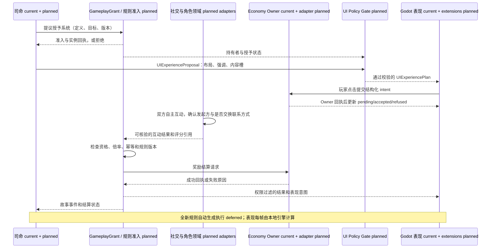
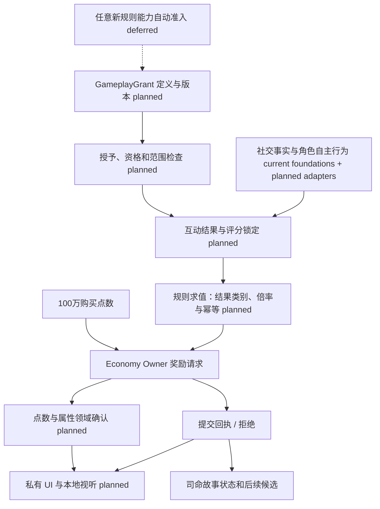

# 司命动态导演与都市“搭讪系统”推演

状态：`analysis / proposed / non-authorizing`。本文记录用户提出的目标与玩法，并推演一种实现方式；不表示这些功能已经实现，不授权修改代码或运行时。当前实现与缺口见 [司命天道影响与玩法系统实现差距](司命天道影响与玩法系统实现差距-20261116.md)。其中架构图、时序图和数据流图为本文的共同架构图表；下方补充本案例的交互顺序和资金数据流。

代码和架构术语统一使用**玩法授予**（`GameplayGrant`）：定义为 `GameplayGrantDefinition`，授予给持有者后的实例为 `GameplayGrantInstance`；“搭讪系统”只作为游戏内显示名称。该术语避免与 System L6、操作系统和普通软件子系统混淆。候选类型名不代表代码已实现。

## 1. 司命作为天道和动态导演

`[planned]` 司命持续观察获准的世界事实、角色处境、故事节点、未解决义务及表现状态，判断哪里值得创造机会、加强氛围或让事件自然发展。它可以提出玩法授予、规则应用、环境改变、心智催化和表现意图，并读取各领域回执。它需要能决定不介入，也要根据真实结果调整后续故事。

故事管理的建议职责：保留蓝图与实际故事节点的区别；跟踪哪些分支打开、关闭、等待条件或变成新问题；记录事实和来源；识别长期冲突、角色目标与潜在机会；尊重角色和玩家作出的选择；防止将失败误写成成功。角色死亡、离开或拒绝时，应允许故事改变，而不是强行恢复原剧情。

`[current]` 仓库已有故事蓝图、运行节点、义务转换、权威结果驱动和资源暂存等后端能力，且有受约束自适应节点机制。它们的范围及验证入口见 [Harness 故事运行时](../harness.md#siming-story-runtime)。这些基础不证明完整开放世界、多线长期故事、实时导演或本案例已经实现。

### 1.1 实时演算与表现

`[planned]` 司命以语义表达“事件/情绪、作用范围、强度、起止、优先级、来源和关联结果”，而非逐帧发送骨骼、摄像机坐标或粒子状态。Godot 在本地连续处理：

- **实时演算**：角色运动、物理与碰撞、环境光照、遮挡、动画混合、粒子、音频空间化、镜头和帧间过渡。与世界事实相关的碰撞、资源或状态仍通过相应 Owner 确认。
- **动画**：根据角色已决定的行为或已确认结果，结合角色包、动作库和当前身体状态选择站姿、转头、表情、移动及交互；缺资源需降级，不能虚构动作结果。
- **粒子与特效**：雨滴、尘埃、落叶和系统界面粒子可在本地演算。若雨雾影响视线、移动或他人感知，其世界状态需先得到权威确认；装饰特效不自动形成世界事实。
- **音频与镜头**：场景内真实声源可进入角色听觉；BGM、玩家私人系统音、镜头、滤镜一般是面向观众的表现，不自动让 NPC 感知。支持冲突仲裁、玩家控制、取消与缺资源降级。

同一结果可以有多种本地呈现，表现执行失败不撤销已提交的事实；表现请求失败和世界请求失败分别记录。渲染帧率、音频延迟及效果质量应通过真实设备和场景测量，本文不承诺固定性能。

## 2. 用户指定的都市玩法规则

背景是现代都市，一名大学生获得“搭讪系统”。以下数额以游戏内货币表示，`10w` 为 100,000，`100w` 为 1,000,000：

1. 玩家主动搭讪评分 **6.5 分及以上**的美女：失败奖励 **10 万**；成功奖励 **100 万**。
2. 被符合条件的美女主动搭讪，奖励基数为 **200 万**。
3. 成功条件为**加上联系方式**。
4. 美女颜值每高 **0.5 分**，对应金额翻倍。
5. 花费 **100 万**购买一个点数，用于提升自己的外貌、智力、体力等人物属性。

这些是用户的玩法设定。以下具体判定是为了让示例可以演算的**建议假设**，并非用户已经确认的规则：

- 本示例中的大学生与目标均为成年虚构人物；分数是玩法中的主观、可配置评分，不能作为现实人物的客观判断或读取真实个人数据。
- 以 6.5 分为倍率起点，按完整 0.5 分阶梯向下取整：`倍率 = 2 ** floor((评分 - 6.5) / 0.5)`；不足 6.5 不触发。上限及非 0.5 精度是否保留待定。
- 主动搭讪在一次双方实际产生的对话中，经双方自愿同意并确认交换联系方式视为成功；明确拒绝或对话结束未交换视为失败。中断、超时、没有真实互动、无结论不自动判失败。
- **被搭讪奖励的触发条件尚有歧义**：本示例暂按“对方主动发起有效搭讪且双方成功交换联系方式”结算 200 万基数；是否一经搭讪就获得、是否要求加联系方式，需用户裁定。
- 一次有效互动只采用一个结果类别；主动成功、主动失败和被动成功不叠加。重复结算、反复交换同一联系方式的资格，以及互动冷却应在正式规则中明确。
- 一点的属性增量、上限、生效速度、副作用与外貌是否实际改变模型尚未指定，案例只示意一次有效加点，不把数值效果当作已定。

### 2.1 司命如何决定玩法授予内容

搭讪金额和属性增量不应写死在某个专用脚本里。`[planned]` 编辑权限持有者发布一个受约束的搭讪规则包络，例如：起始评分、每阶梯倍率、主动成功/失败/被动成功的基数、最大倍数、单次及周期预算、可用资金来源、每次加点价格、属性增量上下限、哪些属性允许购买、角色和场景范围，以及禁止项。这个已发布 revision 是硬约束。

在硬约束内，司命可以根据玩法授予定义、故事阶段、世界状态和当前目标选择或生成本次规则方案，例如采用哪一种已注册评分公式、在允许范围内选择奖励权重和属性点增量，或给某个任务配置不同奖励。方案需包含依据、rule revision、预算和作用范围，经 Policy Gate 校验后交相应 Owner 结算。这样内容变化走数据化运行时组合，不必每次重新接线。

**编辑权限持有者优先级最高**：其最新发布的配置、禁用项和修改意见覆盖司命的旧方案；已授予编辑权但尚未预览/发布的草稿不会静默改写在线规则。紧急撤销可按已发布的撤销策略立即阻止新方案；已经结算的事实不因此被删除。自然语言修改意见若超出现有字段/schema，生成离线扩展提案，不让司命临时绕过校验。

如果司命需要当前 schema 尚不支持的能力，例如一种新计分算法、新属性类型、动态创造新 Owner 或新的 UI 按钮，编辑权限持有者可离线操控 Codex 等编程智能体：提交目标和授权范围，智能体生成代码差异、测试和迁移建议；编辑者检查预览并批准后才发布不可变 revision。此后司命即可在新 revision 的范围内运行时使用。Codex 不在玩家运行时执行，也不自动取得仓库写权限。

按上述假设：

| 评分 | 倍率 | 主动失败 | 主动成功 | 被动成功（示例假设） |
| --- | ---: | ---: | ---: | ---: |
| 6.5 | 1 | 10 万 | 100 万 | 200 万 |
| 7.0 | 2 | 20 万 | 200 万 | 400 万 |
| 7.5 | 4 | 40 万 | 400 万 | 800 万 |
| 8.0 | 8 | 80 万 | 800 万 | 1,600 万 |

## 3. 一次游戏中的全过程

### 3.1 系统降临：司命发放能力

周五傍晚，成年大学生林舟刚从教学楼出来。司命观察到当前世界允许该玩法、角色符合授予资格，提出将 `GameplayGrantDefinition` 的一个实例发放给林舟，实例的游戏内显示名为“搭讪系统”。玩法包版本、实例作用域、授权和依赖通过检查后，负责授予实例事实的已准入领域提交回执。若未获准，界面不显示“绑定成功”。

林舟看到私人界面浮现：

> 【搭讪系统绑定成功】
> 符合条件的社交互动可获得奖励。100 万可购买 1 个属性点。

司命还需要能编排这部分 UI。主项目已有 [UI Runtime 与创作者 UI Package 设计](../superpowers/specs/world-character-siming-authority-mainline/2026-09-24-ui-runtime-and-creator-ui-package-design.md)：按设计，司命可在已审核的 UI capability、layout variant 和内容 slot 内选择体验、展开任务面板、强调关键条件、调整提示节奏并请求获准的文案。运行时仍是 `UIExperienceProposal -> UI Policy Gate -> UIExperiencePlan -> Godot renderer`；该设计当前是 design-only，不代表接线已实现。

玩家点击“查看任务”或“购买属性点”时，固定的 UI capability 产生结构化 intent。它不执行任意 GDScript、不自行扣钱或加属性；界面先显示 pending，只有对应 Owner 回执后才显示已到账或已生效。系统余额、任务条件和加点按钮的交互语义由已审核 UI 契约固定，司命只能在许可范围内决定何时强调、展示何种已批准内容。

`[planned]` 表现层可以播放短促提示音、界面粒子和轻微光效。它们是林舟玩家视角的表现；周围人不会自动看到或听到。若设定系统确实能被其他角色感知，则必须单独声明世界可见性及相应感知事实。

司命在背后记录玩法授予已生效、相关规则版本和当前故事义务，例如“让林舟第一次理解玩法规则”。授予 UI 只呈现状态，不承担事实结算。

### 3.2 第一次主动搭讪：失败也有奖励

林舟在校园咖啡店遇到成年女生许晴。按本案例的虚构玩法评分，她是 7.0 分，倍率为 2。司命可以根据场景和双方处境创造自然机会，例如安排角色各自经过咖啡店或播放适合校园傍晚的音乐；是否改变世界中人物位置，需要各自角色行为或世界 Owner 的真实结果。

林舟主动开口，许晴聊了几句后礼貌拒绝交换联系方式，双方对话结束。社交领域确认有效互动、主动方、明确拒绝和未交换联系方式；任务/规则运行时引用该结果判定主动失败。奖励计算为 `10 万 × 2 = 20 万`。Economy Owner 完成余额变更后，界面才显示：

> 【搭讪失败：7.0 分】
> 【奖励到账：20 万】

司命可以安排提示音与轻微系统光效；许晴仍保有自己的想法和日常，不因系统奖励而被强制继续对话。失败奖励可能鼓励玩家故意反复打扰，正式规则需要确定有效互动、冷却、重复目标和拒绝后退出等机制；具体限制是待确认的设计建议。

### 3.3 第二次主动搭讪：成功与故事后果

第二天，林舟在校外书店遇到成年研究生顾宁。她在本案例中的评分为 7.5 分，倍率为 4。两人因同一本书自然交谈，双方自愿交换联系方式，社交 Owner 确认结果。规则计算 `100 万 × 4 = 400 万`；Economy Owner 提交后林舟余额为 **420 万**。

司命可以把这次结果作为新的故事依据：顾宁是一位有自己目标的角色，她以后是否主动联系林舟，由她的角色状态和双方互动决定。故事线可以出现“书店再次相遇”“一起参加讲座”等机会，也可以让双方很久不再联系；加上联系方式本身不等于关系、好感或恋爱状态自动成立。

表现上，镜头可以短暂强调双方的反应，Godot 根据角色动作和视线实时选择转身、拿书、表情及对话动画；书店光照、窗外落叶粒子和环境音持续本地演算。司命提出氛围方向，不需要逐帧控制人物或粒子。

### 3.4 购买属性点：资金和角色变化协作

林舟花费 100 万购买 **1 点**，余额从 420 万变为 **320 万**。他选择把点数加到“外貌”。建议拆成可恢复的过程：

1. 校验余额、购买价格、系统资格、目标属性和版本。
2. 由 Economy Owner 扣款，并记录可追溯购买结果；点数归属与使用由实际接纳该事实的领域合同确认。
3. 角色属性领域校验点数与外貌变更，提交加点结果，再更新角色档案/有效属性的合法投影。
4. 如果玩法定义外貌变化可见，本地角色表现按已接纳的模型、材质或动画方案呈现；若还没有合适资源，可以显示属性已改变但视觉资源不可用。

扣款成功而属性提交失败时，保留已提交事实与待处理点数或补偿义务；是否支持同一原子提交取决于后续实际 Owner 合同。界面分别展示“扣款”“点数到账”“属性生效”，不能合并成未经确认的成功。

### 3.5 被主动搭讪：另一种分支

周末，林舟参加社团活动。成年女生沈岚主动找他聊天，按本案例评分为 8.0，倍率为 8。她主动接近可以来自她自己的动机、关系和现场条件；司命可以提供机会或提示，但不能为了发奖直接指定她产生好感。

假设双方自愿交换联系方式，按本案例的被动成功假设计算 `200 万 × 8 = 1,600 万`。Economy Owner 确认后，余额从 320 万变为 **1,920 万**。系统提示、音效和粒子表达奖励；故事运行时可以记录双方相识，是否发展成朋友或其他关系仍需后续互动。

| 步骤 | 结算 | 余额 |
| --- | ---: | ---: |
| 7.0 分主动失败 | +20 万 | 20 万 |
| 7.5 分主动成功 | +400 万 | 420 万 |
| 购买 1 点 | −100 万 | 320 万 |
| 8.0 分被动成功（假设） | +1,600 万 | 1,920 万 |

## 4. 司命在后台如何推动故事

`[planned]` 司命可以同时管理多条相互影响的线索：林舟对系统的探索、大学生活、与顾宁的联系、沈岚的社团目标，以及突增财富带来的生活变化。它可以让机会围绕角色动机出现、控制事件频度和氛围，并观察玩家是否已经厌倦某类场景。

不同选择应改变未来：林舟拒绝使用系统时，系统可以保持沉默或给出可关闭的提示；反复尝试时，角色可能记住互动并形成各自的评价；如果林舟购买外貌点数，别人如何反应取决于他们是否感知到变化及各自性格。司命可以记录这些因果和未解决问题，再提出新的节点；具体关系结果要由领域和角色运行时确认。

叙事编排需要避免“每个目标都会配合”的固定剧情。系统评分只用于此玩法的资格与数额，不能取代角色的人格、边界、身份、兴趣或行为自主性；它也不应无授权暴露其他角色的私人数据。

## 5. 本案例的协作与数据

### 时序图

### 数据流图

玩法授予定义、授予实例、互动资格、联系方式、评分、钱包、点数、属性和故事节点是不同事实。应为每次结算固定参与者、主动方、评分及规则版本、互动结果、因果链、钱包版本和幂等键；不同隐私范围只投影必要字段。实际负责授予实例、评分、联系信息和属性的 Owner 及其合法合同尚待明确，不能假定已有通用 API。

## 6. 具体差距与验收

| 范围 | 要补的能力 | 通过证据 |
| --- | --- | --- |
| 玩法授予 | 版本化定义、授予、绑定、暂停、撤销和隐私投影 | 有真实授予回执；越权或错误版本零写入，重启可恢复。 |
| 社交判定 | 自主互动、发起方、同意交换、失败/中断和可靠去重 | 三类奖励分别有真实结果；拒绝、中断、重复、并发及无资格不误发。 |
| 评分与倍率 | 虚构评分来源、隐私、阶梯规则、版本锁定及上限策略 | 6.5、7.0、7.5、8.0 及边界数值可复算；重放不因评分后来变化而改写旧奖励。 |
| 经济与加点 | 资金来源、奖励入账、购买点数、属性应用和失败恢复 | 实际余额、点数、属性分别有 Owner 回执；重复/并发不双发双扣；跨域失败不伪成功。 |
| 故事与角色 | 社交结果进入故事、角色记忆和后续机会 | 玩家拒绝或角色离开时分支正确；角色不被强制提供联系方式；私人信息不越权。 |
| 实时表现与司命 UI 控制 | 镜头、BGM、音效、动画、粒子、环境状态及 UIExperiencePlan 协作 | 真实 Godot 场景可见可听；UI 只改获准的 layout/强调/slot；越权提案回退基础 UI，按钮经 Owner 回执更新；局部表现与确认事实一致，缺资源、取消和冲突可降级。 |
| 回放与运行 | 保存版本、因果链和状态，恢复后继续 | 后端重启、去重和 Owner 回执可核验；Godot 端到端需真实消息和场景证据。 |

## 7. 仍需用户决定的规则

- 被美女主动搭讪是**立即奖励 200 万基数**，还是必须成功交换联系方式后奖励？若对方主动但未加联系方式，是否有失败奖励？
- 评分是否限定最高分、保留几位小数？非 0.5 阶梯是否按下取整？评分如何产生、何时锁定、玩家和角色各能看到什么？
- 同一对象能否多次触发；什么算有效搭讪、拒绝、超时和中断；是否设冷却和每日上限？
- 奖励资金从哪里来：系统生成、特殊账户支付还是其他世界机制？需要怎样解释对城市经济的影响？
- 1 点分别让外貌、智力、体力变化多少，是否有上限、递减、即时变化和可见外形变化？
- 是否允许对心智或关系产生超自然强制效果，系统是否能被其他角色察觉？
