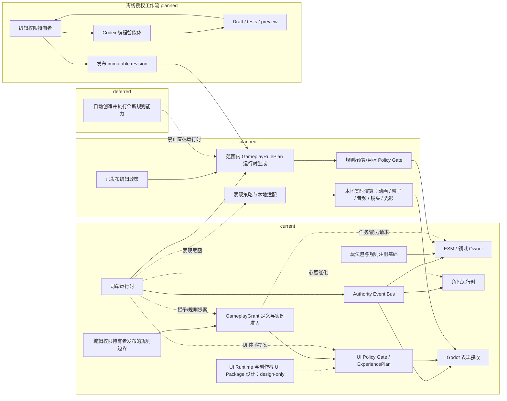
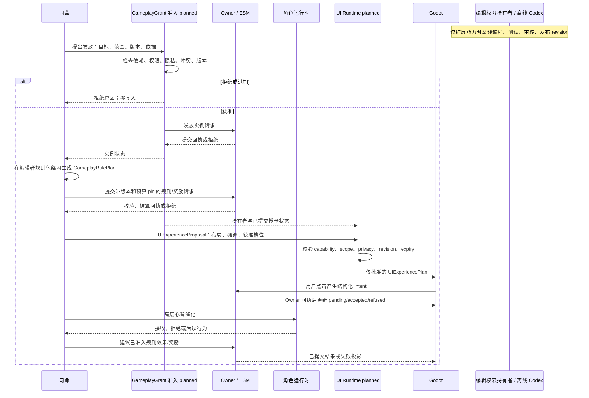
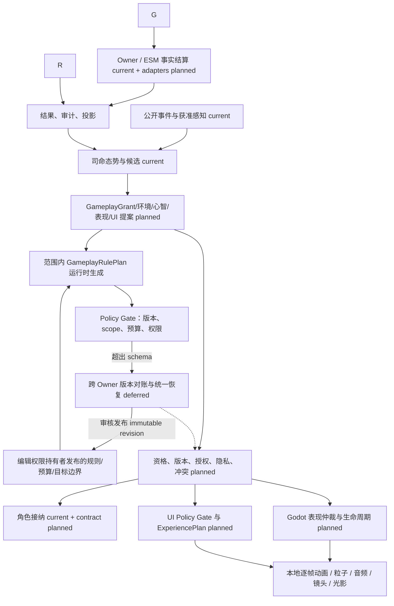

# 司命天道影响与玩法“系统”实现差距

状态：`analysis / current + planned / non-authorizing`。基线为 2026-11-16 `main`（`2cacbdd5`）。本文盘点现状与差距，不授权实现或修改世界事实。

动态导演、实时演算、故事线管理与现代都市搭讪系统的完整推演见 [配套案例](司命动态导演与都市搭讪系统推演-20261116.md)。

## 1. 目标

希望司命作为“天道”影响环境、角色心智和世界表现，并能向玩家或角色发放类似网文的“系统”。系统可以提供任务、提示、能力和奖励，也可能提出新的规则，但必须和既有 Owner 协作：司命负责观察、选择时机、提出高层催化和提案；领域 Owner 负责规则校验、事实提交和结果；角色运行时负责心智接纳；Godot 负责本地表现。

四条原则：

- 表现变化不自动成为世界事实。镜头、滤镜、BGM 等属于本地表现；真实光照、烟雾、声音和物品变化需要相应 Owner/ESM 结算。
- 心智催化不等于直接改写信念。默认影响注意、压力、线索显著度和冲动；信念、情绪、目标、记忆和行为由角色系统按自身状态处理。
- 玩法授予实例不等于 System L6，也不取得世界写权限。授予、持有、启用、使用、奖励和撤销分别验证。
- 新规则不能由自然语言、标签或司命输出直接取得执行权；新事实类型或新 Owner 需要单独准入。

### 编程术语

文档和代码中将网文语义的“系统”统一称为**玩法授予**（`GameplayGrant`），避免与操作系统、System L6、普通软件子系统及 Gameplay System 混淆。“搭讪系统”“调查系统”保留为游戏内展示名称。

| 术语 | 含义 | 建议标识 |
| --- | --- | --- |
| 玩法授予定义 | 可授予的版本化玩法内容声明，含能力、任务模板、规则引用、依赖和展示配置；优先复用现有玩法包/manifest，不另造平行包注册表。 | `GameplayGrantDefinition` |
| 玩法授予实例 | 某持有者在特定世界范围内实际获得的定义实例，包含 revision、生命周期与结算状态。 | `GameplayGrantInstance` |
| 玩法授予事件 | 授予、暂停、恢复、撤销、任务进度和结果等事实或请求；具体事实仍归经准入的 Owner。 | `gameplay.grant.*`（候选命名，须由正式契约确认） |
| 游戏内名称 | 对玩家/角色显示的文案，可以称“搭讪系统”，不作为代码类型或 authority 名称。 | `display_name` |

这是命名约定提案，不表示这些类型、事件或 Owner 已实现。`GameplayGrant` 表示把一组玩法能力授予持有者；定义、实例、激活和结算仍是不同生命周期阶段。不得创建 `SystemOwner` 或让司命直接拥有玩法事实。

### 1.1 玩法授予是否会自然形成

方向上是的：当智能底座能组合已注册能力，玩法包提供版本化定义，世界真相层/领域 Owner 能验证并提交授予、任务、奖励和属性等事实，Godot UI Runtime 能呈现已确认状态时，“搭讪系统”这类玩法体验可以由这些基础能力组合出来，不必再建一个能任意写世界的独立“系统 Owner”。

但“底座齐全”不代表任意网文设定会自动运行。仍需具体玩法定义、依赖与权限准入、持有者/范围资格、已注册规则绑定、领域结算适配、UI capability 与 action、失败恢复和整条运行时接线。首个实现可以把 `GameplayGrantInstance` 做成既有授予/领域回执的聚合投影；只有当这些状态有明确单一写入责任和生命周期需要时，才为它建立独立权威记录。该判断需在正式规格中确认，避免先造第二份世界真相。

### 1.2 运行时自适应与离线扩展

目标不是让每一种玩法变动都等待程序员手工改代码。把可变化内容和可执行能力分开，走两条通道：

| 通道 | 司命/编辑权限持有者能做什么 | 何时需要离线编程 |
| --- | --- | --- |
| **运行时组合** `[planned]` | 司命在已发布的 `GameplayGrantDefinition`、规则 DSL/typed rule schema、已准入 Owner adapter 和编辑权限持有者发布的硬边界内，选择或计算任务条件、评分规则、奖励公式与预算、属性增量/上限、适用对象、有效期和 UI 体验。规则方案可随场景和故事状态变化，并带上所用版本、输入依据及解释。 | 不需要每次内容调整都改代码；只需复用已注册的操作符、条件、公式、结算 adapter 和 UI capability。 |
| **离线能力扩展** `[planned]` | 若编辑权限持有者的需求无法由当前 schema 表达，司命只能产出结构化 gap/扩展提案；编辑权限持有者可以操控 Codex 等编程智能体修改定义 schema、DSL evaluator、adapter 或 UI capability。 | 新操作符、新数据类型、新 Owner、新 authority 写通道、任意代码、超出安全预算的算法或新 UI action。代码须经测试、审查、预览与版本发布，再成为运行时可选能力。 |

运行时优先级：**编辑权限持有者最新已发布约束 > 该玩法已发布定义和政策 > 司命在允许区间内的场景化选择 > 默认值**。编辑权限持有者的草稿/备注在正式发布前可作为待审输入，不能改变运行时；发布后立即成为司命必须遵循的边界。司命不能以优化体验为由覆盖其数值、预算、禁用条件、目标范围、表达意见或撤销决定。

运行时规则结果是版本化数据，不是新代码。每个 proposal 必须钉住 `grant_revision`、`rule_schema_revision`、`owner_policy_revision`、授权范围、资源预算、有效期、输入 revision vector 和确定性 seed；Policy Gate 检查后生成 `GameplayRulePlan`。超界或无法解释的结果拒绝或回落到编辑权限持有者指定的安全默认值，并返回明确 gap，不静默放宽约束。

司命可以**决定奖励公式与资金分配方案**，但不等于能凭空制造可花费的经济事实：资金来源、预算额度、债务/发行政策由编辑权限持有者配置并由 Economy Owner 校验结算。司命可决定奖励金额是否按评分倍增、给出金额和预算分配；它不能绕过已批准资金来源或把预期金额显示成已到账。类似地，它可以在授权 schema 内决定属性增量；实际属性变化由角色属性/Ability 等接纳的 Owner 提交。

Codex 是离线工程工具，不是玩家运行时的一部分。不得让运行时模型直接写仓库、执行任意脚本、修改当前进程代码或绕过测试发布门禁。编辑权限持有者通过编程智能体新增能力后，运行时只消费审查发布的不可变 revision。

## 2. 当前能力与差距

| 方向 | `[current]` 已有能力 | `[planned]` 主要差距 |
| --- | --- | --- |
| 环境 | `siming.environment_request` 经 ESM 校验；支持 `light_level_drop/restore`、`thermal_level_rise`、`smoke_density_rise`、`noise_level_rise`。 | 为每种变化补齐目标资格、持续时间、冲突、撤销和场景证据。天气、昼夜等未由此证明已接入。 |
| 角色心智 | `impulse`、`opportunity`、`fact_reveal` 可投递合格角色；角色感知可记录注意目标、警觉、分心和提示。 | 定义强度、抵抗、拒绝、持续和回执；区分可知事实、建议、情绪影响和强制效果。现有提示不能证明已可靠改写记忆或信念。 |
| 公平与机会 | 主链有态势、候选、策略、可行性和审计；知识图谱、五维天平、冲突生成器已有独立实现。 | 新组件还没有证明被主事件链自动调用；不能把单测通过当作自动剧情闭环。 |
| 视觉事实 | 有已成立事实的可见性请求和 Godot 接收路径；当前接收器记录事实 ID 和提示。 | 高亮、指引、遮挡、持续时间、真实屏幕效果与回执仍需接通。 |
| 音效/BGM | Godot 是本地音频表现所有者，项目文档规划音频适配器。 | 建立司命语义请求、资源资格、优先级、混音、退出和播放回执；世界内声音必须先有世界结果。 |
| 镜头/滤镜/光影 | 有本地表现总线和 `presentation_highlight_request` 类型；主项目已划分相机职责。 | 没有完整证据证明司命可编排镜头、滤镜和光影；纯画面调色与真实光照必须分开。 |
| 动画 | 本地角色表现和语义动作基础存在。 | 司命应只给语义目标与事件引用，由本地资源和仲裁选择动作；位移、命中和开门等事实仍由 authority 结果驱动。 |
| 玩法授予（游戏内可显示为“系统”） | `GameplayPatchManifest`、`GameplayPatchRegistry`、规则求值及部分资源/能力/状态基础存在。 | 尚未证明有通用 `GameplayGrantInstance`、授予/转移/撤销、任务/奖励和跨 Owner 闭环；规则 evaluator 不等于任意新规则可进入世界。 |
| GameplayGrant 组合路径 | 玩法包/规则注册、领域 Owner、事件总线和 Godot UI 表现边界分别已有基础或设计。 | 需要把包定义、持有资格、Owner-bound 事实和 UI experience 组合为一条有回执的运行时流程；底座不会自动生成具体规则、奖励经济或任务判断。 |
| 运行时规则自适应 | `[current foundations]` 有 typed rule definitions、纯规则 evaluator、玩法包 revision 和 authority settlement 基础。 | 需要通用有界规则 schema、司命 rule proposal、权威编辑约束读取、预算/目标/范围 Gate、plan 固定与回放；不得每个新参数都写一条定制代码。 |
| 离线能力扩展 | `[planned]` 编辑器设计已有 Draft/Preview/Publish/Activation 与 AuthorityGrant/MutationContract 治理流程。 | 需要编辑权限持有者可操控 Codex 工具改 schema/evaluator/adapter/UI capability；将人工审核、测试、digest/revision 发布和运行时激活串起来。新能力不能由运行时 Codex 自动注入。 |
| 恢复/对账 | 有审计、事实核心阶段效果和部分派生状态检查。 | `OwnerFactQuery`、完整版本对账和三套状态统一恢复未完成；`SimingDataLayer` 三个统一恢复接口仍明确未实现。 |

依据：[Siming 模块](../架构/运行时/模块/Siming.md)、[Godot 表现与角色入口](../架构/运行时/模块/Godot表现与角色入口.md)、[角色控制基础设施设计](../架构/通用基础设施/前端/角色控制基础设施设计.md)、[司命输出契约](../reference/phase1-siming/OUTPUT_CONTRACT.md)、[玩法包审计](../10月分析/玩法包与编辑器应用治理/01-玩法包现有实现审计与差距矩阵.md)。这些文件中标为 planned 的镜头、音频和特效能力不能当作已实现。

### 2.1 司命动态导演与故事线管理差距

| 目标 | `[current]` 基础 | `[planned]` 尚需实现和验证 |
| --- | --- | --- |
| 故事线状态 | 故事蓝图、运行节点、叙事义务、权威结果驱动与资源暂存已有后端实现；见 [故事运行时验证范围](../harness.md#siming-story-runtime)。 | 多故事线与角色目标联动、长期节奏、角色离开/死亡后的重新规划，以及玩家不参与时的推进政策；不能把现有节点引擎等同于完整开放世界导演。 |
| 故事机会 | 有候选、策略和受约束的自适应桥；图谱、天平和冲突生成器另有独立实现。 | 将真实事件与获准角色上下文接入机会生成、仲裁、投递、实际结果和回收，区分等待、拒绝、过期与无行动；验证新图谱/天平/冲突生成器是否真正进入主链。 |
| 世界因果 | 有事实核心、证据引用、阶段锁定和部分图记忆。 | 不同 Owner 的事实和版本、隐私、故事节点和本地演出之间形成可重放因果；补足跨 Owner 对账与恢复。 |
| 反馈与节奏 | 有审计与部分结果跟踪。 | 定义如何读取干预回执及玩家/角色行为，调整重复频率和后续候选；玩家拒绝或无响应也必须是合法结果。 |

### 2.2 实时表现层：需要补齐的完整链路

目标是司命发出高层戏剧意图，由 Godot 在本地持续演算画面与声音；司命不承担每帧驱动。当前已有 `BackendBridge.gd`、`LocalPresentationBus.gd`、角色表现基础及少量司命事件接收，但本节各项司命编排、仲裁和验收均为 `[planned]`，除非明确标为 `[current]`。

| 能力 | 当前可定位基础 | 具体差距 | 可观察验收 |
| --- | --- | --- | --- |
| 语义表现请求 | `[current]` 有 `siming.visual_observability_request`、`siming.presentation_highlight_request` 等输出；视觉接收器目前记录事实 ID 和日志。 | 声明表现类别、意图、作用对象和空间、受众、强度、优先级、开始/结束、来源和可选事实引用；定义接收、拒绝、取消、完成和降级回执。 | 合格请求抵达对应本地适配器并产生实际效果；非法、过期或不属于当前受众的请求不播放且有原因。 |
| 实时演算与帧更新 | `[current]` Godot 有本地场景、角色和表现循环。 | 本地持续处理动画混合、物理/碰撞、光照、遮挡、音频空间化、粒子和镜头过渡；后端只发送语义变化和已确认结果，避免每帧网络姿态控制。 | 真实场景中角色移动、镜头转向和遮挡变化时表现持续响应；记录目标设备帧率和延迟，阈值由后续规格确定。 |
| 动画与身体 | `[current]` 角色表现适配器、动作与本地运动基础存在。 | 语义动作到资格化动作库的解析、状态机与叠加、表情/视线、资源缺失降级、角色控制与动作仲裁；根运动经 `CharacterMotor`，不能把演出当世界移动成功。 | 不同骨架按兼容资源表现；打断、缺动作、角色死亡/切换及碰撞均有可见结果，权威动作结果与动画一致。 |
| 粒子 / VFX | `[current]` 存在 Godot 本地表现宿主；尚无证据证明司命粒子编排闭环。 | 粒子资源目录、世界/屏幕空间、绑定对象、起止、风场/遮挡、层级、预算与生命周期；界面特效和世界内特效分开。 | 司命请求触发持续粒子且可取消，离开场景/缺资源时正确回收；视觉粒子不能自行创建烟雾或天气事实。 |
| 声音与 BGM | `[current]` 主项目把音效归于表现适配器；该适配器在相关文档中仍有规划内容。 | 定义世界声源与私人提示/BGM 的受众、音量、淡入淡出、混音、遮挡和优先级；世界声音先有获准事实和感知链。 | 真实音频播放、过渡、停止及遮挡可检测；私有系统音不进入 NPC 听觉，世界声源可经获准感知。 |
| 摄像机 | `[current]` 主项目定义相机职责边界，具体策略部分为规划。 | 镜头目标、跟随/观察、构图、持续、优先级、玩家输入接管、场景遮挡和舒适度；不得改变角色位置或视线真相。 | 与玩家控制和其他镜头请求冲突时可仲裁并恢复；无目标、目标消失和禁止接管均可降级。 |
| 滤镜 / 光影 / 天气 | `[current]` ESM 支持若干环境变化；具体场景表现能力需逐项证明。 | 纯调色和世界照明分路；世界天气、烟雾、温度、噪声与可感知变化需 Owner 结算后再映射视觉、音效及感知。 | 同时检查真实 Owner 回执、角色感知及画面/声音；纯玩家滤镜不改变世界事实，拒绝时不渲染成已发生。 |
| 角色外观与系统 UI | `[current]` 有角色包与本地表现基础，不代表存在属性到外观的通用适配。 | 点数和属性经 Owner 确认后按资产能力更新模型/材质；系统界面、数字和音效遵守玩家隐私及到账状态。 | 已到账、待处理、失败分别显示；模型不支持时诚实降级，不能因光效或 UI 伪造属性变化。 |
| 生命周期与可靠性 | `[current]` 有消息与局部审计基础，尚不证明统一表现生命周期。 | 请求去重、优先级、开始/停止/取消、超时、断线/重连、场景卸载、资源回收、版本和来源；表现失败独立于世界结算。 | 重复消息不重复触发一次性效果；断线/重进后的持续效果按已确认状态重建，过期特效不复活；清理本轮资源。 |
| 司命 UI 体验控制 | `[design-only]` 主项目已有 [UI Runtime 与创作者 UI Package 设计](../superpowers/specs/world-character-siming-authority-mainline/2026-09-24-ui-runtime-and-creator-ui-package-design.md)：司命可基于过滤后的会话信号选择已审核 package/layout，调整允许的面板展开、阅读优先级、信息密度、提示强度、叙事节拍，并为批准的 slot 请求内容。 | 该 UI Runtime 设计不代表已实现。需落实 `UIExperienceProposal -> UI Policy Gate -> UIExperiencePlan -> Godot renderer`；结合玩法授予按持有者私有投影任务、余额、属性/奖励状态。司命不能新增 UI capability/action、改 payload/权限/确认路径、运行任意脚本或绕过 Owner 写事实。 | 真实交互界面证明司命提案经 policy gate 后只改变获准布局/强调/槽位；越权、过期、隐私超界或模型失败时零副作用并回到基础 UI；按钮提交结构化 intent，状态只在 Owner 回执后更新。 |

表现合同应支持一次性事件和持续状态两类：一次性事件按身份去重；持续状态包含有效期、版本与终止条件。重连时从获准的当前投影恢复持续表现，不要求逐帧重放。某些高频本地物理采样可先用于预测或证据；涉及库存、伤害、关系等权威结果时，必须通过对应领域确认。

司命对 UI 的“控制”是体验决策权，不是直接操纵任意 Control 节点：可以在已激活 package、layout variant、体验模式及 slot allowlist 内决定呈现顺序、强调、展开程度、信息密度、提示节拍和获准内容；关键状态、权限、确认流程、交互 action 和无障碍契约固定。创作者审核 UI capability 和 package；运行时 Siming proposal 由 policy gate 按 scope、privacy、revision、expiry、budget 和 fallback 复核，Godot 只渲染批准后的 plan。交互按钮产生现有/已准入的 structured intent，后端 Owner 结果才更新界面状态。

### 2.3 都市搭讪系统对通用能力的压力

| 用户目标 | 通用差距与验证 | 案例专属待决 |
| --- | --- | --- |
| 主动失败、成功和被主动搭讪分别奖励 | 需要记录真实互动、发起方、结果、规则版本及幂等；社交事实、规则求值和 Economy 结算分开。拒绝、取消、重复或部分失败不能误发。 | 被主动搭讪是否必须加联系方式才奖励；重复目标、冷却和失败判定。 |
| 6.5 分门槛、每 0.5 分翻倍 | 需要受控评分来源、版本、隐私、阈值和数值溢出策略；结算时固定评分与规则版本，后续重放可复算。 | 评分上限、精度、非半分取整及对谁可见。 |
| 100 万购买点数并加外貌、智力、体力 | 资金扣除、点数归属、属性变更和表现投影分别由适当的已有或获准领域承接；部分成功可恢复。 | 每点实际增量、属性上限、外观变化方式与资金来源。 |
| 司命引导偶遇和长期故事 | 机会建议须经过角色决策与世界结算；后续关系、记忆和故事节点依据真实互动形成。 | 司命对角色心智的影响强度及特殊强制效果范围。 |

以上评分阶梯、结算金额的具体推演与标明未确认的假设见 [都市案例](司命动态导演与都市搭讪系统推演-20261116.md)。案例中的假设不自动成为通用规则。

## 3. 玩法授予目标模型

| 对象 | 建议职责 | 状态 |
| --- | --- | --- |
| 玩法授予定义（`GameplayGrantDefinition`） | 版本化身份、任务模板、规则引用、能力依赖、提示和奖励声明。优先复用玩法包/manifest。 | `[planned]` |
| 玩法授予实例（`GameplayGrantInstance`） | 在某世界/场景中授予某玩家、角色、组织或地点的实例；有持有者、范围、版本和生命周期。 | `[planned]` |
| 授予能力 | 任务、提示、能力申请、奖励申请、规则提案；每项声明所需 Owner、权限和范围。 | `[planned]` |
| 关联规则 | 已注册规则的选择、组合或参数化；每次结算绑定 rule revision 和输入 revision vector。 | `[planned]` |
| 授予表现 | 游戏内玩法界面、语音、音效、镜头和滤镜投影；可见性必须按持有者与玩家权限过滤。 | `[planned]` |

示例：司命提议给学徒发放“调查系统”。准入层检查定义版本、目标资格、世界范围、隐私、依赖和冲突；负责实例的 Owner 提交后才生效。系统可以显示“仓库线索”任务，任务完成要有可信证据；金币由 Economy Owner 结算，物品由 Inventory Owner 结算，能力由对应 Ability/角色域结算。司命可以建议奖励，不能靠 UI 宣布奖励到账。

规则分三类：

1. `[planned]` 选择已接纳的版本化规则。
2. `[planned]` 司命在注册的 schema/DSL 中运行时组合规则、计算参数及内容，包括搭讪分数阈值、奖励金额公式、总预算分配和属性点增量。约束与范围必须来自编辑权限持有者的已发布 revision；本类别不应要求为每个玩法数值重新编码。
3. `[planned]` 超出 DSL 表达能力时，编辑权限持有者通过离线 Codex 工作流修改 schema、evaluator 或已审查 adapter，经测试、预览、审查和发布后增加运行时能力。
4. `[deferred]` 运行时任意代码生成/执行、新事实类型或新 Owner 自动准入；不允许模型直接改写程序或 authority。

规则激活和玩法授予是两个事实。允许某规则不代表角色已经学会技能；获得玩法授予实例也不代表能改写整个世界。跨 Owner 失败时保留已提交事实，形成待处理义务或补偿，不伪造全部成功。

## 4. 协作图

以下图表是目标设计，`current`、`planned`、`deferred` 已明确标注。

### 架构图

### 时序图

### 数据流图

## 5. 优先级与验收

| 顺序 | 差距 | 最小验收 |
| --- | --- | --- |
| 1 | 统一影响请求合同：身份、范围、来源、时效、权限、结果、拒绝和幂等。 | 越权、过期、重复、错误版本均零写入且有审计。 |
| 2 | 环境纵切。 | 真实后端 + ESM + Godot：司命请求、Owner 结果、实际光影/声音和反馈一致；拒绝不伪成功。 |
| 3 | 心智催化纵切。 | 同一催化在不同角色状态下可不同或被拒绝；不泄露私有记忆；建议不冒充强制信念。 |
| 4 | 实时表现纵切：司命意图、资格化资源、本地动画、粒子、音频、镜头与光影。 | 至少验证一组同步演出及各通道实际可见/可听结果；覆盖本地帧更新、播放/取消、资源缺失、冲突仲裁、隐私、重连和清理；纯表现不改世界真相。 |
| 5 | 一个玩法授予实例（`GameplayGrantInstance`）纵切。 | 授予回执 → 任务证据 → 一个既有 Owner 结算 → 游戏内“系统”界面；覆盖拒绝、重复、重启和部分失败。 |
| 6 | 司命 UI 体验控制。 | 复用 UI Runtime 设计：policy gate 选择已批准 layout/slot；越权拒绝并回退基础 UI；交互走 structured intent，仅展示 Owner 回执后的状态。 |
| 7 | 有界运行时规则生成与结算。 | 编辑者设置奖励公式/预算/评分和属性增量包络；司命生成带 pin 的 plan，覆盖边界值、预算耗尽、stale revision、重复和 Owner 拒绝；真实结算可回放。 |
| 8 | 编辑权限持有者驱动的离线扩展。 | 一个超 schema 的需求经编辑者触发 Codex draft，产生差异、自动测试、预览结果和明确的人工发布决定；未发布 revision 不进入运行时。 |
| 9 | 无界规则自动创造。 | `[deferred]` 运行时任意代码、任意 Owner/事实类型自动准入；不可由当前 DSL/evaluator 推断完成。 |

后端测试只能证明合同、授权、幂等和回执；Godot 测试要证明真实画面、声音、镜头和动画；端到端声明必须有运行中的后端、真实边界消息、Owner 结果和可见场景结果。测试替身不能替代在线模型或实际场景证据。

## 6. 尚需产品裁定

1. 系统能授予玩家、NPC、组织、地点中的哪些对象？持有者能否拒绝、暂停或解除？
2. 普通心智影响是否仅限注意、压力和动机；强制信念、情绪和行为是否只作为特殊规则？
3. 司命是否只能选择已注册规则，还是可以提出新规则草案？谁批准激活？
4. 系统提示、BGM、镜头和滤镜对谁可见；纯玩家表现是否被世界角色感知？
5. 多 Owner 奖励失败时如何显示待处理、重试、补偿和撤销？
