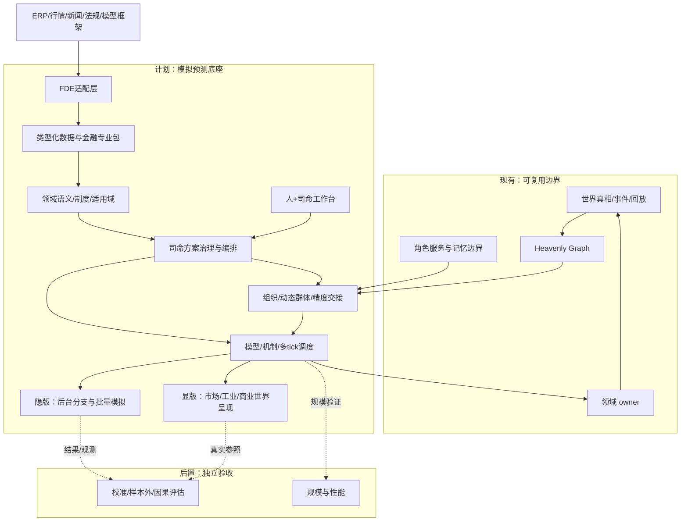
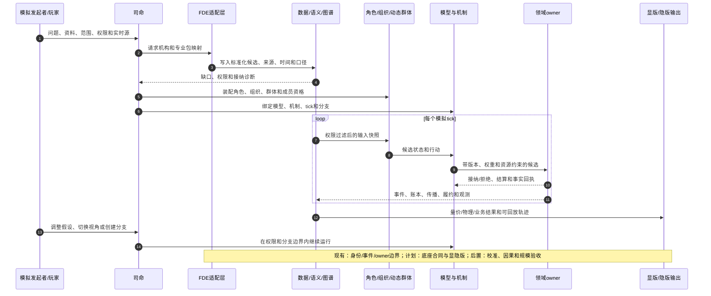
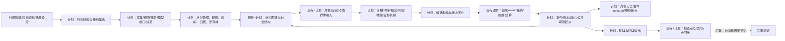

# 模拟预测底座总纲与设计地图

日期：2026-10-14

状态：`analysis / integrated-design-map / non-authorizing`

本文是 `docs/fork项目/模拟预测底座` 的总纲和导航，不替代 01—12 号具体设计，也不授权当前后端已经实现模拟运行时。本文整理已有设计的边界、依赖、实施状态和首个金融纵切，避免同一概念在多个文档中产生第二套定义。

## 1. 总体结论

模拟预测底座采用“**通用类型化底座 + 行业专业包 + 机构/FDE适配 + 司命运行编排 + 领域 owner 接纳**”的结构。

底座的目标不是做一个只能预测价格的金融模型，而是维护一个可按时间推进、受权限约束、能接入现实资料、能运行异质主体、可分支和可回放的局部世界。金融是首个专业纵切，工业、商业和政策场景用来检验同一套结构能否复用。

核心判断：

1. **数据表示、领域语义和世界演化必须分层**。表格、文件、图谱和时序数据保存内容；语义注册说明对象含义、制度和适用条件；模型、机制和 owner 推进状态变化。
2. **组织与动态群体是并列的一等社会结构**。组织有职位、权能、程序、账户和责任；动态群体是按目的、时间窗和行为维度形成的临时投影，不能自动拥有组织权力、法律人格或共同账户。
3. **世界真相层不等于模型预测层**。观测、来源、假设、派生状态、模拟候选和 owner 接纳回执必须分开保存。
4. **图谱是共同索引和传播载体，不是唯一计算引擎**。关系必须有类型、方向、权重、有效期、来源和适用域；撮合、物理、时序、风险和传播机制仍由专业模型执行。
5. **司命负责方案治理和编排，不替主体做决定**。它访谈发起者、检查资料和权限、生成场景、安排角色/群体/模型、管理分支和检查缺口；现实事实仍由对应 owner 接纳。
6. **实时同化是向现实收敛的过程，不是覆盖历史**。新观测生成后继快照、分支、修订或拒绝回执，不能重写已经发生的历史 episode。

## 2. 适用范围与边界

### 2.1 适用范围

| 场景 | 主要问题 | 显版/隐版重点 |
|---|---|---|
| 金融市场 | 信息传播、资金博弈、订单簿、融资约束、政策与舆情冲击 | 隐版高频后台模拟；显版展示市场、参与者、传播网络和量价演化 |
| 工业生产 | 设备、物料、人员、工艺、事故和调度联动 | 显版必须让物理引擎或数字孪生参与；隐版运行批量策略和风险分支 |
| 商业决策 | 产品推出、渠道竞争、客户响应、供应链和组织协同 | 显版可展示业务世界；隐版批量测试价格、产能和竞争策略 |
| 政策/公共治理 | 规则、法域、组织执行、舆情和群体响应 | 需要适用域、规范层级、执行链和权限边界 |

### 2.2 不在当前设计承诺内

- 不声称可以获得所有现实数据或还原所有现实参与者；缺失数据必须显式标为 `assumed`、`requested` 或 `forbidden`。
- 不声称底座本身已经完成真实金融预测、真实交易接入、物理仿真或因果识别。
- 不把图谱、角色智能体或 Laya 单独当作世界事实 owner。
- 不把隐版后台结果直接当成显版现实，不把显版 3D 场景当成完整世界真相。

## 3. 底座分层

### 3.1 逻辑层

| 层 | 主要职责 | 当前设计归属 |
|---|---|---|
| 外部接入与 FDE | ERP、行情、资讯、法规、模型框架和机构资料的身份、字段、时间、口径、权限映射 | 03、04、12 |
| 类型化数据 | 实体、数值、表格、文档、时序、事件、状态、分布、空间、模型端口、情绪与信念状态 | 02、03、06、08 |
| 语义与制度 | 领域类型、规范、政策、法律、合同、组织制度、适用域和解释状态 | 02、04、06 |
| 世界参照与证据 | 观测、来源、陈述、载体、事实、假设、修订、血缘和现实参照 | 02、03、04 |
| Heavenly Graph | 节点、带类型的边、动态权重、多层嵌套、派生视图和传播路径 | 01、02、04、06 |
| 社会结构 | 角色、组织、动态群体、成员资格、代表权、影响和精度交接 | 10、12 |
| 模型与演化 | 时序、统计、因果、风险、传播、情绪/信念、量化信号、组合、执行、撮合、物理和规则机制 | 01、02、03、04、08 |
| 司命编排 | 访谈、场景装配、资料接纳、角色激活、分支管理、观察目标和缺口检查 | 01、04、10 |
| 领域 owner | 市场撮合、账户结算、传播接纳、组织状态、物理履约和其他唯一事实写入 | 02、04、09、10 |
| 工作台与呈现 | 人+司命工作台、玩家视角、隐版后台结果、显版 3D/图谱/量价视图 | 01、04、05、07、10、11 |

### 3.2 三个必须分开的对象

```text
数据表示：值、记录、文件、图、时序和空间数据如何保存
领域语义：这些对象是什么、具有什么制度含义、适用于哪里
世界演化：在时间推进中哪些机制改变哪些状态，并由谁接纳
```

任何新行业适配都必须回答这三个问题，不能只增加一批字段。

## 4. 统一数据与关系骨架

### 4.1 通用原语

底座采用可注册的通用原语，专业包增加类型和机制，不改变原语所有权：

`Entity`、`Role`、`OrganizationStructure`、`DynamicCohortStructure`、`MembershipInstance`、`Relation`、`Statement`、`Carrier`、`Observation`、`Event`、`State`、`Process`、`Resource`、`Model`、`Mechanism`、`ScenarioBranch`、`PermissionDecision`、`OwnerReceipt`、`ReplayCheckpoint`。

### 4.2 组织和动态群体的边界

组织与群体都属于 `SocialStructure`，但关系不能用无类型的“关联”代替：

- 组织关系：`member_of`、`contains_unit`、`appointed_as`、`delegated_to`、`authorizes`、`represents`；
- 群体关系：`temporarily_similar_to`、`exposed_with`、`followed_by`、`defected_from`；
- 组织—群体关系：`internal_cohort_of`、`cross_org_cohort`、`hosts`、`observes`、`influences`、`aggregates`、`refines`、`handoff_to`。

关系必须保存方向、有效时间、观察时间、来源、scope、权力后果、资源后果和 owner。成员资格不自动继承权限，影响关系不自动变成控制关系，群体投影不自动拥有账户或法律责任。

### 4.3 金融数据的核心覆盖

金融专业包至少注册：身份与账户、证券与发行人、行情与订单簿、成交与结算、资金与持仓、融资融券、基金与申赎、财报与 ERP、宏观与政策、新闻/研报/社交信息、行业与供应链、因子/估值/风险模型、量化策略与执行、情绪/信念/注意状态、衍生品与合约、监管与合规数据。

量化资金不是一个静态标签。每个策略实例必须绑定资金载体、策略版本、数据端口、特征流水线、信号、组合目标、风险模型、容量/杠杆约束、执行模型、延迟、训练截止时间、参数版本和 owner；信号只产生组合目标或订单意图，必须经风险与容量检查后进入有限订单簿撮合。

情绪也不能直接写成“看多/看空”。底座分别保存情绪观测、模型估计和主体私有状态，至少记录唤醒度、正负效价、恐惧、贪婪、焦虑、后悔、社会压力、信心、注意力余量、损失厌恶和模仿倾向，以及刺激来源、衰减、社交传染、版本和 replay key。情绪只能通过信息消费、价格/盈亏、他人行动和融资压力改变信念、风险阈值、持有期限、撤单和订单拆分等中间状态。

每条记录必须带身份、时间、统计口径、空间/适用域、来源、权限、版本、修订和血缘。报价、委托、成交都必须同时表达价格、数量、买卖方向、时间和撮合状态。

## 5. 时间、空间与实时性

时间至少区分：事件时间、有效时间、观察时间、发布/送达/消费时间、交易时间、模拟逻辑时间、计算时间和版本时间。不同子场景可拥有不同 tick：盘口毫秒/秒级、资讯分钟级、组织审批小时/日级、宏观政策日/月级、工业传感器秒级、设备维护小时级。

空间不是可选装饰。底座支持几何空间、拓扑空间、动态位置、空间场、制度空间和计算域；金融中对应市场域、法域、交易场所、信息可达范围和组织服务域，工业中对应矿区、设备、道路、管线和作业许可区。

实时源进入 `SourceBinding`，经过身份、时间、口径、权限和修订策略检查后才能进入点时快照。新现实到达后可触发更新、分支、降级或拒绝，但不覆盖历史。

## 6. 一次模拟的标准生命周期

完整运行由以下阶段组成，文档10给出详细运行合同，文档11给出金融案例：

1. 司命访谈模拟发起者，确认问题、目标、时间、范围、资料、权限和实时源。
2. FDE 与司命建立机构映射、专业包、场景假设、模型版本和 owner 边界。
3. 冻结点时输入、现实参照、来源版本、随机种子和分支。
4. 生成主体、角色、组织、动态群体和成员资格。
5. 构建派生社会图谱和信息端口，按权限生成各主体实际可见快照。
6. 按各自 tick 推进发布、送达、曝光、消费、情绪/信念、资源和环境状态；量化策略按其数据可用时间和信号时钟计算。
7. 动态群体按目的和行为维度形成、同步、分裂、脱离、再聚合或消散。
8. 将关键成员、少数派、桥接节点和关键组织过程激活为持续角色。
9. 角色、岗位、组织、情绪/信念机制和注册模型生成候选动作；量化策略完成信号、组合、风险和执行计划，Laya 只选择已注册候选。
10. 领域 owner 校验权限、版本、约束、幂等和资源守恒，并接纳或拒绝候选。
11. 写入事件、账本、撮合、履约、传播和组织状态回执。
12. 反馈到角色记忆、群体分布、图谱、公共观测和下一 tick。
13. 在检查点创建后继分支，接入实时资料并滚动同化。
14. 输出轨迹、分布、量价/物理/业务结果、敏感性、失败原因和权限回执。
15. 回放历史、校准参数、评估样本外表现和反事实分支。

## 7. 显版、隐版与工作台

### 7.1 隐版

隐版是后台模拟模式：以批量主体、群体机制和多个分支快速运行，输出状态、事件、风险、候选动作和预测分布。用户不一定看到每个角色或 3D 世界，但结果必须可以追溯到输入、机制、权限和 owner 回执。

### 7.2 显版

显版是可观察的世界呈现：

- 金融：市场参与者、信息传播、订单簿、买卖盘、成交、量价、资金流和视角切换；
- 工业：物理引擎/数字孪生驱动的设备、物料、空间、工艺、事故和调度；
- 商业：客户、渠道、竞争者、组织和供应链场景。

显版不是把后台结果做成动画。它必须读取后台和领域 owner 的状态，遵循同一时间、权限、版本和事实边界；前台用户通过“人+司命合作工作台”调整假设、观察视角和分支，但不能直接写世界事实。

## 8. 首个金融纵切

首个落地纵切采用“光模块概念行情兴起—资金涌入—交付/政策/融资冲击—腰斩—资金撤离”的虚构案例：

- 角色：主动基金、趋势量化、指数/ETF 配置、做市/短周期执行、融资账户、长期资金、个人投资者和关键信息节点；
- 组织：基金投委会、研究团队、交易台、风控和市场 owner；
- 群体：追涨、观望、止盈、融资减仓、低位承接等按时间窗变化的投影；
- 信息：公告、研报、财经快讯、股吧、雪球、微博、抖音、微信公众号和交易软件；
- 市场机制：买卖方向、报价、委托、订单簿、撮合、成交价、成交量、剩余委托和资金/持仓变化；
- 评估：历史回放、量价轨迹、传播时延、情绪峰谷、策略信号与执行延迟、拥挤交易、流动性、融资约束、样本外和因果识别边界。

文档07解释量价和资金撤离，文档08审查异质信息与决策，文档09冻结权限和接纳合同，文档10运行全流程，文档11提供逐阶段案例。

## 9. 行业适配方法

每个行业专业包必须提供：

1. 对象类型、身份规则和资源类型；
2. 行业制度、法律、规范和适用域；
3. 行业关系、组织和动态群体机制；
4. 时钟、空间、统计口径和观测源；
5. 模型端口、演化机制、owner 和结算规则；
6. 显版状态、隐版输出和工作台配置；
7. 代表场景、验收指标、缺失数据降级路径和现实参照。

FDE 的交付物是映射、机构配置、口径字典、权限和角色配置、模型合同、场景模板、验收样例和同步水位，不是把一个行业硬编码进底座。

## 10. 文档地图与依赖

| 文档 | 定位 | 依赖/输出 |
|---|---|---|
| 00 本文 | 总纲、设计地图、边界和路线 | 导航全部文档 |
| 01 | 通用底座与场景扩展原则、技术选择和兼容方向 | 继承到 04 |
| 02 | 类型化数据、制度语义、可插拔演化机制 | 被 03、04、09、12 使用 |
| 03 | 数据结构、金融类别、时间/口径、FDE 合同 | 被 04、07、08、10、12 使用 |
| 04 | 01—03 的整体整合稿 | 当前总体设计基线 |
| 05 | 露天铜矿工业适配和物理显版检验 | 验证跨行业与显版 |
| 06 | 时空与适用域一级合同 | 被 03、04、05、07 使用 |
| 07 | 光模块行情量价和资金撤离场景 | 金融机制案例 |
| 08 | 异质交易者、信息传播和决策覆盖审查 | 补齐金融专业缺口 |
| 09 | 权限关系、信息接纳和 owner 回执 | 运行安全边界 |
| 10 | 从访谈到回放的全流程群体模拟 | 运行编排基线 |
| 11 | 光模块全流程金融案例 | 10 的具体推演 |
| 12 | 组织与动态群体一等结构、关系和精度交接 | 社会结构基线 |
| 13 | 情绪利用与资金博弈机制 | 08、09、10、12 |
| 14 | 高阶认知与希望逻辑 | 08、09、10、12 |
| 15 | 量化机构组织与速度资金优势 | 08、09、12 |
| 16 | 光模块全设计贯通案例：全面角色、传播、资金、量价与回放 | 03、06—15；含逐项覆盖与守恒算例 |
| 17 | 外部模拟工具与多市场数据对齐：多个模拟盘的身份、语义、单位、时间、口径、来源和权限映射 | 02、03、04、06；专业市场机制由外部工具负责，底座负责 FDE 对齐和统一数据视图 |
| 18 | 中际旭创股东结构与多层参与者规模建模：公开股本、股东、机构、普通/融资群体与 10+200 roster | 03、06、08、12、17；提供金融参与者规模案例，不替代真实数据接入 |
| 19 | 中际旭创私募基金多方博弈案例推演：点时可知性、未穿透残余池、名义持有人去重、私募组织流程和合成订单簿守恒算例 | 18、09、10、13、15、17；示范从方案输入到一轮可核算的案例推演，不替代外部市场模拟盘 |
| 20 | 金融订单行为与多方博弈机制体系：执行计划、拆单、做市、套利、融资融券、借券回补、流动性压力、策略趋同与合作假设 | 07、13、15、17、19；把机构买卖从目标扩展到子订单和盘口反馈，不替代场所撮合或监管认定 |

推荐阅读顺序：`00 → 04 → 02/03/06/09/12 → 10 → 07/08/11 → 17 → 05`。01 作为设计理念和技术选型参考，具体合同以对应扩展文档为准。

## 11. 实施路线与状态

### 11.1 现有可复用设施

身份、角色、事件、权限边界、Heavenly Graph、领域 owner、记忆和回放等 Paralls 设施可以作为现有边界复用，具体实现能力仍需逐项验证。

### 11.2 计划建设顺序

1. 冻结通用记录、身份、时间、口径、空间/适用域、来源和 revision 合同。
2. 冻结权限、owner、接纳回执、资源守恒和幂等边界。
3. 实现 FDE 适配、金融数据纵切、动态边和组织/群体结构。
4. 实现传播、角色、Laya 候选选择、撮合/结算和多 tick 调度。
5. 实现历史回放、实时同化、分支比较、显版金融工作台。
6. 接入工业物理/数字孪生显版，验证工业和商业专业包。
7. 做校准、样本外、因果识别、规模和性能验收。
8. 接入外部模拟工具时先完成 FDE 数据对齐和质量验收，再扩大工具与市场覆盖；如未来确需底座负责跨工具同步运行，另行提出运行时设计。

### 11.3 后置能力

真实参与者还原、跨平台身份去重、因果世界模型、极大规模并行、现实预测有效性和自动行业适配均属于后置验收，不由设计文档直接保证。

## 12. 架构图、时序图和数据流图

### 12.1 架构图



### 12.2 主交互时序图



### 12.3 数据流图



## 13. 总体验收不变量

1. 每个世界事实只有一个领域 owner 负责接纳和结算。
2. 观测、假设、模型输出、模拟候选和现实事实不可混写。
3. 同一主体跨多个群体投影时，资产、订单、权限和事实不重复结算。
4. 组织成员资格、群体成员资格、代表权、观察权和写权限彼此分离。
5. 每个结果可追溯到数据版本、模型/机制版本、权限回执、随机输入和 replay key。
6. 显版与隐版读取同一事实边界；显版不直接制造世界事实。
7. 新观测产生后继版本或分支，不覆盖历史。
8. 任何专业包都能说明数据不足时的降级路径、停止条件和不回答的问题。
9. 外部模拟工具的数据必须保留原生值，并通过版本化映射对齐身份、语义、单位、时间、口径、来源和权限；对齐不等于工具运行、跨工具同步或预测有效性已经验证。

本总纲完成的是设计整理和边界冻结，不代表上述计划能力已经实现或通过运行验收。
