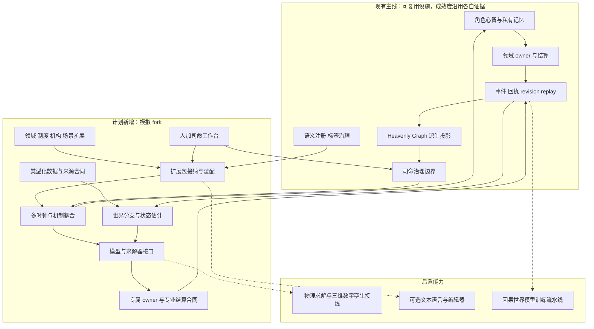
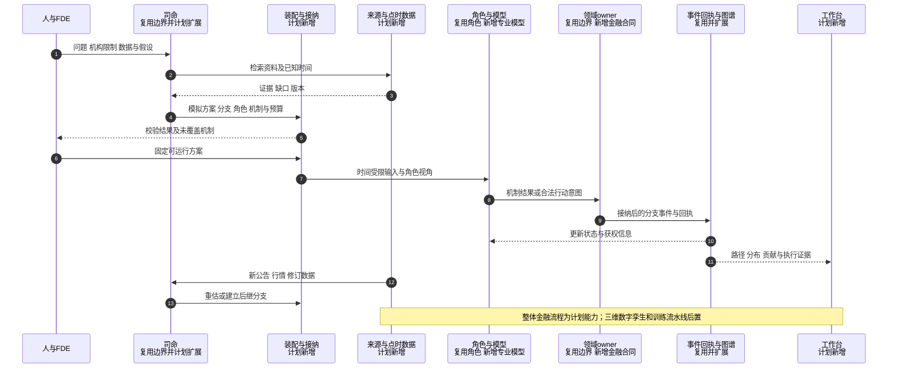
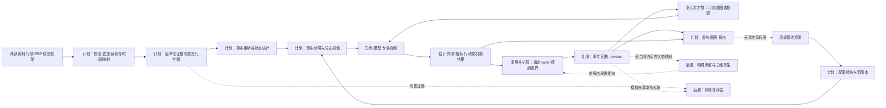

# 通用模拟底座与场景专属扩展设计

日期：2026-10-12

状态：`analysis / design-draft / non-authorizing`

范围：Paralls 模拟 fork 的架构设计；FIN03 为首个专业应用。本文件不替代游戏主线规格，不授权代码实施，不声称金融模拟运行时已实现。

## 1. 目标与设计选择

用户目标是复用世界真相层、角色智能体、司命、群体模拟、Heavenly Graph、领域 owner、标签与元标签，把游戏底座扩展为实时、可重演、可分支、可接外部模型的通用模拟底座。金融先落地，工业和商业用于检验通用性。FDE 按 Forward Deployed Engineer／团队理解，负责机构适配和交付；不是数据连接器的别名。

有三种可选路线：

| 路线 | 优点 | 主要问题 |
|---|---|---|
| 所有内容都转成属性图 | 表面统一，查询直观 | 弱化时序、数值、制度和求解语义，图无法承担全部计算 |
| 每个行业独立引擎 | 专业实现直接 | 身份、时间、分支、角色和回放重复建设，难以跨行业传导 |
| 类型化共享底座＋专业扩展装配 | 共用运行合同，保留专业数据和机制 | 必须认真定义扩展接纳、所有权和耦合边界 |

选择第三条。通用性指能有约束地新增语义和机制，不承诺有限类型清单穷尽世界，也不承诺未来无需修改内核。表达能力、机制可执行性、经验校准程度分别声明。

## 2. 总体架构与实施状态



图中的现有设施不等于完整模拟升级已完成。十月中旬的全体社会图谱、群体与 Laya 协同计划仍为 `analysis/planned/non-authorizing`。新增能力分别建立实现证据；本轮仅设计。

## 3. 共享与扩展的边界

| 层次 | 共享职责 | 不在这一层定义 |
|---|---|---|
| 数据与身份底座 | 类型、单位、身份、时间、来源、版本、访问范围 | 财报科目含义、某交易所撮合细则 |
| 世界与运行底座 | 分支、快照、状态归属、事件、协调、回放 | 具体法律解释、某机构投资流程 |
| 语义与组合设施 | 注册类型、关系端点、能力、标签、依赖、接纳 | 无约束的新 owner、任意跨域写入 |
| 智能体与模拟协作 | 角色视角、决策、群体交接、司命预算与焦点 | 所有角色都使用同一目标或行动集 |
| 领域扩展 | 金融、生产、商业等对象与机制 | 指定客户的内部权限和业务配置 |
| 制度与地域扩展 | 国家制度、司法辖区、交易场所、日历与版本 | 一次推演的临时假设 |
| 机构扩展 | 内部组织、权限、账户、流程、数据和模型选用 | 更改通用内核安全与结算边界 |
| 场景扩展 | 问题、范围、初值、参与者、分支、指标和预算 | 静默修改原始资料或已接纳类型 |
| 视图扩展 | 画布、图谱、时序、报告、三维表现 | 独立创造世界事实 |

制度、地域、领域扩展是依赖图，并非单一继承链。例如跨境基金场景同时组合两个国家配置、基金领域、多个交易场所和机构包。冲突必须显式处理，不能靠加载顺序覆盖。

## 4. 数据表示与语义层分开

### 4.1 数据表示

提供类型化标量、记录、表格、时序、事件流、向量、矩阵、张量、曲线、曲面、图、文档、多模态资料、空间数据、概率分布与样本集合的引用合同。采用组合类型和已注册专业类型，避免把所有数据塞进无类型属性字典。

金额与数量按合同采用精确数值及舍入规则；数值计算允许浮点，但声明误差和转回结算数值的方法。币种、单位、比例与基点、利率年化方法、价格报价方式必须可校验。财报空值不能自动当作零。

大型行情、矩阵和原文留在适合的存储中，图谱保存身份、语义、来源与引用。存储后端可替换；一期不因抽象设计预先安装多套数据库。

### 4.2 世界语义

| 语义对象 | 责任 |
|---|---|
| 实体 | 稳定身份、生命周期、专业类型 |
| 角色与任职 | 在范围与时间内承担的身份，不与个人永久属性混同 |
| 关系与多方安排 | 关联、合同、授权、共同参与等带角色的结构 |
| 陈述与载体 | 分离内容与文件；保留原文定位和提取依据 |
| 过程与事件 | 可推进的机制及其已发生变化 |
| 状态与观测 | 持续条件，以及来源所记录的信息 |
| 模型与机制 | 计算输出，以及受约束的世界演化方式 |

这些是结构族，不把每一项都宣称为不可约的语言原语。最终核心类型代数需通过代表性用例检验后冻结。

### 4.3 最小公共记录合同

以下为语义合同示意，不是已实现 schema。各专业类型声明字段的必选性：

```text
RecordEnvelope {
  identity: record_id + subject_refs + source_specific_ids
  type: namespaced_type + schema_version
  payload: typed_value_or_data_ref
  temporal: event_or_reference_time + valid_interval
            + publication_time + availability_basis + recorded_time
  provenance: source_refs + content_digest + derivation_refs
  revision: version + supersedes_or_corrects_refs
  scope: access_scope + recipient_scope
  context: branch_ref + epistemic_kind
  quality: freshness + missingness + conflicts + applicable_uncertainty
}
```

事件顺序另有来源序列、逻辑顺序和去重键；不能只按一个粗粒度时间戳排序。未提供的时间按未知处理，不编造。角色实际获知时间属于角色信息过程。

## 5. 世界真相、证据与模型状态

明确区分：来源记录、来源陈述、已接纳事实、派生指标、状态估计、角色信念、情景假设、预测、模拟分支事实。

外部来源可信不等于所述内容自动成为事实。观测接入后的身份确认、事实接纳和状态估计由对应合同执行，司命不凭总结改写底层历史。

现实观测档案与模拟分支分开。分支记录父快照、分叉时间、类型及模型版本、初始假设、访问范围和随机输入。分支内可有经 owner 确认的模拟事实，不能反向覆盖现实档案。

新信息更新可估计状态、参数、角色可见信息和分支权重；保留先前预测供评估。分支之间不直接混合账本或个人记忆。概率权重需有模型依据，任意情景枚举次数不是发生概率。

实时收敛以可观测指标的误差、校准和一致性衡量，不承诺完整世界状态一定向唯一现实收敛。新制度、结构突变和缺失数据可以使模型失效。

## 6. 图谱、动态边与多层嵌套

复用 Heavenly Graph 的受来源、scope、revision 约束的派生投影。公共世界、制度、模型依赖、主体信念和私有记忆可互相引用，但有独立授权与查询视图，不能合并成全知公共图。

关系声明端点类型和参与角色；多方合同、联合发文、基金安排以关系实体表示。边包含有效区间、来源、状态、标签以及专业属性。关系属性和拓扑变化由相应 owner 或受控派生机制产生版本；画布拖动不直接改事实。

| 关系族 | 专业属性举例 |
|---|---|
| 所有权与控制 | 股权比例、表决权、控制条件 |
| 权限与管辖 | 授权事项、对象、地域、期限、程序 |
| 资源与风险 | 金额、敞口、担保范围、到期日 |
| 信息与影响 | 覆盖范围、渠道、延迟、响应函数 |
| 规范关联 | 依据、适用、例外、修订、替代 |
| 模型依赖 | 输入类型、输出类型、版本、更新时间 |

不以单一边权表示一切。法律适用条件不能化成影响力分数；观察相关、来源声称、模型假定因果和经验支持的因果边分别标识。多维传播由注册机制计算，需有延迟、适用范围和终止条件。

嵌套图通过稳定实体引用实现。组织内外图与持仓、信息、供应链等视图可以重叠，不能因同一对象出现在两个视图而重复创造身份或资源。

## 7. 时间、多速率与耦合

底座协调逻辑时间与依赖，每个机制独立声明事件驱动、周期触发、连续求解或混合推进。行情粒度、角色思考频率、政策生效、预算周期、物理步长与屏幕帧率分离。

时钟合同包含日历、时区、触发方式、步长或最大步长、采样/聚合方法、延迟、同步点、允许读取的数据水位、误差与失败处理。底座支持无前视信息的因果读取；国家与场所扩展提供交易日历等专业内容。

| 子机制 | 金融示例 | 协调方式 |
|---|---|---|
| 离散事件 | 订单、成交、公告 | 按事件顺序与已知时间推进 |
| 周期过程 | 风控、资金安排、财报更新 | 日历或到期触发 |
| 时序模型 | 波动、需求、利率估计 | 指定频率与数据窗口 |
| 连续过程 | 物理温度、设备状态 | 求解器自有步长，边界同步 |
| 智能体 | 获知、分析、下单、沟通 | 感知或目标触发，决策有耗时 |

跨机制边显式定义采样、插值、聚合与延迟。任何模型不能消费尚未可用的未来输入。图依赖成环时：有时间延迟则按延迟推进；同时间代数耦合需注册求解器、收敛容差和失败语义，不能无限递归传播。

实时迟到资料追加修正；只在隔离分支内做需要的回算或重估，不静默抹去已发布结果。并发同刻事件需有稳定顺序、冲突检测和提交规则。分布式执行、乐观回滚和极低延迟优化后置。

## 8. 模型、机制和状态结算

模型接口声明输入/输出类型、单位、时间、版本、适用条件、校准来源、随机性、依赖、预算和失效条件。支持定价、时序、统计、机器学习、智能体、会计、制度状态机和物理求解器。

模型输出按用途分类：估计、预测分布、派生指标、行动选择、信息请求、机制计算结果或候选状态变化。不是所有输出都是 proposal，也不是所有输出都能写世界。

机制描述状态如何演化；领域 owner 保有规范事实提交权。一个机制的输出必须通过指定 owner 的合同接纳才能改变其状态。物理求解结果同样经对应物理状态合同处理，三维渲染没有结算权。

每个规范状态字段在一个世界分支内只有一个结算归属。复合行动必须采用已接纳的跨 owner recipe 和一致性规则；一期优先复用现有 append/receipt 边界，不发明一个任意写入所有域的超级 owner。涉及无法原子提交的外部动作时另声明补偿和未完成状态。

模型与图谱双向连接使用类型化依赖和输出通道。输出重新成为下一轮输入时需声明这是反馈，并保留派生来源；不能当成新的独立外部证据重复计算。

## 9. 角色、组织、群体与司命

### 9.1 驱动方式

| 驱动 | 含义 | 示例 |
|---|---|---|
| 角色驱动 | 有目标与认知的主体选择行动 | 基金经理分析后卖出 |
| 实体驱动 | 对象自身条件和已登记机制触发变化 | 债券到期形成兑付义务 |
| 事件驱动 | 离散事件触发后续过程 | 交易停牌触发订单处理 |
| 观测驱动 | 新信息改变已知状态和推演条件 | 发布修订数据后更新估计 |
| 过程驱动 | 已启动机制持续推进 | 审批、清算或生产持续执行 |

实体驱动不需要给每个对象配置心智。到期债券不是一个思考如何兑付的角色；是否执行付款仍涉及主体和结算机制。

### 9.2 角色与组织

复用角色身份、档案、记忆、目标、私有感知与执行边界；专业包生成角色模板、合法行动、信息渠道和约束。Laya 在注册候选中选择行动与目标，数量、价格等参数由可审计的执行方案或专用参数模型提供并校验，不能让未校验文本直接变成交易指令。

组织是复合参与者：机构单元、职位、任职者、权限、预算、账户、流程、议事机制和共同记忆有各自类型与来源。组织 owner 的结算职责与内部多角色决策分开。国家、司法辖区、党政机构、基金载体和管理人也分别表示。

组织可以粗粒度模拟外部决策，也可以展开内部议事。在切换精度时保存目标、义务、资金、记忆归属与未完成动作。组织共同记忆不自动包含所有成员私有记忆。

### 9.3 群体

沿用图谱候选与 B0-B3 方向，专业包提供受校准的传播和聚合机制。高低精度交接必须有唯一推进权、连续性和来源记录。显式角色与聚合群体不能重复承担同一份资产、订单、人口和影响贡献；聚合—展开规则由专业包声明。

模拟精度与心智模型路由是不同轴。低精度不等于 Laya，高精度也不等于调用大模型。精度变化记录近似误差和可恢复状态。

### 9.4 司命

司命先面向问题、事件和资源安排机制，再选择角色、群体、精度与预算；确有角色目标或人类任务时也可以从角色出发。金融司命负责收集资料、提出设定、设计分支、定位影响范围、调度专业模型和监督证据缺口。

司命不是市场参与者的全知心智，不强迫角色选择，不重写记忆，不直接改变法律效力、现金或成交。情景内的外生冲击通过场景合同执行，明确假设来源。

## 10. 扩展包与接纳合同

扩展包含数据、语义、可执行机制及校准资料；场景包是组合实例。以下为示意接口，尚未形成自研语言：

```text
ExtensionManifest {
  id, version, compatibility, dependencies
  registered_types, data_contracts, semantic_facets, tag_definitions
  identity_mappings, evidence_mappings, graph_projections
  mechanism_bindings, model_ports, clock_contracts
  owner_bindings, admitted_actions, cross_owner_recipes
  scope_requirements, resource_limits
  migration_rules, calibration_refs, acceptance_cases
}

ScenarioManifest {
  question, objectives, evaluation_metrics
  pinned_extensions, initial_snapshot, source_selection
  world_scope, population_and_organization_configuration
  hypotheses_and_interventions, branch_plan
  information_availability, clock_bindings, fidelity_and_budget
  observation_update_rules, stopping_conditions, views
}
```

扩展包可组合，但不能自行声明就取得写权限。装配检查命名、依赖、版本、单位、身份、关系端点、读写集合、唯一状态归属、跨域 recipe、时钟、可见性、反馈环和验证案例。

构建结果是版本固定的可执行模拟计划，可由 JSON/YAML、表单、画布或以后开发的文本语言生成。缺权限、缺机制、互相冲突的声明禁止激活；允许作为静态资料保存，并明确未执行部分。未知可成为类型化输入，执行机制必须说明是否接受未知和如何处理。

配置、类型、模型更新经过版本化接纳和迁移；运行中不任意热替换。新增本机插件需声明副作用与访问能力；一期采用可信插件和进程边界，后续按实际需要强化隔离。

标签与元标签沿用注册、版本、生命周期、可见性和编辑治理，不能充当第二套无限规则引擎或隐式授权系统。

## 11. 金融专业扩展

### 11.1 对象与机制

| 专业模块 | 类型与机制 |
|---|---|
| 金融身份 | 发行人、工具、上市记录、交易场所、合约、账户、策略主体 |
| 市场微观结构 | 报价、订单簿、交易阶段、订单、撮合、撤单、停牌、价格限制 |
| 合约与现金流 | 债券、期货、期权、贷款、掉期、权利义务、到期、行权、违约 |
| 账本与清算 | 余额、持仓、应收应付、保证金、交割、费用和资金约束 |
| 企业与经营 | 财报口径、经营过程、投融资、公司行动和资本结构 |
| 宏观与制度 | 统计版本、货币财政工具、权限、规范、政策目标、执行程序 |
| 信息与参与者 | 新闻、研报、披露、投资者、监管者、发行人、媒体及其私有认知 |
| 估值与风险 | 曲线、曲面、信用、因子、组合、敞口、压力测试和情景分布 |

市场、账本、合约生命周期等需分别接纳专业 owner 合同；最终 owner 划分在金融纵切中确定，不因为出现一类数据就新增一个 owner，也不强行塞入现有游戏 Economy owner。

### 11.2 数据映射

| 数据 | 表示 | 语义与使用 |
|---|---|---|
| Tick、订单簿、成交 | 事件流与数值记录 | 来源序列、撮合条件、流动性与执行 |
| K 线与复权序列 | 派生时序 | 聚合方法、复权依据、点时可用性 |
| 财报、ERP、交易流水 | 表格与结构记录 | 科目、合并范围、期间、重述与核对 |
| 宏观与行业数据 | 带版本时序 | 初值与修订、口径、可获得时间 |
| 新闻、公告、研报、会议 | 文档及事件引用 | 陈述、信号、获知和传播，不直接变成交 |
| 法规与政策资料 | 文件、条款、规范与程序 | 授权、适用、实施、生效与执行 |
| 股权、持仓、供应链 | 关系和表格 | 控制、资金、风险和经营传导 |
| 曲线、曲面、风险矩阵 | 数值对象 | 构建、校准、依赖、定价和误差 |
| 另类数据 | 空间、时序、多模态资料 | 代理观测与状态估计，保留推断限制 |

金融模型、研究框架同样映射为变量、假设、公式、依赖和适用条件，不仅提取实体。原始输入、转换结果和模型输出分别保留。

### 11.3 制度与中国场景

不使用单一 Policy 类型混合下列概念：战略方向、政策目标、法律规范、政策工具、实施程序、具体决定、文件载体、智能体策略和系统运行规则。

中国配置按来源和具体职权表达路线、方针、党内法规、法律规范、规划、指导文件、白皮书、会议及成果、政府部门、国资出资关系与政府投资基金。名称不自动确定约束力，发行主体、权限依据、程序、对象、地域、生效和执行分别记录。

法律效力、组织约束、执行能力和市场信号分开；效力冲突按制度配置的规则与解释依据处理，不建立全世界通用强弱排行榜。法律解释存在争议时保存多个有出处的解释，不用模型置信度代替法律效力。

政府母基金分别表达出资方、载体、管理人、投资决策机制、子基金与受益安排。预算、承诺、实缴、投资批准和交割是不同状态。国资机构的出资、监管、任命等关系按具体职责分开。

## 12. 一次金融场景的完整推演

问题示例：某产业支持方向出现后，相关资产在未来一周与一个季度的风险收益如何变化？比较多个入场时点与不入场方案，不预设存在可准确识别的唯一最佳时点。

准备：FDE 与人、司命选择数据和制度包；司命起草角色、模型、资金与政策执行分支；装配系统检查合同，记录未知。角色包括机构内部相关职位、管理人、企业、投资者、媒体等，依据证据生成档案，推测部分明确标识。

推演同时运行两条路径：信息获知—预期—订单—价格；正式措施—授权—预算—资金—企业经营—现金流。二者用不同时间尺度，政策不能直接产生必然上涨事件。



“固定方案”是机构业务可审查配置点，不表示每条实时资料或每次后台运行都需要人工批准。机构包可预设允许自动运行、重估和分叉的范围。

输出是条件化分布、候选入场时点比较、回撤、成交可能性、资金约束、关键未知与失败条件；另记录模型精度、来源和历史校准。直接连接真实交易或 ERP 写回是独立外部执行能力，不因模拟计划激活而自动获得。

## 13. 数据流与权威边界



图中的 owner 接纳适用于规范状态改变；纯预测、指标等可直接进入类型化结果存储和视图，不必伪装为世界事件。状态估计与来源事实仍保留不同语义身份。

## 14. 工业、商业及跨行业组合

| 场景 | 专属扩展 | 共用设施 |
|---|---|---|
| 工业生产、采矿 | 设备、工艺、物料、空间、故障、安全、物理求解、传感器与 ERP 映射 | 身份、来源、时钟、分支、组织角色、图谱、结算与工作台 |
| 商业产品决策 | 产品、客户、渠道、竞争、定价、需求、预算、购买与扩散机制 | 角色档案与记忆、传播、模型接口、情景分支和评估 |
| 金融分析 | 工具、市场、合约、账户、政策传导、定价与风险 | 同上，增加专业金融结算与点时数据 |
| 跨行业 | 矿山事故—供应减少—企业现金流—信用—资产价格 | 组合物理、供应链、企业和金融机制，显式同步与状态归属 |

商业角色必须结合调研或行为数据校准；生成详细人格不自动获得真实客户行为。工业显版必须有真正参与计算的物理/工艺求解，三维动画本身不证明物理有效。

所有场景都有可选的人＋司命工作台。后台版运行计划并输出数据/API；显版在此基础上耦合参与模拟的物理数字孪生及三维场景。无限画布、普通关系图或金融曲线不会单独使一个应用成为显版。

## 15. 工作台与FDE交付

无限画布展示问题、证据、实体视图、机制依赖、制度条款、时钟、分支、角色与结果，使用按需展开和有界查询。节点各有类型；连接线区分引用、关系、模型输入和传播，避免把视觉连线自动变成因果。

编辑生成类型化配置变更：校验—版本固定—执行预览—结果审查。修改关系数值时区分来源修正、情景干预和模型参数调整，并显示对应影响范围。私有角色信息按授权展示。

FDE交付：连接器配置、语义映射、机构与制度包、模型选择与校准、代表场景、验收案例。司命可辅助检索与起草，但所有未知、推断和缺机制必须显式保留。模板复用不等于所有客户具有相同流程。

## 16. 技术实现与语言选择

建议用 Python 延续角色、司命、owner 与模型接线；先复用正确的现有边界。实时数据、图查询、多速率调度和批量计算在测得瓶颈后以 Rust 实现适合部分，通过版本化批量接口对接，避免每条行情跨语言调用。

C++/CUDA 等通过模型或求解器插件接入已有高性能生态；不为了语言统一重写所有成熟模型。前端画布可采用 TypeScript；Godot 保有本地具身与表现职责，物理模型可以由独立求解器承担。实际性能以场景负载和延迟证据判断，不根据语言名称保证。

先建立类型化中间表示、装配校验和执行计划，再决定是否需要文本 DSL。语言必须有类型、单位、时间、作用域、效果与 owner 检查；不开发一门替代成熟后端语言的通用语言。

本设计不新增依赖、不冻结数据库产品、不要求立即替换 Python 内核。分布式执行和极低延迟交易级设施在明确吞吐、尾延迟与一致性目标后单独设计。

## 17. Fork兼容与回流

复用接口和合同，避免将当前游戏窄域 owner 直接改造成无边界模拟 owner。新专业事件、字段、生命周期和跨域 recipe 必须单独接纳。

模拟 fork 记录上游版本、兼容合同与本地扩展。通用 bugfix 和兼容改进可回流；专业金融、制度和物理扩展保留独立依赖。上游 owner 变化逐项适配迁移，不自动合并不同语义。

数字孪生依赖的动作、资产和表现更新沿用原版接口接入；场景对象映射到稳定后端身份，不用前端实例反推事实。包版本兼容检查不能代替回放、迁移和运行证据。

## 18. 验收与实现顺序

### 18.1 共用合同验收

1. 点时读取：角色看不到未来公告、修订财报和未来成分名单；数据、参数和训练版本都检查。
2. 数据语义：金额、单位、币种、精度、缺失值和曲线维度能够验证；不合法转换被拒绝。
3. 结算：同一状态归属唯一；角色、模型、标签、图谱和画布不能绕过 owner。
4. 图谱：来源、授权、修正、撤回与有界查询可验证，投影可重建。
5. 时间耦合：跨速率无前视、迟到资料可追踪、环路有明确求解或拒绝结果。
6. 连续性：显式角色、聚合群体、组织内外精度切换不重复状态与贡献。
7. 组合：至少通过金融、商业和物理场景合同样例；专业机制可替换但保持输入输出与结算合同。
8. 回放：保存输入、配置、数据、模型版本和外部输出；记录回放与重新调用模型分开。固定seed不能保证外部LLM重执行相同。
9. 失效处理：来源冲突、数据缺口、求解不收敛、模型超时、迟到决策明确报告，不能伪造成功。
10. 性能：按场景冻结数据率、参与者量、分支数、内存、吞吐、p95/p99延迟和成本目标。

### 18.2 金融与训练验收

真实历史用于点时重演、参数校准与留出评估；模拟轨迹单独标识模型版本、假设、干预、执行证据与近似误差。按时间和完整轨迹隔离训练、校准与评估，不能随机拆散相邻轨迹造成泄漏。

预测对比简单基线，评估校准、风险、成本、流动性和跨阶段稳定性。描述拟合、预测有效性和因果识别分别验收；合成反事实是模型生成资料，不自动证明现实因果。

实现顺序：

1. 建立类型、来源、时间、身份、分支及owner合同映射。
2. 建立扩展接纳与装配，完成一个小型金融历史纵切：有限工具、账本、信息事件、角色和政策执行分支。
3. 加入实时观测、状态估计、多时钟与图谱传播，证明高低精度交接。
4. 扩展金融工具、制度、组织、专业模型及人＋司命工作台。
5. 用商业场景和真实物理求解纵切检查底层通用性，再开展显版接线。
6. 达到点时与回放标准后，建设训练流水线；根据实测瓶颈推进高性能及分布式模块。

这只是设计顺序。各阶段需要单独的规格、计划和验收证据，不能把本文件当作完整实施计划。

## 19. 当前资料与证据边界

- [主线入口](../../superpowers/specs/world-character-siming-authority-mainline/README.md)与[主设计](../../superpowers/specs/world-character-siming-authority-mainline/2026-06-29-world-character-siming-authority-mainline-master-design.md)：复用现有世界—角色—司命—owner方向。
- [组织／政府／社会通用平台](../../superpowers/specs/world-character-siming-authority-mainline/2026-09-03-organization-government-social-generic-platform-design.md)：保留闭合类型、owner分离、recipe、append、revision与回放边界。
- [派生社会图谱计划](../../10月中旬分析/群体模拟升级/计划/既有中旬计划/02-派生社会图谱与因果传播实施计划.md)：来源、私有与公共分离、有界查询和派生投影；升级仍是计划。
- [群体与Laya协同计划](../../10月中旬分析/群体模拟升级/计划/既有中旬计划/03-群体模拟与Laya心智运行时协同实施计划.md)：精度、候选、心智路由、唯一推进权与回执；升级仍是计划。
- [标签与元标签设计](../../10月分析/战斗系统与角色技能，状态和资源/08-对象标签、编辑与版本治理设计.md)：复用注册语义和有限治理，不让标签直接写真相。

本文件为设计分析，现存设施的证据以各自资料为准；没有新增运行时、性能或金融预测有效性证据。迁移后的目录入口见 [README](README.md)，三部分底座的细化设计见 [设计02](02-类型化数据底座、制度与领域语义、可插拔演化机制设计.md)。
