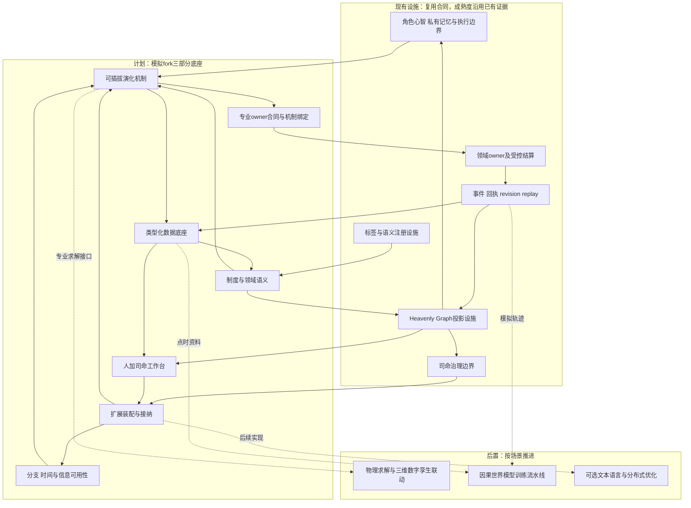
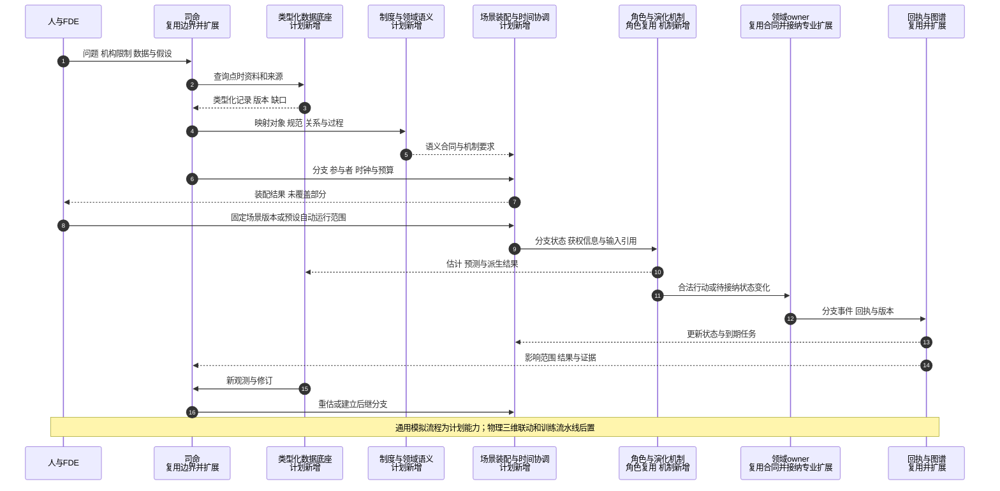
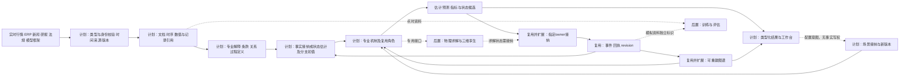

# 类型化数据底座、制度与领域语义、可插拔演化机制设计

日期：2026-10-12

状态：`analysis / design-draft / non-authorizing`

归属：模拟预测底座 fork 的设计分析，不属于游戏主线执行规格。

## 1. 设计目标与依据

本设计基于以下方向重新组织底座：

> 类型化数据底座＋制度与领域语义＋可插拔演化机制。图谱贯穿三者；角色、司命、群体模拟和领域 owner 在其上协作。

目标是同时承载金融的海量数值数据与复杂制度，支持工业的物理模型、商业的组织行为及跨行业传导。底座先定义信息、意义、演化和结算边界；专业扩展再定义具体对象、制度、行为和计算方法。

本文件细化[通用底座与场景专属扩展设计](01-通用底座与场景专属扩展设计.md)。它不是另起一套替换现有owner的世界运行时，也不把自研语言、图数据库或高性能语言当成前提。

“覆盖所有”落实为可扩展的表达与机制协议。支持表达一个对象、不缺失地接入其数据、能够执行其机制、具有校准和预测证据，是四个不同的能力等级；不能互相替代。

## 2. 三部分架构及横向设施

| 部分 | 核心问题 | 输入 | 输出 |
|---|---|---|---|
| 类型化数据底座 | 资料是什么结构、何时可知、从何而来？ | 原始数据、文档、模型输出 | 有类型、身份、时间、来源和版本的记录与数据引用 |
| 制度与领域语义 | 对象、关系和陈述意味着什么、适用于谁？ | 类型化资料、专业定义与制度依据 | 实体、条款、关系、过程定义、适用解释及受约束的图谱投影 |
| 可插拔演化机制 | 给定状态与条件，哪些变化可能或允许发生？ | 分支状态、角色信息、观测和机制配置 | 估计、预测、行动、过程结果及待接纳的状态变化 |

三者通过注册类型和版本化引用连接。世界分支、时间协调、权限、owner、事件回执、回放和工作台贯穿三部分；不归入一个能够任意执行和写入的超级模块。



现有图谱、角色、司命与结算边界可以复用，不意味着通用金融、全体图谱传播或多时钟协同已经完成。图中专业owner合同是新增能力接入既有结算模式的适配，不自动改变既有owner的事实范围。

## 3. 不可混淆的边界

1. 数据载体不等于领域意义：同一数值结构可以表示成交价、目标价或预测价。
2. 来源陈述不等于已确认事实：有出处的报道仍可能错误、过时或存在争议。
3. 法律权限不等于软件写权限：现实授权由制度语义表达，提交权由owner合同控制。
4. 模型计算不等于状态结算：数值正确仍可能不满足资源、权限或生命周期要求。
5. 图谱投影不成为第二事实库：确认关系有可追溯来源，假设关系有独立身份。
6. 标签、元标签不直接写资源、授予权限或创建新owner。
7. 现实观测与模拟分支隔离；角色信念与公共信息隔离。
8. 多个机制可以计算同一对象，但在同一分支中不能竞争提交同一规范状态字段。
9. 同一参与者、持仓、人口、预算或订单不能同时计入显式与聚合模拟。
10. 缺数据、缺解释和缺机制分别表达，不能通过生成细节伪装成已知世界。

## 4. 类型化数据底座

数据合同的细化定义见[数据结构、金融数据类别与时间口径合同设计](03-数据结构、金融数据类别与时间口径合同设计.md)，包括结构族、专业类别、点时读取模式、时间与口径、修订血缘及合同实例。下文字段为概览示意；认识状态的多轴定义以该细化文档为准。

### 4.1 数据类型族

| 类型族 | 示例 | 必须声明 |
|---|---|---|
| 标量与数量 | 金额、价格、温度、数量、利率 | 精度、单位、币种或维度、舍入及报价方法 |
| 记录与表格 | 财报、ERP、订单、库存 | 字段类型、身份键、口径、缺失含义 |
| 时序与事件流 | 行情、新闻、传感器、成交 | 时间语义、顺序、频率、去重、迟到和修订 |
| 曲线与曲面 | 利率曲线、波动率曲面 | 坐标、单位、构建和插值方法 |
| 向量矩阵与张量 | 因子暴露、协方差、场状态 | 维度名称、对象对应、计算口径 |
| 文档与多模态 | 法规、研报、白皮书、会议音视频 | 原文、版本、定位、转录与提取来源 |
| 空间与几何 | 矿区、设备、港口、三维场景 | 坐标系、比例、拓扑、时间变化 |
| 图与层级 | 股权、部门、科目树 | 节点身份、边类型、来源和有效区间 |
| 分布与样本 | 情景路径、风险分布 | 条件、权重、样本生成和相关性 |
| 公式与计算表达式 | 估值、成本、约束 | 输入输出类型、依赖、执行效果 |

类型族可递归组合。专业类型通过注册schema声明约束；不能仅凭任意字符串键值就进入专业计算。币种转换依赖指定时间的汇率资料，不能当作无成本的单位转换。

### 4.2 身份、时间、来源与版本

设计示意：

```text
DataRecord {
  record_id, subject_refs, external_identifier_refs
  type_ref, schema_version, payload_or_data_ref
  reference_period_or_event_time, valid_interval
  publication_time, availability_basis, recorded_time
  source_refs, source_sequence, derivation_refs, content_digest
  revision, supersession_or_correction_refs
  access_scope, branch_ref, epistemic_kind
  missingness, conflicts, freshness, applicable_uncertainty
}
```

字段必选性由专业类型定义；未知时间保留未知。角色获知时间通过信息渠道、访问权限和传播延迟计算，不能直接等同于数据进入平台的时间。

现实记录、来源观点、派生指标、状态估计、角色信念、假设、预测和分支事实分别标识。法律效力不是置信度；置信区间、来源质量和事实接纳状态也不是同一个数值。

### 4.3 存储与读取

原始文件、事件流、数值数据与语义索引可以使用不同存储实现，共享稳定引用和访问合同。一期优先复用现有能力，不为了抽象提前部署多套数据库。

按需提供表格、窗口、曲线、子图和文档片段读取。读取固定数据版本、范围、截止可知时间及权限；记录影响结果的输入引用。图谱存数据引用和派生索引，不复制所有行情到节点属性。

来源冲突保留并行版本与冲突标识，按明确来源策略供模型选择。修正追加版本和失效依赖，不覆盖历史重演需要的旧值。

## 5. 制度与领域语义

### 5.1 语义注册内容

专业类型声明身份规则、字段、单位、生命周期、可接受陈述、关系端点、参与角色、适用范围和机制绑定。用可组合能力表达“有预算”“可持有资产”“具有内部议事程序”，同时校验组合是否一致。

实体、角色、关系、陈述、载体、状态、事件、过程、观测和模型构成语义结构族；金融证券、矿山设备、政策条款等在专业包中细化。这里不把一张业务概念表当作已经冻结的形式语言核心。

### 5.2 制度内容与文件载体分离

| 内容 | 模拟职责 |
|---|---|
| 战略方向与方针 | 形成目标约束、组织贯彻路径或市场信号 |
| 政策目标 | 表达期望结果、期限和衡量指标 |
| 法律规范 | 表达义务、禁止、许可、权能及条件与后果 |
| 政策工具 | 补贴、税收、信贷、采购、担保、投资和许可 |
| 实施程序 | 申请、审议、审批、拨付、检查、申诉、退出 |
| 具体决定与行为 | 批准、处罚、任命、预算分配和实际执行 |
| 文件载体 | 法律文本、规划、指导文件、实施细则、白皮书等 |

一份文件可包含多类内容。逐条保留发布主体、权限依据、程序、适用对象、事项、地域、时间、执行主体与解释来源。

国家、领土、行政区域、司法辖区、政治组织、机关、部门、职位和任职者分别建模。国家之间不同制度通过版本化配置包表达；路线、方针、白皮书、指导意见和细则不能仅按名称排成全球通用等级链。

规范之间的依据、授权、例外、修订、替代与冲突关系采用制度配置定义的规则。具有分歧的解释保留有来源的备选解释；需要执行但解释不足时，报告未决并按场景指定方案运行，不能伪造法律确定性。

智能体决策策略、系统运行规则另行命名，避免用Policy混合政治政策、法律规范和技术策略。

### 5.3 组织及多方安排

组织表示为机构单元、职位、任职者、权能、账户、资源、流程和记忆的组合。基金载体、管理人、出资人、受益人、委托与投资约束分别表示。联合发文、合同和基金结构采用带参与角色的关系实体。

国资机构的监管、出资及其他职权按具体依据区分；会议有议事主体、身份、议题、程序和产物，讲话不自动成为正式决定。政府基金的预算、承诺、实缴、批准和交割分别记录。

组织外部视图展示整体行动，内部视图展示成员和过程。不同视图引用同一身份和规范状态，不能复制出互不一致的组织事实。

## 6. 可插拔演化机制

### 6.1 模型与机制的区别

模型计算估计、预测、评分或决策。机制定义状态如何随条件和行动变化，例如撮合、清算、审批、生产、传播和组织议事。一个机制可以使用多个模型；一个模型也可被多个机制使用。

模型无需逐次产生规范世界变化。风险计算可以直接生成风险指标；只有实际冻结保证金、执行订单等动作进入相应结算合同。

### 6.2 接口合同

以下为设计示意，尚未实现：

```text
MechanismDefinition {
  mechanism_id, version, dependencies, applicability
  input_ports, output_ports, parameter_schema
  state_read_set, proposed_state_effects, owner_bindings
  trigger_and_clock, latency_and_sampling
  access_capabilities, side_effect_declaration
  numeric_tolerance, stochastic_inputs, resource_limits
  invariants, failure_semantics, calibration_refs
}

MechanismCall {
  branch_ref, logical_time, input_refs, state_revision_pins
  parameter_version, scoped_actor_or_process_context
  random_input_refs, deadline, budget
}

MechanismResult = Estimate | ForecastDistribution | DerivedMetric
                | ActionChoice | InformationRequest | ProcessResult
                | TransitionProposal | Failure
```

各输出具有自己的类型和来源。不是所有输出都是proposal；TransitionProposal也不等于执行成功。模型选择行动后，owner仍校验权限、资源、版本和生命周期。

### 6.3 接纳、提交与副作用

机制不得持有任意世界写接口。规范状态由既有或单独接纳的专业owner提交，产生事件与回执。跨owner变化使用已接纳recipe及一致性规则；不把动态连接模型解释成任意跨域写入。

一个规范状态在同一分支内只有一个结算归属。状态估计、缓存和派生特征可以有多个视图，但注明来源并可重建。外部系统写回属于独立能力，模拟运行不自动取得真实交易、资金或ERP变更权限。

插件声明网络、文件和外部动作能力。数值模型尽量无副作用；接入有状态外部求解器时必须记录状态版本和恢复规则。一期使用可信插件与明确进程边界，强化隔离按具体部署需要推进。

## 7. 图谱怎样贯穿三部分

| 图谱视图 | 连接内容 | 更新依据 |
|---|---|---|
| 世界与制度图 | 实体、条款、职权、资源及关系 | owner事件、已接纳资料与受控派生 |
| 信息与信念图 | 发布、引用、获知、相信、质疑 | 信息过程及角色私有更新 |
| 模型与机制依赖图 | 类型化端口、变量、公式、时钟和依赖 | 已接纳配置版本 |
| 场景与分支图 | 初值、假设、干预、分叉和结果 | 场景配置及运行记录 |

这些是查询和组织视图，不要求拆成四套数据库。公共图、私有记忆和主体信念保持scope隔离，跨视图访问需有授权。

动态边保存有效区间、来源、版本、状态、标签和专业属性。所有权边可有比例和投票权；信息边可有覆盖、延迟和传播响应；权限边可有事项、对象和期限。边权不是万能表达，法律效力不由影响分数决定。

拓扑、关系数值与标签变化有不同的来源和更新合同。多层组织、供应链、资产与人员图引用稳定身份，允许有界展开。模型输出反馈图谱时按派生类型更新，不能冒充新的独立外部证据。

因果假设、统计相关、来源声称和经验支持的因果关系分别标识。图遍历找到路径，不等于已证明该路径会发生；真正的传导由专业机制执行。

## 8. 时间、触发与不同tick

底座定义时间协调合同，机制选择推进方式。时间尺度、逻辑顺序、信息可用性与渲染频率分开。

| 触发方式 | 示例 |
|---|---|
| 离散事件 | 报价、成交、公告、故障 |
| 日历与到期 | 债券到期、预算窗口、财报发布、检查 |
| 周期采样 | 风险更新、需求估计、传感器采集 |
| 连续求解 | 温度、受力、流体、设备动力学 |
| 混合过程 | 故障改变连续系统条件，公告触发角色决策 |

机制声明本地时间、日历、步长、触发、延迟、读取水位和同步点。跨机制端口声明采样、聚合、插值和延迟；禁止消费尚未可知的未来输入。

存在延迟的环路按时间推进；同刻代数耦合需要注册求解器、容差、迭代上限与失败结果。不允许无界传播或默认所有反馈瞬间完成。

同时间事件的顺序由来源序列、依赖和稳定冲突规则确定。实时迟到、修订资料追加版本，更新依赖或创建后继分支；不静默覆盖已发布预测。分布式乐观回滚与极低延迟执行另行设计。

## 9. 角色、群体、实体与司命如何推进

角色驱动由心智和目标选择行动；实体驱动由对象条件触发已登记机制，例如债券到期或库存越界，不要求对象拥有心智。事件驱动处理离散变化；观测驱动处理新证据；过程驱动推进已经启动的工作。

角色可见信息由身份、渠道、scope、已知时间和私有记忆构建。角色档案、心智模型、记忆可以由司命辅助生成，但证据、模板和推断部分分别标明；生成细节不等于真实行为校准。

Laya作为快速决策模型在注册候选中选择行动和目标。数量、价格等执行参数由已接纳方案或专用模型产生并校验。慢思考可以改变目标和计划，不能替角色预先取得owner成功回执。

群体模拟按图谱找到受影响范围，由专业传播或聚合机制推进。B0-B3精度与心智模型选择分开；激活角色时冻结其聚合推进权，保存连续性与未完成动作，禁止显式与群体双重计算。

司命管理问题、情景、资料缺口、分支、机制、参与者和预算。它通常先对着事安排人，也可从角色目标出发；角色行动、事实和法律效力不由司命直接改写。

## 10. 扩展包与场景装配

领域、制度/地域、机构、场景和视图包分别声明专业内容。扩展包引用数据合同、语义定义、机制绑定、owner合同、时钟、访问scope和验收案例。场景包固定问题、初值、数据选择、参与者、假设、评价指标与停止条件。

装配产生类型化执行计划，校验：

1. 类型、单位、身份、关系端点和版本能否匹配。
2. 新制度对象是否有适用解释，机制是否覆盖所需程序。
3. 每个状态变化是否有指定owner及合法写入合同。
4. 输入在执行时间是否已可用，时钟是否可协调。
5. 聚合与显式对象是否重叠，依赖循环是否有求解或延迟。
6. 权限、资源、校准范围和失败语义是否齐备。

缺机制的对象可以存储、展示和研究，但必须标明未执行范围。场景可以显式配置未知假设或近似机制，输出记录近似来源，不能把它标成真实已校准机制。

专业类型可以新增，owner与事实族必须另行接纳。任意schema注册不授予事实写权限。配置更新形成新版本，不在运行中静默覆盖模型或制度。

## 11. 主交互时序



固定版本不要求每次自动数据更新均由人确认；机构包预先定义自动运行、重估、分叉与停止范围。没有通过装配的配置保持设计态。

## 12. 数据流与权威边界



事实接纳、状态估计、图谱投影与owner结算有独立合同；图中的汇聚不把它们合并成同一写入权限。来源记录接纳只证明记录被保存，不自动证明记录里的全部陈述为真。

## 13. 金融场景如何专业化

### 13.1 数据映射

| 数据 | 类型化表示 | 专业语义 | 机制用途 |
|---|---|---|---|
| 行情与订单簿 | 有序事件流和数值记录 | 场所、交易阶段、报价、成交 | 撮合、流动性与市场冲击 |
| K线与复权价格 | 派生时序 | 聚合口径、公司行动、调整依据 | 历史分析与模型输入 |
| 财报与ERP | 表格、科目、期间与版本 | 合并范围、会计口径、重述 | 经营、融资与估值 |
| 宏观统计 | 发布与修订时序 | 样本、季调、计量范围 | 状态估计与宏观传导 |
| 曲线、曲面、矩阵 | 数值对象 | 校准、期限、维度、适用市场 | 定价、风险、组合 |
| 新闻与研报 | 文档、陈述与引用 | 观点、预测、传播、角色获知 | 预期变化与交易行为 |
| 法规与政策 | 文件、条款、职权与程序 | 适用、生效、执行与解释 | 权限、约束与资源变化 |
| 持仓、流水与合约 | 记录、关系和生命周期 | 权利义务、账户、现金流 | 交易能力、清算与违约 |
| 另类资料 | 空间、时序及多模态 | 代理指标及其误差 | 经营状态的间接观测 |

发行人、金融工具、上市记录、交易场所、合约和账户拥有不同身份。目标价、成交价、模型合理价和角色相信的价格不能仅因数值相同而互换。基本面框架映射变量、公式、假设和依赖，不只提取公司名。

### 13.2 一次政策影响推演

问题：某产业支持方向出现后，比较多个入场时点及不入场方案在一周和一个季度内的条件化风险收益。

信息路径：公开表态—渠道传播—角色获知—解释—预期—订单—价格。

执行路径：正式措施—权限与程序—预算—出资承诺—实缴或拨付—企业决策—产能与现金流。

两条路径不共享一个即时冲击参数。会议、指导文件、实施细则、资金与真实执行各有状态、延迟和失败条件。模拟可以出现预期先涨、执行延迟、效果不达预期或政策中止。

角色包括机构相关职位、发行人、管理人、不同投资者、媒体和监管主体。Laya负责适配后的快速行动选择；定价、风险、交易和结算使用专业机制。输出分布、执行可能性、成本、回撤、资金约束与解释依据，不宣称一定识别唯一最佳买点。

新观测更新可估计状态和后续方案。情景权重需有校准或明确主观依据，枚举分支的数量不是现实概率。保留旧预测以评估实时更新是否改善结果。

## 14. 工业、商业与跨场景传导

工业扩展增加设备、工艺、物料、空间、安全、故障、传感器与物理求解。商业扩展增加产品、客户、渠道、竞争、需求、预算和购买机制。它们复用身份、时间、证据、分支、组织和结算合同，不复用不适用的金融机制。

跨场景链：矿山故障—生产变化—供应减少—企业现金流—信用变化—金融资产价格。每段有专业机制和同步接口，不能用图上的一条影响边跳过中间计算。

后台版执行同样的计划，输出API和结果。人＋司命工作台独立提供画布、图表、证据与分支编辑。显版要求物理/工艺求解实际参与模拟，并与三维孪生联动；前台渲染保持表现职责。当前Godot不因此获得金融或世界真相写权。

## 15. FDE、司命与机构适配

FDE按Forward Deployed Engineer／团队理解。交付内容是数据连接、专业映射、机构与制度配置、模型选择与校准、代表场景及验收案例。连接器是FDE使用的工具；ERP和金融框架都能参与映射。

司命辅助检索、提取、发现缺口和起草设定。人工和机构流程确定关键依据；来源不足的部分保留未知或明确假设。无限画布的节点分为证据、对象、机制、分支和结果，连线区分关系与模型依赖，视觉连线不直接创造因果。

编辑分别表达资料修正、情景干预和参数调整，产生版本化配置意图。角色私有内容按权限展示。机构可以预设自动运行范围，并不要求所有后台模拟有人在场。

## 16. 历史重演与世界模型训练

历史快照固定当时可用的数据、成分与主体名单、制度版本、模型和参数。后续修订不能进入当时角色视野；用于决策评估的模型也不能未经标识地包含未来训练信息。

轨迹记录状态、观测、角色信息、行动、机制版本、干预、回执、近似误差和结果。真实历史、模型估计和模拟反事实分开存储。回放已记录输出与重新调用外部模型是不同操作；seed不能保证LLM或外部服务重执行一致。

训练、校准和评估按时间及完整轨迹隔离。合成情景可用于探索、压力测试和训练，但不自动提供现实因果证据。金融世界模型分别评估历史拟合、留出预测、概率校准、机制一致性和干预解释。

## 17. 与现有项目的兼容

| 现有设施 | 复用边界 | 本设计新增内容 |
|---|---|---|
| 世界与领域owner | 事实归属、受控执行、事件与结算 | 分支语义及接纳后的金融/物理合同 |
| Character Core与心智 | 私有连续性、记忆、目标、执行边界 | 专业角色模板、行动与信息渠道 |
| 司命 | 高层治理和催化边界 | 资料、机制、分支与预算方案 |
| Heavenly Graph | 来源、scope、revision和派生查询 | 专业关系、模型依赖及场景视图 |
| 群体升级计划 | 唯一推进权、交接与连续性方向 | 金融传播和组织内外机制，仍需实施 |
| 标签与元标签 | 注册语义及有限治理 | 专业标签与机制绑定，保持不直接写事实 |
| Godot与表现 | 本地具身、输入和视听表现 | 后置数字孪生的状态映射与呈现 |

模拟fork记录上游版本和兼容接口；共用改进可以回流，专业扩展独立演进。上游owner变更先做合同、迁移和回放校验，不自动覆盖本地制度语义或结算行为。

实现语言优先延续成熟生态。Python承接现有服务与模型；数据处理、调度等在测出瓶颈后选择Rust等实现；C++/CUDA/其他成熟求解器通过明确接口接入。先建立类型化表示，再评估文本DSL，不先开发一门替代成熟语言的通用语言。

## 18. 验收问题与建设顺序

验收至少覆盖：类型与单位正确、身份不混淆、来源可追溯、点时无前视、制度适用可解释、owner写边界成立、群体无重复计算、多时钟无未定义反馈、修订与回放可验证、失败与未知可见。

性能目标按场景确定数据率、参与者数、分支数、内存、吞吐、尾延迟和成本。不能用选择某语言代替性能证据。预测效果与系统正确性分别验收。

建设顺序：先做类型、时间、来源、语义和owner映射；再用小型金融纵切证明机制装配、角色选择和结算；随后加入实时同化、图谱传播、多时钟和组织展开；用商业及真实物理求解纵切检验通用性；最后扩展数字孪生、训练与规模优化。

## 19. 资料与当前证据

- [总方案](01-通用底座与场景专属扩展设计.md)：专业包、场景装配与总体建设方向。
- [主线设计](../../superpowers/specs/world-character-siming-authority-mainline/2026-06-29-world-character-siming-authority-mainline-master-design.md)：世界—角色—司命—owner运行方向。
- [组织／政府／社会通用平台](../../superpowers/specs/world-character-siming-authority-mainline/2026-09-03-organization-government-social-generic-platform-design.md)：owner分离、闭合类型、recipe和结算边界。
- [派生社会图谱计划](../../10月中旬分析/群体模拟升级/计划/既有中旬计划/02-派生社会图谱与因果传播实施计划.md)：来源、私有信息、有界查询与修正；仍是计划。
- [群体与Laya协同计划](../../10月中旬分析/群体模拟升级/计划/既有中旬计划/03-群体模拟与Laya心智运行时协同实施计划.md)：精度与路由分离、唯一推进权和回执；仍是计划。
- [标签与元标签设计](../../10月分析/战斗系统与角色技能，状态和资源/08-对象标签、编辑与版本治理设计.md)：注册与治理边界。

本文件是新增设计分析。类型与接口为示意；三部分底座和金融流程尚无新增运行验收结论。本文档静态检查不能代替后端、Godot、物理模型、性能或预测有效性验证。
