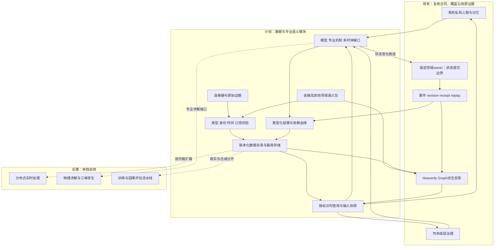
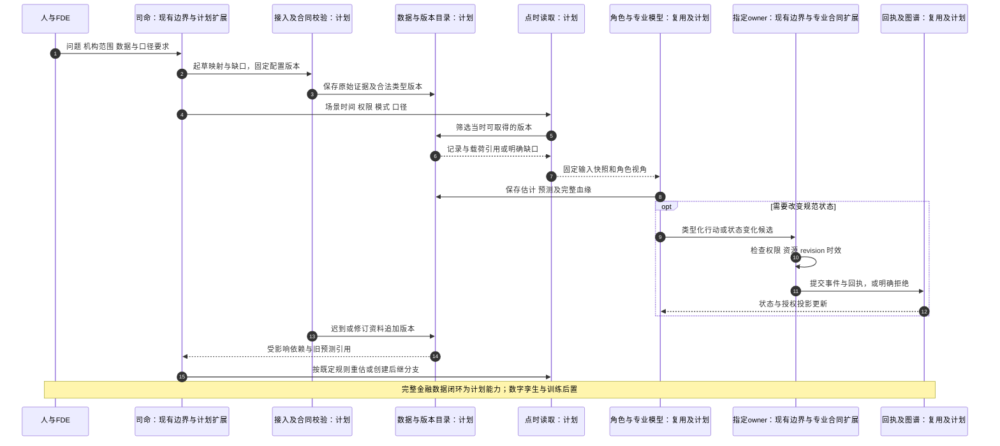
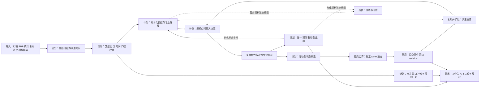

# 数据结构、金融数据类别与时间口径合同设计

日期：2026-10-12

状态：`analysis / design-draft / non-authorizing`

归属：模拟预测底座 fork。本文细化[设计02](02-类型化数据底座、制度与领域语义、可插拔演化机制设计.md)的数据合同，不改变游戏主线规格，不授权运行时代码变更。

## 1. 设计目标与范围

将已讨论的“数据表示、领域语义、世界演化”固化为可审查的数据设计。金融作为首个专业包，优先明确多种数据结构、专业类别、身份、时间、口径、来源、版本和信息可见性；工业、商业通过同样的合同接入自己的类型和机制。

底座的通用性来自可组合类型和扩展协议。保存原始资料、无损表示、专业解释、机制执行、预测有效性是不同的能力。本文定义前三者及其与执行层的接口，未证明覆盖全部金融产品、制度或应用场景。

本次输出是设计文件。所有类型名、字段、接口和实例均为设计示意，尚无对应新增实现；数据库产品、序列化格式、自研语言与高性能实现语言保持未决。

### 1.1 本文中的状态约定

- **现有**：复用世界与领域 owner、角色私有连续性、司命、事件/revision/receipt/replay、Heavenly Graph及注册语义的既有边界；成熟度以原资料和代码证据为准。
- **计划**：通用数据合同、金融专业类型、点时查询、多时钟数据接口、血缘与修订传播。
- **后置**：分布式极低延迟执行、物理数字孪生联动和因果世界模型训练流水线。

现有 Government 的 policy 家族是游戏领域合同，不能直接视为完整法律制度类型。现有 Economy 也不能直接宣称具有完整金融撮合、清算和账户能力。

## 2. 三部分如何连接

| 部分 | 负责内容 | 不具有的权力 |
|---|---|---|
| 数据表示 | 原始资料、类型化数据、时间与口径、来源、版本、读取 | 保存记录不证明其内容真实，不改变持仓或法律权限 |
| 领域语义 | 身份、工具条款、统计指标、制度规范、陈述解释与图谱投影 | 解释和标签不授予事实写权限 |
| 世界演化 | 模型计算、角色选择、传播、审批、撮合等专业机制 | 估计和行动选择不直接等于 owner 提交成功 |

### 2.1 架构图



图中的数据目录拥有记录与索引管理职责；世界规范状态的提交仍属于指定 owner。图谱与载荷库共同服务读取，不形成第二套世界真相。

## 3. 数据结构体系

数据结构与金融业务类别是两条轴：同一结构承载多个业务类别；一个业务对象也能组合多种结构。

| 结构族 | 内容与组合方式 | 必须声明的结构合同 |
|---|---|---|
| 标量与数量 | 整数、定点数、浮点、布尔、枚举、金额、价格、温度 | 精度、量纲、币种、编码、有效范围、舍入 |
| 记录与表格 | 字段记录、关系表、宽表、明细表 | 字段类型、键、粒度、唯一性、缺失含义 |
| 时序 | 单变量、多变量、面板序列 | 索引、频率、期间语义、聚合方法、版本 |
| 事件流 | 行情增量、交易、新闻更新、传感器事件 | 来源分区与序列、顺序、去重、缺口、迟到 |
| 曲线与曲面 | 期限曲线、波动率曲面、需求曲线 | 坐标类型、构建输入、插值、外推、有效范围 |
| 向量、矩阵与张量 | 因子暴露、协方差、场状态 | 轴名称、对象与坐标对应、单位、稀疏性 |
| 文档与多模态 | 文本、表格区域、音视频、图像 | 原文引用、定位、格式、版本、转录与提取血缘 |
| 图与层级 | 股权、部门、科目树、模型依赖 | 节点身份、端点约束、方向、多方角色、有效区间 |
| 分布与样本集合 | 参数分布、经验样本、情景路径 | 条件、支持域、权重、生成方法、联合依赖 |
| 公式与约束表达式 | 估值、现金流、限额、会计恒等式 | 输入输出、单位、时间依赖、效果与求解规则 |
| 空间、几何与场 | 矿区、物流网络、设备、天气场 | 坐标系、尺度、网格或拓扑、边界条件、时间 |

### 3.1 类型化组合

以下为设计示意，不是已实现schema：

```text
TypeDefinition {
  type_id, version, structure_family
  fields_or_axes, constraints, unit_contract, measurement_contract
  identity_contract, temporal_contract, provenance_contract
  missingness_contract, access_contract, compatible_operations
  migration_refs, validation_cases
}

DataObject<T> {
  object_id, revision_id, type_ref
  subject_refs, payload_or_immutable_payload_ref
  measurement_ref, temporal_metadata_ref, provenance_ref
  scope_ref, branch_ref, epistemic_metadata_ref
}
```

类型可以递归组合。大数据采用数据集、分区、块与行键定位；共同元数据放在共享合同中，避免每个 tick 重复携带长文本。定位仍须能追到具体记录和版本，不能只有“某文件”的粗略出处。

结构演化不静默改变旧字段含义。新增可选字段、改变单位、改变粒度和改变语义采用不同的兼容规则；迁移保留原值、转换版本与失败记录。

### 3.2 数值与缺失规则

金额结算优先采用定点或十进制表示，规定舍入时点与方式。数值计算可以使用浮点，但进入结算前须通过明确转换。百分数、小数和基点分别表达；币种是专业语义，汇率转换需要指定汇率、时点和方向。

未知、未披露、不适用、未到期、不可访问、来源冲突、采集故障和真实零值不能合并成一个 `null` 或 `0`。类型定义哪些缺失状态合法，模型声明接受哪些状态、怎样处理。插补生成派生数据，保存算法与依据，不改写来源值。

### 3.3 操作合同

- 加法检查数量、币种、期间、统计范围与是否允许聚合；同单位并不保证可相加。
- 表格连接声明身份、键与粒度；连接造成一对多膨胀时不能默认为新的真实总量。
- 重采样声明区间、时区、会话、聚合规则和完整性；缺测不自动补成零。
- 货币转换、复权、季调和插值产生新版本与血缘。
- 分布组合声明联合依赖；不能默认所有风险独立，也不能把未赋概率的情景数量当概率。
- 图谱连线记录关系类型与证据；发现路径不等于执行因果机制。

## 4. 金融数据类别与专业合同

下表是首批能力目录，可按工具、市场和机构扩展，不是已穷尽金融领域的固定枚举。

| 专业类别 | 典型资料 | 结构 | 关键口径与语义 | 演化接口 |
|---|---|---|---|---|
| 身份与参考数据 | 发行人、证券、合约、上市记录、场所、交易日历 | 记录、关系、版本区间 | 标识体系、代码复用、上市/退市、合约乘数 | 身份解析、生命周期 |
| 行情与微观结构 | 报价、逐笔成交、订单簿、竞价、撤单、停牌 | 事件流、快照、时序 | 场所、序列、档位、交易阶段、价格单位 | 撮合、流动性、市场冲击 |
| 聚合行情与指标 | K线、成交量、VWAP、指数、复权价格 | 派生时序、成分表 | 聚合窗、纳入交易、成分版本、复权依据 | 因子与市场状态模型 |
| 工具条款与现金流 | 债券、期权、期货、掉期、贷款、证券化条款 | 记录、公式、日历、过程 | 权利义务、条件、计息、行权、支付与结算 | 定价、到期、行权、违约 |
| 财报与企业经营 | 财报、科目、分部、ERP、订单、库存 | 表格、期间时序、文档 | 合并范围、会计准则、流量/存量、重述 | 经营、融资、现金流、估值 |
| 宏观与行业统计 | GDP、通胀、就业、产量、库存、调查 | 版本化时序、面板、文档 | 样本、季调、基期、名义/实际、初值/修订 | 状态估计、宏观及行业传导 |
| 账户与资金 | 余额、持仓、流水、保证金、应收应付、抵押品 | 账本记录、快照、关系 | 可用/冻结/已结算、净额/总额、账本时点 | 资金约束、清算、交割 |
| 订单与执行 | 委托、成交回报、撤单回报、费用 | 状态机、事件流 | 请求/接纳/成交/结算分离、数量与身份 | 角色行动、执行、费用结算 |
| 公司行动与信用事件 | 分红、拆股、配股、并购、评级变化、违约 | 事件、条款、时间表 | 公告、登记、除权、支付、生效分别记录 | 权利变更、现金流与信用 |
| 所有权与组织网络 | 股权、投票权、控制、任职、供应链 | 动态图、表格、文档 | 所有权与控制分离、有效期间、披露延迟 | 控制、利益、风险与经营传播 |
| 制度与政策 | 法规、路线方针、规划、细则、会议、预算、基金 | 文档、条款、关系、过程 | 发布与效力分离、权限、适用、执行条件 | 信息预期与真实执行两条路径 |
| 新闻、研报与舆情 | 新闻、公告、预测、目标价、论坛、音视频 | 文档、陈述、传播事件 | 作者、引用、立场、发布时间、角色获知 | 信息传播、信念更新、行为 |
| 估值、风险与研究框架 | 曲线、曲面、因子、评级、矩阵、估值方法 | 数值对象、依赖图、公式 | 校准输入、计价币种、计息、适用条件 | 定价、组合、压力测试 |
| 另类与物理资料 | 遥感、航运、招聘、支付、天气、设备传感器 | 空间、时序、多模态 | 样本覆盖、偏差、采样、代理关系 | 经营状态估计、跨行业模型 |
| 模型与模拟资料 | 参数、特征、预测、信念、情景、反事实轨迹 | 参数集、分布、事件、图 | 来源、训练截止、分支、生成版本 | 校准、比较、评估与后置训练 |

共同内核只定义结构与约束接口。具体债券计息、交易所竞价、财报口径和国家规范适用，属于注册专业类型及机制；类型接入不自动新增领域 owner。

### 4.1 身份与粒度

发行人、金融工具、上市记录、交易场所、合约、账户、投资组合分别拥有稳定身份。名称与证券代码是带命名空间和有效时间的外部标识，不是全局主键；一个发行人可能关联多个工具和上市记录。

政府机构、出资方、基金载体、基金管理人、基金份额、账户和受益安排也分别表示。股权持有不自动意味着控制；“同一集团”不自动允许合并全部账户。

记录声明粒度：例如“发行人×季度×合并口径”“上市记录×场所×交易事件”。模型读取时必须匹配粒度，避免把不同市场的成交、不同分部的收入或重叠投资组合重复计入。

## 5. 内容来源与认识状态

不能用一个 `epistemic_kind` 字段混合结构、来源、真假、私有性与预测属性。采用可组合轴，并约束合法组合：

| 轴 | 示例 | 作用 |
|---|---|---|
| 内容用途 | 观测、陈述、参数、估计、预测、信念、假设、事件 | 区分模型如何使用 |
| 来源方式 | 外部记录、人工录入、提取、计算、生成、owner提交 | 追踪生成链与责任 |
| 世界归属 | 现实参照、历史重演、某模拟分支 | 防止真实与合成混入 |
| 接纳状态 | 待解析、类型有效、存在冲突、已由指定owner接纳 | 区分数据检查与状态提交 |
| 可见性 | 公开、机构授权、主体私有、受限 | 控制读取与角色视角 |
| 不确定性 | 测量误差、区间、模型误差、未知、解释争议 | 保留适用的不确定性形式 |

类型校验通过只证明数据符合结构。来源可靠度、抽取正确度、预测概率、法律效力分别表达。法律解释争议保留文本和依据，不能用一个数值置信度解决效力问题。

成交价、目标价、估值和角色信念即使币种、数值相同，也不能互换。一个模型可以明确把目标价当作解释变量，但输入合同必须表明这种使用。

## 6. 时间合同

时间是多个独立维度；字段必选性由专业类型决定。未知保存未知，日期级资料保留日期级精度，不伪造毫秒时间。

| 时间维度 | 含义 | 示例 |
|---|---|---|
| `event_time` | 事件发生时间 | 成交发生、讲话、故障 |
| `reference_period` | 数据描述的统计期间 | 某季度收入、某月产量 |
| `valid_interval` | 状态、条款或关系适用区间 | 任职、工具条款、规范生效 |
| `published_at` | 来源公开发布时间 | 财报或宏观初值发布 |
| `available_at(channel)` | 指定渠道实际可取得时间 | 付费终端推送、网站上线 |
| `recorded_at` | 平台保存该版本的时间 | 摄取、追补、修订入库 |
| `actor_received_at` | 角色经某渠道实际获知时间 | 阅读研报、接收内部通知 |
| `forecast_origin/target` | 预测形成时间及目标区间 | 当天预测未来一周 |
| `logical_time` | 分支中的推进时间及因果顺序 | 同时事件按来源与依赖排序 |

时间合同还声明时区、精度、日历、边界、源时钟偏差和序列。区间默认半开 `[start, end)`，财务期间等按专业合同明确；同一时刻不代表存在跨来源的全局先后。

交易日历包含会话、节假日、临时休市与版本。日期、交易日、自然日、营业日和计息日不能互换；跨市场不默认使用统一日历。

### 6.1 三种点时读取模式

| 模式 | 可见版本依据 | 用途 |
|---|---|---|
| 历史渠道可知重建 | 有依据的渠道可用时间、当时权限、当时版本 | 重建历史参与者可能获得的信息 |
| 平台实际接收重演 | 本平台真实接收和处理记录、当时权限 | 审计上线后实际发生的决策 |
| 最新修订研究 | 当前选择的修订版本 | 事后研究与标签构建，不能冒充当时输入 |

多年后导入一份旧财报时，其 `recorded_at` 很晚，但可能有可靠的历史发布证据。第一种模式可重建当时可知资料；第二种模式不能声称平台当年收到过它。历史可用时间缺乏证据时输出缺口，或采用显式的保守假设。

设计示意：

```text
PointInTimeQuery {
  subject_selector, type_selector, event_or_reference_window
  decision_cutoff, visibility_mode, channel_profile, principal_scope
  source_selection_rule, revision_rule, measurement_requirement
  branch_ref, snapshot_ref
}

InputSnapshot {
  query_ref, exact_record_and_payload_refs, selected_revision_refs
  calendar_and_identity_versions, measurement_and_transform_refs
  model_and_parameter_refs, unresolved_gaps, content_digest
}
```

查询首先筛选截止时间前可取得的版本，再在已可见集合内执行来源与修订选择。先取最新值再过滤其所属期间会产生前视偏差。

输入快照固定实际消费的资料，不意味着复制全部数据。在线时可以保存追加日志偏移、版本和块摘要，但长期回放要求仍能取得对应载荷。

角色视角在授权点时读取之上叠加渠道、注意与阅读过程；有权读取不代表角色已读。其后对信息的记忆与遗忘属于角色运行时。

### 6.2 修订、纠错与历史保留

新版本引用被修订版本，注明修订原因、公开时间与入库时间。新事实生效、来源纠错、模型重估和情景干预是不同操作，不能都称为更新。

修订沿依赖血缘标记受影响的派生数据、模型输入和后续分支。已发布预测保留原快照；重估产生新的预测身份，并记录取代或补充关系。过去回执和实际行动不能因为数据修订被删除。

权限撤销、许可到期和删除要求按访问与保留合同处理。内容摘要可验证版本一致性，但不证明内容真实；载荷不能保留时，要标明可重演能力的限制。

### 6.3 不同tick与时序模型

| 子场景 | 推进方式示例 | 交换合同 |
|---|---|---|
| 订单簿与成交 | 逐事件及场所序列 | 序列连续性、同刻顺序、快照恢复 |
| 新闻与角色决策 | 信息到达触发，推理有实际延迟 | 获知时间、决策完成时间、过期条件 |
| 风险与组合 | 事件触发或固定周期 | 数据截止、估值时点、暴露版本 |
| 企业经营 | 日、周或月过程 | 流量累计、存量快照、跨期核对 |
| 政策执行 | 程序事件与日历期限 | 权限、执行窗口、预算与支付阶段 |
| 物理系统 | 连续或自适应步长，后置接入 | 求解时间、采样、误差与同步点 |

以上频率是场景配置，不是全局默认tick。时序模型声明输入窗口、观察截止、发布日期滞后、采样频率、预测期限、训练截止、参数版本和重估规则。

跨频率读取明确采样、聚合、插值和陈旧阈值。交易量是窗口流量，余额是时点存量；不能对两者采用相同平均或累加。实时截止前不得使用窗口尚未结束才知道的总量或未来端点插值。

角色决策在读取快照后需要计算时间，完成时重新检查owner状态版本及行情有效性。过期决策可以拒绝或重新计算，不能把慢思考结果倒填到过去。

实时流采用有界重排与来源水位，水位仅代表处理完整性的约定，不证明现实所有事件已齐。缺序列的订单簿停止输出“完整簿”，按来源合同等待补包或重新取快照。迟到资料有明确丢弃、修订、重算或后继分支规则。

同刻循环依赖需延迟、分阶段结算或注册求解器。计划期先采用可审计的保守推进；分布式乐观回滚属于后置设计。

## 7. 口径合同

时间一致仍不足以保证可比。每类指标有独立 `MeasurementDefinition`，相同名称可以有不同专业版本。

| 口径轴 | 必须区分的内容 |
|---|---|
| 数量与单位 | 元/万元、股/手/合约、比例/百分数/基点、量纲与精度 |
| 货币与计价 | 交易币种、结算币种、报告币种、指定汇率与转换时间 |
| 范围与粒度 | 合并/母公司/分部、地域、样本、账户、发行人/工具/上市记录 |
| 期间与聚合 | 期末存量、期间流量、累计/单期、TTM、OHLC、加权平均 |
| 计量方法 | 名义/实际、含税/不含税、毛额/净额、摊余成本/公允价值 |
| 调整方法 | 季调、基期、复权、总回报、汇率、通胀与公司行动处理 |
| 市场约定 | 买/卖/中间价、净价/全价、利率报价、计息基础、复利与日历 |
| 会计与版本 | 准则、科目映射、重述、审计状态、报告边界变动 |
| 统计与质量 | 样本覆盖、抽样权重、缺测、插补、来源冲突与测量误差 |

设计示意：

```text
MeasurementDefinition {
  metric_id, version, quantity_kind, unit, currency_convention
  entity_grain, population_scope, geographic_scope
  period_kind, aggregation, accounting_or_statistical_basis
  adjustment_rules, price_or_rate_convention
  calendar_and_day_count, precision_and_rounding
  admissible_conversions, validation_invariants
}

Transformation {
  operation_ref, version, input_snapshot_refs, parameters
  output_measurement_ref, effective_and_known_times
  lossiness_and_error, quality_annotations, lineage
}
```

口径不匹配时，只有三类结果：直接兼容、通过显式转换兼容、无法比较并报告原因。例如不同币种金额可按指定汇率转换；合并口径变化往往需要更多明细，不能靠一个倍率强行转换。

未知口径可保存和展示，但不能自动进入要求已知口径的专业计算。语义注册提供规则，FDE与司命可辅助映射；证据不足的映射仍标为推定。

## 8. 图谱、存储与模型双向接口

### 8.1 逻辑存储职责

| 逻辑角色 | 保存内容 | 引用规则 |
|---|---|---|
| 原始证据 | 文档、文件、原始推送、音视频 | 不可变引用、来源、访问合同与摘要 |
| 类型化数据 | 记录、表格、时序、曲线、矩阵、版本 | 类型、时间、口径、分区与行键 |
| 语义与身份目录 | 类型定义、身份、指标、日历、专业规则 | 显式版本和迁移关系 |
| 图谱投影 | 实体、制度、动态关系、模型依赖、资料定位 | 来源、scope、有效时间、投影版本 |
| 规范事件与回执 | owner提交、账本或生命周期变化 | 既有结算合同及分支扩展接纳 |
| 结果与运行血缘 | 估计、预测、角色输出、配置、执行记录 | 固定输入、模型版本与生成方式 |

这些是职责划分，不要求部署六套数据库。批量时序和数值对象通过引用进入图谱；图谱保存关系与索引，不复制每条行情。来源冲突保留并行记录；专业读取策略决定使用哪个版本。

### 8.2 双向更新

模型从图谱取得实体、制度和依赖，从载荷存储取得数据窗口及数值对象。模型输出可更新派生估计或预测视图；改变资金、持仓、条款状态等规范状态时，需经过指定owner。

更新沿显式血缘传播。一个新闻转载十次，不自动变成十份独立证据；模型输出再次作为输入时标为反馈，并保留共同祖先。共享信息与相关模型误差由专业组合方法处理，不能仅按消息条数累加置信度。

模型、研究框架的变量、公式、假设、适用范围与输入输出都可以映射到图结构。执行计算仍使用专业模型，不要求把矩阵运算改成图遍历。

### 8.3 主交互时序图



固定映射版本不要求所有实时数据逐条人工批准。机构配置可定义自动接入、重估、分叉与停止范围。

### 8.4 数据流图



保存来源和模型结果属于数据记录边界；图中的owner提交边界负责规范世界变化。现实观测进入参照状态或分支同化时，仍需指定接纳或估计合同。

## 9. 四个合同实例

### 9.1 宏观初值与修订

假设某指标描述2025年第四季度：2026年1月发布初值，3月修订；平台在10月统一导入。这是虚构时间示例。

两份记录共享指标和统计期间，但保留不同来源版本、发布与渠道可用时间。2月的历史渠道重建只能使用初值；4月可按当时可见版本选修订值；平台实际接收重演不能声称它在2月收到过记录。最新修订研究结果必须标明使用了事后资料。

### 9.2 订单簿流与恢复

记录明确场所、上市记录、来源分区、序列、事件时间、渠道到达、平台接收和增量操作。来源重复序列按合同去重；同序列不同内容形成冲突。

丢失增量时，簿状态标为不完整，禁止将其当作完整市场深度。后续按来源合同补齐或采用一致快照恢复，并记录缺口区间。分钟K线是有聚合规则的派生产品，不能代替完整盘口用于精细撮合。

### 9.3 财报口径与企业估计

某发行人的季度合并收入、母公司收入和年内累计收入具有不同口径。累计值转单季需要同范围、同准则、相容版本的前期值；重述后不能任意混用旧前期值。

财报原文定位到表格及科目。提取值、会计映射、汇率转换和经营模型估计分别保存。企业未来收入预测具有预测起点和目标期间，不能覆盖已披露收入。

### 9.4 政策文件与基金执行

会议讲话、指导文件、实施细则、预算安排、基金承诺、实缴与企业投资有不同对象和事件身份。分别记录发布、适用、程序、执行和角色获知时间。

文件解析得到目标、规范、工具、程序和陈述，保留原文依据。角色可因消息改变预期；资金变化需通过对应程序及owner合同。基金宣布规模不能直接写成已到账资金，更不能直接生成市场买单。

## 10. 历史轨迹与训练接口

轨迹保存现实观测、估计状态、角色信息、行动、分支事实、干预、机制版本、输入快照、回执和近似误差。真实结果与合成反事实分开；模拟产生的因果标签代表模型内机制，不自动证明现实因果。

训练与评估按时间、完整轨迹、信息来源和模型版本隔离。回测检查模型训练截止、标准化统计量、特征选择、参数校准、成分名单和制度版本，不只检查行情时间。

记录回放与重新运行模型分别命名。固定seed不保证外部LLM或服务返回相同；回放须保存输出及相关输入版本。实时同化提高哪些指标，需要与固定预测和简单基线对比，不能以“向现实收敛”代替测量。

训练流水线属于后置能力，本设计先保证未来能辨认数据来源、时间与生成过程。

## 11. FDE交付与工作台表达

FDE按Forward Deployed Engineer／团队理解，负责机构适配与验收，使用连接器和映射工具。交付物包括类型映射、身份规则、口径字典、渠道时间依据、日历、来源选择、角色权限、模型合同、代表场景和验收样例。

人＋司命工作台可在无限画布上展示数据、语义与演化依赖。数据节点显示结构和专业类型；侧栏显示时间、口径、来源、版本、可见性和缺口；关系线区分事实关系、资料引用、模型输入和假设传导。

修改原始解释、修订来源、调整模型参数与添加情景干预各有不同入口和变更身份。不能拖动一条边就直接改变真实股权、预算或法律效力。

后台运行使用同一套版本化合同并输出API。无限画布和金融图表不等于显版；显版仍要求真实参与计算的物理数字孪生，相关联动后置。

## 12. 后续验收矩阵

以下是未来实现的验收要求，本文未新增测试代码或运行证据。

| 合同 | 必须证明的行为 |
|---|---|
| 类型与口径 | 错币种、错量纲、错范围与错粒度被识别；显式转换保存血缘 |
| 身份 | 同名、代码复用、多市场上市不误合并；时间化标识可解析 |
| 认识状态 | 目标价、成交价、预测价、信念不可无声明互换 |
| 点时读取 | 初值/修订、历史可知/平台实收/最新研究模式得到各自正确输入 |
| 私有与授权 | 私有持仓、研究、记忆不会因公共图查询泄漏 |
| 流完整性 | 重复、乱序、缺序列、迟到和快照恢复有明确结果 |
| 多时钟 | 无未来窗口读取；存量/流量转换正确；过期决策不能倒填 |
| 血缘与版本 | 修订可定位受影响结果；原预测及回执保留；反馈不冒充独立证据 |
| 状态结算 | 数据、标签、图谱、模型与司命均不能绕过指定owner |
| 回放与评估 | 固定输入和已记录输出可追溯；事后资料与合成结果独立标识 |
| 性能 | 场景声明数据率、窗口、对象数、分支数、内存及p95/p99时延目标 |
| 扩展 | 新领域类型可注册并校验；缺机制显式报告，不假装已经可模拟 |

首个纵切建议包含有限证券、行情流、一个财报或宏观修订案例、一条制度信息链、少量角色、资金约束及历史点时回放。先证明合同正确，再扩大工具和机构范围。性能与预测有效性分别验收。

## 13. 现有资料与待决事项

现有边界依据：

- [游戏主线主设计](../../superpowers/specs/world-character-siming-authority-mainline/2026-06-29-world-character-siming-authority-mainline-master-design.md)。
- [组织／政府／社会平台](../../superpowers/specs/world-character-siming-authority-mainline/2026-09-03-organization-government-social-generic-platform-design.md)。
- [派生社会图谱计划](../../10月中旬分析/群体模拟升级/计划/既有中旬计划/02-派生社会图谱与因果传播实施计划.md)，仍属升级计划。
- [群体与Laya协同计划](../../10月中旬分析/群体模拟升级/计划/既有中旬计划/03-群体模拟与Laya心智运行时协同实施计划.md)，仍属升级计划。
- [标签与元标签设计](../../10月分析/战斗系统与角色技能，状态和资源/08-对象标签、编辑与版本治理设计.md)。

待决事项：首个金融工具与场所、机构合法可获得的数据、金融owner事实划分、来源许可与保留、历史渠道证据、统计与会计专业字典、在线同步规则及具体性能目标。它们影响专业实现，不妨碍保存本次数据设计。

本文件具备架构、时序与数据流三图；文件与链接检查只验证文档完整性，不能替代金融正确性、实时性能、模型效果或数字孪生运行验收。
