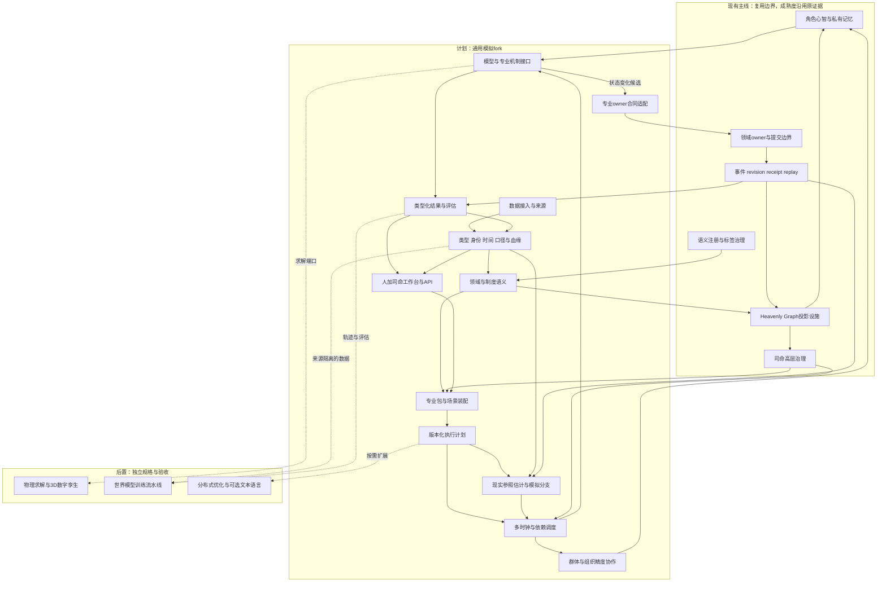
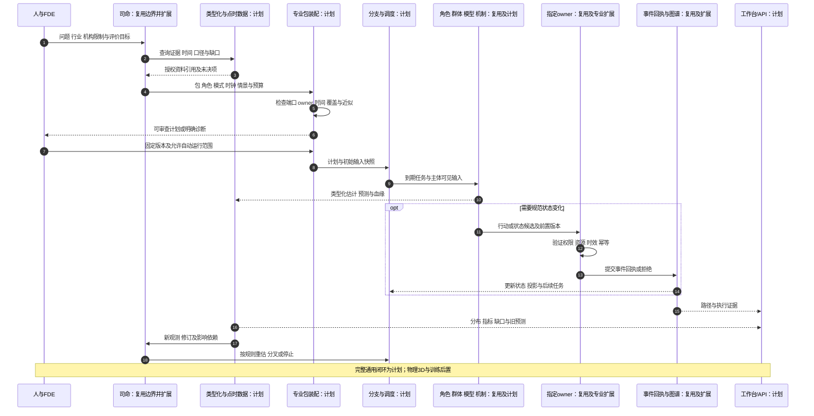
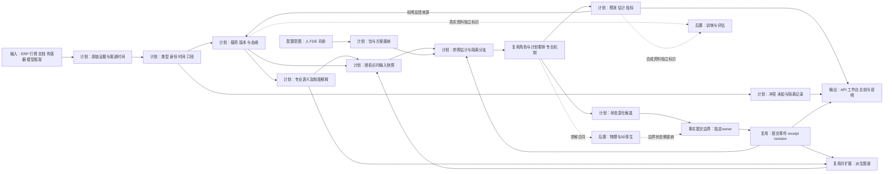

# 通用模拟底座与行业场景适配整体设计方案

日期：2026-10-12

状态：`analysis / integrated-design-draft / non-authorizing`

范围：审查并整合本目录设计01、02、03，形成模拟 fork 的整体设计方案。金融是首个专业应用，工业与商业检验通用性。本文件是新的整合稿，原三份文档保留不动；新增能力尚未实施或验收。

## 1. 总体结论与设计意图

选择“类型化共享底座＋行业场景适配”。共同底座处理身份、数据、语义、时间、分支、计算接口、参与者协作、状态归属和回放；专业扩展提供行业对象、制度、模型、机制与校准；机构与场景配置把这些能力装配成具体问题的模拟方案。

前两份设计提供总体理念和运行边界，第三份提供数据结构、金融类别、时间与口径合同。整体方案保留这两方面，并补齐方案装配、运行模式、观测同化、组织与群体交接、跨模块责任及[通用时空与适用域合同](06-通用时空与适用域合同设计.md)。

底座可接纳新概念和机制，支持跨行业传导；表达能力、机制执行、历史校准与预测有效性分别声明。底层不是一张穷尽全部行业的类型清单，也不预设每种模拟都需要大模型、3D或订单簿。

### 1.1 来源与阅读关系

| 原设计 | 保留的核心贡献 | 本文件整合位置 |
|---|---|---|
| [设计01：通用底座与场景专属扩展](01-通用底座与场景专属扩展设计.md) | 共用与专业分离、扩展包、角色与司命、fork兼容 | 第3、4、9、10、15、17节 |
| [设计02：数据、语义、演化](02-类型化数据底座、制度与领域语义、可插拔演化机制设计.md) | 三部分底座、机制接口、动态图、多时钟、owner边界 | 第4、7、8、11、12节 |
| [设计03：数据结构与时间口径](03-数据结构、金融数据类别与时间口径合同设计.md) | 数据结构、金融目录、身份、点时、口径、血缘 | 第5、6、13、16节 |

本文是整体方案阅读入口，三份原稿是详细来源。本文明确的整合裁决只作用于本轮设计讨论，不自动替换游戏主线规格或成为代码实施授权。数据合同细节继续引用设计03，新增或不同的解释在第2节列明。

## 2. 三份设计审查与整合裁决

审查范围为三份设计全文，并读取目录README与AGENTS约定。这里审查的是架构一致性、可实现性与可验证性，没有重新审计运行时代码，也没有验证金融预测效果。

总体方向一致。主要问题集中在接口尚未闭合，以及概览字段需要细化。下表严重度针对将原稿直接作为实施规格的风险；“补齐”表示本文给出设计合同，不表示实现已完成。

| 编号／程度 | 来源定位 | 问题与影响 | 本文裁决 |
|---|---|---|---|
| R01／高 | 设计01第10节、设计02第10节 | 扩展内容可列出，但装配后的执行计划、诊断与运行准入尚不完整 | 第10节定义输入、检查、输出、版本与准入结果 |
| R02／高 | 设计01第5、12节，设计02第13节 | 历史价格回放与内生撮合未明确排斥；可能重复决定价格与账户 | 第3、13节定义环境运行模式及唯一推进权 |
| R03／高 | 设计01第5节、设计02第8、16节、设计03第6.2节 | 新观测如何改变估计、分支事实、情景权重与角色信息尚需分开 | 第8节定义同化结果与后继运行，保留旧预测和回执 |
| R04／高 | 设计01第9节、设计02第9节 | 唯一推进权方向正确，但组织多维精度与群体交接粒度未闭合 | 第9节定义覆盖单元、暂停推进、核对和交接记录 |
| R05／高 | 设计01第8节、设计02第6节 | 同一owner归属尚缺跨域失败、待完成状态及恢复合同 | 第11、12节明确接纳、原子提交、外部动作与失败恢复 |
| R06／中 | 设计01第4.3节、设计02第4.2节，对照设计03第5节 | 单一epistemic_kind会混合用途、来源、世界归属与可见性 | 第5节采用多轴元数据；校验状态与owner接纳状态进一步分开 |
| R07／中 | 设计01第7节、设计02第8节，对照设计03第6节 | 前两份的时间概览不足以区分历史渠道可知与平台实际收到 | 第6节完整保留三种点时模式，不把导入时间当历史获知时间 |
| R08／高 | 设计01第18.2节、设计02第16节、设计03第10节 | 数据点时正确仍可能受未来训练的模型、LLM历史知识和画像污染 | 第16节区分严格点时评估、事后机制重建与合成训练 |
| R09／中 | 设计01第6、10节、设计02第7节 | 图谱关系、模型依赖和制度规则均可连接，但何时执行需明确 | 第7、10、11节以注册端口和机制绑定执行，画布连线只是配置意图 |
| R10／中 | 设计01第16、17节、设计02第17节 | 语言和fork方向合理，但缺少迁移单位和性能选择门槛 | 第17节按合同、事件、回放与负载证据决定实现和同步 |

审查建议：采用当前理念作为整体设计方向；先完成有界纵切规格，再实施。完整形式类型系统、金融owner划分和具体制度解释尚需后续规格，不将本稿包装成已经完备的执行规范。

## 3. 平台能力与运行模式

### 3.1 产品能力

1. **后台模拟服务**：接入数据、执行方案、管理分支、输出API、报告和条件化预测。
2. **人＋司命合作工作台**：设计、检查和比较方案，可采用无限画布；后台任务不要求人始终在线。
3. **显版**：在同一底座上耦合实际参与计算的物理/工艺数字孪生和前台3D场景。关系图、曲线与普通可视化不单独构成显版。

### 3.2 环境运行模式

运行配置拆成三个轴：执行是记录回放还是重新生成，信息上下文是历史还是在线，各环境端口由外生输入还是内生机制推进。下表是这些轴组成的常用方案形态，不是互斥的全局枚举。实时滚动预测也可以使用内生市场，历史条件重建也可以组合外生宏观与内生经营。

各子系统声明这些绑定，并记录每个状态的推进来源。同一状态在同一范围与时段只能指定一种推进来源，读取外部参照值不自动取得状态推进权。

| 方案形态 | 世界怎样推进 | 适用问题与限制 |
|---|---|---|
| 记录回放 | 使用已记录事件与模型输出重建当次状态 | 审计与复现；不重新生成历史行动 |
| 历史条件重建 | 使用当时可知资料初始化，随后由机制生成路径 | 研究机制是否能解释历史；预测证明还需点时模型约束 |
| 外生环境模拟 | 外部行情、需求或物理轨迹驱动环境，模拟自身行动与资源 | 交易策略执行、风险或业务评估；默认不反过来改变该外生轨迹 |
| 内生机制模拟 | 角色与机制共同生成市场、经营或物理状态 | 市场反事实、政策传导、供需反馈；需要相应机制与校准 |
| 实时滚动预测 | 截止当前观测形成参照估计，运行多个未来分支 | 随新信息产生后继预测；不覆盖此前结果 |

干预是可以附加到生成型模式的操作：改变事件、参数、制度条件或行动，并标识其假设来源。记录回放中添加干预会创建新的生成分支，不再声称是原记录复现。

历史真实结果可以用于事后对照和训练标签，不得在同次决策输入中偷偷提供。采用外生轨迹模拟自己的交易时，流动性、成交假设及冲击近似须声明；如果需要交易影响后续市场，就切换为有明确耦合合同的内生环境。

## 4. 整体架构与模块职责

逻辑上分为三部分：数据表示、领域语义、世界演化。运行中以模块合同划分职责，分支、时间、权限和血缘贯穿三部分。

### 4.1 架构图



图中“现实参照估计与模拟分支”是逻辑状态管理职责，不是统一事实写入模块。参照估计、事件、账本、角色记忆与模型内部状态各有指定归属。

### 4.2 模块责任表

| 模块 | 输入与输出 | 写入职责与边界 |
|---|---|---|
| 接入与来源 | 原始推送/文件→原始证据与渠道时间 | 保存接入记录，不接管世界事实 |
| 数据合同 | 原始证据→类型、身份、时间、口径、时空域、版本与引用 | 管理数据版本与校验，不把“符合类型”当作真实 |
| 语义与专业定义 | 数据及注册定义→实体、条款、关系与过程解释 | 管理语义配置和受控派生；法律权限不等于软件提交权 |
| 扩展装配 | 包、场景、合同→执行计划或诊断 | 管理配置版本，不临时创设owner权限 |
| 时间与依赖调度 | 计划、事件、水位→到期任务与输入截止 | 安排调用及预算，不直接结算资源 |
| 分支管理 | 初值、干预、观测→分支身份、快照及后继关系 | 隔离状态命名空间，不任意写各owner状态 |
| 模型与机制 | 固定输入、参数、状态→估计/预测/行动/状态候选 | 有状态模型管理内部计算状态；规范状态提交仍属owner |
| 角色与群体协作 | 主体信息、覆盖范围→行动与精度交接 | 保留角色私有写回；推进权不等于结算权 |
| 专业owner | 类型化动作、前置证据→提交事件或拒绝 | 对已接纳事实范围拥有唯一结算归属 |
| 图谱投影 | 版本化资料及事件→有范围、有来源的查询视图 | 可重建派生，不反向篡改来源与提交历史 |
| 结果与评估 | 输出与轨迹→条件分布、指标、证据、失效报告 | 保存结果，不改写原输入和实际行动 |
| 工作台与API | 授权视图/编辑意图→方案修改及结果展示 | 通过同一装配合同；3D表现没有领域提交权 |

这些是模块边界，不要求每个模块单独微服务或数据库。新增能力应沿现有合同拓展；哪些模块独立进程部署由负载与隔离需求决定。

## 5. 类型化数据底座：完整保留第三份覆盖

### 5.1 十一种结构族

| 结构族 | 代表资料 | 核心合同 |
|---|---|---|
| 标量与数量 | 金额、价格、比例、温度 | 类型、精度、量纲、币种、范围、舍入 |
| 记录与表格 | 财报、ERP、持仓、明细 | 字段、键、粒度、缺失与唯一性 |
| 时序 | 宏观、行情、面板数据 | 索引、期间、频率、聚合与修订 |
| 事件流 | 成交、订单簿、新闻、传感器 | 分区、序列、重复、缺口、迟到 |
| 曲线与曲面 | 利率、波动率、需求 | 坐标、构建、插值、外推、范围 |
| 向量矩阵张量 | 因子、协方差、场状态 | 轴语义、身份对应、单位、稀疏性 |
| 文档与多模态 | 法规、研报、会议音视频 | 原文、定位、版本、提取与转录依据 |
| 图与层级 | 股权、部门、科目、模型依赖 | 端点、角色、方向、时间与来源 |
| 分布与样本 | 收益、风险、情景轨迹 | 条件、支持域、权重、联合依赖 |
| 公式与约束 | 估值、现金流、限额、守恒 | 类型、单位、依赖、求解与效果 |
| 空间几何与场 | 矿区、物流、设备、天气 | 坐标、尺度、拓扑、边界与时间 |

结构族是表达接口，不是一套强制统一物理存储。大型载荷以不可变版本引用接入图谱与计算，保留分区、块、行键和精确定位。空间几何与场只是数据结构之一；跨行业的物理位置、网络拓扑、法域、组织服务域和计算网格由独立的[时空与适用域合同](06-通用时空与适用域合同设计.md)附着，避免把所有行业空间都压成经纬度。

### 5.2 十五类金融专业数据

| 类别 | 内容 | 语义及机制用途 |
|---|---|---|
| 身份与参考数据 | 发行人、工具、上市、场所、日历 | 代码复用、身份解析、生命周期 |
| 行情与微观结构 | 报价、逐笔、订单簿、竞价、停牌 | 市场阶段、完整性、撮合与流动性 |
| 聚合行情与指标 | K线、VWAP、指数、复权 | 聚合与成分版本、因子及状态估计 |
| 工具条款与现金流 | 债券、期货、期权、贷款、掉期、证券化 | 条件权利义务、计息、到期、定价与违约 |
| 财报与企业经营 | 科目、分部、ERP、订单、库存 | 会计与合并范围、经营及估值 |
| 宏观与行业统计 | GDP、通胀、就业、调查、产量 | 初值/修订、季调与经济传导 |
| 账户与资金 | 余额、持仓、流水、保证金、抵押品 | 可用/冻结/结算、资金约束与清算 |
| 订单与执行 | 委托、成交、撤单、费用 | 请求、接纳、成交与结算生命周期 |
| 公司行动与信用事件 | 分红、拆股、并购、评级、违约 | 公告与执行时间、权利及现金流变化 |
| 所有权与组织网络 | 股权、投票权、控制、任职、供应链 | 控制、利益、经营与风险传播 |
| 制度与政策 | 规范、方向、规划、细则、会议、预算、基金 | 权限、适用、程序、信息与执行 |
| 新闻研报与舆情 | 报道、公告、观点、目标价、论坛 | 来源、传播、获知、信念与行为 |
| 估值风险与研究框架 | 曲线、曲面、因子、评级、矩阵、方法 | 定价、组合、风险、校准和适用条件 |
| 另类与物理资料 | 遥感、运输、招聘、支付、天气、设备 | 采样偏差、代理观测、跨行业传导 |
| 模型与模拟资料 | 特征、参数、预测、信念、反事实 | 训练截止、分支身份、生成和评估 |

金融工具类型与这些数据类别是不同轴。新增产品通过条款、现金流、状态机、结算和风险合同接入；表中类别不是产品穷举表。

### 5.3 共同记录合同

以下为设计示意，不是已实现schema：

```text
DataObject<T> {
  object_id, revision_id, type_ref, subject_refs, external_identifier_refs
  payload_or_immutable_ref, measurement_ref, temporal_ref, provenance_ref
  world_context_ref, access_scope_ref, epistemic_metadata_ref
  validation_status, conflict_refs, owner_acceptance_refs
}

EpistemicMetadata {
  content_purpose, production_method, uncertainty_annotations
}
```

世界归属、可见性、用途、来源方式、不确定性是独立轴。类型有效、来源冲突、owner接纳也可同时成立，拆为独立字段与证据引用；例如owner确认“文件已发布”，不表示接受其全部预测。

主体身份与外部标识分开：发行人、工具、上市、交易场所、合约、账户和组合分别建模。单位、名称相同仍需检查粒度和统计范围。未披露、未知、不适用、无权限、采集失败、冲突和真实零值分别表达。

金额结算采用规定精度与舍入；数值计算可用浮点并声明误差。复权、季调、货币转换、插补和口径迁移生成派生版本与血缘，不覆盖来源。完整规则及四个数据实例见[设计03](03-数据结构、金融数据类别与时间口径合同设计.md#3-数据结构体系)。

## 6. 时间、口径、时空域与多时钟

### 6.1 时间维度与点时模式

共同合同包含事件发生、统计期间、有效区间、公开发布、渠道可用、平台入库、角色获知、预测起点/目标、分支逻辑时间；适用范围还可以引用几何、网络、法域、组织、市场或计算域。日期级资料不伪造高精度时间，日历、时区、序列和源时钟偏差按类型声明。时空域细节、参考框架、覆盖、拓扑、轨迹、跨域映射和空间快照见[设计06](06-通用时空与适用域合同设计.md)。

| 读取模式 | 截止可见依据 | 适用 |
|---|---|---|
| 历史渠道可知重建 | 有证据的渠道可用时间及当时权限 | 重建参与者可能获得的信息 |
| 平台实际接收重演 | 真实接收、处理与获知日志 | 审计在线系统当时的决策 |
| 最新修订研究 | 研究指定的最新版本 | 事后研究与标签；标识未来信息 |

先筛选可见版本，再执行来源与修订策略。历史资料后来导入不影响有证据的历史渠道重建，但不能伪装成平台过去已实际收到。输入快照固定数据、身份、日历、变换、模型及参数版本；授权读取后还需角色实际阅读过程。

### 6.2 九个口径轴

数量与单位、货币与计价、范围与粒度、期间与聚合、计量方法、调整方法、市场约定、会计与版本、统计与质量全部保留。

口径相遇产生直接兼容、显式转换或无法比较三类结果。同单位不能自动相加，合并范围不能靠换算系数修复。利率报价、净价/全价、计息基础、名义/实际、累计/单期及复权处理由专业包声明。

### 6.3 调度与计算时间

### 6.4 时空域读取不变量

时空域读取必须同时固定时间版本、测量口径、空间/网络范围、适用域版本、坐标或层级变换和访问范围。行政区不等于物理区域，网络可达不等于几何相邻，规则适用不等于用户有权执行；这些关系必须由专业合同明确。空间不适用时要显式声明，空间适用但资料缺失时保留缺口，不能用全域平均值静默补齐。

撮合按事件、新闻按到达、风控按事件或周期、企业经营按日周月、制度执行按程序与日历、物理系统按求解步长推进。没有统一强制tick，也不把屏幕帧率当世界时间。

模型声明输入窗口、数据截止、采样、日历、预测期限、训练截止、执行延迟、陈旧阈值与同步点。实际在线计算记录耗时；离线模拟使用明确的模拟延迟合同，不能因为机器跑得快就让历史角色瞬间完成决策。

跨速率端口声明聚合、采样、插值、误差和延迟。流量累积与存量采样分别处理。尚未结束窗口的总量、未来端点插值与新修订值不能提前读取。

同刻事件依来源顺序、依赖与稳定冲突规则处理；没有证据的先后可作为敏感性分支。延迟环路逐时推进；同刻代数耦合由指定求解器及迭代上限处理。水位表示来源完整性的约定，不表示现实所有事件已齐。

## 7. 世界语义、制度与动态图谱

### 7.1 语义结构与制度拆分

实体、角色与任职、关系与多方安排、陈述、载体、状态、观测、事件、过程、模型及机制通过注册专业类型组合。最终形式类型代数在有界用例后冻结，不能把业务名单直接当作不可约语言原语。

制度内容拆为战略方向、政策目标、法律规范、政策工具、实施程序、具体决定与行为、文件载体。智能体策略与系统运行规则另外命名。

中国配置表达路线、方针、党内法规、法律规范、规划、白皮书、指导文件、实施细则、会议成果与执行安排。每项保留主体、职权依据、程序、对象、地域、有效时间、执行责任与解释来源；文件名不能决定全球统一效力等级。

国家、领土、行政区、司法辖区、政治组织、机关、机构单元、职位与任职者分别表示。权力、法律、利益、资源、信息和国际关系可以共同影响机制；制裁、贸易、跨境资本与汇率传导由相应专业包定义，不能简化为一个影响分数。

法律效力、组织约束、执行能力与市场信号分开。国资机构出资、监管、任命按职权区分；基金载体、管理人、出资人、受益人、承诺、实缴和投资过程分开。会议有程序和产物，讲话不自动成为正式决定。

### 7.2 动态边与嵌套视图

```text
RelationDefinition { type_ref, endpoint_roles, property_schema, lifecycle,
                     temporal_contract, evidence_contract, mechanism_bindings }
RelationInstance { relation_id, revision, participant_refs, properties,
                   valid_interval, source_refs, branch_ref, scope_ref, tag_refs }
```

以上为设计示意。所有权比例、风险敞口、传播延迟可量化；权限范围和规范适用保留条件与程序。多方合同、联合发文和基金结构采用关系实体，不能压成缺少角色的普通二元边。

边“活起来”通过事件、状态机与专业更新机制：改变属性、关系生命周期或拓扑，保存版本与依据。公共事实、来源陈述、私有信念、假设因果和统计相关采用不同视图及语义身份。

Heavenly Graph提供受来源、scope、revision约束的派生查询。组织内外、持仓、制度、信息、供应链和模型依赖视图通过稳定身份嵌套。展开视图不会复制实体、余额或权限。

节点、边与标签均为注册语义。元标签管理附着、生命周期、可见性、编辑与冲突；机制绑定需单独接纳，标签不授予结算权。图上路径用于定位候选影响范围，传导由机制执行并声明延迟、强度、范围和停止条件。

## 8. 世界参照、分支与实时同化

### 8.1 分支结构

设计示意：

```text
WorldBranch {
  branch_id, parent_branch_ref, parent_snapshot_ref, fork_time
  plan_version, world_scope, environment_mode_bindings
  initial_state_refs, hypotheses, interventions, random_input_refs
  access_profile, evidence_cutoff, lifecycle
}
RunRecord {
  run_id, branch_ref, input_snapshot_refs, execution_plan_ref
  start_and_end, event_offsets, model_output_refs, receipts
  checkpoint_refs, gaps, failures, performance_and_cost
}
```

分支表示独立世界条件，run表示一次执行。实体可共用稳定身份，但状态访问带分支命名空间；合成身份还需分支来源。父快照固定，不把父分支后续变化默默传播到子分支。

模型内部状态、角色私有状态、owner规范状态、图谱和缓存分别固定版本。估计集合可表达多个可能初值，不能假装已经知道唯一真实世界状态。

### 8.2 新观测的四种去向

| 去向 | 如何处理 | 例子 |
|---|---|---|
| 来源资料 | 追加记录、渠道时间、修订和冲突 | 公告、传感器、统计修订 |
| 参照估计 | 指定估计器产生新版本与误差说明 | 波动率、需求、潜在库存估计 |
| 规范状态 | 有事实接纳映射与owner合同才提交 | 已确认交割、公司行动、工艺状态边界 |
| 角色信息 | 经权限、渠道和阅读过程送入主体视角 | 基金经理阅读公告 |

观测不会自动同时改变四处。模型内模拟成交与现实交易记录不能直接混成一本账；外生与内生价格由第3节模式合同决定。

### 8.3 滚动更新协议

1. 接入校验与时间记录，保留迟到、冲突和缺口。
2. 沿血缘标记受影响的估计、输入和预测；不改写已发生行动及回执。
3. 在允许的同步点生成新的参照快照，校验来源、资金及其他不变量。
4. 按预设规则继续运行、重估、分叉或停止；新参数和计划保留版本。
5. 发布后继结果并链接旧预测，评估更新前后误差与概率校准。

无概率依据的分支只做情景比较。有似然、依赖处理与校准合同才能更新权重；高度相关报道不能重复当成独立证据。所有情景均不兼容新观测时保留“未覆盖”并扩展方案，不能强行选择最接近的一条伪装正确。

结构突变可触发模型失效，而非总是调整一个参数。“向现实收敛”通过具体观测残差、风险校准和机制一致性度量，保留不可观测部分与模型差异。

## 9. 角色、组织、群体与司命

### 9.1 五种驱动共存

| 驱动 | 含义 | 例子 |
|---|---|---|
| 角色 | 有目标与认知的主体选择行动 | 基金经理分析后调整组合 |
| 实体 | 对象条件触发注册机制，不要求心智 | 合约到期、设备寿命阈值 |
| 事件 | 离散变化触发后续任务 | 停牌、故障、决议形成 |
| 观测 | 新证据改变估计与信息 | 新闻到达、统计修订 |
| 过程 | 已启动机制按程序继续 | 审批、清算、生产 |

驱动方式不是五套独立引擎；同一过程可受到多种触发，以任务身份、前置条件和幂等规则避免重复执行。

### 9.2 角色配置

角色配置包含身份、任职、目标、偏好与约束、认知模板、信息渠道、档案、记忆、资金或资源引用、合法行动与决策路由。证据支撑、模板默认和推断生成分别标识。

Laya在注册的完整行动与目标候选中做快速选择；金额、数量和价格来自已接纳执行方案或专业参数模型并校验。慢思考处理需要更深分析的任务；心智路由与模拟精度分别配置。将来司命使用Laya需有自己的治理候选合同。

画像详细程度不代表行为真实程度。记忆按主体及授权管理，组织共同记忆不自动汇总成员私有记忆；出资人、管理人、监管者的角色权限也不合并。

### 9.3 组织内外多维展开

组织由机构单元、职位、任职者、权能、账户、资源、共同资料、议事程序和执行过程组合。外层可模拟整体行为；内层可模拟投资委员会、风控、管理人与执行部门的互动。

精度至少有四个可独立选择的维度：内部决策、外部交互、信息传播、经营/资金过程。可以精细模拟投资审议，同时用较粗模型计算经营；不同维度仍引用同一规范状态。

组织owner结算职责、组织内部行为机制和群体精度调度分别保留。国家治理是多机构、多职权、多程序的组合，不强制简化为统一人格。

### 9.4 群体传播与精度交接

图谱有界查询确定受影响候选，专业机制计算传播与聚合行为；B0-B3方向沿用既有升级计划，但不声称金融协作已经完成。

推进覆盖单元定义为“分支×参与者或群体成员集合×机制维度×时间区间”，每个单元有唯一推进来源。多个重叠群体可以作为分析视图，但执行时需形成不重复的贡献分配；同一资产、订单、预算与人口不能重复承担。

设计示意：

```text
FidelityHandoff {
  covered_subjects, mechanism_dimension, branch_ref, effective_time
  from_runtime, to_runtime, pinned_state_and_event_refs
  conserved_quantities, pending_actions, private_memory_refs
  expansion_or_aggregation_rule, approximation_error, acknowledgment
}
```

交接步骤：暂停对应范围推进→核对状态与未完成动作→按规则展开或汇总→验证守恒与scope→新来源确认接管→恢复。失败保留原接管方及明确暂停状态，不能双方同时推进。

未观测的个人状态只能按指定分布生成，标记合成来源；降精度后如果丢失细节，要声明损失和恢复限制。推进权切换始终不授予owner结算权。

### 9.5 司命职责

司命面对问题、事件、资料缺口和资源安排工作，再确定机制、角色、群体、时钟、分支和精度；也可以从角色目标或人工任务出发。

它辅助收集资料、提出情景、识别影响范围、监督预算与失效、生成适配方案。调整仅在预设自动运行范围或新版本接纳合同内生效。司命不重写世界事实、法律效力、角色记忆或强迫角色行动。

## 10. 行业、制度、机构与场景适配

### 10.1 扩展包种类

| 包 | 提供什么 | 示例 |
|---|---|---|
| 领域包 | 专业类型、模型、机制、状态不变量 | 金融、生产、物流、商业需求 |
| 制度／地域／场所包 | 职权、程序、适用规则、日历、市场规则 | 国家配置、法域、交易场所 |
| 机构包 | 组织、账户、权限、内部流程、来源与模型选择 | 某基金、银行、矿业集团 |
| 场景包 | 问题、初值、范围、假设、指标、预算与更新规则 | 买点比较、政策压力测试、产品推出 |
| 视图包 | 画布、图表、报告、3D对象映射 | 金融工作台、工业孪生前台 |

连接器与模型插件作为包内容或版本化依赖接入，不强制增加独立层级。包关系是依赖图，跨境场景可同时加载多个制度与机构配置；冲突不靠加载顺序解决。

### 10.2 装配合同

以下为设计示意：

```text
ExtensionManifest {
  id, version, dependencies, compatibility
  data_and_measurement_contracts, identity_and_semantic_definitions
  relation_and_tag_definitions, model_and_mechanism_bindings
  owner_contract_refs, admitted_actions, cross_owner_recipe_refs
  clocks, access_requirements, migrations, calibration, acceptance_cases
}
ScenarioManifest {
  question, objectives, scope, replay_or_generate, historical_or_online_context
  environment_port_source_bindings
  pinned_extensions, initial_conditions, information_availability_mode
  participants, organization_and_population_rules
  hypotheses, interventions, branch_plan, clocks, fidelity, budget
  observation_update_rules, evaluation, stop_conditions, views
}
ExecutionPlan {
  plan_id, version, resolved_dependencies, input_query_and_snapshot_refs
  typed_task_graph, time_and_sampling_bindings, owner_write_bindings
  participant_coverage, capability_bindings, checkpoints
  approximation_and_gap_manifest, recovery_and_stop_rules
  evaluation_bindings, source_and_model_version_pins
}
```

装配依次检查：依赖版本→类型、身份、单位与口径→语义和制度适用→模型端口及模式→每项状态变化的owner→时间和反馈环→参与者覆盖→权限、资源与失败处理→能力缺口和验收要求。

输出结果分为可运行、带明确近似可运行、仅静态设计、拒绝激活。缺少世界写权限、owner或必需机制不能用近似掩盖；已有获准近似机制可运行，但必须附范围、误差和用途限制。

源输入可以来自表单、画布、JSON/YAML或未来DSL，最终都生成同一类计划。配置声明某owner不意味着部署授权；运行时仍检查实际能力、revision和资源。

计划状态为草拟→校验→版本固定→运行/暂停→完成/失败/停止。资料追加不必改变计划版本；类型、模型、制度、模式和关键参数改变则生成新配置或子版本，并保存切换时点。

### 10.3 FDE与司命的适配交付

FDE按Forward Deployed Engineer／团队理解。交付连接器、身份映射、口径字典、历史渠道证据、制度与机构包、模型校准、代表场景、运行准入和验收材料。

司命辅助检索、映射、起草角色与方案；工具执行结构与权限校验，人和机构业务流程确定关键解释及约束。资料、假设与缺机制分别记录。已有模板可加速适配，但不能把一家机构权限默认为另一家机构权限。

## 11. 模型、机制、owner与存储

### 11.1 模型及机制接口

模型产生估计、预测、评分或决策；机制定义撮合、清算、传播、审批、生产等状态演化。一个机制可使用多个模型，一个模型可服务多个机制。

```text
ModelOrMechanismDefinition {
  id, version, applicability, input_and_output_ports, parameters
  state_reads, internal_state_contract, proposed_effects, owner_bindings
  triggers, clock, data_cutoff, latency, stochastic_inputs
  calibration_refs, tolerances, invariants, capabilities
  limits, checkpoints, failure_and_expiration_semantics
}
Invocation {
  call_id, run_ref, branch_ref, logical_time, input_snapshot_refs
  state_revision_pins, parameter_version, scoped_context
  random_input_refs, deadline, budget
}
Result = Estimate | Forecast | Metric | ActionChoice | InformationRequest
       | ProcessResult | TransitionProposal | Failure
```

以上为设计示意。结果都有生成与输入血缘；纯预测可直接写结果存储，不必变成世界事件。TransitionProposal需owner验证后才能改变规范状态。

### 11.2 状态归属与一致性

同一“分支×领域×主体×规范状态范围”有唯一结算归属。组织、市场、账户、合约、制度等专业事实的最终划分在纵切中确定，不按数据类别机械新建owner，也不扩大现有owner为任意写入者。

跨owner操作走已接纳recipe与一致性合同。同进程可原子提交时，产生完整批次；无法原子完成的外部动作使用明确的待完成、确认、失败及补偿状态。重试绑定精确幂等身份和状态版本，不能重复扣款或交割。

参数验证、候选选择、owner接纳、实际执行与外部确认分别记录。一次拒绝不写成功事件；已经部分发生的外部结果不能用“全部失败”抹去。

### 11.3 存储与双向更新

逻辑职责包括原始证据、类型化载荷、语义身份目录、图谱投影、规范事件回执、结果血缘。实现可以合并存储，数据库产品后定。

模型从图谱读取身份、制度和依赖，从载荷存储读取时序、矩阵和原文。输出通过类型化通道更新估计、预测或候选变化，图谱依据版本化来源重建。反馈保留共同祖先，不能把模型产物当作新的独立现实证据。

图谱快照、数值窗口和owner状态读取共享截止及版本合同，避免拼接出不存在于任何时点的世界。批量处理、范围查询、增量投影和不可变块引用用于规模化；不要求每个行情触发一次LLM或跨语言调用。

## 12. 主交互、数据流与失败处理

### 12.1 主交互时序图



人工固定版本是机构配置点，可通过预设自动运行规则执行；不要求每次行情或后台模拟重新获得人工批准。

### 12.2 数据流图



资料接纳证明记录存在；专业解释表达内容；估计表达不确定世界；owner提交表达该分支内已经发生的规范变化。这几条边界保持独立。

### 12.3 失败与恢复

| 失败 | 处理与输出 |
|---|---|
| 缺资料或口径未知 | 保留原文与缺口；拒绝依赖该合同的计算或采用已接纳近似 |
| 流乱序、缺序列、来源冲突 | 有界重排；标记不完整；补包或重取快照，不声称完整盘口 |
| 模型超时、求解不收敛 | 类型化失败；降级仅使用已登记方案，记录其影响 |
| revision过期或资源不足 | owner拒绝；重算需新调用身份，不能倒填成功 |
| 精度交接失败 | 暂停相应覆盖范围，保留唯一接管方和待恢复状态 |
| 分支均不兼容观测 | 发布未覆盖诊断，产生新假设或停止，保留旧结果 |
| 崩溃与重复投递 | 从owner事件与固定检查点恢复；投影重建；幂等避免重复结算 |

暂停恢复要固定计划、输入、随机流、求解器内部状态、待执行任务与角色连续性。记录回放读取已存输出；重新运行外部模型可能产生不同结果。版本不兼容时拒绝伪装成相同运行。

## 13. 金融专业应用与一次完整推演

### 13.1 专业能力组合

金融应用按问题选用身份参考、工具条款、市场机制、账户清算、企业经营、宏观制度、信息传播、估值风险与参与者行为。分析财报不必先构建完整交易所；模拟政策传导可以从有限证券与少量机制开始。

每个能力声明“可表示、可解释、可执行、已校准”的状态，并附输入与验收范围。数据目录覆盖广，不等于所有产品已经拥有完整执行机制。

金融市场模式必须明确：

- 外生行情模式：历史或模型行情驱动市场，账户owner执行自身交易模拟，冲击假设有边界。
- 内生市场模式：订单及流动性机制生成成交与价格，不再由同范围真实未来行情覆盖。
- 混合模式：例如外部宏观路径驱动内生证券市场，通过显式端口与唯一状态推进绑定组合。

### 13.2 问题实例

问题：某产业支持方向出现后，比较立即、小幅试探、延后确认、分批进入及不进入等策略，在一周与一个季度的收益风险和执行可行性。有限证券、资金规模、交易场所与成本由场景指定；不预设存在唯一可确定最佳买点。

1. **准备**：FDE与司命装配金融、国家制度、场所与机构包。接入行情、财报、宏观、新闻、政策条款和关系网络；记录15类目录中本场景实际覆盖与缺失部分。
2. **固定信息与口径**：选择历史可知或实时实收模式，固定输入、成分、主体、日历和模型。确认现金、持仓、结算与合约约束。
3. **配置参与者**：管理人、投委会、风控、执行者、企业、不同投资者、媒体及相关机构。角色画像与记忆标明证据和推定，不给任何主体未来信息。
4. **生成情景**：执行及时、执行延迟、预算变化、国际冲击、需求不足等。它们是示例假设，需资料与机构适配；没有概率依据时只比较情景。
5. **双路径推进**：信息→获知→解释→预期→行动→订单与价格；文件→授权→程序→预算→承诺/拨付→企业投资→经营现金流。
6. **多时钟协作**：行情与订单逐事件、角色带思考延迟、风控周期更新、企业按经营期、政策按程序期限。Laya做快速候选选择，其他模型计算数量、定价与风险。
7. **提交与反馈**：模式指定的市场机制形成执行结果，账户与其他专业owner结算，图谱投影反映获权事实，群体传播保留影响来源与覆盖分配。
8. **滚动观测**：新细则、财报、行情和新闻追加版本；更新参照估计、角色信息或后继分支，旧预测保留。
9. **比较输出**：条件收益分布、回撤、流动性、费用、成交概率、资金占用、违约或政策执行风险、关键未知、模型适用性和路径说明。

路径说明展示各机制与输入证据；图上有链条不等于已识别现实因果。与基线对比时，策略使用相同资金、信息和环境条件；可采用配对随机输入减少比较噪声，但不声称保证外部模型确定性。

## 14. 工业、商业与跨行业检验

| 场景 | 专业内容 | 共用合同与代表验收 |
|---|---|---|
| 制造／采矿 | 设备、工艺、物料、故障、安全、ERP、传感器、物理求解 | 时间、状态归属、组织与分支；故障后产量/能量/物料核对 |
| 商业产品决策 | 产品、客户、渠道、竞争、定价、预算、采购及扩散 | 利益相关者、心智与群体；有限调研校准和购买/预算核对 |
| 金融 | 工具、市场、账户、合约、制度、风险 | 点时、结算、估计和信息传播；历史版本与执行核对 |
| 跨行业 | 矿山事故→供给→企业现金流→信用→资产价格 | 显式端口、时钟、口径与范围；每段机制独立可验证 |

至少一个商业和一个真实物理求解纵切应在扩大金融专属内核之前验证通用接口，避免以金融字段定义所有行业。物理连续求解器保存内部积分状态，只有指定同步/事件边界提交规范世界状态，不要求每个内部步长逐次提交。

显版通过稳定身份将求解对象、后端实体和3D对象对应。Godot保留本地具身与表现职责，物理求解可来自成熟专业引擎；动画效果不作为物理正确性证明。

## 15. 人＋司命工作台与后台交付

无限画布适合表达问题、证据、对象、关系、制度、模型、时钟、角色、分支和结果，但不是运行时数据模型。大图按需展开，数值和时序使用专门视图。

节点显示类型与状态，侧栏显示时间、口径、来源、权限和缺口；连线区分引用、关系、模型端口和假设影响。可以查看边的定量属性与时间变化，编辑时区分来源纠错、参数修改和情景干预。

工作台提供方案校验、版本比较、分支比较、运行预算、旧预测评估和失效定位。人工编辑、司命自动起草、后台API使用同一装配合同。私有角色信息、持仓和机构资料按scope过滤后才送往界面或外部模型服务。

后台部署交付配置、数据接口、模型与插件、执行服务及结果API。客户可以修改专业包与方案，平台给出兼容与校验诊断；接入ERP读取和模拟不自动取得真实ERP修改或交易权限。

## 16. 历史重演、预测评估与世界模型训练

### 16.1 三种研究目标分开

| 目标 | 允许资料 | 可形成的结论 |
|---|---|---|
| 严格点时决策评估 | 当时可知输入及符合评估约束的模型、参数和画像 | 给定信息与执行假设下的留出预测/决策表现 |
| 事后机制重建 | 可用后续解释、修订和现代模型，但明确标识 | 哪些机制可以重建历史；不能据此声称当时可预测 |
| 合成轨迹训练 | 有版本、干预和近似标识的模拟资料 | 模型内行为、压力测试和训练价值；现实有效性另测 |

现代LLM可能在预训练中见过历史事件后果。只限制检索输入不能证明没有未来知识。严格评估需审查模型训练边界、候选生成、画像、调参及特征构建，无法证明时标为未满足严格点时，而不是靠提示词承诺无泄漏。

这种模型仍可以服务于明确标记的事后机制分析。角色、记忆和制度解释也记录生成模型与时间范围；训练切分不能只隔离行情而共享未来生成的画像。

### 16.2 轨迹与验收

轨迹包含观测、估计、角色信息、行动、owner事件、模型内部版本、假设、干预、机制、延迟、近似误差与失败。真实、估计和合成结果不混同，训练、校准和评估按时间与完整轨迹隔离。

系统正确性验证类型、时间、结算、守恒与回放；预测验证留出误差、分布校准、风险成本、流动性及跨阶段稳定性；因果识别验证额外假设和经验依据。三者各有验收，不用系统通过替代模型有效。

先构建可追溯数据和轨迹接口，再建设世界模型训练。学习出的模型作为普通版本化插件接入，仍遵守输入、适用、时钟和owner合同，不获得任意事实写权限。

## 17. 实现语言、部署与fork兼容

延续Python承接现有角色、司命、owner与金融模型生态。实测瓶颈后采用Rust等实现数据流、查询、调度或批量运算热点；C++/CUDA/Julia/Fortran及其他成熟工具通过专业插件接口接入。采用批量、共享载荷或进程接口，避免逐记录跨语言往返。

TypeScript可承担工作台，Godot保留具身和表现接口。具体选择根据人员、模型生态、吞吐、尾延迟、内存、错误隔离及维护成本评估；目前不冻结数据库、安装依赖或重写后端。

先形成类型化中间表示、装配校验、执行计划和语义测试。文本DSL若确有价值，再增加可读语法、类型/单位/时间/scope/效果检查；它表达配置与机制绑定，后端仍用成熟语言实现。表单、画布与DSL必须共享语义，不能各自解释相同方案。

fork保存上游版本、复用合同、专业差异、事件与schema迁移及验证矩阵。owner更新同步逐项核对事件、状态、recipe、隐私、revision和回放；表现与资产更新通过稳定身份和接口同步，不把上游实现成熟度当作新领域已验收。

通用缺陷修复可回流；金融制度及机构内容独立维护。包版本兼容声明只是入口，迁移需固定来源、转换和失败结果；无法兼容时保留旧分支的读取及回放方案。

部署先采用少量进程和现有基础；专业插件按能力声明文件、网络与外部副作用。多租户隔离、外部模型数据发送和实际写回均通过明确访问合同，不能由插件自报权限绕过部署接纳。

## 18. 建设顺序与接受标准

这里是设计级依赖顺序，不是完整实施计划；每个阶段另建有界规格与任务计划。

| 阶段 | 交付 | 必过证据 |
|---|---|---|
| A：共同数据与语义 | 类型、身份、时间、口径、来源、认识状态、专业映射 | 设计03四例、无前视与口径拒绝样例 |
| B：方案装配与有限金融闭环 | 包、模式、计划、分支、有限角色、owner映射 | 缺权限零写入、模式不重复推进、账户与事件回放 |
| C：实时与群体组织协作 | 观测同化、多时钟、动态图、精度交接 | 乱序恢复、旧预测保留、覆盖无重叠、资金及贡献核对 |
| D：跨行业与工作台 | 商业纵切、真实物理纵切、画布与API | 专业插件可替换、通用内核不依赖金融字段、界面编辑走合同 |
| E：专业扩展与显版 | 更多工具制度机构、物理/3D联动 | 各专业机制验收与真实求解、边界及可见运行证据 |
| F：训练与规模化 | 轨迹训练、世界模型、热点与分布式优化 | 留出预测、泄漏审查、性能负载与失败恢复 |

后台首个金融应用可以在B阶段形成有限交付，C补实时协作；不必等待显版或训练系统完成。首个原型同时应包含一类数据修订、一条信息/制度链和至少一种非角色触发，以免只有角色对话却没有世界演化。

### 18.1 整体验收不变量

1. 身份不误合并，类型、单位、粒度、时间、口径与时空域可校验。
2. 来源、解释、估计、预测、信念与分支事实分别可追溯。
3. 主体不能看到未可得资料；严格评估还检查模型和生成画像的未来知识。
4. 模式、owner归属与推进覆盖唯一；显式与聚合不重复资源与行为。
5. 角色、司命、图谱、标签、模型与界面均不能绕过结算合同。
6. 时间环路有求解或延迟；过期决策、迟到资料和不完整流可见。
7. 修订不抹去旧结果和回执；故障可恢复或给出明确无法恢复原因。
8. 部分失败不伪装成功；缺数据、缺解释、缺机制分别报告。
9. 新行业可扩展结构与机制，保留专业校准与用途边界。
10. 性能目标按数据率、对象与参与者、分支、窗口、内存、p95/p99延迟和成本验收。

## 19. 后续规格与未冻结决定

需要单独细化的规格领域：类型与语义注册、点时数据接口、计划装配、分支与同化、多时钟执行、组织群体交接、金融owner与一致性、工作台、物理耦合、训练评估。

首个工具与场所、实际数据许可、机构授权、法律解释来源、owner事实划分、延迟目标、部署产品与DSL必要性，留待纵切确定。对于这些事项，本文给出选取依据与合同边界，不伪造已冻结答案。

现有依据：

- [主线主设计](../../superpowers/specs/world-character-siming-authority-mainline/2026-06-29-world-character-siming-authority-mainline-master-design.md)。
- [组织／政府／社会通用平台](../../superpowers/specs/world-character-siming-authority-mainline/2026-09-03-organization-government-social-generic-platform-design.md)。
- [派生社会图谱升级计划](../../10月中旬分析/群体模拟升级/计划/既有中旬计划/02-派生社会图谱与因果传播实施计划.md)。
- [群体与Laya协同升级计划](../../10月中旬分析/群体模拟升级/计划/既有中旬计划/03-群体模拟与Laya心智运行时协同实施计划.md)。
- [标签与元标签设计](../../10月分析/战斗系统与角色技能，状态和资源/08-对象标签、编辑与版本治理设计.md)。

所有新增接口和三图均为计划设计。本文审查、文件校验及链接检查只证明文档层面的整合，不证明后端、金融、实时性能、预测、物理或3D运行里程碑。
