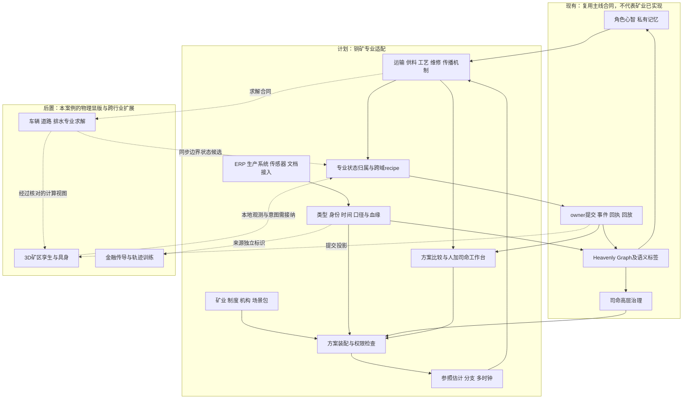
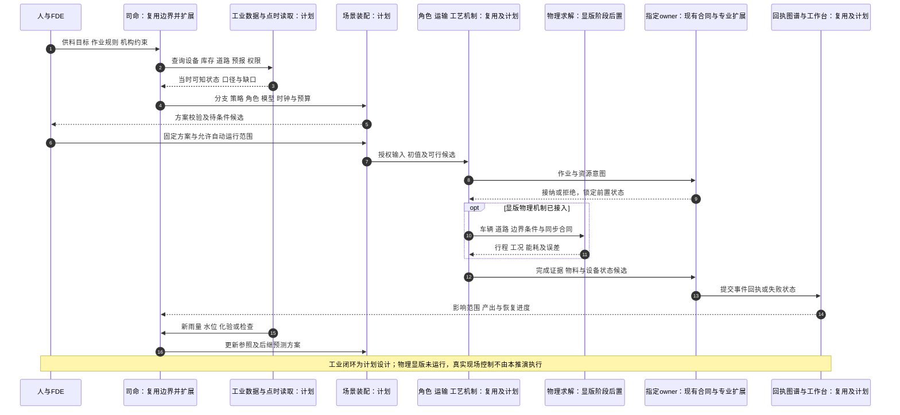
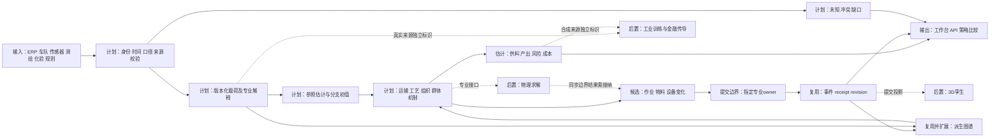

# 露天铜矿生产调度与事故应对场景适配推演

日期：2026-10-12

状态：`analysis / scenario-adaptation-draft / non-authorizing`

依据：[整体设计04](04-通用模拟底座与行业场景适配整体设计方案.md)与[数据合同03](03-数据结构、金融数据类别与时间口径合同设计.md)。本文新增一个工业专业适配案例，设计01—04保持不动。

## 1. 选取行业与业务问题

选择露天铜矿的采装—运输—原料堆场—选矿链，问题是：

> 暴雨造成部分道路封闭，同时发生车辆故障时，未来4小时如何调整车辆、原料配比、选矿负荷和维修资源？在安全、权限、物料及工艺约束成立的前提下，比较可交付产量、库存韧性、恢复时间、能源和成本。

这个案例检验实时感知、ERP及生产系统、组织权限、角色与群体、图谱传播、多时钟、空间和物理求解。它也能连接企业现金流和金融分析，但首个工业纵切只做到生产链及成本。

现场名称、角色、设备和后面的数字全部是假设，不指向真实矿山；推演是设计级桌面分析与算术示例，没有运行求解器，不形成真实矿山的调度或安全结论。

### 1.1 场景范围

- 纳入：已形成可采物料的区域、装载点、矿车、道路、堆场、给料、有限选矿流程、维修、排水、班组、现场指挥与记录。
- 首个纵切不模拟爆破过程，也不把全矿地质、尾矿库和所有连续工艺假装成已有能力。若这些对象的状态影响可行性，接入有依据的外部状态或边界约束；没有依据就报告缺口。
- 首次可运行问题可缩为“运输中断后的供料连续性”；物理显版随后增加实际参与计算的道路/车辆/排水模型与3D联动。

### 1.2 使用方式

| 方式 | 现实参照与未来如何推进 | 结果用途 |
|---|---|---|
| 历史事件重演 | 固定当时传感器、工单、班组记录、天气与模型版本 | 解释运输和供料中断，检查方案是否具备预测条件 |
| 实时滚动模拟 | 从截止当前的参照估计创建未来分支 | 提供候选调度、风险范围与数据缺口 |
| 事故情景演练 | 显式注入雨量、道路关闭、故障、通信延迟等条件 | 比较应对机制和组织协作 |
| 显版耦合 | 求解实际影响轨迹、时耗、排水和产出，再由3D呈现 | 检查空间、物理和流程约束，支持演练 |

现场已发生事实与未来分支隔离。未来天气可以是外生路径，矿车与库存由内生机制推进；同一未来路况不能同时由录制轨迹和物理模型竞争写入。

## 2. 五类扩展包怎样装配

| 包 | 本场景适配内容 | 交付与边界 |
|---|---|---|
| 领域包 | 采装运输、混配、库存、选矿、设备健康、维修、排水 | 类型、机制、模型、物料与设备不变量 |
| 制度／地域／场所包 | 所在国家和地区的适用要求、矿区规则、作业许可、现场应急程序、天气与日历 | 保留具体依据与版本，不套用全球统一停工阈值 |
| 机构包 | 矿业公司、矿区、调度中心、选厂、承包商、维修、安全与班组 | 权限、资产、人员、流程、来源与响应窗口 |
| 场景包 | 4小时供料问题、区域范围、故障与雨情分支、目标、预算、停止条件 | 固定初值、模式、信息范围、策略与评价 |
| 视图包 | 工作台、道路图、时序、物料流、组织图和3D矿区 | 读取授权状态，编辑形成配置意图 |

FDE负责把客户实际编码、数据口径和流程映射成这些交付。司命辅助拿资料、生成设定和发现缺口，装配系统检查合法性。具体适用法规、工程阈值和复工依据来自机构资料与专业审核，不由通用模板生成后直接当事实使用。

### 2.1 架构图



“后置”相对于本案例首个有限纵切，不改变整体设计将物理适配列为通用性检验的要求。物理求解进入场景以后，其输入、内部状态、失败和同步必须纳入同一运行合同。

## 3. 工业数据适配：沿用结构，增加专业语义

| 数据来源 | 结构与领域对象 | 时间、口径与时空域要点 | 模拟用途 |
|---|---|---|---|
| ERP／采购／库存 | 物料、备件、订单、合同、成本记录 | 账面与实物、可用与占用、币种、入账滞后 | 维修备件、采购与成本约束 |
| 生产执行／车队调度系统 | 作业、运输周期、装卸记录、班次 | 请求/分配/开始/完成分开，事件时间与到达时间 | 重建任务与实际运能 |
| 控制与设备监测 | 电流、压力、转速、温度、振动、功率 | 单位、频率、校准、质量码、设备时钟 | 工况估计与故障状态 |
| 车载定位与遥测 | 位置、速度、载荷、燃料、车况 | 坐标系、采样、漂移、湿重/干重、满载/空载 | 运输、能耗、排队与空间约束 |
| 雨量／水位／排水监测 | 时序、空间场、泵状态 | 累积雨量与雨强、观测与预报、流量与水位 | 积水、排水、路况分支 |
| 测绘／道路／地形 | 几何、路线网络、高程、坡度 | 坐标基准、测量日期、道路版本、允许通行范围 | 路径与物理求解 |
| 地质与岩土资料 | 块模型、材料、渗透性、强度、孔压 | 坐标、取样、空间插值、参数不确定性 | 可采物料和专业岩土边界 |
| 称重／化验／物料计量 | 批次、吨位、含水率、品位、粒度 | 采样期间、化验返回、误差、干基/湿基、空间代表性 | 配矿、库存、含铜量与回收 |
| 工艺与产线资料 | 流程、设备容量、响应曲线、试验结果 | 矿石硬度、停留时间、回收曲线、适用工况 | 实际吞吐、能耗和产出 |
| 维修系统 | 工单、健康状态、维修任务、备件与人员 | 告警不等于故障确认，计划不等于完工 | 故障、恢复与资源调度 |
| 人员与组织 |  roster、资格、岗位、班组、授权 | 任职有效期、班次、资质、实际出勤 | 协作、交接、决策与执行 |
| 制度和事故资料 | 文件、条款、许可、预案、检查、会议 | 发布、适用、有效、执行与解释来源 | 作业边界、响应与复工程序 |
| 通信和现场报告 | 日志、语音、消息、图像、陈述 | 发送/接收/阅读、转录误差、访问范围 | 告警传播、确认和角色认知 |
| 外部供应与物流 | 电力、燃料、承包服务、发运 | 容量、时效、合同、到货与预期分开 | 外部中断、缓冲与成本 |

结构仍使用设计03的表格、时序、流、曲线、图、文档、矩阵和空间场，并附着设计06的时空与适用域合同。`FinancialInstrument`不是内核必选对象；矿业包注册设备、道路、矿石批次、任务和工艺类型。矿区几何、道路网络、车辆轨迹、排水场、作业许可区和班组责任域分别建模，不能全部压成一个坐标字段。

### 3.1 五个工业特有的口径陷阱

1. **湿吨与干吨**：含水率定义一致时，干质量由湿质量和含水率转换。不同含水率基准不能直接套同一公式；转换保存测量与采样依据。
2. **矿量与金属量**：干矿量乘干基铜品位才得到含铜量；再结合回收率、停留时间和工艺状态估计可回收铜，不能把运输吨数当成产铜吨数。
3. **铭牌能力与有效能力**：额定处理量、实际工况能力、剩余可用能力、在修设备分别表达。
4. **地形几何与工程状态**：看起来通路畅通，不代表承载、附着、排水或岩土条件允许通行。
5. **台账与现场状态**：ERP显示备件存在，仍需核对实际位置、占用、规格和可用性；工单已关闭不自动证明现场设备可恢复生产。

矿石已装车、在途、卸入堆场、进入工艺和产出分别记录物料位置及转化，不能在运输完成时同时保留原装载点的同一批物料。

### 3.2 时间化观测实例

某道路水位在10:12发生变化，设备10:13发送，平台10:14接收，调度员10:15阅读；这些是虚构时间示例。历史重演不能让调度员在10:12就知道平台10:14才收到的消息。

一份10:00取样、11:30返回的化验结果描述的是10:00的物料，11:30以后才能改变获权角色的估计。在线混配可以先用有误差的品位估计，但不能把后续化验值当成当时已知。

## 4. 实体、关系、组织与群体

### 4.1 节点与动态边

核心实体包括矿区、区域、装载点、道路、车辆、堆场、批次、破碎/磨矿/浮选设备、泵、工单、班次、组织、职位、任职者、承包商和具体制度条款。

| 关系 | 属性与变化 | 权威来源 |
|---|---|---|
| 车辆执行任务 | 任务、路线、载荷、剩余时间、阶段 | 调度与作业提交事件 |
| 道路连接区域 | 距离、坡度、限行、容量、路况有效期 | 资产/空间配置及已接纳状态 |
| 区域向堆场供料 | 批次、品位、运量、延迟 | 运输与物料事件 |
| 设备依赖电力/水/原料 | 容量、用量、故障影响和阈值依据 | 资源与专业机制 |
| 岗位有权批准事项 | 对象、权限范围、期限、程序 | 机构授权与制度依据 |
| 告警传播到角色 | 渠道、延迟、送达/阅读、确认 | 通信记录与信息机制 |
| 工单需要人员与备件 | 数量、资格、占用、预计完成 | 维修及资源事件 |
| 规则适用于作业 | 条件、地域、时段、例外与解释 | 制度包的原文与程序 |

道路是具有几何、状态与生命周期的实体；路线拓扑使用关系连接它。直接在图边上写“可通行”不能替代道路状态的证据与专业计算。

### 4.2 组织与角色的不同信息

| 角色 | 目标与关注 | 可见信息／行动范围 |
|---|---|---|
| 生产负责人 | 协调安全、产出、资源和交付 | 整体计划；按授权调整生产目标 |
| 调度员 | 可执行路线、车辆分配、供料连续性 | 车队与路况；分配已获准任务 |
| 安全岗位 | 适用作业条件、禁入和复工依据 | 告警与现场确认；按制度合同处置 |
| 维修负责人 | 恢复设备、人员与备件可用 | 设备历史与工单；维修资源安排 |
| 选厂负责人 | 给料、品位、工况和物料平衡 | 堆场与工艺；调整允许的负荷和混配 |
| 司机／班组长 | 执行、上报、交接与现场约束 | 局部路况、任务与通信；合法候选行动 |
| 承包商负责人 | 服务任务、合同、人员设备 | 承包范围；提供或确认资源 |

这是角色模板，不是替真实岗位设定统一性格。心智模型可表达成本偏好、谨慎程度、信息依赖和决策时延，参数需数据或明确假设；记忆记录与推定分开。

Laya可选择“报告异常”“等待指令”“请求改线”“接纳合规任务”等注册行动与目标。调度求解器生成可行路线和资源组合，工艺模型计算负荷；Laya不自由生成未经验证的道路速度或安全阈值。

### 4.3 群体怎样通过图谱推进

图谱传播三个不同过程：设备/物料依赖传播、告警与任务信息传播、组织内确认与执行传播。它们分别有延迟和更新合同，不能用一个“影响力”完成全部推演。

非关键班组和背景运输可聚合计算；关键司机、调度员、维修与安全角色可显式展开。同一矿车轨迹由唯一运输机制推进，不会因为司机角色显式展开就复制一辆车；司机心智与车辆物理运动是不同维度。

事故使受影响覆盖单元暂停聚合→保存已在途任务、位置、载荷与班组状态→展开必要角色→核对资源→交接后继续。工单、车辆、人数及告警响应不能在聚合群体与显式角色重复计入。

## 5. 专业机制、模型与owner映射

| 机制 | 专业模型与输入 | 结果及状态归属候选 |
|---|---|---|
| 路况与排水 | 雨量、汇水、积水、泵、坡度、材料条件 | 路况估计或边界状态候选；空间/环境专业归属 |
| 车辆与道路 | 载荷、动力、坡度、滚阻、附着、路段容量 | 运动、行程、能耗与任务事件；运输/作业归属 |
| 采装与排队 | 装载资源、服务时间、队列与车辆 | 装载/等待/出发；作业归属 |
| 调度与资源安排 | 已获准路线、车辆状态、供料需求、目标 | 可行候选与任务分配；调度归属 |
| 混配与库存 | 批次干重、品位、含水、矿性与堆场结构 | 批次转移、给料配方与库存变化；物料归属 |
| 选矿工艺 | 给料、粒度、硬度、工况、停留时间、响应曲线 | 吞吐、在制品、回收与产出；生产归属 |
| 设备健康与维修 | 测量、故障模式、工单、人员备件 | 健康估计、状态变化、恢复确认；维护归属 |
| 作业许可与应急 | 适用规则、观测证据、岗位授权、确认程序 | 禁入、处置、复工过程；指定安全/作业许可归属 |
| 信息与组织协作 | 渠道、岗位、职责、现场陈述 | 获知、确认、行动与私有更新；各自既有边界 |
| 成本与交付 | 能耗、维修、物料、合同、产出 | 成本估计及合同变化；经济/合同专业归属 |

这些是计划的专业归属职责，不是已经创建的10个服务。需在有界规格中确认由现有哪个owner扩展、何处需新接纳合同；不把现有游戏Construction、Ecology或Economy直接称为完整矿业owner。

一次卸料通过接纳的跨域recipe核对车辆任务、批次、来源和目的地，再提交物料转移与作业完成。卸料意图、秤重、接纳和完成回执分别记录；传感器或3D动画显示卸料不自动重复修改库存。

## 6. 显版要让哪些物理计算真正参与

### 6.1 首个可解释的物理纵切

优先实现车辆—道路—堆场，按问题加入排水，而非一次构建全矿高精度多物理系统：

- 地形和路段几何约束路径；车辆质量、载荷、动力、坡度、滚动阻力与附着约束加速度、速度、制动和能耗。
- 装卸与路段占用改变队列、运输周期和供料，不能仅让模型人物沿固定动画轨迹播放。
- 若模型覆盖排水，雨水输入、排水、汇流及蓄积共同改变水位；积水对道路的影响由有依据的专业关系表达。
- 选矿可以先使用有适用范围的工艺响应模型；需要更深问题时再接连续专业求解器，不以通用刚体引擎替代工艺与岩土工程。

岩土、边坡稳定性与地基承载不能仅由降雨或3D坡度判断。资料不足时，以现场已发布限制或专业评估作为外生边界，本平台不输出未经依据的安全通行证明。

### 6.2 三份状态必须分开

1. 现场参照：传感器、记录及估计，具有观测截止和不确定性。
2. 模拟分支：车辆、道路、库存及工艺由对应机制演化，owner接纳同步边界结果。
3. 3D呈现：渲染提交投影及明确标识的求解预览；局部观测和意图通过结构化合同回传。

连续求解器内部步长不等于owner提交频率。运动、接触与水位求解固定内部状态，按任务事件或同步边界给出结果；3D可以插值表现，但插值画面不能作为新的独立现实测量。

### 6.3 多时钟示意

以下为拟议配置范围，不是性能或精度承诺：

| 子过程 | 推进方式 | 交换要点 |
|---|---|---|
| 车辆动力学 | 毫秒至亚秒或自适应求解步长 | 数值稳定性、接触、载荷和事件定位 |
| 行程与装卸排队 | 离散事件，边界按秒级需要同步 | 占用、进出、装载与卸料 |
| 雨水与积水 | 按专业求解器稳定性选择步长 | 水量平衡、阈值事件、误差与边界 |
| 路况传感器 | 按设备实际频率 | 时钟、采样、迟到和失联 |
| 给料与工艺 | 秒/分钟响应或专业连续求解 | 物料存量、流量、工况和停留时间 |
| 角色与维修流程 | 信息、资格、工单和时限触发 | 决策耗时、资源、确认与执行延迟 |
| 调度优化 | 事件触发及分钟级滚动候选 | 固定输入截止、可行性、计划修订 |
| ERP及成本 | 实际更新周期与业务事件 | 台账时滞、确认与口径 |
| 3D | 独立呈现频率 | 稳定身份、提交状态与预览标识 |

实时运行记录实际耗时；离线重演采用明确的感知、确认和决策延迟。预设应急流程及现场已有自动保护可以先于司命慢推演生效，模拟须表达它们的优先级与来源；真实控制保护仍由现场已有系统承担。

## 7. 一次完整的情景推进

以下时间线全部是假设的情景，不是预测结果。

### 7.1 截止当前准备

司命收集未来天气预报、当前车队、路网、库存、工艺、工单、班组与适用程序。FDE固定源编码、坐标、干湿基、品位、任务与权限合同，检查路线、模型和资源缺口。

场景目标不是单一最大吨位：先校验作业与安全约束，再比较4小时产出、库存韧性、恢复时间、能耗和成本。目标之间的权重由机构方案定义；约束不能被奖励函数用利润抵消。

### 7.2 注入事件并选择影响范围

假设出现暴雨、已接纳的主路封闭指令和一辆矿车故障。道路停止接纳新通行任务；在途车的等待、返回或处置依据现行程序和位置确定，不能让它们瞬移至安全区。

图谱找出受影响作业、车辆、原料来源、堆场、选厂、岗位及承包商；装配好的规则先触发对应流程，司命选择哪些区域、司机、维修和组织议事需要更细模拟。

### 7.3 平行比较策略与不确定条件

策略维度：保留未受影响运输、合规改线、调整给料、选择允许的混配、安排维修与排水。条件维度：雨势持续、恢复提前/延迟、备用路受限、通信延迟、化验误差及备件不可用。

先生成合规策略，再让各策略面对可比较的条件集合。不能把策略与天气假设绑成“好策略遇好天气”的不公平比较；共同外生路径或配对随机输入可以减少比较噪声。

备用路线未确认可用时，改线候选是待条件方案，不是立即可执行。出现约束冲突，角色可选择上报、等待或其他合法候选，owner拒绝未经满足条件的任务。

### 7.4 物理与组织同时推进

路线变化影响载荷、车速、制动、周期、能耗和排队，进一步影响供料；给料与矿性改变工艺能力和回收；维修占用人员与备件，可能改变其他设备恢复。

与此同时，司机报告、班组确认、调度调整、选厂认可和安全确认分别有渠道、权限和时间。司命监督缺口与预算，不代替岗位形成没有依据的复工结论。

### 7.5 接入新现实

新的水位、雨量、现场检查、修复确认与化验结果追加版本。它们分别用于更新参照估计、规范状态接纳或角色信息，按计划规则产生后继预测。

若备用路现实封闭，包含其可用条件的方案不再可行；保留旧方案与所用证据，生成新方案，不通过下调风险评分让关闭道路重新可用。预测与观测均相冲突时标记未覆盖并停止相关假设。

## 8. 数量算例：给料连续性不等于完整生产预测

### 8.1 假设与公式

设故障后的比较起点，备用路已完成方案要求的通行确认；本算例只计算稳定运量与干矿缓冲，暂忽略改线和工艺切换瞬态、车队在途差异、排队细节、矿性变化及价格。

| 项目 | 假设值与含义 |
|---|---|
| 选厂正常给料 | 600干吨/小时 |
| 可用原料缓冲 | 1200干吨，已扣除保护性最低储备及占用，不等于堆场全部库存 |
| 车辆单次有效载荷 | 60干吨；真实载荷须按湿质量和车辆限制换算 |
| 比较时可调度车辆 | 改线方案11辆；保留原路方案仅4辆具备可执行任务 |
| 原路稳定运输周期 | 48分钟 |
| 备用路稳定运输周期 | 72分钟 |
| 运输周期利用系数 | 0.8，仅表示本算例周期损失，不再重复扣已单列故障车辆 |
| 评价窗口 | 4小时；封闭与路线条件在此期间按假设保持 |

设计算例公式：

```text
stable_supply = dispatchable_trucks × dry_payload × (60 / cycle_minutes)
                × cycle_utilization
buffer_end = buffer_start + supplied_mass - processed_mass
contained_copper = dry_ore_mass × dry_basis_copper_grade
```

周期利用系数是简化假设，不能再与明确模拟的同一等待和故障损失重复相乘。真实场景由事件/物理机制计算周期与排队，或使用经校准的等效模型，不能两者重复扣损。

### 8.2 三种策略的算术比较

| 策略 | 稳定来料 | 给料与4小时处理量 | 结束时可用缓冲 | 能得出的结论 |
|---|---|---|---|---|
| A：仅保留未受影响原路运输 | 4×60×60/48×0.8＝240干吨/小时 | 先600；缓冲约3小时20分耗尽后降至240；合计2160干吨 | 0干吨 | 4小时正常目标缺240干吨，且没有剩余可用缓冲 |
| B：确认可行后改走备用路，维持600给料 | 11×60×60/72×0.8＝440干吨/小时 | 600×4＝2400干吨 | 1200＋440×4−2400＝560干吨 | 在该简化假设下可维持窗口内给料，消耗640干吨缓冲 |
| C：相同改线，给料降至450 | 440干吨/小时 | 450×4＝1800干吨 | 1200＋440×4−1800＝1160干吨 | 保留更多缓冲，以600干吨窗口产量换后续韧性 |

A的600给料阶段时长为1200/(600−240)小时，之后按240来料保持物料平衡。缓冲为0表示可动用部分耗尽，保护性储备没有在算例中被突破。

这只比较干矿供料。B并不因此成为总最优：若暴雨延长、备用路限流、能耗升高、品位不匹配或工艺负荷变化，排序可能变化。C的价值取决于后续中断和恢复条件；没有概率依据时不给三种条件虚构发生概率。

### 8.3 加入品位和工艺以后

若仅为算术说明，假设2400干吨全部为0.6%干基铜品位，则含铜量为14.4吨；再假设恒定90%回收且完全完成对应流程，理论可回收铜为12.96吨。这两个参数是假设，不是矿山实测或工艺结果。

真实场景按批次追踪含铜量、混配、在制品和停留时间。窗口末产出的铜可能来自窗口前已入选物料，本窗口给料也可能尚未完成流程；不能直接用当期给料乘回收率当作当期已交付铜。

若库存低品位、备用路线送来硬矿或湿矿，运输吨数增加也可能未改善金属产出。必须用物料和工艺模型再计算，原料量、含铜量、精矿量、精矿含铜量与可销售金属量分别输出。

## 9. 主交互时序与数据流

### 9.1 时序图



### 9.2 数据流图



图谱反馈定位受影响对象，真正的物料、维修与路况变化由专业机制计算和owner接纳。信息传播不是资源流动，3D表现不是来源证据。

## 10. 数据不足时怎样分级交付

| 数据与模型条件 | 可以交付 | 明确不能证明 |
|---|---|---|
| 公开资料与行业模板 | 场景草案、实体/制度映射、缺口目录、假设性压力测试 | 某矿真实产能、安全阈值与最优策略 |
| 路网、车队、工单与产量记录 | 有范围的物流离散事件模拟、缓冲与流程分析 | 未建模的车辆动力学、边坡或工艺响应 |
| 加入几何、载荷、标定、材料及环境参数 | 指定范围物理耦合与数字孪生 | 不在求解范围内的工程安全与全部矿区状态 |
| 加入足够历史与留出观测 | 校准、预测误差、恢复时间和响应过程评估 | 所有未见事故的可靠概率与真实因果识别 |

FDE可以先提供公开框架与默认模板，再通过客户数据和专业模型替换。未知参数用有依据的范围、敏感性分析或明确情景，不随意填一个精确数值。资料完全不足时场景保持静态设计态。

## 11. 最小纵切与验收

### 11.1 分三步建设

1. **供料连续性纵切**：有限车队、两条路、一个堆场和选厂；接一类生产数据与一类修订数据，完成离散运输、物料守恒、权限与回放。
2. **实时组织协作**：加入雨情与路况、故障维修、少量关键角色、图谱传播和班组交接；证明观测、私有获知和聚合推进不重复。
3. **物理显版**：加入真正参与计算的车辆/道路或排水求解与3D；验证现实参照、分支和呈现的区分以及专业误差范围。

每步保留已覆盖和未覆盖机制。后台分析可以先交付，完整显版需要第三步相应运行证据。

### 11.2 接受标准

- 身份映射：设备编码、ERP资产、车载终端、求解体和3D对象不误合并，稳定身份可追溯。
- 口径：干湿重、品位、流量/存量、能量、坐标、可用/占用分别检查，未知不当零。
- 守恒：物料位置不重复；品位混配按质量守恒；矿石、在制品、产品、尾矿及铜量在专业边界内核对。
- 时间：不能提前看到未来化验、检查、预报修订或工单结果；决策与执行有延迟。
- 权限：禁入、作业许可和复工前置不被优化目标、Laya或司命绕过。
- 机制：维修计划不自动成为完工；道路连接不自动证明可通行；动画卸料不独立修改库存。
- 群体：同一车辆、司机、工单和告警响应有明确推进范围，精度交接可追踪。
- 物理：输入和边界可复现；数值稳定、误差与工况范围可验证；失联与求解失败不伪造安全结果。
- 回放：方案、资料、模型、角色输出、同步事件和回执有固定版本；旧预测保留。
- 业务效果：与现行调度及简单规则基线比较产出、断料、成本、恢复与预测误差，系统正确不代替业务有效。

性能目标按实际传感器率、车辆数、求解复杂度、分支、同步频率和时延冻结。本文件未指定未经测量的实时性能承诺。

## 12. 对通用底座的适配检验结果

设计级结论：前四份的三部分底座与五类专业包可以表达这个矿业场景；第三份数据结构和时间口径合同可以沿用，专业含义通过矿业扩展接入。

需要专业化的新内容是车辆/道路/物料/工艺类型、模型、作业流程、工程参数与owner事实合同；需要补充验证的通用能力是空间型端口、求解状态检查点、多时钟边界同步和群体推进覆盖。这些仍是设计要求，没有实现验收。

该案例暴露的关键边界是：人类认知与物理运动分开、图关系与工程机制分开、运输量与金属产出分开、现场参照与模拟分支分开、求解内部步长与世界提交分开。底座如果能在同一套合同下处理这些区别，才具有可检验的工业适配能力。

后续金融传导可读取生产和交付预测，通过成本、合同、经营现金流与信用机制影响资产分析；不能从“矿山故障”直接跳到必然股价变化。工业训练轨迹也应分别标识现实、估计和合成来源。
