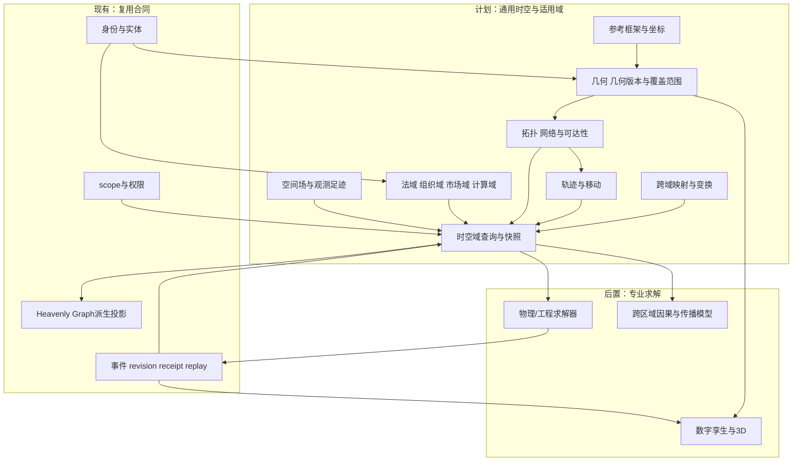
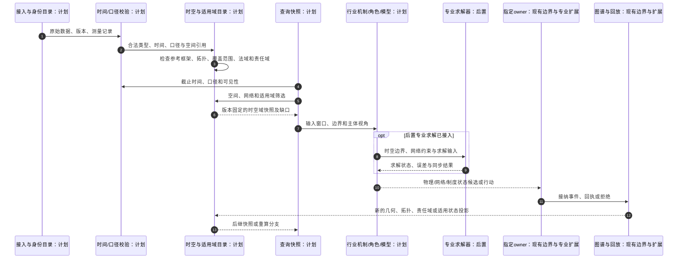
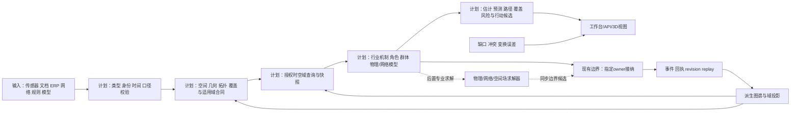

# 通用时空与适用域合同设计

日期：2026-10-13

状态：`analysis / contract-extension-draft / non-authorizing`

归属：模拟预测底座 fork。本文把空间从工业专业字段提升为跨行业一级合同，并补充“适用域”概念。设计01—03保持不动；整体方案04与工业案例05仅增加本合同的引用和适配说明；本文是新的扩展设计，尚未对应运行时代码或验收证据。

## 1. 为什么需要“时空与适用域”

时间回答“何时发生、何时可知、何时有效”，测量口径回答“测量的对象和数值是什么意思”。它们仍不足以回答：

- 这条数据适用于哪里、哪个网络、哪个组织或哪个法域？
- 它覆盖一个点、一个区域、一条路线、一个网格、一个账户层级，还是整个市场？
- 对象之间如何相邻、连接、包含、移动、隔离或经过授权？
- 传感器测到的是本地值、覆盖范围内平均值，还是对一个空间场的间接观测？
- 同一个实体在不同物理位置、网络位置、组织位置和制度位置中如何对应？

因此通用数据合同应扩展为：

```text
数据对象
= 身份
+ 时间
+ 测量口径
+ 空间与关系定位
+ 适用域
+ 来源、版本与认识状态
+ 可见性与权限
```

“空间”不只指经纬度；“适用域”也不只指行政区域。两者共同描述数据、规则、模型和状态在哪些关系结构中成立。

## 2. 通用覆盖模型

空间能力由多个可组合类型承载。一个对象可以同时具有矿区几何位置、道路网络位置、组织责任域和法域；医疗设备可以有医院楼层位置、患者照护单元和数据访问域；金融工具可以没有物理位置，但有交易场所、发行法域、监管区域和市场分区。

| 能力类型 | 表达内容 | 典型行业 |
|---|---|---|
| 几何空间 | 点、线、面、体、网格、体素、边界 | 采矿、制造、建筑、能源、农业 |
| 拓扑与网络 | 相邻、连通、上下游、可达、容量、割点 | 物流、电网、通信、供应链、工艺管线 |
| 动态位置 | 移动、轨迹、停留、路径、进入和离开 | 车辆、人员、货物、机器人、航运 |
| 空间场 | 温度、压力、雨量、品位、污染、应力 | 工业、气象、农业、环境、医疗成像 |
| 观测覆盖 | 传感器足迹、遥感范围、采样区域、代表性 | 遥感、设备监控、流行病、市场调查 |
| 制度与法域 | 许可区、行政区、监管区、税区、司法辖区 | 金融、矿业、跨境贸易、公共治理 |
| 组织与服务域 | 部门、责任区、照护单元、客户区域、权限边界 | 医疗、商业、政府、制造、服务业 |
| 市场与交易域 | 交易所、市场分区、结算网络、产品覆盖范围 | 金融、能源交易、通信、平台经济 |
| 语义与计算域 | 模型网格、仿真区域、数据集分区、版本适用范围 | 所有行业，尤其数字孪生与科学计算 |
| 虚拟与社会空间 | 在线房间、社群、关系邻域、信息可见范围 | 社交、游戏、舆情、组织协作 |

这些能力不是十种互斥的“空间子类”，而是可以并存的定位维度。适配包声明哪些维度存在、哪些不适用，以及维度之间如何映射。

### 2.1 架构图



时空查询只产生有来源、版本和权限的读取快照。求解器和数字孪生不能因读取空间数据而获得世界事实写权；状态仍通过专业 owner 接纳。

## 3. 一级合同定义

以下是设计示意，不是已实现 schema。`SpatialContract`描述物理、网络或虚拟位置；`ApplicabilityDomain`描述规则、模型、数据和权限在哪个域成立。

```text
SpatialContract {
  reference_frame              // 坐标系、基准面、单位、版本
  carrier                      // point | line | area | volume | grid | voxel | network
  geometry_or_location         // 几何、网格单元、节点/边、虚拟位置
  topology_refs                // 相邻、连接、包含、上下游、可达
  extent_and_support           // 覆盖范围、采样足迹、代表区域
  spatial_resolution           // 分辨率、最小可辨识对象、聚合层级
  valid_interval_ref           // 位置或空间关系何时成立
  transform_refs               // 坐标/网络/层级转换及版本
  movement_or_trajectory_ref   // 动态对象的位置序列
  boundary_conditions          // 边界、阻隔、容量、入口出口
  uncertainty_and_error        // 测量、定位、测绘、插值、匹配误差
  non_applicability_reason     // 不适用时的明确原因
}

ApplicabilityDomain {
  domain_kind                  // physical | network | jurisdiction | organization |
                                // market | service | semantic | computational | virtual
  domain_ref, parent_domain_refs
  membership_rule              // 对象如何属于该域
  effective_interval
  authority_or_owner_ref
  access_and_visibility
  inclusion_exclusion_rules
  cross_domain_mapping_refs
  uncertainty_and_dispute_refs
}

SpatiotemporalSnapshot {
  query_ref, cutoff_time, logical_time
  selected_geometry_versions, topology_versions
  selected_domain_versions, transform_versions
  selected_observation_refs, unresolved_gaps
  content_digest, access_scope
}
```

空间几何、网络关系、制度域和组织域不能互相默认为同一集合。行政区边界不等于矿区边界，部门责任区不等于设备物理覆盖区，交易所上市记录不等于发行人总部位置。

### 3.1 适用域的基本关系

适用域关系至少包括：

```text
contains / member_of
adjacent_to / connected_to
upstream_of / downstream_of
reachable_from / blocked_by
covered_by / sampled_by
governed_by / authorized_for
served_by / responsible_for
listed_on / settled_through
simulated_in / approximates
```

它们不是一张普通边表。每条关系声明端点类型、有效时间、证据、方向、是否可达、是否有容量和由哪个机制更新。

例如“医院负责某患者”是组织服务域关系；“患者位于某病房”是物理位置关系；“某医生可查看该记录”是权限关系。三者可以关联，但不能互相替代。

## 4. 跨行业映射

| 行业 | 空间/适用域组合 | 关键模拟问题 |
|---|---|---|
| 制造 | 车间几何＋设备拓扑＋工艺网络＋班组责任域＋安全许可区 | 设备是否可达、物料是否能流转、谁能批准维修 |
| 采矿 | 矿区地形＋道路网络＋矿体网格＋排水场＋作业许可域 | 车辆能否通行、雨水如何汇流、物料属于哪个批次 |
| 物流 | 路网＋仓库拓扑＋车辆轨迹＋海关/服务区域＋承运责任域 | 改道、容量、交付范围与跨境手续 |
| 能源 | 发电/输电网络＋地理区域＋调度责任域＋市场结算区 | 潮流、故障传播、区域平衡与交易边界 |
| 金融 | 交易场所＋监管法域＋结算网络＋发行/投资者服务域 | 哪条规则适用、哪个市场可交易、何时结算 |
| 医疗 | 医院/家庭空间＋照护路径＋科室责任域＋医保/法域 | 床位、转诊、照护权限和服务覆盖 |
| 农业 | 地块几何＋土壤/天气场＋灌溉网络＋承包责任域 | 产量、灌溉、病虫害与作业窗口 |
| 建筑 | BIM几何＋构件依赖＋施工流程网络＋许可区域 | 施工可达性、碰撞、工序和验收范围 |
| 通信 | 设备拓扑＋覆盖场＋频谱/监管域＋客户服务域 | 覆盖、容量、故障传播和合规区域 |
| 航空/航运 | 航路网络＋动态轨迹＋港口/空域＋管制责任域 | 路径、拥堵、天气、港口容量和管制 |
| 商业/平台 | 门店/渠道空间＋用户服务区＋社群关系域＋隐私可见域 | 需求覆盖、配送、舆情传播和客户权限 |
| 公共治理 | 行政区＋人口服务区＋机构责任域＋法律适用域 | 政策覆盖、资源配置、部门协同与执行 |
| 软件/互联网 | 服务拓扑＋数据驻留域＋租户域＋权限域＋虚拟房间 | 故障传播、数据合规、租户隔离与服务可达 |

这张表是适配检查矩阵，不是预先穷尽所有行业。新行业只要能声明其定位载体、适用域、关系和更新机制，即可接入；不能声明的部分必须报告为未支持，而不是用普通字符串字段隐藏。

## 5. 与数据结构、时间和口径的组合

同一结构可携带不同空间合同：

| 数据结构 | 可能的空间含义 |
|---|---|
| 标量 | 某地点的温度、某法域的税率、某节点的容量 |
| 表格 | 区域×期间统计、设备×责任域、市场×合约规则 |
| 时序 | 车辆轨迹、区域价格、病房占用、节点负载 |
| 事件流 | 进入区域、道路封闭、跨境申报、服务故障 |
| 曲线/曲面 | 地形高程、覆盖强度、区域供需、风险空间分布 |
| 图/网络 | 路网、电网、工艺、供应链、组织和结算网络 |
| 矩阵/张量 | OD流量、空间协方差、网格场、网络转移矩阵 |
| 文档 | 适用法域、许可区域、设施图纸、空间标注的报告 |
| 分布 | 定位误差、空间插值、区域需求和风险分布 |
| 公式/约束 | 可达性、容量、边界条件、服务覆盖、法规适用 |

时间与空间必须共同版本化。道路、法域、网络拓扑、组织责任区和模型网格都会变化；不能用今天的几何或组织边界重演过去的决定。

测量口径还要声明空间支持：某传感器值是点值、面积平均、沿线路聚合还是网格代表值。空间分辨率改变时，聚合、插值和误差需要生成派生版本，不能把重采样结果当作原始观测。

## 6. 查询和模拟接口

```text
SpatiotemporalQuery {
  subject_selector, data_type_selector
  time_window, decision_cutoff, logical_cutoff
  spatial_selector              // geometry, network path, domain, region, relation
  resolution, aggregation, topology_depth
  domain_selector, jurisdiction_selector
  source_and_revision_rule, access_scope
  interpolation_or_mapping_rule
}

MechanismSpatialPort {
  input_contract, output_contract
  required_reference_frames, domain_requirements
  topology_reads, field_reads, trajectory_reads
  boundary_conditions, sampling_and_sync
  movement_constraints, capacity_constraints
  spatial_effects, owner_bindings, failure_semantics
}
```

典型读取顺序为：身份匹配→选择时间与版本→确定空间/适用域→检查坐标或层级变换→按声明聚合或插值→生成带缺口的快照→交给机制。不能先把所有区域压成一个平均值，再声称保留了空间差异。

图谱查询可以发现候选影响范围；空间/网络/制度机制判断路径、覆盖、容量和适用性。两者互相引用但不互相冒充。

## 7. 主交互时序与数据流

### 7.1 时序图



### 7.2 数据流图



空间读取、专业计算、3D表现和owner结算保持独立。画布上的区域连接不会自动成为道路可达性、法域适用或因果影响。

## 8. 边界条件与不适用情况

1. **无物理空间**：纯财务指标、抽象数学模型可以声明物理空间不适用，但仍可能有市场域、组织域、法域或计算域。
2. **多个定位冲突**：GPS、资产台账和人工报告不一致时保留冲突，按来源与时间规则选择，不默默平均。
3. **空间变化**：临时封路、组织改组、法域变更和市场规则切换生成新版本，不覆盖过去边界。
4. **拓扑不等于几何距离**：供应链、电网和照护路径的“邻近”由网络关系定义，不由直线距离推断。
5. **覆盖不等于观察到**：传感器覆盖某区域不代表每个对象都被实际观测；观测足迹、质量和遮挡要保留。
6. **适用域不等于权限**：规则适用于某区域，不代表当前用户可以读取或执行；适用性和访问控制分开。
7. **空间相关不等于因果**：相邻区域同时变化可以作为机制输入或统计关系，但图路径不自动证明因果。
8. **跨尺度不自动可逆**：从网格聚合到区域后通常丢失细节，展开需要模型或分布，不能恢复原始状态。

## 9. 验收标准与建设顺序

### 9.1 通用验收

- 坐标、网络、法域、组织域和虚拟域可分别注册，不互相误认。
- 空间关系、覆盖范围、拓扑、轨迹和空间场有来源、版本和有效时间。
- 数据查询同时遵守时间截止、测量口径、空间范围和适用域。
- 坐标转换、网络映射、空间聚合、插值和尺度变化保存血缘及误差。
- 物理位置、网络可达、制度适用、组织负责和权限访问分别验证。
- 变化后的道路、法域、责任区、网络和模型网格不会改写历史重演。
- 聚合与显式对象不重复计算；动态对象的唯一位置和移动由明确机制推进。
- 空间/网络求解失败、定位冲突、覆盖不足和边界不确定性显式输出。
- 机制输出进入owner或结果存储的边界清楚，3D表现不获得写权。

### 9.2 建设顺序

1. 先实现时空域元数据、参考框架、层级/网络标识和快照查询。
2. 用铜矿道路、金融法域/交易场所、物流路网三个小纵切验证不同空间维度。
3. 加入轨迹、覆盖范围、空间场和跨域映射，验证多时钟与修订。
4. 接入物理/网络求解器与数字孪生，验证同步边界、检查点和失败恢复。
5. 用医疗照护域、能源电网、公共治理和软件服务拓扑检验适配范围。

## 10. 与通用底座的裁决

空间不应继续被视为工业专属字段。准确的底层定义是：

> **通用时空与适用域合同**，将物理位置、网络拓扑、动态轨迹、空间场、观测覆盖、法域、组织服务域、市场域、语义域和计算域统一纳入可版本化查询与机制接口。

这不会把所有行业压成一个空间模型，而是让不同空间/适用域能力使用同一套身份、时间、来源、口径、权限、分支、机制和owner边界。空间不适用时显式声明；适用但没有数据时保留缺口。

本文是设计扩展，不证明任何行业已完成空间模拟、数字孪生、物理求解或实时运行验收。
