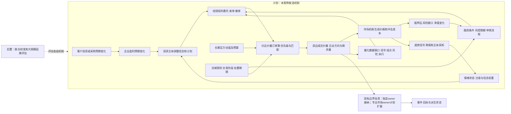
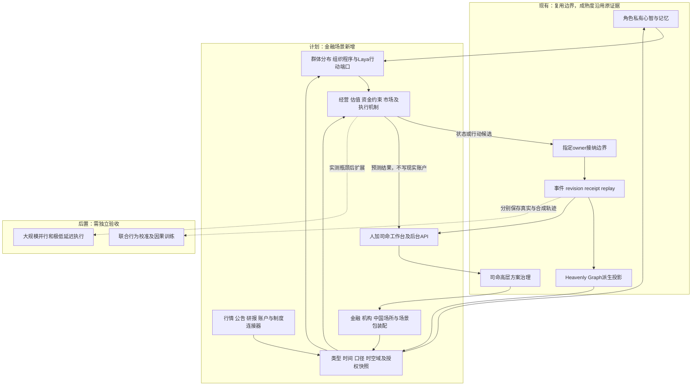
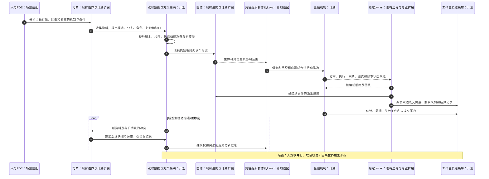
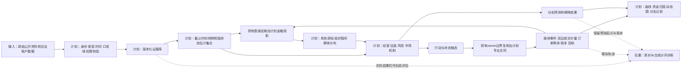

# 光模块概念行情兴起与腰斩资金撤离场景推演

日期：2026-10-14

状态：`analysis / design-draft / non-authorizing`

本文沿用[整体方案04](04-通用模拟底座与行业场景适配整体设计方案.md)、[金融数据合同03](03-数据结构、金融数据类别与时间口径合同设计.md)和[时空域合同06](06-通用时空与适用域合同设计.md)。只新增场景分析，不改变设计01—06，不授权金融运行时代码或真实交易。订单拆分、执行器、借券回补、多方订单行为和异常模式检测见[金融订单行为与多方博弈机制体系](20-金融订单行为与多方博弈机制体系.md)。

目的：检验底座如何表达“光模块概念受到追捧，大量参与者增加配置，价格大幅上涨，随后因不同冲击和反馈下跌约50%，部分持有人撤离”的全过程。假设市场为中国A股；企业、角色、价格、日期与参数均为虚构，不对应已核验历史行情。本次未取得实时数据，未运行撮合、角色或预测模型。

## 1. 推演问题与模式

核心问题是：产业需求与市场预期如何连接，哪些参与者把预期变成订单，为什么相似利空在不同持仓和流动性条件下产生不同跌幅，以及哪些观测可以区分这些机制。

需要分别装配三种任务：

| 任务 | 输入与推进方式 | 可输出的结论 |
|---|---|---|
| 已知历史的解释性重建 | 当时公开资料、历史行情和明确假设的隐状态；历史价格外生回放 | 候选解释、时序一致性、行为可行性；不证明唯一真实原因 |
| 预设腰斩的压力情景 | 设定冲击或外生价格路径，检查组合、赎回、执行与传导 | 发生该压力时会怎样；不是腰斩概率预测 |
| 未知未来的生成式预测 | 在截止时刻冻结资料，内生生成参与者订单与价格 | 有条件的路径、区间和失效条件；可靠概率另需样本外校准 |

下面的数值路径是解释性假设算例，专门展示用户提出的情景。真正前瞻运行不能把“必然腰斩”或目标价格藏进角色奖励、冲击参数或撮合机制；必须同时允许继续上涨、横盘、温和回撤和深跌。

未来宏观条件可以外生，证券订单和价格可以内生，但每个端口只有一个推进来源。历史真实价格不能覆盖同范围内生撮合结果。内生市场之外的买卖盘需由明确的背景参与者或边界订单模型产生，不能用无限承接者把所有卖单自动成交。

## 2. 世界对象和数据装配

### 2.1 概念、企业和证券分开

“光模块”主题是有版本的分类与市场叙事对象，不能等同于所有公司的共同盈利能力。至少区分真实收入暴露、潜在产品布局、供应链联系和新闻关联；每种成员关系保存来源、比例、有效期与不确定性。

| 对象 | 本案例的表达 |
|---|---|
| 产品与技术 | 不同速率/用途的产品、技术路线、认证状态、替代关系 |
| 产业参与者 | 客户、设备与元件供应商、制造商、渠道商及竞争者 |
| 发行人与经营 | 法人、业务分部、订单、交付、成本、毛利、现金流 |
| 金融工具与场所 | 股票、上市记录、交易场所、可用融资工具与交易日历 |
| 投资主体与组织 | 基金载体、管理人、账户、投资委员会、风控、交易员、出资人 |
| 信息对象 | 公告、研报、新闻、讲话、传闻、提取陈述和原始证据 |
| 制度对象 | 法律规范、监管决定、出口限制、实施程序、有效期和适用对象 |
| 场景计算对象 | 模型、快照、隐状态估计、分支、行动候选和成交回执 |

不能直接从“AI发展”标签写入上市公司盈利或股价。需求要经客户投资、产品需求、采购、认证、交付、收入确认和利润机制传导；市场预期可以提前反应，并与实际经营偏离。

### 2.2 本场景所需数据及缺口

| 数据组 | 结构与主要用途 | 时间、口径和缺失处理 |
|---|---|---|
| 价格、成交与报价 | 带买卖方向的价量时序、逐笔流和订单簿；交易状态与承接能力 | 交易阶段、复权、停牌、序列、报价深度与采集缺口；价格、数量、方向必须同一时钟对齐 |
| 企业财务与订单 | 表格、期间数据、公告；盈利和经营传导 | 单期/累计、确认收入/在手订单、币种、合并范围与修订 |
| 产品及供应链 | 类型记录、采购关系、合同；需求和替代 | 产品代际、客户地区、合同期间；比例未知保留区间 |
| 持仓、申赎与融资 | 快照、账本、事件；拥挤、资金约束和强制卖出 | 公告持仓期与发布日期分开；融资数据不覆盖全部杠杆 |
| 新闻、研报与舆情 | 文档、传播图、观点时序；获知和预期 | 来源去重、原始报道、角色收到/阅读时间；观点不冒充订单事实 |
| 宏观与跨市场 | 利率、汇率、海外同业、资本支出信息 | 中国与海外日历、时区、数据版本；相关不直接等于传导 |
| 法律与国际局势 | 规范条款、决定、程序、适用关系 | 发布、实施、豁免、生效分别记录；消息与已执行限制分开 |
| 模型与分析框架 | 估值公式、因子、协方差、分布与机制 | 模型版本、训练截止、输入血缘、适用范围和校准状态 |

本案还必须显式装配两类易被遗漏的参与机制：

| 机制 | 需要保存的状态 | 如何进入量价 |
|---|---|---|
| 情绪与注意 | 刺激、唤醒度、正负效价、恐惧/贪婪、焦虑/后悔、社会压力、信心、注意力、损失厌恶、模仿倾向、衰减和传染版本 | 先改变信息消费、信念权重、风险阈值、持有期限、撤单和订单拆分，再生成候选委托 |
| 量化资金 | 资金载体、策略版本、数据端口、特征、信号、组合目标、风险/容量、杠杆、执行模型、延迟、训练截止和停机条件 | 信号生成目标仓位，执行模型拆单，市场 owner 按买卖方向和有限盘口撮合；滑点、冲击和剩余量反馈给策略 |

情绪观测（发言、搜索、问卷或行为代理）与模型估计、角色私有状态分开存储，不能把情绪推定写成主体真实心理。量化策略不能默认读取未绑定的资讯或角色结论；每次信号都要能够回答“用的是什么数据、何时可用、延迟多久、经过哪些风控和容量检查”。

完整类别继续沿用设计03的15类目录。本案只装配必要子集。没有机构私有账户、实时客户订单或完整持仓时，建立多个有依据的估计初值；不能虚构某真实机构持仓或内幕知识。

## 3. 资金涌入和出逃到底是什么

二级市场每笔成交都有买卖双方。“大量资金进入概念股”需要明确统计主体与账户边界，不能当成全市场凭空增加现金。

| 表达 | 严格口径 |
|---|---|
| 某类资金增加配置 | 指定主体集合成交买入额减卖出额；注明范围、窗口、费用与持仓变化 |
| 卖出意愿增强 | 新增卖单、修改报价、撤销买单；尚未成交不能计为资金已撤离 |
| 持仓转移 | 同一证券由一组持有人转给另一组；成交额和转移股数分别记账 |
| 基金赎回 | 投资者赎回基金份额，产生现金要求；经理卖出什么及何时卖由流程决定 |
| 杠杆去化 | 抵押品变化、维持条件、通知、宽限和处置；受融资合同与规则约束 |
| 概念轮动 | 同一主体减少该主题暴露，增加现金或其他资产；跨主题成员重叠需去重 |
| 主动买卖分类指标 | 对成交发起方的算法估计；算法和未分类部分必须披露 |
| 市值蒸发 | 股数与价格形成的估值变化；不等于同额现金被取出 |

虚构账本例：主体A把100万股以210元卖给主体B，成交金额2.1亿元。交割按场所规则完成后，A减持100万股，B增持100万股；买方支付和卖方收入对应，费用、税和中介账户单列。它说明A撤出这部分股票敞口，不能说明全市场净流出2.1亿元。

另一虚构例：固定1亿股的单一公司，价格240元跌至120元，总市值从240亿元变成120亿元。减少的120亿元不能用“实际卖出所得120亿元”解释。概念指数本身不是证券，指数变化也不能直接记入某账户。

比较配置变化时还要拆开交易、价格标记、公司行动和分类变化：持仓权重上升可能只是价格涨得更快，并非新增买入。多主体完整账本核对现金、证券数量、借贷和费用；聚合成交发起指标无法替代该账本。

### 3.1 量价关系是核心状态，不是附属指标

本场景的市场推进必须同时更新价格、已成交量和未成交压力。只画价格曲线，再把成交量作为下方柱状图，无法解释为什么同样的卖出意愿在不同阶段造成不同跌幅。

### 量价状态合同（设计示意）

对每个证券、交易阶段和时间桶，至少保存以下联合状态：

| 状态 | 含义 | 不能替代的对象 |
|---|---|---|
| `price_state` | 最新价、买卖中间价、VWAP、开高低收、收益和波动 | 真实估值或所有交易者的共同信念 |
| `executed_volume` | 成交股数、成交额、换手率、成交笔数 | 想卖但尚未成交的数量 |
| `signed_flow` | 以主动买入/主动卖出分类的成交量和成交额差 | 全市场“净流出现金”；每笔成交仍有买方和卖方 |
| `book_depth` | 各档买卖量、价差、有效深度、队列位置 | 隐藏流动性或未来一定会出现的承接 |
| `order_intent` | 新单、撤单、改单、未成交卖单和等待买单 | 已结算持仓变化 |
| `impact_state` | 单位主动成交额带来的价格变化、冲击成本、恢复速度 | 基本面价值变化 |
| `turnover_state` | 流通股换手、主体之间的持仓转移和集中度变化 | 市值蒸发或资金净流出 |

以下是降精度市场模型的逐桶设计示意，不能作为订单簿撮合后的第二套价格推进器。完整撮合模式下，成交价格与数量由撮合共同产生，冲击模型用于诊断或生成参与者执行计划。降精度模式需独立声明量价联合生成、承接和校准合同：

```text
signed_notional_t = aggressive_buy_notional_t - aggressive_sell_notional_t
imbalance_t = signed_notional_t / max(aggressive_buy_notional_t + aggressive_sell_notional_t, epsilon)
effective_depth_t = opposite_side_executable_depth_notional_t
impact_t = signed_notional_t / max(effective_depth_t, epsilon)
return_t = alpha_t + lambda_t * impact_t + noise_t
remaining_sell_t+1 = remaining_sell_t + accepted_new_sell_quantity_t
                   + accepted_amendment_quantity_delta_t
                   - executed_sell_quantity_t - cancelled_sell_quantity_t - expired_sell_quantity_t
```

金额与深度金额采用同币种，按当桶明确的价格带、可执行条件和对手方向取值：主动卖出消耗买盘，主动买入消耗卖盘。方向切换或混合流量应分边处理；不能用买卖深度之和稀释单边承接缺口。`epsilon` 带同一金额单位；深度为零时报告不可执行或流动性缺口，不能只靠极小分母生成任意跳价。该近似只适用于声明过的非零深度范围。

这里 `signed_notional` 表示可判定主动方向的成交额差，外部数据的方向可能来自估计；未分类部分单列。`remaining_sell` 表达已接纳但尚未成交的卖单数量，尚未提交的卖出意愿另存。剩余量恒等式不得出现负值；异常要诊断，不能用截断为零掩盖重复成交。`lambda_t` 随盘口深度、价差、交易阶段和参与者结构变化。市场下跌时，成交量增加可能表示主动去化；成交量减少也可能表示买盘消失、卖单排队，不能简单解释为卖压减弱。

### 量价状态如何改变行情解释

| 量价组合 | 可能含义 | 需要继续观察 |
|---|---|---|
| 价格上涨、成交量和主动买入同步增加 | 新信息被更多资金接受，且有真实成交承接 | 盘口深度、买入来源、集中度和消息是否重复计入 |
| 价格上涨、成交量收缩、买盘深度变薄 | 价格可能被少量成交推高，追涨空间和承接变弱 | 撤单率、未成交卖单、价差、后续放量方向 |
| 价格下跌、成交量放大、主动卖出占比上升 | 分歧兑现、再平衡、赎回或去杠杆正在成交 | 卖出主体、资金约束、成交冲击和买盘补充 |
| 价格下跌、成交量下降、卖单队列增加 | 流动性冻结或接近跌停，卖压未被消化 | 排队量、可成交深度、开板概率，不能当作抛压消失 |
| 价格横盘、成交量放大、买卖不平衡接近零 | 高换手下的筹码转移或多空分歧 | 成本分布、持仓集中度、后续突破方向 |

主题层还要保存成分股之间的量价异质性：同一主题指数上涨时，可能只有少数大市值成分贡献价格，其他成分成交量放大但价格不涨。指数成交量、成分股成交量和资金主体净交易不能互相替代。

### 3.2 买卖方向与订单簿匹配

报价、委托必须声明买或卖的 `side`；一笔成交同时关联买侧与卖侧，`aggressor_side` 另行表示谁主动发起。成交不能用一个买/卖字段取代双边关系。不能把“资金流入/流出”当作订单方向：买方和卖方在每笔成交中同时存在，资金流向还要结合账户和结算规则判断。

### 三类价量对象（设计示意）

```text
Quote {
  quote_id, instrument_ref, venue_ref, side: buy|sell
  quoted_price, displayed_quantity, timestamp, sequence, revision
  quote_kind: firm|indicative|book_projection
  source_order_or_level_refs, participant_ref_or_opaque_id
  validity, status, temporal_ref, provenance_ref
}

Order {
  order_id, instrument_ref, venue_ref, side: buy|sell
  order_type, price_condition, submitted_quantity
  remaining_quantity, displayed_quantity, timestamp, accepted_sequence
  executed_quantity, cancelled_quantity, expired_quantity, amendment_quantity_delta
  time_in_force, status_version, temporal_ref, provenance_ref
  participant_ref, account_ref, authorization_ref, lifecycle_status
}

Execution {
  execution_id, instrument_ref, venue_ref
  buy_order_ref, sell_order_ref
  execution_price, execution_quantity, execution_time
  aggressor_side: buy|sell|unknown|not_applicable
  matching_rule_ref, trade_phase, sequence, revision
  classification_method_ref, fees, settlement_ref, status
}
```

共同合同声明价格单位、币种、数量单位、最小报价单位、最小交易数量及舍入规则。股票采用元/股和股，其他工具需声明乘数。限价单有具体限价；市价单有场所允许的价格条件和保护规则，但不能虚构一个事先确定的成交价。数量为非负量，买卖方向单独表达。

三者的语义不同：

- **报价**：某一侧在某时刻展示的价量，可以是可执行报价、指示性报价或已接纳委托的盘口投影。盘口投影与其原委托属于同一份流动性，不能重复入簿；聚合档位与匿名公开行情不强行绑定可识别主体。
- **委托**：主体按场所规则提交的有方向交易请求，经过接纳、拒绝、部分成交、撤单或过期等状态。
- **成交**：一笔买委托和一笔卖委托按撮合规则形成的实际执行，必须同时记录买方、卖方、成交价和成交量；部分成交要留下双方各自的剩余数量。

### 订单簿与匹配过程

对同一证券、交易场所、交易阶段和撮合时钟，订单簿分为买盘和卖盘：

- 买盘按价格从高到低排序；更高买价优先。
- 卖盘按价格从低到高排序；更低卖价优先。
- 同价位通常按时间、批次或场所规定的其他优先级排序；不能默认所有市场都是单一价格时间优先。
- 限价买单只有在卖方可接受价格不高于其限价时匹配；限价卖单只有在买方可接受价格不低于其限价时匹配。
- 市价单、集合竞价、连续竞价、涨跌停、停牌和特殊交易板块必须由场所适配包声明，不能由通用撮合器臆测。

设计示意的连续撮合循环如下：

```text
while book.has_buy_and_sell() and best_bid.price >= best_ask.price:
    buy_order = select_best_buy_order(order_book)
    sell_order = select_best_sell_order(order_book)
    execution_quantity = min(buy_order.remaining_quantity,
                             sell_order.remaining_quantity)
    execution_price = determine_execution_price(buy_order, sell_order, venue_rules)
    propose_atomic_execution(
        buy_order_ref=buy_order.id,
        sell_order_ref=sell_order.id,
        execution_price=execution_price,
        execution_quantity=execution_quantity,
        aggressor_side=classify_aggressor(buy_order, sell_order),
    )
    if designated_owner_accepts_versions_and_execution():
        atomically_record_execution_and_decrement_both_orders(execution_quantity)
        remove_completed_orders_preserving_remaining_priority(venue_rules)
    else:
        refresh_or_report_conflict()
```

该循环只示意限价交叉的连续交易；市价单由单独规则按对手盘逐档匹配，集合竞价按统一竞价价格和分配规则处理。连续交易中成交价可按场所规则采用在簿委托价格；部分成交不默认丢失原时间优先权。集合竞价的主动方向可为不适用，外部逐笔无法判定时保留未知。

实际机制需要同时处理拒单、撤单竞态、迟到消息、重复消息、部分成交、隐藏数量、撮合批次、停牌和故障恢复。指定owner接纳一次撮合时须原子记录成交并扣减双方剩余量；交割由相应账本程序推进。每一次状态变更都要有订单版本、来源序列和回执，避免同一数量被重复成交。行情来源不提供订单ID时，保留来源成交记录和关联缺口，不虚构真实买卖委托身份。

### 买卖盘匹配如何进入量价反馈

订单簿匹配不是价格曲线的后处理，而是价格和成交量的共同生成机制：

1. 买卖方向、价格条件和数量明确的委托获接纳后进入对应队列；盘口报价由其投影，可执行独立报价通过场所接纳规则进入一次。
2. 可交叉的最高买价和最低卖价形成匹配候选。
3. 匹配数量决定成交量；成交价由场所规则确定。
4. 未完全匹配的数量继续留在对应买盘或卖盘，撤单则减少队列。
5. 最优买卖价、深度、价差、队列和成交结果更新下一时刻的价格冲击。
6. 成交后的持仓、现金、可卖数量、融资抵押品和策略记忆再进入角色与组织机制。

因此，卖方想卖很多但买盘不足时，结果可能是：成交量有限、卖单队列增长、价差扩大、价格跳跌或触及限制；买盘充足时，同样的卖出数量可能形成较大成交量但较小价格冲击。两种情况必须由匹配结果区分。

### 跨档卖出算例（全部为假设）

假设卖单到达前最近成交价为200元，连续交易按价格时间优先并在对手挂单价成交；买盘为199.9元×1万股、199.8元×2万股、199.5元×3万股。随后到达限价199.5元、数量5万股的卖单，没有并发撤单、补单或规则限制：

| 撮合顺序 | 对手买价 | 成交股数 | 成交额 | 卖单剩余 |
|---|---:|---:|---:|---:|
| 1 | 199.9元 | 1万股 | 199.9万元 | 4万股 |
| 2 | 199.8元 | 2万股 | 399.6万元 | 2万股 |
| 3 | 199.5元 | 2万股 | 399万元 | 0 |

汇总为成交5万股、成交额998.5万元、卖出成交均价199.7元、最近成交价199.5元；第三档买单还剩1万股。买卖双方各计5万股，但市场成交量按每笔匹配只计一次，为5万股，不是10万股。已知到达顺序下主动方向为卖，卖方所得与买方支付另按费用和交割合同记账。

若同一时点卖单为8万股而其他条件不变，只能成交6万股，剩余2万股按199.5元挂在卖盘（假设有效期允许留单）；买盘耗尽。没有新的匹配成交时，最近成交价不会被剩余卖单任意改低，报价和深度可先变化。这就是“价、量、方向、匹配、剩余量”必须共同表达的原因。

## 4. 多层动态图谱及机制

本案例组合产业、经营、持仓融资、组织权力、信息传播、市场交易、制度适用和模型依赖八类视图。通过稳定身份关联，展开不会复制余额或参与者。

| 边/多方安排 | 可更新属性 | 变化依据及执行机制 |
|---|---|---|
| 客户采购产品 | 数量、价格、期限、认证、地区、可信区间 | 采购和交付事件更新，经营模型读取 |
| 企业关联主题 | 关联理由、业务暴露、分类来源、有效区间 | 数据映射或修订更新，不直接生成利润 |
| 账户持有证券 | 股数、成本、可卖数量、资金状态 | 接纳的成交、交割、公司行动更新 |
| 融资安排 | 借款、抵押品、折扣、维持条件、宽限期 | 合同状态和风控机制推进 |
| 两组合重叠暴露 | 共同证券、加权重叠、估计误差 | 由可见持仓派生，不是另一本资产账 |
| 作者影响读者 | 接触渠道、获知概率、可信度、延迟 | 阅读和传播事件；重复转发不算独立证据 |
| 职位约束行动 | 任职、授权范围、风险额度、否决程序 | 组织规则与审批，不能化为单一影响力分数 |
| 规范适用对象 | 法域、产品、主体、例外、实施状态 | 制度机制判断；不把规则名称当效果 |
| 模型消费数据 | 版本、窗口、截止时间、依赖与陈旧度 | 新资料触发后继估计，保留旧预测 |

边的数值变化须由注册机制或接纳事实产生，标签表达“高拥挤”“强依赖”等语义及来源，不直接修改股价、保证金或权限。

传导需要逐段声明条件和延迟。例如客户资本支出下修未必立即降低所有供应商收入，已锁定合同、客户份额、库存、认证周期和转向其他市场都会改变结果。传闻可以改变信念，但不自动改变已确认收入。

## 5. 角色、组织和群体怎么安排

### 5.1 角色心智和档案

每个显式角色配置职责、目标、限制、资产或资源边界、信息渠道、信念、记忆、决策延迟与行为模型。收益追求、客户需求、合规、相对排名、赎回压力和职业风险分别表达，不能用单一贪婪度替代。

| 角色/群体 | 决策依据与记忆 | 上涨阶段可能行为 | 下跌阶段可能行为 |
|---|---|---|---|
| 产业研究员 | 技术认证、客户投资、历史预期误差 | 上修盈利情景，亦可能指出估值过热 | 区分订单延期和需求永久损失 |
| 基金经理 | 基准、投资期限、组合限额、持仓成本 | 主动配置，或因相对落后跟随 | 减仓、持有、换股；受风控和申赎影响 |
| 风控负责人 | 波动、集中度、流动性、授权和历史损失 | 限制新增敞口或要求审批 | 收紧额度、启动再平衡，不必一律清仓 |
| 交易员 | 委托、报价、成交能力、执行质量记录 | 分批执行，检查冲击与限价 | 管理排队和未成交，不能保证卖得出去 |
| 趋势策略参与者 | 自有可复算信号、仓位、策略版本 | 趋势形成后按规则加仓 | 信号翻转后减仓；不同规则反应不同 |
| 融资持有人 | 融资合同、抵押品、剩余现金、风险偏好 | 在可用融资和额度内增加敞口 | 补充担保、主动减仓或进入处置流程 |
| 个体投资者群体 | 不同成本、渠道、信任、期限和记忆 | 关注扩散、追涨，也有人兑现 | 恐慌、补仓、持有或转向其他主题 |
| 长期买方 | 长期现金流、流动性预算、估值安全边际 | 可能因价格超出范围停止买入 | 条件满足时承接；资金和耐心仍有限 |

同类群体保留成本、杠杆、现金、信念和阈值的联合分布；不能只用均值推演强平。画像不是行为真实性证据，需要校准和不同画像假设的敏感性比较。

### 5.1.1 情绪如何参与本案

情绪按以下状态链进入模拟：

```text
行业信息/价格/盈亏/他人行动/融资压力
  -> 信息消费与解释
  -> 情绪状态（可多峰、可衰减、可传染）
  -> 信念权重与风险阈值变化
  -> 追涨、持有、止盈、撤单、恐慌减仓等行动倾向
  -> 已注册候选委托
  -> owner 撮合后的盈亏和社会反馈
```

D50—D61 的上涨可使部分 R02-A 出现兴奋、贪婪和较高模仿倾向，注意预算增加，突破后的追买阈值降低；另一部分 R02-D 的长期信心不变但仍不下单。D66 顺延消息和价格回撤使群体出现怀疑、焦虑、恐惧和后悔的多峰状态：有些成员先撤回买单，有些成员等待核验，有些成员在亏损阈值触发后提交卖出候选。情绪本身不产生成交，成交必须经过订单簿。

### 5.1.2 量化资金如何参与本案

至少装配以下互不等价的量化参与者：

| 策略 | 主要输入 | 目标与约束 | 可能反馈 |
|---|---|---|---|
| 趋势策略 Q01-T | 价格、成交量、波动和可用盘口 | 趋势确认后增仓，反转后退出；有信号延迟和容量 | 同向订单拥挤、冲击升高，信号翻转后卖压集中 |
| 指数/ETF 配置 Q01-I | 指数权重、申赎、跟踪误差和篮子价格 | 按净申赎或再平衡调整篮子；不能把申赎直接当成单股成交 | 多成分同时出现相关订单，成分股量价分化 |
| 做市/短周期执行 Q01-M | 买卖价差、库存、订单到达和短期波动 | 提供双边报价或拆单，受库存和库存损失约束 | 流动性好时缩小价差；库存/波动恶化时撤单和扩价 |

每个策略都按“数据端口→特征/信号→组合目标→风险与容量检查→执行计划→订单簿撮合→成交/冲击/剩余量→策略状态”推进。策略信号不等于订单，订单不等于成交；训练截止时间、特征可用时间、延迟、成本、容量和停机条件缺失时只能运行降级分支。

### 5.2 组织内部与外部

基金载体、管理公司、投资委员会、基金经理、风控、交易台、出资人及账户分别表示。外部申赎请求通过基金流程成为流动性要求；内部可能出现“经理长期看好，风控要求降集中度，交易员判断此刻承接不足”的分歧。

合法执行链示意为：研究提供陈述→经理提出交易计划→按机构规则获得授权或调整→执行模型生成委托→市场机制处理→指定owner接纳订单、成交和账本变化→私有记忆与图谱按权限更新。申赎、融资处置和审批不强制共享同一程序。

显式角色负责少数关键决策节点，群体负责其余参与者；分支×成员集合×机制维度×时间区间的推进覆盖不能重叠。一个经理不能既作为显式代理又在群体净卖出里算一次。同一组织多人提出计划，也不能各自重复花同一笔现金。

Laya仅在注册且符合权限的完整行动/目标候选中快速选择，例如观察、申请额度、减持某证券、执行已批准计划或取消尚可撤销的委托。数量、报价、账户和时效由专业参数及执行机制生成并校验。Laya不直接决定市场价格，也不绕过成交和结算。

### 5.3 驱动类型在本案中的分工

- 角色驱动：经理因信念、记忆和目标提出减仓，即使没有新消息。
- 实体驱动：账户现金不足、抵押品价值变化或库存积累触发机制；这些实体可以没有人格和心智。
- 事件驱动：订单取消、监管决定发布、报价撤销等离散变化触发处理。
- 观测驱动：新资料进入可见快照，更新估计和主体认知；报道与实际经营事件分开。
- 过程驱动：申赎、审批、交割、融资处置按阶段、期限和失败条件推进。

它们可能在同一因果链出现，但同一动作或状态变化只接纳一次。

## 6. 一次完整的假设路径

假设主题篮子指数起点100，D表示虚构交易日。篮子成分和权重规则固定或按预先声明规则演变，避免事后挑选跌幅大的证券。成分股必须允许不同的订单暴露和价格路径，下面只是主题层汇总。

| 阶段 | 示例指数 | 信息和实体变化 | 主体行为与反馈 |
|---|---:|---|---|
| D0：尚未普遍认同 | 100 | 客户投资计划和技术升级线索，但兑现存在不确定性 | 少数研究者和先行投资者配置，其他人观望 |
| D1—D20：预期形成 | 100→150 | 成交量逐步放大，主动买入额占比上升，卖方深度被消耗 | 增配订单推动价格；新增关注带来更多主动买入和换手 |
| D21—D50：拥挤形成 | 150→240 | 前期上涨伴随放量，后段价格继续上涨但成交量和买盘深度开始背离；集中度、融资暴露上升 | 单位主动买入的价格冲击变大；少量订单也能推高价格，顶部流动性变脆弱 |
| D51—D55：分歧扩大 | 240→220 | 主动卖出增加，成交量达到阶段高位，买卖价差扩大，买盘补单变慢 | 兑现收益和新增卖单先造成高换手；价格对单位卖出量更敏感 |
| D56—D65：冲击与重估 | 220→180 | 估值下修带来连续主动卖出，成交量放大，盘口有效深度明显下降 | 研究模型重估，经理减仓；相同卖出额造成更大价格冲击 |
| D66—D80：去杠杆与承接不足 | 180→120 | 处置和赎回需求继续增加；部分交易日因跌停或买盘消失而成交量反而下降，未成交卖单队列上升 | 已成交减仓、排队卖压和市值下降同时存在；抵押品下降再次触发风控 |

这条路径不要求每个阶段发生，也不要求所有参与者都卖出。需求增长仍可持续，但增长幅度低于价格已包含的预期，或者盈利增长无法补偿估值收缩。

### 6.1 腰斩的估值解释示意

另取一个虚构代表性盈利企业，峰值预期每股收益20元、预期市盈率12倍，估值参考为240元；冲击后预期每股收益降到15元、市盈率8倍，参考为120元：

```text
峰值参考价值 = 20元/股 × 12 = 240元/股
冲击后参考价值 = 15元/股 × 8 = 120元/股
价值比例 = 0.75 × (8/12) = 0.50
```

该算例说明盈利预期下降25%与倍数下降约33.3%可以共同形成50%的参考价值下降。两项可能相关，不能将百分比直接相加。它不是主题篮子的估值公式，也不证明实际成交价必定等于参考价值。亏损企业、业务分部差异和其他估值框架另设模型；风险偏好、流动性和拥挤对倍数的影响须避免重复计入。

### 6.2 反馈链与因果假设图

以下全部是计划模拟的候选机制，不是已经核验的真实因果：



长期买盘恢复、补充担保、减少融资、赎回减缓或订单兑现都可能中止反馈。尤其要区分“卖压存在”与“卖压已经成交”：买盘深度足够时，成交量放大而价格冲击有限；买盘撤走时，成交量可能下降但未成交卖单排队增加。只有把成交量、主动方向、深度、撤单和未成交队列一起推进，才能解释“大量人想卖”何时真的演化为腰斩。

## 7. 时钟、法域与交易边界

| 子场景 | 推进时间 | 同步规则 |
|---|---|---|
| 报价、委托与成交 | 逐事件或有误差合同的批次 | 同源序列、交易阶段、买卖方向、价量字段、订单簿队列、撤单和买卖盘匹配先后 |
| 新闻与公告 | 发布、渠道可用、平台收到和角色读到分别记录 | 收盘后公告不能让当天盘中角色提前响应 |
| Laya和角色分析 | 模拟反应延迟及思考预算 | 所需分析完成后才产生候选，不读取未来窗口 |
| 风控和融资 | 周期＋条件事件＋合同宽限期 | 触及阈值不等于立即成交或所有账户一起强平 |
| 申赎与交割 | 申请、确认、支付和交割日历 | 未确认请求、可用资金与已结算资金分开 |
| 经营和政策 | 日周月季、合同期、审批及生效时间 | 发布的信号效应与未来经营/法律效果分别推进 |

不让整套系统用一个tick。长历史可按粗粒度经营和群体机制推进，关键交易窗口提高市场精度；细粗交接需核对订单、持仓、现金和风险状态，不能同时推进同一范围。

中国A股包按证券、板块、日期和账户注册T+1可卖限制、涨跌幅规则、停牌、竞价、订单单位、融资资格、卖空条件及费用。不能假定所有股票统一10%涨跌幅，不能假定当日新买股可立即卖出，不能假定每个主体可卖空。跌停附近卖出委托可能排队未成交，后续压力不能提前记作已实现撤离。

空间合同在本案主要表现为市场域、法域、客户与供应链网络、组织责任域和渠道覆盖。海外客户地区可决定某限制是否适用，海外发布与A股开盘具有跨日历延迟。法律适用关系没有天然几何距离；公司注册地不自动决定所有产品或合同的适用法律。

## 8. 底座模块如何跑一次

### 8.1 架构图



金融市场、账户、融资及组织程序的专业owner合同仍需设计和实现，现有Economy不能直接宣称完成真实证券市场能力。本图只复用接纳、版本、隐私和回放边界。

### 8.2 主交互时序图



### 8.3 数据流图



## 9. 司命怎样做预设和实时调整

司命先面向任务和资料缺口安排事：查找产业证据、选择中国市场规则包、检查融资与申赎合同、生成参与者覆盖和运行预算，再为关键岗位安排角色。不能因为要展示腰斩就命令所有角色同时卖出。

在D50快照上，至少预设以下不同机制的分支：

| 分支 | 条件改变 | 观察和比较 |
|---|---|---|
| 兑现增长 | 客户需求、利润兑现，承接保持 | 高估值是否被盈利消化，趋势能否延续 |
| 估值收缩 | 盈利暂稳，利率、风险偏好或配置变化 | 能否仅通过定价和资金约束形成大回撤 |
| 基本面下修 | 采购延期、竞争、毛利或技术替代冲击 | 客户和产品差异如何造成成分股分化 |
| 拥挤去杠杆 | 高重叠持仓、有限现金、融资和赎回压力 | 相同小冲击能否触发非线性卖出需求 |
| 制度和跨境冲击 | 明确主体、法域、产品与实施期限的限制 | 哪些合同和预期受影响，哪些不受影响 |
| 稳定承接 | 补充担保、长期买盘、赎回缓解 | 哪些机制中止反馈，是否仍会腰斩 |

可以组合冲击，但不能默认它们独立。每次新观测先追加来源记录，再按合同分别更新估计、规范状态和角色信息；形成后继预测，不改写D50时的旧预测。资料不支持任何已有分支时报告未覆盖并扩展情景。

“拥挤程度高”“主动卖出增加”“上涨对利好反应减弱”等均是候选状态或指标。单个信号不能证明顶点，需比较其在不同市场阶段的误报、漏报和预测增量；没有概率校准时不输出伪精确的腰斩概率。

## 10. 结果呈现和验证条件

工作台可以在无限画布上同时显示主题、产业对象、动态边、关键角色、组织内部审批、观测和分支；配合价格与成交量对齐曲线、买卖分边深度图、逐档匹配和剩余队列、持仓迁移、申赎、融资与预测版本视图。每个拐点链接到当时可知证据、模型输入、角色行动和owner回执。公开聚合视图与有权限的私有账户视图分别呈现，不从匿名成交反推出已知买卖主体。

普通图谱和曲线界面属于人＋司命合作工作台。该案例未引入参与计算的物理数字孪生，不称为物理显版。后台API与工作台共享方案和结果合同。

运行结果至少分别报告：价格路径与峰谷回撤；成交量、成交额、换手和主动买卖不平衡；各档盘口深度、价差、撤单和未成交压力；参与者净交易及持仓转移；赎回与融资处置状态；单位成交额的价格冲击和冲击恢复时间；盈利、倍数和流动性变化；分支条件、资料缺口、敏感性和模型失效。

验证分为四层，当前仅完成第一层的文档表达：

1. 表达一致性：区分主题、证券、企业、信息与事实；时间/口径/域明确；持仓和现金不重复；所有图标注实施状态。
2. 可执行一致性：逐笔核对证券、现金、借贷与费用；每笔匹配的买卖数量相等且成交量只计一次，成交额按成交价×成交量及工具乘数聚合；两侧剩余量、撤单、过期与改单满足数量恒等式；部分成交、优先级、限价、空盘口和竞价模式符合场所规则；方向未知和不适用不强填；盘口投影不与来源委托重复计量；订单扣减与成交记录原子接纳；角色资金权限及多时钟交接符合合同。
3. 历史与预测验证：点时资料、历史成分、幸存者偏差、LLM未来知识泄漏、样本外和跨周期误差；不能只选事后腰斩的成功案例。
4. 机制与因果检验：对照价格/订单流基线，消融传播、组织、融资和需求机制；控制初始条件及外生随机输入做反事实；预测改善不自动等于真实因果已识别。

历史重建中的未观测持仓、信念和流动性状态可能不可识别，需要保留多个解释。合成轨迹可检验已设定机制，也可用于训练实验，但不能作为模型自行证明其机制真实的证据。

本案例证明的是设计上的表达路径和待验证合同，尚不证明底座可以准确预测某次光模块行情的顶部、腰斩幅度或资金撤离时间。
