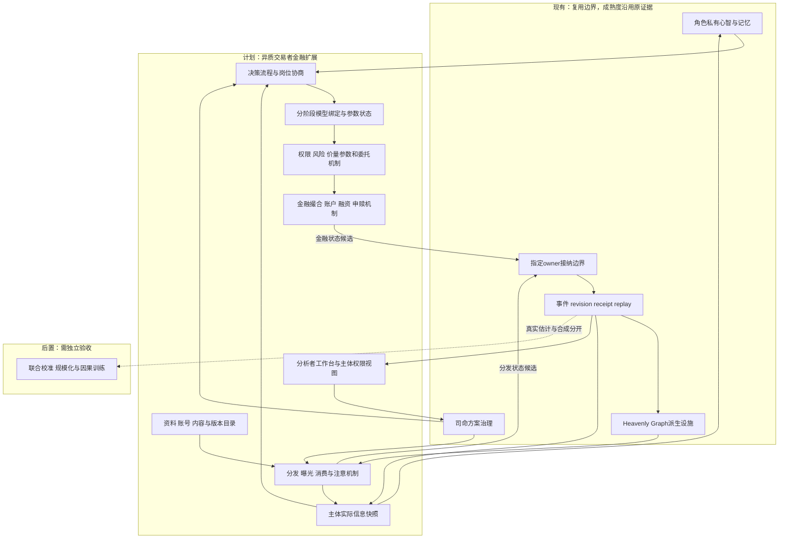
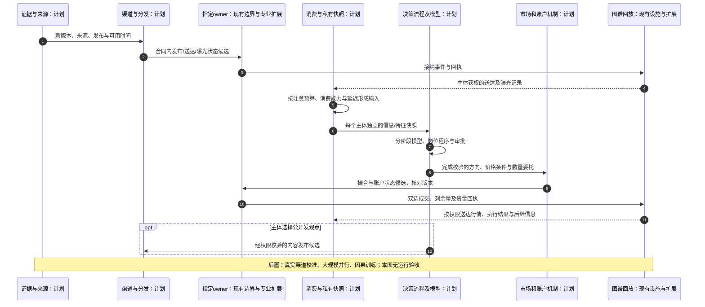
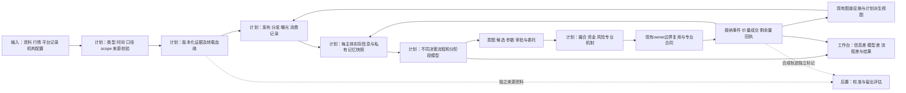

# 交易者异质信息与决策机制及金融模拟覆盖审查

日期：2026-10-13

状态：`analysis / design-draft / non-authorizing`

本文审查[整体方案04](04-通用模拟底座与行业场景适配整体设计方案.md)、[数据合同03](03-数据结构、金融数据类别与时间口径合同设计.md)及[光模块案例07](07-光模块概念行情兴起与腰斩资金撤离场景推演.md)。设计01—07保持不动。本文补充专业合同和验收要求，不授权运行时代码、真实交易或向真实平台发布内容。本次是设计文档审查，不是后端金融闭环的代码或运行验收。

## 1. 审查结论

通用底座的组合方向能够承载资金博弈、信息分发传播、多方参与者及异质交易者，不需要因为新增这些需求推翻身份、数据、时间、scope、图谱、模型插件及owner边界。现有设计却尚不足以宣称这些机制已经可以完整运行。

明确区分四级能力：可表达对象与状态；有可执行机制；机制已按对应市场和参与者校准；在指定预测目标上通过样本外验证。丰富画像、通用图谱、可插拔接口或已生成UI，只能支持前面部分的设计判断，不能替代后三项的证据。

具体结论：**可以建设具有明确范围、有限参与者覆盖、条件分支和专业机制的金融模拟闭环；不能承诺掌握所有真实交易者、私有信息、平台分发算法与未来决定，更不能由此保证预测某次行情顶部或腰斩。**

## 2. 逐项覆盖与缺口

| 用户要求 | 既有设计依据 | 必须补齐的合同或机制 | 本次裁决 |
|---|---|---|---|
| 不同渠道与不同信息集 | 03第6节渠道可用、点时读取、角色阅读；04第9.2节角色渠道与档案 | 订阅与检索、注意预算、曝光、实际消费和主体私有信息快照 | 有设计位置，未形成完整执行合同 |
| 股吧、雪球、财经新闻、研报、交易软件和自媒体传播 | 04第7节动态边、来源与scope；第9.4节传播机制 | 作者/账号/内容/发布/平台分发/曝光/阅读/转载分别建模 | 可适配；不能假定已接入真实平台 |
| 不同决策模型 | 04第9.2节路由、第11.1节模型机制插件 | 每主体或岗位的模型绑定、特征口径、阈值、参数状态和校准 | 接口方向具备；不能全体统一LLM或Laya |
| 不同决策流程 | 04第9.3节组织内部程序、权能、账户 | 从感知到分析、审批、参数生成、执行的任务图 | 需要与模型选择分开注册 |
| 多种资金方博弈 | 03账户与订单类别；04群体覆盖、金融owner；07资金口径 | 带约束的参与者行动、资源守恒、撮合、申赎和融资过程 | 可形成有界纵切；当前无金融运行验收 |
| 动态量价与买卖盘匹配 | 07第3节价量方向、剩余量及撮合 | 场所撮合、市场边界参与者、订单与账本一致性 | 设计示意已细化，未等于撮合器已实现 |
| 组织内外多层博弈 | 04第9.3—9.4节精度与覆盖 | 多岗位协商、否决、委托权限、同账户资源去重 | 兼容原owner，不能把组织当单一人格 |
| 多时钟、历史重演和实时修正 | 03第6节、04第6/8/16节 | 曝光到执行的时延、因果调度、检查点、迟到修订 | 设计支持；平台微秒级性能未验证 |
| 从历史中训练因果世界模型 | 04第16节真/估计/合成分离、泄漏与因果检验 | 独立观测、训练切分、行为识别及因果评估 | 可建设研究流水线，不保证识别真实机制 |

原[派生社会图谱计划](../../10月中旬分析/群体模拟升级/计划/既有中旬计划/02-派生社会图谱与因果传播实施计划.md)将传播查询限制为候选和调度，不写个人结果。金融适配不能只修改边权就声称角色已经读到、相信或下单；这些步骤需要独立机制接纳。原[群体与Laya计划](../../10月中旬分析/群体模拟升级/计划/既有中旬计划/03-群体模拟与Laya心智运行时协同实施计划.md)也仍是升级计划，引用不构成金融接线完成。

## 3. 信息渠道差异不能只是一列平台名称

每个主体至少分开六种状态：有权访问；当前可取得；被平台展示或通知送达；实际阅读/解析；形成解释或信念；形成并执行行动。有权限不代表订阅，订阅不代表曝光，曝光不代表阅读，阅读不代表相信，相信也不必交易。

信息合同增加接收、消费开始与完成、解释完成等阶段。03的`actor_received_at`用于定位获知过程，但正式合同不能以一个时间代替全部阶段。日期级或未知时刻保留精度与不确定区间，不强填精确先后。

以下为设计示意，非已实现schema：

```text
ActorInformationProfile {
  actor_ref, version, valid_interval, branch_ref
  channel_entitlements, subscriptions, followed_account_refs
  query_and_alert_rules, observation_ports, active_search_actions
  attention_budget, modality_capabilities, language_and_expertise
  reading_and_parsing_latency_model, freshness_requirements
  source_assessment_model_ref, memory_policy_ref, calibration_refs
}
InformationDelivery {
  content_revision_ref, channel_ref, publication_ref, delivery_ref
  actor_ref, branch_ref, access_basis, delivery_method
  channel_available_at, delivered_at, exposure_at
  consumption_started_at, consumption_completed_at
  interpretation_result_ref, interpretation_completed_at
  observation_or_simulation_provenance, temporal_precision, status
}
ActorInformationSnapshot {
  actor_ref, decision_time, profile_version, access_scope_ref
  consumed_content_revision_refs, parsed_feature_refs
  private_memory_revision_refs, interpretation_and_belief_refs
  pending_deliveries, unread_refs, unresolved_claims, input_digest
}
```

某次决策使用哪些资料由模型端口声明。例如价格策略消费已到达并处理的行情特征，不强制先像人阅读文本；研究员使用已阅读原文和专业推导；只看转述的主体不会自动拥有原文。可计算输入必须满足主体权限、截止时间和处理完成条件，不能因为后台已采集资料就广播给所有主体。

渠道订阅、主动搜索和关注账号也可以由角色行动改变：付出时间或费用查原文、关闭推送、向研究员询问，或者因经验改变来源判断。更新保留版本，不把今天的关注关系用于昨天。

## 4. 信息传播至少包含三种不同网络

1. **信息与内容网络**：原始资料、陈述、文档、引用、修订、转载和不同解释。一个传闻不是多个转发者各自观测到的独立经营事实。
2. **渠道与接触网络**：平台、作者账号、关注、订阅、群聊、推荐、回复与自选提醒；决定内容怎样接近主体。
3. **认知与行动依赖**：主体实际消费哪些内容、模型如何处理、哪些判断参与候选生成。私有认知不自动投影到公开社会图。

平台目录实例及对应专业机制：

| 渠道 | 需要表达的机制 | 不能直接推断 |
|---|---|---|
| 股吧 | 发帖、回复、引用、板块入口、可见性与展示顺序 | 所有持有人都看见或观点统一 |
| 雪球 | 作者发布、关注流、长文、讨论、引用和转载 | 关注某作者等于相信其判断 |
| 券商APP及研究渠道 | 服务权限、研报、提醒、内部共享与客户通知 | 同一券商所有客户具有相同资料和权限 |
| 第三方交易软件 | 行情端口、资讯端口、自选、条件提醒、数据延迟 | 行情、新闻、买卖发起分类都是同一事实来源 |
| 财联社及财经新闻/资讯软件 | 快讯、报道、专题、订阅推送、修改和转载 | 消息被报道就成为已确认经营事实 |
| 微博 | 发布、转发、话题、评论及展示机制 | 热度等于独立信息质量 |
| 抖音 | 视频上传、内容提取、观看、推荐、评论、分享 | 简短观看等于理解全部依据 |
| 微信公众号等 | 作者发布、订阅、相关阅读、转发和阅读延迟 | 同一文章经多个群转发等于多份独立证据 |

这些是适配机制类别，不声称真实平台一定按此具体算法运行或已经提供接入能力。平台私有分发和个人浏览记录缺失时采用显式的多种分发假设，例如关注流、按时序或有参数的推荐模型；记录校准依据及敏感性。

模拟中平台消息、接纳发布、曝光与阅读也有状态归属、版本和回执。真实平台的运营主体与模拟运行时的领域owner是不同对象。模拟作者发布到模拟渠道，不产生真实外部平台发帖副作用。

曝光具有相关性：同一用户跨平台、共同关注、同源转发和共同事件可导致重叠。分别保留多次曝光对认知的可能影响与证据来源的非独立性；不能把全部曝光次数相乘当作独立可信度。

## 5. 决策流程、模型和参数是不同轴

流程定义谁在什么条件、什么顺序、多久后做什么；模型定义输入如何变成估计、评分或选择；参数与模型内部状态定义该主体具体怎样运行。一个主体可组合多模型，不同主体可以复用同模型但有不同参数、状态和输入。

设计示意：

```text
DecisionProcessDefinition {
  process_ref, version, actor_or_role_binding, stage_graph
  stage_input_and_output_types, triggers, deadlines, latency_models
  approval_and_veto_rules, resource_and_access_bindings
  cancellation_and_revalidation_rules, process_owner_binding
}
DecisionModelBinding {
  stage_ref, model_ref, model_version, applicability
  feature_and_information_port_bindings, parameter_version
  private_model_state_ref, training_cutoff, update_method
  authorized_fallback_ref, calibration_refs, uncertainty_and_failure_rules
}
ActionAndExecutionBinding {
  process_stage_ref, registered_action_candidates
  action_selection_model_ref, sizing_and_price_model_refs
  capability_and_account_refs, execution_and_venue_rules
  pretrade_checks, expiry, owner_recipe_ref
}
```

| 主体示例 | 本轮信息来源和消费 | 决策流程 | 模型组合及输出 |
|---|---|---|---|
| 主动基金 | 公告、已获权研报、内部研究；社群消息未必阅读 | 研究→经理→风控→交易台 | 盈利/估值情景、组合风险、角色选择、执行参数模型；集中度过高时即使看多也可减仓 |
| 趋势策略 | 完整性合格的行情、成交量和盘口；本策略不配置文本输入 | 特征→信号→风险限额→委托 | 明确规则或时序模型＋风险和执行模型；缺行情时等待或按合同降级 |
| 融资账户 | 持仓报价、担保通知、可用现金；可能另读其他渠道 | 担保检查→筹资或减持→授权执行 | 融资合同状态机、现金可行性、角色选择；新闻不直接触发处置 |
| 个人投资群体 | 股吧、雪球、微博、抖音、公众号或原文；成员各有子集 | 曝光→阅读→来源判断/成本记忆→行动 | 异质群体分布、角色推理、规则或Laya候选选择；同一用户不被各渠道重复算成多人 |
| 长期买方 | 财报、公告、专业研究；新公告可能尚未核验 | 重估→安全边际→现金预算→限价计划 | 现金流/盈利情景和估值条件模型；长期看多可选择等待 |
| ETF/指数配置过程 | 成分、份额申赎、价格和规则资料 | 申赎→篮子与资金检查→交易过程 | 产品规则、配篮和执行机制；不强制依赖舆情模型 |

这些是配置实例，不是金融主体的天然分类定律。量化也可以用文本，个人也可以使用专业模型，机构也会关注社交媒体。场景或FDE必须指定真实依据或假设，不由主体名称自动推断。

Laya适用于已注册合法候选的快速动作/目标选择，不替代全部估值、时序、资金和报价模型。部分阶段可以完全不用LLM；慢推理可做证据解释、重规划或组织协商。所有模型包括训练来的世界模型都受输入scope、版本、效果和owner约束。

风控、经理与交易员同属一组织但有各自信息权限、记忆和程序位置。组织共享资料由授权过程形成，不能把私有记忆汇成共同脑。模型候选、批准交易、提交委托、撮合与交割分别记录。

## 5.1 情绪是可演化状态，不是交易方向标签

情绪进入模拟必须经过“刺激—解释—状态—倾向—行动”的链条。`sentiment=positive` 不能直接生成买单，`sentiment=negative` 也不能直接生成卖单。至少要区分：

1. **刺激**：价格跳变、盈亏变化、新闻、观点传播、他人行动、追保通知或组织事件；
2. **情绪状态**：兴奋、恐惧、焦虑、愤怒、后悔、从众压力、平静等连续值或离散状态；
3. **认知状态**：对未来收益、风险、消息可信度、拥挤度和可逆性的判断；
4. **资源与风险状态**：现金、持仓、杠杆、止损空间、期限、权限和可承受损失；
5. **行动倾向**：关注、转发、追买、等待、减仓、撤单、补仓或寻求核验；
6. **实际行动**：经流程、风险检查和 owner 接纳后的发布、委托或其他领域事件。

设计示意：

```text
EmotionState {
  actor_ref, state_ref, valid_time, observed_time, branch_ref
  arousal, valence, fear, greed, anxiety, regret, social_pressure
  confidence, attention_remaining, loss_aversion, imitation_tendency
  trigger_refs, decay_model_ref, baseline_ref, uncertainty
  source_snapshot_ref, mechanism_revision, replay_key
}

EmotionTransition {
  transition_ref, actor_or_cohort_ref, before_state_ref, after_state_ref
  stimulus_refs, exposure_ref, interpretation_ref, resource_context_ref
  latency, persistence, decay, contagion_weight, mechanism_ref
  candidate_tendency_refs, owner_ack_ref, replay_key
}
```

情绪机制每个 tick 至少计算：刺激强度、主体实际是否消费、基线情绪、状态惯性、衰减、社交传染、资源约束和行动阈值。情绪可以影响注意预算、来源选择、风险厌恶、订单拆分、撤单概率和持有期限，但必须经过主体的决策模型。群体层保存分布和多峰状态，例如“兴奋追涨”“恐惧卖出”“怀疑观望”同时存在；群体均值不能替代尾部和少数桥接节点。

情绪的可观测数据与推定数据必须分开：帖子中的情绪词、转发速度和成交行为是观测；“恐慌指数”“市场贪婪度”和个体情绪强度是模型估计，必须记录模型版本、校准区间和误差。缺少真实心理数据时，只能使用显式的情绪转移假设和敏感性分支，不能把模型估计写成主体自述。

## 5.2 量化资金是策略—组合—执行系统

量化资金不是一种单一性格，而是由资金载体、策略版本、数据端口、信号、组合构建、风险约束和执行器组成的可审计参与者。它可以是基金内部策略、券商自营、做市、指数/ETF、CTA、统计套利、高频策略或机构的自动化执行程序；名称不决定行为，绑定合同才决定行为。

设计示意：

```text
QuantStrategyParticipant {
  participant_ref, account_or_fund_ref, organization_ref
  strategy_ref, strategy_version, mandate_ref
  data_port_refs, feature_pipeline_ref, signal_model_ref
  portfolio_model_ref, risk_model_ref, execution_model_ref
  capital_state_ref, leverage_policy_ref, capacity_policy_ref
  rebalance_schedule, latency_profile, venue_scope
  training_cutoff, parameter_revision, owner_bindings
}

QuantSignal {
  signal_ref, participant_ref, instrument_or_universe_ref
  signal_time, availability_time, feature_snapshot_ref
  signal_family, direction_or_score, horizon, confidence
  decay_rule, missing_data_rule, model_revision, replay_key
}

QuantOrderIntent {
  intent_ref, participant_ref, signal_ref, portfolio_state_ref
  target_weight_or_exposure, side, quantity_range, price_rule
  urgency, participation_limit, turnover_budget, cost_budget
  risk_checks, expiry, execution_schedule, owner_recipe_ref
}
```

量化资金的运行链必须拆成：

```text
数据端口
  -> 特征与信号
  -> 组合目标/仓位变化
  -> 风险与容量检查
  -> 订单拆分和执行计划
  -> 市场owner撮合
  -> 成交、冲击、滑点和剩余订单
  -> 策略状态与下一次信号
```

量化策略可以只消费行情、成交量、盘口、因子和风险数据，也可以注册文本/舆情端口；没有绑定的端口不能偷偷读取新闻或角色结论。相同信号不意味着相同订单：资金规模、已有仓位、风险限额、交易成本、市场容量、执行延迟和组合相关性都会改变最终委托。

量化资金必须体现以下反馈：趋势策略会因价格路径触发加减仓；均值回归会因偏离和库存改变方向；指数/ETF 会因申赎和权重规则产生篮子交易；做市策略会因库存、价差和 adverse selection 调整报价；高频策略会因盘口和延迟改变参与率。它们都只能生成候选意图，不能绕过账户、风控、订单簿和结算 owner。

量化策略的回测数据、实时数据和未来信息必须分开。`training_cutoff`、特征可用时间、信号延迟、参数版本、交易成本、容量和停机条件必须写入回放；否则回测收益可能是未来信息泄漏或无限流动性的假象。

## 6. 资金博弈的可执行含义

资金博弈至少由五项组成：参与者的目标与信念；持仓、现金、融资、时间与权限约束；可行行动；相互影响和市场机制；行动后的收益、风险与状态反馈。情绪状态和量化策略是影响这五项的两类不同机制：情绪改变注意、信念、风险阈值和同步倾向；量化策略通过已注册数据、信号、组合、风险和执行模型生成可复算的订单意图。两者都不能跳过市场 owner。不能只写“看多/看空”，也不要求所有参与者做显式博弈均衡求解。

共同持仓导致卖出冲击外溢；买方等待条件价格影响卖方执行；赎回方的期限影响基金现金计划；担保方的合同程序影响融资持有人。这些都可使用现有实体、关系、多方安排、状态、过程和模型接口，但需要专业的响应与执行机制。

有界闭环至少包括：合法价量方向委托、有限买卖盘、同源报价去重、部分成交与剩余队列、账本与费用、资金和可卖数量、融资与申赎程序、投资期限和多时钟。代理本身的需求不是实际成交。对手方不足不能默默安排无限现金买方。

未显式模拟的参与者由有来源和约束的边界模型表示，记录其资金、库存、报价及对信息/价格的响应范围。封闭模型或开放边界各自核对守恒；小样本参与者不能假装覆盖全市场。程序上可运行不等于该边界模型经济上可信。

不把所有决策交给世界模型或司命，也不为叙事戏剧性强制交易。游戏中的叙事压力、随机戏剧催化和角色活化，若进入金融预测要重新声明用途与依据；不能为了出现腰斩而安排一致卖出。精度调度可关注流动性、阈值附近群体和关键组织，不能改变经济规则。

## 7. 相同消息，不同路径的有界推演

全部为假设。D66的09:10发布一份“交付顺延”说明，未宣称订单取消。事件如下：

| 主体 | 实际消费状态 | 模型/流程及可能结果 |
|---|---|---|
| F01基金 | 09:12收到快讯，09:25完成原文与研究对照 | 盈利时点模型重估；经理与风控讨论；未批准前不生成成功委托 |
| R02子群一 | 09:20只阅读股吧或视频转述，“顺延”被解释为“需求恶化” | 自身来源判断和成本状态形成卖出候选；原文仍不在其实际信息集 |
| R02子群二 | 已阅读原文，或选择核验；与子群一共享主题但并非共享信念 | 可观望、持有、转发质疑或形成条件买卖 |
| Q01趋势策略 | 本轮不消费新闻；09:21后处理行情与量价特征 | 只有其他人的行动真正影响行情后才可能触发信号；不让模型偷偷读取消息结论 |
| L01融资账户 | 从券商渠道收到担保相关通知 | 报价和抵押品经接纳估值满足合同条件后，才进入补担保/减仓程序 |
| V01长期买方 | 新公告还未核验，先使用已消费资料或主动请求信息 | 等待、核验或重新估值；价格达到条件且现金允许才形成买单 |

09:20转述不是必须早于机构阅读的市场定律，只是本场景的模拟延迟。改变渠道、注意或处理模型时，角色完成时间会变化。交易者可以基于过去信号主动行动，未必等待本次新闻。

上述选择形成的合法委托进入X01，同一撮合生成成交价量和剩余量，再反馈到账户、记忆及公共行情。R02发帖或转发可能继续传播，但其实际持仓、成本和私有计划不会因为公开观点自动暴露。

## 8. 架构、时序与数据流

### 8.1 架构图



司命到机制的连接表示接纳的方案配置和治理任务，不表示司命直接写主体选择、平台真实分发或成交价格。私有快照和公开图谱不合并；分析者可审查的合成内部状态也不能泄漏到其他参与者输入。

### 8.2 主交互时序图



### 8.3 数据流图



## 9. 能不能模拟真实市场：数据与识别限制

公开资料通常不能还原所有人的真实浏览记录、资金、信念、交易计划或组织内争论。平台曝光、个人信任和多个模型参数的组合可能产生相似价格与成交量。拟合一条行情并不能识别唯一真实解释。

使用观测、区间估计和多初值；未知来源明确标记。缺平台曝光日志时可模拟关注和推荐假设，缺持仓时可用持仓分布或可见披露估计，不能冒充真实微观记录。强制处置等非线性机制需要保留成本、杠杆、现金与渠道接触的联合分布，不能只用平均账户。

真实分发模型、价格策略和群体行为分别校准，随后评估联合闭环；不由模拟输出自证其机制正确。历史测试还要控制模型预训练未来知识、事后生成画像、修订、成分选择、调参和转载重复计证。

## 10. 验收与最小交付范围

首个纵切建议：一个证券场所、小篮子证券、六类参与者、两类组织程序、若干代表性信息渠道、有限撮合及一种融资或申赎机制。其目的验证闭环与合同，不把少数合成代理称为全市场真实人口。

必须能审查以下结果：

1. 限定渠道访问或改变阅读延迟，受影响主体的输入改变，未获权或未消费主体不获得内容。
2. 固定渠道与输入，切换决策模型/参数可产生不同候选；固定模型而切换流程时，审批、延迟与执行可能不同。
3. 文本缺失的量价策略不偷偷消费新闻；专业数值模型在数据缺口时按显式合同等待或降级，不能让LLM臆造数值。
4. 同源转发保留血缘，曝光重复可影响注意但不自动成为独立事实证据。
5. 角色、账号、组织、群体和多平台视图不重复资金、成员或订单贡献；精度交接核对状态和未完成动作。
6. 公开帖子不暴露未获权持仓、记忆或模型状态；分析者所见不等于市场主体所知。
7. 同一撮合器生成价格与成交量，双方数量相等、市场量只计一次，剩余队列与账户守恒，不能二次写价。
8. 预设情景可出现不传播、只原文传播、多观点传播、买方恢复等对照；不同路径不能被奖励函数强制汇成腰斩。
9. 干预渠道、曝光、可信度、模型、资金约束和流程时固定其他外生输入；异步模型使用稳定分对象随机输入，记录内生路径差异。
10. 回放保存来源版本、主体输入、模型参数/状态、处理时间、流程回执、委托和成交。迟到信息不能改写旧决策。
11. 用留出事件和市场阶段比较仅价格/量价基线、含信息传播、含异质模型与组织机制的增量；预测改善与真实因果识别分别报告。
12. 当前缺机制、校准或数据时输出具体缺口；不将草案、生成图片或文档检查通过写成金融能力已验收。

## 11. UI如何体现差异

新增[区域G：交易者信息与决策差异](assets/光模块画布分区/区域G-交易者信息与决策差异.png)作为设计概念：每一主体展开“渠道权限/实际消费→决策流程→模型绑定→行动候选→市场撮合”。与[区域E资金博弈](assets/光模块画布分区/区域E-二级市场资金方博弈.png)、[区域F信息传播](assets/光模块画布分区/区域F-信息分发与观点传播.png)共享主体身份。

同类交易者也能进一步展开渠道、成本、杠杆、阈值与记忆分布。模型名、阶段、权限和时间是实际装配合同的视图；画布连线本身不创建隐式计算机制。当前这些图片均非可运行界面。

通用底座只需规定接纳上述信息、流程、模型、效果与版本合同，不把券商、基金或平台名称写成内核不可扩展枚举。同样的合同可用于工业监控、商业客户渠道、组织审批与设备控制；各行业的机制与校准仍由专业包承担。
