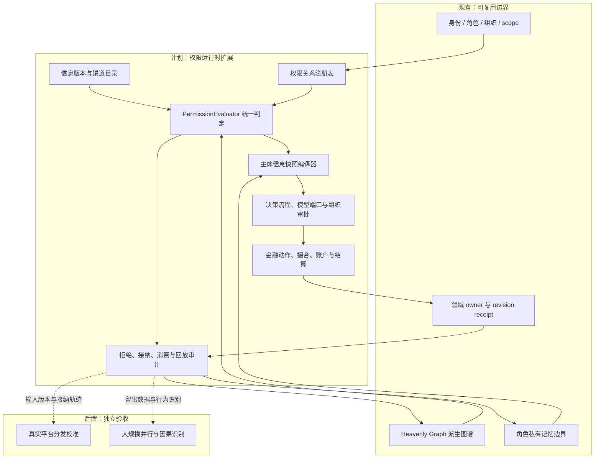
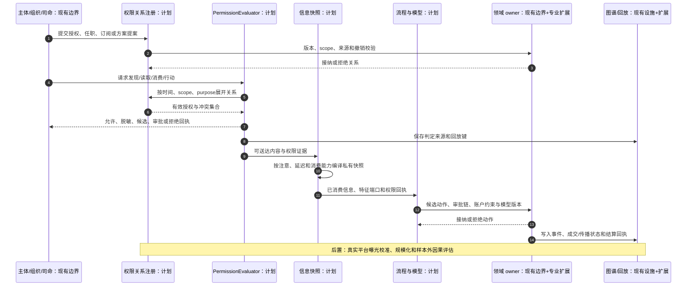

# 权限关系与运行时信息接纳合同设计

日期：2026-10-13

状态：`analysis / design-draft / non-authorizing`

本文只定义模拟预测底座的设计合同，不修改游戏主线，也不授权后端实现、真实平台读取、真实交易或自动发布。本文承接[数据结构合同03](03-数据结构、金融数据类别与时间口径合同设计.md)、[整体方案04](04-通用模拟底座与行业场景适配整体设计方案.md)和[交易者异质信息审查08](08-交易者异质信息与决策机制及金融模拟覆盖审查.md)，解决“谁可以在什么时间、以什么目的、通过什么关系，读取或改变什么”的可执行表达问题。

## 1. 目标与边界

权限不是实体的一个布尔属性，也不是图谱上一个没有时间的“可见”边。一次运行时访问必须同时回答：

1. **主体是谁**：个人、角色、岗位、组织、群体代表、司命、FDE、系统服务或领域 owner。
2. **资源是什么**：事实、公告、研报、盘口、订单、账户、持仓、记忆、模型参数、组织文件或派生图谱视图。
3. **要做什么**：发现、读取、解释、转发、发布、提出候选、审批、提交委托、撮合、结算、修改或撤销。
4. **在哪个范围**：世界、分支、场景、市场、组织、账户、主体私有空间、数据集或平台渠道。
5. **什么时候有效**：模拟时间、有效时间、交易时间、公布时间、送达时间和规则版本时间。
6. **为什么做**：研究、风险检查、交易执行、合规审计、司命编排、训练评估或人类工作台观察。
7. **结果如何被接纳**：允许、拒绝、脱敏允许、只允许候选、需要审批、延迟送达或允许但不可写事实。

目标是让同一套底层结构可用于金融、工业和商业。证券、券商、研报和国家政策都属于可注册的专业资源类型；内核只固定关系语义和判定边界。

## 2. 权限关系的最小完备结构

以下是设计示意，不是当前已实现的 Python schema。权限关系是独立的事实对象，可以作为图谱关系的来源，也可以存入关系表、事件流或策略索引；三者必须通过同一 `permission_ref` 和 revision 对齐。

```text
PermissionRelation {
  permission_ref, revision, relation_type
  subject_ref, subject_kind, acting_as_ref
  resource_ref, resource_kind, resource_revision
  action, effect
  scope_ref, scope_kind, branch_ref, market_ref, organization_ref
  purpose, obligations, redaction_profile_ref
  valid_time, transaction_time, decision_cutoff
  provenance_ref, granting_owner_ref, policy_basis_refs
  delegation_ref, parent_permission_ref
  priority, conflict_class, status
}
```

其中：

- `relation_type` 表示关系来源，例如 `direct_grant`、`role_membership`、`organization_delegation`、`channel_subscription`、`public_disclosure`、`owner_admission`、`simulation_assumption`。
- `effect` 不是只有 allow/deny，还包括 `allow_metadata`、`allow_redacted`、`allow_candidate_only`、`require_approval`、`delay_until` 和 `deny`。
- `acting_as_ref` 防止“某人作为研究员”自动获得“该人的基金经理”权限；身份、任职和代表组织行动必须分别解析。
- `scope_ref` 与 `resource_ref` 必须同时判定。某主体在 A 分支有权限，不得因此读取 B 分支；观察者有工作台权限，也不等于市场角色有相同权限。
- `valid_time` 决定模拟中的生效区间，`transaction_time` 保留系统何时接纳或撤销它。历史回放使用当时生效的关系，不能用今天补录的权限回写昨天。
- `purpose` 和 `obligations` 允许“可以读取但不得转发”“可以审计但不得改变世界事实”等约束。

### 2.1 关系类型与典型含义

| 关系类型 | 例子 | 可以授予 | 不自动授予 |
|---|---|---|---|
| 直接授权 | 组织把一份研报授予 F01 研究员 | 指定资源的发现/读取 | 经理、交易账户或其他成员的权限 |
| 任职继承 | 研究员在任职区间内读取内部研究 | 岗位合同声明的动作 | 任职前后或其他组织的资料 |
| 组织委托 | 经理授权交易员代表组合提交委托 | 指定市场和账户的候选或提交动作 | 读取经理私有记忆或修改组合真相 |
| 渠道订阅 | R02 关注雪球作者或券商快讯 | 接收和曝光候选 | 已读、相信或交易 |
| 公开披露 | 已公开公告进入公共市场资料 | 在公布点之后发现/读取 | 公布前内部版本 |
| owner 接纳 | 市场 owner 接纳一笔合法委托 | 后续撮合处理 | 直接改变价格或账户余额 |
| 模拟假设 | 场景设定给某类群体一个延迟分发模型 | 受标记的合成输入 | 伪装成真实平台记录 |
| 司命观察 | 司命读取汇总诊断或安排任务 | 方案治理和观测 | 代替主体选择或写入私人信念 |

### 2.2 “读取”必须拆成多个动作

金融场景中，访问至少分为以下动作：

`discover → request → deliver → expose → consume → interpret → cite → share → act`。

司命或后台采集器可能 `discover` 一份公告，但交易者没有 `deliver`；交易者收到推送但尚未 `consume`；交易者读了原文但没有 `interpret` 为可用特征。只有满足模型声明的输入端口和截止时间，信息才可进入决策快照。`share` 还要重新做发布权限判定，不能因已读取而自动获得转载权限。

## 3. 判定算法与冲突规则

运行时不能让各模块自行猜权限。所有读取、候选生成和状态写入先调用统一的 `PermissionEvaluator`。以下伪代码是设计契约：

```text
evaluate(request, point_in_time, purpose, branch, policy_revision)
  1. 校验主体、acting_as、资源版本、动作和 scope 均已注册
  2. 取 point_in_time 前已接纳且未撤销的关系
  3. 展开有限深度的任职、组织委托、渠道订阅和公共披露继承
  4. 校验 branch / market / organization / private-owner scope 完全匹配
  5. 校验 purpose、数据分类、模型端口和必要义务
  6. 合并直接授权、继承授权、显式拒绝与 owner 限制
  7. 按 conflict_class 和 priority 决定冲突：
       explicit_deny > owner_boundary > legal_restriction > direct_grant
       > role_grant > public_or_simulation_default
  8. 返回 decision、effective_actions、obligations、reason_codes、
     matched_permission_refs、policy_revision 和 receipt_requirement
```

安全边界如下：

- 默认拒绝；缺少 scope、时间、资源版本或目的时不能降级为允许。
- 显式拒绝只在其声明的 scope 和有效期内生效，不能无界封锁整个世界。
- 组织成员资格不等于组织全部数据权限；岗位授权只能继承声明过的资源类型和动作。
- `allow_candidate_only` 只能生成候选，不能提交委托或写入账户。
- `allow_redacted` 必须把脱敏规则和版本放入回执，调用方不能自行还原。
- 权限判定失败是结构化的 `PermissionDenied`，不得静默返回空资料，因为空资料会被误解为“世界中没有该事实”。
- 运行时随机或群体抽样不能改变硬权限；随机性只影响已授权关系下的曝光、注意和反应。

## 4. 组织、岗位与司命的权限边界

组织不是单一智能体。组织由组织实体、岗位、任职、委托链、共享空间、账户和审批过程共同组成。

### 4.1 组织内的最小权限链

```text
组织 O01
  ├─ 任职：研究员 R01 ──读取→ 内部研报 P01
  ├─ 任职：经理 M01 ────读取→ 研究结论与组合状态
  ├─ 任职：风控 K01 ────读取→ 风险特征与委托候选
  └─ 委托：经理 M01 ────提交→ 账户 A01 / 市场 X01
```

研究员的原文阅读不会自动出现在个人投资者或交易员的私有记忆里；经理共享的是经过组织过程接纳的研究结论版本。交易员只能使用被委托的账户和交易参数范围。风控可以拒绝候选，但不能凭风控读取权限直接修改经理的信念。

### 4.2 司命权限

司命拥有的是**方案治理权限**：注册场景、绑定资料、安排角色、选择群体精度、设置观察目标、申请可审计的汇总视图、暂停分支和要求重新评估。司命不因拥有方案治理权限而自动拥有：

- 角色的私有记忆、未授权持仓或未公开模型状态；
- 平台主体没有消费过的资料；
- 组织岗位未委托的账户写权限；
- 市场 owner 才能接纳的成交价格、账户余额或世界事实。

司命提出的修改产生 `SimulationProposal`，由相应领域 owner 接纳后才生效。人类工作台也走同一提案路径，避免工作台观察权限成为隐形写权限。

## 5. 运行时合同

### 5.1 权限判定请求与回执

```text
PermissionRequest {
  request_ref, actor_ref, acting_as_ref
  resource_ref, resource_revision, action
  branch_ref, scope_ref, simulation_time
  purpose, model_port_ref, requested_fields
}

PermissionDecision {
  request_ref, decision_ref, decision
  granted_fields, redaction_profile_ref
  obligations, effective_until
  reason_codes, matched_permission_refs
  policy_revision, evaluated_at
}

PermissionReceipt {
  receipt_ref, decision_ref, actor_ref, resource_ref
  delivered_at, exposed_at, consumed_at, interpreted_at
  input_digest, content_revision, branch_ref
  owner_ref, replay_key, status
}
```

`PermissionDecision` 只说明“可以做什么”，不代表主体已经完成动作。只有 owner 接纳 `PermissionReceipt` 后，才能把送达、消费、解释和后续行动写入对应状态。

### 5.2 交易者实际信息快照

08 中的 `ActorInformationSnapshot` 需要增加权限证据：

```text
ActorInformationSnapshot {
  actor_ref, decision_time, branch_ref, profile_version
  consumed_content_revision_refs
  parsed_feature_refs, private_memory_revision_refs
  permission_decision_refs, receipt_refs
  pending_deliveries, unread_refs, unresolved_claims
  inaccessible_refs, redacted_refs
  input_digest, snapshot_revision
}
```

模型只能读取快照中已满足 `consume` 条件的资料。审计者可以看到 `inaccessible_refs` 的数量和拒绝原因，但不能因审计视图而把被拒资料放入交易者输入。

### 5.3 写入与 owner 接纳

所有会影响世界状态的动作分为三步：

1. **提案**：角色、组织、司命或模型产生候选动作，带上主体快照、权限决定、模型版本和账户约束。
2. **接纳**：领域 owner 校验权限、版本、幂等键、资源守恒、组织审批和市场规则。
3. **结算**：owner 写入事件、账本、成交、传播状态或私有记忆，并生成回放回执。

金融例子：交易员可以有 `submit_order` 权限，但订单仍须经过账户可用现金、可卖数量、价格口径、市场时间和风控规则。撮合器接纳成交后，成交双方、价格、数量、剩余量和账户变化由同一 owner 事件写入，不能由角色或司命直接写价。

## 6. 金融传播与交易的权限链示例

假设 E01 是“交付顺延”公告，P01 是内部研报，K01 是社群转述：

| 主体 | 可见/可用资料 | 权限判定后的运行时结果 |
|---|---|---|
| F01 主动基金 | E01 公开版本、P01 获权版本、内部研究结论 | 研究员可读原文；经理可读组织接纳结论；风控可读候选及风险字段；交易员只得授权账户参数 |
| Q01 趋势策略 | H01 行情、盘口、成交量 | 只有行情端口进入模型；没有文本端口时，E01 不得通过 LLM 偷渡进信号 |
| R02 个人群体 | 个人订阅的股吧、雪球、微博、抖音或公众号片段 | 每个子群收到不同版本和延迟；收到不等于解释，更不等于拥有他人持仓 |
| L01 融资账户 | 券商担保通知、账户状态和市场报价 | 合同状态机可以基于接纳的抵押品状态触发程序；不要求把内部通知公开传播 |
| V01 长期买方 | 历史财报、公开公告、专业研究 | 新公告在完成核验前保留 `pending`，估值模型不能读取未来修订 |
| 司命/工作台 | 经批准的汇总、分支对照、拒绝统计和回放 | 可调整方案并提交提案；不能把观察视图写回角色私有信息 |

同一内容的公开版本、券商版本和组织内部版本应是不同 `resource_revision`。转发链保留来源和权限，不因“多次转载”升级为更高权限，也不把同源转载计作多份独立证据。

## 7. 兼容图谱、数据湖和模型

权限关系与三类基础设施的连接方式不同：

- **图谱**保存主体、资源、关系、授权来源和派生可见性边；边必须带 `permission_ref`、时间、scope、来源和状态。图谱查询只产生候选，不直接把私有事实广播给角色。
- **数据湖/时序存储**保存行情、研报版本、交付回执、曝光和消费流水；每条记录带资源分类、时间精度、版本和权限索引。批量计算先按主体生成授权视图，再送入模型。
- **模型运行时**声明信息端口和目的，例如 `price_signal` 只接受已完成时间截点的行情特征，`valuation_review` 允许公告和获权研报，`role_choice` 只能使用该主体快照和注册候选。模型不能自行扩大输入集合。

这使“数据结构保存信息、领域语义解释含义、演化机制计算变化”落成闭环：权限关系定义可达边界，领域 owner 定义可执行动作，演化机制在时间推进中生成送达、消费、决策和结算事件。 :codex-annotation{index="2"}

## 8. 架构、时序与数据流

### 8.1 架构图



### 8.2 主交互时序图



### 8.3 数据流图


## 9. 可运行验收标准

本文设计进入实现阶段后，至少需要以下可观察验收；当前文档不声称它们已经通过：

1. F01 研究员能读取获权 P01；R02、Q01 和工作台之外的角色收到结构化拒绝，拒绝原因包含资源、scope 或目的差异。
2. 研究员离职或授权到期后，同一历史时间点的回放仍按旧权限，新的决策时间点不能继续读取。
3. 经理对交易员的委托只覆盖 A01 和声明的市场/数量范围；交易员不能用委托读取经理私有记忆。
4. `allow_candidate_only` 可以生成候选但不能提交订单；风控拒绝后不会产生成交或账户变更。
5. 司命可看到汇总诊断、拒绝统计和分支比较，但不能把观察视图直接写入任何主体的私有快照。
6. Q01 没有文本模型端口时，后台存在 E01 也不能进入 Q01 的输入摘要。
7. R02 的股吧转述、雪球长文和抖音视频保存来源血缘与版本；同源转载不升级证据等级。
8. 脱敏允许返回字段清单、脱敏版本和义务；调用方不能从权限回执中恢复被隐藏字段。
9. 权限拒绝、送达、消费、委托、成交和结算都可按 `replay_key` 重放，并能显示使用的关系版本。
10. 任何跨 branch、market、organization 或 private-owner scope 的资源访问默认拒绝，除非存在明确的跨域委托关系。
11. 改变权限关系时，固定资料、模型和外部随机种子，只有受影响主体的可用信息和后续行动改变。
12. 权限运行时可以替换金融专业包；工业或商业扩展只需注册新的资源分类、动作和 owner 规则，不修改 `PermissionEvaluator` 的核心判定语义。

## 10. 实现顺序建议

首个运行纵切应只选择一个模拟分支、一个证券市场和六类主体：F01、Q01、L01、R02、V01 与司命工作台。先实现关系注册、时间/scope 判定、结构化拒绝、主体快照和候选动作接纳，再接入有限撮合与账本。组织多级委托、群体身份去重、平台分发校准和大规模回放随后逐步加入。

这样做的原因是：权限错误会直接污染信息集、决策轨迹和因果评估。先证明“谁看到了什么、谁没有看到什么、谁能做什么”可回放，再扩展模型复杂度和参与者数量。

