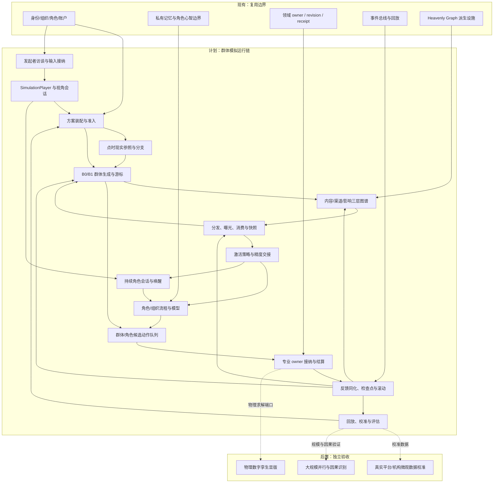
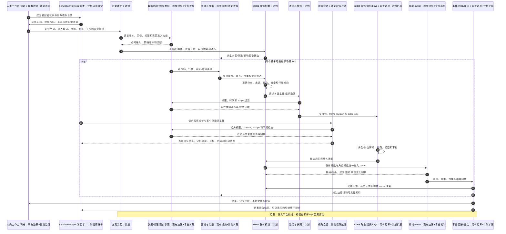
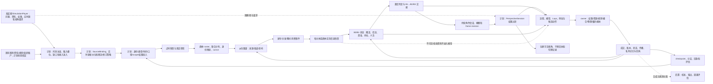

# 全流程群体模拟运行设计

日期：2026-10-14

状态：`analysis / design-draft / non-authorizing`

本文描述模拟预测底座如何从模拟发起者访谈开始，接入资料和实时更新，运行一次完整的群体模拟，并让发起者以玩家身份观察和参与。本文只修改 fork 设计文档，不授权当前后端、Laya、金融撮合或真实平台接入已经完成。文中的“现有”表示可以复用的身份、owner、事件、图谱、记忆和回放边界；“计划”表示需要为模拟 fork 实现的合同；“后置”表示必须单独校准或验收的能力。

本文承接[整体方案04](04-通用模拟底座与行业场景适配整体设计方案.md)、[异质交易者审查08](08-交易者异质信息与决策机制及金融模拟覆盖审查.md)、[权限合同09](09-权限关系与运行时信息接纳合同设计.md)和[组织与动态群体一等结构设计](12-组织与动态群体一等结构设计.md)。文档12冻结组织与动态群体的并列社会结构、成员资格、群体 episode、资源去重和精度交接合同；本文只描述如何把这些合同编排进一次全流程运行。金融示例使用 F01 主动基金、Q01 趋势资金、L01 融资账户、R02 个人投资群体、V01 长期买方和 X01 市场 owner；这些只是装配实例，不是底层固定枚举。

## 1. 先定义“群体模拟”是什么

群体模拟不是批量生成几百个相似人物，也不是把群体平均成一个代表人。一次完整模拟同时维护三种精度：

| 精度 | 负责什么 | 典型对象 | 输出 |
|---|---|---|---|
| B0 聚合层 | 覆盖全体、资源分布、传播压力和总体响应 | 个人投资者子群、市场流动性池、矿工班组 | 分布、流量、概率、候选事件 |
| B1 群体机制层 | 子群内部规则、接触网络和异质参数 | 趋势子群、融资账户群、区域居民群 | 分组行动、曝光、信念更新、资源变化 |
| B2 角色层 | 关键主体的私有信息、记忆、流程和模型 | 基金经理、研究员、关键政策执行人 | 角色候选、组织协商和行动意图 |
| B3 深度组织/角色层 | 需要解释和干预的关键组织、岗位或事件 | 基金投委会、监管部门、矿山调度中心 | 审批、否决、委托、可审计决策路径 |

B0/B1 保证覆盖，B2/B3 保证解释和局部高保真。这里的“群体化”不是把一大群人永久压成一个平均人，也不是把群体当成拥有单一意志的组织。底层仍保留主体或匿名主体单元的身份映射、资源守恒、关键状态分布和必要的记忆摘要；群体只是针对某个时间窗、行为维度和计算目的建立的临时投影。

同一批人可以在不同维度被划入不同群体：他们可能在“是否相信交付顺延”上相近，在“是否卖出”上分裂，在“信息渠道”上属于不同子群，在“融资压力”上又与另一批人形成共同体。群体内部允许乌合、跟随、反对、观望、少数派带动多数、局部同步、脱离和再聚合。只有在声明的时间窗内、针对声明的行为维度，行为相近的部分才可以合并计算；合并不改变成员的独立身份、资产、权限和潜在差异。

一个人可以先由 B1 代表，达到激活条件后转为 B2 角色；转化必须保存原有身份、资金、记忆摘要、未完成义务和群体 cursor，不能复制出第二份资产或第二个同一人。群体拆分、合并和成员迁移同样必须保存前后游标、分配权重、原因和守恒回执。

### 1.1 动态群体化的四个对象

| 对象 | 含义 | 是否拥有独立世界事实写权限 |
|---|---|---|
| `PopulationUnit` | 真实或合成的个体、账户、组织岗位或匿名主体单元；保存资源、权限、参数和状态分布 | 否，仍需领域 owner |
| `CohortProjection` | 某时间窗、范围、行为维度上的临时群体投影；可以是一组成员，也可以是加权统计单元 | 否 |
| `CohortEpisode` | 群体从形成、同步、分裂到消散的一段有版本的历史片段 | 否 |
| `ActivatedActor` | 从群体中展开的关键个体、组织或代表性子群；保留与原群体的连续性 | 否，仍需角色流程和 owner |

群体投影不是主体本身。它必须带有 `projection_purpose`（例如传播、情绪、订单到达、融资压力或资源消耗）、`time_window`、`feature_slice`、`membership_rule`、`weighting_rule` 和 `uncertainty`。如果同一个人同时属于多个投影，资源和订单不能因此重复计算；只允许在明确的事件归属或分摊规则下进入一次 owner 结算。

### 1.2 什么时候可以暂时“一体化”计算

只有同时满足以下条件，才允许把一批主体在某个行为维度上合并为一个临时计算单元：

1. **行为相似**：目标动作、触发条件、可用资源区间和反应延迟在声明容差内相近；
2. **信息相似**：实际消费过的内容版本、渠道延迟和来源判断处于声明范围；
3. **约束相似**：权限、账户类型、杠杆/库存/预算和法律或组织限制没有跨越关键分界；
4. **网络相似**：接触关系和影响来源可以由同一组统计特征近似；
5. **时间有效**：只在当前 tick 或登记的短时窗口有效，窗口结束后必须重新评估；
6. **误差可审计**：合并带来的动作、资源和结果误差有上限，并保存被合并成员的分布摘要。

不满足条件时，系统必须拆分群体、保留混合分布，或激活部分主体，而不是强行平均。合并的含义是减少同一机制的重复计算，不是宣称这些主体拥有同一心理、同一记忆或同一决策。

### 1.3 群体内的“乌合之众”机制

每个 `CohortProjection` 至少保留以下状态，而不能只保存一个平均值：

- 多峰信念或观点分布：看多、看空、观望、未消费信息等；
- 跟随、反跟随、独立判断和沉默的比例；
- 渠道暴露、阅读延迟、来源信任和注意预算的分布；
- 资金、持仓、杠杆、期限、风险阈值和可用流动性的分布；
- 关键少数、桥接节点、孤立节点和局部网络密度；
- 已同步、正在分裂、已脱离和待重新聚合的成员权重。

群体机制每个 tick 可以产生四类变化：`form`（形成临时群体）、`synchronize`（某一行为维度短时同步）、`split`（观点或约束差异扩大而分裂）、`dissolve`（共同触发条件消失而解散）。这些变化先写入群体事件和候选动作，不能直接写入个人信念、账户或成交。

## 2. 一次模拟的完整生命周期

完整运行分为十六个阶段（阶段 0 至阶段 15）。阶段 0 是模拟启动前的发起者访谈和输入接入；阶段不是必须对应十六个微服务，但每个阶段必须有输入、输出、owner、版本和回执。

### 阶段 0：司命访谈发起者、接入输入并形成模拟启动包

司命不能直接假定场景、参与者或数据。它先以结构化对话向模拟发起者提问，确认“要模拟什么、发起者能提供什么、哪些信息允许进入哪一类主体的输入”。发起者在这里登记为 `SimulationPlayer`：可以是游戏模拟底座中的玩家，也可以是机构团队的代表；玩家身份不等于市场中的某个交易角色，除非发起者明确装配自己的模拟组合或岗位。

司命至少要问清以下输入槽位：

1. **身份和目的**：发起者、所属组织、模拟目的、要支持的决策、不希望回答的问题。
2. **对象和范围**：市场/行业、标的或设备、法域、空间范围、起止时间、历史重建/实时滚动/反事实模式。
3. **发起者掌握的资料**：文件、表格、接口、内部记录、假设、事件线索、已知未知项及其时间和口径。
4. **数据使用许可**：哪些资料可作为公共资料、组织资料、发起者私有资料、仅司命诊断资料或禁止进入模拟的资料。
5. **实时源要求**：新闻、行情、研报、ERP、传感器、舆情或模拟方自有流的来源、刷新频率、延迟、修订规则、断流处理和停止条件。
6. **参与者要求**：必须出现的组织、群体和关键角色，哪些角色要持续激活，哪些只需 B0/B1 聚合，哪些主体必须保持不可见。
7. **观察与干预**：发起者要观察的指标、允许提出的干预、是否拥有自己的模拟账户、可切换的视角范围和审计要求。

司命把回答转换为带来源和状态的输入项，而不是把自然语言直接当成事实：

```text
SimulationInitiation {
  initiation_ref, player_ref, organization_ref, conversation_revision
  objective_refs, scope_refs, requested_participants
  supplied_input_refs, realtime_source_refs, assumption_refs
  permission_intents, perspective_policy, intervention_policy
  missing_required_slots, unresolved_questions, consent_receipts
  readiness, degraded_mode, intake_revision
}
```

每个输入项必须标记为 `observed`、`provided`、`assumed`、`requested`、`derived` 或 `forbidden`，并记录时间、统计口径、空间/适用域、来源、权限和版本。司命随后完成三项检查：资料是否能接入、权限是否能表达、缺失是否会改变结论。必填项未满足时只能停在 `intake_blocked`，或由发起者明确选择带缺口的 `degraded` 模式，不能静默补全。

在启动包中，司命为每个实时源创建 `SourceBinding`，记录接入适配器、来源身份、可提供字段、更新 tick、延迟、修订/撤回策略、断流状态和 owner。模拟方后续补充的文件、事件、盘口或资讯，沿同一接纳合同进入新观测队列；它们不会绕过点时快照、权限判定或历史回放边界。

司命或人类工作台先声明要回答的问题，而不是先生成角色。例如：

- 交付顺延消息如何经不同渠道传播，是否会导致光模块资金拥挤和流动性下降？
- 政策变化下，哪些投资者先调整仓位，哪些投资者因权限、延迟或风控继续等待？
- 某矿山事故发生后，调度、供应链、监管和舆情如何共同影响产量恢复？

目标必须声明预测变量、时间范围、观察粒度、可干预参数、评价指标和不回答的问题。司命拥有方案治理权限，不直接指定“必须上涨”“必须腰斩”或某一角色必须卖出。只有 `SimulationInitiation.readiness = ready` 或玩家明确接受降级模式后，才进入阶段 1。

### 阶段 1：装配场景、范围和权限

载入专业包、机构配置、场景假设、市场/空间/法域范围、数据源、规则版本、模型版本和权限关系。生成 `SimulationPlan`：

```text
SimulationPlan {
  simulation_ref, scenario_ref, branch_ref, seed
  initiation_ref, player_ref, player_role_ref
  objective_refs, scope_refs, market_or_domain_refs
  resource_catalog_revision, graph_revision, policy_revision
  time_origin, end_condition, tick_schedule
  population_precision_policy, activation_policy
  source_bindings, intake_revision, perspective_policy
  model_bindings, owner_bindings, intervention_points
  prohibited_inputs, evaluation_protocol
}
```

装配器先做准入检查：资源身份是否唯一、时间口径是否兼容、权限关系是否足够、每个状态是否只有一个推进 owner、模型端口是否有输入、组织账户是否可核算、空间/市场范围是否完整。失败时产生诊断，不偷偷填补缺失。

### 阶段 2：冻结点时输入与现实参照

按历史重建、实时滚动或反事实分支选择点时模式。先筛选在决策时可获得的资料，再生成 `ReferenceState`：

- 公开资料、内部资料和私有资料分开；
- 发布、渠道可用、平台接收、主体获知和主体消费分别记录；
- 最新修订资料不得进入历史决策输入；
- 外生行情、宏观变量或物理环境声明由外部驱动还是由模拟内生生成；
- 所有数据、模型、参数、规则和权限版本固定到分支快照。

现实参照是校准和对照，不是模拟者可以直接读取的“全知世界”。

### 阶段 3：生成主体、组织和群体

从已注册的人、组织、账户、岗位、平台账号、工具和资源生成主体 roster。群体生成采用“来源约束的分布＋关系网络＋身份映射”，并同时生成可随时间重算的群体投影：

1. 从观测或场景假设确定人数、资金、持仓、杠杆、期限、风险偏好、渠道成本、专业能力和行为参数的联合分布。
2. 抽样时保持重要相关性，例如资金规模与渠道质量、杠杆与被迫交易概率、投资期限与换手率，不能把每个属性独立随机化。
3. 建立跨平台身份映射，股吧、雪球、微博、抖音和公众号账号不能自动算成多个独立投资者。
4. 建立组织、岗位、任职、委托链、共享空间、账户和审批关系。
5. 给每个 `PopulationUnit` 分配 `population_cursor`、参数版本、私有状态摘要和资源守恒初值。
6. 为每个候选 `CohortProjection` 记录形成原因、成员权重、行为维度、时间窗、相似性容差和误差预算；初始群体只是起点，不能冻结为永久类别。

没有真实微观数据时必须标记为合成或估计，并保存假设范围；合成群体不能冒充真实用户清单。

### 阶段 4：构建派生社会图谱

图谱由 owner 事件、公开资料、授权关系和明确标记的假设派生，不从显示层猜测事实。图谱至少有三层：

- **内容与来源图**：公告、研报、帖子、视频、作者、引用、转载和修订血缘；
- **接触与渠道图**：平台、账号、订阅、关注、推荐、群聊、行情端口和通知；
- **影响与行动图**：组织委托、持仓共同暴露、供应链、政策适用、群体接触和可执行依赖。

私有记忆、来源判断和未公开持仓不直接投影为公共 confirmed edge。边携带方向、强度、时效、置信度、来源、scope、revision 和传播状态。传播查询只能返回有界候选、来源和截断原因，不直接写入个人信念或成交。

### 阶段 5：初始化主体信息端口与私有快照

为每个群体单元和关键角色装配 `ActorInformationProfile`：可用渠道、订阅、主动搜索、注意预算、专业能力、语言/模态、读取延迟、来源判断、记忆策略和模型端口。

每个决策窗口生成独立 `ActorInformationSnapshot`：

```text
ActorInformationSnapshot {
  actor_or_group_ref, decision_time, branch_ref
  accessible_revision_refs, delivered_revision_refs
  consumed_content_refs, parsed_feature_refs
  private_memory_refs, belief_refs, pending_refs
  inaccessible_refs, redacted_refs
  permission_receipt_refs, input_digest, snapshot_revision
}
```

后台已采集资料不自动写进快照；有权访问不等于收到，收到不等于读完，读完不等于相信，相信不等于下单。B0/B1 使用聚合输入端口，B2/B3 使用主体私有快照；两类输入不能混用。

情绪状态也必须绑定到这份私有快照，而不是作为公共人物标签广播。设计示意：

```text
EmotionState {
  actor_or_group_ref, state_time, branch_ref
  arousal, valence, fear, greed, anxiety, regret
  social_pressure, confidence, attention_remaining
  loss_aversion, imitation_tendency
  observed_refs, estimated_by_model_refs, private_state_ref
  stimulus_refs, decay_model_ref, contagion_model_ref
  uncertainty, model_revision, replay_key
}
```

情绪更新的输入可以是价格和盈亏、已消费信息、社交暴露、他人行动以及融资/追保压力；输出只能先改变注意力、来源选择、信念权重、风险厌恶、持有期限、撤单概率或追涨/止损倾向。它不直接写买卖方向，观测到的表情/发言、模型推定和主体真实私有状态必须分开。

### 阶段 6：按各自 tick 推进分发、曝光和消费

传播不是一次性广播。每条内容按渠道规则经过：

`发布 → 平台可用 → 订阅/检索 → 曝光 → 阅读/解析 → 来源判断 → 记忆更新`。

不同子系统使用不同 tick：新闻按到达和修订，盘口按撮合事件，个人注意按秒或分钟，基金审批按工作流，长期买方按日或周，组织政策按程序节点，物理系统按求解步长。调度器只推进到输入水位满足的最早事件，不用统一 tick 强行同步所有主体。

同源转发保留内容血缘和非独立证据标记。平台推荐算法、个人浏览日志或私有资金信息缺失时，运行多个显式假设分支，不能把假设写成真实分发记录。

### 阶段 7：更新群体状态、动态群体化和社会图谱

B0/B1 先处理群体级状态：可见人数、渠道覆盖、未读量、多峰情绪/信念分布、资金可用性、持仓集中度、杠杆压力、接触网络和行动倾向。情绪至少保留多峰分布（例如兴奋追涨、谨慎观望、焦虑减仓并存），不得用一个群体均值替代少数派。每个 tick 先更新 `PopulationUnit` 的必要摘要，再依据当前信息、资源、情绪和行为相似性重算 `CohortProjection`：

1. 计算哪些成员在本时间窗和目标行为维度上仍然相近；
2. 对相近部分形成临时群体，保留成员权重和分布，不抹平少数派；
3. 对观点、约束或行动明显分化的部分产生 `split`，分别进入不同机制；
4. 对短时同步的群体产生批量候选，但记录同步持续时间、触发来源和解散条件；
5. 对达到激活阈值的少数成员或桥接节点建立 B2/B3 连续角色；
6. 对失去共同触发条件的群体产生 `dissolve` 或重新聚合事件。

群体状态更新必须由注册机制产生，例如：

- 信息扩散机制：按渠道和关系边计算曝光与转发；
- 信念更新机制：按主体来源判断、记忆和证据质量更新分布；
- 流动性机制：按订单到达、撤单和盘口深度更新可成交范围；
- 融资机制：按抵押品和合同状态生成补担保/减持候选；
- 组织机制：按审批、否决、委托和岗位延迟更新可执行行动。

情绪机制须声明状态转移、衰减、传染范围和不确定性。例如同一条顺延公告可使一部分成员的焦虑上升、另一部分成员的信心仅小幅下降；只有当这些状态进一步改变信念和风险阈值，才会产生不同的候选行动。情绪传染边的变化由消费、互动和平台曝光事件产生，不能由图谱标签直接改写。

量化资金由专门的 `QuantStrategyParticipant` 运行，不应被并入“趋势资金”这一单一群体标签。每个策略在自己的数据端口和可用时间上执行：

```text
数据端口 -> 特征流水线 -> 信号
  -> 组合目标/仓位变化 -> 风险、杠杆与容量检查
  -> 订单拆分/执行计划 -> owner 撮合
  -> 成交、滑点、冲击、撤单和剩余量 -> 策略状态反馈
```

策略必须保存 `strategy_revision`、训练截止时间、特征可用时间、信号延迟、调仓周期、交易成本、容量、停机条件和 owner。它不能偷偷读取未绑定的新闻、角色私有结论或未来盘口；信号和目标仓位都不是成交，只有订单进入市场 owner 后才产生量价结果。

图谱在此阶段保存派生状态和来源，不代替专业机制写入账户、订单或世界真相。

群体合并或拆分只改变计算投影，不自动转移资产、持仓、权限或个人记忆。涉及资源的变化必须在候选动作中保留成员权重，并由相应 owner 逐笔或按已注册批量结算。

### 阶段 8：激活关键角色、建立持续会话并开放玩家观察

司命根据预先登记的激活策略从候选中选择 B2/B3 对象。激活原因可包括：

- 对总体结果贡献高或位于关键传播桥接位置；
- 资金、杠杆、库存或权限位于非线性阈值附近；
- 组织审批、政策执行、事故处置等需要解释；
- 群体内部出现明显分歧，需要展开不同路径；
- 观测覆盖不足，需对不确定性做主动核验；
- 评估要求对某类主体做反事实干预。

激活前保存 B1 cursor 和摘要，取得 actor lock，冻结该主体的群体推进。激活包只包含获权引用、来源、空间/市场范围、当前义务、资源状态、私有记忆摘要和候选动作，不把全图谱或其他主体私有状态送入 Laya。

达到持续激活条件的主体不能在下一个 tick 被当作一次性“展开结果”丢弃，而要建立可恢复的 `PersistentActorSession`：

```text
PersistentActorSession {
  session_ref, actor_ref, acting_as_ref, branch_ref
  activation_reason, activation_policy_revision
  b1_cursor_at_activation, frame_revision, actor_lock
  private_memory_revision, pending_obligations, open_process_refs
  information_profile_ref, model_bindings, owner_bindings
  last_decision_time, next_wakeup, status
}
```

持续角色每次被唤醒都从自己的 `frame_revision` 和新获准信息开始，保留记忆、未完成审批、委托、订单、承诺和待办事件。退出活跃状态时只释放计算资源，不能删除身份和连续性；后续由事件、时间表、阈值或玩家请求重新唤醒。B1 游标在角色锁定期间暂停，释放时接收角色产生的公开结果和连续性摘要，禁止把私有思维全文广播回群体。

模拟发起者以 `SimulationPlayer` 进入工作台，可以：

- 观察全局汇总、自己装配的模拟组合或被授权的组织空间；
- 在允许的干预点提交假设、资料、问题、暂停/继续、分支和候选行动提案；
- 随时请求切换到已激活参与者的**观察视角**，查看该主体在当前时刻实际可见的信息、记忆摘要、目标、约束、待办和已产生的候选/结果；
- 在授权范围内切换到自己的模拟玩家角色或模拟组合的**参与视角**，其行动仍需经过角色权限、组织流程和领域 owner 接纳。

视角切换不是身份切换，也不授予被观察主体的写权限。每个视角会话都有独立的 `PerspectiveSession` 和权限回执：

```text
PerspectiveSession {
  perspective_ref, player_ref, observed_actor_ref, acting_as_ref
  branch_ref, scope_ref, simulation_time, frame_revision
  mode, requested_fields, granted_fields, redacted_fields
  reason_codes, permission_receipt_ref, expires_at
}
```

`mode` 至少区分 `player_observe`、`player_act`、`siming_audit` 和 `public_observe`。司命可以帮助发起者解释差异、提示不可见资料和安排下一次唤醒，但不能因为玩家正在查看某个主体就把该主体的私有信息写入玩家或其他角色。

### 阶段 9：运行持续角色、岗位、组织和量化策略决策

B2/B3 在自己的持续会话和每次生成的权限快照上执行：感知/查询 → 解释 → 目标与约束评估 → 角色或岗位协商 → 风控/审批 → 候选动作 → Laya 或注册模型选择 → 执行参数生成。玩家若处于 `player_act` 视角，只能提交该主体允许的意图或候选动作；玩家输入不会跳过主体自己的流程，也不会直接代替角色产生世界事实。

Laya只在注册候选集合中选择动作与目标，不能直接写价格、成交、账户、公共事实或其他角色记忆。估值、时序、风险、合同状态机和执行模型按主体/岗位/策略分别绑定。组织岗位的私有信息、共享结论、否决和委托必须形成独立事件；组织账户只结算一次，不能因研究员、经理和交易员各自行动重复扣款。

量化策略的信号计算、组合求解、风险检查和执行参数生成必须作为可审计阶段事件保存。趋势、均值回归、指数/ETF 配置、做市和高频策略可使用不同数据端口、持有周期、库存约束和执行模型；即使它们同时指向卖出，也不能合并成一个没有策略来源的卖单。

### 阶段 10：生成群体行动与有限市场/领域动作

未激活群体由 B0/B1 机制根据当前 `CohortProjection` 生成行动分布或批量候选；已激活角色产生单体候选。批量候选必须声明其覆盖的成员投影、动作相似性、权重、误差和拆分条件，不能把一体化计算结果伪装成每个成员已经做出同一个决定。两者统一进入 owner 接纳前的动作队列：

```text
CandidateAction {
  action_ref, actor_or_group_ref, acting_as_ref
  projection_ref, member_weight_digest, aggregation_scope
  source_snapshot_ref, process_ref, model_refs
  target_ref, side, quantity_or_intensity, price_or_condition
  account_or_resource_ref, permission_refs
  expiry, priority, uncertainty, branch_ref
}
```

群体候选不是实际成交。金融市场由 X01 撮合器统一处理方向、价格条件、数量、优先级、部分成交、剩余队列、费用、结算和买卖双方；工业场景由设备/生产 owner 校验能力、资源、空间和物理约束；商业场景由订单、库存、合同和履约 owner 接纳。

### 阶段 11：领域 owner 接纳、结算和回写

每个候选经历：权限复核 → 版本和幂等检查 → 约束检查 → 资源守恒检查 → owner 接纳或拒绝 → 事件写入 → 结算回执。

owner 是状态唯一推进者：

- 市场 owner 写入委托、成交、撤单、盘口和账本；
- 组织 owner 写入审批、委托、共享结论和岗位状态；
- 传播 owner 写入发布、送达、曝光、阅读和转载；
- 工业 owner 写入设备、产量、库存、质量和事故状态；
- 政策/法域 owner 写入适用、许可、限制和程序状态。

角色、司命、图谱和工作台只能提交意图或派生视图，不能直接写这些事实。

### 阶段 12：反馈到群体、角色、图谱和公共观测

owner 回执按权限分发：公共行情/状态进入公共观测，组织共享结果进入授权空间，私有盈亏、记忆和计划只写回所属主体。反馈分为：

1. **直接结果**：成交、履约、事故处置、审批结果、资源变化；
2. **可观察结果**：行情、新闻、公开公告、设备信号、库存或舆情；
3. **私有结果**：成本、记忆、信任、模型状态、未公开持仓；
4. **派生结果**：图谱边、群体分布、风险指标和评估特征。

群体重新吸收公开反馈，更新曝光、信念、资金和行动倾向；局部角色只吸收其有权获得的反馈。已撤权或过期的资料从新快照中移除，但历史回放保留当时的输入和回执。

### 阶段 13：检查点、分支和实时同化

在每个可配置水位生成 checkpoint：全局状态摘要、群体 cursor、关键角色 frame revision、图谱 revision、owner 状态、权限版本、事件序列和随机种子。新观测到达时：

- 不覆盖已完成的旧决策；
- 生成观测接纳事件和新的后继分支；
- 更新现实参照估计、未完成任务和未来输入水位；
- 重新运行受影响范围，明确哪些主体重算、哪些状态保持；
- 对比基线分支、干预分支和现实参照。

实时预测是不断滚动的分支集合，不是把模型结果改写成“已经发生的事实”。

### 阶段 14：停止、收敛和结果输出

停止条件可以是目标时间、事件已结算、资源耗尽、稳态/收敛、风险阈值、覆盖预算或司命终止。输出至少包括：

- 总体指标和条件分布；
- 群体分层结果、覆盖率和未激活部分；
- 关键角色和组织决策链；
- 信息传播路径、延迟和同源血缘；
- 资金、持仓、订单、成交、剩余量和守恒检查；
- 干预前后差异、不确定性和敏感性；
- 资料缺口、权限拒绝、降级路径和未模拟边界；
- 完整 replay key、版本向量和评估证据。

### 阶段 15：历史回放、校准和反事实评估

先做结构校验和守恒校验，再做行为校准，最后做预测评估：

1. 用点时资料重放信息和决策窗口，检查未来信息泄漏；
2. 用留出事件比较 B0、B0+B1、B0+B1+B2/B3 的增量；
3. 分别校准传播、群体响应、组织流程、交易执行和量价结果；
4. 做渠道、权限、资金约束、模型和程序的干预敏感性；
5. 检查同一量价轨迹是否可由多种机制产生；
6. 报告覆盖、误差、未识别机制和适用边界，不把拟合写成因果证明。

## 3. 每一个模拟 tick 内部发生什么

一个金融市场 tick 的简化顺序如下；工业和商业只替换专业 owner 与时间表：

```text
01. 读取水位内的新资料、行情、政策、组织事件和观测
02. owner 接纳资料版本，登记来源、时间和权限
03. 分发器按渠道、订阅、曝光和延迟生成送达候选
04. 为 B0/B1 更新覆盖、未读、信念和资源分布
05. 生成社会图谱传播候选和待办义务
06. 司命按激活策略选择需持续运行的角色/组织
07. 恢复或创建持续角色会话，生成权限过滤后的私有快照
08. 玩家可请求观察或参与某个已激活主体，建立独立视角会话
09. 群体机制和角色/组织流程分别生成候选动作
10. 更新情绪状态、衰减和社交传染；计算已绑定量化策略的信号
11. 量化策略生成组合目标，完成风险/容量检查和执行计划
12. Laya/数值模型/规则模型完成已注册阶段的选择
13. owner 复核权限、风险、账户、资源和版本
14. 市场/业务/物理 owner 统一接纳并结算动作
15. 写入事件、回执、公共观测、私有记忆和派生图谱
16. 更新持续角色 frame、策略状态、B1 cursor 和待完成队列
17. 生成 checkpoint，推进到下一个最早子场景 tick
18. 记录情绪轨迹、信号触发、仓位、执行质量、拒绝、降级、耗时和 replay key
```

任何阶段失败都必须有结构化状态：`blocked`、`rejected`、`deferred`、`degraded` 或 `recovered`。失败不能默默当作没有信息、没有对手方或没有行动。

## 4. 全流程架构图、时序图和数据流图

### 4.1 架构图



### 4.2 主交互时序图



### 4.3 数据流图



## 5. 关键不变量

1. **覆盖不等于全知**：群体层可以知道总体分布，单个角色只能看到其权限和消费过的输入。
2. **聚合不等于平均人**：保留资金、渠道、杠杆、期限、能力、记忆和阈值的联合分布。
3. **图谱不等于事实写入器**：图谱派生候选，owner 才接纳世界状态。
4. **候选不等于行动**：意图、审批、委托、成交、结算分别记录。
5. **信息不等于信念**：曝光、阅读、解释、信任和行动是不同状态。
6. **组织不等于单一角色**：岗位、权限、共享资料、否决和账户边界分别可审计。
7. **激活不复制主体**：B1 到 B2/B3 交接保留同一身份和资源守恒。
8. **时间不只有一个 tick**：子场景按各自时钟推进，并通过水位和依赖调度交换结果。
9. **新观测不覆盖旧决策**：同化创建后继分支，保留旧快照和回放。
10. **无法识别的机制必须标出**：相同结果轨迹可能由多套渠道、信念和资金机制产生。
11. **司命先问后装配**：发起者没有确认的资料、权限、时间和口径不能被司命默认为事实。
12. **玩家视角不等于主体身份**：切换观察视角只改变可见投影；参与视角也必须沿被观察主体的权限、流程和 owner 接纳执行。
13. **持续角色保留连续性**：角色会话的记忆、未完成义务、订单、审批和 frame revision 跨 tick 保留，休眠不等于删除。
14. **群体化是临时投影**：大规模主体可以按当前时间窗和行为维度短时合并，也必须允许内部冲突、分裂、脱离和再聚合。
15. **合并不重复资源**：同一主体出现在多个投影时，资产、订单、权限和世界事实只按明确归属规则结算一次。
16. **少数派不能被平均值抹掉**：群体输出必须保留多峰分布、关键少数、桥接节点和误差预算；必要时激活少数主体解释机制。

## 6. 首个金融纵切的最小可运行范围

为了真正跑起来，首个纵切不应一开始模拟全市场。建议固定：

- 一个证券市场 X01、一个光模块标的和一个 D66 日内窗口；
- 五类主体：F01、Q01、L01、R02、V01，外加一个组织内 F01 投委会；
- 五类渠道：公告、券商研报、行情/盘口、社群转述、财经快讯；
- B0/B1 群体分布、有限订单簿、买卖方向、部分成交和账户守恒；
- B2 只展开 F01 经理、L01 关键账户和一个 R02 子群；
- 一个可控事件：交付顺延，两个传播延迟分支和一个融资约束分支；
- 输出每个主体实际信息集、候选动作、权限回执、委托/成交、量价和群体分布变化。
- 验收发起者访谈是否形成完整启动包，实时源是否按声明的 tick 接入，发起者能否在不越权的情况下切换 F01、L01 和 R02 的观察视角；参与视角的输入必须留下独立提案和 owner 回执。

验收先证明“谁看到了什么、谁没有看到什么、谁能提出什么、谁实际成交了什么”，再增加模型复杂度、主体数量和真实渠道校准。

## 7. 不能由全流程自动保证的事情

全流程闭环可以保证结构完整、权限隔离、资金守恒、来源可追溯和结果可回放，但不能仅凭底座保证：

- 所有真实交易者都被准确还原；
- 平台私有推荐算法和个人浏览行为被完整重建；
- 某次行情顶部、腰斩或政策结果一定被预测；
- 复杂组织内部未观测的协商被唯一识别；
- 历史上相似的价格轨迹只有一种因果机制。

这些属于数据覆盖、行为识别、专业校准、样本外评估和因果识别问题，必须作为独立结果报告。
