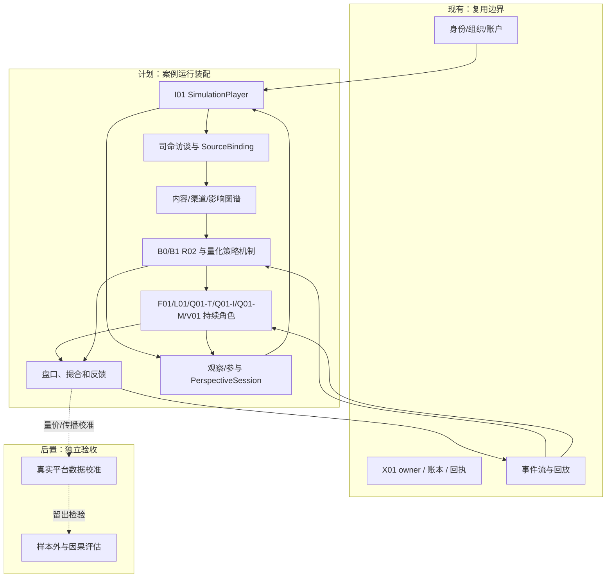
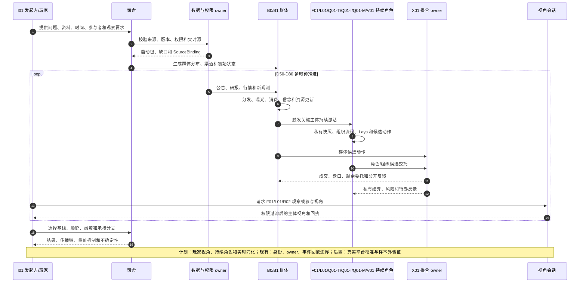
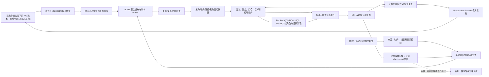

# 光模块行情全流程群体模拟案例推演

日期：2026-10-14

状态：`analysis / design-draft / non-authorizing`

本文用一个完全虚构的光模块二级市场案例，演示[全流程群体模拟运行设计](10-全流程群体模拟运行设计.md)如何实际走一遍；其中组织、动态群体、成员资格和精度交接均遵循[组织与动态群体一等结构设计](12-组织与动态群体一等结构设计.md)。所有人物、账户、数据、价格、资讯和事件均为模拟假设，不构成投资建议，也不表示已经接入真实交易平台。

## 1. 案例问题

模拟发起方 I01 是一家机构的研究与风险团队。它作为 `SimulationPlayer`，想回答：

> 光模块交付预期改善后，大量不同类型资金进入市场；当交付顺延、融资压力和信息分歧同时出现时，能否解释行情为什么从上涨转为腰斩？哪些信息、资金约束和参与者行为会改变下跌速度？

发起方不要求系统预设“必然上涨”或“必然腰斩”，而是要求比较以下分支：

| 分支 | 关键假设 | 观察问题 |
|---|---|---|
| 基线 | 交付按期、资金缓慢流入 | 行情能否在有限流动性下维持？ |
| 顺延 | D66 出现交付顺延公告 | 哪些主体先看到，谁先减仓？ |
| 顺延+融资 | 顺延与融资补担保同时发生 | 被迫卖出是否放大跌幅？ |
| 承接恢复 | 顺延后出现新订单和长期资金承接 | 下跌是否在更高成交量下止住？ |

## 2. 阶段 0：司命先访谈发起方

司命先把 I01 的自然语言问题拆成可接入的输入槽位。以下是一次示意对话结果：

| 司命需要确认 | I01 提供的答案 | 接纳状态 |
|---|---|---|
| 模拟时间 | D50 09:00 至 D80 15:00；日内盘口 tick，资讯分钟 tick | `provided` |
| 目标市场 | 虚构证券市场 X01，连续竞价，双边限价订单簿 | `provided` |
| 标的 | 光模块标的 S01，初始参考价 100，流通股数为假设值 | `assumed` |
| 发起方自有资料 | 产业链访谈摘要、历史量价片段、风险约束表 | `provided`，私有范围 I01 |
| 公共资讯 | 公告、券商研报、财经快讯、股吧/雪球/微博等渠道机制 | `requested`，需绑定来源或标为假设 |
| 实时数据 | 行情流、新闻流和模拟方手工补充事件 | `SourceBinding` 待接入 |
| 重点参与者 | F01 基金、Q01-T 趋势策略、Q01-I 指数/ETF 配置、Q01-M 做市/短周期执行、L01 融资账户、R02 个人群体、V01 长期买方、M01 厂商、C01 客户 | `requested` |
| 观察方式 | 可查看全局、自己的 P01 组合，并切换观察 F01/L01/R02；不得获得未经授权的私有数据 | `permission_intent` |
| 干预方式 | 只能提交假设、资料、分支和候选意图；不直接改价或写成交 | `policy` |

司命将这些内容形成 `SimulationInitiation`。例如，I01 提供的风险约束表不能自动成为 F01 的内部资料；它先进入 I01 私有空间，只有被组织 owner 接纳并授权共享后，F01 才能在自己的快照中看到。

若 I01 没有提供真实平台推荐算法或个人浏览日志，司命必须把“传播延迟”和“曝光概率”作为显式假设分支，不能伪装成真实平台数据。

## 3. 阶段 1 至 3：装配方案、点时输入和群体

司命建立 `SimulationPlan`：

```text
simulation_ref = SIM-S01-D50
player_ref = I01
market_ref = X01
instrument_ref = S01
time_origin = D50 09:00
end_condition = D80 15:00 或目标事件已结算
tick_schedule = {盘口:撮合事件, 资讯:1分钟, 个人注意:5分钟,
                  基金流程:工作流节点, 量化信号:策略时钟,
                  量化执行:订单事件, 长期买方:1日}
branches = {baseline, delay, delay_plus_margin, recovery}
```

### 3.1 点时快照

D50 09:00 时，系统只装入当时已可获得的资料：

- S01 的历史价格、成交量、盘口深度和流通盘假设；
- M01/C01 的产业链状态和已公开交付信息；
- F01 已公开的行业配置方向；
- Q01-T 的趋势参数和资金规模分布；
- Q01-I 的指数成分、申赎/再平衡规则和跟踪误差约束；
- Q01-M 的报价、库存、撤单和执行延迟约束；
- L01 的融资合同、担保比例和追保阈值；
- R02 的渠道、风险偏好、注意力和持仓联合分布；
- V01 的估值区间和长期持有约束。

D66 之后才发布的顺延公告不能进入 D50 的决策快照。系统同时保存来源、公布时间、送达时间、主体消费时间和修订版本。

### 3.2 群体分层

R02 不生成一个“平均散户”，而是生成带联合分布的 B0/B1 群体：

| 子群 | 主要渠道 | 约束 | 反应机制 |
|---|---|---|---|
| R02-A 追涨群 | 股吧、短视频、行情软件 | 注意力高、持有期短 | 价格突破和情绪阈值触发追买 |
| R02-B 研报群 | 券商研报、财经快讯 | 等待估值或确认 | 新信息经过阅读和来源判断后调仓 |
| R02-C 融资群 | 行情端、融资通知 | 维持担保比例 | 触发阈值后产生减仓候选 |
| R02-D 长线群 | 公司公告、行业资料 | 换手率低、期限长 | 只在基本面区间变化时行动 |

群体账户、渠道身份和资金约束都保存 `population_cursor`。同一人同时出现在股吧和雪球，只通过身份映射保留为一个主体。

### 3.3 R02 的动态群体化

R02 不是一个统一的“散户智能体”。在 D58 上涨阶段，系统可能根据“短时追涨行为”形成一个临时 `CohortProjection`：其中一部分人同时满足价格突破、可用现金和较短持有期条件，于是可以批量计算新增买单压力；但这不表示他们的长期信念、账户余额或记忆完全相同。

收到 E06 后，同一临时群体按行为和约束拆分：

| 时间片 | 临时投影 | 行为 | 处理方式 |
|---|---|---|---|
| D58-D61 | `R02-A/breakout` | 追涨、同向买入、延迟接近 | 可合并计算买入到达率 |
| D66 09:20 | `R02-A/split-sell` | 一部分止盈或减仓 | 从原投影拆出卖出子群 |
| D66 09:20 | `R02-A/hold` | 认为顺延是噪声，继续观察 | 保留为观望/继续持有子群 |
| D66 09:20 | `R02-B/confirm` | 等待研报或公告核验 | 与原追涨群分开处理 |
| D66 10:30 | `R02/recovery-buy` | 低位看到长期订单确认，少数人重新试探买入 | 形成新的短时承接投影 |

如果某个主体同时在多个平台出现，不能因此复制成多个资金单元；如果同一群体内部出现明显少数派，系统可以只激活少数桥接节点或代表性角色，而不是让整个群体一体化。群体拆分和再聚合只改变计算投影，实际订单仍必须按主体归属和 owner 规则结算一次。

### 3.3 情绪状态和量化策略状态

本案例把情绪作为随时间变化的中间状态，而不是角色标签。每个 R02 子群和持续角色保存独立的情绪估计/状态版本：

| 阶段 | 主要刺激 | 可能的情绪分布 | 对行动的中间影响 |
|---|---|---|---|
| D50-D58 上涨 | 订单改善资料、价格突破、他人追买 | 兴奋/贪婪上升，信心和社会压力分化 | 注意力集中，追买阈值下降，持有期缩短或撤单减少 |
| D61-D66 高位 | 估值偏离、波动放大、无法继续成交 | 怀疑、焦虑、后悔并存 | 等待确认、分批止盈、减少新增风险 |
| D66 后下跌 | 顺延公告、亏损、融资通知、他人卖出 | 恐惧和压力上升，也保留长期信心少数派 | 止损/减仓概率上升，部分买单撤回，卖单拆分加快 |
| 承接恢复 | 长期订单确认、价格稳定、他人低位承接 | 恐惧衰减，谨慎信心恢复 | 少数成员重新试探买入，其余继续观望 |

同一公告对 F01、Q01-T、Q01-I、Q01-M 和 R02 的情绪/风险状态变化不同；情绪先改变注意、信念权重、风险限额、撤单概率和订单拆分，再由角色或群体机制生成候选。观测到的发言情绪、模型推定和角色私有状态要分别标记，不得把推定当作真实心理事实。

Q01 在本案例中拆成三个具有不同数据端口和执行合同的策略：

| 策略 | 信号/组合时钟 | D52-D61 | D66 后 |
|---|---|---|---|
| Q01-T 趋势 | 价格/成交量窗口，延迟后调仓 | 趋势确认，分批建立多头 | 趋势反转后生成退出目标，受容量和冲击约束 |
| Q01-I 指数/ETF | 申赎和指数再平衡 | 按篮子权重买入，可能同时影响多只成分 | 赎回或权重变化产生篮子卖出，不能直接等同于单股成交 |
| Q01-M 做市/短周期 | 订单到达、价差、库存和短波动 | 提供双边报价，库存上升时扩大价差 | 波动和库存风险上升，撤单或降低报价深度 |

三类策略都必须记录特征可用时间、训练截止、信号延迟、目标仓位、风险/容量检查、执行计划和实际成交。它们的信号先进入订单意图，再进入 X01 订单簿，只有匹配后才改变价格和成交量。

## 4. 阶段 4 至 7：图谱、信息传播和群体状态

系统构建三层图谱：

1. **内容来源图**：M01/C01 交付资料 E01、公告 E02、券商研报 E03、财经快讯 E04、平台观点 E05。
2. **渠道接触图**：公告端、券商端、行情端、股吧、雪球、微博、短视频和公众号等渠道节点。
3. **影响行动图**：F01 的持仓暴露、L01 的融资约束、R02 子群接触关系、X01 撮合依赖。

图谱只提供传播候选和来源血缘。它不能直接把“看到顺延消息”写成“所有人卖出”。

### 4.1 行情兴起阶段

| 时间 | 现实/模拟事件 | 群体状态变化 | 可能的下一步 |
|---|---|---|---|
| D50 | 行业订单改善资料进入公开资料集 | R02-A 的突破信念上升；F01 研究员开始核验 | F01 进入组织研究流程 |
| D52 | 券商研报 E03 发布，行情量增加 | R02-B 获得研报；Q01-T 趋势信号触发 | Q01-T 生成买入候选 |
| D55 | 多渠道转述 E05，观点同源标记保留 | R02-A 曝光快速增加，未读转已读 | 群体买入压力上升 |
| D58 | 资金持续流入，卖盘深度下降 | 追涨群的价格阈值被触发；V01 仍等待估值 | X01 产生更多双边委托 |
| D61 | S01 价格从 100 上升到 160（假设成交轨迹） | 资金拥挤度、融资余额和未成交买单增加；Q01-I 发生篮子再平衡，Q01-M 因库存扩大价差 | 激活 F01、Q01-T、Q01-I、Q01-M 和 L01 |

这里“价格从 100 到 160”不是模型强制结果，而是某一条分支在 X01 撮合后产生的观测。另一个分支可能因为卖盘更厚而只到 135。

### 4.2 顺延消息阶段

D66 09:10，M01 的交付顺延公告 E06 被接入。它先由资讯 owner 接纳，再按渠道 tick 分发：

| 主体 | 看到 E06 的时间 | 是否消费 | 对消息的解释 |
|---|---:|---|---|
| F01 研究员 | 09:12 | 是 | 影响短期交付，但需核实客户 C01 |
| F01 经理 | 09:18 | 是 | 组合集中度过高，先降低风险 |
| Q01-T | 09:11 | 是 | 趋势反转信号，等待盘口确认 |
| Q01-I | 09:11 | 是 | 组合模型先检查赎回/权重变化，不因公告单独卖出 |
| Q01-M | 09:10 | 是 | 波动和库存上升，先扩大价差并减少报价深度 |
| L01 | 09:13 | 是 | 担保比例接近阈值，优先准备减仓 |
| R02-A | 09:25 | 部分消费 | 认为是短期噪声，继续追踪价格 |
| R02-B | 09:21 | 是 | 下调盈利预期，停止加仓 |
| V01 | 09:40 | 是 | 长期逻辑尚未完全改变，暂不交易 |

同一条 E06 对不同主体产生不同候选，不允许用公共图谱边直接替代各自的信念更新。

## 5. 阶段 8 至 10：激活持续角色并生成动作

### 5.1 激活对象

司命根据预设策略激活：

- F01：经理、研究员、风控和交易员，形成 B3 组织流程；
- L01：担保比例接近阈值的关键融资账户，形成 B2 角色；
- Q01-T：对行情拐点贡献较大的趋势策略，形成 B2 角色；
- Q01-I：在出现篮子申赎/再平衡时激活，形成 B2 角色；
- Q01-M：在流动性恶化或库存越过阈值时激活，形成 B2 角色；
- R02：从 B1 中抽取一个代表性争议子群，其他散户继续由 B1 机制推进；
- V01：只在承接恢复分支中激活，用于解释长期资金是否接盘。

激活不复制资金：F01 的研究员、经理和交易员都围绕同一个组织组合账户 P-F01 工作；L01 的融资账户只保留一份现金、持仓和担保状态。

### 5.2 F01 组织决策

F01 的持续角色链如下：

```text
研究员：读取 E03/E06 和 C01 核验结果
  -> 形成“短期交付受压、长期需求未证伪”的组织结论
经理：读取组织结论、组合集中度和赎回压力
  -> 提交“分批减持 80,000 股”的候选
风控：检查单一标的暴露、滑点和流动性
  -> 允许限价区间 155~160，否决一次性市价卖出
交易员：在受托账户 P-F01 生成卖出委托
  -> 进入 X01 owner 撮合
```

Laya 只在“保持 / 分批减持 / 等待更多信息”这些已注册候选中选择，不直接决定 80,000 股、160 元或账户余额。数量、价格条件和风险约束由模型和 F01 的组织流程生成。

### 5.3 典型候选动作

| 主体 | 方向 | 委托/行动 | 来源信息 | 状态 |
|---|---|---|---|---|
| F01/P-F01 | 卖 | 限价 158，80,000 股 | E06 + 组合集中度 | 待 owner 接纳 |
| Q01-T | 卖 | 触发趋势退出，30,000 股 | 价格跌破趋势线 | 待 owner 接纳 |
| Q01-I | 卖 | 篮子调仓映射出的 S01 卖出意图 | 申赎/权重变化 + 组合约束 | 待组合与 owner 校验 |
| Q01-M | 买/卖 | 调整双边报价和库存，撤回部分卖方深度 | 价差、库存和短波动 | 待执行模型与 owner 接纳 |
| L01 | 卖 | 减仓 20,000 股 | 融资阈值压力 | 待追保规则校验 |
| R02-A 群体 | 买/卖混合 | 按价格和情绪分布生成批量候选 | E05/E06 分裂解读 | B1 聚合候选 |
| R02-B 群体 | 卖 | 减少新增仓位，部分止盈 | E06 + 研报 | B1 聚合候选 |
| V01 | 等待 | 不提交委托 | 长期估值约束 | 无市场动作 |

## 6. 阶段 11：X01 双边撮合和量价反馈

假设 D66 09:30 盘口中同时存在：

| 委托 | 方向 | 价格 | 数量 | 来源 |
|---|---|---:|---:|---|
| B-F01 | 卖 | 158.0 | 80,000 | F01 交易员 |
| B-Q01-T | 卖 | 157.5 | 30,000 | Q01-T 趋势退出 |
| B-Q01-I | 卖 | 157.2 | 15,000 | Q01-I 篮子调仓 |
| B-L01 | 卖 | 市价/受限 | 20,000 | L01 担保压力 |
| A-V01 | 买 | 155.0 | 25,000 | V01 条件承接 |
| A-R02-B | 买 | 154.5 | 10,000 | R02-B 低位试探 |

X01 owner 按价格、时间、方向、数量和市场规则撮合。示意结果：

- 155.0 元先成交 25,000 股；
- 154.5 元成交 10,000 股；
- F01、Q01-T、Q01-I、L01 的其余卖单保留在订单簿，或在满足价格条件后继续成交；Q01-M 的撤单/报价调整另按订单版本处理；
- 成交量只计算买卖双方匹配的数量，不把买单和卖单相加两次；
- 价格、成交量、盘口深度、剩余委托和双方账户余额同时写入 X01 事件流。

如果买方承接不足，卖方并不会自动“全部成交”。未成交部分会继续影响盘口深度和后续主体的观察结果。价格下跌是有限买卖盘、撤单、融资约束和不同决策共同产生的结果，不是司命直接设定的结论。

## 7. 阶段 12：反馈与玩家视角切换

成交和盘口变化反馈到不同层：

- **公共观测**：X01 的成交价、成交量、盘口深度和公开公告；
- **F01 私有空间**：实际成交、滑点、组合损益和剩余委托；
- **L01 私有空间**：担保比例、追保时间和可用现金；
- **R02 群体状态**：可见价格、新闻曝光、未读内容、情绪分布和传染/衰减状态；
- **Q01 策略状态**：各策略信号、目标仓位、延迟、库存、容量、滑点、冲击和未成交量；
- **图谱派生层**：E06 的传播边、资金暴露边和拥挤度指标；
- **I01 玩家视角**：只看到自己被授权的投影和各主体的脱敏摘要。

I01 可以连续切换：

1. **全局视角**：看分支、价格/成交量、传播覆盖、群体分布和未决风险。
2. **F01 观察视角**：看到 F01 已消费的 E06、组织结论、风控限制、委托状态和组合结果；看不到 L01 的私有担保明细。
3. **L01 观察视角**：看到 L01 的融资约束、已收到通知、可用现金和减仓候选；看不到 F01 的内部会议原文。
4. **R02 观察视角**：看到某个子群的渠道接触、观点分裂和聚合行动；看不到任何真实个人的私有身份。
5. **自己的参与视角 P01**：如果 I01 装配了模拟组合，可以提出等待、买入或减持意图，但仍要经过 P01 的权限、风险和 X01 owner 接纳。

司命负责解释“为什么两个主体看到相同公告却采取不同动作”，不能替玩家把 F01 的私有信息带入 L01，也不能把观察视角变成万能控制台。

## 8. 阶段 13：实时同化和后继分支

D66 10:30，系统收到模拟方补充资料：C01 仍确认长期订单，只是短期交付顺延。这个资料不能覆盖 D66 09:10 已发生的决策，而是产生后继分支：

| 分支 | 新观测如何使用 | 可能结果 |
|---|---|---|
| `delay_only` | 只把短期顺延写入 M01/C01 状态 | 卖压延续，价格继续寻找承接 |
| `delay_plus_margin` | 同时接入 L01 追保通知 | 被迫卖出增加，深度快速下降 |
| `recovery` | 接入长期订单确认，V01 进入激活 | 低位出现条件买单，跌幅收窄 |

每个分支保留自己的 `branch_ref`、权限版本、角色 frame、图谱 revision、订单簿和随机种子。历史结果不被新资料重写；系统只重新运行受影响的角色和未来事件。

## 9. 阶段 14 至 15：输出和评估

模拟结束后，I01 得到的不是一个单点“明天价格”，而是可回放的条件结果：

- 各分支的价格路径、成交量、盘口深度和未成交量；
- F01/Q01-T/Q01-I/Q01-M/L01/R02/V01 的信息集、情绪状态、策略信号、决策/执行延迟、候选动作和实际成交；
- 顺延公告从 E06 到各渠道的传播链、同源转述和消费延迟；
- 融资阈值、撤单、有限承接与腰斩速度之间的敏感性；
- 哪些结果来自观测，哪些来自发起方资料，哪些来自合成群体或模型假设；
- 观察视角切换记录、玩家干预提案、权限拒绝和 owner 回执。

随后进行历史回放和反事实评估：

1. 去掉 E06，检查上涨分支是否仍由资金拥挤产生；
2. 保留 E06，但解除 L01 融资约束，比较下跌速度；
3. 保留融资约束，但增加 V01 承接，比较成交量和价格冲击；
4. 将 R02 的渠道延迟缩短或拉长，比较传播速度和群体同步程度；
5. 禁用情绪传染或改变情绪衰减速度，比较追涨、撤单和恐慌卖出；
6. 改变 Q01-T 信号阈值/延迟、Q01-I 赎回规模和 Q01-M 库存限额，比较冲击、深度和成交量；
7. 检查相同的量价轨迹是否可以由多套不同的传播、情绪和资金机制产生。

## 10. 这个案例证明了什么

这个案例证明底座可以把“发起者输入、实时资料、异质渠道、群体状态、持续角色、组织流程、买卖盘匹配、量价反馈和玩家视角”放入一个可回放的运行链。但它仍然不能仅靠结构保证真实市场预测准确：平台私有分发、真实交易者心理、未观测组织流程和参数校准仍需要真实数据、历史验证和样本外评估。

## 11. 案例架构、时序和数据流

### 11.1 架构图



### 11.2 主交互时序图



### 11.3 数据流图


