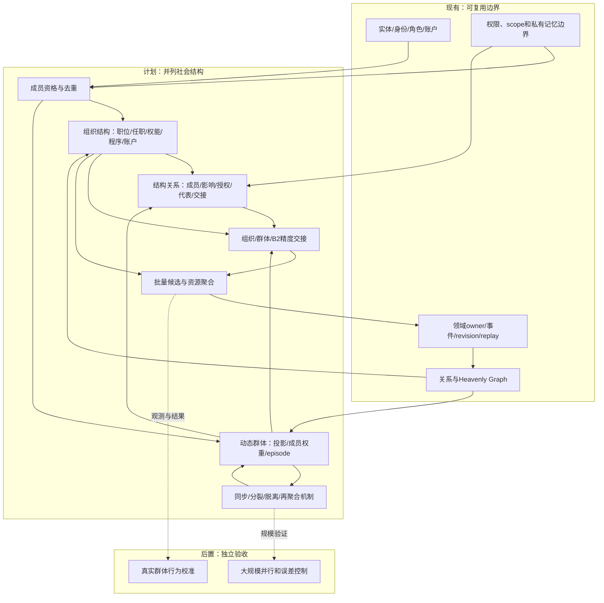
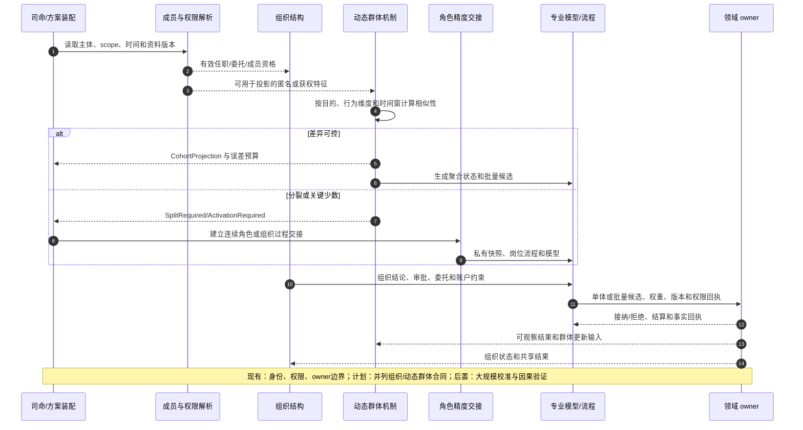
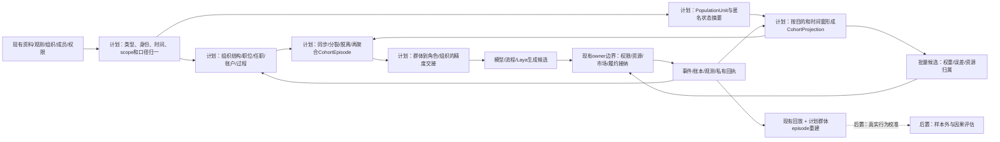

# 组织与动态群体一等结构设计

日期：2026-10-13

状态：`analysis / design-draft / non-authorizing`

本文把“组织”和“动态群体”提升为模拟预测底座的两种并列社会结构。组织不是唯一的社会集合，群体也不是组织的低精度替代。二者都建立在实体、成员资格、关系、过程、状态、权限、事件、时间、图谱和领域 owner 之上，但拥有不同的形成原因、稳定性、权力来源、资源边界和演化规则。

本文承接[类型化数据底座与领域语义设计](02-类型化数据底座、制度与领域语义、可插拔演化机制设计.md)、[数据结构与金融数据合同](03-数据结构、金融数据类别与时间口径合同设计.md)、[整体方案](04-通用模拟底座与行业场景适配整体设计方案.md)、[权限合同](09-权限关系与运行时信息接纳合同设计.md)和[全流程群体模拟运行设计](10-全流程群体模拟运行设计.md)。本文是底层数据与运行合同设计，不授权当前后端已实现组织/群体运行时。

## 1. 设计结论

底座需要把以下两类对象放在同一层级：

| 一等结构 | 主要问题 | 典型稳定性 | 典型作用 |
|---|---|---|---|
| 组织 `OrganizationStructure` | 谁以什么职位、权能、账户和程序共同办事 | 相对稳定，有明确成立、授权、解散和继任 | 决策、审批、委托、资源控制、责任承担 |
| 动态群体 `DynamicCohortStructure` | 哪些主体在某个时间窗、某个维度上暂时表现相近 | 临时、可重叠、可分裂、可脱离、可再聚合 | 传播、共同行动、情绪/信念扩散、订单压力、社会响应 |

二者都不是单一智能体。组织的整体行动必须经过岗位、程序、权限和账户结算；群体的整体行动必须经过成员投影、统计机制、候选动作和领域 owner 接纳。组织可以拥有稳定资源和法律责任，群体默认不拥有独立资产、法律人格或世界事实写权限，除非专业包明确注册其制度身份和 owner 合同。

## 2. 数据结构体系是否支持

现有数据结构体系**可以表达这两类结构，但原有文档对动态群体的结构合同不够显式**。需要补充以下一组类型化对象：

| 现有结构族 | 对组织的支持 | 对动态群体的支持 | 需要补强的合同 |
|---|---|---|---|
| 记录与表格 | 组织、职位、任职、账户、成员资格 | 群体投影、成员权重、相似性特征 | 生命周期、唯一性、成员归属和分摊粒度 |
| 图与层级 | 机构层级、委托链、控制、供应链 | 接触、影响、桥接、同群/异群和重叠投影 | 多方端点、边有效期、投影 scope、不可重复计算 |
| 时序与事件流 | 任职、会议、审批、授权、组织状态 | 形成、同步、分裂、脱离、再聚合、消散 | 逻辑时间、事件因果、乱序、回放和后继分支 |
| 分布与样本集合 | 预算、风险、岗位能力分布 | 资金、渠道、信念、行为和约束联合分布 | 多峰、条件依赖、抽样和误差预算 |
| 状态机与过程 | 审批、委托、议事、执行 | 群体同步阶段、分裂阶段、聚合阶段 | 触发、阈值、迟延、失败、恢复和停止条件 |
| 文档与陈述 | 章程、制度、会议产物和组织决定 | 观点、转发、群体标签、假设和观察 | 来源、可见性、是否事实、同源血缘 |
| 权限与适用域 | 岗位权能、账户范围、委托和责任 | 成员可见范围、群体代表权、观察/干预权限 | 成员资格不自动授予群体全部权限 |
| 资源与账本 | 组织账户、预算、库存、持仓 | 仅按成员归属或注册机制汇总，不默认共同所有 | 唯一 owner、分摊、守恒、重复投影排除 |

因此，数据结构体系不是推倒重来，而是增加“社会结构类型、成员资格和群体投影”三个明确轴。金融、工业、商业和政策场景都可以注册专业字段与机制，不把“群体”硬编码成散户。

### 2.1 FDE 适配层如何接入外部系统

ERP、行情系统、金融研究框架、新闻资讯、监管文件和机构自有表格都通过 FDE 适配层进入底座。适配层负责字段、身份、时间、统计口径、空间/适用域、权限和版本映射，不直接取得组织账户、成员私有资料或世界事实写权限。

| 外部输入 | FDE 映射目标 | 必须保留的边界 |
|---|---|---|
| ERP 组织、岗位、账户、订单、库存 | `Entity`、`OrganizationStructure`、`MembershipInstance`、`Process`、`ResourceState` | 原系统身份、组织层级、账套、授权范围和同步水位 |
| 金融数据模型、因子、估值和风险框架 | `Model`、变量实体、依赖关系、模型端口和适用条件 | 公式版本、校准集、输入口径、输出置信度和可执行范围 |
| 行情、盘口、成交、资金和持仓 | `Observation`、`Event`、`ResourceState`、市场图谱关系 | 交易时间、有效时间、修订、撮合 owner、币种和数量口径 |
| 新闻、研报、公告、社交平台内容 | `Carrier`、`Statement`、`Observation`、传播事件和来源关系 | 原文、作者/账号、发布时间、送达时间、转载血缘和可见范围 |
| 法规、政策、合同和机构规则 | `NormativeStatement`、`Applicability`、权限/约束关系和过程触发器 | 发布层级、生效/失效时间、适用域、版本、冲突和解释状态 |
| FDE 或模拟发起方的场景设定 | `Assumption`、`ScenarioBranch`、结构模板和机制参数 | 提供者、假设标记、分支范围、可修改字段和现实参照关系 |

映射结果先进入原始证据、标准化对象和待接纳候选三个层次：

```text
外部系统/框架
  -> FDE Adapter（身份、类型、时间、口径、适用域、权限）
  -> Canonical Entity/Event/Observation/ModelPort
  -> 组织或动态群体结构候选
  -> PermissionEvaluator + 领域 owner 接纳
  -> 可回放的世界事实、派生图谱或模拟输入
```

同一个 ERP 人员、交易账户、部门或研究框架变量可以被多个专业包引用，但必须通过稳定的 `entity_ref`、`source_ref`、`mapping_revision` 和 `deduplication_key` 去重。映射不确定时保留候选和置信度，不把推定身份、推定成员资格或推定事实静默升级为确定事实。FDE 可以协助司命快速完成机构适配，但最终的权限授予、事实接纳和资源结算仍由对应 owner 执行。

## 3. 共同内核与差异内核

### 3.1 共同内核

组织和动态群体都必须引用：

- 稳定的 `entity_ref`，不能以显示节点 ID 代替身份；
- 可版本化的成员资格 `membership_ref`；
- 带角色和方向的关系实例 `relation_ref`；
- 生效时间、观察时间、交易时间和逻辑时间；
- branch、scope、provenance、revision 和 replay key；
- 输入快照、过程、机制、候选动作和 owner 回执；
- 可见性、权限目的、脱敏和拒绝原因；
- 形成、更新、暂停、恢复、结束和迁移事件。

### 3.2 不能混用的差异

| 维度 | 组织 | 动态群体 |
|---|---|---|
| 成立依据 | 法律、章程、合同、任命、注册或场景设定 | 观察到或假设的相似行为、共同暴露、传播接触或约束 |
| 成员关系 | 任职、出资、委托、隶属、代表、受益等有明确语义 | 参与、暴露、接触、相似、跟随、桥接、脱离等可变语义 |
| 权力来源 | 明示职权、委托、控制权和程序 | 影响力、网络位置、注意力、资源集中和行为协调 |
| 资产/责任 | 可拥有账户、预算、库存、法律义务 | 默认不拥有成员资产，不承担成员法律责任 |
| 内部程序 | 议事、审批、否决、授权、执行和审计 | 传播、同步、分裂、模仿、反应和解散机制 |
| 代表性 | 组织代表必须有授权和任职依据 | 群体代表只代表统计投影，除非明确委托 |
| 生命周期 | 可长期持续，继任和制度版本重要 | 通常短期有效，按 tick 重算成员和行为相似度 |
| 结算 | 组织账户和 owner 结算一次 | 成员动作按归属或批量规则结算一次 |

组织不能仅由“成员相似”推导，群体也不能仅由“共同组织”推导。一个组织内部可以出现多个动态群体；一个动态群体可以跨越多个组织、平台和法域。

### 3.3 组织—群体关系的类型化定义

组织和群体之间不能只画一条“属于”边。所有结构关系都必须是有方向、有生效区间、有来源和有权限后果的 `StructureRelation`。关系存在本身不自动授予权力、代表权、私有数据访问权或资源所有权。

```text
StructureRelation {
  relation_ref, source_structure_ref, target_structure_ref
  relation_kind, relation_basis, direction
  valid_time, observed_time, logical_time
  scope_ref, provenance_ref, revision
  authority_effect, representation_effect, resource_effect
  visibility_policy_ref, owner_ref, replay_key
}
```

| 关系类型 | 方向 | 真实含义 | 默认不推出的结论 |
|---|---|---|---|
| `contains_unit` | 组织 -> 主体/岗位 | 组织在制度上包含单位、岗位或成员 | 不代表该成员支持组织当前观点 |
| `member_of` | 主体 -> 组织 | 任职、出资、委托、受益或其他注册成员资格 | 不代表主体能访问组织全部资料 |
| `internal_cohort_of` | 动态群体 -> 组织 | 群体投影的成员来自同一组织或其授权范围 | 不授予群体组织职权、账户或签字权 |
| `cross_org_cohort` | 动态群体 -> 多组织 | 群体成员跨越多个组织、平台或法域 | 不构成新法人、共同账户或统一委托 |
| `observes` | 组织/群体 -> 结构 | 允许在限定目的和范围内观察结构统计或公开结果 | 不授予修改、代表或私有成员读取权 |
| `influences` | 组织/群体 -> 结构 | 通过信息、资源、网络位置或行为压力改变对方输入 | 不等于控制、授权或因果确定性 |
| `hosts` | 组织 -> 群体 | 组织为群体提供空间、渠道、流程或数据环境 | 不代表组织拥有群体成员个人资产 |
| `authorizes` | 组织 -> 群体/代表 | 组织在明确范围内允许某群体或代表提交候选 | 只授予声明范围内的候选权，不授予事实写权 |
| `represents` | 代表主体/群体 -> 组织或外部主体 | 有明确委托、任期、事项和撤销条件的代表关系 | 没有 `RepresentationMandate` 时不得使用 |
| `aggregates` | 组织/模型 -> 动态群体 | 把组织单位或角色按特定目的投影为群体统计 | 不删除原组织身份、岗位、账户或程序 |
| `refines` | 角色/组织 -> 动态群体 | 从群体中展开关键成员、少数派或组织过程 | 不复制主体、资产、记忆或未完成义务 |
| `handoff_to` | 任一结构 -> 任一结构 | 在限定 scope 内把推进精度交给另一个结构 | 不转移 owner，必须有连续性和资源检查 |

关系必须区分四个独立问题：

1. **成员问题**：谁在制度上属于组织，谁在本时间窗被投影进群体；
2. **影响问题**：谁改变谁的输入、注意、信念或行动概率；
3. **权力问题**：谁可以批准、否决、委托、签字或写入领域事实；
4. **资源问题**：谁拥有、管理、冻结、转移或结算现金、持仓、库存和预算。

同一对节点可以同时存在多条不同关系。例如基金 F01 与“看多研究群体”可以同时有 `hosts`、`internal_cohort_of` 和 `observes`，但只有投委会的正式岗位流程拥有 `authorizes` 或账户行动权限；“追涨群”可以 `influences` F01 的市场输入，却不能 `represents` F01。图谱查询和权限判定必须按 `relation_kind` 过滤，不能把所有边合并为“关联”。

### 3.4 三种结构转换必须分开

**组织内形成群体**：从组织的成员、岗位、共享信息或约束中生成 `internal_cohort_of`。群体只获得计算投影，不获得组织程序权限；群体共识要经过组织岗位、审批或委托流程，才能变成组织结论。

**群体影响组织**：群体通过 `influences`、`signals_to` 或 `pressures` 提供统计压力、信息扩散或候选输入。组织可以观察、采纳、拒绝或反向干预；采纳必须产生组织过程事件和 owner 回执。

**群体制度化**：群体只有在章程、合同、注册、任命、账户、责任和 owner 都被显式创建后，才可以转化为新的 `OrganizationStructure`。这不是给原群体改标签，而是创建一个新组织身份，并记录 `institutionalized_from`、成员迁移、资源来源和生效时间。原群体的历史 episode 不被改写。

反方向，组织也可以被某个机制临时投影为群体，例如把多个供应商的交付行为压缩为“延迟风险群”。这只生成 `aggregates` 或 `CohortProjection`，不改变组织身份、法律责任、账户和内部程序。只有在精度交接合同明确暂停某个 scope 时，才允许该投影接管该 scope 的模拟推进。

### 3.5 权限和结算规则

- `internal_cohort_of` 不继承组织岗位权限；必须另有 `observes`、`authorizes` 或 `represents` 关系及其权限条件。
- `cross_org_cohort` 不继承任何成员组织的私有数据、交易权限、法律责任或账户余额。
- `influences` 只能改变注册机制的输入或候选概率，不能直接写组织决策、成员记忆、订单或账本。
- `represents` 必须绑定 `RepresentationMandate`，声明代表人、事项、范围、时间、撤销条件和 owner；没有委托时只能表达统计意见。
- 组织账户、个人账户和群体投影必须有唯一 `resource_owner_ref`。同一主体同时出现在组织内群体和跨组织群体时，现金、持仓、订单和事实仍只结算一次。
- 组织与群体的关系变化写入关系事件和 episode；不得通过覆盖节点属性来抹掉历史成员、历史权限或历史影响路径。

金融场景中，F01 内部“研究看多群体”可以影响投委会输入，但不能直接买入；跨平台 R02 追涨群可以形成市场买压候选，但必须拆回成员或注册批量归属后由市场 owner 撮合；当一部分 R02 成员被激活为关键角色时，使用 `refines` 和 `handoff_to`，而不是复制一份资金账户。

## 4. 核心类型合同

以下为设计示意，不是已实现 Python schema：

```text
SocialStructure {
  structure_ref, structure_kind, type_ref, revision
  branch_ref, scope_ref, provenance_ref
  formation_basis, lifecycle_state
  valid_time, observed_time, logical_time
  authority_profile_ref, resource_policy_ref
  process_bindings, mechanism_bindings, owner_bindings
  visibility_policy_ref, replay_key
}

OrganizationStructure extends SocialStructure {
  organization_ref, legal_or_scenario_identity
  unit_refs, role_refs, appointment_refs
  authority_refs, delegation_refs, account_refs
  shared_space_refs, procedure_refs, responsibility_refs
  succession_policy_ref, dissolution_policy_ref
}

DynamicCohortStructure extends SocialStructure {
  cohort_ref, projection_purpose, cohort_episode_ref
  membership_rule_ref, feature_slice_ref
  time_window, behavior_dimension
  similarity_tolerance, aggregation_scope
  member_weight_digest, uncertainty_ref, error_budget
  source_snapshot_refs, split_merge_policy_ref
  resource_non_ownership_policy, activation_policy_ref
}

StructureRelation {
  relation_ref, source_structure_ref, target_structure_ref
  relation_kind, relation_basis, direction
  valid_time, observed_time, logical_time
  scope_ref, provenance_ref, revision
  authority_effect, representation_effect, resource_effect
  visibility_policy_ref, owner_ref, replay_key
}

RepresentationMandate {
  mandate_ref, representative_ref, represented_ref
  matters, scope_ref, valid_time, revocation_rule
  authority_limit, owner_ack_ref, replay_key
}

MembershipInstance {
  membership_ref, structure_ref, member_ref, member_kind
  membership_kind, role_or_weight
  valid_interval, observed_interval, branch_ref, scope_ref
  source_refs, confidence, status
  allocation_rule_ref, deduplication_key
}

CohortEpisode {
  episode_ref, cohort_ref, parent_projection_refs
  event_kind, trigger_refs, predecessor_refs, successor_refs
  start_time, end_time, member_weight_digest
  behavior_snapshot_ref, mechanism_revision, replay_key
}
```

`OrganizationStructure` 的成员资格通常是任职、委托、出资、受益或代表；`DynamicCohortStructure` 的成员资格通常是某时间窗内的行为相似、信息暴露、共同持仓、融资约束或传播接触。两者都可以有嵌套，但嵌套语义必须显式注册，不能因为图谱中存在路径就自动继承权力或资产。

## 5. 动态群体化的严格定义

### 5.1 群体不是平均人

动态群体投影只压缩**本次机制需要的维度**。例如：

- 传播机制只需要渠道、延迟、来源信任和转发倾向；
- 订单到达机制需要资金、持仓、价格触发、风险阈值和可用流动性；
- 融资机制需要抵押品、担保比例、合同状态和追保期限；
- 情绪机制需要内容消费、信念峰值、网络暴露和注意预算。

同一个群体不应把所有维度强行压成一个均值。输出必须保留多峰分布、尾部、关键少数和误差边界。

### 5.2 暂时一体化的准入

一批主体只有在以下条件满足时才可以作为一个批量机制输入：

```text
cohort_admit(members, purpose, window, feature_slice):
  require same_branch_and_scope(members)
  require comparable_information_exposure(members, feature_slice)
  require comparable_constraints(members, feature_slice)
  require comparable_action_latency(members, feature_slice)
  require network_summary_error <= configured_tolerance
  require resource_allocation_is_explicit(members)
  require projected_error <= error_budget
  return CohortProjection or DeferSplitOrActivate
```

这不是全局聚类，也不是对世界事实的合并。准入仅允许特定机制在特定窗口调用该投影。窗口结束、输入修订、成员约束变化或误差超限时，必须重新评估。

### 5.3 群体内部的分裂与再聚合

群体机制必须支持：

1. `form`：因共同暴露、共同约束或局部网络形成投影；
2. `synchronize`：在某一行为维度短时趋同；
3. `split`：信息解释、资源约束、目标或网络位置产生差异；
4. `defect`：成员退出原投影并保留自己的状态；
5. `merge`：两个投影在同一目的和窗口内重新满足相似性准入；
6. `dissolve`：共同触发条件消失，投影失效但历史 episode 保留。

这些是群体事件，不是个人事实写入。个人信念、余额、持仓、权限和订单由各自 owner 或角色过程更新。

## 6. 组织与群体的交互

### 6.1 组织内群体

一个基金组织可以同时存在：研究员看多群体、风控谨慎群体、交易台执行群体和赎回压力群体。这些群体不自动拥有组织职权；研究员群体的共识只有经过组织流程接纳，才会成为经理或投委会可用的组织结论。

### 6.2 跨组织群体

趋势资金、融资账户和个人投资者可能因共同信号形成跨组织群体。但该群体：

- 不能读取各成员的私有账户；
- 不能代表成员签署合同或提交统一委托；
- 不能把同源转载当成独立证据；
- 只能通过机制生成统计行动压力或候选动作；
- 仍须由市场 owner 按成员归属处理成交和资金变化。

### 6.3 组织和群体的精度交接

司命可以把群体中的关键成员、桥接节点、极端约束账户或少数派激活为持续角色，也可以把组织内部某个过程暂时降为群体机制。交接必须记录：

```text
PrecisionHandoff {
  handoff_ref, source_structure_ref, target_structure_ref
  member_refs_or_projection_ref, reason, policy_revision
  source_cursor, target_frame_revision
  paused_scopes, continuity_digest, resource_check
  start_time, end_time, owner_ack_refs, replay_key
}
```

同一主体在同一范围和时段不能同时由显式角色和群体机制推进相同状态。群体投影可以继续计算不受该角色锁定范围影响的传播统计，但不能再次生成该主体的相同订单、资金变化或私有记忆更新。

## 7. 权限、资源和 owner 边界

### 7.1 权限

动态群体成员资格不等于群体权限。需要分别判定：

- 主体是否属于该群体；
- 主体能否看到群体统计；
- 主体能否看到其他成员或桥接节点；
- 谁可以创建、修改、冻结或解散该投影；
- 谁可以以群体代表身份提出候选；
- 哪些群体属性可以公开显示。

组织岗位也不能因为属于组织就自动看到组织全部数据。权限仍由 `PermissionEvaluator` 按主体、acting_as、资源、动作、scope、时间、目的和 owner 限制判定。

### 7.2 资源守恒

群体统计可以聚合成员资源，但必须标识：

- `gross` 或 `net`；
- 是否包含重叠成员；
- 是否包含组织账户；
- 是否按成员权重分配；
- 是否只是估计而非 owner 账本值。

同一账户不能因为属于多个群体而重复计入现金、持仓、订单或卖压。组织账户内部岗位行动也不能重复扣款。

### 7.3 owner

组织和群体协作模块只有推进权和候选生成权，不拥有领域事实写权限：

- 市场 owner 接纳成员订单并撮合一次；
- 账户 owner 结算现金、持仓、保证金和融资状态一次；
- 传播 owner 接纳发布、送达、曝光、消费和转载事件；
- 组织 owner 接纳任职、授权、审批、共享结论和组织状态；
- 群体 owner 或群体机制保存投影、episode、分裂/合并事件和成员权重，但不能写成员世界事实；
- 图谱只保存带来源、scope 和 revision 的派生视图。

## 8. 时间、图谱和回放

群体投影必须同时声明：

- 形成时间、观察时间和生效时间；
- 行为时间窗和数据截止；
- 形成前的来源和信息版本；
- 触发事件、延迟、采样和水位；
- 成员权重与误差版本；
- 分支、scope、专业机制和随机输入。

图谱中组织节点、群体投影节点和成员关系使用不同关系类型。组织成员关系使用 `member_of`、`contains_unit`、`appointed_as`、`delegated_to`；组织—群体关系使用 `internal_cohort_of`、`cross_org_cohort`、`hosts`、`authorizes`、`represents`、`aggregates`、`refines`、`handoff_to`；行为或传播关系使用 `temporarily_similar_to`、`exposed_with`、`followed_by`、`defected_from`、`influences`。这些边不得按一个无类型的“关联”合并。边的有效期、权力后果、资源后果和事件血缘必须支持回放某一时刻的群体组成与组织权限。

新观测到达时，旧群体 episode 不被覆盖；系统可以创建后继投影、分裂或消散事件。回放必须能回答：某一批成员为什么在当时被合并、使用了什么信息、何时分裂、哪些候选动作来自该投影、最终由哪个 owner 接纳。

## 9. 金融案例中的一等群体

在光模块行情案例中，R02 不是一个“散户组织”，而是多个动态投影：

| 投影 | 目的和窗口 | 成员相似维度 | 不能推导的内容 |
|---|---|---|---|
| `R02-breakout` | D58-D61 计算追涨订单到达 | 价格突破、现金、持有期、注意延迟 | 成员拥有同一信念或同一账户 |
| `R02-delay-sell` | D66 计算顺延后的减仓压力 | 已消费 E06、风险阈值、可卖数量 | 所有人已经实际提交卖单 |
| `R02-hold` | D66 计算继续持有 | 将 E06 判为短期噪声、较长期限 | 成员无法随后改变判断 |
| `R02-recovery-buy` | D66 10:30 后计算低位承接 | 看到长期订单确认、现金可用、限价条件 | 成员构成新的法律或资金组织 |

同一主体可能先后进入多个投影，也可能同时在不同目的的投影中出现；其资金和订单仍只在账户 owner 处结算一次。少数桥接节点可以升格为 B2 角色，其他成员继续由 B0/B1 机制处理。

## 10. 运行时接口

以下接口是实现前应冻结的最小方向：

```text
ProjectCohort(request) -> CohortProjection | SplitRequired | ActivationRequired
UpdateCohort(projection_ref, observation_refs, state_pins) -> CohortEpisodeEvent
HandoffPrecision(source_ref, target_ref, scope, reason) -> PrecisionHandoff
GenerateBatchCandidates(projection_ref, purpose, mechanism_ref) -> CandidateBatch
ResolveMembership(member_ref, structure_ref, point_in_time) -> MembershipView
EvaluateStructureRelation(source_ref, target_ref, relation_kind, point_in_time, purpose) -> RelationDecision
IssueRepresentationMandate(issuer_ref, representative_ref, represented_ref, matters, scope) -> RepresentationMandate | Rejected
AggregateResource(projection_ref, resource_ref, mode) -> AggregateView
ObserveStructure(player_ref, structure_ref, perspective) -> PermissionFilteredView
```

`CandidateBatch` 至少带有 `projection_ref`、成员权重摘要、动作相似性、来源快照、聚合目的、误差预算、拆分条件和 owner 接纳要求。它不是成交、账本变化或个人决定列表。

## 11. 架构图、时序图和数据流图

### 11.1 架构图



### 11.2 主交互时序图



### 11.3 数据流图



## 12. 验收标准和实施顺序

进入实现前，至少需要证明：

1. 同一主体可以在不同目的的群体投影中出现，但资源、权限和订单不会重复结算。
2. 群体投影能在一个时间窗内合并行为相近成员，并在输入、约束或观点分化后产生可回放的 `split`。
3. 群体保留多峰分布和少数派，不把全体替换成一个平均参数。
4. 组织成员资格、群体成员资格、代表权和观察权是不同权限关系。
5. 组织内部群体共识必须经过组织过程才能成为组织结论。
6. 跨组织群体不能自动读取成员私有资料、签署合同或提交统一资金动作。
7. B1 到 B2/B3 的交接保存 cursor、frame、资源和未完成义务，不能产生第二个主体。
8. 批量候选可以被 owner 部分接纳、拒绝或拆分，并能追溯成员权重和误差。
9. 组织和群体的形成、成员变化、分裂、合并、交接、观察和结算均可按 replay key 重放。
10. 权限撤销、实时新观测和分支切换不会覆盖旧群体 episode 或历史决策。

建议实施顺序：先冻结共同类型和成员资格合同，再实现单一金融市场的 R02 动态投影与 F01 组织交互；随后增加批量候选、资源去重、少数激活、多时钟和大规模回放；最后用工业班组、供应链网络和商业客户群体验证跨行业适配。真实行为校准、因果识别和极大规模并行属于后置验收。

## 13. 与既有文档的关系

- 设计02的“组织及多方安排”保留，本文补充与动态群体并列的社会结构抽象、成员资格和群体机制。
- 设计03的“图与层级、时序、事件流、分布与样本集合”足以承载结构，但必须采用本文的群体投影、episode、权重和资源去重合同。
- 设计04的角色与群体协作模块扩展为“组织与动态群体协作”，并把群体升级为一等装配对象。
- 设计09的权限判定继续适用于组织和群体；群体成员资格不自动继承组织权能或成员私有权限。
- 设计10的 B0/B1、B2/B3 和精度交接按本文的 `CohortProjection`、`CohortEpisode` 和 `PrecisionHandoff` 执行。
- 设计11的 R02 案例展示动态群体化，但不替代本文的底层合同。
