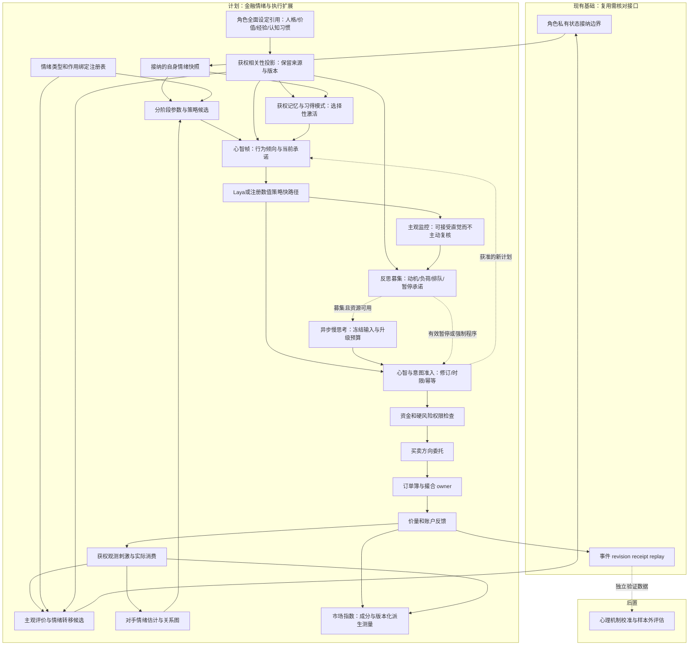
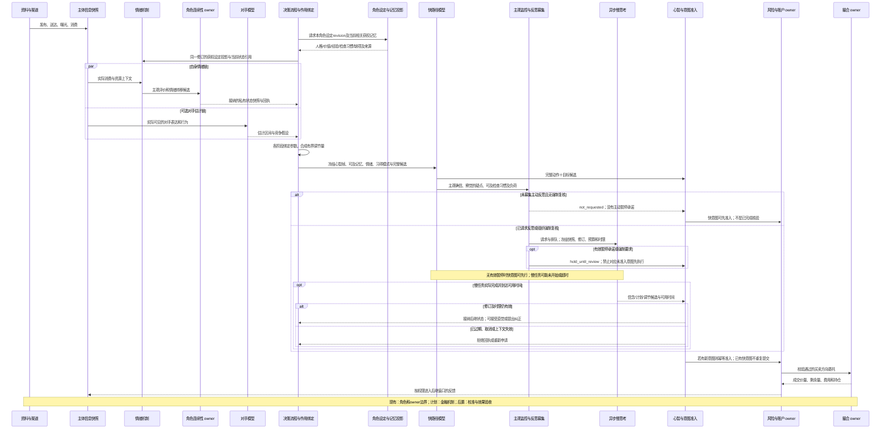
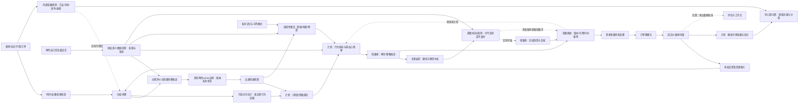

# 情绪利用与资金博弈机制设计

日期：2026-10-14

状态：`analysis / design-draft / non-authorizing`

本文只讨论第一个主题：参与者如何识别、利用和反制情绪，以及资金规模、交易速度和交易频率如何形成对手盘博弈。本文承接 08、09、10、12 号 fork 文档；高阶认知见[高阶认知与希望逻辑设计](14-高阶认知与希望逻辑设计.md)，量化机构见[量化机构组织与速度资金优势设计](15-量化机构组织与速度资金优势设计.md)。

## 1. 核心链路

情绪不是买卖方向标签，资金和速度也不是自动获利能力。每个参与者都必须经过：

```text
可获权刺激 -> 实际消费 -> 解释 -> 自身情绪/信念更新或对手状态估计
-> 分阶段参数绑定 -> 行动倾向 -> 合法候选策略 -> 资金/风险/权限检查
-> 买卖方向委托 -> 有限订单簿 -> 成交价量/剩余量
-> 情绪、信念、持仓和对手模型反馈
```

### 1.1 三类数据来源，与情绪类型是两个独立轴

这里的“三类”区分数据如何获得，不是规定只有三种情绪，更不是只保留贪婪与恐惧。每一种情绪都可以有行为观测、模型估计和分支内私有状态。真实主体的心理不可由模拟私有状态反向证明；合成主体的私有状态也必须标记为模拟生成。

| 类型 | 示例 | 约束 |
|---|---|---|
| 观测 | 帖子恐慌词、转发速度、撤单率、主动卖出比例 | 只记录来源和时间，不直接断言心理 |
| 估计 | 群体恐惧 0.82、贪婪 0.67 | 必须带模型版本、校准区间和误差 |
| 私有状态 | 某角色消费亏损后产生焦虑和后悔 | 只对该主体可见，不能被对手直接读取 |

```text
EmotionState {
  state_ref, actor_ref, emotion_instances[]
  background_affect { arousal, valence }
  valid_time, observed_time, available_time, logical_time
  evidence_origin, provenance_ref, branch_ref, privacy_scope
  base_revision, mechanism_revision, owner_receipt_ref, replay_key
}

EmotionInstance {
  emotion_instance_ref, emotion_type_ref, type_revision
  target_refs, concern_ref, eliciting_event_refs, appraisal_ref
  intensity, uncertainty_band, onset_time, last_update_time
  transition_model_ref, decay_model_ref, regulation_model_ref
  evidence_origin = observed_expression | inferred | self_report | synthetic
  source_snapshot_ref, visibility_scope, branch_ref
}
```

同一事件可以形成“恐惧但希望反弹”“兴奋但担心流动性”等混合状态。群体必须保存多峰分布，不能用一个平均情绪代替尾部和少数桥接节点。

上面的类型是计划合同示意，替代本节早期把 `fear/greed/confidence/loss_aversion` 混装在一张情绪表里的写法。文档08、10中的同名结构是早期扁平示意，接入此扩展时需按下述语义映射，不能把旧字段全部认定为情绪。

### 1.2 可注册情绪类型，避免把所有决策因素归为情绪

底座注册情绪类型和机制；金融专业包提供有版本的情绪目录。目录可以扩展，不承诺用固定清单穷尽所有行业、文化或心理理论。类型名称相同，也可以绑定不同经过校准的机制。

| 状态轴 | 示例 | 保存位置与意义 |
|---|---|---|
| 情绪与情感状态 | 恐惧、焦虑、兴奋、喜悦、失望、后悔、愤怒、羞耻、内疚、嫉妒、羡慕、释然、希望、好奇、无聊 | `EmotionInstance`，带对象、原因、强度、持续时间 |
| 认知与判断 | 看多/看空、确信、怀疑、概率估计 | 认知命题和信念快照；不等同于情绪 |
| 动机与目标 | 获利欲望、地位追求、希望别人相信某事 | 目标/动机状态与文档14的模态命题 |
| 关系与社会输入 | 信任、敌意、从众压力、声誉压力 | 关系状态和社会观测；可以触发情绪 |
| 行为参数与能力 | 损失厌恶、耐心、注意预算、模仿倾向、交易速度 | 决策配置、调节状态和资源合同；不自动成为情绪 |

“贪婪”可以由专业包定义为强获利动机及兴奋等状态的组合指标，必须给出公式和版本；“错失恐惧/FOMO”可以组合机会评价、焦虑、社会比较和紧迫感。组合指标不能再次作为独立刺激重复贡献同一情绪。希望的情感体验放在情绪层，`hopes_outcome`、`hopes_belief` 放在目标/命题层，二者通过引用连接。

不同情绪不是全局各一个数。一个交易者可以同时对股票 A 害怕、对股票 B 兴奋、对券商愤怒、对自己昨日的卖出后悔。`target_refs + concern_ref` 保存这种对象差异；归属同一事件的多个实例共享证据血缘。

### 1.3 初始情绪目录及进入链路的位置

以下是金融专业包的初始机制假设，不是心理学定律，也不是固定买卖规则。表内作用都需主体画像、持仓、情境和校准依据共同决定。

| 情绪类型 | 主体如何评价刺激 | 首先影响哪些中间状态 | 可能形成的不同候选 |
|---|---|---|---|
| 恐惧 | 预期损失严重、自身难控制 | 威胁注意、风险容忍、行动紧迫性 | 减仓、对冲、撤买单、等待核验；也可僵住不行动 |
| 焦虑 | 未来不确定，尚无明确威胁对象 | 检查频率、信息需求、决策迟疑 | 增加核验、延迟下单、缩小试探规模 |
| 兴奋、喜悦 | 收益机会或收益实现 | 注意集中、接近倾向、短期风险容忍 | 加仓候选、分享观点、止盈或继续持有 |
| 希望 | 偏好某结果，且认为仍有可能 | 目标坚持、等待时长、证据搜索 | 等待反弹、制定条件单、继续研究；资源不足时无法增仓 |
| 失望、悲伤 | 结果低于预期或重要目标受损 | 目标重估、精力、参与意愿 | 降低仓位目标、减少交易、退出研究 |
| 后悔 | 认为另一选择本可更好 | 反事实记忆、再犯错阈值、补偿动机 | 避免再追涨、买回、锁定利润或暂不交易 |
| 愤怒、挫败 | 认为损失可归责于他人或受阻 | 责任归因、信任、表达及控制冲动 | 发帖质疑、投诉、换渠道；也可能产生需风控拦截的冒进候选 |
| 羞耻、内疚 | 自己行为违背社会期待或责任 | 披露意愿、声誉关注、问责压力 | 隐瞒候选、主动报告、减少风险或请求审批 |
| 嫉妒、羡慕 | 他人盈利或地位超过自己 | 社会比较、目标强度、注意对象 | 跟随、核验对方、调整目标或拒绝模仿 |
| 释然、平静 | 威胁解除或感觉恢复控制 | 唤醒度、耐心、风险复核 | 撤销紧急减仓候选、恢复常规节奏；不必买入 |
| 好奇、惊讶 | 新颖或违反预期的信息 | 主动搜索、模型复核、注意切换 | 获取原文、试验策略、保持观望 |
| 无聊、疲惫相关感受 | 刺激不足或持续负荷 | 注意投入、参与意愿 | 停止看盘、转向新主题；疲劳资源另行记录 |

焦虑、恐惧可以同属威胁相关情绪，但具有不同对象确定性和作用位置；后悔与失望的反事实评价也不同。仅保存正负效价不能表达这些差异。

### 1.4 类型、实例、评价与作用绑定

每种情绪至少装配四种对象。自然语言画像和标签可以提出候选，实际运行必须绑定版本化模型、允许输入和允许输出。

```text
EmotionTypeDefinition {
  type_ref, version, semantic_family, intensity_unit
  allowed_target_types, appraisal_schema_ref
  transition_model_ref, decay_model_ref, regulation_model_ref
  permitted_effect_binding_refs, calibration_refs
}

AppraisalSnapshot {
  appraisal_ref, actor_ref, consumed_evidence_refs, input_snapshot_ref
  goal_relevance, goal_congruence, threat_severity, uncertainty
  controllability, responsibility_attribution, expectation_gap
  counterfactual_comparison_ref, social_comparison_ref
  belief_revision, resource_revision, evaluated_at, branch_ref
}

EmotionEffectBinding {
  binding_ref, emotion_type_ref, decision_stage_ref, context_predicate_ref
  read_state_refs, permitted_target_parameter_refs
  effect_model_ref, parameter_bounds, composition_rule_ref
  baseline_ref, binding_revision
}
```

实例强度的 0—1 是专业包声明的归一化标度，不能直接当作发生概率，也不能在未校准时直接跨类型比较。未知强度不填 0；没有实例不等于主体没有该情绪。真实表达只进入观察池，由估计机制形成候选；合成主体状态变化由角色/连续性 owner 接纳后生效。

作用绑定只能改变声明的注意分配、核验需求、目标评分、风险偏好、耐心、执行紧迫度等参数，不能写现金、持仓、价格和成交。硬风险限额、职位权限、保证金规则不因情绪变动而被放宽。人格基线与本轮调节量分开，避免把一次恐慌永久写入人格。

### 1.5 每个时钟窗口如何执行

运行顺序是设计合同示意：

1. **冻结输入**：角色获权的资料消费回执、自身成交/盈亏、组织事件和可观察他人行为；检查点时可用性，排除未来资料。
2. **主观评价**：按本主体的信念、目标、成本记忆、控制感和责任归因形成 `AppraisalSnapshot`。同一公告不保证同一评价。
3. **提出转移**：计算多种情绪各自的刺激、衰减、调节和互动项；去重刺激血缘。同一帖子跨平台重复接触可增加注意影响，但不自动增加独立证据可信度。
4. **接纳私有状态**：角色/连续性 owner 校验输入修订、范围和幂等键，提交新状态与回执；失败不推进状态游标。
5. **生成决策参数**：只通过获准 `EmotionEffectBinding` 生成本轮参数差异；多个情绪共同作用时执行明确的合成规则和上下界，不能重复叠加 FOMO 与其组成项。
6. **形成行动候选**：角色流程、Laya 或专业策略读取获权参数和信息快照；也可以选择核验、发观点、等待或不交易。
7. **权限与执行**：组织审批、账户资源、硬风控、市场规则检查后才提交订单；有限买卖盘撮合形成成交价量、剩余量和账本回执。
8. **反馈到后继窗口**：成交、未成交、消息澄清及对手公开行为进入后继资料。时间戳确定更新顺序，不在同一窗口无限循环。

连续时间衰减的一种计划形式为：

```text
intensity_next = clamp(
  baseline + (intensity_previous - baseline) * exp(-ln(2) * delta_time / half_life)
  + appraisal_stimulus + social_exposure_effect + regulation_effect
  + registered_interaction_effect,
  0, 1)
```

`delta_time` 与 `half_life` 必须同单位且后者大于零；不按“每 tick 减固定量”，否则细 tick 会无故让情绪更快消失。该形式可替换为状态空间或其他已注册模型。来源缺失、过期或未知时按缺失数据合同处理。社交项只读已送达的表达/行为，不能读取别人的私有情绪。过去已形成的情绪继续衰减，也可被自身盈亏刺激；“没有消费新公告”不等于状态必须静止。

情绪可以影响后继的信息搜索和信念更新过程，但不能修改世界事实，也不能覆盖由原始证据计算的客观数据。所有随机采样绑定主体、机制、逻辑窗口与种子，使回放不依赖计算机线程完成顺序。

### 1.6 群体、组织、量化与对手观察

- **群体**保存情绪类型、对象、信念、成本、杠杆、渠道和行为参数的联合分布。可以暂时合并行为相近者，但保留多峰、尾部与拆分条件；同一个人跨平台不重复计算。
- **组织**的经理、研究员和交易员可以有不同情绪；组织没有默认的“共同情绪大脑”。组织氛围是授权派生统计，机构决定仍经岗位与程序形成。
- **量化策略**不会默认拥有人的恐惧或愤怒。它可以读取获权的情绪估计作为因子，也可完全不使用；岗位人员情绪与自动策略的输入保持分开，信息与处理延迟沿用文档15。
- **对手模型**从公开表达和行为估计情绪概率/区间，可以误判、发现伪装或失效。自己情绪更新和对手估计是并行的两条链；交易不要求先建立对手模型。

### 1.7 同一消息的不同情绪路径

光模块“交付顺延”公告被三名虚构主体实际消费。以下参数仅为情景假设：

| 主体 | 主观评价与情绪实例 | 参数/流程变化 | 候选及执行限制 |
|---|---|---|---|
| 融资持有人 A | 高杠杆、亏损接近阈值；对本票恐惧 0.8、焦虑 0.6 | 加急核验、缩短等待、降低风险偏好 | 提出减仓；是否强制处置由融资合同决定，不由恐惧值决定 |
| 盈利持有人 B | 浮盈大、担心回吐；对本票后悔预期 0.5、失望 0.4 | 更重视保住收益，制定分批退出条件 | 限价止盈候选；买方不足时部分成交或不成交 |
| 昨日卖出者 C | 已无仓位，仍偏好反弹；后悔 0.7、希望 0.6、好奇 0.5 | 主动找原文、比较是否误卖；既有纪律可以抑制追回冲动 | 核验或小额买回候选；无现金时不能下买单 |

同一方向候选也可能来自不同情绪；同一情绪可以形成不同方向或没有订单。观察到减仓不能唯一识别恐惧，拟合出相同量价也不能唯一证明这一情绪机制。

### 1.8 情绪利用的边界

参与者可以根据公开行为、获权内容和交易反馈估计对手的恐惧、贪婪、耐心、从众压力和后悔，并选择公开解释、分批交易、撤单、做市、等待或对冲。模拟可以研究这些行为是否改变对手输入，但必须满足：

1. 不能读取对手私有情绪、记忆或策略参数；
2. 必须有渠道、资金、账户、权限和速度能力；
3. 必须经过法律、市场规则、组织程序和 owner 校验；
4. 情绪推定带区间和错误分支，不能写成事实；
5. “做局”是待验证的策略假设，不是司命预设的成功结论。

### 1.9 贪婪与恐惧：必做核心维度，与市场指数分别建模

金融包必须提供 `fear` 与 `greed` 两个核心端口。对外可以合称金融情绪；内部声明恐惧是威胁相关情绪，贪婪端口表达收益追求相关的状态/复合倾向，连接动机、机会评价及有关情绪。它不是按“非基本情绪”被排除的可选功能。已有逐利目标提供基线，情境变化提供增量，二者不重复入账。

可以建立对称的数据接口，但不默认心理机制对称：

- 允许 `fear`、`greed` 同时高或同时低；既无 `fear + greed = 1` 约束，也无强制负相关约束。相关性可以由专业包的实证模型表达。
- 个体害怕损失又不愿放弃上涨机会，是同一主体的冲突；一部分主体恐慌、另一部分追逐收益，是群体分歧。必须分别记录，不能混用。
- 恐惧和贪婪的触发、阈值、持续时间及作用系数可不同。正负效价相反，不足以推出收益/损失评价、接近/回避行为完全镜像。
- 损失厌恶属于参考点相关的价值评价；它既不等于恐惧，也不保证减仓。亏损区间的风险寻求、处置效应等机制须独立启用并校准。

其他类型通过注册引用参与：焦虑可影响不确定性处理，兴奋可影响机会注意，后悔可影响反事实评价，愤怒可影响归责和控制感，希望可影响目标坚持。它们可作用于核心维度，也可直接作用于获准中间参数；同一因果通路不得被两条路径无意重复计算。FOMO 等复合量声明组成项和使用位置。

市场贪恐指数是另一个对象。CNN 官网说明以七项市场指标形成等权的 0—100 指数：市场动量、股价强度、股价广度、看跌/看涨期权、垃圾债需求、市场波动和避险需求。指标包括标普500相对125日均线、NYSE新高新低、成交量广度、看跌/看涨比率、信用利差、VIX和股票/国债相对收益；各指标按方向与历史偏离程度转成子分数。下式仅表示聚合结构，不声称复现其未完整公开的标准化细节：

```text
FGI_CNN(t) = sum(component_score[k, t], k=1..7) / 7
component_score[k, t] in [0, 100], 高值统一表示贪婪方向
```

Alternative.me 的加密市场指数又是另一种口径，其网页列出波动25%、动量/成交量25%、社交15%、调查15%、主导率10%、趋势10%，同时标记调查暂停。该清单不能证明暂停后的实际重分配算法，不得擅自归一化后声称精确复现。不同市场不能混用一套成分，例如不能把比特币主导率直接用于A股行业指数。

单轴指数中的“两端相对”是测量设计，不是个体心理必定互补的证据。数值50既不能证明所有人平静，也不能区分高度分歧和低参与。底座同时保存指数及成分、各群体/个体潜在状态与不确定性，并补充唤醒度、分歧、成交活跃度等视图。

`SentimentIndexObservation` 计划合同包含：`provider_ref / methodology_revision / market_scope / component_refs / weights / normalization_ref / missing_component_policy / valid_time / published_time / available_time / revision / provenance_ref`。未知算法保留未知，只能做近似研究指标并另命名。

指数与模拟校验区分两种用途：以外部指数作输入时，它只能在实际发布/可用后经主体渠道消费；以模拟行情计算指数作输出时，它是派生测量。若两者共用行情或文本，保留共源血缘，不宣称独立心理验证。不得用未来收盘指数驱动当日盘中决策，也不得把同一价量变化作为独立情绪证据反复强化。

### 1.10 行为倾向：心智状态、候选动作与执行之间的结构

行为倾向不能只有 `buy_probability / sell_probability`。对每主体、对象和逻辑窗口保存如下设计示意：

| 维度 | 代表参数 | 进入何处 |
|---|---|---|
| 注意与搜索 | 威胁/机会注意分配、来源偏好、原文核验意愿 | 搜索、消费与L2解释 |
| 评价与目标 | 参考点、主观概率、目标权重、短期兑现偏好 | 价值评价与GoalPortfolio；信念仍独立存储 |
| 接近与回避 | 接近、退出、冻结、观望、模仿、逆向倾向 | 多种完整动作＋目标候选的主观评估 |
| 信息表达 | 分享、沉默、质疑、披露、协商倾向 | 传播与组织程序候选 |
| 承诺与调节 | 耐心、紧迫度、承诺持续时间、停止/复核条件 | 意图承诺与取消，不覆盖硬规则 |
| 交易表达 | 期望敞口、调整幅度、限价/市价偏好、分单和撤改意愿 | 账户状态感知的交易候选编译与执行合同 |
| 认知控制 | 不确定性、目标冲突、反复失败、思考预算和截止时刻 | 快慢思考升级与异步调度 |

区分三层：较稳定的倾向画像、情境动态调节、针对当前完整候选的评估。行为倾向是多维且可冲突的；它不直接成为持仓目标或真实订单，也不是未披露的本地规则替角色作决定。

```text
BehaviorTendencySnapshot {                  # 计划合同示意
  actor_ref, target_refs, branch_ref, logical_time
  perception_revision, belief_revision, affect_revision
  goal_revision, memory_revision, account_snapshot_revision
  baseline_profile_ref, dynamic_modulations[], appraisal_refs[]
  attention_profile, approach_avoidance_profile, expression_profile
  patience, urgency, commitment_profile, cognitive_control_profile
  mechanism_revision, uncertainty, provenance_ref, replay_key
}

DecisionEpisode {                            # 计划合同示意
  actor_ref, episode_ref, frozen_input_ref, tendency_snapshot_ref
  thought_mode_ref, model_binding_ref, candidate_set_ref
  plan_revision, compute_budget, decision_deadline, simulated_ready_at
  escalation_reason, slow_job_ref, expires_at
  selected_action_target_ref, intent_ref, admission_receipt_ref
}
```

`risk_tolerance` 等软倾向只表达主体愿意承担多少风险，账户硬限额仍是独立约束。当前仓位、现金、可卖数量和市场规则由权威快照提供；“想增加敞口”不能推导“已有购买力”。思想状态接纳、意图准入和市场成交分别留回执。

### 1.11 数学机制与行为心理学的结合

数学负责可计算和可检验，心理学提供区分变量及提出机制假设的依据。不能把某种心理效应写成全市场必然规则，也不能以短期拟合替代机制识别。

一种有界的参数调节示意如下；每条作用绑定先把输入变换到声明量纲，不直接比较未校准的情绪强度：

```text
theta[j] = bounded_link_j(
  baseline[j] + context_effect[j]
  + sum(binding_effect[j, e])
  + sum(registered_interaction[j, e, k])
)
```

交互项有自己的对象匹配、条件谓词、时滞和版本。例如“恐惧×希望”只有在同一持仓目标相关的上下文激活；不能把对另一只股票的希望无条件用来抵消当前股票恐惧。激活重复刺激的主效应和交互项须声明作用路径，避免隐式双算。

若选用前景理论作为某类主体的价值评价组件，可在参考点 `r` 周围定义：

```text
x = consequence - reference_point
v(x) = x^alpha,                 x >= 0
     = -lambda * (-x)^beta,     x < 0
```

`alpha / beta / lambda` 及概率权重函数、参考点更新、结果口径和期限均需声明；完整累计前景理论还需按结果排序计算决策权重，不能用独立概率变换冒充完整实现。常见的损失厌恶设定 `lambda > 1` 是可选主体参数，不是恐惧的别名；风险态度还取决于曲率、概率权重和情境。成本价只是可选参考点，前高、收益目标或负债门槛也可能参与。

同一框架还可装配：注意与显著性、启发式/习惯、社会比较、处置效应、自我调节等机制。选择哪些机制及参数由场景包声明，通过行为数据、异质主体和反事实分支评估。强制清算等制度事实保持外生的硬约束，不借心理理论重写。

对已声明为数值随机效用模型的主体，可用如下候选策略示意：

```text
P(action_target = a | state) = softmax(score[a] / temperature)
```

候选必须覆盖等待、核验、表达等非交易动作，并声明温度、种子和可执行性。该式不是所有角色的统一选择器，`temperature` 也不自动等于唤醒度。对Laya/慢模型角色，参数、评价组件和候选作为获权心智输入，由绑定模型选择完整动作＋目标；不能先由本地softmax定案再伪称Laya选择。Laya返回的候选分数/概率未经独立校准，也不能当作真实人群的行动概率。

### 1.12 与心智模型快慢思考结合

这里延续[角色心智设计](../../10月分析/角色/01-角色心智模型与模型驱动运行时设计.md)与[Laya快慢循环设计](../../10月分析/角色/02-Laya快循环与快慢思考战斗设计.md)的职责边界；金融接线为计划能力。工程上的快/慢模型是对双加工思想的计算实现假设，不等同于脑内两个实体，也不是“快＝情绪、慢＝理性”。两条路径共享获权心智状态，都可受到情绪、动机和偏差影响。

1. **形成MindFrame**：从私有消费、账户反馈、画像、记忆、目标、情绪及行为倾向组织当前上下文，不向模型暴露对手隐藏状态。
2. **快循环**：在当前策略/承诺范围内，Laya选择完整动作＋目标，例如“撤销本账户某买单”“等待本公告核验”“按既有计划提交分单候选”。价格数量由声明的候选/参数模型及执行合同提供，不要求Laya凭文本计算订单簿。
3. **升级评估**：新颖性、输入冲突、目标冲突、失败积累、仓位/风险变化和任务重要性提供潜在触发线索，但不保证被主体注意到，也不保证启动反思。按1.15的联想可及性、主观冲突检测、反思募集和时序竞争推进；启用条件、阈值、滞回和预算均版本化。受情绪影响的主观复核意愿与组织强制复核要求分开，后者不能被情绪关闭。
4. **慢思考**：基于冻结的点时快照核验证据、比较情景、重估参考点、检验对手假设或重组目标，输出信念/计划/调节候选。慢思考可能合理化原有判断，不预设一定纠正偏差；认知重评只有被接纳才影响后继情绪。
5. **并发期间**：快循环可在有效授权及动作包络内形成新直觉意图、继续既有承诺或等待/撤销。先前承诺若要求先复核，不能由情绪解除；没有合法执行路径时返回拒绝或暂停。慢思考不是所有行动的必经审批，未启动/未完成时也可能已有自主行动；慢结果不能追溯取消已成交交易。
6. **回写与仲裁**：新计划经心智/意图接纳边界生效；输入、目标、账户或计划修订失效时拒绝、取消或重算。更新计划不能静默接管已在途订单，取消/替换须经执行及市场回执确认。

决策截止之前若无法完成核验，选择等待、维持承诺还是有限行动由主体绑定的决策机制和强制程序共同决定。不是一律等待慢模型，也不是紧迫就绕过审批。快慢路径不得对同一意图重复提交；固定 episode、revision、幂等键及权威订单状态判定重试。

模拟时钟分别记录信息到达、注意排队、理解/计算、审批、下单和市场响应。批量仿真中电脑先算出结果不代表角色已在市场中完成思考；到 `simulated_ready_at` 才能交付结果。真实联机模式额外受实际延迟约束，不得提前发布尚未算出的结果。多tick调度按事件时间映射，不用统一“快思考每秒一次”代表所有人。

大规模群体可批量运行参数分布和快慢状态转移，保留主体/代表单元的消费、目标、行为联合分布和资源约束。临时合并者遇到不同风险阈值、策略切换或信息分叉须拆分；重要主体活化后仍继承其心智与未完成承诺。不能把模型采样随机性当作已校准的人群异质性。

### 1.13 联动案例与可检验预测

以下是虚构机制分支，不代表真实行情或概率结论：

- 交付顺延公告送达持仓者A：恐惧与贪婪都较高。一个分支中快循环提出撤买单并请求核验；另一个分支中负面记忆更显著、主体未察觉信息缺口，直接形成获权减仓意图。高冲突可能触发慢思考，也可能未被主观监控识别。其高贪婪并未消除恐惧，撤单也不证明其已完全看空。
- 慢思考等待期间，公司原文、分析师解释及价格变化分别按渠道到达。A只能消费实际到达的资料；量化机构Q可以按其独立的合法数据、策略和延迟更早调整报价或执行交易，不能读取A的私有心智。
- 慢思考可能确认风险并提出减仓，也可能认为顺延不影响长期需求而继续持有；即使决定减仓，仍按可卖量、账户和执行合同送单。若融资硬阈值先触发，融资程序依其合同运行，不等待心理变化。
- 同一市场内，B可能因后悔/希望不愿退出，C因兴奋/社会比较提出买入，机构Q可能缩减报价或承接。共同订单簿匹配具体价格与数量，产生成交、撤单及剩余量；多种情绪不直接写出“必然腰斩”。
- 若买方报价深度下降、卖出紧迫性上升，成交可能向更低买价推进；但成交量升降取决于双方到达和承接，不能预设放量。成交与未成交反馈再影响下一轮情绪和计划。模拟可按同口径派生贪恐指数，与外部指数及独立行为证据分别检验。

新增验收关注：相同贪恐指数下能否区分低唤醒与高冲突群体；相同恐惧水平下不同参考点/纪律是否产生不同候选；慢结果过期是否被阻止；并行路径是否重复下单；多tick/批量调度是否提前泄露信息；改动行为参数是否只影响声明路径。预测或因果结论另需消融、样本外检验和可识别性分析。

### 1.14 方法参考与证据范围

- [CNN Fear & Greed Index](https://www.cnn.com/markets/fear-and-greed)：本轮读取其成分说明及等权FAQ；只核对公开方法说明，不声称取得完整标准化算法或实时数值。
- [Alternative.me Crypto Fear & Greed Index](https://alternative.me/crypto/fear-and-greed-index/)：本轮读取其权重清单、市场范围及调查暂停说明；不推断暂停后的内部算法。
- Kahneman与Tversky，1979，[Prospect Theory: An Analysis of Decision under Risk](https://doi.org/10.2307/1914185)：参考点、收益损失评价与风险决策的理论来源，不是本文参数已校准的证据。
- Lerner与Keltner，2001，[Fear, Anger, and Risk](https://doi.org/10.1037/0022-3514.81.1.146)：不同情绪的评价模式和风险判断可有差异，不能只用正负情绪划分。
- Evans与Stanovich，2013，[Dual-Process Theories of Higher Cognition: Advancing the Debate](https://doi.org/10.1177/1745691612460685)：双加工理论参考，不构成Laya即人类System 1或慢模型必然理性的实证结论。
- Kahneman，2002，[Maps of Bounded Rationality: A Perspective on Intuitive Judgment and Choice（诺贝尔讲座原文）](https://www.nobelprize.org/uploads/2018/06/kahnemann-lecture.pdf)：本轮直接读取PDF。PDF第2—3页讨论自动直觉、刻意控制与较松的监控；第5—6页讨论练习、可及性及情绪/动机唤醒；第8、34—35页讨论认知负荷、监控和不同纠正路径；第22页讨论情感启发式。本文方程是据此提出的仿真机制，不是讲稿提供的实证参数。讲稿中明确判断也可由系统2被动认可；本文“未启动系统2”指未启动主动、费力的反思核验，不能读成完全不存在任何系统2参与。

### 1.15 系统1先行、反思未介入：情绪、记忆与经验的可执行机制

**设计目标**：能够产生主体受情绪、联想记忆和经验影响，在充分反思之前承诺行动的情况；同时保留经验丰富者快速正确识别情境、以及成功暂停直觉的情况。默认先产生直觉候选、反思有条件介入，不强制每次先检查再允许决策。以下全部是计划机制/合同示意，没有金融心理运行实证。

#### 1.15.0 直接依角色全面设定运行

每个角色的全面设定及已接纳运行态是其个体差异的权威来源。通用机制负责处理流程，不为已有角色另套统一人格、默认恐惧/贪婪反应或固定系统2启动概率。角色的设定可以同时包含相互冲突的目标、习惯与经历，不把它压成“恐惧型”“理性型”等单一标签。

| 角色自己的设定 | 在本链中的用途 |
|---|---|
| 身份、职业、教育、生活背景、价值观和目标 | 解释线索、评估损失与机会、决定关注什么 |
| 人格及细分特质、耐心、纪律、风险态度、情绪调节方式 | 主观评价、情绪响应、行为倾向及行动承诺 |
| 已有知识、专业能力、人生/交易经历、成功失败记忆和习得习惯 | 选择性联想、直觉识别、主观熟悉感及判断偏差 |
| 检查习惯、认知风格、注意限制、反思动机和自控目标 | 是否察觉疑点、是否募集系统2、是否暂停快行动 |
| 信任与关系、所属群体、组织岗位及权限 | 相信哪些渠道、受谁影响、需要哪些程序 |
| 自己当前的情绪、信念、目标、疲劳/负荷及活跃承诺 | 本次快慢思考输入；不等同于长期人格 |
| 金融账户、持仓、负债、合同及合法交易能力 | 由对应owner的点时快照约束候选和执行，不从人格推算资金 |

运行时从完整设定中构建获权的 `MindFrame`：快路径读取当前相关设定、可及记忆和本轮状态，慢路径在自己的信息与认知范围内进一步检索、核验和权衡。完整设定持续存在，不表示角色此刻能想起所有经历，也不表示快路径每次读取整份档案。无需把每句自然语言设定强行换算成心理系数；可由绑定模型直接读取经权限和相关性投影的语义设定。确需数值计算的反应、时延或群体机制，转换须具名、版本化并保留字段来源和不确定性，不把模型猜出的数值称为已知心理参数。

设计示意沿用角色既有档案和五池记忆，仅增加引用投影，不建立另一份角色真值库：

```text
CharacterDecisionDossier {                  # 计划合同：引用全面设定
  actor_ref, dossier_revision, domain_projection_ref
  profile_refs, identity_role_refs, value_goal_refs, trait_facet_refs
  knowledge_capability_refs, experience_memory_refs, learned_habit_refs
  emotion_regulation_refs, reflection_habit_refs, cognition_attention_refs
  relation_trust_refs, self_control_commitment_refs
  field_provenance_refs, unknown_fields, privacy_scope, valid_time
}

EpisodeMindState {                           # 计划合同：当前动态状态
  actor_ref, episode_ref, dossier_revision
  perception_revision, belief_revision, goal_revision, affect_revision
  accessible_memory_refs, cognitive_load_ref, active_commitment_refs
  account_snapshot_ref, reflection_state_ref
  branch_ref, logical_time, owner_receipt_ref, replay_key
}
```

`CharacterDecisionDossier`只引用角色档案、记忆和已接纳状态；`EpisodeMindState`引用本次运行态。每轮结果更新动态状态，长期人格/习惯的变化须经过明确学习机制和owner接纳。金融投影不自行修改原游戏角色身份与档案真值。设定中的自我描述或“我很理性”不是执行约束；只有被明确接纳的自控承诺/组织规则才是相应的执行条件。一般性人格倾向也不必每次稳定表现为同一行动。

已有完整角色缺少某个数值时，不自动补“平均投资者”。保留unknown，必要时由司命在方案装配中标出缺口，或记录具名的分支假设；假设不能偷偷回写角色长期设定。背景群体可按来源明确的成员设定联合分布批量计算，重要成员活化时继承自身设定、记忆、状态和承诺。不能将群体平均值覆盖到已具名角色。

例如，同一则交付延期消息送达三名虚构角色：A的设定包含此前类似事件中的重大亏损、紧急时优先避险且缺少强制核验习惯，可能先卖后想；B的设定包含核验原文的职业训练及已生效暂停承诺，可能先检查；C的设定包含多次回调盈利、偏好抢机会和高主观熟练感，可能先提出买入。具体选择仍由各自心智输入和模型产生，不能由这些文字示例硬编码成必然动作。

**理论映射边界**：系统1自动、联想式、低主观努力，不表示所有输出都不可意识到。主体可以意识到“我现在想卖”，却未意识到该判断受哪段记忆和情感影响。系统2是需要注意资源的反思加工；不保证启动后理性正确。Laya是实现快路径的模型，不是脑内系统1的证据；不得仅凭模型低延迟宣称还原人类无意识。

#### 1.15.1 刺激如何选择性激活记忆和经验

不能在每次快决策前把完整档案、所有反证和最佳策略全部灌入模型。快路径只读取当前获得注意的线索、可及的记忆片段、已习得的情境—反应映射及短期状态；外部资料“已经进数据库”不表示主体已经消费或已想起。

对获权记忆片段 `m`，可定义以下可替换的激活模型：

```text
activation[m] = cue_similarity[m] * w_similarity
  + recency[m] * w_recency + learned_accessibility[m] * w_learning
  + emotional_salience[m] * w_salience
  + state_congruence[m] * w_congruence
  + repetition[m] * w_repetition + current_priming[m] * w_priming
  - retrieval_cost[m]
accessible_memories = registered_retrieval(activation, attention_budget)
```

各特征先按声明尺度变换；读取范围、有限采样或top-k、阈值和种子版本化。不能默认所有人存在同样强度的情绪一致性检索；该机制需按主体校准。重复刺激可增加熟悉感与想起概率，不增加独立证据数量。来源错误、过度概括和旧经验失配留在主观层，不污染原始事实。

区分三种记忆：经历及其情感/结果回执、已知知识与来源、通过反馈学到的习惯/技能。曾追涨赚钱可以提高追涨模式的主观可及性，但当时赚钱不证明模式有效。技能、主观熟练感和环境稳定性分开；复用旧经验既可能正确，也可能在市场结构改变后失效。经验学习只使用已到达的反馈，保留未成交、成本和延迟结果，不能用未来盈亏训练当前主体。

例如，“我上次没卖，后来又跌了一半”的记忆与当前恐惧共同突出，可能让“赶紧卖掉”比“核验交付是否实质变化”更可及；“每次回调买入都赚钱”的近期经历与贪婪共同突出，则可能形成相反直觉。自然语言事后理由不能替代实际检索轨迹。

#### 1.15.2 直觉、主观确信和问题替代

快路径由线索、激活记忆、情感评价和习得反应产生完整动作＋目标候选。可装配情感启发式、可得性启发式、代表性判断、锚定或习惯识别；每种启用条件与输入路径单独注册。不能全员同时具备全部偏差。

对注册数值主体，可定义候选激活示意：

```text
fast_activation[a] = cue_response_match[a]
  + affect_binding[a] + accessible_memory_support[a]
  + learned_habit_support[a] + goal_salience[a]
  + registered_interactions[a]
```

对Laya角色，这些作为冻结的主观投影输入，仍由Laya选择完整候选；本地不预先选好再要求模型背书。主观确信来自流畅感、熟悉感、记忆支持和主体评价的注册机制，不使用Laya softmax分数直接替代。确信可高于客观准确性。

`substituted_question` 可记录“未来盈利是否实质受损”被“这条消息让我多害怕”或“它像不像上次大跌”替代的候选机制。只在启用的机制能提供轨迹时记录；模型生成一句理由不足以断言真实发生了问题替代。轨迹供获权审查，不默认出现在主体自己的意识或对手输入中。

#### 1.15.3 反思募集：不是全知的自动报警器

先区分系统能记录的客观冲突与主体注意到的主观冲突。主体未消费或未想起的反证，不得用来触发其主动反思；主体虽看过但没有当前可及的内容，也不能默认强制进入快路径。组织强制程序可以基于其授权资料独立触发，属于另一条链。

将被动接受直觉与主动反思分开：低成本监控可能只觉得“这个答案顺”，直接接受，没有专业分析模型请求。反思募集可用以下概率示意，或替换为注册状态转移模型：

```text
P(request_active_reflection | perceived_state) = sigmoid(
  b + w1 * perceived_conflict + w2 * noticed_novelty
  + w3 * checking_motivation + w4 * accessible_checking_habit
  + w5 * perceived_decision_importance + w6 * usable_attention
  - w7 * subjective_certainty - w8 * competing_task_load
  - w9 * perceived_effort_cost - w10 * perceived_urgency
  + registered_context_interactions
)
```

符号是可检验假设，强情绪可以提高或降低主动检查，需按类型/情境绑定；不得规定恐惧必然阻止反思。危险线索有时反而促成核验。负荷、时间压力、疲劳、自控目标和习惯分别存储，不假设存在经验证的统一“理性电量”，也不将有争议的自我损耗结论当成固定定律。

决策窗口固定或按事件启动，一次请求的随机采样绑定episode；不在每个tick重复伯努利抽样，否则提高tick频率会人为提高系统2启动率。等待期间确需再次募集时，定义连续时间事件强度/新的刺激窗口，声明重评条件。

系统2募集与按下交易按钮的直觉承诺可以竞争。若主体只是启动反思却未形成暂停行动的承诺，快意图仍可能先准入。若成功主动暂停，或组织规定必须复核，需留下明确的 `hold_until_review` 执行约束。

#### 1.15.4 时序竞争与六条分支

```text
t_fast_ready = t_stimulus_available + attention_wait + fast_processing
t_reflection_ready = t_request + cognitive_queue + deliberation_duration
t_action_commit = t_fast_ready + commitment_delay
```

真实模型调用完成与主体模拟可用时间遵循1.12。行动意图承诺、订单送达、订单接受和成交是不同时间。系统2能否介入，需看它的结果与暂停/取消请求是否在相应可撤销窗口内获接纳，不只比较“是否开始过思考”。同时间事件用声明的顺序和事件身份仲裁，不能依赖线程先后。

| 分支 | 发生什么 | 行为结果记录 |
|---|---|---|
| 未发现需检查 | 直觉熟悉、确信高，没有察觉矛盾 | 被动接受直觉，无主动反思请求 |
| 察觉但未募集 | 有疑虑，检查动机/注意不足或代价过高 | 未提出主动反思请求，并保留原因/未知 |
| 请求但未能开始 | 已入认知任务队列，资源不可用或截止到达 | queued/expired/cancelled，不能写成已反思 |
| 反思开始但行动先行 | 无有效暂停承诺，快意图先提交甚至成交 | 后续只能影响尚可撤销/未来行为 |
| 反思未纠正 | 反思接受原判断、只部分修正或合理化 | 与未反思分开，保留新计划及证据 |
| 反思及时介入 | 有效暂停或纠正赶上可撤销窗口 | 阻止未提交意图，或按回执取消/替换订单 |

“无法理智开启系统2就做了决定”在模拟中主要由前四条体现，不需要永久关闭系统2。人可以事后反思、后悔或为原选择找解释；事后输出不能补成事前理性检查。暂停约束、认知资源与权限门禁分开，硬校验不附送无偿的完整理性分析。

#### 1.15.5 运行合同与角色状态

```text
IntuitiveResponseSnapshot {                 # 计划合同示意
  actor_ref, episode_ref, branch_ref, stimulus_snapshot_ref
  dossier_revision, episode_mind_state_ref, profile_projection_revision
  attended_cue_refs, accessible_memory_refs, retrieval_revision
  affect_revision, learned_pattern_refs, habit_revision
  subjective_certainty, perceived_conflict, perceived_urgency
  heuristic_binding_refs, substituted_question_ref
  complete_candidate_set_ref, model_binding_ref, selected_action_target_ref
  generated_at, simulated_ready_at, visibility_scope, replay_key
}

ReflectionRecruitmentState {                # 计划合同示意
  actor_ref, episode_ref, perceived_input_revision
  dossier_revision, reflection_habit_refs, cognition_attention_refs
  monitor_status, recruitment_model_revision, recruitment_sample_ref
  status = not_requested | queued | running | completed | expired | cancelled
  attention_allocation_ref, competing_task_refs, effort_cost_estimate
  checking_motivation, hold_commitment_ref, mandatory_review_ref
  requested_at, started_at, simulated_ready_at, expires_at
  result_ref, acceptance_receipt_ref, intervention_outcome
}

ActionCommitmentTrace {                     # 计划合同示意
  episode_ref, intent_ref, selected_action_target_ref, authority_snapshot_refs
  intuitive_response_ref, reflection_state_ref, decision_basis_refs
  commitment_time, admission_time, order_sent_at, order_accepted_at
  cancellable_window_ref, cancellation_receipt_ref, fill_receipt_refs
  gate_results, owner_receipts, replay_key
}
```

采样回执、机制版本及模型输出可重放；不向其他主体公开私有检索或情绪。角色连续性owner接纳主观状态；执行、账户、风险与撮合owner分别接纳对应结果。字段缺失保持unknown，不能推断现实人物无意识或未反思。

组织岗位允许不同状态：经理冲动提出交易，而交易员尚在执行其他任务，风控按组织程序暂停；也可能是已授权交易员在允许范围内快速交易，无须每单请经理反思。群体保留情绪、记忆模式、经验、监控/募集倾向、认知负荷、反应时间和持仓的联合分布；不要用群体平均恐惧决定统一启动率。量化自动策略按算法合同运行，不模拟成“被恐惧占领的大脑”；其岗位人员另走心智链。

#### 1.15.6 数值案例与验收

虚构A股光模块场景：交易者A持有昨天买入且今天可卖的1,000股，账户具备交易权限。时间单位秒、价格单位元/股，所有时间和订单仅为机制算例，不是人的实测反应时。

1. A在 `t=0` 消费一则“交付不及预期”的帖子。上次延迟后亏损的记忆被激活，恐惧较高，注意集中于风险词，没有读公告原文；完整候选仍可包含核验、等待和卖出。
2. Laya快路径在 `t=0.8` 模拟可用，选择以限价99元卖出1,000股。参数来自账户感知的候选合同。主观确信高、未发现自己遗漏反证，反思状态为 `not_requested`；不调用慢模型来假装已核验。
3. 在 `t=1.0` 意图获权准入；假设 `t=1.2` 委托到达撮合。盘口已有100元买价400股和99.5元买价600股，均满足卖单99元限价，分别匹配成交，合计1,000股，成交金额99,700元，均价99.7元；资金入账/可用性及费用另按账本和市场合同。
4. A在 `t=8` 才消费公告原文，发现帖子省略了某些条件，启动后续反思。该新判断无法撤销前面的成交；是否买回取决于新候选、现金可用性和新盘口。事后后悔只影响后继窗口。
5. 反事实分支保持帖子、盘口及初始资源相同，增加有来源的“重大交易先核验”自控习惯：A成功形成暂停承诺，并在 `t=4` 完成反思，则此前不提交卖单。另一个分支在 `t=0.9` 请求反思、`t=4` 才完成且未暂停交易，仍可于 `t=1.2` 成交。两种分支不能混成“系统2都启动了，所以结果相同”。

该例的委托与成交由共同市场机制产生，盘口是假设输入；反事实完整运行时，A不下单也可能改变其他主体和后继盘口，不能强行固定整个后续市场来宣称因果收益。

验收至少覆盖：

- 用冻结的模型输出/机制夹具验证无主动反思的合法快意图可以执行；硬门禁拒绝时仍不能执行。夹具只证明结构，真实Laya质量另验。
- 角色差异必须能追溯到各自全面设定、记忆和动态状态；自然语言与数值投影有来源，缺项不被静默补值，群体平均不覆盖具名角色。相同事件不强求不同角色一定产生不同动作。
- 控制资料与持仓，替换有来源的记忆/情绪输入，验证检索、主观监控、募集及候选响应链；固定种子/冻结调用与独立模型评估分开报告。
- 完整数据库中的反证未消费或未可及时，不能偷偷触发角色理性核验；快路径选择核验后才走实际信息获取过程。
- 区分未请求、未开始、未及时、未纠正、成功介入；不可用不同名字隐藏同一强制慢思考流程。
- 改tick粒度不凭空增加募集概率；慢结果、取消和成交竞态按事件时间及回执处理；已成交量不能被认知回写冲销。
- 相同经验可以形成快速正确或过度泛化的路径；不预设系统1错误、系统2正确，也不以删去“等待/核验”候选强迫冲动。
- 用有边界的场景和数据校准反应时间、复核比例、取消率、行为分布及其不确定性；模拟分支不能直接证明真实参与者心理。

## 2. 资金、速度和频率优势

资金优势表现为现金、融资、保证金、容量、库存承受力和抗冲击能力；速度优势表现为更早收到合法数据、更快完成计算、更快送达委托；频率优势表现为策略唤醒周期、订单到达率、撤改单率、订单存活时间和持仓更新频率。它们分别记录，不能压成一个 `strength` 字段。

```text
LatencyProfile {
  publish_to_receive, receive_to_feature, feature_to_signal
  signal_to_risk, risk_to_order, order_to_cancel_replace
  match_to_feedback, update_frequency, order_arrival_rate
  cancel_replace_rate, holding_time_distribution
}
```

速度只改变可用时间、队列位置和执行机会；资金只改变可行规模、容量和承受滑点能力。二者都不能创造不存在的对手流动性，也不能绕过风险和撮合。

## 3. 竞争与合作

```text
StrategicRelation {
  source_ref, target_ref
  relation_kind = competes | cooperates | allies_with | follows |
    hedges | signals_to | hides_from | probes | exploits | defects_from
  objective_refs, resource_scope, information_scope, power_scope
  trust, suspicion, dependency, influence_strength, observability
  valid_time, evidence_refs, permission_effect, owner_ref, replay_key
}
```

同一对主体可以同时竞争和合作，例如在股票方向上争夺流动性、在借券渠道上合作。关系边必须由事件、交易、传播、承诺或违约驱动，不能是静态装饰。

## 4. 案例推演

虚构光模块概念股发布“交付顺延”说明：个人群体的一部分恐惧上升但仍希望反弹；融资账户受担保阈值约束；高频做市机构观察撤单和成交方向后扩大价差；另一量化机构试探其库存；主动基金仍处研究和风控流程。

各方候选经过账户、风险和容量检查后进入同一个订单簿。买卖方向匹配后才产生成交价、成交量和剩余委托。成交反馈改变情绪、融资压力、对手模型和下一 tick。成交量增加不等于净资金流入，必须分别报告成交量、净资金流、持仓变化和资金撤离。

## 5. 架构图



## 6. 主交互时序图



## 7. 数据流图与验收



除已有价量、资金、权限和回放合同外，本情绪扩展的验收需分别检查：

1. 未消费某内容不能以该内容为刺激更新情绪；已有状态仍可衰减，自身盈亏与其他获权刺激仍可更新状态。
2. 初始目录中的多种情绪可以同时存在，按对象区别；新增类型必须注册语义、转移机制和作用绑定，不依赖硬编码二分类。
3. 只改变后悔相关输入时，反事实评价和已绑定决策阶段发生可追溯变化，未绑定阶段不受隐藏影响。
4. 固定证据、画像和时间跨度，改变 tick 粒度不会仅因 tick 次数增加而加快衰减；模型近似误差有明确容限。
5. 组合指标、同源刺激和跨群体成员不重复计算；未知状态与强度为零可区分。
6. 对手估计不读取私有情绪；缺少对手模型的角色仍能按自身决策运行。
7. 情绪调节不能放宽账户权限、硬风险限额或融资合同约束，不能直接写成交价量和账本。
8. 同一情绪可有不同或无交易候选；自动量化策略可不使用情绪端口；岗位情绪不能隐式传入策略。
9. 三图中的金融机制均为计划能力；现有设施需核对接口，心理机制校准与样本外效果需后置独立验收。文档检查通过不代表金融情绪运行时已实现。
10. 系统1先行机制还需按1.15验收选择性记忆激活、被动接受直觉、反思募集失败、认知排队及行动/取消/成交竞态；快意图不能隐式要求系统2先完成。
