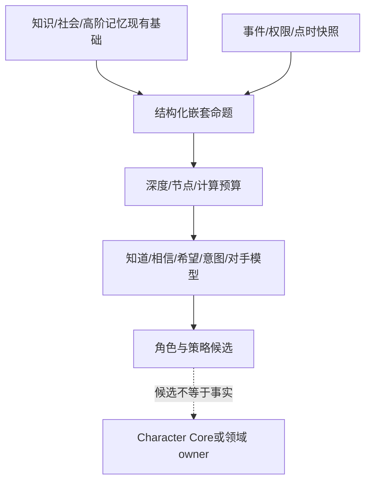
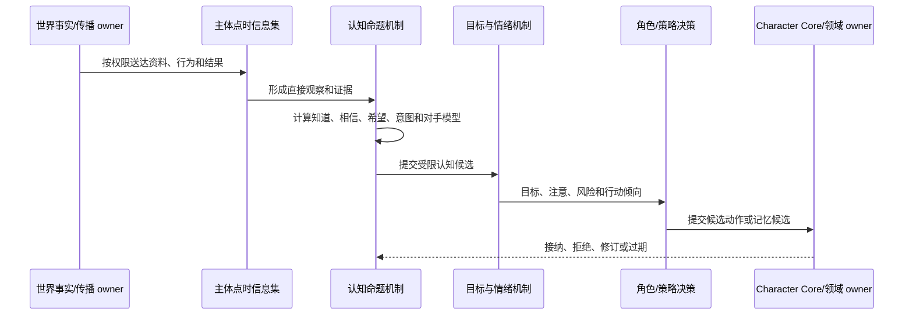

# 高阶认知与希望逻辑设计

日期：2026-10-14

状态：`analysis / design-draft / non-authorizing`

本文只讨论第二个主题：“谁知道谁知道”“知道谁知道谁知道”以及希望、信念、意图等高阶逻辑。它适配原项目已有的知识、社会记忆、高阶记忆、目标和情绪基础；情绪博弈见 13 号文档，量化机构见 15 号文档。

## 1. 原项目复用审查

原项目已有：

- `knowledge_memory`：主体对命题的状态、置信度、来源和时间；
- `social_memory`：信任、怀疑、依赖、共享秘密和关系印象；
- `higher_order_memory` 与 `higher_order_belief_event`：主体关于另一主体知识/信念的记录；
- `goal_runtime`：长、中、短期目标、优先级、紧迫度和证据；
- `AffectEngine`：`hope`、`fear`、压力、信任和置信度等动态状态；
- 角色私有记忆、司命内部信号、世界事实和 owner 回执的边界。

现有高阶记忆主要保存 `subject_actor_id + proposition_key + meta_belief`，不能据此声称支持任意深度递归。因此 fork 复用主体视角、证据和权限边界，新增结构化命题树、递归深度和计算预算。

## 2. 命题结构

```text
CognitiveProposition {
  proposition_ref
  operator = fact | knows | believes | hopes_outcome | hopes_belief |
             intends | models | observes | signals | hides
  subject_ref, object_ref, child_proposition_ref, predicate_ref
  value_or_target, modal_polarity, confidence
  evidence_refs, source_snapshot_ref
  valid_time, observed_time, available_time
  visibility_scope, branch_ref, depth, parent_ref
  mechanism_revision, replay_key
}
```

示例：

```text
p0 = fact(D66, delivery_delay, true)
p1 = knows(A, p0)
p2 = believes(B, p1)
p3 = hopes_belief(Q, R, believes(R, p0))
p4 = models(M, Q, expects(Q, price_breakout))
```

对应关系：

| 语句 | 表示 |
|---|---|
| A 知道 X | `knows(A, X)` |
| A 认为 B 知道 X | `believes(A, knows(B, X))` |
| A 知道 B 认为 C 知道 X | `knows(A, believes(B, knows(C, X)))` |
| A 希望 X 发生 | `hopes_outcome(A, X)` |
| A 希望 B 相信 X | `hopes_belief(A, B, X)` |
| A 计划利用 B 的恐惧 | `intends(A, exploit(B, fear_state))` |

`knows` 需要主体实际可用的证据；`believes` 可以是推断并且可以错误；`hopes` 是偏好目标；`intends` 是准备尝试的策略；`models` 是对手模型。它们不能互换。

## 3. 深度与证据预算

```text
CognitionBudget {
  max_depth, max_nodes_per_actor, max_subjects_per_layer
  max_evidence_refs, compute_deadline
  approximation_policy = truncate | summarize | sample | defer
  stale_after, branch_scope
}
```

公开市场群体可用深度 0—1，关键角色和组织可用深度 2—3。超过预算必须记录截断、摘要、采样或延期，不能静默假设“无人知道”。每层命题保存证据类型、来源、可见域、可用时间、可靠性区间和矛盾证据。

## 4. 希望、情绪和意图

```text
hopes_outcome(A, price_recovery)
hopes_belief(A, B, delivery_delay_is_temporary)
```

`hope_for_outcome` 是主体希望结果发生；`hope_for_belief` 是主体希望他人形成某种信念。二者都不是事实，也不等于概率预测。希望只有在主体拥有渠道、权限、成本承受力和候选行动时，才可能进入信号或传播机制。

公共事实、司命内部信号、另一分支结果和分析者回看结果不能直接进入主体私有知识。只有获权传播、主体可观察行为或注册推理机制的输出，才能形成认知候选，最终写回仍由角色/记忆 owner 接纳。

## 5. 架构图



## 6. 主交互时序图



## 7. 数据流图与验收


验收必须证明：不同阶数和不同模态可区分；每层带证据和时间；超预算可见地降级；希望不写成事实；分析者全景不泄漏给主体；原项目有限高阶记忆可复用，但金融任意深度递归仍需单独实现。

