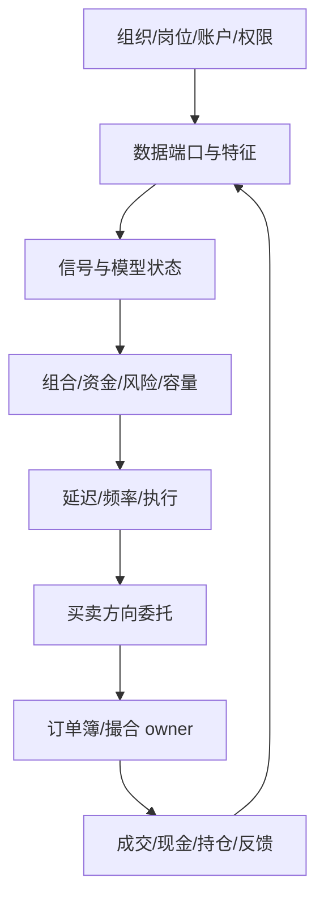
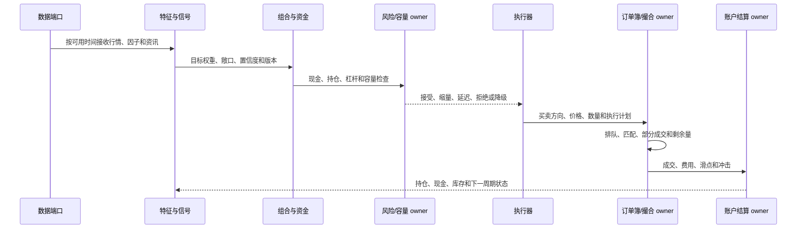

# 量化机构组织与速度资金优势设计

日期：2026-10-14

状态：`analysis / design-draft / non-authorizing`

本文只讨论第三个主题：量化机构如何作为组织使用自己的资金和量化策略参与股市，并表现信息获取速度、计算速度、交易频率、资金规模、容量和执行优势。情绪博弈见 13 号文档，高阶认知见 14 号文档。订单行为分类、拆单、借券回补、做市/套利、策略趋同和异常模式检测见[金融订单行为与多方博弈机制体系](20-金融订单行为与多方博弈机制体系.md)。

## 1. 量化机构是一等组织

量化资金不是静态标签，而是以下系统：

```text
量化组织
  -> 基金/自营账户与资金状态
  -> 研究、数据、风控、交易和执行岗位
  -> 数据端口、特征、信号和专有模型
  -> 组合、风险、杠杆和容量
  -> 延迟、频率、执行和订单
  -> 订单簿撮合
  -> 成交、资金、持仓、滑点、冲击和模型反馈
```

研究、风控、交易和执行是一个组织内部不同权限和过程位置，不是四笔独立资金。账户 owner 统一核算资金、持仓、订单和结算。

## 2. 数据结构

```text
QuantStrategyParticipant {
  participant_ref, organization_ref, fund_or_account_ref
  strategy_ref, strategy_version, mandate_ref
  data_port_refs, feature_pipeline_ref, signal_model_ref
  portfolio_model_ref, risk_model_ref, capacity_model_ref
  execution_model_ref, capital_state_ref, leverage_policy_ref
  venue_scope, instrument_universe, training_cutoff
  parameter_revision, private_model_state_ref
  information_latency_profile_ref, computation_latency_profile_ref
  decision_cadence_ref, order_arrival_rate_profile_ref
  cancel_replace_rate_profile_ref, owner_bindings
}
```

```text
QuantCapitalState {
  account_ref, cash_available, gross_exposure, net_exposure
  positions_ref, margin_available, margin_used, leverage
  risk_budget, turnover_budget, liquidity_budget, capacity_remaining
  settlement_lag, valid_time, account_owner_ref
}
```

策略运行必须拆成：

```text
数据端口 -> 点时特征 -> 信号 -> 组合目标 -> 风险/容量检查
-> 买卖方向、价格和数量计划 -> 订单簿 -> 成交与反馈
```

`QuantSignal != QuantOrderIntent != AcceptedOrder != Trade`。信号、订单意图、接受委托和成交有不同的类型、时间和回执。

## 2.1 执行计划和拆单是一等对象

“卖出 100 万股”只能是组合目标，不能直接写成一笔成交。底座把它展开为：

```text
组合目标
  -> 执行计划
  -> 子订单生成器
  -> 接受委托
  -> 撤单/改单/部分成交
  -> 成交回报
  -> 剩余目标与下一批子订单
```

设计示意的数据合同：

```text
ExecutionPlan {
  plan_ref, parent_intent_ref, participant_ref, account_ref
  instrument_ref, venue_ref, side, target_quantity, target_notional
  objective: reduce_exposure|acquire_exposure|hedge|rebalance|arbitrage|liquidate|make_market
  schedule_algorithm: twap|vwap|pov|arrival_price|optimal_control|event_driven|custom_registered
  aggressiveness: passive|mixed|aggressive
  display_policy: fully_displayed|partial_display|venue_native_hidden|executor_synthesized
  price_policy: limit|marketable_limit|pegged|ladder|reference_price|venue_defined
  routing_policy: single_venue|smart_route|basket_route|cross_market_linked
  urgency, participation_cap, price_band, child_size_distribution
  display_quantity, replenish_rule, cancel_replace_rule
  max_queue_age, max_slippage, stop_condition, valid_interval
  borrow_requirement_ref, authorization_ref, risk_receipt_ref
}

ChildOrder {
  child_ref, plan_ref, side, price_condition, submitted_quantity
  displayed_quantity, hidden_or_reserved_quantity, arrival_time
  cancel_replace_parent_ref, remaining_quantity, fill_quantity
  queue_position_observed, accepted_sequence, status, owner_receipt_ref
}
```

`schedule_algorithm`、`aggressiveness`、`display_policy`、`price_policy` 和
`routing_policy` 是独立轴，不能再用一个互斥的 `schedule_type` 把时间算法、隐藏展示和价格梯度混为一类。原生隐藏单、交易执行器合成的分批单和普通限价单必须分别标记；外部场所不支持的能力返回 `unsupported`，不能静默替换。

不同机构的“卖”因此可以完全不同：主动基金按参与率慢慢卖；趋势量化按信号分批跨档卖；做市策略持续双边报价并根据库存撤改单；ETF 由申赎篮子在特定时点产生成分订单；融资账户由担保合同触发处置；个人群体按成本和止损阈值分布生成小单。每一个子订单都必须经过资金、库存、权限、交易规则和撮合 owner，不能用一个聚合数字代替。

执行方式可以作为注册机制组合，但不保证成交：

| 执行模式 | 在模拟中的含义 | 需要观察的结果 |
|---|---|---|
| TWAP/VWAP/POV | 按时间、成交量或市场参与率分批 | 成交率、平均价格、冲击、未成交量 |
| 被动挂单 | 贴近买一/卖一排队，等待对手方 | 排队时间、撤单率、成交概率 |
| 主动吃单 | 跨一档或多档获取即时成交 | 跨档数量、滑点、深度消耗 |
| 冰山/隐藏剩余 | 只展示部分数量，成交后按规则补单 | 展示量、补单时间、剩余量；不得重复入簿 |
| 价格梯子 | 在多个价格档位分布子订单 | 各档成交/撤单和价格冲击 |
| 撤改单 | 根据盘口、波动和库存改变价格或数量 | 原订单生命周期、队列优先级和取消原因 |

这些模式是市场机制的参数，不是 Laya 可以绕过权限自行发明的操作。外部市场引擎必须按具体市场规则决定哪些模式可用。

## 2.2 融资、融券和日内回转

持有现货、融资买入、借券卖出和买回归还必须使用不同账本。设计示意的借券生命周期为：

```text
可借库存确认 -> 借券合同 -> 卖出借入证券 -> 空头库存
  -> 买入回补 -> 归还证券/费用结算 -> 合同关闭或被召回
```

最少保存 `borrowable_quantity`、`borrow_rate`、`locate_at`、`borrow_start/end`、`recall_at`、`short_position`、`cover_quantity`、`settlement_status` 和适用市场规则。模型可以表达“先卖后买”“先买后卖”“部分回补”“借券被召回”等路径，但能否当天完成回转、能否卖空、是否受 T+1、涨跌停、价格笼子、融券券源和结算限制，必须由 venue/产品适配包判断。没有借券或合法库存，不得生成卖空订单；没有可用现金或保证金，不得生成买入订单。借券存在不等于获得任意日内回转能力；每条回补路径都要记录规则判定和结算状态。

## 2.3 盘口行为作为对抗性情景，不直接写成交易建议

用户所说的“拉伸再砸”“砸完做假反弹再砸”，在底座中可表达为**多阶段市场压力假设**，而不是一条直接改价格的规则：

1. **流动性试探**：某策略用小额、可撤销子订单观察深度和对手反应；
2. **方向性压力**：在合法库存、资金和权限范围内连续主动买入或卖出，消耗多档流动性；
3. **反应传播**：价格、成交量和公开盘口被其他策略读取，趋势跟随、止损和融资机制产生后继候选；
4. **反向阶段**：原策略或其他策略撤单、反向交易或回补，验证此前的买盘/卖盘是否真实；
5. **结果判定**：由撮合器产生价格、成交、剩余委托和账户结果，不能由“拉伸”标签直接生成走势。

每个阶段都带 `actor_intent`、`precondition`、`public_observation`、`expected_response`、`legal_scope`、`detection_rule` 和 `owner_decision`。如果运行目的是压力测试或监管检测，可以生成“疑似诱导流动性”“异常撤改单”“短期价格压力后反向回补”等观测标签；系统不把这些标签当作已证实操纵事实，也不向现实账户输出未经授权的执行计划。

## 3. 速度、频率、资金和多时钟

单一 `latency` 不足以表达优势，至少拆分：发布到接收、接收到特征、特征到信号、信号到风控、风控到下单、下单到撤改单、撮合到反馈。频率记录策略唤醒周期、每周期订单数、每秒消息数、撤改单率、订单存活时间、换手和持仓更新频率。

资金优势记录现金、融资、保证金、杠杆、容量、流动性预算和抗冲击能力。速度优势改变合法输入可用时间、队列位置和执行机会；资金优势改变可行规模和容量；二者都不能创造对手方流动性或绕过 owner。

| 子场景 | tick | 主要输入 |
|---|---:|---|
| 撮合与高频做市 | 微秒—秒 | 委托、撤改单、盘口、成交回报 |
| 短周期量化 | 秒—分钟 | 行情、量价、因子、获权资讯 |
| 新闻和社交传播 | 秒—小时 | 发布、送达、曝光、转发、消费 |
| 研究、投委会、融资 | 分钟—日 | 公告、研究、审批、担保和现金 |

快时钟不能读取慢时钟尚未完成的结果，慢时钟不能改写历史撮合；每条数据保存 `available_at`。

## 4. 典型机构对比

| 参与者 | 资金/组织 | 信息和速度 | 决策链 |
|---|---|---|---|
| 高频做市 Q01 | 自营账户、库存上限、库存风险预算 | 毫秒盘口和高撤改单频率 | 报价—库存—风险—执行；按库存动态拆单/撤改单 |
| 趋势量化 Q02 | 基金账户、单票容量和换手预算 | 分钟行情和量价 | 特征—信号—组合—执行 |
| 主动基金 F01 | 投委会、研究、风控、交易台 | 研报和公告，审批延迟 | 研究—经理—风控—委托 |
| 对手量化 M01 | 独立组织和策略账户 | 订单流和可见报价 | 试探—对手模型—执行；识别并跟随公开压力 |

量化机构可以使用资讯或情绪数据，但只能读取声明的数据端口；机构名称不能自动决定模型和行为。多个策略出现同向订单，也不能直接推断“合作”：必须区分显式通信/授权、共同公开信号导致的策略趋同、观察价格后的跟随，以及仅仅在统计上相关。

## 4.1 竞争、合作、默契与趋同

图谱中把四种关系分开：

| 关系 | 需要的证据 | 模拟含义 |
|---|---|---|
| 显式合作 | 合同、授权、通信、共同账户或订单委托证据 | 可形成共享目标、分工和信息权限；仍须分别通过各自账户与 owner |
| 公开信号趋同 | 相同公告、价格、指数规则或公开数据端口 | 没有私下协作；多个策略可能独立生成相同方向订单 |
| 观察跟随 | 主体可见对手公开报价、成交或价格变化，并有延迟 | 后来者根据观察结果调整目标或子订单，不读取对方私有意图 |
| 默契/隐性协调假设 | 只有行为相关，缺少直接通信证据 | 只能作为待检验假设或反事实分支，不能写成事实关系 |

建议使用 `coordination_hypothesis` 而不是直接建立“合作”边：

```text
CoordinationHypothesis {
  hypothesis_ref, actor_refs, instrument_scope, time_window
  mechanism: explicit|common_signal|follower|tacit|unknown
  evidence_refs, observability, prior_strength, alternative_explanations
  predicted_order_signatures, detection_metrics, owner_status
}
```

例如，趋势量化 Q02、ETF 申赎和融资账户可能在同一天下单，但原因可以分别是价格趋势、篮子规则和保证金合同。模拟要把三条因果链分开，再观察它们叠加后是否形成拥挤，而不能把三者合并成一个“联盟资金”。

## 5. 架构图



## 6. 主交互时序图



## 7. 数据流图与验收


验收必须证明：量化机构是组织、账户、策略、岗位、数据、模型和 owner 的组合；岗位不重复计算资产；训练截止时间和特征可用时间阻止未来信息；速度、频率、资金、杠杆和容量分别可观测；订单包含价格、数量、买卖方向、时间、有效期和剩余量；高速或大资金参与者不能绕过风险、合规、撮合和结算。

司命负责装配机构、策略、数据、时钟、分支和观察指标；Laya 只能在注册的策略/执行候选中做快速选择，不能替代数值模型、风险检查、订单簿和结算 owner。
