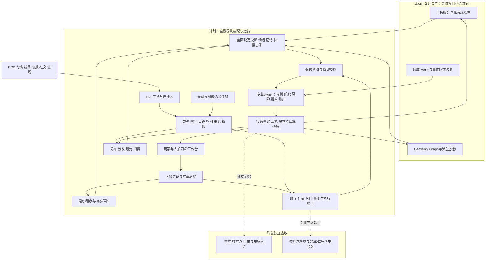
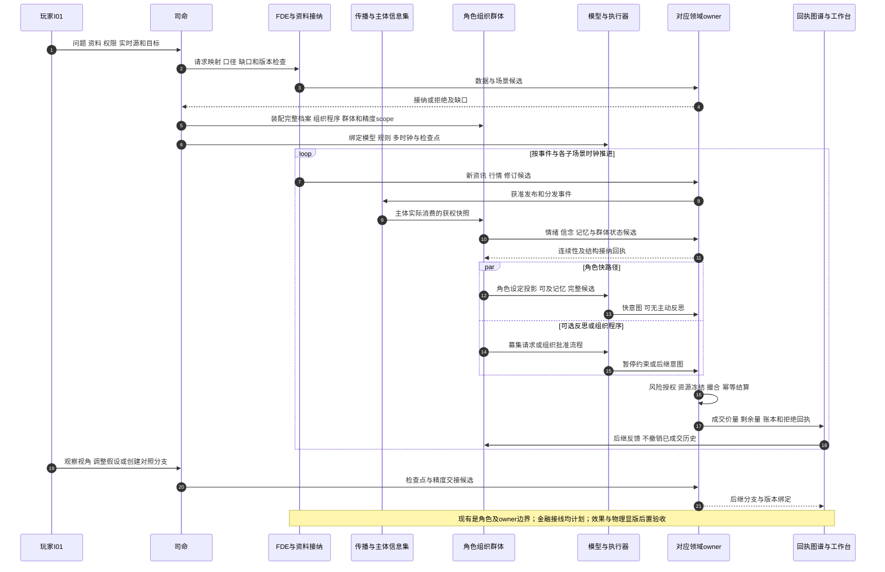

# 光模块市场全设计贯通案例

日期：2026-10-14

状态：`analysis / design-draft / non-authorizing`

本文展示一次从发起者访谈到历史回放、滚动预测和训练样本导出的完整金融模拟设计。承接[总纲](00-模拟预测底座总纲与设计地图.md)、[整体方案](04-通用模拟底座与行业场景适配整体设计方案.md)以及设计03、06—15。原三份基础文档保持不动。

人物、机构、金额、价格、消息、时延、心理数值及行情路径全部为合成示例。本文没有运行模拟；叙述中的选择和成交是用于核对合同的假设轨迹，不是模型实测输出，也不据此证明预测有效。

## 1. 发起者到底要模拟什么

虚构资管机构 F01 的研究与风险团队发起模拟，操作身份为玩家 I01。它管理自己的组合 P01，想回答：

> 光模块主题已从100元涨到160元。交付不确定性、国际限制、舆情传播、拥挤交易和融资约束相遇时，哪些路径可能导致价格接近80元？我们何时减仓、等待或分批承接，各自承担什么风险？

展示的是一条“上涨—拥挤—冲击—流动性退潮—腰斩—分化承接”的条件路径。司命不能把80元设成必须实现的终点再反向安排所有人卖出。场景还包含未腰斩、快速修复和低流动性长期横盘的分支。

这里有两个独立的身份层：I01是场景操作和观察身份；F01是世界里的机构，P01是其组合。两者通过显式委托关联。发起者没有因此获得其他机构的秘密，也不能用工作台直接写成交。

### 1.1 司命先问清楚

| 访谈项目 | 本例答案 | 形成的输入与边界 |
|---|---|---|
| 用途 | 组合压力测试、退出与承接方案比较 | 输出路径和风险区间，不把单一路径当必然预测 |
| 时段 | D00至D80，重点展开D64盘中 | 日历、交易时段、日级与事件级时钟 |
| 范围 | 光模块概念 K01、三家成分企业；重点证券 S01 | 概念、发行人和证券分开；行业广度与单股盘口分开 |
| 自有资料 | P01持仓、交易约束、研究档案、订阅源 | F01私有；按岗位和用途授权 |
| 外部资料 | 公告、行情、财报、研报、新闻与社交统计 | 逐来源绑定；没有平台内部算法和完整浏览日志 |
| 企业资料 | M01授权的脱敏ERP样例 | 只授予特定研究流程；其他投资者不自动可见 |
| 重要参与者 | 基金、量化、融资户、长期资金、厂商、客户、媒体账号 | 选择关键岗位与成员持续角色化 |
| 干预方式 | 假设、资料、组合候选、对照分支 | 不直接改现实资料、对手心理或盘口结果 |
| 更新方式 | 实时行情与资讯，加发起者持续上传 | 先核对来源、发布时间、权限和修订，再接纳 |
| 观察方式 | 自身机构、市场公开视角、合成角色实验视角 | 三种权限分别授予；实验私有状态不进入交易角色信息集 |
| 资料缺口 | 其他机构真实仓位、个人完整经历、推荐算法 | unknown或具名合成假设，不冒充真实还原 |

司命产出 `SimulationInitiation` 和缺口清单。FDE指 Forward Deployed Engineer／团队，负责机构适配、配置和验收；其使用的连接器、映射工具与注册合同构成适配设施，FDE本身不是可以任意写世界事实的自动代理。

## 2. 装配一份可执行的场景，而不是只写背景故事

以下为设计示意：

```text
simulation_ref: SIM-OPTICAL-16
player_ref: I01
organization_ref: F01
portfolio_ref: P01
time_range: D00..D80
focus_episode: D64 10:00:00 起
market: X01，虚构的境内普通股票连续竞价市场
packages:
  identity / temporal-scope / permission / social-structure
  financial-data / corporate-process / information-distribution
  character-cognition / emotion / quant-strategy
  orderbook / account-settlement / risk / replay
owner_bindings:
  资料接纳 / 角色连续性 / 组织程序 / 传播
  风险授权 / 撮合 / 账户结算 / 企业履约
versions:
  source_watermarks / semantic_registry / market_rules
  profile_revisions / model_bindings / mechanism_revisions
  permission_snapshot / initial_checkpoint / random_streams
stop_conditions:
  D80收盘 / 关键源不可恢复 / 守恒错误 / 无合法推进路径
```

风险授权、撮合与账户结算是不同职责。撮合产生唯一成交记录，账户结算消费成交身份，幂等提交双方资金、证券与费用变化。结算未确认时挂起相关资源，不把尚未完成的结算显示为可自由使用余额。本文不新设一个跨领域任意写入的总owner。

### 2.1 交易制度也必须装配

本例采用模拟规则包：价格最小单位0.01元，普通买入以100股为单位；普通股票当日买入不能当日卖出；未配置合法借券时不能裸卖空；常规日涨跌幅为前收盘的±10%，边界按规则包取整；考虑停牌、集合竞价与交易日历。本例盘中片段位于连续竞价，其他时段不复用相同撮合逻辑。

短周期流动性策略不是默认具有法定做市资格的机构。Q01-L以已有可卖库存和现金提供限价买卖单，不暗示真实普通A股存在本文虚构的正式做市制度。频繁买卖也受可卖库存、T+1、费用、消息限速和容量约束。

费用示例统一采用订单级汇总后舍入：双方佣金为成交金额的0.03%，最低5元；卖方另付0.05%税费。它们只是本例规则包假设，不是对任何现实日期费率的确认。撤单、未成交不征成交费用；跨日结算、可用与可取余额分别记录。

## 3. 数据如何成为同一个世界里的不同对象

### 3.1 数据表示、领域语义、演化机制的贯通

| 输入 | 数据表示 | 领域语义与实体映射 | 在世界中的用途 |
|---|---|---|---|
| M01的ERP | 订单明细、库存表、生产事件 | 企业、客户、合同、产线、交付批次、应收款 | 企业过程机制计算交付候选与现金压力 |
| 证券主数据 | 记录、关系表 | S01、发行人M01、概念K01、市场X01 | 企业变化通过暴露关系影响证券模型 |
| 财报与预测 | 面板时序、表格、估计分布 | 合并收入、单季收入、利润、预测版本 | 估值、偿债、风险模型输入 |
| 盘口与成交 | 有序增量事件流、深度快照 | 报价、委托、撤单、成交及双方账户 | 撮合、量价统计、流动性与执行模型 |
| 账户与融资 | 账本、持仓、合同、约束式 | 现金、可卖量、冻结量、担保与负债 | 可行行动、补担保、减仓程序 |
| 公告与研报 | 原文、表格片段、命题、修订 | 作者、载体、判断、证据、预测 | 发布、分发、消费、信念更新 |
| 社交内容 | 文本、视频、转写、互动事件 | 账号、渠道、观点、转载血缘 | 曝光、注意、观点上传与扩散 |
| 宏观与行业 | 时序、曲线、矩阵、分布 | 利率、汇率、需求、产业暴露 | 资金成本、需求与估值情景 |
| 政策法律 | 文件、条款、适用域、过程 | 制定者、法律效力、实施机关、受约束事项 | 解释、审批、履约限制与预期变化 |
| 分析框架 | 模型实体、变量、依赖图、端口 | 估值、时序、风险、传播、行为模型 | 读取冻结输入，生成有来源的估计或状态候选 |

图谱保存身份与依赖，原文留在载荷存储，行情留在事件/时序存储，张量和分布留在适合计算的存储。不能把每笔行情和每个矩阵元素都变成重型角色节点。

例如时序模型读取截至本轮可用的成交与波动窗口，输出未来波动分布；估值模型读取已获权交付、利润预测和折现曲线，输出估值区间。输入变量和模型依赖投影到图谱，输出以新派生版本更新对应变量引用；企业交付或市场状态的新回执又使后继模型重算。这是双向更新，不是让模型预测值直接成为成交价。金融插件可继续注册期权曲面、指数篮子、利率与信用等端口，但本案例不假装运行了所有金融产品。

### 3.2 一条交付数据的时间、口径和空间

设计示意：

```text
object: M01-DELIVERY-Q3-r2
value: 80000
unit: 件
meaning: 指定订单集合在第三季度计划交付的合格成品数量
scope: M01合并范围；排除内部转移；含税金额不适用
event_time: D63 16:00 客户提出变更
valid_time: 第三季度计划适用期
published_at: D64 10:00:00 公告对外发布
received_at: 各来源/订阅端独立记录
consumed_at: 各主体独立记录
recorded_at: 本系统实际入库时间
logical_time: 当前模拟分支的事件时间
spatial_and_applicability_scope:
  工厂A/客户所在法域J02/境内市场X01/授权研究范围F01
revision: r2
supersedes: r1（100000件）
provenance: 原文页段+ERP映射版本+订单集合定位
epistemic_status: 合成场景中的计划修订；不是已实现出货
```

8万件不是8万元，也不是已确认收入；季度计划不能直接与月度实际产量相减。财务模型必须区分合并/母公司、单季/累计、计划/实际、币种、含税/不含税以及重述版本。

空间在此包括工厂几何位置、供应链拓扑、跨境物流路径、政策法域、证券交易场所和信息可达范围。政策只影响声明范围内的产品、客户和合同，不把“某国限制”广播成所有企业同等受损。

历史渠道可知、系统当时实际接收、今天最新修订研究是三个查询模式。D50的回放不能读D64才发布的r2；迟到入库也不能伪造某角色过去已读。

### 3.3 政策、权力、法律及会议分别表达

本例装配以下独立对象，影响不只来自经济利益：

| 对象 | 表达方式 | 影响路径 |
|---|---|---|
| 国际限制措施 | 规范条款、发布机构、生效区间、产品与法域 | 合规核验→客户采购/交付过程→企业估计 |
| 国内产业方向、方针、政策 | 分别注册语义类型与载体关系 | 目标和预期→机构研究；不自动生成现金 |
| 实施细则 | 具体对象、条件、执行机关、办理过程 | 符合条件→申请→审批→实际履约 |
| 白皮书、指导文件、会议讲话 | 内容陈述、发布者、效力及解释状态 | 提供预期线索；不能一律作为强制规范 |
| 部门会议 | 过程、出席任职、议题、表决/纪要/决定 | 会议发生不等于文件生效或资金到位 |
| 国资监管机构 | 组织、监管职权及控制关系 | 权限链约束相关企业/出资行为 |
| 政府母基金及被投基金 | 独立组织、出资合同、资金账户、投资程序 | 实际出资/投资改变对应资源；不能把政策规模直接算成二级市场买盘 |

“路线、方针、政策、实施细则”等名称不构成全球统一的线性效力排序；以法域专业包、制定权限、适用范围、效力依据、冲突规则与解释版本判定。国际消息有争议时同时保留原文、不同解释与不确定性。

## 4. 市场参与者是组织、岗位、个人和策略的组合

本例不沿用不同文档里碰巧相同的机构编号含义；以下为本场景独立命名空间。

| 参与者 | 内部结构 | 资金与约束 | 主要博弈对象 |
|---|---|---|---|
| F01主动基金 | 研究员B、经理C、风控D、交易员E | P01组合，单票上限、授权、申赎压力 | 同业排名、投资者、市场承接 |
| Q01量化机构 | 数据/研究/风控/执行岗位，三个策略实例 | 一个主账户、可核对的策略子额度 | 报价对手、趋势拥挤者、消息反应者 |
| Q01-L流动性策略 | 库存与价差模型 | 已有可卖库存、买入资金、消息限速 | 主动买卖盘与库存逆向选择 |
| Q01-T趋势策略 | 分钟量价特征、组合与执行 | 独立子额度和单票容量 | 其他趋势资金、共同退出压力 |
| Q01-N资讯策略 | 新闻/社交特征、对手估计 | 资讯授权、交易额度、持仓限制 | 不同渠道的信息时差与反应 |
| Q02对手量化 | 独立组织和模型版本 | 自有账户，不能读Q01私有策略 | Q01的可见报价和成交行为 |
| L01融资投资者A | 个人、券商合同及账户 | 自有现金、已有持仓、融资负债 | 券商追保、其他卖方与承接资金 |
| V01长期资金 | 研究员、决策人H、风控与交易岗 | 估值区间、持有期限、承接预算 | 流动性折价与基本面误判 |
| M01发行人 | 生产/财务/法务/披露岗 | 订单、产能、披露义务 | 客户、供应商、监管和股东 |
| C01客户 | 采购、合规、预算审批 | 采购合同、资本支出和政策约束 | M01及其他供应商 |
| J01券商 | 研究、资讯服务、融资与风控 | 不同业务信息隔离与授权 | 客户需求、合同与信誉 |
| U01财经创作者G | 账号、内容团队、发布流程 | 注意力、声誉、平台权限 | 用户、其他作者、平台推荐 |
| R01公众参与者 | 具名角色与B0/B1背景成员 | 各自账户、记忆、渠道、成本 | 彼此影响、价格反馈、机构交易 |

同一个岗位不等于一个资金池。研究员、经理、风控和交易员都可持续运行，但F01的组织账户只核算一次。Q01三个策略的子额度不得分别声称拥有同一笔全部现金；组织主账与子账对账，额度变化由组织与账户程序接纳。

## 5. 每个持续角色都从自己的全面设定出发

### 5.1 完整档案、相关投影、动态状态

每个角色引用设计13的 `CharacterDecisionDossier`，涵盖身份背景、价值目标、人格细分、知识能力、生活与交易经历、记忆、习惯、认知方式、情绪调节、信任关系、组织任职、自控承诺与隐私来源。当前状态放在 `EpisodeMindState`，账户由账户owner提供快照。

以下表格是为了阅读而节选，不能当成只允许这些字段的固定人格模板。所有示例设定均为本例作者显式合成；未写出的事实仍为unknown，不自动推断家庭、诊断、隐私或数值参数。运行时加载实际完整档案及其获权相关投影，不用这张摘要替代它。

| 人物与身份 | 背景、目标及冲突 | 经历、记忆与习惯 | 认知、渠道和关系 | D64动态状态与权限 |
|---|---|---|---|---|
| A，L01融资投资者 | 工程背景；希望盈利又害怕重复重大亏损；在意家庭安全 | 曾遇过交付延期后连续跌停；后来几次回调又反弹；亏损线索容易唤起前一次失败 | 熟悉技术产品，欠缺合同核验训练；先看交易软件与股吧，信任G但并非盲信；紧急时惯于先减仓 | 浮盈回撤、恐惧与反弹希望并存；注意被价格牵引；仅能操作自己的账户 |
| B，F01研究员 | 光通信专业；重视证据及研究声誉，也担心错失机会 | 过去纠正过标题误读；习惯核对原文和订单范围 | 公告、授权研报和ERP脱敏端口；不信转载次数代表独立证据 | 焦虑、好奇；可写研究候选，不可下单 |
| C，F01基金经理 | 重视长期收益，也承受短期排名和赎回压力 | 曾因过早止盈跑输，也曾因审批拖延受损 | 能看内部研究与组合；会评估“其他基金是否也会退出” | 贪婪、担忧及声誉压力并存；可提出目标仓位，不能绕过风险否决 |
| D，F01风控负责人 | 稳健、强调责任边界；目标是控制组合尾部风险 | 对历史流动性枯竭有程序性记忆 | 读取授权组合和市场数据；不自动读研究员私人记忆 | 警惕但有工作流程；有授权限额内否决权，无研究观点任意改写权 |
| E，F01交易员 | 重视成交质量、纪律和执行信誉 | 曾因激进追价产生冲击；有分单和暂停习惯 | 盘口、成交回报、已批准计划；不能读取另一机构模型 | 专注、负荷升高；只能执行当前授权包络 |
| F，Q01策略负责人 | 重视模型稳定与资源利用，也担忧错失行情 | 记得旧情绪因子在不同市场失效 | 监控合法特征与模型漂移；不每笔人工审批自动策略 | 紧张但不等于算法恐惧；可提出停用或调参，经组织程序生效 |
| G，U01作者 | 追求影响力、收入和专业形象 | 曾因抢发涨粉，也因错误标题受质疑 | 公开公告、新闻与评论；只知道受众可见行为 | 惊讶、表达紧迫感和声誉顾虑；可发布候选，不能写市场价格 |
| H，V01决策人 | 偏好可理解现金流、耐心但非永不止损 | 在旧周期低估过结构性需求下降 | 原文、估值、产业资料；不以一时热度代替订单验证 | 谨慎希望；可申请承接预算，资金执行仍需授权 |
| I，M01披露负责人 | 希望稳定预期，也必须准确披露 | 有澄清误读与披露问责经历 | 企业获权内部资料、法务和披露过程 | 压力、担忧与责任感；可提披露文本，按程序批准发布 |
| J，C01采购负责人 | 要保证供货并遵守预算与跨境限制 | 记得延期与预付款风险 | 自有采购和合规资料；不掌握全市场信息 | 不确定、希望保供；提出合同变更，不能直接改M01收入 |

### 5.2 A的一次完整心智投影

```text
actor: A
dossier_revision: A-r12
known_now: 已消费的帖子片段、自己的持仓、实际送达的盘口
not_known_now: 公告尚未阅读的限定段、F01审批、Q01内部仓位
goals: 保住家庭安全垫；争取行情收益；避免再一次连续跌停
accessible_memories:
  旧交付延期导致卖不出的经历（本轮高度可及）
  近期回调反弹经历（仍存在，本轮较弱可及）
beliefs: “这也许又是旧事故”；“也可能只是暂时调整”
affect: 恐惧、焦虑、希望同时存在；按对象分别保存
habits: 紧急威胁先减小风险；缺少重大卖出前必须核验承诺
current_load: 价格提醒与融资界面占用注意；尚未看到原文限制条件
candidate_set:
  卖出可卖持仓的一小部分 / 等待 / 阅读原文
  请求反思 / 发布带来源的观点 / 其他获准候选
binding: Laya快路径选择完整动作及目标
```

没有因为A的摘要写了“恐惧”就强制他卖出。Laya读取本角色的真实投影，在完整候选中选择；数值模型负责候选的价格数量、账户可行性和执行参数。慢模型也可能保留原判断，不能默认等于理性纠错器。

## 6. 组织内部与外部同时在博弈

F01内部不是一个统一大脑。B认为标题夸大，但C担心即使基本面影响有限，同业集中退出也会让净值承压；D关注可退出容量，E关注订单到达后能否成交。四人可以有分歧，也可以通过程序合作。

本例组织程序为：B提交带证据的研究版本→C提出减仓目标→D检查风险与授权，批准、缩量或否决→E编译分单→账户冻结资源→撮合→结算→组织回执与复盘。紧急风险动作可由事先授予的窄授权触发，不必临时召开完整投委会；窄授权的资产、数量、时间、触发条件仍明确。

F01外部同时面对持有人赎回、融资银行/券商合同、公司披露、同业竞争和媒体解释。合作包括内部研究共享、获权数据采购和合法执行委托；竞争包括争夺有限买盘、获取更好价格和避免被对手预测。不同主体同时竞争与合作，用不同关系与过程表达。

## 7. 大规模群体让成员自己形成分歧

合成公众池包含20,000个成员身份，保存现金、持仓、成本、杠杆、渠道、习惯、记忆与情绪/信念的联合结构；B0/B1可以用样本、条件分布与成员游标推进，不要求20,000人每轮都调用大模型。

上涨时12,000人曾被投影为“短窗追涨”群体。这是特定时段、特定行为维度的合并，不是12,000人拥有同一个人格。D64消息消费与价格反馈后，该投影在一个互斥行为维度上的假设拆分为：

| 成员数 | 当前行为 | 内部仍保留的差异 |
|---:|---|---|
| 5,000 | 提出不同规模的减仓候选 | 成本、可卖量、杠杆、恐惧对象、消息来源 |
| 4,000 | 继续持有或撤销新增买入 | 希望反弹、基本面判断、风险预算各异 |
| 3,000 | 等待核验、观望 | 不同渠道、阅读习惯和认知截止时间 |

其余8,000人没有因这个划分而消失，也不要求他们交易。相同成员还可处于“融资约束”“某账号受众”“某地区”等重叠投影；这些是不同统计维度，不能相加成更多人或更多资金。

### 7.1 群体的内部传播

G的关注者先争论，部分人转发，部分人贴出公告原文，另一部分只看到下跌截图。桥接成员把雪球的解释带到股吧；旧关系的信任度、重复曝光、注意争夺、评论互动和价格反馈改变传播。临时共同行动可以持续、分裂、转向或消散，不要求全体同时切换方向。

### 7.2 群体展开为角色

司命发现5,000个减仓候选成员中有100个成员兼具高杠杆、桥接传播或大额订单影响，于检查点提出精度升级。接纳后，该交易scope由4,900个成员的批量机制与100个持续角色共同推进。

这100个角色继承原身份、账户、记忆、情绪、未完成订单、义务与随机流，不重新生成100笔资金。原批量机制暂停其对应scope；传播scope若继续批量统计，要按身份排除重复写入。降回群体精度时也保存新增经历和未完成过程。

### 7.3 组织与群体的区别在此可见

F01的“谨慎研究成员群”可以影响C，不能获得D的否决权。跨平台“恐慌减仓群”能提供传播和订单压力候选，没有共同账户，也不能代表每个成员承诺卖出。若成员依法成立投资组织，须创建新组织、章程、授权和账户，记录来源关系；不是换一个标签。

## 8. 活的图谱承载不同层面的关系

| 图层 | 节点与边 | 可变化的内容 | 写入或更新边界 |
|---|---|---|---|
| 企业与产业 | M01、C01、供应商、合同、批次 | 交付、依赖、替代、应收暴露 | 企业过程与事实接纳 |
| 制度与权力 | 部门、文件、任职、审批、法域 | 生效、解释、授权、撤销 | 对应制度/组织owner |
| 组织内部 | B/C/D/E、岗位、任命、委托 | 权限有效期、任务状态、预算 | 组织程序；观察不等于代表 |
| 信息分发 | 原文、账号、平台、受众 | 转载、曝光、阅读、信任、覆盖 | 传播/角色接纳；不读取对手私有心理 |
| 认知与情绪 | 主体、对象、命题、记忆引用 | 信念、希望、恐惧和对手估计 | 私有连续性owner |
| 资金与市场 | 账户、策略、证券、订单、成交 | 持仓、敞口、容量、队列 | 风险、撮合和账户结算 |
| 模型依赖 | 模型、变量、输入端口、输出 | 版本、适用域、更新频率、失效 | 模型输出先作候选或估计 |

例如G→A同时存在关注、信任、影响三类边。信任0.70降至0.45是一个有来源的示例版本变化；影响强度、可信度和法律代表权是不同字段，不能用一个权重替代。其他有向边可用比例、金额、时延、容量或类别表达，只有相同量纲和语义的边才可直接比较。

边带注册标签，例如“转载同源”“融资约束”“只读研究用途”“D64有效”。标签绑定可检验的语义和机制，不因挂上“强影响”就直接扣钱或写入卖单。元标签约束可挂对象、可见性、编辑、冲突、生命周期和权限，也不授予新owner。

多方结构通过关系实体表达：一个合同连接客户、厂商、担保方、产品和履约过程；一篇联合研报连接多个作者与机构。嵌套图可展开“机构→岗位→认知命题”或“行业→企业→生产批次”，分析算法包括社区、中心性、路径、切割与网络暴露，但这些结果仍是派生量。

## 9. 信息从哪里来、怎么被不同的人看到

### 9.1 发布、分发、曝光、消费分开

| 渠道 | 本例传播方式 | 不同参与者实际获取什么 |
|---|---|---|
| 公告与公司网站 | 原文发布、修订、订阅 | B核对限定段；I通过披露流程发布；多数公众尚未阅读 |
| 财联社等财经新闻/资讯软件 | 快讯、编辑标题、后续解释 | Q01-N获授权机器流；A可能仅见推送标题 |
| 券商软件与研报服务 | 权限分层、摘要、研究全文、客户触达 | F01订阅全文；部分客户只有摘要；融资通知独立送达 |
| 第三方交易软件 | 行情、提醒、资讯卡片、社区 | A价格提醒先到；其他人关闭推送或订阅不同主题 |
| 股吧 | 标的讨论、评论、转发与截图 | A消费高热帖；少数成员上传原文反证 |
| 雪球 | 关注流、长文、组合观点、讨论 | 研究倾向成员读长文；桥接者跨平台转述 |
| 微博 | 热点、关注网络、转载 | 标题传播快，消费深度按人分化 |
| 抖音 | 视频、推荐、观看与转发 | 短视频观众可能延迟数分钟消费解释 |
| 微信公众号 | 订阅文章、推送、社群转发 | 形成不同阅读窗口与观点再加工 |

这些是渠道适配范例；没有真实推荐日志时，曝光/排序/时延机制显式为合成假设。平台是组织和机制，账号是主体或组织的渠道身份，原文是载体，观点是陈述，几者不合并为一个节点。

一份公告被十个平台转述，仍只有一份底层证据；独立客户确认才可能增加独立证据。重复曝光可以改变注意和熟悉感，但必须保留共同血缘。观点上传经历“角色候选→发布权限/内容程序→发布回执→平台分发→实际消费”，不能由一次角色发言直接更新所有人信念。

### 9.2 D64的消息与可用时间

以10:00:00为t=0：M01发布“部分批次顺延，年度框架未取消”的公告E01。世界中还存在尚未公开的客户讨论，公开公告不使它们自动进入交易者快照。

| 时刻 | 事件 | 获得与尚未获得 |
|---:|---|---|
| t=0 | 披露程序发布E01 | 公开可获取；不等于所有人已阅读 |
| t=0.15秒 | Q01-N接收授权资讯摘要 | 已接收摘要，未证明人工读过公告全文 |
| t=0.32秒 | Q01-N订单意图可送达 | 经过其特征、信号、组合、风险和执行；无保证成交 |
| t=2秒 | B消费原文并检索订单范围 | 具有限定段知识；尚未获全部客户内部资料 |
| t=6秒 | G消费快讯并提出观点 | 只能基于自身已消费内容，不拥有B的私有研究 |
| t=12秒 | G的带来源观点发布并分发 | 受众曝光候选开始，尚不能断言A已读 |
| t=18秒 | B完成首轮核验，向C发内部研究候选 | C消费后才知道B的结论 |
| t=30秒 | A实际消费股吧转述 | 标题与讨论可及，限定段尚未消费 |
| t=31秒 | A启动本轮决策episode | 冻结自己的设定、获权记忆与状态 |
| t=90秒后 | F01授权减仓计划可能完成 | 实际取决于过程状态，不固定每次90秒批准 |

同一时刻的事件以明确因果序列、场所序号和仲裁规则处理，不以模型线程谁先返回决定谁获得队列优势。

## 10. 情绪、行为心理学、快慢思考如何落到一次行动

### 10.1 情绪不是仅有贪婪和恐惧

在上涨末段，A可以同时有强获利动机、兴奋、错失焦虑以及对旧事故的恐惧。贪婪组合指标0.78、恐惧强度0.55只是不同标度上的合成状态示例，不要求相加等于1，也不直接表示买卖概率。

D64消费后，恐惧指向“再次卖不出去”，焦虑指向“消息仍不清楚”，希望指向“价格可能反弹”，后悔指向“昨天为何没止盈”，愤怒可能指向“作者为何一直看多”。这些情绪对象不同，不做一个全局正负数相消。

| 角色自己的因素 | 本轮进入的位置 | 可见的中间变化 |
|---|---|---|
| A旧亏损记忆 | 威胁线索联想与主观评价 | 旧事故更容易被提取，熟悉感提高主观确信 |
| A恐惧与焦虑 | 注意、核验意愿、紧迫度 | 可能先减仓，也可能核验或僵住；本路径选择前者 |
| A反弹希望与后悔 | 目标坚持、反事实评价 | 只卖部分持仓，后续可能想买回；不是强制抄底 |
| C同业压力 | 目标冲突、对手模型与组织流程 | 基本面尚可仍提出减仓，防拥挤退出 |
| B好奇与核验习惯 | 原文检索、反思募集 | 发现限定段，延缓武断结论 |
| G声誉顾虑 | 表达方式与发布程序 | 选择带来源、保留限定，而非必然夸张 |

行为心理组件可以引用前景理论、注意显著性、社会比较、处置效应和习惯，但只有声明适用的角色/群体使用。参考点可以是成本、前高、目标或债务门槛；损失厌恶参数与恐惧强度不是一回事，不把所有人套进统一函数。

数值机制的计划形式沿用设计13：

```text
emotion_next = bounded(
  baseline + (previous - baseline) * 2^(-elapsed / half_life)
  + appraisal_stimulus + consumed_social_effect + regulation + registered_interactions)

behavior_parameter[j] = bounded_link_j(
  character_baseline[j] + context[j] + permitted_effects[j])
```

参数基线从角色实际设定或有来源的投影产生；自然语言设定无需全部强转成系数。FOMO与组成的焦虑/社会比较不能重复叠加。半衰期按经过时间计算，不按tick次数；缺参数则保留缺口或显式分支假设。

### 10.2 A未主动开启系统2便承诺行动

本路径的假设时序为：t=31秒冻结输入；t=31.8秒快路径可用，选择卖出1,000股，限价159.50元；A主观确信“先降低风险”，没有募集主动反思，也没有生效的暂停承诺。经权限和资源准入，t=32.1秒订单到达，t=32.2秒撮合。

系统1在这里体现自动联想与快速判断。A知道自己想卖，但未必意识到旧亏损记忆如何影响自己。不是物理大脑复制，也不能因为Laya调用快就证明还原无意识。系统2“未开启”指没有主动、费力的核验；可存在被动接受直觉。

完整候选包含等待、核验与不交易；不能删掉这些候选强迫A冲动，也不能先在本地选好卖出再让Laya背书。模型实际计算耗时与模拟中的主体可用时间分别记录；离线回放可等待计算结束后按契约调度，实时预算不足则延期或降级并记录，不能无故让推理穿越时间。

### 10.3 相同刺激下的六种反思路径

| 路径 | 在本例如何出现 | 对订单的意义 |
|---|---|---|
| 未察觉疑点 | A只联想到旧事故 | 快意图可先准入 |
| 察觉但未募集 | A感到不确定，仍觉得先行动 | 没有自动慢模型审批 |
| 请求但尚未开始 | 反思队列未给到资源 | 无暂停时仍可能先成交 |
| 已开始但行动先发生 | t=31.9请求，t=37完成 | 已成交部分不能撤回 |
| 反思支持原直觉 | 看完原文仍判断流动性风险大 | 可以继续或调整，系统2不保证反向选择 |
| 及时介入 | B式核验习惯或A既有暂停承诺生效 | 暂停后再决定；不是事后伪造事前核验 |

若换用另一个全面设定，须创建明确的对照角色版本或干预分支，不在同一历史中悄悄给A添加训练和纪律。一次反思募集的抽样绑定episode，不在每个更细tick重新抽签提高成功率。

## 11. 谁知道、谁认为别人知道，以及希望别人相信什么

本例的结构化命题示意：

```text
p_text = 公告E01包含“年度框架未取消”限定段
knows(B, p_text)                             # B已消费且有原文证据
believes(C, knows(B, p_text))                 # C基于内部研究回执的判断
believes(C, believes(Q01, many_retail_will_sell))
hopes_outcome(A, price_recovery)
hopes_belief(I, investors, delay_is_limited)  # 披露负责人希望受众理解范围
intends(Q01-N, trade_on_estimated_reaction)
models(Q02, Q01-L, inventory_reduction_hypothesis)
```

这里B知道的是原文包含什么，不能仅凭公告断言未来订单一定不取消。C关于Q01的命题是可错的对手推断，不读取其私有模型。希望是目标，情绪中的希望体验另存，并以引用关联。

群体可限深0—1层，关键角色本例限深3层、每episode最多128个命题节点；超预算截断或摘要，留诊断，不解读成“无人知道”。每层都有来源、时间、置信度及矛盾证据。A没有读到B的内部研究，不能因为玩家看过就自动知道。

## 12. 量化机构如何看到情绪并利用资金与速度

### 12.1 人、组织与自动策略各有状态

Q01的策略负责人F可能焦虑，但自动策略不会因此获得一份人的恐惧。Q01-N仅在声明端口读取公开表达/行为的情绪估计；Q01-T可以只读量价；Q01-L以盘口、库存与波动管理报价。策略变更须版本化和接纳，不允许F临时想法无痕改变已经在途的订单。

Q01有1亿元模拟主账户现金，其中Q01-L分配2,000万元、Q01-T分配5,000万元、Q01-N分配3,000万元；各自另有已有持仓明细与冻结量。Q02独立拥有800万元现金。金额是本例假设，资金规模不代表必然盈利。

### 12.2 速度是一条链，频率是一组资源

Q01-N在本次事件中的假设累计时延：

| 阶段 | 完成时刻 | 解释 |
|---|---:|---|
| 授权资讯送达 | 150毫秒 | 相对公开发布t=0 |
| 点时特征完成 | 200毫秒 | 文本与可用盘口特征 |
| 信号完成 | 260毫秒 | 产生目标变化，尚非订单 |
| 风险与额度确认 | 280毫秒 | 共享主账户资金仍核对 |
| 订单到达 | 320毫秒 | 与其他到达订单共同排队 |

Q01-L可按订单事件更新，受模拟消息上限约束；Q01-T按一分钟窗口唤醒；Q01-N按新资讯触发，执行器按拆单事件推进。分别记录每秒消息、实际订单数、撤改率、存活时长、换手、队列位置、资金占用、滑点和已成交量。频率高不能在没有新信息或授权时无限生成免费决策。

### 12.3 本例的博弈与反制

1. Q01-N估计部分投资者会将“顺延”理解为更严重的问题，先降低自己已有多头敞口。它读的是获权摘要和可见行为，不是A的真实内心。
2. Q01-L发现主动卖出占比上升，撤回部分尚可撤的买单、降低库存目标；这减少承接深度，但撤单须市场确认，不能取消已经成交的数量。
3. Q02从可见报价推断对手可能收缩，决定是等待、提交真实可执行限价单，还是减仓；试探单一旦匹配必须承担成交，不能被定义成零成本读取别人秘密的工具。
4. H认为短期折价开始补偿不确定性，申请小规模承接。Q01-L也可能在更低价格愿意买入，因此量化并非始终单向卖方。
5. 对手会误判：标题影响短暂、真实买方更强或模型漂移时，先卖者可能付出踏空、费用和再买成本。

同一机构内部的资讯、风险与执行合作，同外部机构竞争并存。合法研究共享或执行委托使用明示合同与权限。若研究违规传播/虚假委托情景，行为单独标为违规候选，常规运行由制度门禁拒绝；研究分支才允许按专门规则模拟行为、检测、调查与处罚，不能将虚假信号当成普通合法优势。

## 13. 报价、委托、成交：三者都有价、量与方向

本例t=32.0秒的盘口局部如下。它是完整市场中的一个展示切片，后续订单可改变它。

| 方向 | 价格 | 剩余数量 | 对应已接纳订单 |
|---|---:|---:|---|
| 卖 | 160.20 | 1,500股 | 其他账户卖出 |
| 卖 | 160.00 | 2,000股 | Q02部分已有库存 |
| 买 | 159.80 | 400股 | Q01-L真实买单 |
| 买 | 159.60 | 600股 | V01已批准承接子单 |
| 买 | 159.40 | 2,000股 | 其他账户买入 |

报价展示带价格、量、方向与快照时间，聚合报价必须能回到订单。委托记录买卖方、账户、限价、原始量、已成交量、剩余量、到达时间、有效期、队列与状态。成交记录实际价格、数量、买卖双方、主动方向判定、时间与成交身份。

### 13.1 A的卖单如何跨档匹配

A在t=32.1秒到达的委托为“卖出1,000股，限价159.50”。账户快照确认其已有20,000股全部为此前交易日取得、可卖，现金80,000元；卖出量冻结1,000股。前收盘160元，该限价处于本例当日边界内。

撮合按价格优先、同价时间优先处理：

| 成交 | 买方 | 卖方 | 价格 | 数量 | 成交额 | 主动方向 |
|---|---|---|---:|---:|---:|---|
| T01 | Q01-L账户 | A账户 | 159.80 | 400股 | 63,920元 | 卖方主动 |
| T02 | V01账户 | A账户 | 159.60 | 600股 | 95,760元 | 卖方主动 |
| 合计 | — | — | 均价159.68 | 1,000股 | 159,680元 | — |

卖单不去匹配卖盘；159.40低于卖方限价，也不会被这笔委托吃掉。若仅有400股合法买盘，剩余600股按订单有效期继续挂单或取消，不补造成交。最新成交价159.60、均价159.68和卖方限价159.50是三个不同数。

### 13.2 资金、持仓和费用核算

按本例订单级收费假设，A佣金47.90元、税费79.84元，净增加现金159,552.26元。两笔买单佣金分别19.18元和28.73元。

| 账户/接收方 | 现金变化 | 证券变化 | 后继限制 |
|---|---:|---:|---|
| A | +159,552.26 | -1,000股 | 持仓变19,000；现金变239,552.26，可用/可取按结算状态区分 |
| Q01-L | -63,939.18 | +400股 | 当日新增400股不可立即卖出；旧库存另行核对 |
| V01 | -95,788.73 | +600股 | 同样保存取得日期与可卖状态 |
| 佣金接收账 | +95.81 | 0 | 归属对应费用记录 |
| 税费接收账 | +79.84 | 0 | 归属对应费用记录 |

现金变化含费用接收方合计为零，证券变化合计为零。部分成交、费用、冻结释放和对账都绑定T01/T02及订单身份；重复回执不会重复扣款。

这个切片成交量是1,000股，成交额159,680元；不能把买方1,000加卖方1,000报告为2,000股成交量。卖方主动口径的订单流失衡为负，但并不意味着159,680元现金凭空离开市场。A实际向银行提现、基金赎回付款、板块减仓、总市值减少，分别是不同的资金撤离指标。

若A此后反思认为卖错，只能提出后继买入候选；买回受现金、价格和市场规则约束，不能撤销已完成成交。

## 14. 把一次交易放回整轮行情，量价关系始终在中心

以下是需由未来模拟运行检验的假设展示路径，不是手工价格表驱动角色，也不是前文1,000股切片直接造成全部跌幅。完整场景还需要其他证券、参与者、订单事件与账户明细。

本例S01假设总股本与流通股本均为1亿股；公众池以外另有原始持有人、机构、其他个人及其完整账户，不能仅用20,000人的摘要解释全部市场订单。160元与80元对应的总市值分别为160亿元与80亿元，80亿元市值减少不等于80亿元现金流出。股本变化、分红除权或复权口径若进入分支，另行接入公司行动过程。

| 阶段 | S01价格参照 | 每日/代表日成交量 | 盘口与行为 | 解读及验证对象 |
|---|---:|---:|---|---|
| D00起点 | 100元 | 300万股 | 常态深度，意见分散 | 基准成交、持仓和波动 |
| D20产业预期改善 | 120元 | 800万股 | 主动买入增加，研报传播 | 新需求预期是否伴随真实承接 |
| D45主题拥挤 | 150元 | 1,500万股 | 换手高，融资与趋势敞口集中 | 增量买盘与旧持有人出售同时存在 |
| D63前收盘 | 160元 | 1,200万股 | 部分资金止盈，买盘恢复变慢 | 冲击前持仓和流动性脆弱性 |
| D64冲击 | 144元 | 2,000万股 | 早期放量卖出，随后触及跌停 | 放量来自实际匹配；卖单仍可能大量未成交 |
| D65 | 129.60元 | 600万股 | 报价收缩，融资减仓队列增长 | 缩量下跌可表示无承接，不能自动解读惜售 |
| D66 | 116.64元 | 500万股 | 趋势目标降低，未成交压力跨日 | 必须区分意图、在途订单与成交 |
| D67 | 104.98元 | 800万股 | 追保、赎回与波动约束联动 | 制度约束与情绪贡献分别追踪 |
| D68 | 94.49元 | 1,000万股 | 多方分歧扩大，出现新承接 | 成交增加不能单独证明见底 |
| D69 | 85.04元 | 1,200万股 | H式买方增加，强卖仍存在 | 承接意愿与实际可用资金分别观察 |
| D70 | 80元 | 1,600万股 | 约腰斩，买卖仍匹配，后续未定 | 高成交量可能是换手或再次退出，需检查结构 |

各日价格变化遵守本例10%边界与分币取整，160→80历经多个交易日。模型不能因为需要腰斩而在一天突破制度限制。若多日跌停，未成交量和排队风险显式保留。

始终输出价格、成交量/额、换手、主动方向口径、价差、深度、撤改、队列、冲击成本、日内波动、可卖库存、融资与申赎。板块指标按成员及权重版本聚合，不把S01下跌当成全行业所有证券同步腰斩。

## 14.2 从单一标的扩展为多标的市场

前面的逐笔撮合用S01解释一条交易链；完整金融场景把市场建模为一个**资产集合**，而不是把S01的价格乘上几个相关系数。设本例资产宇宙为：

| 资产 | 类型 | 独立事实与owner | 与其他资产的连接 |
|---|---|---|---|
| S01 | 发行人M01的普通股 | 自己的主数据、公司行动、订单簿、成交和账户结算 | M01基本面、K01成分、ETF篮子、期货/期权标的 |
| S02 | 发行人M02的普通股 | 独立盘口、可卖库存、融资规则和成交 | 同一产业暴露；可能替代S01订单 |
| S03 | 发行人M03的普通股 | 独立盘口、公司行动和流动性 | 与客户/设备链和K01权重关联 |
| K01 | 概念/行业指数 | 指数编制规则和成分权重owner | 是观测和模型基准，不是可直接买卖的证券 |
| E01 | 光模块ETF份额 | 二级市场ETF订单簿＋一级申赎owner | 持有S01/S02/S03篮子；受NAV和申赎影响 |
| F01 | 指数/行业期货合约 | 合约乘数、到期、保证金、每日盯市owner | 与篮子和成分股存在基差与套保关系 |
| O01 | S01期权合约 | 行权价、到期日、合约乘数、波动率与保证金owner | 与S01、波动率和组合保证金关联 |
| CASH | 现金与保证金 | 币种、可用/冻结/可取、结算owner | 资金轮动和保证金补足的结算媒介 |

每个可交易资产拥有独立 `instrument_ref`、交易日历、tick规则、订单簿、成交流、费用、结算日历和权限。K01等指数/概念只有在专业规则注册为可交易工具时，才创建自己的订单簿；概念本身不能直接记成买卖成交。多标的图谱连接的是暴露、篮子、替代、套保和模型依赖，不是把所有价格合并成一个节点。

### 14.3 组合和资金轮动：先改变目标，再分别下单

资金轮动由组合层生成，但成交仍由各资产自己的市场owner完成。流程如下：

```text
信息/价格/风险变化
  -> 组合状态与目标权重修订
  -> 现金、持仓、融资、容量和换手检查
  -> 资产级订单计划（方向、价格、数量、有效期、执行时钟）
  -> 各标的独立订单簿排队和成交
  -> 统一账户结算、费用、持仓与剩余计划
  -> 组合风险和下一轮目标反馈
```

目标权重变化不等于资金已经流入。设P01可调资金为1,000万元，D64从 `{S01:50%, S02:20%, S03:10%, CASH:20%}` 改成 `{S01:20%, S02:25%, S03:15%, CASH:40%}`，这是组合目标变化；实际能否卖出S01、能否买到S02/S03、价格冲击多少，必须分别由三个订单簿决定。未成交的轮动计划保留 `unfilled_target_delta`，不可直接写持仓。

组合层要保留：基准/目标/实际权重、风险贡献、行业和发行人暴露、现金与融资、换手预算、交易成本、成交缺口、约束冲突和再平衡截止时间。多只股票之间的替代只能由角色/策略的目标函数、约束和获权信息产生；相关性或主题标签可以改变候选评分，但不能直接把S01上涨写成S02上涨。

### 14.4 ETF申赎和篮子交易：两个市场、两个owner

E01必须同时建模二级市场和一级申赎：

1. **二级市场**：投资者买卖E01份额，E01有自己的买卖盘和成交。E01价格由订单簿形成，不能直接等于篮子NAV。
2. **一级市场**：授权参与者AP01按申赎规则向ETF发行人提交 `create` 或 `redeem` 请求。发行人/基金owner核验篮子成分、份额单位、现金替代、截止时点和费用，随后产生S01/S02/S03的篮子交付或收回过程。
3. **篮子执行**：AP01可以持有现成篮子，也可以在成分股订单簿分别买卖。每个成分订单有独立到达时间、价格、数量、部分成交和失败原因；篮子未完整交付时按规则挂起、现金替代或拒绝，不能把一笔ETF成交伪装成三只股票都已成交。
4. **反馈**：E01的溢价/折价、申赎流、篮子成交缺口和成分流动性进入做市、套利和组合策略；它们改变候选，不直接改写NAV或成分成交。

设计示意：

```text
ETFSecondaryOrder(E01, side, price, units)
  -> E01二级订单簿 -> E01 Trade -> AP/投资者账户结算

CreationRedemption(E01, AP01, create|redeem, units, basket_revision)
  -> ETF一级owner核验篮子与截止时点
  -> [S01订单簿, S02订单簿, S03订单簿] 或现成篮子交付
  -> 篮子交付/份额发行或注销 -> 双方账户结算
```

E01的份额数量、NAV、申赎篮子版本、现金替代、管理费和折溢价分别记录。E01二级成交量不能加到S01/S02/S03成交量；只有一级篮子实际买卖或交付才产生相应成分资产变化。

### 14.5 指数再平衡：规则生成订单，指数本身不下单

K01保存成分、权重公式、自由流通调整、发布日期、生效时间、缓冲规则、停牌/异常处理和版本。指数owner在生效时生成被动组合的目标变化：

```text
K01规则版本 + 被动账户持仓 + 生效时点
  -> 目标权重差额
  -> 各成分资产的买卖方向和数量计划
  -> 交易所集合竞价/连续竞价订单
  -> 资产级成交与跟踪误差反馈
```

指数调出S01不等于K01卖出S01；实际卖出来自ETF、指数基金或其他绑定该规则的账户。不同账户可以提前、分批或延后执行，受容量、交易成本、授权和市场日历限制。再平衡必须记录预告时间与生效时间，防止回放把未来权重泄漏给早期策略。

### 14.6 个股替代、跨标的联动和产业流动性冲击

替代关系分为四种，不能统称“相关”：

| 关系 | 例子 | 计算效果 | 不自动推出 |
|---|---|---|---|
| 暴露相似 | S01/S02都受K01需求影响 | 改变组合风险和信息关注 | 同涨同跌或相同订单 |
| 资金替代 | 卖S01后转买S02 | 产生两个账户动作和两套撮合 | 现金已轮转 |
| 供应链传导 | M01交付影响M02客户 | 通过企业过程和时序模型传递 | 股价确定变化 |
| 套保/套利 | 多头S01、空头F01或买入O01保护 | 生成多腿候选及保证金占用 | 多腿必然同时成交 |

当行业冲击发生，先计算每个主体的暴露、可见信息、约束和策略目标，再在每个资产的订单簿中生成订单。行业级流动性冲击至少需要一个共享约束层：共同退出的资金规模、各资产有效深度、订单到达相关性、做市库存、融资折扣、交易限制、跨市场时延和替代容量。冲击传导的输出是订单流、价格冲击、未成交量、价差、深度和保证金变化，而不是一个直接乘到所有证券价格上的行业跌幅。

可以使用多资产价格影响模型作为计划机制，例如对资产 `i`：

```text
price_impact_i = own_impact_i(net_aggressive_flow_i, depth_i)
               + shared_factor_i(common_flow, factor_exposure_i)
               + liquidity_feedback_i(spread_i, inventory_i, cancel_rate_i)
```

三个项的来源、单位、时滞和校准版本必须分开；模型只生成候选价格/订单影响，真实成交仍由每个市场撮合owner产生。没有足够深度时报告不可执行和排队，不用一个极小分母制造任意价格。

### 14.7 期货、期权与现货套利：多腿订单，不是直接修正价格

衍生品扩展为独立合约和独立市场：

| 合同 | 必备字段 | 进入现货的方式 |
|---|---|---|
| F01期货 | 标的/指数、乘数、到期、交割或现金结算、保证金、每日盯市 | 套保策略生成期货腿和现货篮子腿 |
| O01期权 | 标的、看涨/看跌、行权价、到期、乘数、行权方式、权利金、保证金 | Delta/vega等模型生成标的对冲候选 |
| 跨品种价差 | 两个或多个合约、腿方向、比例、同时性和最大滑点 | 每条腿各自排队；缺腿时保留裸露风险或撤销 |

套利策略读取基差、隐含波动率、融资和借券成本，形成带 `leg_group_ref` 的多腿计划。执行器声明原子性：

- `all_or_none`：所有腿在可接受窗口内完成才接纳组合结果；
- `legged_execution`：允许先成交的腿，但记录裸露敞口、止损和补腿期限；
- `hedge_only`：仅在已有风险增加时允许对冲腿。

期权模型输出理论价、Greeks或隐含波动率估计，不直接写期权成交；期货基差收敛是假设机制，不是强制价格方程。到期、行权、现金交割、每日盯市、展期、借券和交易费用由各合约owner结算。

### 14.8 组合风控、跨标的保证金和连锁平仓

账户owner在每个风险窗口生成统一的 `MarginSnapshot`，但风险计算保留资产级输入：

```text
MarginSnapshot {
  account_ref, valid_time, positions_revision
  market_prices_revision, haircut_revision, collateral_scope
  initial_margin, maintenance_margin, margin_used, excess_liquidity
  stress_scenarios, concentration_addon, cross_asset_offsets
  available_cash, pending_settlement, liquidation_deadline
  owner_ref, replay_key
}
```

计算顺序为：市场数据点时快照→头寸与可卖状态→折扣/波动/集中度→跨标的抵消或附加→初始/维持保证金→通知→补足或处置计划。跨标的抵消只有在规则包允许、合约关系有效且两边真实存在时才能生效；相关性估计不能自动降低保证金。

连锁平仓按账户、合同、优先级和市场可执行性推进：

1. 生成补担保通知和截止时间；
2. 读取可用现金、可补资产和可卖库存；
3. 选择处置顺序（限制、流动性、冲击和风险贡献）；
4. 各标的分别提交卖出/平仓订单；
5. 逐笔撮合，保留未成交与排队；
6. 用真实成交和新的保证金快照重新计算，必要时继续处置。

“触发平仓”不是“所有持仓瞬间按理论价卖出”。不同标的可能先跌、停牌、无买盘或只能部分成交，造成风险从一个账户传到其他资产和其他账户；每一步都必须有合同、订单和owner回执。

### 14.9 多标的贯通小推演

D64公告后，S01、S02、S03的初始价分别为160、80、40；E01的二级价格为2.00，净值2.02；F01期货基差偏离，O01隐含波动率上升。Q01-T需要降低光模块组合敞口，Q01-L减少E01和S01的库存风险，AP01收到E01赎回请求，H只愿意在S02跌幅较大时承接。

推进顺序如下：

1. 各角色按自己的全面设定和实际信息集形成目标：A卖S01，F01减S01并换入S02，H申请S02限价买入；这不是一个“行业卖出”动作。
2. Q01-T产生三只成分的目标差额，风险owner按单票容量缩量；Q01-L在E01和S01分别撤减报价；每个撤单等待各自市场确认。
3. AP01提交E01赎回篮子。ETF owner核验篮子版本，S01/S02/S03篮子腿分别进入独立订单簿；S03深度不足，篮子进入现金替代或延迟分支，而不是假设三腿同步完成。
4. F01期货空头与S01多头形成套保候选；若期货腿先成交，账户记录临时基差敞口；若O01对冲腿只成交一部分，保证金附加立即更新。
5. S01出现主动卖流，S02因资金替代出现买入与卖出并存，S03因深度不足价差扩大。行业图谱更新暴露和流动性边，不能直接把S01的跌幅复制给S02/S03。
6. L01跨标的保证金不足，处置器按可卖状态先卖S01；若S01跌停无成交，转向可卖的S02，产生新的S02卖压。每一轮撮合后重新计算保证金和组合风险。
7. E01折价扩大后，另一套利者同时提交“买E01、卖篮子”的多腿计划。腿不同步时记录裸露风险；只有实际成交的腿更新账户和市场状态。
8. 检查点保存各资产价格、成交量、深度、主动方向、持仓、现金、保证金、申赎、基差、隐含波动率和未成交量。后续分支可以改变AP篮子截止时间、H预算、Q01时延或融资规则，不能回写已成交历史。

这一步以后，案例回答的已经不是“单只S01会不会腰斩”，而是“一个产业冲击如何经由信息、组合目标、ETF篮子、指数规则、衍生品、保证金和有限流动性，在不同资产上形成不同路径”。

### 14.1 融资、赎回与波动反馈

L01收到券商合同中的补担保通知，合同阈值由账户估值、负债、可计担保资产与规则计算。恐惧可以影响自主减仓，却不能修改担保阈值。缺钱补担保时，强制处置仍需程序、时间和合法订单；没有买盘就不能自动清仓。

为展示该链，A初始融资负债假设为180万元。本例担保资产仅含该账户现金与S01持仓，暂不计利息、折扣和其他资产；提醒阈值150%，通知后要求按合同期限补足到160%。D63资产为328万元，比例182.22%；上述卖出成交后，D65按129.60元估值，资产约270.20万元，比例150.11%；D66按116.64元估值，资产为245.57万元，比例136.43%，触发通知。若负债不变且只补现金，达到160%需新增424,287.74元。本例A没有这笔外部资金，于是转入合同补救/处置过程；若选择卖股还债，担保资产和负债会同时变化，必须按合同重算，不能把“卖了多少”直接当同比例改善。

F01投资者赎回是另一过程：赎回申请、确认、支付期限、现金需求与资产变现分开；Q01风险模型在波动升高时可能降低目标，但容量检查与执行造成时滞。它们同信息和情绪共同反馈，不归结为“恐惧导致一切”。

市场贪恐指数另作观测：例如按公开方法接入CNN指数或其他市场指数，并标明市场、成分、方法版本、发布可用时间。它不是本例境内光模块角色心理的直接真值。场景自建复合指数另有配方，保存价格/量/波动等共源血缘；指数再被角色消费时，不把同一份底层行情当新增独立证据。

## 15. 多时钟、五类驱动和因果顺序

| 子场景 | 本例推进方式 | 不可跨越的边界 |
|---|---|---|
| 订单/撤单/成交 | 事件驱动，场所序列确定顺序 | 没收到撤单确认不能当作已撤；已成交不回滚 |
| 资讯流 | 发布、送达、曝光、消费的事件时间 | 公开不等于已消费 |
| 角色 | 刺激唤醒、持续承诺、注意与认知deadline | 模型实际完成时间与模拟可用时间均记录 |
| 趋势/组合模型 | 分钟窗口、日级再平衡 | 窗口结束前不能用最终收盘特征 |
| 组织程序 | 任务、审批、否决、授权事件 | 未批准的意图不能假装交易员已执行 |
| 融资与结算 | 合同时间、估值、通知与清算日历 | 交易量、可用资金、可取资金分开 |
| 企业/政策 | 交付过程、会议、生效与履约 | 文件发布与实际资金/产能落地分开 |

角色驱动是某个具有心智的主体提出行动。实体驱动更广，包括无心智的合同到期、设备产能、资金余额与订单状态约束；例如担保不足触发合同程序，不需要给融资合同造一个人格。

事件驱动处理交付修订、订单到达和交易结果；观测驱动处理新行情、资讯与传感/外部资料的接纳；图谱传播连接各过程的输入、范围和候选到达。五者可以联合调度，不让任何一个驱动绕过owner。

维护各源序号、水位、时钟映射和检查点。迟到事件在未提交窗口按确定策略重排；已提交历史采用修订与后继分支。缺失行情增量先标缺口并申请快照，不将残缺订单簿当完整市场。模型与图谱双向更新通过后继版本完成，避免同一tick无界循环。

## 16. 权限关系在这次模拟里怎样实际执行

每次读取、发布、提案与提交都评估主体、资源、动作、scope、目的、时间、委托与版本，产生许可或拒绝回执。

| 主体 | 可以 | 不可以 |
|---|---|---|
| I01玩家 | 修改获准场景假设、看P01授权资料、申请视角/分支 | 读取Q01真实私密模型；直接写价或成交 |
| 司命 | 访谈、检索获权来源、提出设定和方案、激活/交接候选 | 凭全景知识替A决定；绕过owner写账户或角色长期档案 |
| FDE | 配置字段、时间口径、来源、角色和专业模型映射 | 以映射身份自动获得机构私有资料或审批权 |
| B/C/D/E | 在岗位授权内研究、提目标、风险批准/否决、执行 | 因共同属于F01而互读所有私人记忆或重复拥有组合资金 |
| G及平台 | 按规则提交/接纳发布与分发候选 | 直接修改受众信念、现金或证券价格 |
| Q01策略 | 读声明端口、在额度内形成目标和订单候选 | 读取A私有恐惧、使用未来特征、无库存裸卖空 |
| 动态群体机制 | 在接管scope内提交有成员归属的批量候选 | 获得全体成员秘密或创建共同账户 |
| 撮合与账户owner | 各自在职责内形成成交与幂等结算 | 脱离订单和资源依据制造对手盘 |

典型拒绝：研究员B直接下单；I01用分析视角的信息给A补记忆；Q01重用旧账户revision；未授权ERP明细传给公众；群体和已展开成员重复卖同一库存。拒绝保留原因与相关修订，不由司命静默“修好”后假称原请求成功。

玩家切换到A有三种不同操作：按A可见范围观察；获授权读取合成A的实验私有状态；在新干预分支中接管A或向其发送获权信息。默认切视角只有观察，不自动接管，也不把其他视角信息写回A。现实私有资料即使处于研究全景也不突破授权。

## 17. 实时同化：让方案随现实更新

本例以历史条件轨迹说明机制；投入实时用途时须明确运行模式：

| 模式 | 市场价格和成交从哪里来 | 如何使用角色与订单 |
|---|---|---|
| 历史观测回放 | 历史真实行情作为外部观测 | 检验信息/角色/模型；订单执行以声明的回放近似估计，不能改写历史真实成交 |
| 封闭反事实模拟 | 所有分支内价格由有限订单簿产生 | 外部消息与数据提供条件，合成订单形成内生市场 |
| 现实监测＋预测分支 | 现实流更新参照世界；未来分支自行撮合 | 在检查点校准/筛选后继预测，不将模拟成交混入现实账户 |

D65现实端若出现“客户并未取消年度框架”的新资料，先经过来源与权限检查，再进入现实参照后继版本。司命检查哪些假设受影响，建议保留、降权、分叉或重算；具体模型同化与参数更新有自己的合同和owner，不由司命凭叙述改概率。

真实观测与合成市场偏离时，区分资料误差、模型偏差、不可观测持仓、传播假设和制度遗漏。可以在检查点重启新的滚动分支，不能把D64已成交的A改成“其实没卖”。模型版本、参数变化与分支权重更新均可回放；未经校准的情景权重标为设定权重。

## 18. 人＋司命合作的无限画布如何查看这整件事

| 画布区域 | 展示内容 | 用户可以做什么 |
|---|---|---|
| A 发起与方案 | 问题、范围、资料缺口、分支、owner与权限 | 同司命补充输入、提交适配方案 |
| B 企业与制度 | ERP实体、订单、政策条款、会议与履约 | 展开法域/供应链/工厂，查看适用范围 |
| C 组织与人物 | 岗位、程序、档案、记忆和认知状态 | 切角色视角，查看分歧与审批 |
| D 群体与图谱 | 临时投影、分裂、桥接、动态边 | 按维度展开，查看接管scope和去重 |
| E 传播 | 公告→快讯→平台→消费、观点回流 | 比较送达与消费、追溯共同来源 |
| F 资金博弈 | 策略、账户、额度、信号与执行链 | 比较速度、容量、库存与对手估计 |
| G 量价与撮合 | 买卖盘、委托、成交、剩余量、资金/持仓 | 回放t=32.2秒，逐笔解释成交与未成交 |
| H 时间与分支 | 多时钟、现实水位、历史/未来边界 | 对齐时刻，比较干预，检查模型版本 |

选中任意边可看类型、方向、量纲、数值、适用时间、来源、版本和更新事件；选中角色可看当前获权投影而非默认展开所有秘密。画布层级折叠保持实体身份；在不同区域重复展示同一对象，只是视图引用。

隐版承担后台批量运行与分支评估。这张面向人的画布是合作工作台，不因此就成为用户定义的显版。若本金融场景进一步联动真实参与计算的工厂/物流物理数字孪生，才装配物理引擎、前台3D和后台模拟的联合显版；ERP、图谱或订单簿的3D可视化本身不算物理孪生。金融例无需为了完整而虚构物理仿真能力。

## 19. 预设情景、反事实与决策输出

| 分支 | 从哪个检查点改变什么 | 要比较什么 |
|---|---|---|
| B0 条件基线 | 原始交付与融资设定 | 量价、资金、信息、角色与组织过程 |
| B1 限定信息更早消费 | 改指定受众分发/消费条件，保留来源 | 标题误读与信息时差的模型内影响 |
| B2 较弱融资压力 | 改具名合同或初始负债假设 | 被迫出售、排队和尾部风险 |
| B3 更充足真实承接 | 改H的预算与明确获权行动 | 能否成交、成本、T+1与风险，而非直接抬价 |
| B4 不同执行延迟 | 改Q01延迟/消息预算 | 优势、滑点、拥挤退出与费用 |
| B5 不同角色版本 | 改A有来源的核验训练/暂停承诺 | 反思何时介入及交易后果 |
| B6 复合冲击 | 预设国际限制、客户预算变化、谣言与澄清 | 非线性反馈及资料/制度缺口 |

对照共享可比较的初始资源、外生资料与配对随机流，干预后的订单簿、传播和对手行动允许内生改变，不能强行保持不变来美化效果。单一主体局部机制测试与全市场反事实评估分开。

“什么时候买入最好”必须先定义目标：未来期限、收益/风险度量、回撤、冲击、资金占用和可执行量。输出可以是条件触发区间、分批承接计划、未成交风险、情景敏感性与不行动方案。事后最低点是带未来信息的评估基准，不是当时可知的买点。

一份完整结果包包括：输入与假设清单、价格/量/深度轨迹、持仓/现金/融资/申赎、角色决策解释、信息传播与消费、组织批准/否决、策略信号到成交的差距、群体拆分与精度交接、错误与拒绝、分支对照、来源与权限回执。每个结论能追到事件、模型、设定版本和replay key。

## 20. 历史回放如何服务金融因果世界模型

先按历史当时可知资料构建回放，再分开记录真实观测、合成隐藏状态与模型生成的反事实。训练样本设计示意：

```text
sample:
  pre_state_ref + actor_information_sets + graph_snapshot
  character_profile_revisions + organization_processes + population_projection
  action_intents + accepted_orders + rejection_receipts
  trades_and_ledger_receipts + next_state_ref
  event_time + available_time + branch_ref + intervention_ref
  source_lineage + model_mechanism_versions + replay_key
  origin = real_observation | synthetic_state | simulated_counterfactual
  uncertainty + missingness + permissions_and_training_license
```

按时间、事件、标的和机构隔离训练/验证，避免同一新闻的跨平台转载或同一分支家族泄漏到两侧；模型、特征、修订与训练截止冻结。验证不仅看K线相似，还看成交与盘口、传播延迟、行为分布、组织程序、守恒及干预响应。

模型生成的恐惧和对手意图不能当真实人的心理标签。合成分支可用于训练状态转移、策略响应与机制检验，但“模型内干预成立”不等于现实因果已识别。多个机制可能拟合相同量价，需要外部证据、可识别条件和样本外检验。训练导出另查数据用途、许可与隐私，不因模拟阶段可读就默认可训练。

## 21. 这次案例的三张系统图

### 21.1 架构与所有权



### 21.2 主交互时序



### 21.3 数据流与真相边界

```mermaid
flowchart LR
  RAW[外部证据与具名合成假设] --> MAP[计划：类型 身份 时间 口径 空间 权限映射]
  MAP --> ADMIT[指定资料owner接纳或拒绝]
  ADMIT --> REF[现实参照与合成分支分开保存]
  REF --> SNAP[授权点时快照与实际消费]
  PROFILE[现有角色档案与记忆边界] --> PROJ[计划：相关设定与可及记忆投影]
  SNAP --> APP[计划：主观评价 情绪 认知与组织过程候选]
  PROJ --> APP
  APP --> MINDOWNER[角色与组织owner接纳]
  MINDOWNER --> DEC[计划：角色与群体决策]
  SNAP --> NUM[计划：时序 特征 信号 组合 风险模型]
  DEC --> INTENT[完整动作及目标意图]
  NUM --> INTENT
  INTENT --> RISK[风险授权与账户资源检查]
  RISK --> BOOK[撮合owner：有限买卖盘]
  BOOK --> SETTLE[账户owner：唯一成交消费与结算]
  SETTLE --> OUT[事件 回执 账本 后继快照]
  OUT --> VIEW[工作台 图谱量价与分支比较]
  OUT --> SNAP
  OUT -.后置：权限与许可过滤.-> TRAIN[真实与合成分开的训练评估]
```



## 22. 设计覆盖与验收清单

| 用户设计细节 | 在本例的落点 | 未来必须验证什么 |
|---|---|---|
| 通用底座＋行业适配 | §2—3，类型/语义/演化分层 | 换专业包不破坏身份、时间与owner合同 |
| ERP与金融框架映射 | §3，企业实体与模型端口 | 身份去重、口径转换、模型输入/输出血缘 |
| 司命先问明白再装配 | §1—2 | 缺口明确，资料与权限不被虚构补齐 |
| 全面角色设定 | §5、10 | 行为可追到自己的档案、可及记忆和动态状态 |
| 快慢思考与情绪 | §10 | 无主动反思可行动，暂停与成交竞态可回放 |
| 组织内外多方博弈 | §4、6 | 岗位分歧、权能与资金不合并混写 |
| 群体内部自发分化 | §7 | 多峰联合分布、分裂、重叠去重与连续性 |
| 活边＋标签＋多维嵌套 | §8 | 类型、量纲、适用期、变更依据和元标签门禁 |
| 平台信息分发与观点上传 | §9 | 发布/曝光/消费区分，同源证据不重复算 |
| 高阶知道、希望与意图 | §11 | 模态不混用、预算明确、分析视角不泄漏 |
| 量化组织的资金速度频率 | §12 | 共享主账、各阶段时延、容量、T+1与队列 |
| 量价、方向与撮合 | §13—14 | 三类价量对象、双方匹配、部分成交、费用守恒 |
| 权力法律国际局势 | §3.3、6、16 | 规范效力、适用域、组织权限与真实履约分开 |
| 时间空间与多驱动 | §3.2、15 | 无未来信息、无tick频率伪效应、迟到修订可追溯 |
| 实时更新向现实收敛 | §17 | 参照世界/预测分支分开，不改历史 |
| 玩家视角和无限画布 | §16、18 | 观察/实验读取/接管分开；视图不造事实 |
| 隐版与物理显版 | §18 | 工作台不冒充物理孪生；物理联动独立验收 |
| 历史与因果世界模型 | §19—20 | 反事实可回放、许可可审查、合成不伪装真实因果 |
| fork兼容与主线同步 | 下段 | 专业扩展不能直接覆盖原owner合同 |

这些设计能力通过版本化专业包和适配合同接入。fork引用原角色、图谱、组织owner与回放边界，金融专业扩展独立版本化；主线后续更新先通过兼容检查与迁移回放，再更新绑定。组织的多角色程序、群体精度切换和金融撮合不能因为复用既有名称就宣称已实现，物理孪生后续同步同样需要独立证据。

本文完成的是一份贯通场景说明。将它变成运行能力，仍需分别实现合同、机制与接纳链，并以真实模型调用、撮合账本、历史回放和样本外证据验证。
