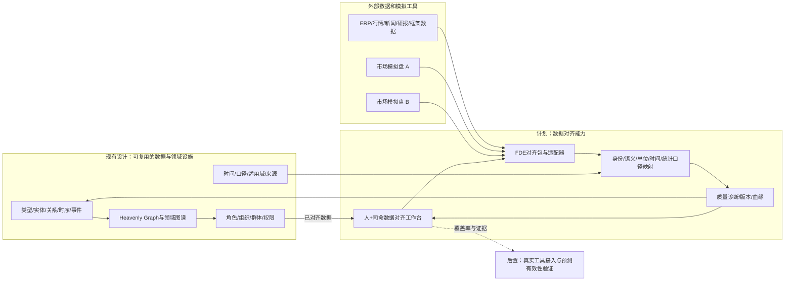
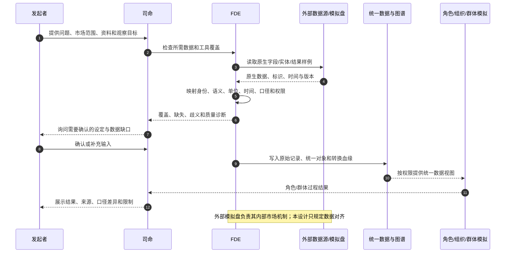
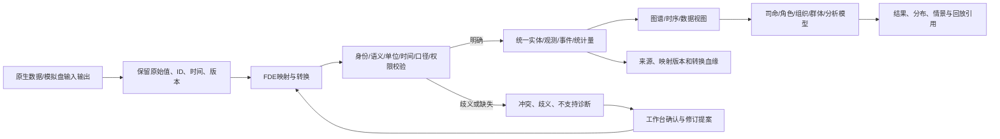

# 外部模拟工具与多市场数据对齐设计

日期：2026-10-14

状态：`analysis / data-alignment-design / non-authorizing`

归属：模拟预测底座 fork。本文落实一个清晰分工：股票、期权、期货、外汇等市场内部机制由外部模拟盘或专业工具负责；底座通过 FDE 做数据对齐，使司命、角色智能体、群体模拟和图谱能理解、比较并使用这些工具的输入输出。本文不设计底座自己的多市场撮合器、联邦时钟、跨引擎事务或分布式恢复运行时。

本文承接[类型化数据底座与可插拔演化机制](02-类型化数据底座、制度与领域语义、可插拔演化机制设计.md)、[金融数据合同](03-数据结构、金融数据类别与时间口径合同设计.md)、[整体方案](04-通用模拟底座与行业场景适配整体设计方案.md)和[时空与适用域合同](06-通用时空与适用域合同设计.md)。

## 1. 设计裁决：底座做数据对齐

```text
市场模拟工具 A ─┐
市场模拟工具 B ─┼─ FDE 数据对齐 ─ 统一数据对象/事件 ─ 图谱、司命、角色与群体模拟、分析模型
外部数据与资料 ─┘
```

外部模拟工具各自负责其支持的资产和市场机制。底座负责：

- 把工具的本地实体映射到稳定的统一身份；
- 把字段和事件映射到明确的领域语义；
- 对齐计量单位、币种、时间、统计口径、适用范围和来源版本；
- 保留原始值、转换记录和映射版本，保证结果可解释、可比较；
- 将对齐后的数据提供给图谱、司命、角色智能体、群体模拟和分析流程。

“数据对齐”不是只改字段名。它保证两套数据表达同一对象、同一概念和可比较的时点/口径；它不意味着底座统一推进外部工具，也不意味着两个工具的结果天然可以拼成一次同步市场运行。

## 2. 对 fork 底层结构的支持判断

| 现有设计结构 | 数据对齐用途 | 判断 |
|---|---|---|
| `Entity`、稳定身份、外部标识 | 发行人、工具、账户、市场、法域和合约的统一身份 | 可承载；需由 FDE 维护映射 |
| `Relation`、动态图谱 | 上市、标的、篮子、套保、替代和结算关系 | 可承载；关系语义和有效期要显式注册 |
| 类型族、记录、事件流、时序、曲线/曲面、矩阵、分布 | 行情、委托、成交、持仓、财务、风险和模型输出 | 可承载；专业 schema 由金融包注册 |
| `DataObject<T>`、来源、revision、血缘、认识状态 | 保存原始输入、标准化结果、估计值和模拟结果的来源关系 | 可承载；不得混成同一种事实 |
| 多时间维度、统计口径、适用域 | 处理交易日、时区、观察时点、报告口径、法域与市场范围 | 可承载；FDE 必须给出明确转换规则 |
| 角色、组织、群体、权限与记忆 | 将统一后的数据按主体可见范围提供给参与者 | 可承载；数据对齐不自动授予可见或行动权限 |
| 模型、机制、owner、事件和回放 | 接收外部工具输出并供既有模拟流程引用、比较或回放 | 可承载；具体接入仍需实现和验证 |

结论：已有数据结构在表达能力上支持多市场数据对齐。需要新增的是 FDE 对齐包、行业映射注册和质量校验流程，不需要为此先建设一套通用市场联邦运行时。结构可表达不代表已有适配器或外部工具接入已经实现。

## 3. 统一数据对象与对齐合同

所有输入输出保留两层：

1. **原生层**：工具原样提供的数据、原生标识、原生字段、原始时间、文件/API 版本和原始载体。
2. **统一层**：映射后的 canonical 实体、领域类型、值、单位、币种、时间、口径、作用域、来源与转换血缘。

示意结构：

```text
AlignedData<T> {
  canonical_ref, canonical_type, value
  native_source_ref, native_id, native_type, native_payload_ref
  unit_ref, currency_ref, statistic_definition_ref
  event_time, observed_at, available_at, processed_at
  valid_interval, market_calendar_ref, timezone_ref
  market_ref, jurisdiction_ref, branch_ref, permission_ref
  source_version, mapping_version, revision, lineage_refs
  alignment_status               // exact | converted | ambiguous | unsupported
  quality_flags, conflict_refs
}
```

字段含义按以下合同对齐：

| 维度 | 必须回答的问题 | 金融例子 |
|---|---|---|
| 身份 | 这个本地 ID 对应哪个 canonical 实体，是否一对多或有时效 | 证券代码、交易所代码、合约代码、账户 ID |
| 领域语义 | 这个数值/事件实际表示什么，属于观测、估计、预测还是动作 | 最新成交价、收盘价、理论价、目标价不能混用 |
| 单位与币种 | 数值以什么单位表达，换算公式及舍入规则是什么 | 股/手、合约乘数、报价币种、结算币种 |
| 时间 | 数值在哪个时点有效、何时被观察/发布/接收，采用哪个日历 | 成交时间、资讯发布时间、平台接收时间、交易日 |
| 统计口径 | 聚合窗口、样本范围、计算方法、调整方式是什么 | 成交额、换手率、复权价格、净流入估计 |
| 空间与适用范围 | 数据适用于哪个市场、法域、场所、账户或情景分支 | 上市地、交易所、监管辖区、模拟场景 |
| 来源与权限 | 数据由谁提供、许可范围是什么、哪些主体可读取 | 行情供应商、研报、内部账户数据、公开资讯 |
| 版本与血缘 | 原值如何变成统一值，使用了哪些映射和转换版本 | 汇率转换、合约换月、复权、代码变更 |

歧义值不得静默强行映射。应标记为 `ambiguous`，记录候选和冲突，等待 FDE/领域 owner 处理；明确不支持的字段保留在原生层，不伪造统一语义。

## 4. 重点金融数据对齐

### 4.1 行情、量价和订单流

报价、委托、成交都必须保留买卖方向、价格、数量、时间、市场和生命周期状态。统一表达示意：

```text
MarketEvent {
  event_kind                    // quote | order | trade | cancel | auction | settlement
  instrument_ref, venue_ref, participant_ref?
  side                          // buy | sell | not_applicable
  price, price_unit, currency_ref
  quantity, quantity_unit, contract_multiplier?
  event_time, available_at, sequence_ref?
  order_ref?, trade_ref?, status
  source_ref, source_revision, statistic_definition_ref
}
```

各模拟盘的字段名即使相同，若一个是委托量、另一个是成交量，也必须映射到不同事件类型。盘口档位、报价和成交不能相互替代；买卖盘匹配规则由外部市场工具负责，底座保留并对齐其输入输出。

### 4.2 多标的和跨市场身份

统一身份至少区分发行人、证券/合约、上市记录、交易场所、货币、账户和结算主体。证券代码不是全球唯一身份；期权合约、期货月份、ETF 份额类别、ADR 与基础证券均需独立实体及明确关系。

映射示意：

```text
ExternalIdentityMap {
  source_ref, native_namespace, native_id, native_type
  canonical_ref, mapping_kind       // exact | composite | derived | candidate
  valid_from, valid_to, revision
  evidence_refs, confidence, owner_ref
}
```

复合关系（如 ETF 与篮子、衍生品与标的、跨国上市证券之间的对应）用图谱关系表达，并带方向、有效期、来源和适用范围。不要把复合关系压成单个同一 ID。

### 4.3 币种、估值与统计口径

原币值和转换后值并存。任何报告币种转换都记录汇率来源、报价方向、事件时间、可用时间、转换公式和舍入规则；不得用换算后的报表值覆盖本币账本或原始数据。

统计量附 `StatisticDefinition`：名称、分子/分母、窗口、样本范围、过滤规则、调整方法、单位、币种、时区/日历和版本。相同标签但定义不同的值不可直接比较。

## 5. FDE 对齐流程

每种外部工具或数据源交付一份可审查的 `DataAlignmentPackage`：

```text
DataAlignmentPackage {
  source_descriptor              // 来源、版本、许可、接入方式
  identity_mappings
  type_semantic_mappings
  unit_currency_conversions
  time_calendar_mappings
  statistic_definitions
  scope_permission_rules
  event_mappings
  lineage_and_revision_policy
  validation_fixtures
  unsupported_and_ambiguous_fields
}
```

工作步骤：

1. 盘点工具支持的市场、资产、数据字段、原生对象与输出格式。
2. 将本地标识映射到 canonical 身份，标明一对多、复合、候选和有效期。
3. 将字段映射到领域类型，区分原始观测、统计结果、模型估计、预测和模拟输出。
4. 配置单位、币种、时间、日历、统计口径及所有转换版本。
5. 配置来源、许可证、适用范围和不同角色可见的数据权限。
6. 用固定样例校验映射、换算、时间顺序、缺失值、冲突和边界条件。
7. 生成对齐诊断：通过项、转换项、歧义项、不支持项和数据质量问题。
8. 将对齐后的对象提供给图谱和模拟流程；原始记录及转换血缘一并保留。

FDE 的工作重点是行业与机构语义映射、口径治理和验收，不只是字段 ETL。司命可据此询问缺失资料、选择可用工具和组织方案；它不自行猜测身份或口径。

## 6. 多个模拟盘如何使用

用户可以选择若干模拟盘，分别对同一场景输入或输出进行对齐。底座可统一呈现、比较、回放其结果；是否让模拟盘之间实时互相驱动，由所选外部工具或其自身组合能力决定，不由本文要求底座实现。

| 使用方式 | 底座的数据职责 | 明确边界 |
|---|---|---|
| 历史结果导入 | 对齐实体、字段、时间和口径，作为历史参照 | 不据此声称已复现其内部机制 |
| 场景输入导出 | 将统一实体、观测、假设、订单意图等转换为工具要求的格式 | 具体运行和约束由工具负责 |
| 多工具结果比较 | 对齐相同标的、情景、时点、单位与指标定义 | 未对齐的结果不做数值排名 |
| 工具组合运行 | 对齐各工具交接的数据格式和语义 | 联动、同步和失败处理由组合工具/使用方负责，除非未来另立需求 |

若模拟盘只提供最终结果，仍可做结果对齐和比较；不能进一步声称有逐笔市场过程、实时反馈或内部因果路径。多工具结果也可能因机制、假设、数据可见范围不同而不可直接比较，工作台需显示差异而非抹平差异。

## 7. 司命与工作台职责

司命根据发起者的问题识别所需市场、标的、时间范围和观察指标；检查可用数据源/模拟盘的覆盖及缺口；读取 FDE 对齐诊断；询问歧义和缺失输入；安排角色、组织、动态群体和可用模型；最后将对齐数据交给对应模拟流程。

人＋司命工作台围绕数据对齐提供：

- 原生字段到统一类型的映射浏览与编辑；
- 实体映射、关系和有效期的图谱视图；
- 单位、币种、日历、时间和统计口径转换预览；
- 冲突、歧义、缺失、许可和质量问题列表；
- 对齐前后样本值、来源版本和转换血缘对照；
- 多模拟盘覆盖范围与结果指标的并列比较。

工作台中的手工改映射应形成版本化提案，经 FDE/领域 owner 确认后生效。映射编辑不直接改写外部工具数据或世界事实。

## 8. 架构、交互和数据流

### 8.1 架构图



### 8.2 主交互时序图



### 8.3 数据流图



## 9. 接入验收与边界

每个对齐包至少通过以下检查：

1. 本地实体映射到稳定身份，或明确标为候选/歧义/不支持；
2. 每个字段有领域语义，不以相同字段名推断同义；
3. 单位、币种、乘数、时间、日历和统计口径可复算；
4. 原生值可追溯，任何转换都有版本、来源和血缘；
5. 权限和许可证范围明确，角色只能获得授权视图；
6. 缺失、迟到、修订、冲突和空值策略有固定样例验证；
7. 行情量价数据能区分买卖方向、报价、委托、成交及其数量与生命周期状态。

接入能力按数据覆盖描述：

| 等级 | 能力 | 不代表 |
|---|---|---|
| D0 结果可读 | 导入并解释外部历史/模拟结果 | 不代表重现内部机制 |
| D1 场景可交换 | 对齐后可向外部工具提供输入并接回输出 | 不代表底座负责工具运行或联动 |
| D2 多源可比较 | 多工具的身份、时间、单位、口径和来源一致性通过验证 | 不代表结果预测准确或可以直接合并 |

真实工具接入、逐字段映射、数据质量和样本外预测效力需要分别验证。任何“已支持”都要区分数据结构可表达、对齐包已配置、适配器已运行和结果已验证。

## 10. 现有、计划与后置

### 现有设计可复用

- 类型化实体、关系、数值、表格、时序、事件、来源、revision 和血缘；
- 金融数据类别、时间、统计口径、空间/适用域和权限合同；
- Heavenly Graph、角色/组织/动态群体和司命方案编排边界。

### 计划补充

- FDE 的 `DataAlignmentPackage`、跨来源身份映射和领域字段字典；
- 金融常用单位/币种/日历/统计量转换目录；
- 样例驱动的数据质量、歧义和覆盖率诊断；
- 工作台的映射审查、转换预览和多工具结果比较。

### 后置验证

- 接入具体外部模拟盘和真实数据源；
- 验证各工具间组合运行能力（若使用方需要）；
- 历史回放、校准、样本外预测和因果评估。

本文完成的是数据模型支持审查与 FDE 数据对齐设计，不表示接入已实现，也不对金融预测准确性作承诺。
