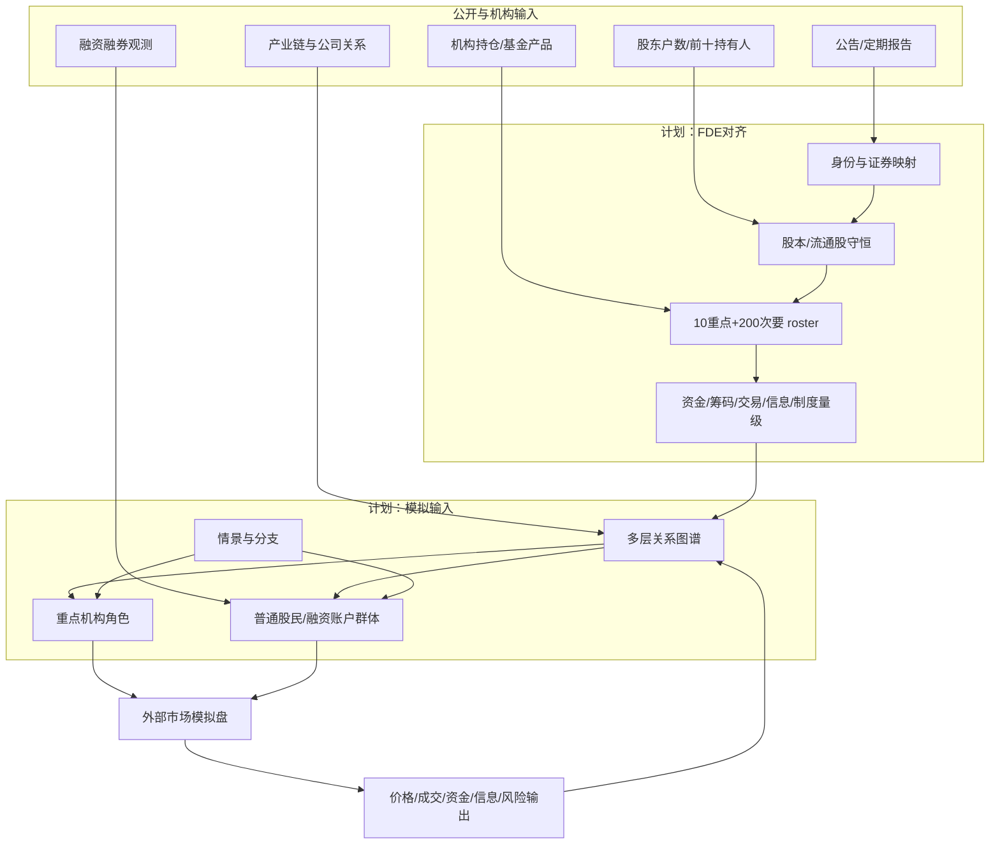
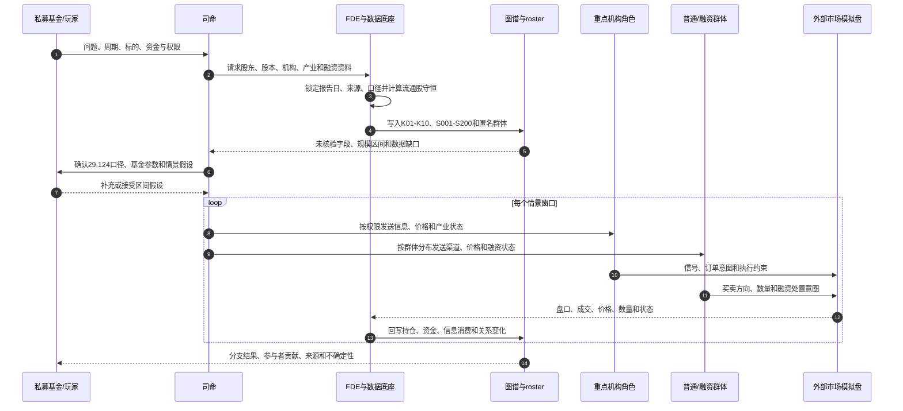

# 中际旭创股东结构与多层参与者规模建模方案

日期：2026-10-14

状态：`analysis / scenario-roster-design / non-authorizing`

本文为“私募基金模拟中际旭创及光模块产业链”设计一份可运行的参与者规模基线。目标是把公开可核验的股东、机构持仓、流通股和股东户数转成底座可使用的参与者、群体、关系、资金和交易能力设定，并明确哪些内容只能估计。本文不代表已接入真实交易账户，也不把公开披露之外的受益人、融资账户或交易意图当作事实。

## 1. 模拟发起方与目标

### 1.1 模拟方

模拟方是一家私募基金。它作为 `SimulationSponsor` 和玩家组织进入模拟，拥有自己的研究、投资、交易、风控、合规和运营岗位。基金内部账户、资金和持仓只在基金组织层核算一次，岗位不重复拥有同一份资产。

### 1.2 模拟问题

基金希望推演以下问题：

1. 光模块产业景气、订单、供给、技术路线或政策信息变化时，哪些机构和股东先改变判断；
2. 长期持股块、机构配置资金、量化资金、融资交易者和普通股民如何分别进入买卖盘；
3. 信息传播速度、资金体量、交易频率、融资约束和流动性如何共同影响中际旭创及相关标的；
4. 在不同情景下，基金自己的交易对市场冲击、组合暴露和退出时间如何变化。

本案例先围绕中际旭创（A 股代码 `300308.SZ`）建立单股核心盘，再扩展到光模块产业链、指数/ETF、同业、期权或其他相关市场。股票内部的撮合和盘口机制由外部模拟盘负责，底座负责数据对齐、参与者编排、关系传播和结果回写。

## 2. 公开数据核验快照

### 2.1 可确认的基线

本方案采用公开数据接口返回的 `2026-06-30` 季度快照作为演示基线。接入时必须保存来源 URL、抓取时间、字段名、版本和原始响应；下面数值不能脱离日期和口径使用。第三方接口快照还需与公司定期报告交叉核验后，才能升格为正式模拟基线。

| 指标 | 数值 | 口径与用途 |
|---|---:|---|
| 股东户数 | 205,678 户 | 期末持股账户/股东户数统计；不是交易者人数 |
| 户均持股 | 5,396 股左右 | 公开接口的 `AVG_FREE_SHARES`；四舍五入值 |
| 总 A 股 | 1,115,234,641 股 | 公开股本结构字段 |
| 限售股 | 5,296,363 股 | 约占总股本 0.47% |
| 流通股 | 1,109,938,278 股 | 总 A 股减限售股 |
| 前十名披露持有人合计 | 376,754,258 股 | 约占总股本 33.78%，约占流通股 33.94% |
| 其余流通股 | 733,184,020 股 | 由流通股减前十名披露持有人合计得到 |
| 机构持股统计 | 3,636 个机构、509,589,856 股 | 数据源分类汇总；机构数及分类需回查源定义，不能简单理解为 3,636 个独立交易决策者 |
| 其中基金类统计 | 3,578 个机构、214,732,617 股 | 机构分类字段 `ORG_TYPE=01`；需保留源分类 |

### 2.2 关于“29,124 户”的处理

用户提供的“股东总数 29,124 户、平均持股 5,000 多股”与上述公开接口的 `2026-06-30` 快照不一致。按 29,124 户乘以约 5,000 股，只能得到约 1.46 亿股，无法解释同期约 11.10 亿股流通股。因此：

- `29,124` 暂存为 `unverified_claim`，不能写入基线；
- 需要补充它的披露日期、公告/报告名称、原始字段和是否指某一类股东或某一交易平台；
- 若未来核验为另一日期或另一统计口径，作为独立时间点写入时序，不覆盖 `2026-06-30`；
- 模拟可以把两套数字放入分支，观察股东基数差异对流动性和筹码分布的影响，但不能混合平均。

### 2.3 来源记录

设计示例使用以下公开接口作为核验入口，接入时由 FDE 记录实际抓取响应和版本：

- 东方财富股东研究接口：`https://emweb.securities.eastmoney.com/PC_HSF10/ShareHolderResearch/PageAjax?code=SZ300308`
- 东方财富数据接口（股东户数快照）：`https://datacenter-web.eastmoney.com/api/data/v1/get?reportName=RPT_HOLDERNUMLATEST&columns=ALL&filter=(SECURITY_CODE%3D%22300308%22)`
- 中国证监会指定信息披露平台：`https://www.cninfo.com.cn/`
- 本次检索到的中际旭创 2026 年半年度报告 PDF：`https://static.cninfo.com.cn/finalpage/2026-08-22/1225491753.PDF`

第三方接口只作为采集入口，最终基线应与公司公告、定期报告和交易所披露交叉核验。接口返回的未来或修订数据必须按其 `END_DATE`、公告日期和抓取日期分别保存。

## 3. 流通股分解与筹码层级

### 3.1 守恒关系

```text
总A股 1,115,234,641
  = 限售股 5,296,363
  + 流通股 1,109,938,278

流通股 1,109,938,278
  = 前十名披露持有人 376,754,258
  + 其余流通股 733,184,020
```

这只是持股结构守恒，不等于可在任意一天全部卖出。长期持股、控制权平台、ETF 申赎、机构授权、停牌、交易限额、融资担保和市场冲击都需要另行建模。

### 3.2 前十名披露持有人

| 排名 | 持有人 | 类型 | 持股数 | 对总股本比例 | 模拟解释 |
|---:|---|---|---:|---:|---|
| 1 | 山东中际投资控股有限公司 | 投资公司/控制平台 | 121,440,135 | 10.94% | 控制与长期持有节点；不直接等于日内交易资金 |
| 2 | 香港中央结算有限公司 | 名义持有人/托管聚合节点 | 73,326,563 | 6.58% | 不能当作单一投资策略，需拆成跨境受益人群体 |
| 3 | 王伟修 | 个人/重要股东 | 69,731,451 | 6.26% | 与公司控制和长期持股关系另行核验 |
| 4 | 苏州益兴福企业管理中心（有限合伙） | 持股平台 | 46,627,154 | 4.18% | 长期/员工或管理层平台候选，需以公告关系为准 |
| 5 | 苏州云昌锦企业管理中心（有限合伙） | 持股平台 | 23,858,278 | 2.14% | 长期持股平台候选 |
| 6 | Lumiza Limited | 境外公司/机构持有人 | 15,415,548 | 1.38% | 受益所有人和交易意图不能由名称推断 |
| 7 | 苏州福睿晖企业管理中心（有限合伙） | 持股平台 | 8,156,444 | 0.73% | 长期持股平台候选 |
| 8 | 国泰中证全指通信设备 ETF | 基金产品 | 6,789,203 | 0.61% | 被动/指数约束，交易通过申赎和再平衡传导 |
| 9 | 章建平 | 个人/市场参与者 | 5,934,789 | 0.53% | 公开持有人节点，不能推断其日常策略 |
| 10 | 中信证券股份有限公司 | 券商/证券账户节点 | 5,474,693 | 0.49% | 需区分自营、资管、托管或其他账户属性 |

前十名中的“持有人记录”不等于十个同质化交易智能体。香港中央结算、券商账户和基金产品必须拆成托管聚合、产品管理人、受益人或执行链条；控制平台和个人重要股东则应以低频状态为主，不默认每天进入订单簿。

## 4. 首批十个重要机构

“十个重要机构”不是简单取十个名称，而是选择对筹码、信息、交易、流动性或制度传导有不同作用的机构节点。每个节点要有完整规模档案、关系档案和可见信息档案。

| 编号 | 机构节点 | 选择依据 | 主要作用 |
|---:|---|---|---|
| K01 | 山东中际投资控股有限公司 | 前十名、控制/长期持股候选 | 控制权、长期筹码、公司治理和减持约束 |
| K02 | 香港中央结算有限公司 | 前十名、跨境托管聚合 | 把跨境受益人拆成外资、港股通、被动和主动资金群体 |
| K03 | 苏州益兴福企业管理中心（有限合伙） | 前十名、持股平台 | 长期筹码、管理层/员工关系候选 |
| K04 | 苏州云昌锦企业管理中心（有限合伙） | 前十名、持股平台 | 长期筹码、解禁和减持约束候选 |
| K05 | Lumiza Limited | 前十名、境外公司持有人 | 境外资本、受益所有人和跨境交易约束候选 |
| K06 | 苏州福睿晖企业管理中心（有限合伙） | 前十名、持股平台 | 长期筹码、持股平台关系候选 |
| K07 | 国泰基金管理有限公司 / 国泰中证全指通信设备 ETF | 公募/行业 ETF 机构持仓 | 指数规则、申赎、行业资金和再平衡 |
| K08 | 易方达基金管理有限公司 / 易方达创业板 ETF | 机构持仓统计靠前 | 创业板被动配置、申赎和指数联动 |
| K09 | 华泰柏瑞基金管理有限公司 / 沪深 300 ETF | 机构持仓统计靠前 | 宽基指数权重、申赎和再平衡 |
| K10 | 中信证券股份有限公司 | 前十名券商记录 | 券商自营/资管/托管候选、融资与执行通道 |

K07—K09 的基金产品持仓来自机构持仓统计，不应与前十名披露持有人再次相加。K02 和 K10 是通道或聚合节点，模拟时必须展开下游受益人/业务单元，否则会把一个托管名义主体错误地当成单一决策者。

### 4.1 重要机构的规模档案

每个 K 节点至少配置：

```text
InstitutionScaleProfile {
  institution_ref, product_or_account_ref
  as_of, source_ref, source_revision
  aum_or_balance, investable_capital, cash_ratio
  target_holding, disclosed_holding, free_float_ratio
  avg_daily_turnover, max_order, capacity, impact_budget
  leverage, margin, redemption_pressure, risk_budget
  holding_horizon, rebalance_frequency, execution_latency
  information_channels, information_delay, research_bandwidth
  legal_scope, mandate, forbidden_actions
  confidence, observed_or_estimated, estimation_method
}
```

公开披露的持股数是 `disclosed_holding`，不能直接当成机构全部 AUM、可交易库存或当日可卖规模。未公开的 AUM、现金、策略容量和融资额度必须用区间/分布，并标为 `estimated` 或 `scenario_assumption`。

## 5. 两百个次要机构

### 5.1 组成方式

二百个次要机构以公开持仓、基金产品、市场通道和产业关系为候选池，依据证据和对场景的作用排序，不预设各类型数量配额。当前公开接口只返回部分基金产品名录；机构总数汇总不提供全部机构逐户名称、持仓与策略。因此 roster 按以下规则建设：

1. 公开报告/持仓明示的基金、保险、社保、券商、外资和持股平台以实名节点纳入；
2. 同一管理人不同产品分别保留产品节点，另以 `managed_by` 连接管理人；
3. 产业链公司作为组织参与者单列，不冒充中际旭创的股东；
4. 只能识别到机构类别而不能识别到具体机构的部分，以匿名类别群体表示；
5. 候选池不足 200 个满足最低证据门槛的独立机构时，不补造实名机构，而以类型化代理群体补足模拟规模，并明确其为校准代表而非真实机构。

| 候选类型 | 公开识别依据 | 允许的模拟表达 |
|---|---|---|
| 公募主动基金与基金产品 | 定期报告、基金持仓披露、公司前十大名单 | 实名产品及管理人；未披露时只模拟策略类别 |
| ETF/指数基金 | 成分权重、基金定期报告、申赎与指数规则 | 实名产品、被动流量规则与跟踪误差 |
| 保险、社保、养老金等长期资金 | 定期报告、权益持仓披露、股东名册 | 实名已披露持仓；其余以长期资金群体表示 |
| 券商自营、资管、托管与做市 | 股东披露、公开业务和交易制度 | 区分自营/资管/托管；缺少账簿数据时用范围参数 |
| 私募、量化、套利与对冲机构 | 公开产品、持仓披露、公开策略资料 | 实名公开产品或按策略类型的代表主体 |
| 跨境资金 | 香港中央结算、港股通和公开跨境持仓 | 托管名义主体与下游受益人群体分开 |
| 产业链企业与产业资本 | 公告、年报、合同、供应链及投资关系资料 | 组织节点及经营资源，不虚构证券持仓 |

200 是模拟 roster 的次要机构容量，不是声称公开资料已确认 200 家机构在同一时点持有该股。每个实名节点至少有来源、类型、规模口径、持仓/产业关系证据、信息渠道和置信度；缺少证据的对象进入匿名群体，不进入“已识别机构”清单。

### 5.2 机构筛选排序

```text
机构优先级 =
  持仓规模权重
  + 持仓持续性权重
  + 对流通股占比权重
  + 产业/指数/信息桥接中心性
  + 交易活跃度或申赎传导能力
  + 与私募基金策略的相关性
```

同一管理人旗下多个基金产品不能自动合并为一个交易者。只有在数据来源能确认统一决策、统一账户或统一策略时，才建立 `managed_by` 或 `common_strategy` 关系；资金和持仓汇总必须保留产品层和管理人层两个口径。

## 6. 长期股东、普通股民与融资账户

### 6.1 长期股东识别规则

“长期股东”是模型标签，不是仅凭一次前十大排名得出的事实。建议满足以下条件中的至少两项，并保留证据：

1. 在连续四个或更多报告期保持可识别持仓；
2. 变动幅度低于设定阈值，且没有高频交易证据；
3. 属于控制平台、员工/管理层持股平台、战略关系或长期资金类型；
4. 受到锁定、减持、治理或产品合同约束；
5. 持仓期限或基金合同明确为长期配置。

长期标签仍要带 `confidence`。香港中央结算、券商名义账户和基金产品不能直接贴长期或短期，必须先拆出下游受益人或产品策略。

### 6.2 普通股民的建模

公开股东户数不能直接告诉我们每户是普通账户、融资账户、活跃交易者还是休眠账户。底座应把其余流通股和未识别账户建成校准群体：

| 群体 | 资金/持股设定 | 信息与行为设定 |
|---|---|---|
| 长期个人股东 | 持股期限长、换手低、现金买入为主 | 关注公告、财报和长期叙事 |
| 趋势与主题交易者 | 中小持仓、换手较高 | 关注行情、新闻、社交平台和热点扩散 |
| 短线高频个人 | 单次仓位小、交易频率高 | 主要依赖盘口、短讯和交易软件 |
| 融资交易者 | 融资余额、利息和保证金约束 | 对下跌、波动和追加保证金敏感 |
| 低频/休眠账户 | 持仓存在但很少交易 | 只在重大事件、分红或强制处置时行动 |

各群体保留账户数量、持股分布、现金、融资余额、平均持有期、交易频率、信息渠道和行为参数。群体内部用分布表达，不把 20 多万户压成一个统一“散户角色”。

### 6.3 融资账户的事实边界

融资融券公开数据通常能提供标的层面的融资余额、融资买入额、偿还额、融券余额等，但不能公开逐户列出所有融资账户的身份、持股和交易策略。因此：

- `融资余额/融券余额`可以作为公开观测；
- `融资账户数量`、账户规模分布和强平阈值需要授权数据或模型估计；
- 普通账户与融资账户可能是同一投资者的不同账户或同一账户的不同状态，不能简单相加为不同的人；
- 模拟中使用账户状态模型：普通现金状态、融资状态、担保品状态、追加保证金状态、被动减仓状态；
- 所有估计都写明来源、日期、校准方法和区间。

## 7. 参与者的全维度规模档案

所有机构、组织、个人重要股东和群体都使用相同的底层字段族，但专业字段按类型扩展：

| 维度 | 核心字段 | 作用 |
|---|---|---|
| 资金 | AUM、现金、可投资资金、相关持仓、净敞口、杠杆 | 决定可行动规模 |
| 筹码 | 持股数、流通股比例、成本区间、锁定/可卖状态 | 决定可供给和持有约束 |
| 交易 | 单笔规模、日均成交、频率、持有期、执行延迟 | 决定订单流和市场冲击 |
| 风险 | 回撤限额、保证金、止损、赎回、流动性缓冲 | 决定被动卖出和退出速度 |
| 信息 | 渠道、覆盖范围、延迟、可信度、研究带宽 | 决定认知先后和信念更新 |
| 产业 | 产能、订单、客户/供应商依赖、库存、交付 | 决定基本面传导 |
| 组织 | 决策层级、授权额度、审批时间、岗位和责任 | 决定观点到订单的转换速度 |
| 制度 | 许可、管辖、交易限制、披露义务、合同约束 | 决定能做什么和何时能做 |
| 外部环境 | 利率、汇率、贸易、技术、政策和宏观暴露 | 决定情景冲击方向与强度 |

每个字段都保存 `as_of`、`valid_interval`、`unit`、`statistic_definition`、`source_ref`、`observed_or_estimated`、`confidence` 和 `revision`。

## 8. 关系图谱中的连接

参与者不是孤立 roster。每个参与者与产业、公司、市场、信息、制度和环境之间建立有方向、带时间和可量化属性的边：

```text
机构/股东
  ├─持有/托管/管理─> 证券、ETF、账户
  ├─供货/采购/竞争─> 光模块产业链公司
  ├─接收/发布/转载─> 公告、研报、新闻、社交内容
  ├─受约束/有权限─> 交易所、监管、基金合同、融资合同
  ├─暴露/对冲─> 利率、汇率、贸易、技术和政策环境
  └─提交订单/成交/结算─> 外部市场模拟盘
```

边属性至少包括数量、比例、强度、时延、有效期、来源、置信度和认识状态。香港中央结算与受益人之间要使用 `nominee_for`；基金管理人与产品之间使用 `managed_by`；产品与证券之间使用 `holds`；证券与产业公司之间使用 `issued_by`；这些关系不能合并成一个“关联”边。

## 9. 模拟输入与输出

### 9.1 输入

```text
ScenarioInput {
  sponsor_ref                       // 私募基金
  snapshot_date, report_date, market_date
  canonical_security_ref            // 300308.SZ
  shareholder_snapshot_ref
  institutional_roster_ref          // K01-K10 + S001-S200
  retail_population_distribution
  financing_observation_or_range
  industry_graph_ref
  information_channels_and_latency
  policy_and_external_environment
  market_engine_alignment_ref
  assumptions, unknowns, permissions
}
```

### 9.2 输出

- 公开股东、机构、基金产品、托管聚合和普通股民群体的持股守恒；
- 每一类主体的可交易筹码、可用资金、融资约束和流动性贡献；
- 信息从发布、送达、消费到行动的路径；
- 机构、量化、融资账户和普通股民的订单方向、频率、速度和成交结果；
- 中际旭创及相关标的的价格、成交量、买卖盘、资金流、波动和回撤分布；
- 长期持股块、机构调仓、被动申赎、融资减仓和普通股民交易的分解贡献；
- 每个结果对应的公开事实、估计参数、场景假设和外部模拟盘版本。

## 10. 从公开资料到模拟 roster 的全流程

1. 司命询问私募基金的观察周期、目标、组合范围、可用内部资料和权限。
2. FDE 锁定报告日、行情日、股东户数日、持仓日和抓取日，不能混用。
3. 导入原生股东、股本、机构持仓、公司公告、产业关系和融资观测。
4. 建立 `canonical_ref`，把证券代码、基金代码、账户和机构名称放入命名空间。
5. 计算总股本、限售股、流通股、前十名披露持有人和其余流通股的守恒关系。
6. 识别 K01—K10，记录每个节点的直接证据和未确认属性。
7. 按公开机构持仓和产业/市场中心性筛选 S001—S200；不满足来源要求的对象进入匿名群体。
8. 根据连续报告期、持股平台和变动记录生成长期持股候选，不把候选直接写成事实。
9. 按总股东户数、流通股、机构统计和融资观测校准普通/融资群体分布。
10. 给每个主体配置资金、筹码、交易、信息、制度和外部环境规模档案。
11. 将主体视图按权限提供给私募基金、角色智能体、群体模拟和外部市场模拟盘。
12. 运行基线、产业需求上修、供应扰动、估值反转和融资收缩等分支。
13. 回写价格、成交、量价、持仓、信息消费和资金变化，并检查守恒与来源。

## 11. 三张图

### 11.1 架构图



### 11.2 主交互时序图



### 11.3 数据流图

```mermaid
flowchart LR
  RAW[原生公开数据/机构资料] --> SNAP[带日期和版本的快照]
  SNAP --> ALIGN[身份/语义/单位/时间/口径对齐]
  ALIGN --> CONSERVE[总股本/流通股/前十持有人守恒]
  CONSERVE --> ROSTER[10重点机构+200次要机构+普通/融资群体]
  ROSTER --> PROFILE[资金/筹码/交易/信息/制度/环境档案]
  PROFILE --> GRAPH[产业-公司-市场-信息-制度关系图谱]
  GRAPH --> ORDERS[角色和群体订单意图]
  ORDERS --> ENGINE[外部市场模拟盘]
  ENGINE --> EVENTS[报价/委托/成交/量价/资金事件]
  EVENTS --> FEEDBACK[持仓/信念/情绪/融资/关系更新]
  FEEDBACK --> GRAPH
  FEEDBACK --> RESULT[情景结果、贡献分解和不确定性]
  RAW -.歧义/缺失.-> DIAG[对齐诊断]
  DIAG --> REVIEW[司命与发起者确认]
  REVIEW --> ALIGN
```



## 12. 验收标准与不可声称事项

### 12.1 验收标准

1. 报告日、股东户数日、持仓日和抓取日分别记录；
2. 总股本、限售股、流通股、前十持有人和其余流通股守恒；
3. K01—K10 每个机构都有来源、规模字段、关系和不确定性标签；
4. S001—S200 每个对象都有最小来源和类型字段；无法确认的对象进入匿名群体；
5. 普通账户、融资状态、托管聚合和基金产品不重复计数；
6. 持股规模、可交易规模、订单规模和成交规模分开；
7. 公开事实、模型估计、情景假设和角色私有状态不混写；
8. 模拟输出可回溯到 roster 版本、数据快照、外部市场工具版本和情景分支。

### 12.2 当前不能声称

- 不能仅凭股东户数还原 205,678 个真实交易者的身份、账户类型和交易行为；
- 不能把香港中央结算或券商名义账户当成单一策略主体；
- 不能从公开数据准确拆出全部融资账户数量、每户杠杆和强平价；
- 不能把 200 个次要机构 roster 写成 200 家机构都已被公开数据确认持有中际旭创；
- 不能把长期股东标签、机构交易方向或普通股民行为当成事实，除非有相应时序证据；
- 不能由该 roster 自动推出股价预测能力。

本文是模拟 roster 和规模建模方案。真实接入需要逐字段 FDE 对齐、来源许可、历史回放和样本外验证。
