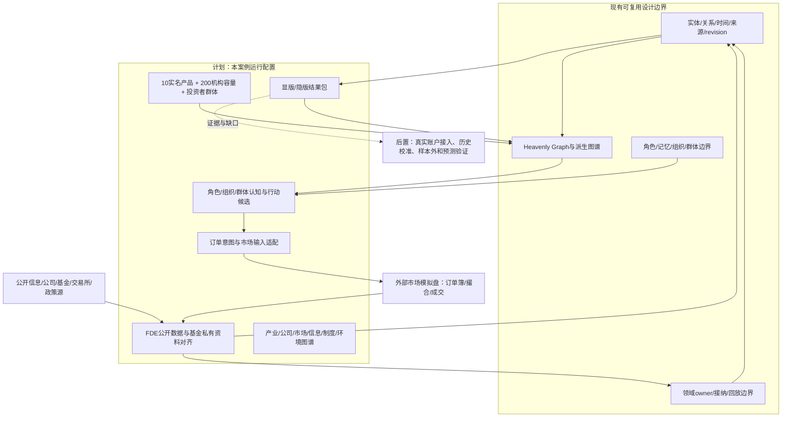
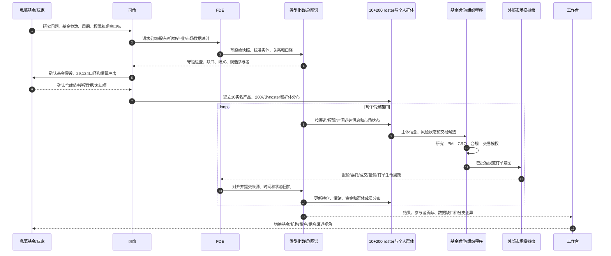
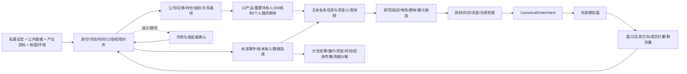

# 中际旭创私募基金多方博弈案例推演

日期：2026-10-14

状态：`analysis / illustrative-run / non-authorizing`

本文把[股东结构与多层参与者规模方案](18-中际旭创股东结构与多层参与者规模建模方案.md)转成一次可审阅的模拟案例。案例围绕中际旭创（`300308.SZ`）及光模块产业链，由私募基金作为发起者和玩家。公开数据用于初始化可观察结构；基金自身账户、参与者未公开策略、客户关系和冲击事件均使用显式假设或区间。本次没有运行真实外部市场模拟盘，因此文中的订单和状态变化是**机制推演输入/预期输出示例**，不是成交回测、事实预测或投资建议。全篇运行从公开快照可知之后的合成时点开始，不把披露前不可见信息倒灌给参与者。

## 1. 案例问题与运行边界

私募基金提出的问题：

> 如果光模块产业链中的交付、需求或融资预期出现变化，不同参与者会通过哪些信息渠道获知、如何更新判断和仓位，资金规模、交易速度与融资约束如何影响中际旭创及相关标的的量价、流动性和基金自身风险？

本轮模拟回答“可能的机制路径和条件”，不回答确定目标价，不预设市场必然上涨、腰斩或某一机构必然买卖。

### 1.1 运行范围

| 项目 | 本轮设置 | 状态 |
|---|---|---|
| 观察锚点 | `2026-06-30` 期末股东/持仓快照；模拟从 `2026-08-24 09:00` 合成场景时间开始 | 报告日与可知时间分开 |
| 模拟信息截止 | `2026-08-24 09:00`；只允许读取当时已公开或授权可见的信息 | 点时约束；源发布时间需留存 |
| 核心证券 | 中际旭创 A 股 `300308.SZ` | 公开身份 |
| 扩展证券 | 新易盛 `300502.SZ`、天孚通信 `300394.SZ`、光迅科技 `002281.SZ`、华工科技 `000988.SZ`；逐一验证产业标签、市场数据和关系类型 | 观察名单；非等价公司或确定供货关系 |
| 相关交易工具 | 通信设备 ETF `515880`、创业板 ETF `159915`、沪深 300 ETF `510300`、创业板 50 ETF `159949`、沪深 300 ETF `510310`、5G 通信 ETF `515050` 等 | 公开产品/持仓线索；需冻结成分快照 |
| 参与对象 | 私募基金、10 个实名基金产品/重要机构节点、控制/持股平台、200 个次要机构 roster 容量、个人投资者和融资状态群体、产业公司、媒体渠道、交易所及制度环境 | 混合实名与分布群体 |
| 市场机制 | 委托簿、买卖方向、排队、部分成交、价格和成交量 | 交给外部模拟盘；尚未接入 |
| 模拟输出 | 信息路径、角色状态、候选行动、订单意图、量价/资金轨迹和分支差异 | 设计性输出；运行值待外部工具 |

观察名单中的公司共享产业主题可能性，不自动构成直接供应/客户关系。只有公司披露、定期报告或可信行业资料支持时才建立 `supplies_to` / `customer_of` 边；否则只建“同产业主题”“可能替代”“收益敏感度假设”等弱关系。

## 2. 输入包：每部分提供什么、产生什么

| 输入部分 | 本轮输入 | 进入模拟后的对象 | 输出/回执 |
|---|---|---|---|
| 私募发起者 | 问题、时域、关注标的、持仓/资金范围、风险容忍、信息权限 | `SponsorProfile`、私有资料 scope、玩家视角 | 参数缺口清单、可运行范围、授权确认 |
| 公司与股本 | 公司身份、发行人、证券、股东数、前十持有人、限售与流通股 | `Issuer`、`Security`、`ShareholderSnapshot` | 股本守恒、身份冲突与报告日 |
| 机构持仓 | 前十股东、基金产品持仓、机构分类统计 | 产品/管理人/名义托管分层实体 | 持仓快照、机构类别统计、重叠告警 |
| 产业资料 | 光模块链条、技术/产品、供需、公司关系、交付与产能证据 | 公司、产品、流程、产业关系和证据 | 关系强度区间、缺失关系、不确定项 |
| 市场与融资 | 日线/分钟线、盘口/成交、融资余额和融券数据、交易日历 | 观测、市场事件、统计定义、账户状态分布 | 量价基线、流动性状态、融资压力估计 |
| 信息环境 | 公告、研报、财经新闻、平台帖子、转发与曝光 | 内容、作者、渠道、送达/消费事件 | 主体私有信息快照、传播延迟和来源可信度 |
| 制度与外部环境 | 交易规则、披露规则、产业政策、出口/贸易、利率汇率 | 规则、法域、事件、有效期和作用域 | 可行动作边界、情景冲击入口 |
| FDE 对齐包 | 身份、语义、单位、时间、统计口径、权限、血缘映射 | 版本化 `DataAlignmentPackage` | exact/converted/ambiguous/unsupported 诊断 |
| 外部市场模拟盘 | 对齐过的市场快照、规范订单意图、交易约束 | 引擎自己的原生订单和撮合状态 | 行情、委托、成交、剩余量和拒绝原因 |

每条记录均带 `event_time`、`available_at`、`observed_at`、`source_ref`、`unit`、`statistic_definition`、`scope`、`revision` 和认识状态。市场主体只能读取获权且在该时点已可用的信息。

## 3. 基准快照与守恒

采用方案文档核验过的 `2026-06-30` 第三方接口快照做**演示起点**。这是期末状态，不代表 6 月 30 日当日即可知。中际旭创 2026 年半年度报告于 `2026-08-22` 披露；本案例把 `2026-08-24 09:00` 作为保守的合成运行起点。正式接入时，FDE 必须为每条源记录保存 `published_at` 和 `available_at`；若接口字段更晚才可用，以更晚时间为准。不得在披露前把期末股东结构喂给角色。

| 基准项 | 数值 | 状态/口径 |
|---|---:|---|
| 总 A 股 | 1,115,234,641 股 | 来源接口字段，需与报告复核 |
| 限售股 | 5,296,363 股 | 来源接口字段 |
| 流通股 | 1,109,938,278 股 | 总股本减限售股 |
| 股东户数 | 205,678 户 | 账户/股东户数，不是独立交易者人数 |
| 户均流通股 | 约 5,396 股 | 平均数经四舍五入；户数×均值与流通股有约 9.9 万股舍入差 |
| 前十名披露持有人 | 376,754,258 股 | 约占流通股 33.94% |
| 前十名之外的剩余流通股 | 733,184,020 股 | 未穿透残余池；不等于散户持股 |
| 机构分类统计 | 3,636 类机构记录/约 509,589,856 股 | 接口汇总分类，不等于可识别的独立策略或账户 |

```text
1,115,234,641 总A股
= 5,296,363 限售股 + 1,109,938,278 流通股

1,109,938,278 流通股
= 376,754,258 前十名披露持有人 + 733,184,020 余下流通股
```

`29,124 户`目前仍是未核实说法。本轮不把它和 205,678 户平均，也不把它塞进同一快照。若之后找到可靠原始披露，按对应日期和定义添加一条独立观测。

### 3.1.1 点时可知性与重复持股约束

| 数据 | 事件/有效时间 | 可知时间规则 | 模拟用途 |
|---|---|---|---|
| 股本、流通股和前十持有人 | `2026-06-30` 期末 | 不早于 `2026-08-22` 报告披露日；接口更晚可用时取更晚时间 | 披露后的基线库存 |
| 股东户数与户均持股 | `2026-06-30` 期末 | 以源记录的实际发布时间为准 | 账户数量约束，不生成个人身份 |
| 十个基金产品持仓 | `2026-06-30` 期末 | 逐产品按其报告的实际公开日设置 `available_at` | 期末库存，不表示当日订单 |
| 合成新闻、行情和场景事件 | 各自事件时间 | 使用配置的发布、送达和消费时间 | 生成主体私有视图 |

`2026-08-24 09:00` 是本案例的合成运行起点，不表示该日真实股价、盘口或历史行情已经接入。无法证明在起点前可用的资料置于未来/未知队列。历史持仓、管理人汇总、HKSCC/券商名义持有人和下游受益人分属不同口径；只有来源证明是互斥的直接持有人时，才进入同一股数守恒式。每条持仓链接标注 `direct_record`、`nominee_link`、`manager_aggregate` 或 `beneficial_owner_estimate`，防止穿透重叠。

## 4. 参与对象 roster

### 4.1 发起私募基金（玩家 P00）

基金是唯一持有组合账本的模拟组织；基金经理、研究员、交易员、风控和合规是组织岗位，岗位的授权额度不是新增资产。

| 设定 | 本次值 | 证据状态 |
|---|---:|---|
| 基金净资产 | 20 亿元 | 合成案例参数，要求用户提供真实值时替换 |
| 中际旭创初始暴露 | 净资产 3%，即 6,000 万元等值 | 合成参数；不是现实持仓 |
| 目标配置区间 | 净资产 0–5% | 合成风险政策 |
| 单日新增/减仓上限 | 过去 20 日均成交额的 8% | 参数合同；ADTV 未载入前不得换算成人民币或股数 |
| 允许回撤阈值 | 情景参数：单股风险预算 1.5% NAV | 假设，须由模拟方确认 |
| 决策节奏 | 研究小时级、组合日级、交易秒/订单级 | 角色流程设定 |
| 资料权限 | 公告/授权研报/行情公开；内部持仓私有 | 权限设定 |

基金角色：

| 角色 | 目标与信息 | 权限/约束 | 输出 |
|---|---|---|---|
| 基金经理 PM01 | 组合目标、机会成本、产业判断；可见研究团队获准结论和组合风险 | 决定目标仓位；不得绕过账户和市场规则 | 目标暴露提案/继续持有/减仓/等待 |
| 行业研究员 R01 | 公司公告、产业报告、管理层公开沟通、供应链证据 | 不能访问未授权客户信息或直接下单 | 证据链、信念更新、情景概率区间 |
| 交易员 T01 | 盘口、订单流、PM 授权和执行算法反馈 | 只执行有效授权；有价格/参与率/时段约束 | 买卖方向委托、撤改单计划 |
| 风控 CRO01 | 组合风险、流动性、回撤、融资及相关资产暴露 | 可暂停越限交易；不替代撮合 | 风险拒绝/降额/复核 |
| 合规 CO01 | 信息来源、许可、内幕信息隔离、交易限制 | 可阻止违规信息或动作进入运行 | 权限拒绝和证据缺口 |

### 4.2 十个实名重要机构/基金产品

以下是 `2026-06-30` 机构持仓接口返回的十个基金产品。持仓股数是观察值；AUM、现金、资金来源、每日交易方向、赎回压力和真实执行速度均未公开，故不推定。基金产品之间按独立账本建模；管理人是它们的组织上级，不额外复制持仓。

| ID | 产品 | 持有股数 | 占公司流通股约 | 机构/市场关系 | 决策风格建模（假设，不是事实） |
|---|---|---:|---:|---|---|
| I01 | 国泰中证全指通信设备 ETF `515880` | 6,789,203 | 0.612% | 通信设备指数规则→产品→证券；申赎/再平衡影响订单 | 被动跟踪、申赎驱动，低自由裁量 |
| I02 | 易方达创业板 ETF `159915` | 5,367,347 | 0.484% | 创业板指数权重→篮子调整→证券需求 | 被动跟踪、指数/申赎驱动 |
| I03 | 华泰柏瑞沪深 300 ETF `510300` | 3,546,472 | 0.320% | 沪深300权重及申赎机制 | 被动再平衡 |
| I04 | 华安创业板 50 ETF `159949` | 3,511,488 | 0.316% | 创业板50成分权重 | 被动再平衡 |
| I05 | 永赢科技智选混合发起 A `022364` | 2,348,003 | 0.212% | 主动基金；管理人/产品/持仓三层 | 主动研究风格用策略类别区间 |
| I06 | 华泰柏瑞质量成长混合 A `008528` | 2,256,386 | 0.203% | 主动基金 | 基本面/组合风险决策假设 |
| I07 | 易方达沪深 300 ETF `510310` | 2,178,897 | 0.196% | 宽基指数权重与申赎 | 被动再平衡 |
| I08 | 大成科技创新混合 A `008988` | 1,851,601 | 0.167% | 主动科技主题基金 | 基本面/主题配置假设 |
| I09 | 景顺长城景颐丰利债券 A `003504` | 1,847,200 | 0.166% | 固收产品持有权益的组合风险节点 | 受权益仓位、产品合同和赎回约束 |
| I10 | 华夏中证 5G 通信主题 ETF `515050` | 1,827,434 | 0.165% | 5G主题指数成分及申赎 | 被动再平衡 |
| **合计** | 10 个产品持仓之和 | **31,524,031** | **2.840%** | 仅为此十个产品的可观察持仓子集 | 不是全部机构筹码 |

注意：其余 3,578 个基金类机构分类统计与十个产品存在汇总/穿透层级差异；本案例不把前者与这十个产品再次相加。持仓值作为**期末库存**输入，交易流必须从之后的申赎、报告期变化或市场模拟行为产生。

### 4.3 重要持有人与基础设施节点（与十只基金产品做去重关联）

| ID | 实体 | 期末持股/规模 | 与公司/市场/其他参与者的关系 | 模拟方式 |
|---|---|---:|---|---|
| H01 | 山东中际投资控股有限公司 | 121,440,135 股 | `controls_or_long_term_candidate → issuer`; `holds → 300308.SZ` | 低频控制平台持有人；无减持事件时不造日内卖单 |
| H02 | 王伟修 | 69,731,451 股 | 个人重要持有人；控制/任职关系另需公告校验 | 重要股东状态节点，不模拟私有想法 |
| H03 | 苏州益兴福企业管理中心（有限合伙） | 46,627,154 股 | 持股平台候选；平台受益人/锁定约束待核验 | 长期/解禁敏感库存节点 |
| H04 | 苏州云昌锦企业管理中心（有限合伙） | 23,858,278 股 | 持股平台候选 | 持股平台库存和法定约束 |
| H05 | Lumiza Limited | 15,415,548 股 | 境外持有人；受益人和交易决策未知 | 不推断真实资金属性，保留为机构候选 |
| H06 | 苏州福睿晖企业管理中心（有限合伙） | 8,156,444 股 | 持股平台候选 | 持股平台库存和法定约束 |
| H07 | 香港中央结算有限公司 | 73,326,563 股 | 名义持有人→多个跨境受益人/策略 | 必须拆分为外资主动、被动、港股通等 latent cohorts；不能一体化交易 |
| H08 | 章建平 | 5,934,789 股 | 个人重要持有人/公开市场参与者 | 只以公开库存和事件记录建模，不虚构操作 |
| H09 | 中信证券股份有限公司名下持股 | 5,474,693 股 | 券商账户节点，账户业务属性未知 | 自营/托管/资管待消歧，不直接视为券商自营库存 |
| H10 | 国泰中证全指通信设备 ETF `515880` | 6,789,203 股 | 与 I01 是同一只产品、同一笔前十披露持仓 | H10 是持有人榜记录，I01 是产品分析视图；只能计一次 |

H01—H10 与 I01—I10 的实体、持股记录和受益人层必须去重。H10 与 I01 共用同一 `holding_record_ref`，禁止在持仓合计时重复相加。登记股东/托管主体、管理人、产品、证券账户、受益人是不同节点，关系可多层嵌套。

### 4.4 200 个次要机构与匿名群体

`S001–S200` 是模拟参与对象容量。 roster 以可公开识别的基金产品、保险/长期资金、券商资管/自营、私募/量化产品、跨境受益人群体和产业组织组成。**未有名称和持仓证据的槽位使用 `synthetic_cohort_member`，不伪装成实名实际机构。**

每个 S 节点从候选池按持仓规模、持续性、指数/产业/信息桥接、交易关联度排序；已公开持仓用真实快照，未公开规模采用与同类公开统计校准的 lognormal/分层区间并标 `estimated`，禁止把模型抽样值回写为公开事实。在持有人明细互斥前，只能对已识别子集做区间校准，不能把 `RESIDUAL-POST10` 或机构分类汇总强行分摊给 200 个节点，严禁生成 200 个相同规模或等概率交易者。

| S roster 层 | 建模对象 | 量级维度 | 对六层关系的连接 |
|---|---|---|---|
| S-FUND | 主动公募产品、保险资管、社保/养老金公开节点及匿名同类 | 组合净值区间、该股配置比例、风险预算、申赎/负债压力 | 产业研究→公司估值/持仓→交易市场；公告/研报；合同和监管；利率/宏观暴露 |
| S-ETF | 次要 ETF/指数产品 | 基金规模、成分权重、申赎单位、再平衡日期 | 指数规则→篮子订单→个股；产品公告/指数信息；基金合同 |
| S-QUANT | 量化、统计套利、短周期策略产品 | 资本容量、频率、信号延迟、库存、杠杆和交易参与率 | 行情/新闻特征→策略→订单流；交易制度和数据许可；波动/流动性状态 |
| S-BROKER | 券商自营、资管、做市/融资服务单元 | 账簿规模区间、库存/保证金、可报价能力、客户订单流权限 | 经纪/资管/自营权限边界；订单簿和融资链；监管及资本规则 |
| S-XBORDER | HKSCC 下游跨境受益人/港股通和其他外资群体 | 受益人分布、换汇/额度、地域时间和资金流 | 证券持仓→托管通道；境内外新闻；跨境准入/结算/汇率 |
| S-INDUSTRY | 可识别供应商、客户、竞争者、替代技术和产业投资组织 | 产能、订单、客户集中、库存、交期、资本开支 | 产业链边→中际旭创业务预期→相关证券/基金；公告/研报/行业渠道；出口、技术及贸易规则 |

匿名群体 S-RETAIL 不包含在 200 个机构槽位中；普通与融资账户状态在 §4.5 单独建立。每个匿名成员仍有稳定 `actor_ref`、规模档位、信息渠道、决策风格和记忆版本，群体内可以分裂、聚合，关键桥接主体可升级为角色。

### 4.5 普通股民与融资账户群体

已知股东户数不是交易者人数。`205,678` 只校准账户/持有人基数；不得把每户当作一个活跃 agent。前十以外的 `733,184,020` 股先记入 `RESIDUAL-POST10` 未穿透残余池，不能直接分配给 `S-RETAIL`。机构分类统计约 `509,589,856` 股与十个产品、名义持有人可能重叠，当前没有互斥持有人明细可证明应从残余池扣除多少；本版不编造“散户股数”，股东户数只作账户数量约束。只有取得同一报告日、互斥的持有人明细后，才拆成已识别机构、跨境受益人、其他主体和个人估计分布。三种分类轴独立建模：

1. **投资者类型**：个人、未识别机构、跨境受益人、机构产品；
2. **账户融资状态**：现金、自有资金+融资、保证金不足/被动减仓；
3. **行为/持有期**：低频长期、基本面配置、趋势追随、短线、套利、沉睡账户。

三轴可能交叉，同一投资者不因此重复计算。融资余额、融资买入额、偿还额和融券余额用交易所/行情源逐日序列校准；逐户账户数、贷款余额、担保比例和强平阈值未取得时设为区间，具体账户身份保持匿名。每次强制减仓必须由担保品/维持担保合同触发，不能由情绪标签直接触发。

## 5. 六层参与者关系图谱

所有关系边是版本化、多维、带量纲的事实或假设。每条边至少存：`source_ref`、`target_ref`、`relation_type`、方向、数量/比例、单位、有效时间、观察时间、证据、置信度、认识状态、权限 scope 和 revision。

| 关系层 | 关键实体与边 | 规模/状态字段 | 传播到其他层的路径 |
|---|---|---|---|
| 产业 | 光模块产品、上游材料/器件、制造、云厂商/数据中心、同业和替代路线；`supplies`、`buys`、`competes`、`substitutes` | 订单/产能/库存/交付/客户集中；公开事实或区间估计 | 需求/交期变化→公司盈利预期→研究观点→仓位目标 |
| 公司 | 发行人、部门、管理层/IR、股东、持股平台；`employs`、`controls`、`holds`、`discloses` | AUM不能映射成公司资源；公司侧为营收、产能、现金流、资本开支等 | 公司披露/治理/经营事件→信息渠道→主体信念 |
| 市场 | 证券、交易场所、指数、ETF、账户、订单、买卖盘、成交；`listed_as`、`tracks`、`holds`、`places`、`fills` | 持股数/自由流通比、报价/委托/成交方向与数量、订单频率 | 交易/价格/成交量/盘口深度→信念、风险和策略更新 |
| 信息 | 内容、源作者、财经媒体、研报、券商终端、社交平台、接收者；`publishes`、`reposts`、`delivers_to`、`consumes`、`believes` | 受众/曝光/接收延迟/触达和可信度区间 | 信息发布→渠道分发→不同人到达时间→认知与情绪→行动候选 |
| 制度 | 交易所、监管机构、政策部门、基金合同、融资合同、披露规则；`governs`、`permits`、`restricts`、`effective_in` | 管辖主体、许可动作、生效区间、审批/披露时限 | 规则/政策事件→行动可行集、结算、融资和风险约束 |
| 外部环境 | 利率、汇率、出口管制、地缘事件、云资本开支、AI服务器技术路线；`exposes_to`、`hedges`、`shocks` | 暴露系数/情景强度/起止时间/证据级别 | 环境冲击→客户需求/供给成本/风险偏好→公司/市场/资金 |

关键区分：产业链里的“可能客户”关系不等于已披露采购合同；新闻热度不等于主体消费；机构披露持仓不等于本日订单；融资余额不等于融资户数；价格上涨不等于净流入资金。量、价、资金流、持仓变动和账户现金必须分别记账。

## 6. 参与者规模与决策档案

| 参与对象 | 已知量级 | 需要的非公开/估计参数 | 信息与认知差异 | 行动及约束 |
|---|---|---|---|---|
| P00 私募基金 | 假设 NAV 20 亿元；起始暴露 6,000 万 | 实际可用现金、持仓成本、赎回、风险授权、容量 | 研究员可见慢信息；交易员可见盘口；PM 看聚合风险 | PM 定目标；CRO可拒绝；交易员按8% ADTV参与率上限执行 |
| I01/I10 被动 ETF | 期末分别 678.9万/182.7万股 | AUM、申赎、现金、再平衡和AP篮子 | 主要按指数/申赎，不需要像主动经理一样消费个股新闻 | 按跟踪规则交易；被动并非永不交易 |
| I02/I03/I04/I07 指数ETF | 持仓分别约 536.7万、354.6万、351.1万、217.9万股 | 各日成分权重/申赎/共同授权人 | 指数公司数据、篮子和申赎时点 | 形成规则驱动流量；不同ETF持仓不可重复合并为管理人资金 |
| I05/I06/I08/I09 主动基金 | 持仓分别约 234.8万、225.6万、185.2万、184.7万股 | AUM、持仓成本、研究确信、赎回、合同比例 | 研究报告、公司公告和基金组合风险 | 基金经理/风控/交易台各自有权限和延迟 |
| H01 控制平台 | 1.214亿股 | 可出售比例、质押、承诺、治理意图（未公开不推断） | 公告/监管/股东事务 | 低频状态；需减持公告/合规触发才建交易事件 |
| H02 重要个人股东 | 6,973万股 | 个人账户结构、意图不可见 | 公开披露、公司事件和市场行情 | 不生成猜测性交易单 |
| H03/H04/H06 持股平台 | 合计 7,864万股 | 受益人、锁定、减持条件和授权 | 公司治理、持股平台通知 | 按合同、锁定、法定披露规则行动 |
| H07 HKSCC 聚合 | 7,333万股 | 下游受益人/币种/主动被动结构 | 香港/国际数据、港股通流、时区和汇率 | 由匿名受益人群体分布驱动，不作为单一交易方 |
| H08 重要个人市场参与者 | 593万股 | 个人交易偏好不可见 | 公共市场与公开披露 | 仅公开证据更新持仓；不模拟传闻操作 |
| H09 券商登记节点 | 547万股 | 自营/托管/资管/客户持有归属未知 | 经纪、资金、市场数据的合法隔离视图 | 先消歧；不同业务单元不得共享私有客户信息 |
| S001–S200 次要机构 | 单体按披露或同类区间 | 公开持仓缺失时按分布抽样并受总量约束 | 主动、被动、量化、跨境、产业等渠道不同 | 不统一成一个投资者；各自拥有资金/容量/规则 |
| S-RETAIL 个人投资群体 | 账户基数只由股东户数校准；持股规模待互斥明细或区间估计 | 账户分布、现金/融资状态、成本、持有期、活跃率 | 股吧/雪球/微博/短视频/公告/行情渠道与延迟不同 | 行为群体可拆分；不把 `RESIDUAL-POST10` 直接标成散户 |
| 产业公司组织 | 由年报/公开资料配置营收、资本开支、产能等 | 未公开订单和客户数据不推断 | 公告、业绩会、行业和监管信息 | 通过经营/披露/投资事件影响二级市场，不直接生成证券成交 |
| 媒体/平台 | 账号/平台的公开粉丝、订阅或样本触达，视数据可得性 | 实际曝光、推荐权重、读完率、信任度 | 平台、算法、用户网络和时延不同 | 发布/传播/消费事件，不能直接写买卖盘 |
| 交易所/监管/政策部门 | 规则适用市场、监管对象和法定权限 | 执法强度/执行资源只在公开资料支持时设区间 | 正式文件/公告/问询渠道 | 生成规则、停复牌/披露/交易限制等合规事件 |

信息层必须区分：作者发布 → 平台接收 → 推荐/曝光 → 主体实际收到 → 主体消费 → 记忆/信念变化 → 订单意图。每个参与者的延迟是分布，量化高速处理只在其授权数据、网络和订单接口允许时体现。

## 7. 场景参数与分支

### 7.1 初始情景：公开信息含混，产业预期分歧

本轮使用一条**合成演练事件**，不是对真实公司或客户的事实陈述：

> 某匿名产业参与者的验证/交付周期可能推迟，来源可信度尚未确认；公开平台出现简化转述，其他渠道暂未证实。该事件不指名中际旭创的真实客户或供应商。

注入参数（示例）：

| 参数 | 初始值/范围 | 说明 |
|---|---:|---|
| 首发时刻 | `D0 09:05` | 合成逻辑时间 |
| 首发渠道 | 行业社交账号 → 转发平台 | 不使用真实个人账号 |
| 初始可信度 | 0.25–0.45 | 主体自己的估计，不是事件真实性概率 |
| 相关公司直连证据 | 缺失 | 不能从产业主题外推公司客户关系 |
| 曝光规模 | 10万–50万次潜在展示 | 合成区间，表示传播模型输入而非真实平台数据 |
| 真实消费率 | 1%–8% 曝光 | 合成校准参数，需实际平台数据验证 |
| 交易盘起始 | 采用历史盘口快照或外部引擎初始化 | 本轮未接入，价格/深度留待适配 |
| 参与者初始资金 | 以上公开持仓 + 私募显式假设 + 匿名群体分布 | 资金与持股分开守恒 |

### 7.2 四条分支

| 分支 | 新增输入 | 不预先写死的主体反应 | 观察重点 |
|---|---|---|---|
| B0 基线 | 不发生可证实产业变化，正常公告和行情继续 | 主动机构按各自证据更新；被动资金按指数/申赎；群体按信息/盈亏行为变化 | 正常交易噪声、流动性、基金订单市场冲击 |
| B1 谣言未证实/澄清 | D0 后出现来源可信的澄清或官方未确认状态 | 早期转发者可能撤回；相信者可能不反转；趋势策略仍可能受价格信号影响 | 信息更正速度、残留信念、买卖盘方向是否反转 |
| B2 产业风险部分确认 | 合成正式信息确认某链条环节存在范围有限的交付延迟，但未确认公司收入影响 | 研究员拆分公司暴露和替代供给；机构修改概率/估值区间；群体反应异质 | 产业关系证据如何传到盈利预期，主动与被动流的差异 |
| B3 风险叠加 | B2 加上全市场 risk-off、融资约束收紧和跨境资金流出假设 | 高杠杆账户触发追加担保或减仓；量化风控压缩风险；长期持有人不一定卖 | 资金/融资/波动/深度的反馈和非线性卖压 |

另保留 B4 正面需求/资本开支信息分支，防止只模拟利空：供需数据的正面变化使产业预期上调，但订单流仍由参与者反应和撮合形成。

## 8. 一轮全流程推演

### 阶段 0：发起与输入访谈

司命向 P00 确认：这是研究模拟还是交易演练；真实/假设持仓的区分；基金 NAV、持仓成本、现金、赎回压力、风险限额；观测窗口；可使用的研报、行情和内部数据；输出是否要显版。

当前示例先用 20 亿元 NAV、6,000 万暴露、8% ADTV 参与率和 1.5% NAV 单股风险预算。司命将它们标成 `scenario_assumption`，不可静默当成基金真实数据。用户可在运行前替换。输出：`SponsorProfile@r1`、权限列表、问题清单、输入缺口报告。

### 阶段 1：公开数据对齐和对象装配

FDE 导入 `2026-06-30` 股本和股东快照，并按 `available_at` 限制可见性，对证券身份、持有人和基金产品去重，核对股本守恒。I01–I10 是机构分类持仓视图；H01–H10 是前十持有人记录，其中 H10 与 I01 指向同一持仓记录。产品持仓、管理人汇总和名义托管口径分开保留。模拟从 `2026-08-24 09:00` 开始，不读取这一时点之后才发布的材料。

产业公司建 `Issuer`/`Organization`，证券建 `Security`/`Listing`，产品建 `FundProduct`，管理人建 `AssetManager`，新闻建 `InformationItem`，平台建 `Channel`。同业或概念关系与直接供应/客户关系使用不同 edge type。

输出：实体映射通过项、歧义项、实体重叠检查、流通股守恒、尚缺失的 ADTV/盘口/融资/真实持仓时序。

### 阶段 2：十个重要产品与 200 roster 定标

I01–I10 载入每个产品的披露持股数和产品规则类别，未公开 AUM、现金和策略保留 unknown。I01–I04、I07、I10 等指数产品按对应指数权重/申赎机制生成被动交易候选；I05、I06、I08、I09 的研究决策使用主动基金模板，但仅作为风格假设。

S001–S200 从可披露候选列表装配；若没有真实实名来源，配置合成代理并附 `synthetic=true`。机构规模分布由公开同类基金规模或模拟方许可资料校准，筹码抽样受总流通股和可见持仓总额约束。未公开的交易方向不从季报持仓变化直接下结论。

输出：逐主体 `ScaleProfile`、主体到产业/公司/市场/信息/制度/环境的边集合、未知字段和参数区间。

### 阶段 3：信息分发与不同主体认知

在 D0 09:05，合成信息首先只进入一个行业社交渠道。分发模型按每个账号的平台关注边、推荐概率和时间延迟传播，不把“网络上存在”视为所有人知道。

| 主体 | 可能的信息可达顺序 | 认知处理差异（设定，不是真实心理断言） |
|---|---|---|
| PM01 | 交易终端摘要→研究员转述→原始来源 | 先关注组合影响和仓位集中，再要求证据 |
| R01 | 原帖→公司公告/行业来源搜索→研究纪要 | 对供应关系和公司暴露做核验；未知关系保持 unknown |
| T01 | 交易软件快讯/盘口→PM订单授权 | 关注价格变化、盘口深度和限价/参与率，不自行断言基本面 |
| I01/I02 ETF 产品 | 指数/申赎/行情输入 | 事件本身未必改变策略；若价格/申赎/成分变化则按规则动作 |
| I05/I06 主动基金 | 研报/公告/行情/内部研究 | 更新预期及组合风险，决策与执行分时发生 |
| S-QUANT | 授权机器可读新闻/行情/订单流 | 依数据供应和计算时延排序；同类策略并不完全一致 |
| S-RETAIL 个人群体 | 社交平台、股吧/雪球、交易软件、财经新闻 | 渠道、信任、记忆、持仓成本和杠杆联合分布驱动 |
| H01/H03/H04 持股平台 | 公司正式公告/法定通知 | 持股状态稳定；无合法事件不推演减持 |
| 监管/交易所 | 正式披露、市场监测渠道 | 只有规则授权事件才产生制度动作，不由舆情直接推断监管处置 |

司命把事件快照按权限投递给各主体。每个角色私有记忆只保存其已看到并获权保留的内容。S 群体保留“看见但不信”“未看到”“相信并等待”“相信且持仓减仓”等不同状态。

### 阶段 4：认知、情绪和决策形成

R01 首先产生“该传闻不能确认公司直接暴露”的候选研究结论，而不是直接将风险映射到中际旭创。PM01 根据现有 3% NAV 暴露要求交易台准备流动性评估，但须等 CRO01 风险扫描和 CO01 信息来源审查。

被动 ETF 的候选行动通常来自申赎或篮子变化，不由社交情绪直接驱动。主动基金则比较研究信念、持仓集中、风险预算和替代机会。量化主体读取其授权的文本/价格信号，依各自时间戳和模型版本生成信号；信号不等于订单。个人群体中一部分增加检索和观望，一部分根据已有短线记忆卖出，也有相反观点者承接。恐惧、贪婪、FOMO、后悔和从众作为独立且可并存的情绪维度，通过注意、信念和风险阈值作用，不直接生成成交。

组织程序：R01提交证据包 → PM01提出减仓/不动的两个候选 → CRO01计算组合和参与率限制 → CO01检查信息来源/权限 → PM01选定目标 → T01形成执行计划。Laya 只在已注册的候选集合、权限和资源范围内选择，不替基金发明账户或扩大风险授权。

### 阶段 5：订单形成与外部市场模拟盘

假设 PM01 在 B1 选择“暂不主动减仓，预授权最多将 0.25% NAV 的目标暴露降低，等待核验”，这只是一个**分支输入**，并非模型已经预测基金会这么做。

```text
PM目标调整候选: -0.25% NAV = -500万元等值（合成）
T01执行约束: 每日不超过20日ADTV的8%，参与率不足时分日执行
CRO01校验: 单股风险/现金/组合约束通过后发放有限额度
外部市场模拟盘: 将规范订单映射成交易所本地限价/时间/数量订单
返回: 买卖方向、委托量、排队、部分成交、撤单、成交价量和剩余量
```

即使基金“决定减仓”，也不代表全额成交。盘口厚度不足时只成交一部分，价格冲击和未成交量回传，影响 T01 后续策略。卖出的每一股必须对应某个买方：ETF 申购交易、主动基金、量化回补或个人承接由各自订单和撮合决定，不允许模型用隐藏无限买家消化卖单。

外部引擎未接入前，底座只可输出 `CanonicalOrderIntent` 和待映射订单，不得生成仿真的成交事实。量价事件由市场模拟盘作为市场机制 owner 输出，底座 FDE 对齐后接收。

### 阶段 6：状态反馈和群体再组织

接纳后的市场输出逐项回传：基金订单 → 部分成交/未成交 → 现金和持仓变化；市场成交 → 价格/成交量/深度；主体可见信息 → 信念和情绪；融资观测/保证金规则 → 账户风险状态；平台传播 → 群体成员分布变化。

S-RETAIL 内符合“高杠杆+低现金缓冲+成本在现价上方+已消费风险信息”的成员可聚成临时融资压力投影；低杠杆长期持有人、未看到消息者和主动承接者保留在其他投影。同一账户只保留一个持仓和现金 owner，群体投影只持有成员引用与统计状态，不能再计一份钱。

### 阶段 7：分支比较

| 对比项 | B0 基线 | B1 澄清 | B2 部分确认 | B3 风险叠加 |
|---|---|---|---|---|
| 信息状态 | 产业消息无变化 | 传闻未证实/来源修正 | 延迟有限确认，实际公司暴露仍待核 | 同 B2 加宏观/融资冲击假设 |
| 主动机构 | 原研究判断/风险预算 | 依据澄清分批降低风险或保持 | 重估影响路径和时间范围 | 压缩组合风险，考虑跨标的卖出/现金提高 |
| 被动 ETF | 权重与申赎驱动 | 只有市场/申赎改变才动作 | 价格和申赎影响再平衡 | 风险偏好/赎回及市场大跌共同影响 |
| 量化资金 | 基准信号 | 反转新闻与价格信号竞争 | 文本/价量信号分阶段变化 | 波动、相关性、容量与风控限额触发 |
| 融资群体 | 普通融资状态 | 消息本身不等于强平 | 价格下跌时融资压力分布上移 | 担保阈值触发部分被动卖出，形成反馈 |
| 个人投资者 | 日常异质活动 | 澄清到达前后状态不同 | 叙事和仓位成本导致分化 | 恐惧、损失厌恶、从众和资金约束共同作用 |
| 结果 | 作为对照 | 信息澄清速度和市场反应 | 产业冲击到估值/订单的传导 | 极端尾部、卖盘深度和退出天数 |

### 阶段 8：结果包

本轮应输出的结果不是一句“看涨/看跌”，而是：

1. 公开基线、合成假设、估计分布、缺失数据和 source lineage；
2. 10 个公开产品持仓变化、200 个次要 roster 中实名/合成节点占比；
3. 产业、公司、市场、信息、制度和环境六层关系的版本差异；
4. 各主体信息接收/消费时间、信念变化、决策依据和被拒绝动作；
5. 买卖方向委托、盘口、成交、剩余量、价量、现金、持仓、融资状态和净资金流；
6. 私募基金策略的成交率、实现成本、风险预算消耗和退出天数分布；
7. B0–B4 的情景差异及关键机制敏感性；
8. 数据未对齐、身份未知、事件未证实、外部工具黑箱及预测能力未验证的限制。

## 9. 量化演示：只展示可算出的部分

已知十个基金产品合计持股 31,524,031 股，占流通股约 2.840%。这是一个公开库存子集，不表示 10 个产品同一时刻都愿意卖出。前十披露持有人合计约 33.94% 流通股；其余流通股约 66.06%，但其中既有未披露机构也有个人及托管受益人，不能都标成散户。

私募假设暴露为 6,000 万元，订单上限按外部数据计算：

```text
每个交易日可提交目标量 <= 8% * rolling_20d_ADTV
目标股数 = 目标金额 / 当日参考价
真实成交金额 = sum(fill_price * fill_quantity)
实际仓位变化 = 成交股数（含可用/冻结/待交割状态）
```

当前案例文件没有可信的 `rolling_20d_ADTV`、逐笔盘口和基金真实持仓成本，因此不填虚假股数、成交额、滑点或涨跌幅。外部模拟盘接入后，这部分才会变为可执行推演值。

### 9.1 合成盘口微型推演：订单如何变成成交与账本回写

以下是**隔离于真实公开快照的合成微型账本**，用于说明结构如何承载资金博弈和买卖盘匹配。数字不是 2026-08-24 的真实行情、真实参与者持仓或外部模拟盘输出。场景假设参考价为 `500.00 元/股`，最小报价单位 `0.01 元`，单笔成交价采用当时被动挂单价格；该撮合规则仅为算例设定。

此微型账本是为逐笔展示撮合而单独建立的 B1 子分支，不与阶段 5 的“最多减仓 500 万元”方案输入混为一条轨迹。它采用 2,500 万元目标减仓，用来显示大订单被异质买方分段承接的情况。

#### 场景与订单意图

合成消息在 `09:00:00.000` 由行业账号发布：“某上游器件交付可能延后”，尚无公司直连证据。量化策略 Q01 的授权新闻解析在 `09:00:00.120` 收到；它的动量腿产生减仓候选，但因没有合成可卖库存而被拒，同一组织的篮子回补腿依据授权行情产生买入候选并通过风险检查，在 `09:00:00.130` 挂入买盘。社交平台的转发和推荐在后续数分钟内才触达部分个人群体。R-SELL 在 `09:02:40` 根据行情终端而非该传闻提交止盈单；ETF-BASKET 在 `09:02:50` 按合成申购篮子提交买单。私募研究员 R01 于 `09:03` 将传闻标为未证实，PM01 将 6,000 万元合成初始暴露下调 2,500 万元，CRO01 批准上限，交易员 T01 于 `09:03:10` 以限价/参与率约束发出卖单。个人承接者 R-BUY 在 `09:03:12` 于更低价等待；他们不共享同一情绪或信息视图。

| 参与者 | 合成初始规模/状态 | 可见输入和决策过程 | 订单方向/限价/数量 | 账本所有者 |
|---|---|---|---|---|
| P00 私募基金 | NAV 20 亿元；本标的初始持仓 120,000 股，按 500 元计 6,000 万元 | PM 目标减持 50,000 股；CRO 授权；T01 看盘口并限价执行 | 卖 `50,000 @ 499.90` | P00 组合账户，岗位不另持资金 |
| Q01 量化组织 | 策略可用现金 3,000 万元；机器读到授权资讯/盘口 | 120ms 信号延迟；动量减仓候选被库存/风险门拒绝，独立篮子回补腿通过 | 买 `40,000 @ 500.20`；减仓候选不生成有效卖委托 | Q01 策略子账本与组织账户唯一映射 |
| ETF-BASKET | 合成可用现金 2,000 万元 | 被动申购篮子产生 30,000 股买入目标，不读取社交情绪 | 买 `30,000 @ 500.00` | ETF 产品账户 |
| R-SELL 个人卖方 | 合成现金/持股独立初始化；持股 20,000 股 | 仅从交易软件看到价格和短讯，按预设止盈单执行 | 卖 `20,000 @ 500.00` | 个体账户，不代表全体散户 |
| R-BUY 个人承接者 | 合成可用现金 1,000 万元 | 未消费传闻，因目标买价低于参考价而挂单 | 买 `15,000 @ 499.80` | 个体账户 |
| S-PASSIVE 合成卖方 | 合成持仓 10,000 股 | 以更高限价等待，不主动追价 | 卖 `10,000 @ 500.10` | 仅供盘口展示的合成账户 |

Q01 的“买单”来自独立的篮子回补腿；消息信号改变了动量减仓候选，但没有绕过库存/风险门生成卖单。为避免混淆，表内把它说明为订单候选经过资金、库存和风险门后形成的有效买单。信号、目标仓位、订单、交易所委托、成交是不同对象。

#### 连续撮合与逐笔结果

按价格优先、同价时间优先处理。Q01 的买单先于两笔卖单进入订单簿；R-SELL 在 `09:02:40` 到达后先与 Q01 的买单成交，ETF-BASKET 在 `09:02:50` 到达，P00 在 `09:03:10` 到达。买价不低于卖价时撮合，成交价使用先进入簿的被动委托价：

| 序号 | 主动方 | 被动方 | 买方 | 卖方 | 成交价 | 成交量 | 成交金额 |
|---:|---|---|---|---|---:|---:|---:|
| 1 | Q01 买 | R-SELL 卖 | Q01 | R-SELL | 500.20 元 | 20,000 股 | 10,004,000 元 |
| 2 | Q01 买 | P00 卖 | Q01 | P00 | 500.20 元 | 20,000 股 | 10,004,000 元 |
| 3 | ETF-BASKET 买 | P00 卖 | ETF-BASKET | P00 | 499.90 元 | 30,000 股 | 14,997,000 元 |
| **合计** |  |  |  |  |  | **70,000 股** | **35,005,000 元** |

成交后未成交委托：P00、Q01、ETF-BASKET 和 R-SELL 的订单剩余均为 0；R-BUY 买单 `15,000 @ 499.80` 未成交；S-PASSIVE 卖单 `10,000 @ 500.10` 未成交。卖方的 70,000 股与买方的 70,000 股完全匹配；不存在隐藏承接资金。最后一笔合成成交价为 499.90 元，剩余最佳买价 499.80 元、卖价 500.10 元，买卖盘价差为 0.30 元。订单簿剩余状态必须由撮合器回执，不由角色直接写入。

#### 资金与持仓守恒

| 参与者 | 成交前现金变化 | 成交前持仓变化 | 成交后持仓 | 成交后现金变化 |
|---|---:|---:|---:|---:|
| P00 | `+25,001,000` 元 | `-50,000` 股 | 70,000 股 | `+25,001,000` 元 |
| Q01 | `-20,008,000` 元 | `+40,000` 股 | 40,000 股 | `-20,008,000` 元 |
| ETF-BASKET | `-14,997,000` 元 | `+30,000` 股 | 30,000 股 | `-14,997,000` 元 |
| R-SELL | `+10,004,000` 元 | `-20,000` 股 | 0 股 | `+10,004,000` 元 |
| R-BUY | 0 元 | 0 股 | 0 股 | 0 元 |
| S-PASSIVE | 0 元 | 0 股 | 10,000 股 | 0 元 |
| **合计** | **0 元净变化** | **0 股净变化** |  | **买方支出 = 卖方所得 = 35,005,000 元** |

上表的“成交后持仓”只对明示的合成局部账本成立。P00 的 120,000 股合成初始持仓减 50,000 股后为 70,000 股；Q01 和 ETF-BASKET 的初始持仓设为 0；R-SELL 的 20,000 股初始持仓全部售出。所有持仓必须来自该局部账本的初始库存；这个例子不从 733,184,020 股残余池切分，也不宣称任何真实机构当天这么交易。P00 按最后成交参考价 500 元计的剩余持仓为 3,500 万元，即 NAV 的 1.75%；与原合成 3% 暴露相比下降 1.25 个百分点。

#### 这笔推演怎样体现多方博弈

量化 Q01 先读到新闻并有更短处理延迟，但其订单规模、库存和风险门限制能否交易；ETF-BASKET 较慢且不消费传闻，其申购篮子需求仍提供买盘；私募要减仓，但组织授权、参与率、限价和可成交对手盘限制减仓速度；R-SELL 的个人止盈单增加供给；R-BUY 虽然有资金，却因限价低于卖盘而未成交。结果是 7 万股成交而不是所有卖单无限流出，剩余买单与卖盘深度保留给下一 tick。市场结果再反馈给 PM 的执行成本、Q01 的盘口特征、ETF 的篮子偏离及个体的持仓/情绪状态。

这份案例只手算了一个订单簿切片，不能替代 A 股交易制度、涨跌幅/价格笼子、交易单位、T+1、ETF 申赎、集合竞价、费用税费、订单撤改和真实市场冲击的专业模拟引擎。真实运行须由外部引擎执行并返回逐笔成交、未成交、账户回执和订单簿快照；底座按来源与口径对齐后再推进角色和群体状态。

### 9.2 白话五日下跌周期推演：从传闻到恐慌，再到初步企稳

下面把一次完整的下跌过程讲成连续五个交易日。价格、成交量、订单量和资金流全部是**合成展示参数**，不是中际旭创的真实历史行情，也不是对未来的判断。为了方便阅读，假设第一天开盘前的参考价是 `500 元`，私募 P00 起始持有 `120,000 股`，按 500 元计算约 `6,000 万元`。

#### 五天先看全貌

| 日次 | 合成收盘价 | 当日涨跌 | 合成成交量 | 市场发生的事 | 价格和成交量说明 |
|---|---:|---:|---:|---|---|
| 第 1 天 | 493 元 | -1.4% | 180 万股 | 未证实的交付传闻扩散；私募先小幅减仓，量化和个人意见相反 | 价格下跌、成交量放大，说明卖方开始主动寻找承接 |
| 第 2 天 | 475 元 | -3.7% | 260 万股 | 交付风险得到部分确认，但影响范围仍不清楚；主动基金、量化和 ETF 赎回开始卖 | 下跌加速，成交量继续放大，买盘需要更低价格才愿意出现 |
| 第 3 天 | 465 元 | -2.1% | 420 万股 | 盘中先跌到 448 元，随后出现抄底、空头回补和少量被动买盘，形成弱反弹 | 这是待验证的下跌中继候选；盘中反弹时段的成交量、盘口深度和持续时间尚未足以确认趋势反转，收盘仍低于前日 |
| 第 4 天 | 435 元 | -6.5% | 560 万股 | 反弹没有得到新信息支持，开盘冲高后再次破位；量化风控、基金赎回、融资减仓重新叠加 | 中继失败，第二段下跌开始，卖单重新压过买单 |
| 第 5 天 | 410 元 | -5.7% | 520 万股 | 早盘继续下探至 398 元；下午没有新增坏消息，低位资金开始接货 | 收盘高于日内低点，说明卖压暂时减弱，但不能判定反转 |

五天从 500 元到 410 元，累计跌幅正好 18%。这只是价格变化，不等于有 18% 的市值都变成现金流出；市值变化由最后成交价标记，真正转手的现金只发生在成交订单上。

#### 第一天：大家第一次听到坏消息，但还没有形成共识

早上，行业账号发出“某上游器件可能延迟交付”的消息。量化策略在几百毫秒内读到，人的研究员要花更长时间查来源。量化的一条动量策略想减仓，但没有可卖库存，风控拒绝了这条卖出候选；另一个篮子策略因为申购规则仍然买入。私募研究员认为“还不能证明影响中际旭创”，但基金经理不想等到证据完全明确后才行动，于是先卖出 `20,000 股`，成交均价假设为 `490 元`，回收约 `980 万元`。这是合成执行结果，不能替代逐笔撮合回执。

股吧和雪球里，有人认为这是买入机会，有人开始怀疑前期上涨过快。个人投资者的行为分裂：一部分抄底，一部分止盈。订单簿上，499 元附近的买单变薄，490 元附近才有较多承接。价格从 500 元跌到 493 元，但还没有出现全面恐慌。

#### 第二天：消息从“传闻”变成“部分得到确认”，机构开始真正调整

第二天，新的公开资料确认某个产业环节确实存在交付延迟，但没有证明中际旭创的收入会按同样幅度下降。研究员把“行业风险”和“公司直接损失”拆开，可市场参与者不会等到所有细节都明确。

私募又卖出 `30,000 股`，假设成交均价 `470 元`。主动基金降低主题仓位；量化策略看到价格趋势和波动一起恶化，开始分批卖出；ETF 的合成赎回流让篮子卖单增加。原先准备低价承接的个人投资者把买价从 480 元下调到 460 元，导致中间价位没有足够买盘。

这一天的关键不是“所有人都看空”，而是愿意买的人要求更低的价格。卖单越来越多，买单向下移动，价格从 493 元跌到 475 元，成交量从 180 万股升到 260 万股。价格跌、成交量升，表示筹码正在加速换手。

#### 第三天：第一次下杀后的弱反弹，形成下跌中继

第三天上午，市场整体进入避险状态，相关股票和 ETF 一起走弱。股价从 475 元一度下探到 448 元，一批融资账户的担保比例接近警戒线。有人仍然相信公司长期价值，但账户必须补钱；补不上钱，就只能卖出。

合成设定中，融资群体有约 `40 万股`被动减仓意图进入撮合器；这不是“融资者都恐慌”，而是部分账户的合同约束触发了可执行动作。私募再卖 `30,000 股`，均价假设为 `458 元`；量化策略根据波动率、相关性和流动性限额继续减仓。随后，低位抄底资金、空头回补和部分 ETF 小额申购暂时增加买盘，价格从 448 元反弹到 465 元。

此时出现第一轮反馈循环：价格下跌 → 融资担保比例下降 → 被动卖出增加 → 买盘被吃掉。反弹出现后，部分参与者把它解释成“已经跌透”，重新追入；但价格仍未回到 475 元上方，成交量也没有恢复到足以改变趋势的程度。情绪短暂从恐惧回到谨慎希望，系统 1 让一部分人抢反弹，系统 2 尚未确认基本面改善。收盘 465 元，留下一个典型的下跌中继结构。

#### 第四天：中继反弹失败，第二段下跌启动

第四天早盘，价格一度反弹到 472 元，但没有出现新的正面信息。随后，市场又出现一条合成的负面情景输入：下游需求预期被进一步下调。它仍然不是现实公司的事实，只是 B3 分支中的新冲击。中继反弹失败后，参与者面对的已经不是一条消息，而是几天累计的亏损、赎回压力、融资约束和前几天的下跌记忆。

主动基金担心继续持有会拖累净值，基金赎回使 ETF 和主动产品都需要变现；量化机构的风险模型降低单票仓位和组合杠杆；融资账户继续被动卖出，合成进入撮合的强制卖出量约 `80 万股`；个人投资者中，成本在现价上方的人开始止损，成本较低的人反而可能继续持有。

私募 P00 再卖 `25,000 股`，假设均价 `430 元`，但它的卖单不能保证立即成交。订单簿中卖单排队，买方不断撤单，低于 430 元才出现较多承接。价格重新跌破 465 元，收于 435 元，成交量放大到 560 万股。这里要特别区分：成交量很大，不代表资金全部流出市场；每一笔卖出都必须有对应买方，只是买方愿意付出的价格越来越低。

#### 第五天：第二段下跌延续，尾盘出现弱承接

第五天早盘，前几天被动卖出的订单还在执行，价格从 435 元继续下探，最低到 398 元。私募卖出最后 `15,000 股`，假设均价 `415 元`，合成持仓全部退出。部分融资账户也完成了被动减仓，卖方最急迫的部分逐渐减少。

下午没有新的坏消息，几类买方开始出现：低估值策略、没有融资压力的长期资金、此前一直等低价的个人投资者，以及 ETF 的小额申购。它们不一定相信行情已经反转，只是认为 398–410 元的价格值得承担风险。买盘重新在 405–410 元附近排队，价格从日内低点 398 元回到 410 元收盘。

因此第五天不是“市场突然看多”，而是第二段下跌后卖方力量暂时下降、买方终于愿意在较低价位接货。价格仍比前一天收盘低 5.7%，但收盘高于日内低点，成交量仍然较大。底座会把它标记为“下跌中继后的观察状态”，而不是直接写成“反转确认”。

### 9.3 不同机构究竟怎样买卖：拆单、回补、跟随与盘口反馈

本节采用[金融订单行为与多方博弈机制体系](20-金融订单行为与多方博弈机制体系.md)的分类。这里的“拉伸、回砸、反弹”等词只是对多阶段订单流的白话描述，不是预设的现实交易手法清单。

前面的五日表只写了日级结果。真实推演必须把每个“想买/想卖”继续拆成执行计划和许多子订单。下面是同一合成 B3 分支的白话版；参与者、数量和价格都是为了展示机制而设的参数，不是对任何真实机构的交易判断。

#### 私募 P00：先定目标，再按盘口分批退出

P00 不是早上决定卖出 120,000 股，然后市场里凭空出现一笔 120,000 股的卖单。PM 先提出“把单票暴露从 3% 降到 0%”，风控根据每日参与率和流动性把计划拆开，交易员再根据买一深度调整：

| 日次 | 计划卖出 | 执行拆分（示意） | 盘口反馈 |
|---|---:|---|---|
| 第 1 天 | 20,000 股 | 4 批，每批 5,000 股；先挂近买一，成交慢时少量主动吃单 | 买盘还在，成交较平稳 |
| 第 2 天 | 30,000 股 | 6 批，每批 5,000 股；按 VWAP/参与率执行 | 价格下移，后两批被迫降低报价 |
| 第 3 天 | 30,000 股 | 先挂 10,000 股观察承接，再拆 4 批；盘中反弹时暂停追卖，收盘前仅在新的卖压确认后恢复 | 盘中弱反弹与卖压重新出现并存；日级收盘结果不等于每批都成交 |
| 第 4 天 | 25,000 股 | 5 批，每批 5,000 股；卖盘拥挤时降低参与率，防止冲击过大 | 盘中可能有未成交委托；本表日终现金结果采用“最终补成交”的合成分支，不代表每个时段都成交 |
| 第 5 天 | 15,000 股 | 3 批，每批 5,000 股；最后一批只有在价格和规则允许时执行 | 卖压衰减，低位买单逐渐出现 |

每一批都有自己的委托时间、限价、剩余量、撤改单和成交回执。P00 可以因为买盘突然消失而撤掉尚未成交的子单，也可以因为风险限额临近而停止计划；“目标卖完”不是“保证卖完”。

#### 主动基金、ETF 和长期资金：它们的卖法并不相同

- **主动基金 F01**：研究员把公司影响分成轻、中、重三种情景，PM 先减半，等下一条资料；赎回压力增加时，交易台把剩余目标分成多时段执行。它可能卖中际旭创，同时买入其他相对强的标的，因此单看一只股票的卖单不能推断它完全离开行业。
- **ETF-BASKET**：不是基金经理看到恐慌就手动清仓，而是净赎回、指数权重变化和篮子交付规则产生目标。具体执行顺序由 AP、产品合同和场所规则决定，底座不预设“先卖 ETF”或“先卖成分股”；也可能有申购流，在下跌中继续提供一部分买盘。ETF 订单必须逐成分对齐，不能把一笔篮子流量直接当成中际旭创成交。
- **长期资金 L01**：通常不追着每个 tick 操作，只在估值区间、组合现金和流动性预算满足条件时分层挂买单。它的买单可能一直低于现价，所以“有长期资金看好”不等于当下就能承接卖盘。

#### 量化资金：同一机构内部也可能一边卖、一边买

Q01 量化组织可以同时拥有多个策略账本：趋势策略因价格和波动转坏而减仓，统计套利策略因相关资产偏离而买入，做市策略根据库存双边报价。它们共享组织级资金和风险约束，但不能重复使用同一份现金或持仓。系统必须把以下链条分别保存：

```text
新闻/行情到达
  -> 策略 A 产生卖出信号
  -> 库存/风险检查
  -> 卖出候选被接纳、缩量或拒绝

相关资产价差/篮子偏离
  -> 策略 B 产生买入信号
  -> 另一子账本的现金/容量检查
  -> 买入子订单进入盘口
```

所以“量化在卖”不是一个完整结论。必须进一步问：哪一个策略、哪个账户、是否有库存、卖的是现货还是融券头寸、采用什么拆单方式、哪些订单已经成交。

#### 融券和日内回转：必须按市场规则分支

具有合法券源的空头策略可以在一个分支中执行“借券卖出→价格继续下跌→低位买回→归还证券”。另一分支可以模拟“先买入后卖出”的普通现货路径。两者分开记账：借入的证券、空头数量、借券费、回补数量和可用现金不能与普通持仓混在一起。

对于中际旭创这类 A 股，是否能当天卖出后再买、买入后再卖，必须由交易场所、账户类型、T+1/T+0、融券券源、涨跌停和结算规则决定。本案例不假定所有账户都能日内回转；只有 venue 适配包明确允许、借券 owner 已确认可借、保证金和合规检查通过时，才生成日内回转候选。即使允许，回补也不是必然成交，仍然受盘口价格和剩余买单限制。

#### “拉伸—回砸—假反弹—再砸”怎样在底座里表达

这类说法不能直接作为“把价格拉到某点再砸”的脚本。底座把它改写成可以检查的多阶段压力情景：

1. **试探阶段**：一个或多个主体提交小额、分散、可撤销的子订单，观察盘口深度和其他主体是否跟随；
2. **方向压力阶段**：合法库存和风险额度允许的主动买入或卖出消耗若干档位，价格和成交量由撮合器共同产生；
3. **跟随阶段**：趋势量化、止损账户、融资规则和社交传播分别读取公开价格/成交，不读取发起者私有意图，可能形成趋同订单；
4. **反弹阶段**：空头回补、低位承接和撤单减少卖压，价格短暂反弹；系统记录这是反弹事件，不自动标为趋势反转；
5. **再定向阶段**：若新信息、风险限额或未成交压力仍偏向卖方，第二轮子订单再次到达，形成下跌中继；若买方深度持续恢复，则该分支可能终止。

运行输出要显示每一轮的订单到达、撤单、成交、盘口深度、跟随延迟和账户约束。若检测指标发现异常撤改单、短时间价格压力后反向回补或多个账户高度同步，只生成 `possible_pattern` 观测和证据链，不把它直接判定为操纵，也不把它转成现实执行建议。

#### 资金之间如何“配合”或表现出“默契”

底座不把同时买卖自动合并为联盟，而是区分四种来源：

| 表现 | 可能原因 | 案例中的处理 |
|---|---|---|
| 显式合作 | 共同账户、委托、合同或授权 | 建立有证据的多方安排，仍分别通过账户 owner |
| 量化趋同 | 多个策略使用相同价格、波动或新闻特征 | 保留各自策略版本、延迟和子订单，统计叠加后的拥挤程度 |
| 跟随 | 后到主体观察到公开成交/盘口后调整 | 记录可见时间、反应延迟和跟随规则 |
| 默契假设 | 只有同步行为，没有通信证据 | 作为待验证假设，与“共同信号”“独立巧合”做反事实比较 |

这样可以同时表达竞争与合作：机构可能在信息渠道或借券资源上合作，却在现货价格和流动性上竞争；多个量化策略可能没有任何联系，却因为读取同一行情而一起卖出；做市商可能一边承接卖单，一边在波动上升时扩大价差保护自己。

#### 私募基金五天的简单账本

| 日次 | P00 卖出 | 假设成交均价 | 当日回收现金 | 剩余持股 |
|---|---:|---:|---:|---:|
| 起始 | 0 | — | 0 | 120,000 股 |
| 第 1 天 | 20,000 股 | 490 元 | 980 万元 | 100,000 股 |
| 第 2 天 | 30,000 股 | 470 元 | 1,410 万元 | 70,000 股 |
| 第 3 天 | 30,000 股 | 458 元 | 1,374 万元 | 40,000 股 |
| 第 4 天 | 25,000 股 | 430 元 | 1,075 万元 | 15,000 股 |
| 第 5 天 | 15,000 股 | 415 元 | 622.5 万元 | 0 股 |
| **合计** | **120,000 股** | — | **5,461.5 万元** | **0 股** |

如果忽略费用、税费和现金利息，私募起点按 500 元标记的 6,000 万元股票，五天卖出后收到约 5,461.5 万元；相对起点 500 元标记价值减少约 538.5 万元。由于真实持仓成本、费用和成交回执未提供，这里不能把 538.5 万元称为按成本实现损失。这个标记减少也不是“基金单独造成的下跌”，而是它在不同买方深度下逐日退出的合成结果。

#### 五天里情绪和群体怎么变

| 阶段 | 主要情绪状态 | 群体变化 | 关键触发 |
|---|---|---|---|
| 第 1 天 | 贪婪、怀疑并存 | 追涨者与抄底者仍在，卖方只是增加 | 未证实消息、前期盈利记忆 |
| 第 2 天 | 后悔、焦虑 | 观望者减少，主动减仓群体扩大 | 风险部分确认、价格破位 |
| 第 3 天 | 恐惧后短暂希望 | 抄底者、空头回补者和被套者形成弱反弹群体，但没有改变主趋势 | 盘中超跌、短线回补、融资压力暂缓 |
| 第 4 天 | 反弹失败后的恐慌、从众 | 群体重新聚集到“先卖再说”，少数承接者被淹没 | 中继破位、风控、赎回、强平和负面预期叠加 |
| 第 5 天 | 疲惫、谨慎希望 | 强制卖出群体缩小，低价承接群体出现 | 没有新增坏消息、卖压衰减、估值吸引力 |

恐惧不是贪婪的镜像。上涨时，买入通常可以等待，错过机会的代价是心理上的；下跌时，融资账户、赎回和止损会把“想不想卖”变成“必须卖不卖”。下跌中继还会制造一次短暂的希望：一部分人把反弹当成反转，随后在再次破位时更快止损或被动减仓。因此恐惧阶段容易出现“下跌—弱反弹—再下跌”的非对称路径。

#### 这五天在底座里怎样运行

每天开盘前，司命只把当时已经发布并且该主体有权限看到的信息送给对应角色。量化主体按毫秒或秒级 tick 处理行情，研究员按分钟到小时核验资料，基金经理按组合风险节奏审批，融资规则在达到阈值时触发账户 owner 的被动动作。每个角色只能提交候选，交易 owner 再检查资金、库存、交易规则和权限，最后由外部撮合器决定成交价、成交量和剩余委托。

每天收盘后，系统把成交、现金、持仓、融资状态、情绪、信息消费和群体归属写回各自的 owner。这样第二天的卖压不是凭空出现的：它来自前一天的亏损、撤单、未成交订单、追加保证金、基金赎回或新的信息。第五天是否真的企稳，也必须继续运行后续 tick 才能验证，不能由单日反弹直接宣布趋势反转。

## 10. 关键待输入和待对齐项

| 数据/参数 | 为什么需要 | 当前状态 | 缺失时处理 |
|---|---|---|---|
| 29,124 户的原始披露 | 与 205,678 户口径冲突 | 未核实 | 不进入基线，保留冲突待查 |
| 最新股东户数和完整流通股结构 | 当前快照 2026-06-30，后续有 H 股事件和股本变化需核 | 需要时间点刷新 | 继续使用明确历史快照或更新报告日 |
| 20 日 ADTV、分钟K线和盘口 | 参与率、冲击和执行量化 | 尚未装载 | 只输出比例公式，不给股数结果 |
| 融资/融券余额时间序列 | 分离融资压力与现金股民 | 尚未装载 | 账户数量/担保比分布保持估计 |
| 机构连续四期持仓和十大变化 | 长期持有/轮动识别 | 当前只展示一个期末和部分序列 | 不断言本轮交易方向 |
| 200 家实名次要机构清单 | roster具体化 | 目标容量，逐项来源还未整理 | 匿名类别群体占槽，不伪造机构 |
| 光模块公司间业务关系证据 | 确认供应商/客户/竞品边 | 公司层逐关系待核验 | 按主题暴露/替代假设边表示 |
| 新闻平台曝光/阅读/转发数据 | 真实传播速度和消费率 | 合成参数 | 单独作敏感性区间，不声称真实触达 |
| 私募实际基金参数 | 资金规模和行动约束 | 使用演示假设 | 用户提供或创建多个规模分支 |
| 外部市场模拟盘 | 撮合价格/成交/订单簿结果 | 尚未接入 | 不生成真实成交，只输出规范订单意图 |

## 11. 架构图、时序图和数据流图

### 11.1 架构与权威边界



### 11.2 主交互时序



### 11.3 数据流和输入输出



## 12. 运行验收与停止条件

1. 股本、前十披露持股和余下流通股按同一报告日守恒；
2. 十个产品的期末持股与机构层统计不双计；管理人汇总不另增资产；
3. HKSCC/券商名义节点不得作为单一最终受益人决策者；
4. 普通/融资/交易风格是正交状态，不将同一账户重复计人/计股；
5. 每个持仓、关系强度、信息曝光与规模有来源/估计/假设标签；
6. 订单候选经授权和风控后才能外送；信号、订单、委托、成交、结算分开；
7. 买方成交量与卖方成交量相等，成交价量由外部市场工具回传，不能由情绪或图谱边直接写入；
8. 没有 ADTV/盘口时停止价格冲击量化，只保留比例参数和定性结果；
9. 没有获权融资数据时不得生成实名融资账户或确定强平阈值；
10. 若数据报告日冲突、机构身份未对齐或总持股超出流通股，停止该分支并返回 FDE 诊断。

本案例能展示何种机制可被推演，也能暴露哪些输入不足；不能证明底座已接通真实市场、能还原全部持有人或有预测优势。将案例升级为可执行模拟的顺序是：补齐公开源快照及日期 → 准备 200 roster 的证据清单 → 对接融资和行情数据 → 接入外部模拟盘 → 用历史区间回放校准 → 留出样本做验证。
