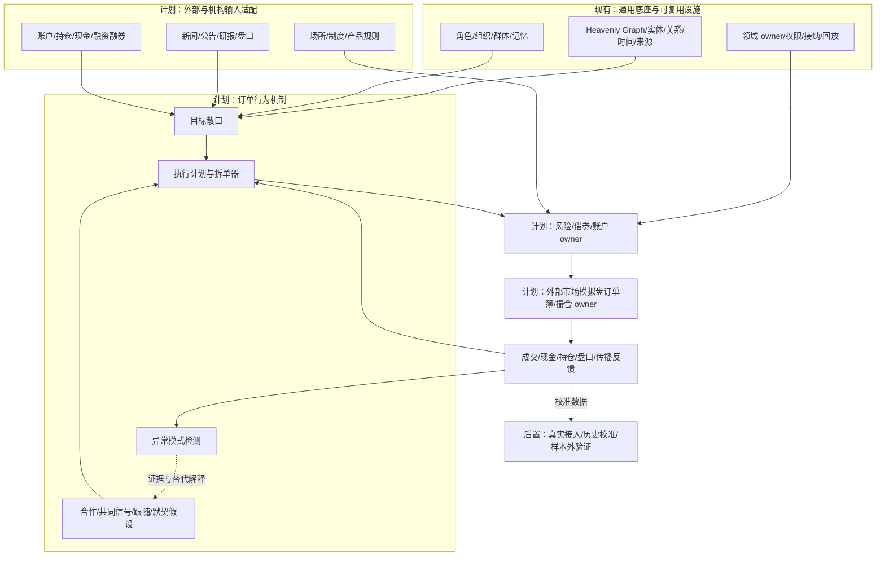
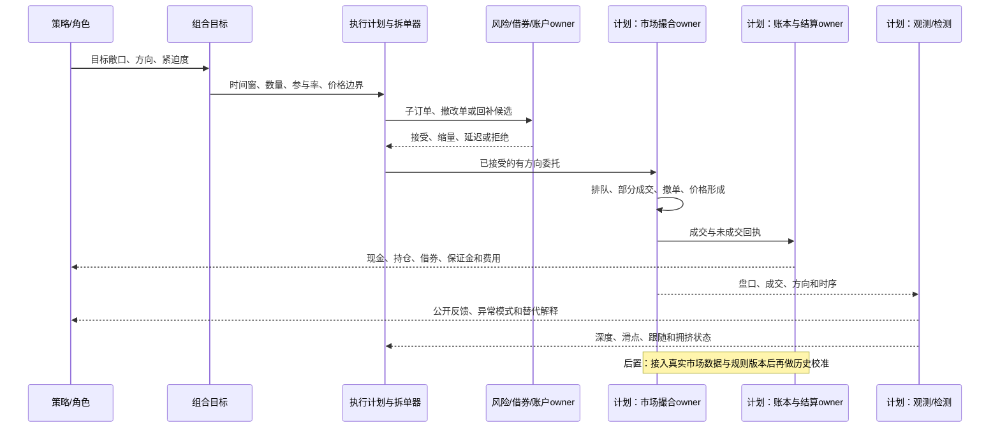
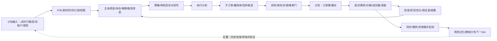

# 金融订单行为与多方博弈机制体系

日期：2026-10-15

状态：`analysis / design-draft / non-authorizing`

本文回应一个关键问题：金融机构如何把“想买/想卖”变成许多不同类型的子订单，如何受到盘口、资金、借券、融资、信息传播和其他参与者行为的反馈，以及如何在不把同步行为误判为合作的情况下模拟多方博弈。

本文是[模拟预测底座总纲](00-模拟预测底座总纲与设计地图.md)的金融扩展，依赖[量化机构组织与速度资金优势设计](15-量化机构组织与速度资金优势设计.md)、[光模块概念行情场景](07-光模块概念行情兴起与腰斩资金撤离场景推演.md)和[中际旭创私募基金案例](19-中际旭创私募基金多方博弈案例推演.md)。本文不构成现实交易指令，也不把任何市场参与者标记为操纵者。

机制分类参考了公开的执行研究和交易所异常交易教育材料：VWAP/最优执行研究用于区分目标与执行计划；上海证券交易所投资者教育材料及主板股票异常交易实时监控细则用于整理“拉抬/打压、异常撤单、申报速率、收盘阶段行为”等检测对象。它们只提供术语和监管观察维度，不代表本案例中的任何主体实施了相关行为，也不替代目标市场的最新规则适配。

参考入口：

- [VWAP Execution as an Optimal Strategy（arXiv）](https://arxiv.org/abs/1408.6118)
- [The Price Impact of Order Book Events（Cont、Kukanov、Stoikov，arXiv）](https://arxiv.org/abs/1011.6402)
- [ABIDES：Agent-Based Interactive Discrete Event Simulation](https://github.com/abides-sim/abides)
- [上海证券交易所投资者教育：异常交易行为案例系列](https://edu.sse.com.cn/tips/risk2/)
- [上海证券交易所主板股票异常交易实时监控细则](https://www.sse.com.cn/lawandrules/sselawsrules2025/stocks/exchange/c/c_20250519_10779397.shtml)
- [SEC：Lek Securities layering/spoofing 执法材料](https://www.sec.gov/enforcement-litigation/litigation-releases/lr-25427)

## 1. 先把“买卖”拆成八个分层

机构说“卖出一百万股”，底座不能直接写入一百万股成交。完整链路是：

```text
研究/策略判断
  -> 目标敞口或目标仓位
  -> 执行计划
  -> 子订单生成
  -> 委托接纳、排队、撤改单
  -> 部分成交/未成交
  -> 现金、持仓、融资融券和费用结算
  -> 策略与角色记忆反馈
```

这八层必须使用不同对象：

| 层 | 例子 | 能否直接形成成交 |
|---|---|---|
| 研究判断 | “交付风险可能扩大” | 不能 |
| 目标敞口 | 从 3% NAV 降到 1% | 不能 |
| 执行计划 | 五天卖 120,000 股，参与率不超过 8% | 不能 |
| 子订单 | 5,000 股限价卖单，或 500 股一组的多批订单 | 只能进入市场队列 |
| 接受委托 | 交易场所接受并分配序号 | 不能保证成交 |
| 成交 | 一笔买单与一笔卖单匹配 | 是 |
| 结算 | 现金、证券、借券、费用和可用状态变化 | 是世界事实回写 |
| 记忆反馈 | 执行质量、持仓变化、情绪和策略状态写回 | 不直接形成成交 |

因此，“机构在卖”至少还要说明：哪个账户、哪个策略、卖现货还是融券、目标量多少、执行时间多长、拆成多少批、每批价格条件、是否会撤改单、有没有可卖库存、成交了多少。

## 2. 参与者的订单行为分类

### 2.1 正常执行类

这些机制是为了完成已经批准的组合目标，不能被自动解释成操纵。

| 机制 | 白话解释 | 需要的底层输入 | 典型输出 |
|---|---|---|---|
| TWAP | 把目标量按时间平均分成多批 | 时间窗、目标量、子单大小 | 定时子订单 |
| VWAP | 参考历史或实时成交量，在活跃时段多做、冷清时段少做 | 成交量曲线、实时成交量、参与率 | 随市场成交量变化的子订单 |
| POV | 只占市场成交量的某个比例 | 实时成交量、最大参与率 | 市场越活跃，允许提交的量越大 |
| Arrival/implementation shortfall | 在冲击成本和等待风险之间权衡 | 到达价格、波动、深度、时间约束 | 更急或更慢的执行轨迹 |
| 被动挂单 | 放在买一/卖一附近排队 | 最优报价、队列、撤单概率 | 低冲击但可能不成交 |
| 主动吃单 | 直接消耗对手方一档或多档 | 对手盘深度、价格限制、紧迫度 | 更快成交、较大滑点 |
| 智能路由 | 在多个交易场所或流动性池选择路径 | 场所规则、费用、延迟、可见流动性 | 分场所子订单 |
| 篮子执行 | 将组合目标拆成多标的同步或异步订单 | 指数权重、篮子偏离、申赎状态 | 成分股各自的订单和成交 |

VWAP、TWAP、POV 和 Almgren–Chriss 类执行模型可以作为注册的执行模型参考；执行模型只产生计划，价格、成交数量和剩余量仍由市场 owner 决定。文献入口包括 [VWAP Execution as an Optimal Strategy](https://arxiv.org/abs/1408.6118) 和 Almgren–Chriss 最优执行框架。模型版本、参数、训练截止时间和数据可用时间必须进入回放键。

### 2.2 盘口流动性类

| 机制 | 白话解释 | 反馈 |
|---|---|---|
| 做市双边报价 | 同时挂买价和卖价，赚取价差并管理库存 | 库存偏多时降低买价/增加卖价，波动升高时扩价或撤单 |
| 库存再平衡 | 不是因为看多看空，而是仓位超过库存上限 | 触发反向子订单 |
| 价差捕捉 | 观察价差和短期订单流变化 | 在价差足够覆盖风险时提供流动性 |
| 冰山/部分展示 | 只公开一部分数量，成交后按规则补充 | 公开盘口不等于完整真实库存；补单不得重复入簿 |
| 价格梯度 | 在多个价格档位分布订单 | 价格移动时逐档成交或撤销 |
| 排队博弈 | 估计自己在队列中的位置和前方撤单 | 决定等待、撤单或主动跨档 |
| 流动性撤退 | 波动、信息风险或库存风险突然升高 | 买卖价差扩大，深度减少，未成交卖单增加 |

### 2.3 套利与相对价值类

| 机制 | 白话解释 | 订单表现 |
|---|---|---|
| 现货—期货/期权套利 | 两个相关工具的价格关系偏离 | 一边买、一边卖，数量按对冲比率拆分 |
| ETF—成分套利 | ETF 价格与成分篮子价值偏离 | 申购/赎回和逐成分订单 |
| 跨标的配对 | 同行业或统计关系偏离 | 多标的同时产生方向相反订单 |
| 指数再平衡 | 指数权重或成分改变 | 按生效时点集中但可拆分的篮子流 |
| 因子/风险平价再平衡 | 波动、相关性或风险贡献变化 | 组合层统一减仓，个股方向可能不同 |

套利策略不能被简化为“看多”或“看空”。它可能在核心标的下跌时买入该标的，同时卖出相关标的；必须保存腿之间的关联、对冲比率、同步约束、部分成交风险和未完成套利状态。

### 2.4 事件与被动资金流类

| 机制 | 触发条件 | 是否需要主观判断 |
|---|---|---|
| 基金赎回 | 份额持有人赎回、现金需求 | 产品合同和流动性程序触发 |
| ETF 申赎 | AP 申购/赎回篮子 | 规则和篮子状态触发 |
| 保证金追加 | 担保比例低于阈值 | 融资合同触发 |
| 强制减仓 | 追加保证金未完成、风控处置 | 账户 owner 触发 |
| 风险限额收缩 | 波动、回撤、相关性或集中度超过规则 | 风控模型和组织授权触发 |
| 公司行动/指数生效 | 分红、拆并股、成分调整 | 制度/产品 owner 触发 |

被动流也会拆单。强平不是一笔“恐慌卖单”，而是按可卖库存、可接受价格、场所规则和处置优先级分批执行。

### 2.5 融资融券与日内回转类

现货、融资买入、借券卖出、买回归还必须分账：

```text
可借库存确认
  -> 借券合同与费用
  -> 卖出借入证券
  -> 空头库存
  -> 买入回补
  -> 归还证券并结算
```

每个借券主体至少需要：`borrowable_quantity`、`borrow_rate`、`locate_at`、`borrow_start/end`、`recall_at`、`short_position`、`cover_quantity`、`margin_used` 和 `settlement_status`。

“当天卖了再买、买了再卖”不是通用能力。必须由市场、账户和工具适配包决定是否允许日内回转，并检查 T+1/T+0、融券券源、保证金、涨跌停、价格笼子和结算规则。没有可借证券，不能生成卖空；没有可用现金和保证金，不能生成买入；允许回转也不保证回补成交。

### 2.6 订单行为的正交维度

上面的分类是机制目录，不是一个互斥枚举。每个执行计划都要沿独立维度组合，才能表达同一机构“边做市、边对冲、边减仓”的真实情况：

| 维度 | 可选值示意 | 解决的问题 |
|---|---|---|
| 目标 | 建仓、减仓、对冲、再平衡、套利、清算、做市 | 为什么要交易 |
| 时间调度 | TWAP、VWAP、POV、到达价、事件触发、最优控制 | 什么时候发多少 |
| 主动性 | 被动、混合、主动 | 是否跨价位消耗流动性 |
| 展示 | 全量、部分展示、场所原生隐藏、执行器合成分批 | 对手能看到多少 |
| 价格 | 限价、可成交限价、跟价、梯度、参考价 | 在什么价格条件下成交 |
| 路由 | 单场所、智能路由、篮子路由、跨市场联动 | 去哪里执行 |
| 资源约束 | 现金、现货、借券、保证金、容量、风险预算 | 能不能发出 |
| 观察与反馈 | 盘口、成交、新闻、社交、风控回执 | 看到了什么以及何时看到 |
| 组织程序 | 自动、交易员复核、PM批准、风控否决、被动强平 | 谁能批准和改变 |

这些轴必须进入 `ExecutionPlan` 的版本化结构。`iceberg`、`price_ladder` 等不再作为覆盖全部语义的 `schedule_type`；它们分别属于展示轴和价格轴。场所适配包可以拒绝不支持的组合，拒绝必须有原因码，不能偷偷降级为另一种订单。

### 2.7 订单生命周期、竞态与守恒合同

父计划、子订单、场所委托、成交和结算是不同事实。推荐的状态机如下：

```text
draft -> authorized -> submitted -> accepted -> queued
queued -> partially_filled -> filled
queued/partially_filled -> cancel_pending -> canceled
queued/partially_filled -> replace_pending -> replaced -> queued
accepted -> rejected | expired
filled -> pending_settlement -> settled | settlement_failed
```

每个状态转换必须带 `event_time`、`available_at`、`venue_sequence`、`causal_parent` 和 owner 回执。撤单在途、改单在途、成交回报和风控回报可能乱序到达；底座不能用最后一条消息覆盖此前事实，而要用事件日志重放并按场所序号结算。

最低守恒合同：

```text
parent_target = filled + live_remaining + canceled + expired + rejected
displayed + hidden_reserved <= accepted_quantity
buy_fills == sell_fills                 # 同一成交事件两侧相等
cash_after = cash_before - buys + sells - fees - financing_cost
position_after = position_before + buys - sells
short_after = short_before + borrowed_sales - covered_quantity
```

跨腿交易另加：`hedge_ratio`、`leg_group`、`max_leg_skew`、`unhedged_timeout` 和 `leg_failure_policy`。一腿成交、另一腿未成交时，系统必须显示裸露风险并触发等待、撤单、补单或风控处置；不能把整组套利当作已经完成。

### 2.8 盘口事件、价格影响与异常行为的分层

盘口不只是成交。最小事件集合是 `limit_submit`、`marketable_submit`、`cancel`、`replace`、`partial_fill`、`full_fill`、`auction_uncross`、`halt` 和 `reference_update`。短周期观测可计算买卖一深度、价差、队列年龄、取消率、成交方向不平衡和订单流不平衡（OFI）。Cont、Kukanov 与 Stoikov 的研究摘要指出，短时间价格变化与最佳买卖价处的 OFI 近似线性相关，斜率与市场深度有关；这应作为待校准的观测模型，不是跨市场普遍真理。

建议把异常或对抗性行为分为四层，避免把一个标签直接当成法律结论：

1. **可观察模式**：高撤单率、短存活订单、盘口压力、跨市场不同步、收盘阶段集中流；
2. **机制假设**：流动性试探、诱导性展示、对倒/自成交风险、信息型压力、跨市场联动；
3. **证据层**：账户关联、实际成交占比、撤单前后意图证据、通信/授权记录、收益与风险结果；
4. **制度结论**：由目标市场的监管规则和 owner 审核决定，系统只返回 `possible_pattern`、`evidence_missing`、`alternative_explanations`。

`spoofing`、`layering`、对倒、自成交、收盘价格影响和跨市场影响可以作为监管压力测试的情景类别，但不得生成现实账户的规避检测步骤。没有意图证据时，模型必须同时保留做市风险控制、队列重排、策略失效和共同信号等正常解释。

### 2.9 可注册的机制族

为了让“手法”能扩展而不是变成固定菜单，机制注册表按目的和可观测结果组织。每个机制都必须声明前置条件、可用信息、主体权限、状态变化、输出观测和替代解释：

| 机制族 | 典型机制 | 主要状态变化 | 可观测结果 |
|---|---|---|---|
| 执行优化 | TWAP、VWAP、POV、到达价、最优控制、收盘/开盘参与 | 剩余目标、参与率、滑点预算 | 完成率、实现价、冲击、等待风险 |
| 流动性提供 | 双边报价、库存偏置、价差扩张、队列更新、流动性撤退 | 库存、报价半径、队列位置 | 深度、价差、成交概率、库存回转 |
| 方向性交易 | 趋势、反转、突破、事件后漂移、止损 | 信念、目标敞口、订单紧迫度 | 方向性订单流、成交簇、价格路径 |
| 相对价值与套利 | 配对、ETF/成分、现货/衍生品、跨市场、指数再平衡 | 多腿偏离、对冲比率、裸露风险 | 腿间同步、基差、未对冲敞口 |
| 风险与被动流 | 赎回、保证金、强平、风险限额、公司行动 | 可用现金、保证金、强制目标 | 被动卖压、集中时段流量、连锁处置 |
| 信息与传播反应 | 公告消费、研报更新、新闻延迟、社交扩散、公开跟随 | 信息集、置信度、情绪、记忆 | 到达延迟、消费率、信念更新、跟随订单 |
| 对抗性压力测试 | 流动性试探、异常撤改单、短期压力后反向回补、跨市场冲击 | 订单簿状态、检测分数、证据状态 | 模式指标、证据缺口、替代解释 |
| 组织协同 | PM授权、风控缩量、交易员复核、共享资金预占 | 权限、资金锁定、审批状态 | 决策延迟、拒单原因、组织内冲突 |

“流动性试探”“反弹后再定向”等属于可观测阶段标签，不是现实操作按钮。若研究目标是监管或稳健性测试，系统可以生成压力场景；若目标是市场预测，必须把主体意图作为不确定变量，并运行独立、共同信号、跟随和对抗性分支进行比较。

### 2.10 队列、冲击和容量的校准接口

外部模拟盘至少需要向底座回传：逐事件时间戳、订单簿深度、队列序号或可估计队列位置、成交方向、撤改单原因、场所延迟、拒单原因和结算回执。底座不强制某一种撮合器，但要求适配器实现以下接口：

```text
MarketEvent {
  event_ref, venue_ref, instrument_ref, event_time, available_at,
  event_type, side, price, quantity, order_ref, match_ref,
  queue_sequence, latency, source_ref, revision
}

ExecutionReceipt {
  parent_ref, child_ref, venue_order_ref, accepted_quantity,
  filled_quantity, remaining_quantity, average_price,
  fees, reject_code, cancel_code, settlement_status,
  venue_sequence, event_refs, owner_receipt_ref
}
```

可校准模型包括：OFI—深度价格冲击、成交概率、撤单生存时间、市场冲击曲线、容量曲线、延迟敏感度和跨腿裸露损失。模型输出必须带训练窗口、市场/品种、参数版本和置信区间；缺少逐笔盘口时，只能保留区间或比例，不得伪造逐笔成交。

## 3. 盘口压力与反向阶段

用户举的“拉伸再砸、砸完假反弹再砸”可以泛化成**多阶段订单流情景**，不能写成直接改价格的脚本。为了避免把术语表误当成行为清单，底座只注册“机制类别＋前置条件＋可观测结果＋合法性/检测状态”，不注册一个可直接照抄的现实操作按钮：

1. **流动性试探**：小额子订单测试深度、价差和对手反应；
2. **方向性压力**：合法库存和权限范围内连续主动订单消耗一档或多档流动性；
3. **公开反馈**：价格、成交量、盘口和新闻被其他主体按各自延迟看到；
4. **策略跟随或反向**：趋势策略、止损、融资机制、空头回补、套利和做市调整订单；
5. **短暂反弹**：卖压减弱、空头回补或低位买入造成反弹；
6. **中继或终止**：若新的卖压、融资约束或风险限额继续触发，形成下跌中继；若买方深度持续恢复，压力阶段终止。

运行时只让撮合 owner 产生价格和成交，系统输出可观测模式：订单到达密度、撤改单比、盘口深度变化、成交方向不平衡、价格冲击、反向回补、账户关联和信息到达顺序。可以输出 `possible_pattern`、`evidence_missing` 和替代解释，不能把统计模式自动判定为操纵，也不能把分析模式变成现实执行建议。

## 4. 多方关系：合作、趋同、跟随和默契

同向交易不等于合作。底座必须分开保存：

| 关系 | 说明 | 模拟方式 |
|---|---|---|
| 显式合作 | 合同、共同账户、通信或授权可证明 | 多方安排、分工和权限边；仍按各自账户结算 |
| 共同公开信号 | 多个策略读取同一公告、行情、指数规则 | 各自生成目标和子订单，比较到达延迟 |
| 量化趋同 | 模型特征、风险限额或训练样本相似 | 策略版本和数据端口独立，测量同步性和拥挤 |
| 公开盘口跟随 | 后到主体看到成交/报价后行动 | 保存可见时间、反应延迟和跟随强度 |
| 默契假设 | 行为相关但无通信证据 | 只作为假设分支，与独立巧合和共同信号分支比较 |

建议使用：

```text
CoordinationHypothesis {
  hypothesis_ref, actor_refs, instrument_scope, time_window
  mechanism: explicit|common_signal|convergent_model|follower|tacit|unknown
  evidence_refs, observability, prior_strength, alternative_explanations
  predicted_signatures, detection_metrics, owner_status
}
```

一个典型情况是：趋势量化、ETF 赎回和融资账户在同一时段卖出。它们可能没有任何联系，只是分别受价格趋势、篮子规则和保证金合同驱动。模拟要保留三条因果链，再观察叠加后是否造成拥挤，而不能直接生成“联盟卖盘”。

## 5. 案例映射：五日下跌中的机构怎么拆单

把[19 号案例](19-中际旭创私募基金多方博弈案例推演.md)中的日级动作展开，可得到以下结构：

| 参与者 | 目标 | 主要拆单机制 | 可能的反向/反馈行为 |
|---|---|---|---|
| 私募 P00 | 五天降低单票暴露 | POV + 被动挂单 + 价格梯度；每批 5,000 股 | 买盘消失时撤单；中继反弹时暂停；破位后恢复 |
| 主动基金 F01 | 降低主题集中度 | VWAP 分时卖出，可能同时买入替代标的 | 研究结论改变时缩量或恢复持有 |
| ETF/AP | 处理申赎篮子 | 成分权重拆单；不把篮子直接等于单股成交 | 申购转为赎回时方向改变 |
| 趋势量化 Q02 | 信号翻转后减仓 | 高频小单、POV、跨档紧急程度随波动调整 | 信号反转或容量耗尽时停止 |
| 做市 Q01-M | 控制库存和报价风险 | 双边报价、撤改单、库存偏置 | 波动上升时扩大价差或撤出 |
| 融资群体 | 维持担保比例 | 按账户阈值和可卖库存分批处置 | 补保证金则暂停；未补足则继续卖 |
| 融券策略 Q03 | 可能先卖后买回 | 借券、卖出、低位回补、归还 | 券源召回或回补成本上升时提前退出 |
| 长期资金 L01 | 条件式承接 | 多价位低位限价单，慢时钟执行 | 价格继续破位时下调承接价或等待 |
| 个人群体 | 止盈、止损、抄底、观望 | 大量小单和分布式限价单 | 信息/情绪/成本变化导致群体分裂 |

因此，五天中出现“先压价、弱反弹、再破位”的结果时，系统要能回答：是哪类子订单造成的，哪些是主动订单，哪些是被动订单，哪些只是跟随，哪些订单在盘口中未成交，哪些资金实际上在回补空头，哪些机构只是同步而没有协作证据。

## 6. 运行输入与输出

### 6.1 输入

- 参与者组织、账户、策略、岗位和授权；
- 目标仓位、持仓成本、现金、保证金、借券和可卖库存；
- 订单簿、逐笔成交、撤改单、场所规则和交易阶段；
- 行情、新闻、研报、社交传播和各主体 `available_at`；
- 执行模型、子订单大小、时间窗、价差、参与率、撤单和补单参数；
- 多标的对冲腿、ETF 篮子、指数生效和套利约束；
- 合作、跟随、共同信号和默契假设的证据与替代解释；
- 检测目标：流动性压力、拥挤、异常同步、反向回补、融资反馈或执行质量。

### 6.2 输出

- 每个主体的目标、执行计划、子订单、委托生命周期和成交回执；
- 买卖方向、报价、委托、成交、剩余量、撤改单和队列变化；
- 现金、现货、融资、借券、保证金、费用和结算状态；
- 价格、成交量、主动买卖不平衡、深度、价差、冲击和反弹/中继结构；
- 公开信息到达、主体消费、信念/情绪变化和后继行动；
- 多方订单同步的原因分解：显式合作、共同信号、模型趋同、公开跟随、默契假设或未知；
- 异常模式检测、证据缺口、替代解释和 owner 回执；
- 结果的分支、版本、权限、来源和 replay key。

## 6.3 来源与适用范围台账

| 来源 | 本文实际读取内容 | 可支持的设计结论 | 不能推出的结论 |
|---|---|---|---|
| Kato, *VWAP Execution as an Optimal Strategy*, arXiv:1408.6118 | 摘要与论文元数据 | 在引入成交量过程的 Almgren–Chriss、风险中性假设下，VWAP 可成为最优策略；风险厌恶时会有修正 | VWAP 在所有市场、所有风险偏好下都最优 |
| Cont, Kukanov, Stoikov, *The Price Impact of Order Book Events*, arXiv:1011.6402 | 摘要与论文元数据 | 限价单、主动单和撤单共同构成盘口事件；短周期 OFI 与价格变化、深度之间可校准关系 | 仅凭 OFI 证明意图、操纵或未来价格 |
| ABIDES README 与 arXiv:1904.12066 入口 | README | 外部 agent-based discrete-event 引擎可模拟大量交易代理、交易所交互和逐代理网络延迟 | ABIDES 的具体市场规则自动等于中国 A 股或目标市场规则 |
| 上海证券交易所投资者教育与主板异常交易监控目录 | 页面目录和公开案例分类 | 可作为拉抬/打压、异常撤单、申报速率、收盘阶段等检测维度词表 | 上交所主板规则直接适用于深交所创业板或任何市场 |
| SEC layering/spoofing 公开执法材料 | 页面摘要和案件说明 | 可作为“展示—撤销—成交影响”异常模式的制度研究入口 | 案件模式可以直接归因给案例中的任一主体 |

来源只约束术语、假设和检测维度；真正运行时必须由 FDE 保存法域、市场、产品、版本、发布日期、适用期间和 owner 接纳回执。

## 6.4 机制注册合同（设计示意）

```text
OrderMechanismSpec {
  mechanism_ref, version, objective_axis, schedule_axis,
  aggressiveness_axis, display_axis, price_axis, routing_axis,
  prerequisites, forbidden_combinations, venue_capabilities,
  state_transition_rules, accounting_effects, observables,
  calibration_inputs, legal_scope, evidence_requirements, owner_ref
}

MarketAdapterContract {
  venue_ref, product_ref, jurisdiction, calendar,
  tick_size, lot_size, price_limits, auction_rules,
  settlement_cycle, short_sale_rules, borrow_rules,
  intraday_reversal_rules, cancel_replace_rules,
  hidden_order_support, latency_model, unsupported_behavior_codes,
  effective_from, effective_to, source_refs, owner_receipt_ref
}
```

FDE 先把外部行情、模拟盘回执和制度文件映射为这两个合同；司命只能在合同允许的组合上安排角色、组织和群体。司命可以改变情景参数和参与者激活状态，不能越过市场 owner 直接写价格、成交或结算。

## 7. 三张图

### 7.1 架构图



### 7.2 主交互时序图



### 7.3 数据流图



## 8. 运行验收不变量

1. 目标仓位、执行计划、子订单、接受委托、成交和结算不能混写；
2. 每个子订单有买卖方向、价格条件、数量、时间、有效期、父计划和状态版本；
3. 成交买卖数量相等，部分成交保留两侧剩余量，撤单和改单不重复计量；
4. 冰山或隐藏数量不会与盘口投影重复入簿；
5. 现货、融资、融券和借券回补分别记账；没有券源或保证金不得生成相应订单；
6. 机构内部多个策略不重复使用同一资金和持仓；
7. 同向交易只有在证据充分时才建立合作边，默认保留共同信号、趋同、跟随和独立巧合解释；
8. “拉伸—回砸—反弹—再砸”只能作为事件和订单流分支，价格由撮合 owner 产生；
9. 异常模式输出必须带证据、可见性、时间窗和替代解释，不能直接写成现实违法结论；
10. 所有结果可追溯到数据版本、模型/策略版本、授权、owner 回执和 replay key。

本文完成的是机制体系设计与案例映射，不代表执行器、借券、外部撮合或异常检测已经实现。下一步应先用一个小型合成订单簿验证拆单、部分成交、撤改单、空头回补和跟随延迟，再接入真实市场模拟工具。
