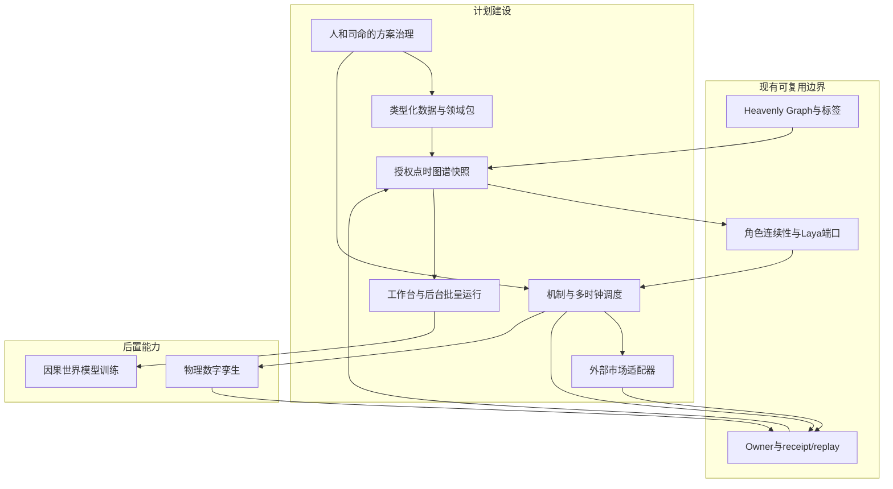
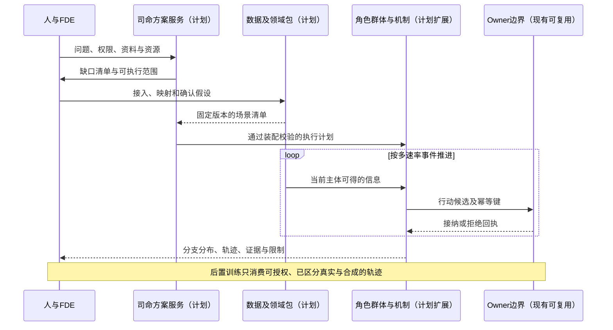

# 00 总纲与设计地图

修订日期：2026-10-16｜合同版本：整合设计 v1.0｜建设状态：计划建设｜验证证据：专用静态校验入口见[README](README.md#文档状态与静态校验wog-r10)；本轮运行、适配、性能及预测未验证。

日期：2026-10-15｜版本：整合设计 v1.0｜状态：design-draft / non-authorizing。

## 1. 设计目标与裁决

把现有世界—角色—司命—领域 owner 的架构发展为通用模拟底座。金融是第一套专业包；工业、商业、公共治理等通过领域类型、数据、机制和求解器适配。通用性意味着可以注册新语义并检查缺口，不意味着现有机制已经能够准确模拟一切。

金融执行专业包当前只规划美股、A股、港股、日本、韩国、台湾、新加坡七个股票市场，按实际场所/板块/产品/时间及账户能力分别装配。首批普通股票与明确支持的上市ETF二级交易以[17](17-外部模拟盘与跨市场数据对齐.md)为范围合同；其他金融品种仍能作为数据或估值输入，执行机制后置。通用内核保持行业无关，不把七地规则硬编码成通用类型。

采用“**类型化数据 + 领域语义 + 可插拔演化机制 + 有权接纳**”路线。单纯知识图谱不能完成模拟；为每个行业另写一套世界运行时又会破坏复用。图谱负责关联和发现作用路径，机制负责计算，owner 负责规范状态提交。

不将自研程序语言设为前置条件。先建设类型化中间表示 IR、装配校验和执行计划；需要文本编辑时再提供受限声明式 DSL。后端优先复用 Python，批量热路径在测量后用 Rust 等成熟组件优化，见[02](02-底座分层与模块责任.md)。

## 2. 全套文档的统一约定

- FDE 是 Forward Deployed Engineer／驻场交付团队。团队交付机构配置、连接器、语义映射、机制绑定和验收方案；“FDE 适配层”只是这一交付成果的统称。
- 玩家是模拟发起者的一种会话身份。组织身份、数据所有权、玩家操作权和观察视角分别授权。
- `world_ref + branch_ref` 确定一个世界分支。现实资料档案、历史重建、模拟事实、主体信念分别保存。
- `owner` 是特定状态的提交责任边界，不等同于真实公司、经理、监管者等世界内实体。
- `Laya` 是角色决策模型端口名称；保留实际版本、能力与输出约束，不推定其已有特定数量的输出类型，也不再使用 JEV。
- 本套规范性字段以[03](03-类型化数据与统一记录合同.md)为准，时间、空间和口径以[06](06-时间空间口径与适用域.md)为准，写入流程以[09](09-权限关系与运行时接纳.md)为准。

## 3. 可复用、计划与后置

本套现含00–26共27篇，完整索引与按职责划分的主合同见[README](README.md#来源映射与合同优先级)。21负责共同合同映射，不覆盖03的字段及05/09的Owner边界；26负责组合、投影和跨存储查询。冲突按受影响合同显式版本迁移，不凭文档新旧决定。

2026-10-16已确认WOG-R05–R10：认知/因果证据门槛、Nasdaq连续竞价现金限价/撤单子集与ABIDES候选、数据用途与删除、固定场景性能/恢复目标、潜变量竞争解释和文档治理；随后单独确认R03的TEST-X合成双边交易纵切。主合同和未决证据见[26 §14](26-世界运行图谱与统一运行合同.md#14-设计成熟度评估记录2026-10-16)，纵切夹具与验收见[26 §14.14](26-世界运行图谱与统一运行合同.md#1414-wog-r03-已确认决议合成双边交易最小纵切)。十项设计裁决已确认，真实适配、性能实测与运行闭环均未验证，不因回写提升成熟度。

| 层次 | 现有可复用边界 | 本 fork 计划 | 后置且另验收 |
|---|---|---|---|
| 世界 | owner、append、revision、receipt、replay 方向 | 通用记录、快照、分支和专业提交合同 | 跨进程分布式状态与大规模恢复 |
| 图谱 | Heavenly Graph、派生读取、注册标签方向 | 动态关系、多方结构、时空域、模型依赖图 | 大规模增量查询优化 |
| 心智 | 角色连续性、私有资料、Laya 端口方向 | 金融角色、决策阶段、信息隔离与情绪绑定 | 跨文化行为校准 |
| 社会 | 组织、群体升级已有设计 | 组织内部程序、动态群体、多精度交接 | 亿级匿名人口的压缩运行 |
| 专业 | 游戏主线已有窄域合同 | 金融数据、市场／账户／清算适配 | 多国市场全覆盖、工业物理孪生 |

“现有可复用”表示存在复用依据，不是对实现完成度的重新背书；现有游戏 Economy/Government 不被直接认作金融账本或完整法律系统。

## 4. 架构图

## 5. 主交互时序图

## 6. 数据流图

## 7. 建设阶段与交付门槛

1. **内核合同检查**：记录、身份、时间、权限、单Owner原子接纳和重复回执，作为完整纵切的前置检查；单域通过不代表跨域协同已验收。
2. **首条可执行纵切（WOG-R03）**：按[26 §14.14](26-世界运行图谱与统一运行合同.md#1414-wog-r03-已确认决议合成双边交易最小纵切)固定TEST-X合成双边500股交易、五个业务Owner实例、费用、交收、查询、故障恢复及两类回放。设计已确认，实现与运行验收待完成。其后按17推进ABIDES候选适配，再扩展两只股票、新闻到达差异及父子订单；合成通过不能替代真实适配证据。
3. **组织与群体**：投研—风控—执行，B0–B3 交接，群体分裂与可回放资源分摊。
4. **跨市场**：ETF／期货／外汇等适配、不同日历、结算与保证金、未对冲风险。
5. **实时与解释**：在线同化、多分支预测、无限画布、视角切换、历史可见性重放。
6. **高保真与训练**：物理求解器、世界模型、样本外和干预评估。

每阶段分别提交结构可表达、执行一致性、吞吐时延和预测有效性证据。文档结构通过不等于其中任何运行阶段完成。

## 8. 验收不变量与导航

状态唯一 owner；账户资金不重复；角色与群体唯一推进；时间不穿越；模型与现实来源分离；任何视图只展示可授权事实；预测保留条件与不确定性。

全套阅读与旧文档映射见[README](README.md)。完整运行参照[12](12-司命方案治理与全流程运行.md)，金融案例参照[20](20-光模块市场完整贯通案例.md)。
