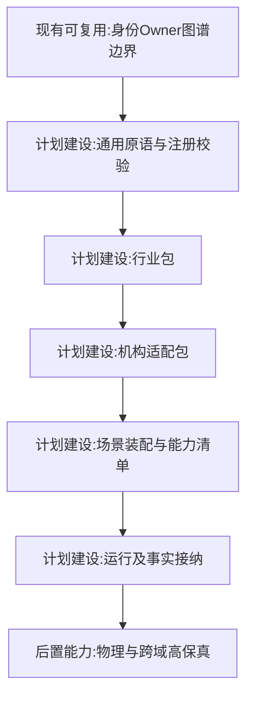
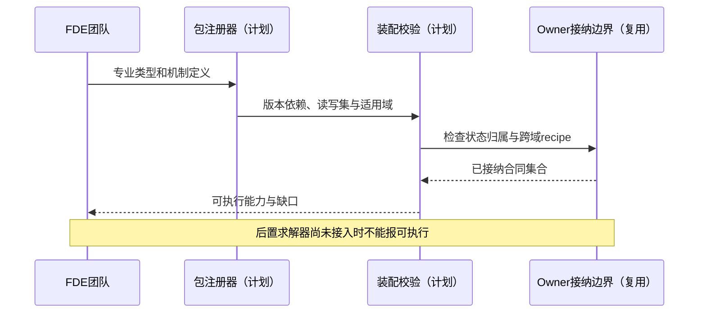

# 01 通用模拟底座与扩展边界

修订日期：2026-10-16｜合同版本：未发布草案｜建设状态：计划建设｜验证证据：专用静态校验入口见[README](README.md#文档状态与静态校验wog-r10)；本轮运行、适配、性能及预测未验证。

日期：2026-10-15｜状态：design-draft / non-authorizing｜依赖：[00](00-总纲与设计地图.md)。

## 1. 通用性的含义

底座承诺能组合领域类型、数据结构、时间空间合同、状态变化和有权提交。它不承诺预置世界上所有法律、组织、产品、算法和物理规律。没有专业机制的数据只能表示、检索或展示，不能被宣称已经可模拟。

以三个独立能力描述适配成熟度：`representable` 可无损保存，`executable` 已绑定合法机制，`validated` 在特定范围已有证据。每个场景的每种能力分别登记，未知项显式输出。

## 2. 核心原语与组合

| 原语 | 责任 | 例子 |
|---|---|---|
| Entity / Role | 身份、生命周期、范围内身份 | 设备、自然人、基金产品、基金经理 |
| Relation / Arrangement | 二元或多方联系 | 股权、委托、联合发文、融资合同 |
| Statement / Carrier | 命题表达与其载体 | 法律条款、新闻、目标、文件 |
| Observation | 某主体从某来源得到的信息 | 传感器读数、行情接收、报道 |
| Event / State | 发生的变化与持续条件 | 成交、停机、持仓、道路封闭 |
| Process / Resource | 有步骤的履约与受约束资源 | 审批、生产、现金、库存 |
| Model / Mechanism | 估计与状态演化计算 | 时序预测、传播、撮合、物理求解 |
| Organization / DynamicCohort | 制度集合与行为投影 | 机构、班组、临时恐慌卖出群体 |
| Scenario / Branch | 问题配置与条件分叉 | 订单下滑、出口限制、事故分支 |

原语不是互斥继承树。组织有 Entity 身份和 OrganizationStructure；一份合同既有 Carrier，又包含 Statement，还是多方 Arrangement 的依据。命题自身不具有执行法律或扣款的权力。

## 3. 行业包、机构包与场景包

以下为设计示意：

```yaml
DomainPackage:
  package_ref: {id, version, digest}
  dependencies: [PackageRef]
  type_definitions: [TypeDefinition]
  relation_definitions: [RelationDefinition]
  semantic_tags: [TagDefinition]
  units_and_definitions: [MeasurementDefinition]
  norm_profiles: [NormProfile]
  mechanisms: [MechanismSpec]
  owner_bindings: [OwnerBinding]
  cross_owner_recipes: [RecipeSpec]
  adapter_requirements: [CapabilityRequirement]
  clock_and_domain_contracts: [ContractRef]
  conformance_scenarios: [ScenarioRef]
```

行业包定义专业语义；机构包添加自身岗位、数据授权和流程；场景包选择问题、范围、参数、参与者和分支。机构不得通过配置任意声明一个新 owner 来获得所有状态写权。

## 4. 制度不能压缩成一个 policy

将规范内容、文件载体、发布过程、执行机关、法律效力和适用域分轴表示。可注册法律、行政法规、规章、司法解释、政策、路线、方针、规划、实施细则、白皮书、指导文件、组织内规和合同条款。名称不直接推出约束强度；白皮书可以是说明资料，会议可以产生议程、纪要、决议或信号，是否生效须由适用法域包判断。

国家、主权辖区、政府、立法／行政／司法机关、政党机构、部门、国资出资人、基金管理人、母基金产品、受托人和被投公司分别建实体。政府母基金不能同时被当作主管部门、管理人和全部被投企业；它们用出资、控制、委托和监管关系连接。

规范状态至少分 `proposed/adopted/published/effective/suspended/repealed/disputed`，不是全行业固定顺序。效力冲突由专业的优先规则、授权链、解释和争议程序解决，不能用“越晚越高”通用排序。

## 5. 四种驱动

| 驱动 | 触发条件 | 与角色驱动的区别 |
|---|---|---|
| 角色驱动 | 意图、目标、私有认知产生行动 | 需要有决策者 |
| 事件驱动 | 新成交、公告、事故或授权事件 | 不必有主动意图 |
| 实体驱动 | 到期、阈值、库存耗尽、设备寿命 | 实体不必是人或智能体，例如债券到期 |
| 观测驱动 | 新测量或报道被接收 | 更新可知状态，未必改变外部真实状态 |

同一新闻可先触发观测，再改变角色信念，再产生订单，成交事件又触发保证金实体的阈值规则。触发器使用因果父链和幂等键去重。

## 6. 架构图



## 7. 主交互时序图



## 8. 数据流图


## 9. 验收不变量

新行业须给出身份、状态归属、机制输入输出、时间空间域、权限、失败语义和验证案例；缺一个就记录缺口。标签、文档解释、模型输出、图谱连接均不能自动创造执行能力。工业物理、商业需求和金融成交使用不同专业机制，但共享[03](03-类型化数据与统一记录合同.md)、[08](08-模型机制与可插拔演化.md)、[09](09-权限关系与运行时接纳.md)。
