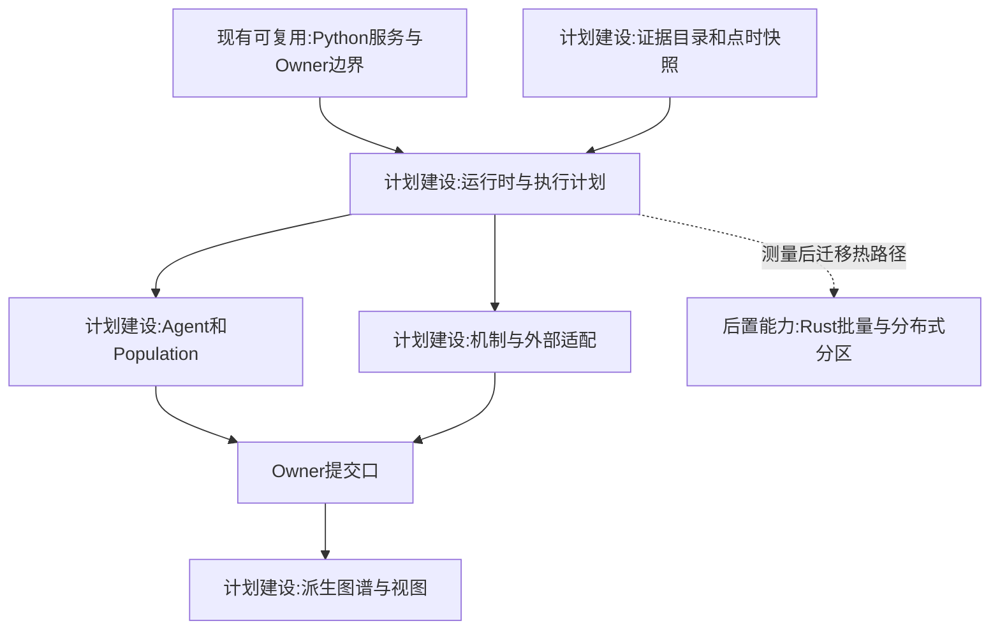
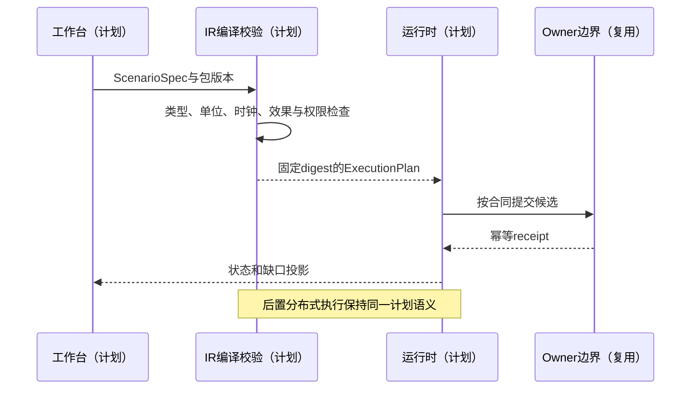
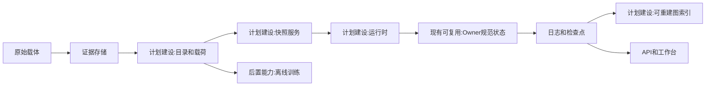

# 02 底座分层与模块责任

修订日期：2026-10-16｜合同版本：未发布草案｜建设状态：计划建设｜验证证据：专用静态校验入口见[README](README.md#文档状态与静态校验wog-r10)；本轮运行、适配、性能及预测未验证。

日期：2026-10-15｜状态：design-draft / non-authorizing｜依赖：[01](01-通用底座与扩展边界.md)。

## 1. 模块及所有权

| 模块 | 输入 → 输出 | 管理内容 | 不拥有 |
|---|---|---|---|
| EvidenceStore | 原始响应 → 不可变证据引用 | 载体、抓取与校验摘要 | 内容必然真实的保证 |
| DataCatalog | 类型化记录 → 点时索引 | schema、版本、质量、血缘 | 账户和订单规范状态 |
| SemanticRegistry | 词汇与规则 → 版本化定义 | 类型、关系、标签、元标签 | 任意规则执行器 |
| GraphProjection | 事实／估计 → 授权图视图 | 派生节点和动态边 | 第二份世界真相 |
| SnapshotService | cutoff与actor → 读取快照 | 数据选择、权限过滤、输入摘要 | 给角色补入未来消息 |
| SimulationRuntime | ExecutionPlan → 事件与检查点 | 多时钟、队列、分支、推进锁 | 越权写入各领域 |
| AgentService | 私有frame → 决策候选 | 记忆、Laya调用、阶段状态 | 成交成功的判定 |
| PopulationService | 成员状态 → 群体候选 | 分布、episode、精度交接 | 共同所有的虚构资产 |
| SimingService | 问题与缺口 → 场景提案 | 检索、装配、治理与监督 | 通用超级owner |
| OwnerAdapters | 授权候选 → receipt与revision | 各域唯一规范状态提交 | 无关领域的直接写入 |
| ProjectionAPI | 状态与结果 → UI/API | 权限视图、量价、回放 | 通过画布直接改事实 |

纯分析输出可进入 ResultStore，不必为了保存一个预测而制造世界事实事件。会影响后续模拟的状态估计则须显式绑定状态合同。

## 2. 物理存储与计算选择

数据模型不绑定单一数据库。建议对象存储保存原文、Parquet/Arrow 载荷和快照；关系库保存目录、权限、元数据、账本与回执；列式分析引擎读取行情时序；图索引保存派生结构；事件日志承担重放。每项规范字段只有一个逻辑事实源，索引是可重建副本。

初始单机分区执行即可，避免未经测量先上全部分布式组件。Python 复用现有角色、司命、模型生态和后端接口。批量流校验、队列、图增量和密集数值计算出现具体瓶颈后，可用 Rust 服务或已有 C/C++ 数值库，经批量 Arrow/IPC 或版本化消息交换。C 不作为业务内核首选，原因是开发和内存安全成本；不能脱离工作负载给某语言宣称整体最快。

## 3. DSL 与执行计划

`ScenarioSpec -> typed IR -> 静态装配检查 -> ExecutionPlan -> runtime`。

IR 包含类型、量纲、时间依赖、作用域、权限要求、读写集、owner绑定、随机源、外部端口。表达式只允许注册纯函数和已接纳效果，不允许随意网络请求、任意代码或跨 owner 写入。图形画布与文本编辑器最终编辑同一个 IR，不各造一套语义。

```yaml
ExecutionPlan:
  manifest_ref: ImmutableManifestRef
  world_ref: WorldRef
  branch_ref: BranchRef
  mechanism_bindings: [BindingRef]
  clock_domains: [ClockPolicy]
  read_write_sets: [EffectDeclaration]
  owner_bindings: [OwnerBinding]
  capability_set: [CapabilityRef]
  seed_streams: [SeedRef]
  budgets: {events, actors, branches, memory, latency}
```

## 4. Fork 与上游同步

记录 `upstream_commit`、合同版本、schema迁移和本地扩展清单。复用接口优先于复制实现；金融/工业包隔离；上游 owner 新事件不能自动接纳进模拟 fork。标签注册与元标签只治理语义、生命周期、可见性和编辑方式，不能成为不受约束的第二规则引擎。

升级先进行契约差异比较、快照迁移演练、旧轨迹兼容回放，再启用新版本。已有分支继续固定其历史依赖，禁止运行中静默替换模型、规则或上游代码。

## 5. 性能与失败预算

每个场景声明源事件率、活跃主体数、群体数、分支数、窗口、内存、p95/p99 接收与决策延迟目标。采用分区队列、背压、批处理、缓存和分层精度，禁止通过丢掉关键成交或提前送消息达标。实时源断流按 freshness policy 暂停、降级或切合成分支，并让界面明确标识。

## 6. 架构图



## 7. 主交互时序图



## 8. 数据流图



## 9. 验收不变量

模块重启可从检查点和日志恢复；任何索引丢失不损失规范事实；跨语言接口保留类型和确定性；相同 manifest 的历史分支不受新配置影响；实际性能证据与功能正确性分开。下游详细合同见[03](03-类型化数据与统一记录合同.md)、[05](05-世界真相证据模型与修订回放.md)、[08](08-模型机制与可插拔演化.md)。
