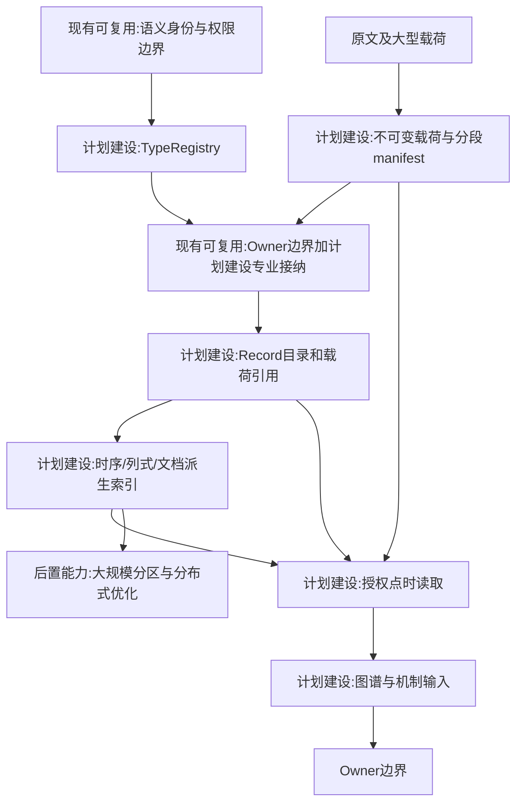
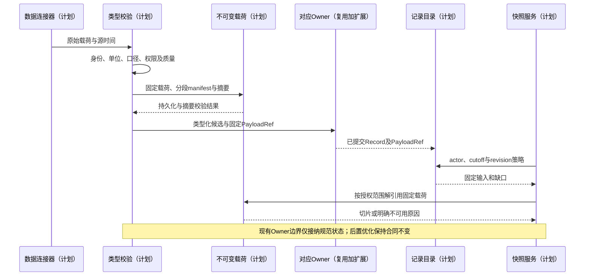

# 03 类型化数据与统一记录合同

修订日期：2026-10-16｜合同版本：未发布草案｜建设状态：计划建设｜验证证据：专用静态校验入口见[README](README.md#文档状态与静态校验wog-r10)；本轮运行、适配、性能及预测未验证。

日期：2026-10-16｜状态：design-draft / non-authorizing｜本文为全套字段语义主合同；所有类型及伪代码都是设计示意。

## 1. 数据结构与业务类别分轴

| 结构族 | 支持的载荷 | 必须声明 |
|---|---|---|
| 标量与数量 | 布尔、枚举、定点、浮点、金额、价格 | 精度、量纲、单位、币种、范围与舍入 |
| 记录与表格 | 明细、宽表、面板、层级表 | 主键、粒度、唯一性、字段可空与缺失含义 |
| 时序 | 单／多变量、不规则采样 | 时钟、窗口、流量／存量、采样与聚合 |
| 事件流 | 盘口增量、交易、传感器事件 | 分区、序号、乱序、缺口、重放和去重 |
| 曲线与曲面 | 利率曲线、波动率曲面、工艺特性 | 轴、输入、插值、外推、有效区间 |
| 向量矩阵张量 | 因子、协方差、空间场 | 命名轴、对象映射、稀疏性、单位 |
| 文档多模态 | 文本、表格区块、图像音视频 | 原文定位、转录、提取版本和证据 |
| 图与多方结构 | 供应链、股权、组织、模型依赖 | 端点类型、角色、有效时间、方向 |
| 分布与样本路径 | 联合分布、粒子、轨迹集合 | 条件、支持域、权重、相关和随机源 |
| 公式与约束 | 估值、会计、优化、安全边界 | 类型、单位、效果、求解与失败语义 |
| 几何、网络与场 | GIS、BIM、轨迹、网格 | 坐标、分辨率、覆盖、边界与变换 |

金融业务类别详见[14](14-金融数据专业包与数据分类.md)。同一报价使用数量、记录、事件流和时序；同一曲面结构也能服务制造或能源，不能以业务名反推底层结构。

## 2. 统一记录合同

以下 `Record` 是持久化信封；大型载荷用不可变引用，不把全部 tick 和文档塞成图节点。

```yaml
Record:
  identity: {id: RecordId, type: TypeRef, version: SchemaVersion}
  world_ref: WorldRef
  branch_ref: BranchRef
  payload: InlineValueOrPayloadRef
  subject_refs: [EntityRef]
  event_time: PointInTimeOrInterval
  valid_time: Interval
  published_at: PointInTimeOrUnknown
  available_at: AvailabilityRef
  observed_at: PointInTimeOrUnknown
  processed_at: PointInTime
  statistical_definition: MeasurementDefinitionRef
  spatial_scope: SpatialContractRef
  applicability_domain: ApplicabilityDomainRef
  source_refs: [SourceRef]
  revision: Integer
  supersedes_ref: RecordRefOrNone
  lineage: [DependencyRef]
  access_scope: AccessScopeRef
  epistemic_status: observation|assumption|estimate|candidate|fact|result
  quality: QualityReport
  uncertainty: UncertaintyRef
  owner_receipt_ref: OwnerReceiptRefOrNone
  stream_position: StreamPositionOrNone
  content_digest: Digest
```

`identity.version` 是 schema版本；`revision` 是同一逻辑记录的修订，不可混用。`available_at` 引用按主体／渠道记录的可得时间表，不能用一个全局发布时间冒充所有人同时知道。未知值、空值、不适用、未披露、尚未收到和有争议分别编码，不用 `0` 代替。

本合同中的 `Record` 是唯一规范记录信封。`RecordId` 表示同一逻辑记录的稳定身份；`RecordRef = {record_id, revision}` 指向某一具体版本。关系数据以 `RelationInstance` 作为载荷并引用 `RecordRef`，不另建一套缺少本合同字段的边记录。`Proposal` 与 `OwnerReceipt` 是提案和接纳协议对象，不等同于世界事实记录；Owner 接纳后生成的新事实记录通过 `owner_receipt_ref` 回指相应回执。

```text
PointInTime = {instant_utc, original_timezone, precision, clock_ref, sequence?}
TypeRef = {namespace, name, version, digest}
StreamPosition = {source, partition, sequence, snapshot_ref?}
QualityReport = {completeness, freshness, consistency, flags, validation_refs}
DependencyRef = {record_ref, revision, transform_ref, input_role}
```

### 2.1 不可变载荷引用与分段记录（WOG-R04）

`Record` 的逻辑合同与物理存储分开。小型类型化值可以内联；原文、音视频、大型表格、曲线、矩阵、张量和流分段使用不可变 `PayloadRef`。以下为引用最小合同（设计示意）：

```yaml
PayloadRef:
  object_ref: OpaqueStorageRef
  content_digest: Digest
  byte_length: Integer
  encoding: FormatAndCodecRef
  schema_ref: TypeRef
  selector: VersionedSliceSpecOrNone
  index_manifest_ref: ImmutableManifestRefOrNone
```

`content_digest` 校验被引用的完整不可变对象；`selector` 在该对象上定位行、时间区间、命名轴或文档区块，不把“当前文件路径”或无版本查询当作载荷身份。分块对象通过不可变 manifest 固定各块摘要和顺序；存储位置迁移不改变逻辑引用和内容摘要。单位、轴与口径仍遵守 TypeDefinition 和 MeasurementDefinition。

高频流可以按分区、序号区间和 schema 分段承载，不强制每个 tick/样本各建一个 Record 或图节点。分段 manifest 必须固定成员定位、来源序号、事件/接收时间、缺口以及成员级元数据。权限、可得时间、口径或认识状态不一致时，必须分段或保留逐成员映射；读取在成员级执行同样的时间与权限筛选，不能用段的最早可得时间提前暴露后续数据。单条事件仍可用“具体 RecordRef + 分段摘要 + 来源分区/序号或成员定位”稳定寻址。

PayloadRef 只定位内容，不授予读取权限。记录可见不等于整份载荷可见；解引用、切片和聚合都须经过主体/用途/时间及载荷范围授权。引用的内容必须在规范记录提交前完成持久化和摘要校验；失败不得发布可供消费的悬空引用。目录或派生索引尚未同步时报告滞后，不补造记录。

### 2.2 存储职责

| 存储职责 | 保存内容 | 权威与重建边界 |
|---|---|---|
| Owner 规范存储和领域事件日志 | 本域 Record revision、事件、receipt、幂等结果、预留与义务 | 规范提交依据，遵守[05](05-世界真相证据模型与修订回放.md)域内原子合同 |
| Record 目录 | 信封元数据、RecordRef、PayloadRef 和检索入口 | 不取得领域事实写权；若保存元数据副本，须标注源版本和同步水位 |
| 不可变载荷存储 | 原始资料、事件分段、大型数值载荷和版本化 manifest | 是被引用内容的持久化依据，不能把它当作可随意丢弃的缓存 |
| 时序/列式、文档检索和图谱索引 | 时间范围/轴/全文检索、聚合加速、实体关系与状态摘要 | 可由固定规范记录和载荷重建，不独立修订事实 |
| ResultStore | 派生曲线、矩阵、模型预测和图算法结果的 Record 及载荷 | 保留认识状态和固定依赖，复算生成新结果版本 |

上述是逻辑职责，不要求各自部署一种数据库。时序/列式格式可同时用作不可变载荷的编码；只有可重建的查询副本属于索引层，不能因格式相同而丢掉唯一原始数据。跨存储查询的请求、清单和一致性合同统一见[26 §6.5](26-世界运行图谱与统一运行合同.md#65-跨存储查询合同wog-r04)。

### 2.3 不可变引用与内容留存边界（WOG-R07）

不可变指同一引用不更换所指内容，不授予永久保留或永久读取权。原始载荷不能作为缓存任意淘汰，但必须遵守[09 §5.3](09-权限关系与运行时接纳.md#53-撤权保留与删除传播wog-r07)的许可到期、内容删除和依法保留合同。删除后保留最小受控不可用标记，不用相似数据补成原内容；回放/查询报告缺失，仍需复核当前授权。引用、摘要和审计本身也接受最小化与访问治理。

## 3. 类型、身份和专业扩展

`TypeDefinition` 声明结构族、字段／轴、单位、约束、身份规则、时间语义、访问合同和可用操作。未知类型可以保留原始载荷，但在完成注册前不得参与需要强类型输入的机制。

发行人、上市证券、交易所合约、基金产品、管理公司、账户和名义持有人分别编号。不同来源别名映射为候选实体并保留匹配置信与证据，不能仅靠名称相似合并。一个人多个平台账号有独立账号实体；现实无法去重时保存联合分布，不伪造已知真实身份。

## 4. 数量、测量和分布

`MeasurementDefinition` 包括被测对象、数量种类、单位、币种、价格基准、分母、样本总体、调整方法、会计范围、期间、空间支持、采样、聚合、缺失处理及版本。

价格乘股数得到金额，不能将“手”和“股”直接相加。存量取期末或时点；流量按不重叠窗口求和；均值需保留权重；分位数不能直接均值化。币种转换、复权、跨网格重采样都产生新派生记录和误差。

分布记录保留现金、成本、杠杆、渠道、情绪和阈值的联合依赖。独立抽样边缘分布可能抹掉“高杠杆且高成本群体”的尾部风险，需显式声明独立假设。

## 5. 版本与流处理

原始资料按内容摘要保存；修订只追加。重放使用指定 cutoff 和选择策略，分“当时公开”“当时平台实收”“今天修订后重建”三种模式。流记录检查重复、乱序和序号缺口，缺口期间盘口标为不可可靠重建，直至补流或新快照。

schema升级、模型输出修订、法律状态变化和观测修订各自有独立版本轴。质量改善不能无声篡改已经发布的模拟结果。

## 6. 架构图



## 7. 主交互时序图



## 8. 数据流图


## 9. 验收不变量

来源和血缘不可丢；schema与revision分开；缺失与零分开；时序聚合保持存量／流量含义；单位不兼容时拒绝计算；同一Record在不同角色下的可见性独立校验。完整时空选择见[06](06-时间空间口径与适用域.md)，接入交付见[07](07-FDE数据接入与机构适配.md)。

R04 补充：载荷引用固定内容且校验摘要；分段后仍能定位单条事件并执行成员级权限/可得时间筛选；丢弃查询索引不丢规范记录或唯一载荷；切片和聚合不绕过授权；派生结果带固定输入与方法版本。
