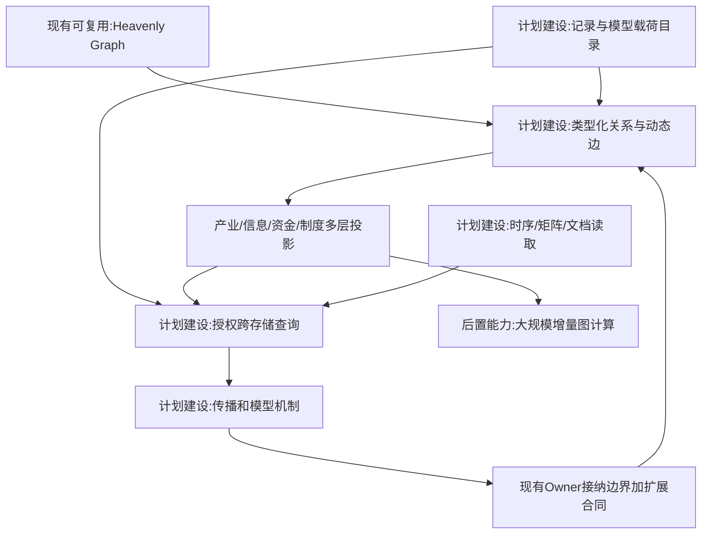
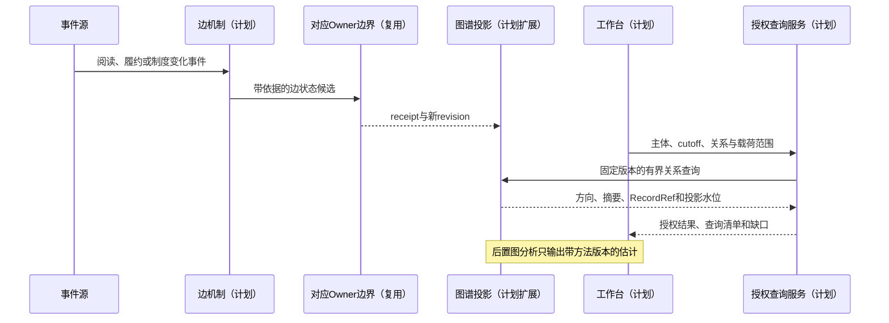
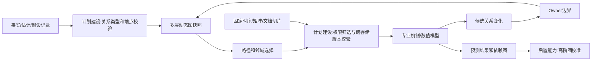

# 04 实体关系图谱与动态边

修订日期：2026-10-16｜合同版本：未发布草案｜建设状态：计划建设｜验证证据：专用静态校验入口见[README](README.md#文档状态与静态校验wog-r10)；本轮运行、适配、性能及预测未验证。

日期：2026-10-16｜状态：design-draft / non-authorizing｜依赖：[03](03-类型化数据与统一记录合同.md)。

## 1. 图谱的责任

Heavenly Graph 提供关系与派生索引基础；模拟 fork 扩展时间切片、带属性的关系、嵌套子图、多方结构和因果机制引用。图谱可以找候选作用路径，不能仅因两节点相连就推断有真实因果，更不能直接改持仓、记忆或权限。

节点与边使用全局身份，图层只是投影。支持产业、公司治理、资金、交易、信息、认知、法律制度、物理网络和模型依赖图。一个实体可跨多个图层出现，但规范状态和资源只记一份。

### 1.1 图中实体化边界（WOG-R04）

图中投影稳定实体、Arrangement、多方角色关系，以及有明确检索/机制引用用途的规则、过程、文档身份和状态/事件摘要。并非每条 Record 都必须有图节点；投影策略须版本化，声明选择类型、摘要字段、更新触发和引用方式。每个摘要保留具体 RecordRef、源版本和投影水位；摘要不替代完整事件或载荷。

原文段落、图像像素、行情 tick、传感器样本和矩阵单元默认不逐项实体化。确有独立关系查询或机制引用需求时，可按注册类型和投影策略选择特定对象，引用[03 §2.1](03-类型化数据与统一记录合同.md#21-不可变载荷引用与分段记录wog-r04)固定载荷或成员位置；不能为了让数据可查询而展开全部原始内容。文档身份与版本可以入图，文档原文仍由载荷引用保存。

图谱负责关系发现和有界导航；时间范围扫描、数值聚合、全文检索与矩阵切片交给对应查询层。图谱发现的候选集合仍需按[26 §6.5](26-世界运行图谱与统一运行合同.md#65-跨存储查询合同wog-r04)校验权限、版本与完整性后，才能成为输入快照。索引未追上时不能把“没有搜到”解释为“不存在”。领域 Owner 的提交和高频机制推进不等待图谱刷新。

## 2. 动态边合同

```yaml
RelationDefinition:
  type_ref: RelationTypeRef
  endpoint_roles: [TypedRoleConstraint]
  directionality: directed|undirected|multi_party
  properties: PropertySchemaRef
  lifecycle: LifecycleRef
  allowed_tags: [TagRef]
  mechanism_bindings: [MechanismRef]
  owner_binding: OwnerBindingRef
RelationInstance:
  relation_id: RelationId
  record_ref: RecordRef
  relation_type: RelationTypeRef
  participants: [{entity_ref: EntityRef, role: RoleRef}]
  state_ref: RecordRefOrNone
  arrangement_ref: RecordRefOrNone
  tags: [VersionedTagRef]
```

`RelationInstance` 是 `Record` 的关系专属载荷。`world_ref`、`branch_ref`、时间、来源、血缘、权限、`epistemic_status`、质量、不确定性和 `revision` 均由其关联的 `Record` 提供；关系规范版本使用该 `RecordRef` 的 revision。`state_ref` 指向关系状态的规范记录，`arrangement_ref` 指向所属多方安排的规范记录。`RelationInstance` 不拥有第二套通用记录字段或独立事实版本。

数量不是一个万能 `weight`。信息边可有信任、覆盖、延迟、暴露频率；交易边有价格、数量、方向和状态；法律边有效力、对象、条件和争议；供应边有产能、交付期、替代率。属性必须带[03](03-类型化数据与统一记录合同.md)测量合同。

## 3. 边如何“活起来”

每类边绑定更新机制和触发器。例如阅读新闻后信任变化、借券到期使可借容量下降、政策正式生效改变可执行动作。更新是 `current_revision + event + mechanism_version -> candidate_revision`，经指定合同接纳再生成新投影。可在画布调整合成边参数，但应生成场景新版本／新分支，不能修改现实关系档案。

标签表达注册语义，如“供货关系／关键供应商／高替代难度”；元标签管理可附着对象、生命周期、可见性、编辑和冲突政策。标签不能直接扣现金、授予权限或触发任意代码；效果绑定交给注册机制。

## 4. 多维、嵌套与超边

- 嵌套组织子图：机构—部门—岗位—任职者—账户；可折叠为组织外部行为，但保留接口。
- 多方安排：联合发文、银团贷款、ETF申赎、合同，以 Arrangement 实体加角色化边表达，不硬压成多条互不相关二元边。
- 关系的关系：一个消息是对原消息的转载；一个人的信念以另一条命题为对象；引用语句ID和版本避免循环无界展开。
- 图论分析：中心性、社群、割点、可达性和路径容量作为带窗口与方法版本的结果，不作为事实因果强度。
- 跨尺度：社会网络—订单流—市场流动性—产业现金流相连，但每次转换都要有机制及不确定性。

## 5. 图与数值模型双向连接

曲线、张量、风险模型和时序大载荷存于数据层；图中记录 Model、InputPort、OutputPort 与输入依赖。模型输出生成 estimate 记录，更新授权图投影；图中企业或网络状态变化形成新模型输入快照。以执行阶段、版本与反馈延迟打断代数环，禁止同一个预测被回送后当作新的独立证据。

实时新闻的“来源作者—发布—平台—曝光—消费—认知”分段建模，不能直接“新闻节点出现 -> 全体角色知道”。

## 6. 架构图



## 7. 主交互时序图



## 8. 数据流图



## 9. 验收不变量

节点副本不重复资源；边变化都有版本和依据；端点类型不合规拒绝；超边可整体回放；跨层投影不新增可见权限；循环模型不得自我证实。组织／群体结构详见[11](11-组织与动态群体一等结构.md)，权限详见[09](09-权限关系与运行时接纳.md)。

R04 补充：未投影不等于规范记录不存在；图谱重建不依赖旧图节点保存唯一原文；摘要指向具体源版本；高频推进不依赖逐样本建图；图查询结果与载荷拼接须带同一查询清单。
