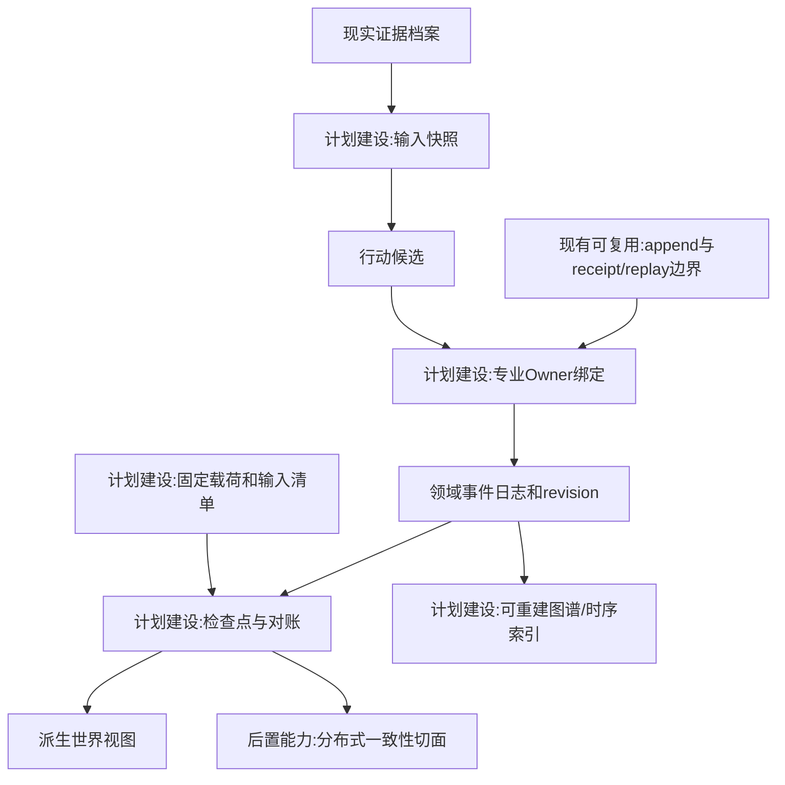
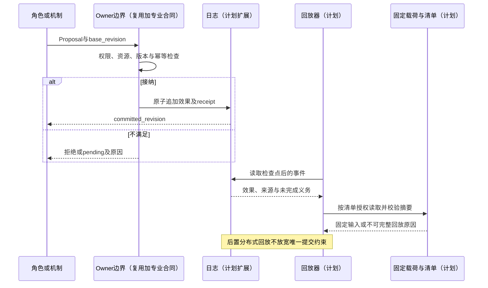
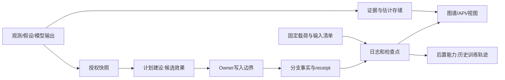

# 05 世界真相证据模型与修订回放

修订日期：2026-10-16｜合同版本：未发布草案｜建设状态：计划建设｜验证证据：专用静态校验入口见[README](README.md#文档状态与静态校验wog-r10)；本轮运行、适配、性能及预测未验证。

日期：2026-10-16｜状态：design-draft / non-authorizing｜依赖：[03](03-类型化数据与统一记录合同.md)、[09](09-权限关系与运行时接纳.md)。

## 1. “世界真相”的严格含义

世界真相层保存某个世界分支内经有权机制接纳的规范状态，并不保证有关现实世界的陈述一定真实。观测档案可以记录“平台收到一篇报道”，不能据此记录“报道中的业绩下滑一定发生”。模拟成交是该模拟分支的事实，不能回写成现实交易。

| 认识状态 | 所表达的内容 | 可进入的用途 |
|---|---|---|
| observation | 某来源或主体观测到的信息 | 证据、感知与估计输入 |
| assumption | 发起者设定或补齐的未知 | 明确的情景分支条件 |
| estimate | 模型推算与主体预测 | 条件分布、风险、信念候选 |
| candidate | 提议发生的动作或状态变化 | 权限、资源和owner检查 |
| fact | 分支内按合同接纳的规范状态 | 后续机制、账本和回放 |
| result | 从输入计算的解释和评价 | 分析、图表与评估 |

`epistemic_status` 不自动提升。接受一种观测只证明采集记录被接纳；命题真假、模型拟合、授权有效性各自有校验。

## 2. 三种隔离的状态空间

现实资料档案保存原始观测和版本；模拟分支保存合成行动和规范结果；主体私有空间保存其信念、记忆和未公开资料。三者按获权引用连接。玩家或司命可以获得研究视图，但不能把后台全知信息塞给角色。

冲突来源并存，由 SnapshotSelectionPolicy 决定当前读取哪个版本并报告争议。不能用“最新”一词混淆现实修订、当时可知和模拟最新状态。

## 3. 提案、回执和事件合同

`Proposal` 与 `OwnerReceipt` 是流程对象，分别表达候选提交和 Owner 处理证明。它们不直接构成世界事实，也不替代 `Record` 的通用记录信封。`OwnerReceipt.accepted_effect_refs` 指向 Owner 接纳后生成的具体 `RecordRef`、事件或关系记录；这些新事实记录再通过 `owner_receipt_ref` 回指回执。提案的流程状态、回执的决策状态和事实记录的 `epistemic_status` 分开保存。

```yaml
Proposal:
  proposal_ref: ProposalRef
  world_ref: WorldRef
  branch_ref: BranchRef
  actor_ref: EntityRef
  acting_as: RoleAssignmentRef
  action_type: ActionTypeRef
  base_revision: RevisionRefOrVector
  input_snapshot_ref: SnapshotRef
  expected_effects: [TypedEffect]
  resource_reservations: [ReservationRef]
  permission_decision_ref: PermissionDecisionRef
  causal_parent_refs: [EventRef]
  idempotency_key: ScopedKey
  expires_at: PointInTime
OwnerReceipt:
  receipt_ref: OwnerReceiptRef
  owner_binding_ref: OwnerBindingRef
  proposal_ref: ProposalRef
  decision: accepted|partially_accepted|rejected|pending
  accepted_effect_refs: [EffectRef]
  rejection_reasons: [ReasonCode]
  base_revision: RevisionRefOrVector
  committed_revision: RevisionRefOrVectorOrNone
  event_refs: [EventRef]
  committed_at: PointInTimeOrUnknown
  replay_key: ReplayKey
```

`base_revision` 是提交时的并发校验依据，`committed_revision` 必须引用实际生成的规范事实 revision；回执不另造一条与事实无关的版本轴。`pending`、`partially_accepted`、`rejected` 是流程处理结果，不写入事实记录的接纳状态字段。

同一幂等键重复提交必须返回同一效果或明确冲突，不能再扣一笔。对 stale revision 的重新计算产生新提案，并保留旧提案拒绝依据。`pending` 不代表已提交，部分接纳须列出哪些效果成立。

## 4. 多owner一致性

### 4.1 权威层次与唯一写入者

必须区分“外部事实来源”和“本地规范状态 Owner”：

| 状态类别 | 外部事实来源 | 本地唯一直接 Owner | Owner 可写范围 |
|---|---|---|---|
| 原始资料、行情、传感器和外部回报 | 来源系统或外部场所 | 证据接入 Owner | 收到的载荷、来源序号、质量、缺口和观测 Record |
| 交易订单簿与成交 | 内部撮合器或外部场所 | 绑定的 Venue Owner | 订单生命周期、订单簿、双边成交、场所序号和执行回报 |
| 账户现金、持仓、保证金、借券和预留 | 账户/托管系统或模拟账户规则 | Account/Resource Owner | 本域预留、消耗、释放、资产和费用账本效果 |
| 清算与交收 | 清算/托管/结算系统或其模拟规则 | Clearing/Settlement Owner | 应收应付、交收义务、完成、失败和补偿义务 |
| 合同、供应、生产、库存、物流 | 对应业务系统或模拟机制 | 对应 Domain Owner | 本域安排、资源、过程、产出和履约事实 |
| WOG 节点、边和查询索引 | 上游已接纳事实 | Projection Service | 派生索引、投影版本和消费游标 |

外部适配器负责验证、映射、去重和报告缺口，不因收到回报就代替账户、结算或其他 Domain Owner 写入其状态。一个 `world_ref + branch_ref + domain_ref` 的规范状态只能绑定一个直接 Owner；协调器、投影器和回放器不能冒充业务 Owner。

### 4.2 Owner 写入集合与域内原子提交

Owner 的写入对象不限于当前状态，必须明确为四类：

```text
本域规范 Record revision
本域领域 Event
本域资源 Reservation 与未完成 Obligation
本次提交的 OwnerReceipt、幂等结果和审计引用
```

同一 Owner 的一次提交必须同时写入其效果、事件、receipt 和幂等记录；不得出现“已扣资源但没有对应事件”或“已生成成交但遗漏成交 ID”的半提交。`Proposal` 只提供候选，不能扩大 Owner 的写入集合。

### 4.3 跨Owner协调合同

跨域采用“预留 → 确认/消耗 → 释放或补偿”的协调流程，不采用覆盖外部系统的全局两阶段提交：

```text
Proposal
  → 相关Owner分别校验权限和base_revision
  → 各Owner建立Reservation
  → 触发Owner在本域原子提交
  → 事件和OwnerReceipt沿因果链传播
  → 依赖Owner确认、等待、释放或建立补偿义务
```

协调器只能写预留令牌、依赖、等待项、超时、对账任务和补偿任务；不能直接扣现金、减少库存、制造成交或完成生产。跨域的一致性由事件因果链、义务状态和对账结果表达，不把短暂不一致伪装成全局原子成功。

### 4.4 暂态、对账和补偿

各领域保留独立状态轴：

| 状态轴 | 示例状态 | 语义 |
|---|---|---|
| 资源预留 | `requested → held → partially_consumed → released/expired` | 资源可用性和占用，不等于业务已完成 |
| 订单/执行 | `submitted → accepted/rejected → working → partially_filled/filled/cancelled/expired` | 场所侧生命周期 |
| 外部回报 | `unknown → querying → matched/mismatched/unreconciled → resolved` | 本地是否已核对外部状态 |
| 结算义务 | `pending → partially_settled → settled/failed` | 成交或履约后的交收进度 |
| 补偿流程 | `requested → compensating → applied/failed` | 追加修复事件，不撤销原事实 |

`filled_unreconciled` 表示外部成交已有证据但本地账户效果尚未完成映射或提交；`settlement_pending` 表示成交成立而交收尚未完成。二者都不能被解释为成交撤销。外部事实一旦可验证地成立，本地失败只能产生差错义务、对账或补偿事件，不能删除或重写原事实。

### 4.5 幂等与守恒不变量

幂等键按操作作用域分别定义：Proposal、资源预留、场所命令、外部执行、账户效果、结算效果和补偿效果不得共用无作用域字符串。重复提交必须返回原结果或明确冲突；不同来源的相同文本不能自动判为重复。

金融双边成交至少满足：

```text
buy_quantity == sell_quantity == trade_quantity
buyer_position_delta == +trade_quantity
seller_position_delta == -trade_quantity
```

任何账户效果必须引用已接纳的成交或业务事件；任何结算义务必须引用已接纳的账户/执行效果；补偿不得删除历史 revision。事实流采用领域有序日志和因果父链，不用不同机器的墙上时钟推导唯一因果顺序。

### 4.6 日志、载荷与派生索引（WOG-R04）

领域事件日志保存已接纳业务事件、Owner 提交顺序、因果父引用、receipt、幂等结果及相关效果引用；原始接收日志保存收到什么、来源分区/序号、接收时间和缺口。收到外部回报不等于本地业务效果已提交，两类日志不可互相代替。运行诊断日志也不能充当领域事实日志。

大型事件载荷可使用[03 §2.1](03-类型化数据与统一记录合同.md#21-不可变载荷引用与分段记录wog-r04)的固定引用，领域日志仍须保留稳定事件身份、顺序和重放定位。引用的载荷应先持久化并校验；其后的规范 revision、事件、receipt 和幂等结果仍在 Owner 本域原子提交。Record 目录副本、时序/列式查询索引和 WOG 通过已提交数据异步更新；这些更新失败不撤销原提交，也不能要求跨存储全局原子写入。

高频机制可以消费有序事件流与固定数值切片，不经过逐事件图更新。图谱和时序索引可重建；Owner 日志及其唯一载荷不可因存在查询副本而被视为可丢弃数据。重建和回放不重新接纳事件，不重复执行账户效果或外部写回。

## 5. 回放合同

```text
ReplayCheckpoint = {
  world_ref, branch_ref, parent_checkpoint_ref, logical_time,
  owner_revisions, event_cursors, actor_frames, cohort_cursors,
  active_set_digest, input_manifest_ref, package_and_model_pins,
  random_stream_states, external_checkpoint_refs, open_obligations,
  access_snapshot_ref, digest
}
```

回放分三种：记录输出的审计重放、固定可重复机制的执行重放、改变模型／假设的研究重算。LLM或外部模拟器不可确定时，精确审计依靠已记录输出；重新调用只能形成新run，不保证逐位一致。

`input_manifest_ref` 引用[26 §6.5](26-世界运行图谱与统一运行合同.md#65-跨存储查询合同wog-r04)固定的查询输入清单，包括具体 RecordRef、事件游标、载荷/分段摘要、切片范围和方法版本。回放从检查点和规范日志/固定载荷恢复，不依赖“当前图谱”或无版本的最新行情。载荷缺失、摘要不符、流缺口或当前授权不允许读取时，须明确标记该次回放不可完整执行，不用空值或今天的修订静默替代。历史授权快照记录当时选择依据，不绕过当前读取授权。

### 5.1 回放受当前治理约束（WOG-R07）

精确审计重放以必需资料仍合法留存且当前主体获权为前提。不可变 revision/载荷引用不保证内容永久可读；按[09 §5.3](09-权限关系与运行时接纳.md#53-撤权保留与删除传播wog-r07)删除或限制内容后，报告受限/缺失与验证范围，不伪造原轨迹、不重新执行业务效果。删除处理保留必要受控标记及未完成任务，备份恢复先重新应用限制。依法保留内容不得因具备审计用途而进入其他用途。

## 6. 架构图



## 7. 主交互时序图



## 8. 数据流图



## 9. 验收不变量

重复回报只生效一次；拒绝不制造成功；补偿不删除旧效果；现实与模拟不可串写；精确审计重放能恢复未完成义务；两条相似轨迹不能冒充同一现实因果解释。时间修订选择见[06](06-时间空间口径与适用域.md)，金融一致性详见[16](16-金融订单行为量化执行与市场机制.md)。

R04 补充：目录/投影失败不产生业务半提交；事件可定位到固定载荷；审计回放不重新结算或写回外部；缺失输入明确阻断完整回放声明；恢复规范状态不以图谱是否已追上为前提。

R03的首条合同协同验收采用[26 §14.14](26-世界运行图谱与统一运行合同.md#1414-wog-r03-已确认决议合成双边交易最小纵切)的TEST-X合成双边交易。检查点、日志、回执、幂等结果和开放义务须一起用于恢复；成交后账户失败不删除成交或重撮合。审计回放解释已提交事实，执行回放在隔离存储中重跑固定输入并比较业务结果；两者均不向真实外部执行。载荷缺失、摘要不符或跳过必需案例不能标记通过。设计已确认，实现与运行验收待完成，字段定义继续以03/本篇为准。
