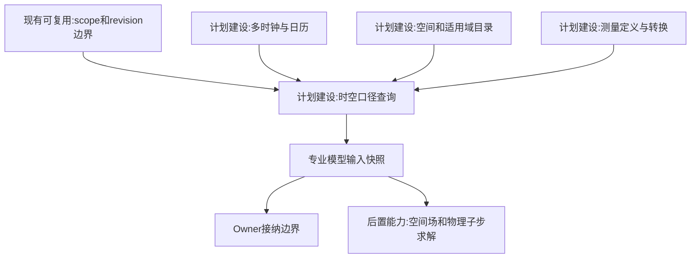
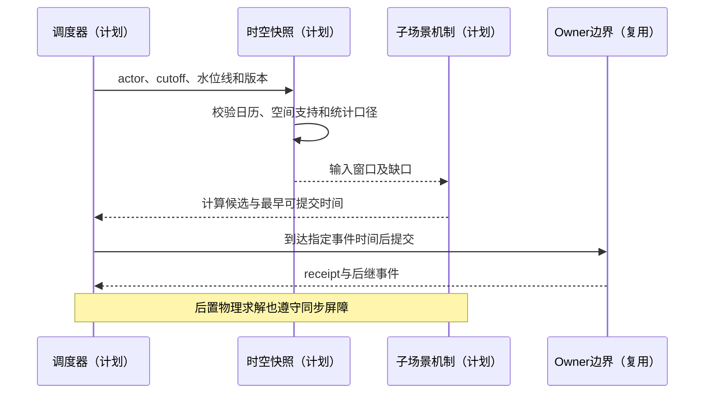
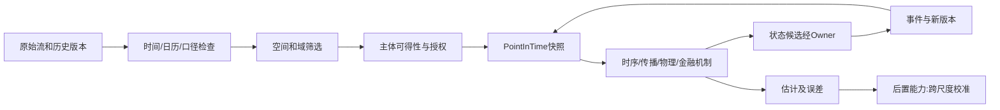

# 06 时间空间口径与适用域

修订日期：2026-10-16｜合同版本：未发布草案｜建设状态：计划建设｜验证证据：专用静态校验入口见[README](README.md#文档状态与静态校验wog-r10)；本轮运行、适配、性能及预测未验证。

日期：2026-10-15｜状态：design-draft / non-authorizing｜依赖：[03](03-类型化数据与统一记录合同.md)。

## 1. 时间不是一个 timestamp

发生、有效、发布、某主体可得、系统观测、系统处理是独立维度。财报在3月末截止、4月发布、5月修订；订单在交易所撮合、之后券商回报、再到机构；新闻被发布，不等于每个角色立即曝光或阅读。所有这些必须以独立字段保存。

点时查询固定 `decision_cutoff`、`actor_ref`、来源版本策略、权限快照和时钟。系统后台历史重放若按实收模式，需同时满足该时刻平台已收到；按市场公开模式可以采用当时已公开资料，但须标注并非平台实收重演。

## 2. 多速率调度与因果顺序

| 时钟域 | 典型粒度（示意） | 推进机制 |
|---|---|---|
| 订单/撮合 | 毫秒、微秒或离散消息序 | 外部venue事件和序号 |
| 量化响应 | 亚秒至分钟 | 策略订阅、决策与路由延迟 |
| 信息传播 | 秒至小时 | 发布、分发、曝光和消费队列 |
| 人类决策 | 秒至日 | 注意力、系统2、组织程序 |
| 财务/产业/政策 | 日、季度至多年 | 公告、履约、产能和生效事件 |
| 物理求解 | 由求解稳定性决定 | 专业子步长和同步屏障 |

这些是配置范围，不是性能承诺。运行时采用离散事件优先，定步模型经适配形成事件；不是所有主体每毫秒都调用LLM。接收与决策耗时决定提交时间：`arrive_venue = available_to_actor + consume + decide + approval + route`，不得把晚到的系统2结果倒填为早先订单。

跨子场景以水位线、消息因果父链、外部序号和同步屏障协调。对反馈环先确定阶段：输入快照 -> 决策 -> 提交 -> 撮合 -> 回报 -> 下一轮，零延迟代数环必须显式联合求解或拒绝装配。

## 3. 时间合同

```yaml
ClockPolicy:
  clock_ref: ClockRef
  mode: event_driven|fixed_step|external_driven
  resolution: Duration
  calendar_ref: CalendarVersionRef
  ordering_rule: OrderingRuleRef
  allowed_lateness: Duration
  watermark_rule: RuleRef
  synchronization_ports: [SyncPortRef]
  stale_action_policy: reject|recompute|explicit_degraded
  recovery_policy: RecoveryPolicyRef
```

迟到观测可以追加并影响后续预测，或建立修订重算分支；不能悄悄改变旧决策输入。不同tick聚合要保留窗口边界、覆盖和误差，不把未来整个一分钟K线提前提供给当分钟策略。

## 4. 空间与适用域合同

```text
SpatialContract = {
  reference_frame, carrier, geometry_or_location, topology_refs,
  extent_and_support, resolution, valid_interval,
  transform_refs, trajectory_ref, boundary_conditions,
  uncertainty, non_applicability_reason
}
ApplicabilityDomain = {
  domain_kind, domain_ref, parent_domains, membership_rule,
  effective_interval, authority_ref, visibility,
  inclusion_exclusion, cross_domain_mapping_refs
}
```

| 可组合维度 | 行业含义 |
|---|---|
| 几何、网格、体素 | 厂房、矿区、建筑、农业地块、医疗影像 |
| 拓扑与网络 | 路网、电网、工艺、供应链、清算网络 |
| 位置与轨迹 | 车辆、人员、库存、机器人、船舶 |
| 空间场与观测足迹 | 温度、应力、雨量、遥感覆盖 |
| 法域与制度域 | 许可区、国家、税区、监管、交易场所 |
| 组织与服务域 | 部门责任、病区、租户和客户服务范围 |
| 社会、虚拟与计算域 | 社区、平台邻域、模型网格、数据分区 |

金融不必有几何位置，但有法域、上市地、交易时区、结算网络和信息可达域。空间不适用要声明理由，不能因缺数据便默认为不适用。距离、网络可达、责任、法规适用和读取权限是五个不同问题。

## 5. 统计口径与组合校验

价格有成交／报盘／估值／复权；成交量可按股、手、份、张；收益有本币／基币、含息／不含息；股东户数、账户数、受益人数与活跃交易者数不是一个量。工业温度有点值／区域均值；商业转化率有用户／访问／订单分母。都由 `MeasurementDefinition` 定义。

跨时区、币种、网格和统计范围转换产生派生记录，保留原值和误差。空间拓扑、行政区、机构组织图、交易制度与指标定义都按历史版本选取，不能用今天的边界解释过去。

## 6. 架构图



## 7. 主交互时序图



## 8. 数据流图



## 9. 验收不变量

无未来K线、后见公告和修订泄露；晚结果不倒填；交易日和结算日不混淆；网络邻近不冒充几何邻近；采样覆盖不等于全部观测；单位、分母、范围不同先转换再比较；新现实观测创建后继预测版本。相关接入见[07](07-FDE数据接入与机构适配.md)、跨市场见[17](17-外部模拟盘与跨市场数据对齐.md)。
