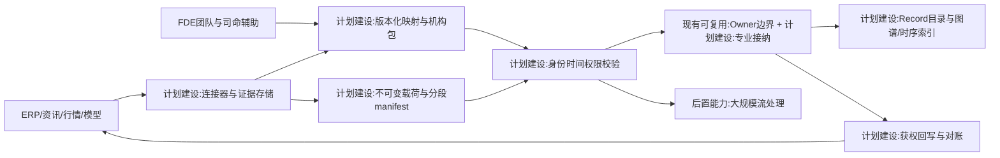
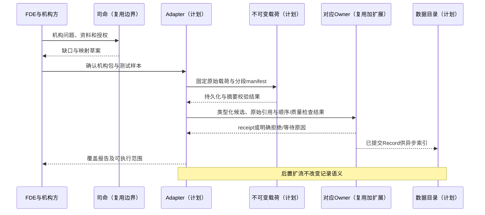
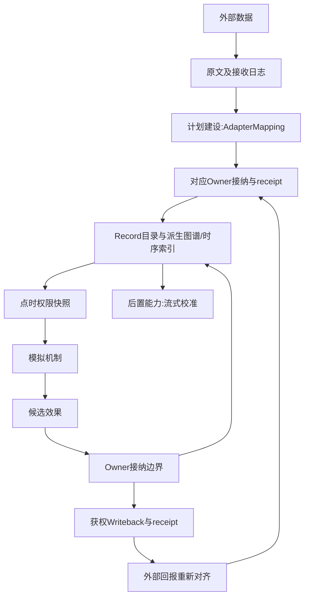

# 07 FDE数据接入与机构适配

修订日期：2026-10-16｜合同版本：未发布草案｜建设状态：计划建设｜验证证据：专用静态校验入口见[README](README.md#文档状态与静态校验wog-r10)；本轮运行、适配、性能及预测未验证。

日期：2026-10-16｜状态：design-draft / non-authorizing｜依赖：[01](01-通用底座与扩展边界.md)、[03](03-类型化数据与统一记录合同.md)、[06](06-时间空间口径与适用域.md)。

## 1. FDE的定位与交付物

FDE 指驻场工程师／团队，负责把底座部署成适合某机构的方案。FDE不是单个连接器，也不要求每个客户修改底层代码。交付物包括机构问题定义、数据源清单、权限矩阵、字段与实体映射、专业包选择、组织流程、机制校准、场景模板和验收案例。司命帮助检索、抽取、填表与检查，人工确认机构独有流程和未知项。

## 2. 输入来源与映射目标

| 来源 | 进入底座的对象 | 重点 |
|---|---|---|
| ERP/MES/CRM/机构账户系统 | 组织、人员、产品、订单、资源、流程 | 原系统ID、职责、单位和敏感性 |
| 行情/财务/宏观库 | Instrument、Observation、Event、State | 代码历史、日历、修订与源序号 |
| 新闻/公告/研报/政策 | Carrier、Statement、Publication、Norm | 原文、引用定位、发布时间、适用与争议 |
| 金融框架/风险模型/时序模型 | Model、Port、Feature、Estimate | 输入类型、可得时点、版本与解释 |
| 模拟发起者表格/访谈 | Assumption、场景参数与参与者模板 | 不能伪装成真实披露 |
| 外部模拟盘/物理求解器 | ExternalEvent、ExecutionReceipt、状态差量 | 权威边界、顺序、检查点与失败 |

ERP映射出实体和组织流程，分析框架也映射出模型、变量、假设、约束和依赖图；框架本身不能被当作真实市场主体。

## 3. 映射与机构合同

```yaml
AdapterMapping:
  mapping_ref: {id, version, digest}
  source_schema_ref: SchemaRef
  source_identity_rules: [IdentityRule]
  target_types: [TypeRef]
  field_and_axis_map: [TransformSpec]
  measurement_rules: [MeasurementDefinitionRef]
  temporal_rules: TemporalPolicyRef
  spatial_domain_rules: [DomainMapping]
  source_access_policy: AccessScopeRef
  epistemic_status_rule: RuleRef
  quality_and_gap_rules: [RuleRef]
  deduplication_rule: RuleRef
  reverse_writeback_contract: WritebackContractRefOrNone
InstitutionPackage:
  institution_ref: EntityRef
  organization_structure_ref: StructureRef
  access_matrix_ref: PolicyVersionRef
  mappings: [AdapterMappingRef]
  mechanism_and_model_bindings: [BindingRef]
  scenario_templates: [ScenarioRef]
  acceptance_cases: [CaseRef]
```

字段转换使用注册函数；身份匹配不确定就保存候选集合，不能名称相似就合并公司／账户。原文和原值不可变，转换错误通过新版本修复。

## 4. 实时管道与状态同化

采集 -> 不可变原始证据与接收日志 -> 类型规范化 -> 重复／顺序／缺口检查 -> 权限与身份 -> 对应 Owner 接纳观测或业务记录 -> 已提交数据供目录、时序索引与图谱异步消费 -> 授权输入快照 -> 机制。适配器与证据接入 Owner 的职责分开；高频交易流采用批量和有序订阅，不每个 tick 调用司命或等待图谱刷新。

同化分三类：新观测追加；模型或信念更新；需要owner接纳的状态校正。现实价格可以进入对照和条件化分支，不能同时把它强行设定为封闭撮合盘结果又把撮合盘输出当成独立预测。

### 4.1 分层存储与查询交付（WOG-R04）

机构映射交付须明确每类数据的规范 Owner、Record 类型与粒度、不可变载荷格式/引用、分区与源序号、段内成员元数据、时序/列式或文档查询索引，以及图谱实体化策略。引用字段遵守[03 §2.1](03-类型化数据与统一记录合同.md#21-不可变载荷引用与分段记录wog-r04)，不在适配器另造载荷合同。批量封装不得丢失原始事件的时间、序号、权限或可得时间差异。

查询接口按[26 §6.5](26-世界运行图谱与统一运行合同.md#65-跨存储查询合同wog-r04)交付固定版本的清单与缺口。直接订阅也须声明起始游标、分区顺序、缺口和快照衔接位置；不能以图谱刷新完成表示上游流已齐。源序号缺口、载荷未就绪、映射失败和索引滞后分别记录；补流/修订生成新记录或新分段引用，并保留旧查询清单。

### 4.2 来源权利、身份匹配与删除交付（WOG-R07）

机构适配包须交付[09 §5.2–5.3](09-权限关系与运行时接纳.md#52-数据治理与用途判定wog-r07)规定的许可、用途、地域、敏感级别、保留/删除义务及来源证据。抓取成功不授予训练、分享或跨境权利；授权未知时拒绝相应用途。接入验证包括来源真实性、供应商映射版本及副本/派生血缘。

身份匹配保留候选、证据、置信度及撤回关系，不按名称直接合并。原文不可变仅指留存期间不原地改写；删除按治理合同传播至载荷、索引、缓存、摘要和相关派生物，恢复时重新施加限制，回放报告缺失。每个可控副本有处理回执；外部副本缺证明时保留未完成项。

## 5. 双向回写

图谱可调整合成参数，模型输出可更新估计边；但写回ERP、外部盘或账户系统需独立 `WritebackContract`，列出目标、动作、幂等键、调用凭证、可撤回性与回执映射。默认仅消费数据和输出模拟结果，不把“有读取连接”推导为“有外部写权限”。

反馈防环：每条派生信息保留 `origin_run`、`causal_parent` 和 `lineage`；同一模拟的预测经平台再次采入不能被计为独立新闻证据。

## 6. 架构图



## 7. 主交互时序图



## 8. 数据流图



## 9. 验收不变量

交付包可在干净环境按版本装配；未知来源和口径有清单；公开资料不能解锁机构私有账户；写回必须有独立能力；同一实体不重复建资金；断流、重复、迟到和字段变更分别有可测试处理。权限见[09](09-权限关系与运行时接纳.md)，模拟盘接入见[17](17-外部模拟盘与跨市场数据对齐.md)。

R04 补充：分段可恢复成员级时间、权限与序号；查询副本滞后不阻断 Owner 提交；补流不覆盖历史输入；跨存储查询和订阅明确版本、游标与缺口；只有映射成功不能被报告为业务状态已接纳。
