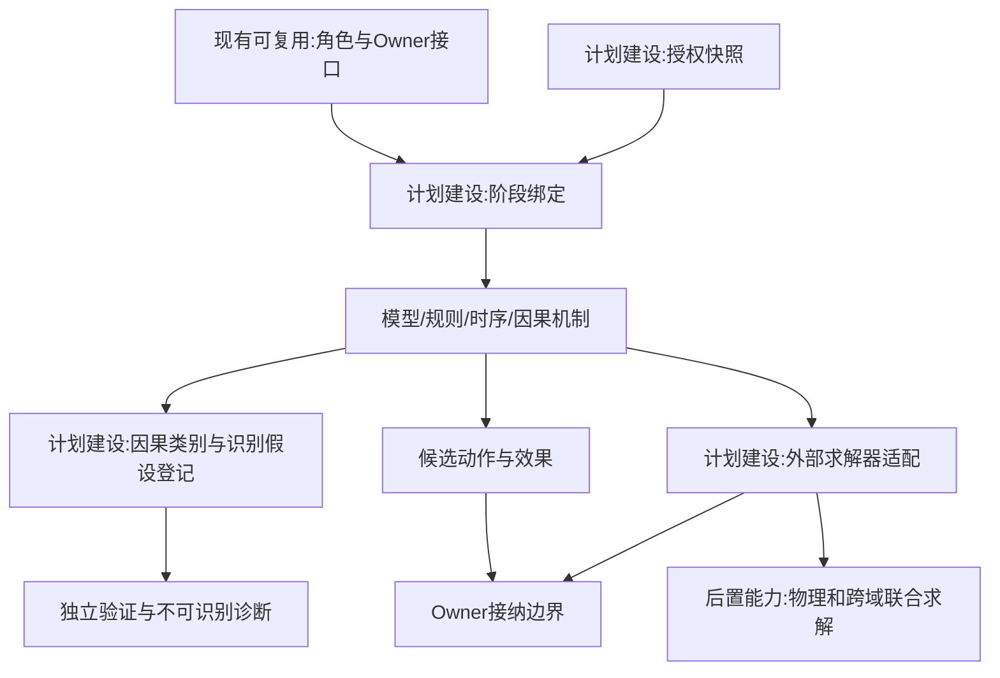
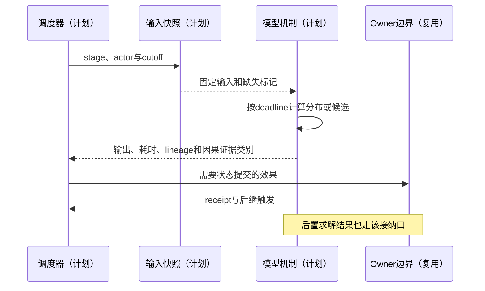
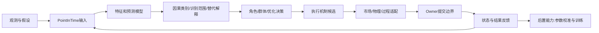

# 08 模型机制与可插拔演化

修订日期：2026-10-16｜合同版本：未发布草案｜建设状态：计划建设｜验证证据：专用静态校验入口见[README](README.md#文档状态与静态校验wog-r10)；本轮运行、适配、性能及预测未验证。

日期：2026-10-15｜状态：design-draft / non-authorizing｜依赖：[02](02-底座分层与模块责任.md)、[06](06-时间空间口径与适用域.md)。

## 1. 模型和机制的区别

模型将输入映射为估计、分布或决策评分；机制定义何时读取哪些输入、怎样产生状态变化候选、由谁接纳以及失败后怎样继续。一个估值模型可以被多种交易机制使用，不能把估值变化直接当成交价。

## 2. 模型端口与分阶段绑定

```text
ModelSpec = {
  model_ref, version, input_ports, output_ports, required_features,
  training_cutoff, applicability_domain, uncertainty_contract,
  data_visibility, latency_profile, deterministic_mode, artifact_digest
}
MechanismSpec = {
  mechanism_ref, trigger_set, read_set, proposed_write_set,
  stage_bindings, clock_policy_ref, owner_bindings, causal_dependencies,
  resource_requirements, failure_semantics, termination_rule, replay_policy
}
StageBinding = {
  stage: perceive|interpret|forecast|decide|plan|execute|review,
  implementation_ref, input_snapshot_rule, output_type, deadline
}
```

金融可分别绑定文本解读、因子／时序预测、Laya决策、组合优化、订单执行；工业可绑定状态估计、故障预测、排产优化、物理求解。各阶段共享可追踪快照，但不是共享所有信息。

## 3. 演化主循环

1. 更新输入水位线与权限快照；处理已到时间的实体事件。
2. 传播与认知机制先接收实际到达消息，更新可接纳的主体状态。
3. 群体和激活角色生成候选，组织流程处理审批与否决。
4. 资源和制度检查，候选按真实模拟耗时排入提交队列。
5. 市场、物理、履约等适配器推进并返回事件。
6. 对应owner接纳事实、账本或资源变化；投影结果、情绪反馈和后继事件。
7. 写检查点，处理停止条件和未完成动作。

必须有每个主体的唯一推进令牌，避免角色与群体同时下单。不同机制修改相同状态时不得靠执行顺序隐式解决，装配时声明owner和冲突策略。

## 4. 现实更新与“向现实收敛”

新数据可通过贝叶斯更新、滤波、参数重估、误差校正或模型重加权进入。更新保存先验、观测、后验、模型版本与创新残差。真实系统未观测的变量保留不确定性；市场反身性、结构突变和隐变量使其不保证单调收敛。

开放同化模式以现实为边界条件；封闭反事实模式由模拟参与者生成交易；混合模式明确哪些背景流和主体流来自现实。不能同时重放全市场真实成交再额外加入对应模拟主体成交，造成双计。

## 5. 失败与反馈环

输入缺失、模型超时、外部求解发散、协议版本错配、风险超限和owner拒绝使用不同原因码。回退模型须预注册且显式记入轨迹，不能悄悄用语言模型编造数字。跨腿或跨owner完成一半时保留未完成状态，由[05](05-世界真相证据模型与修订回放.md)对账。

反馈模型需声明滞后或联合求解策略。估计反馈到特征时标注自产；否则可能形成“预测上涨 -> 作为新闻 -> 再预测上涨”的自证循环。

### 5.1 因果声明与识别合同（WOG-R05）

因果对象由统一 Record 承载。必须区分以下证据类别；它们不是沿着置信度自动晋级的阶梯：

| 类别 | 能支持的结论 | 不能替代 |
|---|---|---|
| 记录依赖 | 某输出读过哪些固定输入、事件或规则 | 现实因果作用 |
| 机制假设 | 某模型假定的作用路径 | 假设已被证实 |
| 模型内干预结果 | 固定模型与分支中改变输入的对照结果 | 现实干预效应已识别 |
| 现实识别证据 | 在声明的数据、设计和识别假设下得到的效应估计 | 无条件适用于所有主体和时期 |

每个因果估计声明干预变量/方式、对照条件、结果变量与目标窗、输入及模型/机制版本、混杂处理、识别假设、适用范围和不确定性。隐藏共同原因、选择偏差、反向作用和测量误差须进入竞争解释。若证据不能识别，输出可行范围或多个机制；不能因为 WOG 上有路径就输出单一效应。

例如温度异常与良率下降只形成观测相关；模拟降温后良率改善只支持该模型内干预结果。现实因果结论还需工艺/材料等混杂约束与独立识别证据。估计不直接修改设备或生产事实，状态变化仍经对应 Owner。潜变量登记见[15](15-金融市场参与者与多层规模建模.md)，独立验证见[19](19-金融历史回放训练与预测评估.md)。

## 6. 架构图



## 7. 主交互时序图



## 8. 数据流图



## 9. 验收不变量

输入不超cutoff；模型版本可追溯；延迟不倒填；不存在未声明双写；同一主体唯一推进；回退有记录；同化不覆盖历史；外部求解误差不伪装成精确事实。角色接口见[10](10-角色智能体心智与Laya接口.md)，运行编排见[12](12-司命方案治理与全流程运行.md)。

R05 补充：记录依赖、机制假设、模型干预、现实识别分别标注；缺干预/对照/结果窗/版本/识别假设的估计不得标作已识别现实因果；不可识别必须保留范围或替代解释。
