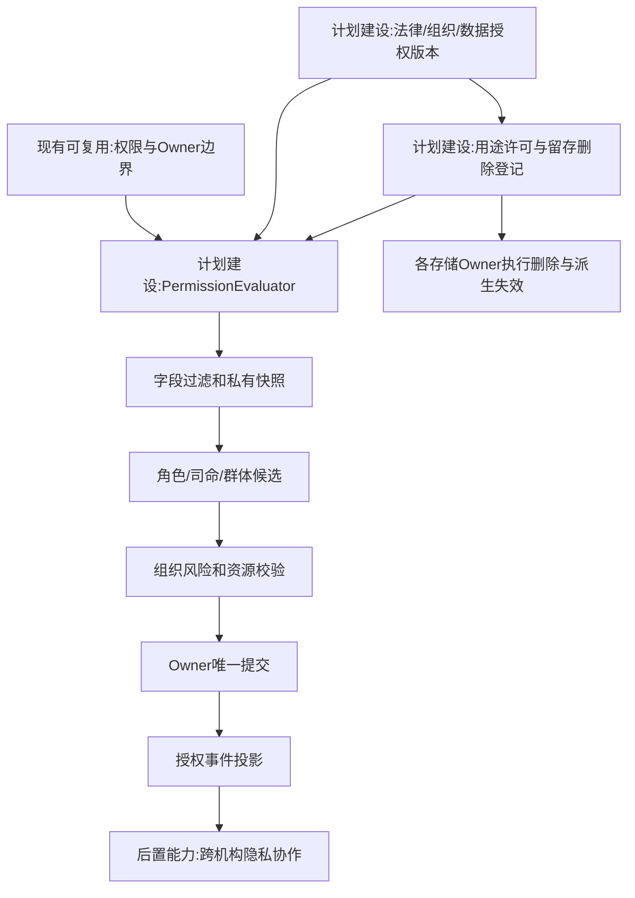
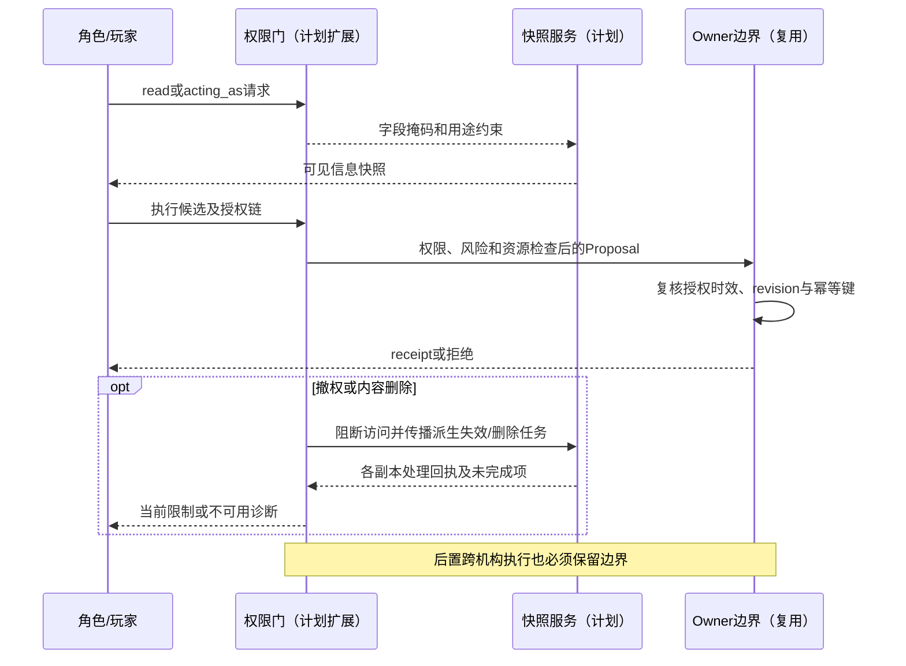
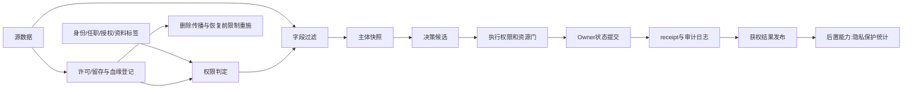

# 09 权限关系与运行时接纳

修订日期：2026-10-16｜合同版本：未发布草案｜建设状态：计划建设｜验证证据：专用静态校验入口见[README](README.md#文档状态与静态校验wog-r10)；本轮运行、适配、性能及预测未验证。

日期：2026-10-15｜状态：design-draft / non-authorizing｜依赖：[05](05-世界真相证据模型与修订回放.md)。

## 1. 五个不能混同的概念

角色在世界里的权力、组织授权、系统访问权限、领域状态提交权、资料实际知情是独立轴。政府可以对某公司有监管权限，但模拟服务中仍须经合同提交；基金经理有交易授权，也可能没有读过刚发布消息。玩家切换视角不是自动代行该主体。

## 2. 权限决策合同

```yaml
PermissionRequest:
  principal_ref: PrincipalRef
  acting_as: RoleAssignmentRef
  operation: read|derive|train|share|propose|approve|execute|settle|replay|export|transfer
  resource_ref: ResourceRef
  world_ref: WorldRef
  branch_ref: BranchRef
  scope_ref: ScopeRef
  purpose_ref: PurposeRef
  at_time: PointInTime
  delegation_chain: [DelegationRef]
  input_labels: [AccessLabel]
PermissionDecision:
  decision_ref: PermissionDecisionRef
  outcome: allow|deny|conditional
  policy_version_refs: [PolicyRef]
  obligations: [Obligation]
  permitted_field_mask: FieldMask
  expires_at: PointInTime
  reason_codes: [ReasonCode]
  audit_ref: AuditRef
```

权限无匹配时拒绝；多条规则冲突按已注册的组合逻辑处理，敏感否决不得被普通允许覆盖。系统权限策略可以采用 policy 术语，但不把法律、政策文件、白皮书等统统压成这种技术策略。

## 3. 关系表达

`owns_resource`、`appointed_to`、`delegates_to`、`may_approve`、`may_veto`、`supervises`、`acts_for`、`discloses_to`、`confidential_to` 都是带有效区间与证据的关系。委托需范围收窄、截止时间和不可放大规则；组织成员资格不直接授予全机构读取或资金划拨权。

派生结果继承来源限制；摘要、嵌入、图查询和聚合都需要权限判断。可证明足够匿名的群体统计可经专门发布合同降敏，不能默认“聚合了就公开”。共享组织记忆不等于所有人私有记忆的并集。

## 4. 金融职责矩阵示例

| 身份 | 可读 | 可提议／决定 | 不自动获得 |
|---|---|---|---|
| 模拟发起人／玩家 | 自有授权资料、公共结果 | 方案编辑、获权分支干预 | 他机构真实私仓、其他角色私有思维 |
| 司命 | 方案元数据、获权检索快照 | 场景、激活、分支与缺口提案 | 市场定价、账户结算和私有全图 |
| 基金研究员 | 共享研究及授权终端 | 研究结论、交易建议 | 执行与风控豁免 |
| 基金经理 | 自有组合和授权研究 | 目标仓位、父订单审批 | 交易所成交或系统owner权限 |
| 风控岗 | 必要风险敞口与限制 | 限额、否决、撤销未执行授权 | 抹去已成交交易 |
| 交易员／执行程序 | 已授权订单及执行行情 | 拆单、报价、撤改单请求 | 自改基金预算或跨账户套利 |
| 市场／账户专业owner | 对应状态所需资料 | 依合同接纳和记账 | 他域状态任意提交 |

## 5. 可运行的完整接纳链

主体登录与acting_as确认 -> 读取字段过滤 -> 快照签名 -> 模型/角色候选 -> 组织程序 -> 制度、资源与风控 -> 决策授权 -> owner提案提交 -> 幂等／revision校验 -> 回执 -> 可见范围广播。

入队时和最终执行时分别检查授权是否仍有效，防止撤权后在途请求照常通过。已经接纳成交不因后续撤权撤销。外部回报必须验证来源、账户映射和场所序号，不能接受角色自行声称的“交易成功”。

### 5.1 Owner写入边界

Owner 是某类规范状态的唯一直接写入者。Owner 可写本域的 `Record` revision、领域事件、资源预留/未完成义务以及对应 `OwnerReceipt`；不能写其他 Owner 的状态，也不能把 Proposal、外部回报或 WOG 投影直接当作本域事实。外部适配器负责接入和对账，协调器负责等待与补偿任务，二者均不是业务状态 Owner。

金融场景中，场所 Owner 只接纳订单生命周期、订单簿和双边成交；买方与卖方各自的 Account Owner 分别接纳现金/证券预留及成交后的账本变化；Clearing/Settlement Owner 接纳交收义务。费用由固定版本的 `FeeSchedule` 计算，收费效果由对应账户或交易后 Owner 接纳，不能凭一条成交回报同时修改双方账户。

### 5.2 数据治理与用途判定（WOG-R07）

数据许可是访问策略之外的必要约束。数据及数据集的治理登记至少包含来源权利证据、权利主体、允许用途、训练/派生/分享/导出与跨境限制、地域、敏感级别、留存期限和删除要求，并固定政策与许可版本。数据集清单引用这些登记，字段承载沿用[03](03-类型化数据与统一记录合同.md)，不另造通用信封。

`read` 不推出 `train`、`share`、`export` 或跨境 `transfer`；未知许可阻断相应用途。入队、实际读取/执行、发布/导出均复核当前授权和用途义务，不能用旧 PermissionDecision、QueryManifest 或历史可见性绕过已撤权限制。

摘要、嵌入、缓存、图投影、特征和派生结果必须保留来源血缘并继承限制。脱敏或聚合不自动变公开；降低限制需独立发布规则及证据。身份匹配保存候选、匹配依据、置信度与可撤回链接；名称相同不能合并，匿名名义持有人不能被假装穿透为真实受益人。

### 5.3 撤权、保留与删除传播（WOG-R07）

| 动作 | 即时效果 | 后续处理 |
|---|---|---|
| 撤权 | 阻断相应主体/用途的新读取与在途发布 | 失效访问票据和缓存；不因此删除合法保存的业务事实 |
| 许可到期 | 按条款停止相应用途 | 判断续期、删除或受限保留义务 |
| 内容删除 | 先阻断访问并登记删除范围 | 清除载荷、索引、缓存及受影响派生物，追踪各副本回执 |
| 依法保留 | 按已核定依据保留必要内容 | 隔离、限制用途和保留期限；不能以保留为由继续一般使用 |

删除协调服务只登记范围、传播任务和完成证据；各存储/领域 Owner 执行自己负责的删除或受限保留，不新增一个能任意改写事实的超级 Owner。删除任务必须沿血缘查到摘要、嵌入、投影、导出副本和训练数据集；不能定位或不能完成的受控副本保持受限及未完成诊断，不能宣称已全部删除。

不可变引用不等于永久保留内容。内容依法或依合同删除后，引用不改指别的内容；仅留必要、最小且受控的不可用标记/审计，回放明确报告缺失和无法验证的范围。摘要或标识本身敏感时也应最小化，审计不复制原文。历史承诺不能绕过当前读取限制。

备份恢复必须在对外开放读取前重新应用撤权、到期和删除登记；清理可访问副本不等于备份已物理清除，备份到期/销毁按明确策略追踪。训练数据删除另行评估模型撤回、重训或其他处置，删除源文件不证明模型影响已消失。

最低威胁验收覆盖跨租户读取、队列中途撤权、派生物泄露、伪造来源/身份匹配、删除传播失败及备份恢复再暴露。每例有拒绝/隔离结果与受控审计；未获确认的传播任务不能标 completed。当前仅为设计，真实机构安全与合规证据尚待建立。

## 6. 视角模式

`observe_as` 只获得主体可见视图；`act_as` 允许该主体可执行意图并保留代理身份；`research_view` 可按机构获权观察多个分支的合成内部状态，但不能反向污染角色认知。所有模式单独授权、记录审计。

## 7. 架构图



## 8. 主交互时序图



## 9. 数据流图



## 10. 验收不变量与反例

拒绝跨机构私仓读取；拒绝已过期委托；拒绝群体成员资格自动结算；拒绝司命直接改价格；重复回执不重复扣款；模型摘要不绕过保密；研究视角不得进入角色frame。权限失败返回可诊断原因和最小必要信息，不在错误消息泄露敏感内容。

组织合同见[11](11-组织与动态群体一等结构.md)，外部市场信任见[17](17-外部模拟盘与跨市场数据对齐.md)。

R07 补充：未知用途许可拒绝；派生限制不丢；删除逐副本跟踪；恢复先施限制再开放；最小审计受控；已删数据不被旧清单读回；模型影响处置单独留证。
