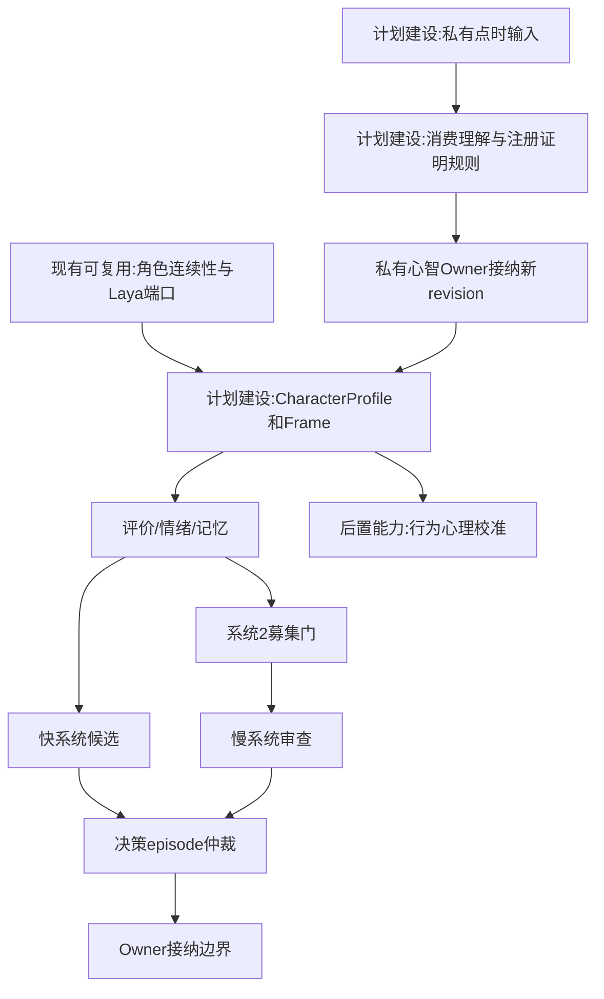
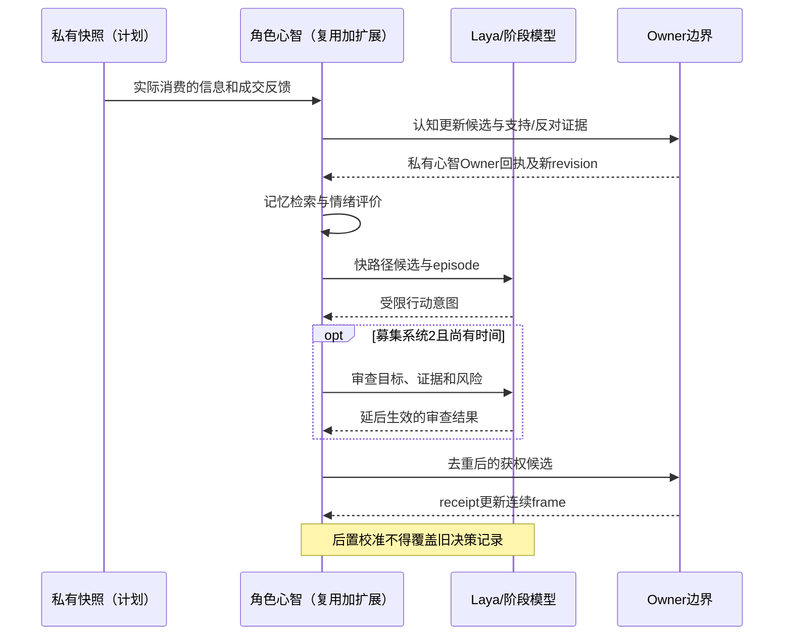

# 10 角色智能体心智与Laya接口

修订日期：2026-10-16｜合同版本：未发布草案｜建设状态：计划建设｜验证证据：专用静态校验入口见[README](README.md#文档状态与静态校验wog-r10)；本轮运行、适配、性能及预测未验证。

日期：2026-10-15｜状态：design-draft / non-authorizing｜依赖：[08](08-模型机制与可插拔演化.md)、[09](09-权限关系与运行时接纳.md)。

## 1. 全面角色设定与连续性

角色不按“散户=恐惧”“量化=无情绪”硬编码。角色模板可生成不同背景和能力，参数来自公开证据、机构提供、自我报告或合成假设，逐项注明来源。真实参与者的不可知心理只作为可校准潜变量。

```text
CharacterProfile = {
  identity, biography, organizational_roles, legal_and_market_scope,
  objectives_and_horizon, competing_goals, values_and_preferences,
  resources_and_authorizations, risk_and_loss_preferences,
  cognitive_style, expertise, memories_and_experience,
  information_channels, trust_model, social_network,
  emotion_dynamics, attention_and_fatigue, habits_and_strategies,
  decision_stage_bindings, execution_constraints, source_annotations
}
CharacterFrame = {
  actor_ref, frame_revision, current_time, private_snapshot_ref,
  beliefs, emotional_state, attention, active_goals, memory_cursor,
  pending_decisions, open_obligations, organization_process_refs,
  last_receipt_refs, continuation_cursor, actor_lease
}
```

同一角色跨日持续，不每天重新抽一个性格；经历盈亏、审批和未完成订单进入连续frame。休眠只释放计算资源，不删除身份、记忆和义务。

## 2. 快系统如何在系统2启动前做决定

采用双过程理论作工程启发，不把系统1/2当成两块实际大脑，也不声称已复现卡尼曼心理机制。快路径对熟悉模式、情绪唤醒、显著记忆和时间压力敏感；慢路径需要注意力、动机、时间和专业能力。

以下为可校准示意：

```text
fast_score(a) = habit(a) + memory_cue(a) + emotion_bias(a)
                + social_cue(a) - constraint_penalty(a)
P(recruit_S2) = sigmoid(b0 + b1*anomaly + b2*discipline + b3*stakes
                         - b4*arousal - b5*fatigue - b6*time_pressure)
```

系数不是心理学常数。纪律、止损习惯、机构规则可能使同样恐惧产生完全不同动作。达到紧迫阈值且未募集系统2时，快系统候选可以先进入授权检查；系统2之后才启动，可能修改尚未成交部分或重新评估，不得撤销已发生事实。强制风控可拦截快系统，不要求每个人先理智审查。

慢路径有耗时和截止，过期结果拒绝或重算。快慢并行需共享 `decision_episode_id` 和执行配额，不能各下一份全额订单。

## 3. 行为倾向细分

| 维度 | 对候选的作用 | 与资源／制度的分离 |
|---|---|---|
| 风险承受与损失厌恶 | 接受波动、止损／惜售阈值 | 不能解除保证金要求 |
| 耐心与紧迫性 | 等待、拆单速度、价格容忍 | 不能保证立即成交 |
| 信心与校验意愿 | 证据阈值、查询、启动系统2 | 信心不等于真实准确率 |
| 从众与逆反 | 参考他人、独立核查、反向候选 | 同步不证明协作 |
| 后悔与参考点 | 不愿止损、卖后追回、保护浮盈 | 参考点需注明成本或近期高点 |
| 注意力与习惯 | 渠道选择、遗忘、系统1反应 | 没读到消息不会被全局更新 |
| 经验与策略纪律 | 模式识别、响应规则、否决冲动 | 经验也可能形成错误启发式 |

行为倾向经阶段绑定产生动作概率、规模、时机与订单执行偏好，最终进入[16](16-金融订单行为量化执行与市场机制.md)而不是直接写价格。

## 4. 高阶认知和希望逻辑

命题用AST存储，限制深度、预算和缓存；不靠无限递归文本提示表达。

```text
Claim = fact_ref | believes(agent, Claim) | knows(agent, Claim)
      | hopes_outcome(agent, Claim) | hopes_belief(agent, agent, Claim)
      | intends(agent, ActionRef) | models(agent, agent, ModelRef)
      | observes(agent, ObservationRef) | signals(agent, Claim)
      | hides(agent, Claim)
ClaimPayload = {ast, holder, proposition_context_ref, confidence,
                supporting_evidence_refs, opposing_evidence_refs,
                knowledge_rule_ref, inference_trace_ref, depth,
                dispute_status, retracts_claim_ref}
```

“我认为别人知道”是信念，不能自动升级为 `knows`。`knows` 只有在其知识规则和证据要求成立时使用；不确定时为 `believes`。知道不自动递归为“知道自己知道”，希望某事不推出认为它会发生，希望别人相信也不推出已影响对方。

### 4.1 命题上下文与证据门槛（WOG-R05）

`ClaimRecord` 表示由[03](03-类型化数据与统一记录合同.md)的 `Record` 承载上述业务载荷的记录，不是第二套信封。身份、分支、有效时间、权限、来源和 revision 均引用信封；`proposition_context_ref` 固定命题对象、目标时间、分支及所引用的具体版本。主体今天相信“昨天的公告有误”，不能被拼成昨天已知更正。

| 算子 | 可表达内容 | 证据边界 |
|---|---|---|
| `observes` | 主体实际取得的观测 | 证明其取得该观测，不证明载体内命题为真 |
| `believes` | 主体当前接受的解释或预期 | 可有错误、冲突和不完整证据；高 confidence 不自动升级 |
| `knows` | 该分支、目标时点和注册知识规则下已成立的命题 | 实际取得并理解证据，固定版本可追溯，且通过版本化证明规则 |
| `hopes_outcome` / `hopes_belief` | 希望结果或希望他人相信 | 不推出发生概率、自己的信念或对方已受影响 |
| `intends` | 行动意向 | 不推出授权、提交、执行或成功 |

无法核实的现实命题保留为 `believes`；读到“工厂停产”的新闻只能证明读到该报道。`knows` 的规则绑定、证据闭包与结论必须可检查，不能用模型生成的确定口吻代替证明。该语义不承诺开放现实中的全知或永不出错。

认知机制仅提出更新候选；私有心智 Owner 校验可见性、消费/理解证据、规则及 base revision 后接纳，新 revision 回指 OwnerReceipt。支持和反对证据并存，争议、降级和撤回显式记录；新消息不能以“最后写入者胜出”抹掉旧证据。证据撤回使依赖结论重新校验，保留旧决策当时的输入与解释。

高阶认知只按注册推理规则展开，并固定深度、节点数、耗时预算及截断诊断。未声明的自省规则不启用；公开发布不构成共同知识，未展开层级不能当作 false。金融上，基金相信量化机构已读公告，不会替对方产生 Consumption；工业上，温度异常观测不会自行变成“设备故障导致良率下降”的知识。

例如基金经理相信“量化机构已读到新闻”，量化机构却只订阅结构化公告。前者会影响基金的紧迫性，但系统保留双方认知差异。公共报道不等于共同知识，多阶认识要由可见传播与确认事件逐步建立。

## 5. Laya与其他模型端口

`DecisionRequest` 带角色frame、私有快照、候选动作及资源约束、阶段、deadline、版本和决策episode。`DecisionResponse` 返回类型化选择、计划或受限意图、引用证据、信心及需补查项。实际输出形状由 `LayaAdapterCapability` 声明；不擅自假定三类输出。

Laya可做短周期选择，复杂估值、风险计算和盘口优化交给专业模型；司命未来可用同类模型加速方案步骤，但仍受司命权限约束。未授权建议、不可解析输出和超时进入明确失败或注册回退。

## 6. 架构图



## 7. 主交互时序图



## 8. 数据流图


## 9. 验收不变量与理论边界

相同消息不同设定能产生不同响应；高唤醒可在系统2前决策但不能绕过制度；快慢不重复下单；角色不知道后台全图；递归命题不泄露私有信念。理论入口：Kahneman《Thinking, Fast and Slow》、Kahneman与Tversky的前景理论；它们提供机制假设，不提供可直接用于每个角色的数值参数。

传播与情绪方程见[13](13-信息传播情绪与认知机制.md)，组织内部决策见[11](11-组织与动态群体一等结构.md)。

R05 补充验收：算子不互推；同源转载不增加独立证据数；冲突证据共存；规则和命题版本固定；撤回追加修订；深度/预算截断可诊断；所有私有认知更新经其 Owner 接纳。
