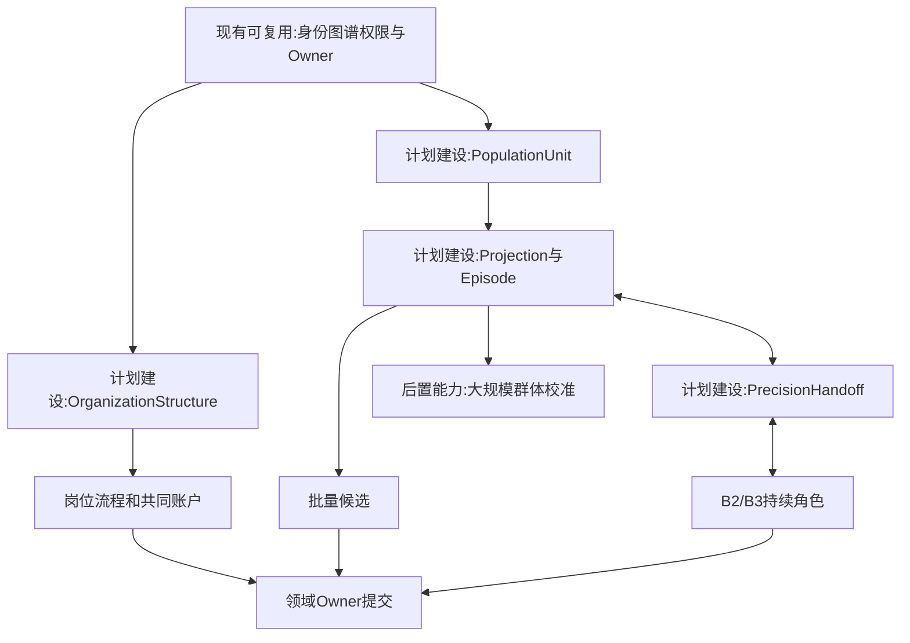
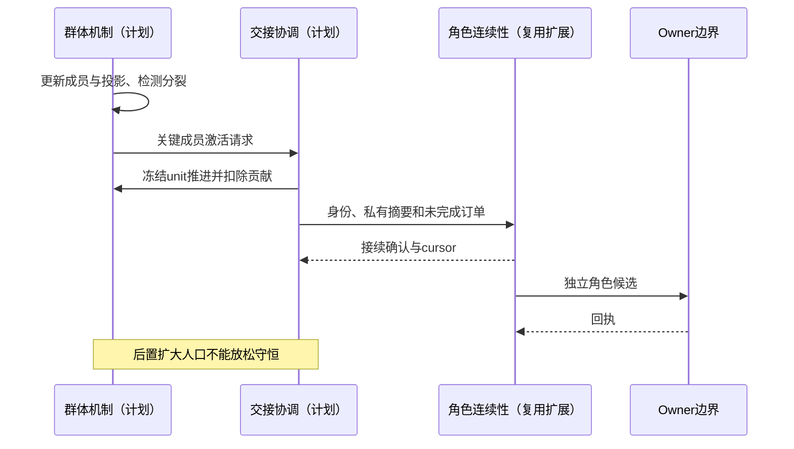
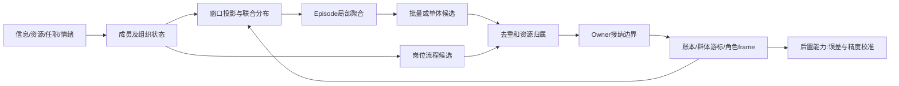

# 11 组织与动态群体一等结构

修订日期：2026-10-16｜合同版本：未发布草案｜建设状态：计划建设｜验证证据：专用静态校验入口见[README](README.md#文档状态与静态校验wog-r10)；本轮运行、适配、性能及预测未验证。

日期：2026-10-15｜状态：design-draft / non-authorizing｜依赖：[04](04-实体关系图谱与动态边.md)、[09](09-权限关系与运行时接纳.md)。

## 1. 同级结构，不是同一种集合

组织和动态群体都是一等社会结构，分别建schema、生命周期和机制。组织因制度身份、职责、程序与共同资源持续存在；群体因某段时间的信息、行为、情绪或约束相似而形成。不把“群众平均人”视为组织，也不把组织仅视为群体的高精度版本。

| 维度 | Organization | DynamicCohort |
|---|---|---|
| 身份与边界 | 稳定、制度或契约依据 | 窗口、目的和相似性定义 |
| 成员关系 | 任职、合同、权利义务 | 重叠投影、权重、迁入迁出 |
| 行动形成 | 岗位、委托、议事、审批 | 异质分布、网络传播、局部同步 |
| 资源 | 合法持有账户、预算与责任 | 默认无独立所有权，仅统计成员资源 |
| 内部分歧 | 程序处理、多目标、否决 | 多峰、冲突、分裂、反向群体 |
| 低高精度 | 外部行为可展开内部流程 | 行为片段可聚合或展开角色 |

组织owner是状态提交组件，组织智能体则是被模拟的决策结构；二者不可合并。

## 2. 组织结构合同

```text
OrganizationStructure = {
  organization_ref, institutional_identity, units, positions,
  role_assignments, delegation_rules, approval_and_veto_rules,
  resource_accounts, budget_constraints, process_bindings,
  shared_information_spaces, responsibility_and_obligation_refs,
  internal_group_refs, external_relationships, version
}
```

支持公司、基金管理人、基金产品、合伙、委员会、政府部门、监管机构、政党组织、国资出资人与跨国机构。通过组合能力表达特殊性：法人人格、成员主权、辖区、财政、出资人职责、授权来源、议事程序等均独立，不用“特殊组织类型”列表穷举世界。

国家/法域/党政组织/会议/文件/执行过程分开。会议是 Process，参会者以角色任职关联；决议是 Statement，由Carrier承载，进入其自身生效机制。临时联席会议不必自动产生法人和账户。

组织可粗略建一个行为端口，也可展开研究员—经理—风控—交易员。内部岗位各有私有记忆和局部信息，组织共享记忆须实际发布；岗位更换保存组织未完成义务和账本。

## 3. 动态群体数据合同

```text
PopulationUnit = {unit_ref, identity_or_anonymous_key, resources_ref,
  minimal_state, joint_parameter_profile, memory_summary, progression_owner}
CohortProjection = {projection_ref, purpose, time_window, member_selector,
  membership_weights, joint_distribution_ref, network_summary,
  dimensions, resolution, error_budget, source_snapshot_ref}
CohortEpisode = {episode_ref, projection_ref, behavior_dimension,
  start, end, similarity_rule, aggregate_operator,
  dissent_and_tail_state, split_conditions, candidate_batch_refs}
CandidateBatch = {projection_ref, member_allocation_rule, actions,
  covered_units, weights, uncertainty, deduplication_keys, owner_requirements}
```

同一批人在“渠道”维度可能同群，在“持仓成本”维度不同群。重叠群体是分析视图；执行时采用互斥分配或唯一unit推进令牌，不能多群同时下同一笔订单。未知个体用匿名单元或粒子，不能假装有真实实名档案。

## 4. 群体内让成员自己演化

每窗先更新个体／粒子必要状态，再按当前任务重算投影。保留信息延迟、现金、成本、杠杆、情绪和阈值的联合分布，允许内部争论、从众、逆反、沉默和分裂。只对特定时段、特定行为相近的片段批量计算：例如共同恐慌不意味着每个人同一价格卖同样比例。

拆分依据可为损失阈值分岔、网络极化、罕见大户、行为误差超预算或玩家追踪。合并要求无未处理义务冲突且误差符合预算；合并不会抹去尾部风险和记忆摘要。

## 5. B0–B3与精度交接

| 层 | 统一含义 | 典型用途 |
|---|---|---|
| B0 | 总体分布与流量覆盖 | 全市场匿名人口与背景压力 |
| B1 | 子群机制和异质参数／网络 | 融资群、渠道群、趋势和逆向群 |
| B2 | 独立持续角色 | 基金经理、桥接账号、关键交易账户 |
| B3 | 深度角色或组织内多角色程序 | 投委会、研究风控交易协同 |

```text
PrecisionHandoff = {
  unit_or_structure_ref, from_level, to_level, at_cursor,
  actor_lease, state_and_memory_digest, account_refs,
  pending_obligations, open_orders, random_state,
  private_visibility_refs, residual_projection_ref, receipt_refs
}
```

交接先锁定推进权，冻结旧cursor，从群体中扣除相应统计贡献，再恢复角色frame，确认后启用新推进器。降级反向操作；仅回传可公开摘要，不能把私有思维全文发给全群。

## 6. 组织与群体的关系

组织可 `hosts/observes` 群体；群体可 `internal_to/cross_organization/influences` 组织；成员可 `refines_to/handoff_to` 角色。基金内部风险偏好群可能跨岗位，散户群可能跨平台；这些关系不产生审批、账户或法律权。

## 7. 架构图



## 8. 主交互时序图



## 9. 数据流图



## 10. 验收不变量

组织岗位不重复资金；群体不自动拥有资产；两种重叠投影不重复执行；高低精度交接保持同一身份、资金和订单；同一恐惧均值可以保留多峰行为；群体分裂能解释成员权重去向。运行顺序见[12](12-司命方案治理与全流程运行.md)。
